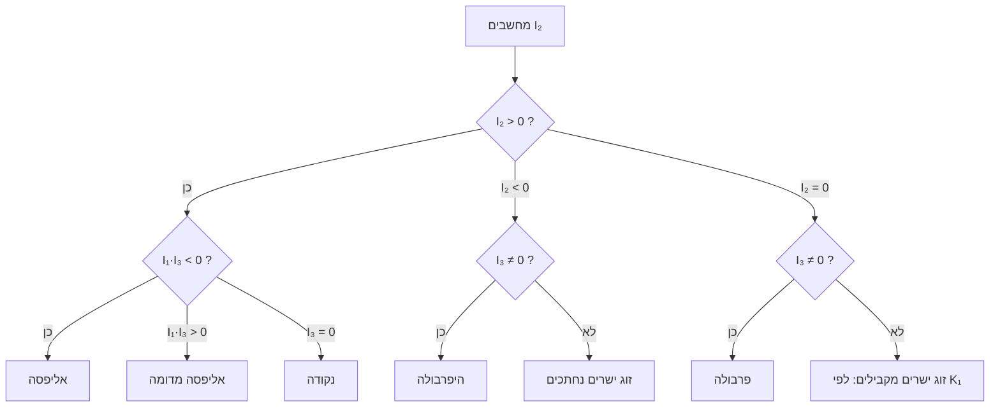

> **מצב הדגמה.** אין מפתח API מוגדר, אז זו תשובה מוכנה מראש שמציגה את כל רכיבי התצוגה של האפליקציה. היא קצרה בהרבה מרף 4000 המילים של שיעור אמיתי. כל המספרים בה חושבו בקוד שרץ באמת, וההרצות מוצגות למטה. כדי לקבל שיעורים אמיתיים מ-Claude, הגדירו `ANTHROPIC_API_KEY` (ראו README).

```plan
1. האינווריאנטים $I_1, I_2, I_3$: למה הם קיימים ואיך בודקים אותם (כאן)
2. טבלה 1: סיווג תשע הצורות הקנוניות, והדוגמה שבעמ' 241
3. אינווריאנטים למחצה ($K_1$) והמעבר לגאומטריה פרויקטיבית (§13)
```

```story
@title: שני עורכי דין בחצר של לינקולנ'ס אִין
בלונדון של שנת 1850 הסתובבו בחצרות בית המשפט שני גברים שהמתמטיקה לא פרנסה אותם. ארתור קיילי (Cayley) היה עורך דין שכתב חוות דעת על נדל"ן. ג'יימס ג'וזף סילווסטר (Sylvester) היה אקטואר שלמד משפטים. בין תיק לתיק הם דיברו על שאלה אחת: כשאנחנו כותבים צורה גאומטרית בעזרת משוואה, מה במשוואה שייך **לצורה** ומה שייך רק **למערכת הצירים** שבחרנו? [[ודאות: גבוהה]] [[מקור: MacTutor — Cayley biography | https://mathshistory.st-andrews.ac.uk/Biographies/Cayley/]]

השאלה הזו לא הייתה רק אקדמית. אותו חוף נמדד על ידי שני מודדים, כל אחד מנקודת מוצא אחרת ובכיוון אחר, ויוצאות להם שתי משוואות שונות לגמרי. איך יודעים שמדובר באותו חוף?
```

נניח שמישהו נותן לנו משוואה ממעלה שנייה כמו $x^2-6xy+5y^2-2x+4y+3=0$ ושואל: איזה עקום זה? אליפסה? היפרבולה? אולי זוג ישרים? הבעיה היא שהמשוואה תלויה בשני דברים בבת אחת. היא תלויה בעקום עצמו, וגם במיקום ובכיוון של הצירים שבהם כתבנו אותו. אם נסובב את הצירים בעשר מעלות, כל ששת המקדמים ישתנו, אבל העקום יישאר אותו עקום בדיוק.

למה זה קשה? ראינו ב-§11 שסיבוב צירים מחליף את $x, y$ בביטויים לינאריים במשתנים החדשים. כשמציבים אותם בפולינום ממעלה שנייה, כל איבר "נשפך" לכמה איברים חדשים. האיבר $xy$, למשל, מייצר תרומות ל-$x'^2$, ל-$y'^2$ וגם ל-$x'y'$. במבט ראשון אין שום סדר: כל מקדם חדש הוא תערובת של כמה ישנים.

הרעיון שפותר את זה הוא לחפש **ביטויים במקדמים שאינם משתנים** (invariants) כשמחליפים מערכת צירים מלבנית אחת באחרת. אם נמצא ביטוי כזה, הערך שלו שייך לעקום ולא לצירים. הרעיון נשען ישירות על הדטרמיננטה מ-§11. שם היא מדדה יחס שטחים בין מסגרות, וכאן היא תחזור כאחד משלושת האינווריאנטים.

```refresh
@title: הדטרמיננטה (determinant)
@first: §11, נוסחה (21): עבור מסגרת חדשה שווקטוריה $(a_1,a_2)$ ו-$(b_1,b_2)$, ‏$\Delta=a_1b_2-a_2b_1$ הוא היחס בין שטח המקבילית החדשה לשטח הישנה
בסיבוב (טרנספורמציה אורתוגונלית) $\Delta=\pm1$. השטח לא משתנה, ולכן כל ביטוי שבנוי מדטרמיננטות "מוגן" מפני הסיבוב. זה בדיוק מה שנראה עכשיו.
```

נכתוב את הפולינום הכללי כמו בספר [[מהספר]]: $Ax^2+2Bxy+Cy^2+2Dx+2Ey+F$. הגורם 2 לפני $B$, ‏$D$ ו-$E$ הוא בחירה מכוונת. בזכותו אפשר לסדר את המקדמים במטריצה סימטרית שבה כל איבר מופיע פעם אחת.

```formula
@title: שלושת האינווריאנטים האורתוגונליים
$$I_1=A+C,\qquad I_2=\begin{vmatrix}A&B\\B&C\end{vmatrix}=AC-B^2,\qquad I_3=\begin{vmatrix}A&B&D\\B&C&E\\D&E&F\end{vmatrix}$$
$A,\dots,F$ הם מקדמי הפולינום. $I_1$ הוא העקבה (trace) של מטריצת החלק הריבועי, $I_2$ היא הדטרמיננטה שלה, ו-$I_3$ היא הדטרמיננטה של המטריצה המלאה. שלושתם נשמרים בכל מעבר בין מערכות צירים מלבניות.
```

```think
לפני שממשיכים, נסו לחשוב: למה דווקא $A+C$ לא משתנה בסיבוב, כשכל אחד מ-$A$ ו-$C$ לבד משתנה?
---
אפשר לראות את זה ישירות. בסיבוב בזווית $\theta$ מתקבל $A'=A\cos^2\theta+2B\sin\theta\cos\theta+C\sin^2\theta$, ו-$C'=A\sin^2\theta-2B\sin\theta\cos\theta+C\cos^2\theta$. כשמחברים, האיברים עם $B$ מתבטלים, ונשאר $A'+C'=A(\cos^2\theta+\sin^2\theta)+C(\sin^2\theta+\cos^2\theta)=A+C$. במבט מלמעלה זו העקבה של המטריצה $\begin{pmatrix}A&B\\B&C\end{pmatrix}$. סיבוב הופך אותה ל-$R^{T}MR$, ועקבה (כמו דטרמיננטה) אינה משתנה במעבר כזה.
```

ראינו את זה באלגברה, אבל עדיין לא ראינו את זה במספרים. נבדוק בקוד: ניקח את הדוגמה מעמ' 241, נסובב את הצירים בכל הזוויות מ-0° עד 180° ונעקוב אחרי המקדמים.

<!--code:demo_calc-->

```chart
{"ref": "rot", "title": "המקדמים משתנים, האינווריאנטים לא", "caption": "סיבוב הצירים של x² − 6xy + 5y² − 2x + 4y + 3 = 0 בכל זווית בין 0° ל-180°"}
```

מה רואים? שלושת הקווים הגליים, $A'$, ‏$B'$ ו-$C'$, נעים בין כ-0.6- לכ-6.6 [[ודאות: גבוהה]], והם מחזוריים עם מחזור של 180°. לעומתם $I_1$ ו-$I_2$ הם קווים ישרים לגמרי, על 6 ועל 4-. למה? הגלים של $A'$ ו-$C'$ הם בדיוק תמונת ראי זה של זה: כשאחד עולה, השני יורד באותה כמות. לכן הסכום שלהם קבוע. שימו לב גם לנקודות שבהן $B'=0$, בסביבות 28° ו-118°. שם הצירים מתיישרים עם צירי הסימטריה של העקום, וזה בדיוק הסיבוב שמביא את המשוואה לצורה קנונית.

```table
{"ref": "rot", "title": "חמש זוויות מתוך החישוב"}
```

```svg
@caption: סיבוב הצירים: המערכת החדשה $x'y'$ מסובבת בזווית θ ביחס ל-$xy$, והעקום לא זז
@source: תוספת
<svg viewBox="0 0 320 240" xmlns="http://www.w3.org/2000/svg" font-family="Space Mono, monospace" font-size="12">
  <g stroke="currentColor" stroke-width="1.5" fill="none" opacity="0.55">
    <line x1="20" y1="120" x2="300" y2="120"/><line x1="160" y1="225" x2="160" y2="15"/>
  </g>
  <g stroke="#ff3d7f" stroke-width="2.2">
    <line x1="47" y1="185" x2="273" y2="55"/><line x1="95" y1="7" x2="225" y2="233"/>
  </g>
  <ellipse cx="160" cy="120" rx="95" ry="38" transform="rotate(-30 160 120)" fill="#ff6b35" fill-opacity="0.18" stroke="#ff6b35" stroke-width="2.5"/>
  <path d="M 215 120 A 55 55 0 0 0 208 92" stroke="#8b5cf6" stroke-width="2" fill="none"/>
  <text x="222" y="108" fill="#8b5cf6">θ</text>
  <text x="303" y="124" fill="currentColor">x</text><text x="164" y="14" fill="currentColor">y</text>
  <text x="276" y="52" fill="#ff3d7f">x′</text><text x="80" y="12" fill="#ff3d7f">y′</text>
</svg>
```

עכשיו נשאל את השאלה שהספר פותח בה בעמ' 240: אם האינווריאנטים קובעים את העקום, אפשר לקרוא את **סוג** העקום ישירות מהם? התשובה היא כן, וזו טבלה 1 בספר. לפני הטבלה המלאה, נראה איך זה עובד כשמשנים פרמטר אחד: נשאיר את כל המקדמים של הדוגמה ונשנה רק את $B$. קודם נחשב בדיוק איפה עוברים הגבולות.

<!--code:sym-->

```interactive
{"title": "מעבר בין סוגי עקומים: x² + 2Bxy + 5y² − 2x + 4y + 3 = 0",
 "caption": "הזיזו את B. ב-B² = 5 משתנה הסימן של I₂ (אליפסה ↔ היפרבולה). ב-B ≈ 0.897 וב-B ≈ −2.230 מתאפס I₃, והעקום מתנוון.",
 "params": [{"id": "B", "label": "B", "min": -3.5, "max": 3.5, "step": 0.01, "value": -3}],
 "x": {"min": -6, "max": 6, "label": "x"}, "y": {"min": -4.5, "max": 4.5, "label": "y"},
 "curves": [{"label": "העקום", "implicit": "x^2 + 2*B*x*y + 5*y^2 - 2*x + 4*y + 3"}],
 "readouts": [{"label": "I₁ = A + C", "expr": "6"}, {"label": "I₂ = 5 − B²", "expr": "5 - B^2"}, {"label": "I₃ = 6 − 4B − 3B²", "expr": "6 - 4*B - 3*B^2"}, {"label": "I₁·I₃", "expr": "6*(6 - 4*B - 3*B^2)"}]}
```

מה מלמד המחוון? מתחילים ב-$B=-3$, הדוגמה של הספר, ורואים היפרבולה ($I_2=-4<0$). מזיזים את $B$ ימינה, וב-$B=-\sqrt5\approx-2.236$ מתאפס $I_2$: לרגע אחד העקום הוא פרבולה. כמעט מיד אחר כך, ב-$B\approx-2.230$, מתאפס $I_3$, והאליפסה שנולדה זה עתה מתכווצת לנקודה אחת. שני הגבולות קרובים כל כך שבעין אי אפשר להבחין ביניהם. הקוד מכריע את הסדר, והמחוון מראה אותו. בין $-2.230$ ל-$0.897$ מתקיים $I_1I_3>0$, והאליפסה **מדומה**: אין אף נקודה ממשית שמקיימת את המשוואה, והמסך ריק. אחרי $0.897$ האליפסה מופיעה, גדלה, וב-$B=\sqrt5$ נפתחת חזרה לפרבולה ולהיפרבולה. [[תוספת]]



התרשים הוא שחזור של טבלה 1 בעמ' 240 בצורת עץ החלטה [[מהספר]]. כל צומת שואל על סימן של אינווריאנט אחד. שימו לב שהשאלה הראשונה היא תמיד $I_2$, הדטרמיננטה של החלק הריבועי, כי היא קובעת את ה"סוג הגדול" (אליפטי, היפרבולי או פרבולי). רק אחר כך $I_3$ מבחין בין עקום אמיתי לעקום מנוון.

נחזור לדוגמה של הספר מלמטה למעלה. $A=1$, ‏$B=-3$, ‏$C=5$, ‏$D=-1$, ‏$E=2$, ‏$F=3$, ולכן $I_1=6$, ‏$I_2=5-9=-4$, ‏$I_3=-9$. השורה הרביעית בטבלה מתקיימת ($I_2<0$, ‏$I_3\ne0$), אז זו היפרבולה. לחצאי הצירים: הערכים העצמיים של החלק הריבועי הם $\lambda_{1,2}=\tfrac{I_1\pm\sqrt{I_1^2-4I_2}}{2}=\tfrac{6\pm\sqrt{52}}{2}$, כלומר בערך $6.606$ ו-$-0.606$. הצורה הקנונית היא $\lambda_1x'^2+\lambda_2y'^2+\tfrac{I_3}{I_2}=0$, ומכאן חצאי הצירים $\sqrt{\left|\tfrac{I_3}{I_2\lambda_i}\right|}$.

```erratum
@title: חצי הציר הקטן בדוגמה של עמ' 241
@page: 241
**מה כתוב:** חצאי הצירים "0.57 and 1.93".
**מה נכון:** ‏$b=\sqrt{2.25/6.606}\approx0.584$ ו-$a=\sqrt{2.25/0.606}\approx1.928$. ‏1.93 נכון (אחרי עיגול), אבל 0.57 צריך להיות **0.58**.
**איך נבדק:** בקוד שלמעלה. חישבנו את הערכים העצמיים ב-`numpy.linalg.eigvalsh` וקיבלנו $0.58363$ ו-$1.92760$, ואת $I_3=-9$ אימתנו בדטרמיננטה ישירה. הסטייה קטנה (כ-2%) וכנראה נובעת מעיגול ביניים בספר. [[ודאות: גבוהה]]
```

```history
@title: מאיפה באה תורת האינווריאנטים
@who: ג'ורג' בול (Boole), ארתור קיילי, ג'יימס ג'וזף סילווסטר; אחר כך פליקס קליין (Klein)
@when: 1841–1872
**הצורך:** במאה ה-19 גאומטריה אנליטית כבר עבדה, אבל כל תוצאה הייתה "קשורה" למערכת צירים. בול הראה ב-1841 שלביטויים מסוימים בפולינומים יש ערך שלא משתנה בהצבות לינאריות [[ודאות: גבוהה]]. קיילי וסילווסטר הפכו את זה לתורה שלמה, וסילווסטר טבע את המילה "invariant" ב-1851 [[ודאות: בינונית]]. הצורך הזה מסביר את ההנחה המרכזית בסעיף: ההגבלה למעברים **אורתוגונליים**. אם מרשים גם מתיחות (טרנספורמציה אפינית), $I_1$ כבר לא נשמר.

**מי משתמש היום, ואיך זה שודרג:** קליין הפך את הרעיון לעיקרון מארגן בתוכנית ארלנגן (Erlangen program) ב-1872: כל גאומטריה מוגדרת על ידי חבורת הטרנספורמציות שלה ועל ידי מה שנשמר תחתיה [[ודאות: גבוהה]]. מכאן הדרך קצרה לפיזיקה. האינטרוול של לורנץ, שנגיע אליו בעמ' 250, הוא אינווריאנט של חבורה אחרת. וגם רשתות נוירונים "אקוויווריאנטיות" (equivariant) בנויות היום על אותו רעיון.
```

```domain
@field: medicine
@title: דימות טנזור דיפוזיה (DTI) במוח
**מה עושים שם:** ב-MRI מסוג DTI מודדים לכל ווקסל (voxel) במוח מטריצה סימטרית $3\times3$ שמתארת באיזו קלות מולקולות מים נעות בכל כיוון. בסיבי חומר לבן המים נעים מהר לאורך הסיב ולאט לרוחבו. **מה מקביל למה:** המטריצה היא המקבילה התלת-ממדית של $\begin{pmatrix}A&B\\B&C\end{pmatrix}$. ראש המטופל שמוטה בסורק הוא "סיבוב הצירים". **ההבדל ולמה:** רדיולוגית לא רוצה מספר שתלוי באיך המטופל שכב, ולכן היא מסתכלת על אינווריאנטים: הדיפוזיביות הממוצעת $MD=I_1/3$ ומדד האנאיזוטרופיה FA. אלה אותם רעיונות בדיוק, בממד אחד נוסף. **מי עובד עם זה:** נוירו-רדיולוגים וחוקרי שבץ וטרשת נפוצה [[ודאות: גבוהה]].
```

```casestudy
@title: אותו מוח, שלושה מצבי ראש
**השאלה:** אם מטופל מטה את הראש בסורק, האם מדדי ה-DTI ישתנו? אם כן, אי אפשר יהיה להשוות בין סריקות.
**המודל:** טנזור דיפוזיה של ווקסל חומר לבן עם ערכים עצמיים $1.7,\;0.3,\;0.3$ (ביחידות $10^{-3}\,\text{mm}^2/\text{s}$) [[היפותטי]]. אלה ערכים בסדר הגודל הטיפוסי, אבל הם לא מדידה של מטופל אמיתי. מסובבים את הטנזור כמו שהראש מסתובב, ומחשבים את רכיבי המטריצה ואת האינווריאנטים.
```

<!--code:dti-->

```table
{"ref": "dti", "title": "רכיבי המטריצה זזים, MD ו-FA לא"}
```

**מסקנות:** הרכיב $D_{xx}$ יורד מ-1.7 ל-1.227 ו-$D_{xy}$ קופץ מאפס ל-0.606, כלומר מי שהיה מסתכל על הרכיבים היה "מאבחן" שינוי שלא קרה. העקבה (2.3), ‏MD (0.767) ו-FA (0.799) זהים בשלושת המצבים. זה $I_1=A+C$ מהספר, רק בממד שלוש. [[ודאות: גבוהה]] לגבי המתמטיקה. בסריקה אמיתית יש גם רעש, שמוסיף שונות למדדים, ולכן FA של חולה משווים לטווח נורמה ולא למספר בודד [[ודאות: בינונית]].

```domain
@field: engineering
@title: אינווריאנטים של מאמצים וקריטריון פון מיזס
**מה עושים שם:** מהנדס מבנים מחשב בכל נקודה בקורה טנזור מאמצים (stress tensor). **מה מקביל למה:** הרכיבים תלויים בכיוון שבו בחרנו את הצירים, בדיוק כמו $A$, ‏$B$ ו-$C$. **ההבדל ולמה:** פלדה לא "יודעת" איזה ציר בחרנו, ולכן קריטריון הכשל של פון מיזס (von Mises) כתוב כולו באינווריאנטים של הטנזור. אילו היה תלוי בצירים, אותו בורג היה נשבר או לא נשבר לפי דף החישוב. **מי עובד עם זה:** כל תוכנת אלמנטים סופיים (ANSYS, Abaqus) מציגה מפת "von Mises stress" [[ודאות: גבוהה]].
```

```domain
@field: ai
@title: מומנטים אינווריאנטיים בראייה ממוחשבת
**מה עושים שם:** כדי לזהות צורה בתמונה בלי קשר לסיבוב שלה, מחשבים ממנה "מומנטים", שהם ממוצעים של חזקות הקואורדינטות. ב-1962 הציע מינג-קואי הו (Hu) שבעה צירופים של מומנטים שלא משתנים בהזזה, בסיבוב ובשינוי קנה מידה [[ודאות: גבוהה]]. **מה מקביל למה:** המומנטים מסדר שני יוצרים מטריצה $\begin{pmatrix}\mu_{20}&\mu_{11}\\\mu_{11}&\mu_{02}\end{pmatrix}$, והאינווריאנט הראשון של הו הוא העקבה שלה: אותו $I_1$ (אחרי נרמול). **ההבדל:** הו צריך גם אינווריאנטיות לקנה מידה, ולכן מנרמל. זה בדיוק הדרישה ל"הומוגניות מסדר אפס" שהספר מזכיר בעמ' 239. **מי עובד עם זה:** הפונקציה `cv2.HuMoments` ב-OpenCV, ובקרת איכות בפסי ייצור.
```

```domain
@field: physics
@title: האינטרוול של מינקובסקי
**מה עושים שם:** בתורת היחסות הפרטית שני צופים שנעים זה ביחס לזה מודדים זמנים ומרחקים שונים לאותו מאורע. **מה מקביל למה:** הביטוי $c^2t^2-x^2$ זהה אצל כל הצופים (בטרנספורמציית לורנץ), כמו ש-$A+C$ זהה בכל הצירים. **ההבדל ולמה:** החבורה שונה. במקום סיבובים, ששומרים על $x^2+y^2$, יש "סיבובים היפרבוליים", ששומרים על $c^2t^2-x^2$. לכן גם הסימן בביטוי שונה. **מי עובד עם זה:** כל פיזיקאי חלקיקים. מסת המנוחה של חלקיק היא בדיוק אינווריאנט כזה. הספר יגיע לזה בעמ' 250.
```

```product
@title: FSL — הכלי DTIFIT
@company: FMRIB, אוניברסיטת אוקספורד
**מה הוא ואיך הוא בנוי:** ‏FSL היא חבילת קוד פתוח לניתוח MRI. הכלי DTIFIT מקבל סריקות דיפוזיה בכמה כיווני מדידה, מתאים בכל ווקסל טנזור $3\times3$ בשיטת ריבועים פחותים, ומוציא מפות של הערכים העצמיים, ‏MD ו-FA [[ודאות: גבוהה]] [[מקור: FSL Wiki — FDT | https://fsl.fmrib.ox.ac.uk/fsl/fslwiki/FDT]].

**החיבור למודל:** כל המפות שהכלי מפיק לרופא הן אינווריאנטים. זו בדיוק ההנחה של הסעיף: מעבר אורתוגונלי לא משנה אותם. ההנחה נשברת כשהסורק מעוות את התמונה באופן לא-אורתוגונלי (עיוותי eddy currents), ולכן ב-FSL יש כלי נפרד (eddy) שמתקן את העיוות **לפני** שמחשבים אינווריאנטים.

**מגבלות:** מודל טנזור יחיד מניח כיוון סיב אחד בכל ווקסל. בווקסלים שבהם סיבים מצטלבים, FA יוצא נמוך באופן מטעה. ההערכות לשיעור הווקסלים עם סיבים מצטלבים שונות מאוד בין מחקרים [[ודאות: נמוכה]].
```

## תרגילים

```exercise
@title: אימות טבלה 1
@source: ספר, עמ' 241 (מאומת בקוד)
@level: 1
חשבו את $I_1$, ‏$I_2$ ו-$I_3$ עבור $x^2-6xy+5y^2-2x+4y+3=0$, וקבעו לפי טבלה 1 איזה עקום זה.
---hint---
‏$B$ ו-$E$ הם **חצי** מהמקדמים של $xy$ ושל $y$: ‏$2B=-6$.
---solution---
‏$A=1$, ‏$B=-3$, ‏$C=5$, ‏$D=-1$, ‏$E=2$, ‏$F=3$. ‏$I_1=6$ ו-$I_2=5-9=-4$. מהנוסחה: ‏$I_3=ACF+2BDE-AE^2-CD^2-FB^2=15+12-4-5-27=-9$. מתקיים $I_2<0$ ו-$I_3\neq0$, כלומר היפרבולה (השורה הרביעית). כל הערכים תואמים לפלט של הקוד שלמעלה.
```

```exercise
@title: אליפסה או לא כלום?
@source: חדש
@level: 2
עבור $x^2+5y^2-2x+4y+3=0$ (המקרה $B=0$ במחוון): הראו בעזרת האינווריאנטים שאין לעקום אף נקודה ממשית, ואחר כך הראו את אותו הדבר בהשלמה לריבוע.
---hint---
‏$I_3(B)=6-4B-3B^2$.
---solution---
‏$I_2=5>0$ (סוג אליפטי), ‏$I_3=6$, ו-$I_1I_3=36>0$, כלומר אליפסה מדומה לפי טבלה 1. בהשלמה לריבוע: ‏$(x-1)^2+5(y+0.4)^2=1+0.8-3=-1.2$. סכום של ריבועים לא יכול להיות שלילי, ולכן אין פתרון ממשי. שתי הדרכים מסכימות.
```

בהודעה הבאה נעבור על טבלה 1 שורה אחר שורה, נשחזר את כל תשע הצורות הקנוניות, ונבין למה $K_1$ (האינווריאנט למחצה מעמ' 240) נשמר בסיבוב אבל לא בהזזה.
