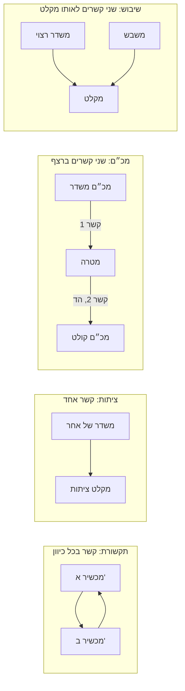

## פרק 2: הקשר החד-כיווני ואובדן ההתפשטות

משדר שולח וואט אחד, ומקלט במרחק עשרים קילומטר מקבל ממנו חלק זעיר. השאלה של הפרק היא כמה בדיוק מגיע, ולמה דווקא הכמות הזאת. אותו חשבון קובע אם מכשיר קשר שומע את הבסיס, אם מכ"ם רואה מטוס, אם מקלט ציתות קולט שידור של אחר ואם משבש מצליח להסתיר אות. בסוף הפרק נכתוב את מסלול האות כשורת חיבור אחת, נגזור מעקרונות ראשונים את האובדן הגדול שבדרך, נחשב אותו בראש בתוך דציבל או שניים, ונדע מתי החשבון כבר לא מתאר את המציאות.

**מפת הפרק.** 2.1: כל מערכת רדיו מתפרקת לקשרים חד-כיווניים. 2.2: מה האנטנה מוסיפה, הגבר והספק מוקרן אפקטיבי. 2.3: משוואת הקשר בצורת dB. 2.4: אובדן ההתפשטות מכדור ומשטח של אנטנה. 2.5: הנוסחה ההנדסית עם 32.44, ואומדן בראש. 2.6: גבולות המודל, והקשר של החללית Voyager 1.

**מה אנחנו כבר יודעים.** בשיעור הקודם בנינו את שפת הדציבל. יחס בין שני הספקים כותבים $10\log(P/P_0)$, לפי (8), ומספר טהור $N$ הופך ל-$10\log N$ dB לפי (9). הספק מוחלט כותבים ב-dBm, ביחס למיליוואט אחד, לפי (11), והגבר של אנטנה ב-dBi. הגבר הוא יוצא חלקי נכנס, ואובדן הוא ההפך, מספר חיובי ב-dB שמחסירים. ולבסוף חוקי הכתיבה (15)–(17): ל-dBm מוסיפים או מחסירים dB ומקבלים dBm; הפרש של שני ערכים ב-dBm הוא יחס ב-dB; ובכל אגף של משוואה יש לכל היותר איבר מוחלט אחד. מי שאינו בטוח באחד מהם יחזור לעמודים [[B01:29]]–[[B01:31]].

### 2.1 מה עובר בין משדר למקלט: הקשר החד-כיווני

**השאלה.** מכ"ם, מכשיר קשר, מקלט ציתות ומשבש נראים כארבע מערכות עם מטרות הפוכות. האם כלי אחד מנתח את כולן? נתחיל במה שעובר בין משדר למקלט: אנרגיה והספק.

**אנרגיה והספק.** כל מערכת רדיו מעבירה אנרגיה ממקום למקום. אנרגיה (energy) היא היכולת לבצע עבודה: להזיז גוף, לחמם אותו או להניע זרם חשמלי במעגל. היא נמדדת בג'אול (J). למקלט חשוב הקצב, כמה אנרגיה מגיעה בכל שנייה. הספק (power) הוא קצב העברת האנרגיה, ביחידות וואט, $1\,\text{W}=1\,\text{J/s}$. הוואט והמיליוואט שכבר פגשנו מודדים אפוא זרם של אנרגיה.

**גל הרדיו.** האנרגיה עוברת בלי כבל, ולכן משהו נושא אותה דרך האוויר והחלל. גל רדיו (radio wave) הוא הפרעה חשמלית ומגנטית שנעה במהירות האור, בקו ישר בחלל ריק, ונושאת אנרגיה. נצטרך רק שלוש תכונות שלו. התדר (frequency) $f$ הוא מספר התנודות שהגל משלים בשנייה, בהרץ (Hz), כאשר $1\,\text{MHz}=10^6$ Hz ו-$1\,\text{GHz}=10^9$ Hz. מהירות האור (speed of light) $c$ שווה בריק בדיוק ל-299,792,458 m/s, וברוב החשבונות מעגלים אותה ל-$3\cdot10^8$ m/s. אורך הגל (wavelength) $\lambda$ הוא המרחק שהגל עובר בזמן של תנודה אחת.

$$\lambda=\frac{c}{f}$$

**איך בנוי אורך הגל.** זה "מרחק שווה מהירות כפול זמן": תנודה אחת נמשכת $1/f$, ולכן $\lambda=c\cdot(1/f)$. מהירות ב-m/s חלקי תנודות לשנייה נותנת מטרים, ותדר גבוה פי כמה נותן אורך גל קצר פי כמה. ב-100 MHz אורך הגל הוא 3 m, ב-1 GHz הוא 30 cm, וב-10 GHz הוא 3 cm. הקשר תקף בריק, ובקירוב טוב מאוד גם באוויר, שבו הגל איטי רק בכשלוש מאיות האחוז [[ודאות: גבוהה]].

**משדר, אנטנה ומקלט.** משדר (transmitter, XMTR) מייצר הספק חשמלי בתדר מסוים ושולח אותו בכבל. אנטנה (antenna), בקצה הכבל, ממירה הספק שזורם בכבל לגל שיוצא לחלל, ובצד השני ממירה גל שמגיע אליה בחזרה להספק בכבל. מקלט (receiver, RCVR) מקבל את ההספק מהאנטנה שלו ומפיק ממנו מידע: קול, נתונים, או ההודעה "יש כאן מטרה". בין שתי האנטנות עובר הגל, ושם החשבון הקשה.

**הבעיה.** [[B01:32]] מכ"ם (radar) שולח [[מונח: פולס | שידור קצר מאוד, לרוב מיליוניות שנייה, שאחריו המערכת מקשיבה לחזרה שלו]], והפולס חוזר כהד מהמטרה אל מקלט שעומד ליד המשדר. מטרה היא הגוף שהמכ"ם מחפש, והד הוא החלק מהפולס שחוזר ממנה. ציתות (interception) הוא מקלט שקולט שידור שלא נועד לו, כדי לגלות משדר ולזהות אותו. שיבוש (jamming) הוא משדר שמכניס הספק למקלט של אחר, כדי שהאות שהמקלט מחפש ייבלע ברעש. רעש (noise) הוא תנודות חשמליות אקראיות שקיימות בכניסה של כל מקלט גם כשאין אות, בעיקר מתנועת החום של החלקיקים הטעונים ברכיבים שלו. אות חלש מהן אינו ניתן להבחנה, והמשבש מוסיף לרחש. את גודלו נמדוד בסעיף 2.5. בתקשורת הצדדים משתפים פעולה, בציתות צד אחד לא יודע שמקשיבים לו, ובשיבוש צד אחד פועל נגד השני.

**למה זה קשה.** המערכות נבדלות במי משדר, מי רוצה שהאות יגיע ואיפה המקלט. במכ"ם האנרגיה עושה דרך הלוך וחזור דרך גוף מתכתי שאינו מכשיר רדיו; בשיבוש שני משדרים שולחים הספק לאותו מקלט, וחשוב היחס ביניהם. חשבון נפרד לכל מקרה ייתן ארבע תורות שאי אפשר להשוות.

**הרעיון: פירוק לקשרים.** נסתכל על יחידה שחוזרת בכולן. קשר חד-כיווני (one-way link) הוא מקור קרינה אחד, מקלט אחד, וכל מה שקורה לאנרגיה האלקטרומגנטית בדרך מהמקור אל המקלט. בכל קשר יש אותם חמישה רכיבים: משדר, אנטנת שידור, מסלול התפשטות, אנטנת קליטה ומקלט. החוקים שקובעים כמה הספק עובר בכל רכיב אינם יודעים מי בנה את המשדר ולמה, ולכן כל מערכת רדיו היא אוסף של קשרים חד-כיווניים, ולכל קשר אותו חשבון.

**המחזיר כמשדר.** כדי לפרק גם מכ"ם, מתייחסים לגוף שמחזיר את הגל כאל משדר. פולס שפוגע במטוס מניע זרמים במתכת, והם מקרינים גל חדש. הגל המוחזר אינו "זוכר" שהוא הד, ומתפשט לפי אותם חוקים שחלים על שידור של [[מונח: מכשיר לחץ-דבר | מכשיר קשר נישא שמשדר רק כשלוחצים על מתג, ומקשיב בשאר הזמן]]. לכן המכ"ם הוא שני קשרים חד-כיווניים ברצף: מהמכ"ם אל המטרה, שבו המטרה היא המקלט, וממנה בחזרה אל המכ"ם, שבו המטרה היא המשדר.

**מה מחבר ביניהן.** בתרשים כדאי לספור כמה חיצים, כלומר קשרים חד-כיווניים, יש בכל מערכת.



במכ"ם ההספק עבר את מסלול ההתפשטות פעמיים, ובשיבוש שני קשרים נפגשים באותו מקלט: ההבדלים הם רק כמה קשרים יש ואיך הם מחוברים, ולא פיזיקה אחרת.

**איפה ההנחה מסתירה משהו.** "המטרה היא משדר" אינו אומר כמה הספק המשדר הזה שולח. מטוס גדול מחזיר יותר מטיל קטן, ותלוי גם בכיוון. הכמות נמדדת בגודל שנקרא [[מונח: חתך מכ"ם (RCS, σ) | שטח שקול במ"ר שמתאר כמה מההספק הנופל על המטרה היא מחזירה לכיוון המכ"ם]], שכתבנו ב-dBsm בשיעור הקודם. הפירוק אומר רק שאחרי שהגל עוזב את המטרה החשבון זהה; כמה היא "משדרת" נבנה בשיעור הבא. הקשר מתחיל במשדר ובאנטנה, ולכן הצעד הבא הוא למדוד מה יוצא מהאנטנה.

### 2.2 אנטנה איזוטרופית, הגבר אנטנה ו-ERP

**השאלה.** מה האנטנה עושה להספק בדרך מהכבל לחלל: מוסיפה, מפסידה, או משהו אחר? כדי למדוד צריך נקודת השוואה, ולכן נתחיל באנטנה האידאלית.

**האנטנה האידאלית.** הייחוס הטבעי הוא אנטנה שאינה מעדיפה שום כיוון. אנטנה איזוטרופית (isotropic antenna) היא אנטנה דמיונית שמקרינה את כל ההספק שנכנס אליה באופן שווה לכל הכיוונים במרחב, כמו נורה שמאירה כדור שלם באחידות. היא לא קיימת, כי כל מבנה אמיתי מקרין חזק יותר לכיוונים מסוימים [[ודאות: גבוהה]], אבל ההספק שלה מתחלק באופן ידוע על פני כדור, ולכן כל אנטנה מתוארת ביחס אליה.

**הגבר כריכוז.** אנטנה אמיתית שולחת מאותו הספק יותר לכיוונים מסוימים ופחות לאחרים, ואת היחס לאנטנה איזוטרופית, בכל כיוון, נגדיר עכשיו.

```definition
@title: הגבר אנטנה בכיוון, וההספק המוקרן האפקטיבי (ERP)
@mark: summary
נתונה אנטנה שמוזן לה הספק $P$ בכבל, ונתון כיוון $\theta$ ביחס לאנטנה. נציב מקלט קטן בכיוון $\theta$ ובמרחק $d$ ממנה, ונסמן ב-$P_\theta$ את ההספק שהוא מקבל. נחליף את האנטנה באנטנה איזוטרופית שמוזן לה אותו הספק $P$, ונסמן ב-$P_{iso}$ את ההספק שאותו מקלט מקבל באותו מקום.

**הגבר האנטנה בכיוון $\theta$** הוא היחס
$$G(\theta)=\frac{P_\theta}{P_{iso}}$$
ההגדרה דורשת: אותו הספק בכניסה לשתי האנטנות; אותו מרחק ואותו מקלט; ומרחק גדול מספיק כך שהיחס כבר אינו תלוי ב-$d$. ההגבר מוגדר ביחס להספק שנכנס לאנטנה, ולכן הפסדים בתוך האנטנה כלולים בו. ב-dB הוא נכתב $G(\theta)\,[\text{dBi}]=10\log G(\theta)$, כאשר i מציין ייחוס לאנטנה איזוטרופית.

**ההספק המוקרן האפקטיבי (Effective Radiated Power, ERP)** של משדר בהספק $P_T$ עם אנטנה בהגבר $G_T(\theta)$ הוא
$$\text{ERP}(\theta)=P_T\,G_T(\theta)$$
כלומר, ההספק שאנטנה איזוטרופית הייתה צריכה לקבל כדי שאותו מקלט, באותו מקום בכיוון $\theta$, יקבל ממנה אותו הספק $P_\theta$ (בסעיף 2.4 ננסח את זה במדויק כצפיפות הספק). בצורת dB: $\text{ERP}\,[\text{dBm}]=P_T\,[\text{dBm}]+G_T(\theta)\,[\text{dBi}]$. ה-ERP תקף רק לכיוון $\theta$ שבו נמדד $G_T(\theta)$.
```

**איך בנויה ההגדרה.** כל תנאי מונע השוואה לא הוגנת. "אותו הספק בכניסה": ההגבר מודד רק את חלוקת ההספק בין הכיוונים, לא את חוזק המשדר. "אותו מרחק ואותו מקלט": מה שקורה בדרך מתבטל ביחס. "מרחק גדול מספיק": קרוב לאנטנה הגל עוד לא קיבל את צורתו הסופית (סעיף 2.6). הגבר ביחס להספק שכבר הוקרן גדול מעט יותר, כי הוא מתעלם מהחום שהאנטנה מבזבזת; במשוואת הקשר צריך את ההגבר שכולל את ההפסדים, כי הוא מחבר את המשדר בכבל לגל בחלל. ה-ERP מצרף את תרומת המשדר ואנטנת השידור, ולכן הוא הגודל היחיד שהמקלט "רואה" מהצד השני.

**אותה אנטנה בקליטה.** כמה האנטנה אוספת מגל שמגיע מכיוון $\theta$? אותו מספר: היא מוסרת למקלט שלה פי $G(\theta)$ ממה שהייתה מוסרת אנטנה איזוטרופית באותו מקום, כאשר $G(\theta)$ הוא ההגבר שלה בשידור לאותו כיוון. העיקרון נקרא הדדיות (reciprocity) [[ודאות: גבוהה]]. כאן הוא נתון, ובסעיף 2.4 נראה אותו בלשון של שטחי איסוף. זה ההגבר $G_R$ של אנטנת הקליטה, שייכנס למשוואת הקשר לצד $G_T$.

**למה הגבר איננו יצירת הספק.** לאנטנה אין מקור אנרגיה, ולכן הגבר בכיוון אחד בא תמיד על חשבון כיוונים אחרים. אנטנה דמיונית ששולחת את כל ההספק באופן אחיד לעשירית מפני הכדור, ושום דבר לשאר, פורסת אותו על שטח קטן פי 10, ולכן בתוך האלומה מקלט מקבל פי 10 מאשר מאנטנה איזוטרופית: ההגבר שם 10, כלומר 10 dBi, ומחוץ לאלומה אפס. הגבר של אלומה אחידה הוא אחד חלקי החלק של הכדור שהיא מאירה: 20 dBi הם כמאית מהכדור, ו-30 dBi כאלפית. לכן "אנטנה של 10 dB מגבירה את ההספק פי 10" שגוי: היא מרכזת אותו, כך שבכיוון שלה מקלט מקבל פי 10, ובכיוונים אחרים פחות.

**דוגמה.** משדר של 1 W, כלומר 30 dBm, מחובר לאנטנה בהגבר 10 dBi, והמקלט בכיוון ההגבר. ה-ERP הוא $30+10=40$ dBm, כלומר $10^{40/10}=10^4$ mW, או 10 W: אנטנה איזוטרופית הייתה צריכה משדר של 10 W לאותה תוצאה, והמשדר עדיין מוציא 1 W בלבד. ה-40 dBm תקפים רק בכיוון המקלט; מקלט ציתות בצד האלומה רואה ERP נמוך לפעמים בעשרות dB.

**הגבר שלילי.** הגבר יכול להיות קטן מ-1, כלומר שלילי ב-dB, ואז ה-ERP קטן מהספק המשדר. ל[[מונח: אנטנת שוט | מוט אנכי דק על מכשיר קשר נישא, קצר בדרך כלל מאורך הגל, ולכן יעיל פחות]] של מכשיר קשר נישא, הגבר של $-3$ dBi הוא ערך סביר [[היפותטי]]. עם 30 dBm היא נותנת ERP של 27 dBm, כלומר 501 mW, חצי ממה שאנטנה איזוטרופית הייתה שולחת. אין פירוש הדבר שחצי הפך לחום: חלק מההפרש נשלח לכיוונים אחרים, וחלק אובד כחום, ביעילות הנמוכה של שוט קצר ובגוף המפעיל.

**dBi מול dBd.** [[מונח: דיפול | אנטנה של שני מוטות מוליכים בקו ישר, שאורכם יחד כחצי אורך גל; אנטנת הייחוס המעשית הנפוצה]] של חצי אורך גל הוא אנטנה אמיתית פשוטה, בהגבר פי 1.64 בכיוון המועדף, כלומר $10\log1.64=2.15$ dBi [[ודאות: גבוהה]]. יש יצרנים שמודדים הגבר ביחס לדיפול, ביחידות dBd, ולכן $G\,[\text{dBi}]=G\,[\text{dBd}]+2.15$; למשל, 7 dBd הם 9.15 dBi. dBd שמוצב כ-dBi נותן ERP נמוך ב-2.15 dB.

**ERP מול EIRP.** בדפי מפרט ובתקנות של רשויות תדרים, "ERP" הוא בדרך כלל ביחס לדיפול: ההספק שדיפול היה צריך כדי לשלוח לכיוון המקלט אותה עוצמה. הגודל שהגדרנו כאן, ביחס לאנטנה איזוטרופית, נקרא שם EIRP (Effective Isotropic Radiated Power). הדיפול שולח בכיוון המועדף פי 1.64 מאנטנה איזוטרופית, ולכן היא צריכה פי 1.64 יותר הספק לאותה עוצמה:
$$\text{EIRP}\,[\text{dBm}]=\text{ERP}_{dipole}\,[\text{dBm}]+2.15$$
בשיעור הזה, וגם במקור, ERP פירושו תמיד EIRP, וזה מה שמציבים במשוואת הקשר. דוגמה: "ERP 50 W" ביחס לדיפול הם $10\log50{,}000=46.99$ dBm, וה-EIRP הוא $46.99+2.15=49.14$ dBm, כלומר 82.0 W. כשדף המפרט אינו אומר מה הייחוס, אלה 2.15 dB של אי-ודאות בתקציב השגיאות.

**מה הרווחנו.** ה-ERP מתאר את כל תרומת הצד המשדר, ונשאר לכתוב את כל הדרך עד המקלט כחשבון אחד.

### 2.3 משוואת הקשר בצורת dB

**השאלה.** איך מחשבים מהספק המשדר, מהגברי האנטנות וממה שקורה בדרך את ההספק בכניסת המקלט, באותו חשבון לכל קשר? נתחיל במסלול, כפי שהוא משורטט באיור.

[[B01:33]]

```figure
B01:33:0
איור 2.1: עוצמת האות לאורך הקשר, ב-dBm. המשדר (XMTR) משמאל, הגבר אנטנת השידור מעלה את הרמה ל-ERP, אובדן ההתפשטות והאובדן האטמוספרי מורידים אותה לאורך הדרך, והגבר אנטנת הקליטה מעלה אותה שוב לפני המקלט (RCVR).
```

**המסלול באיור 2.1.** כל רכיב בקשר הוא מדרגה: למעלה בהגבר אנטנת השידור עד ה-ERP, למטה, בגדול, לאורך הדרך, ושוב למעלה בהגבר אנטנת הקליטה. כל מדרגה נכתבת ב-dB וכל רמה ב-dBm, לפי (15) ו-(16).

**הגורמים בדרך.** בקשר שבו האנטנות רואות זו את זו ובמזג אוויר טוב, יש בדרך שני גורמים. אובדן ההתפשטות (spreading loss) $L_s$, שנקרא גם אובדן החלל (space loss), הוא היחס בין ההספק שאנטנת שידור איזוטרופית מקרינה לבין ההספק שאנטנת קליטה איזוטרופית מקבלת ממנו במרחק $d$. כאן הוא רק סמל, יחס חיובי ב-dB שמחסירים; את ערכו נגזור בסעיף 2.4. ההנחתה האטמוספרית (atmospheric loss) $L_a$ היא האובדן הנוסף מבליעה של אנרגיה בגזים של האוויר, וגם היא יחס חיובי ב-dB שמחסירים; את ערכה נקרא מאיור בסעיף 3.1. ההספק המתקבל (received power) $P_R$ הוא ההספק שמגיע לכניסת המקלט, אחרי אנטנת הקליטה, ב-dBm.

**תנאי התוקף.** קו ראייה (line of sight) פירושו שאנטנת השידור ואנטנת הקליטה "רואות" זו את זו, והמסלול ביניהן אינו מתקרב מדי לקרקע או למים. אוויר צלול פירושו שאין גשם, שלג או ערפל במסלול.

**ממכפלה לסכום.** [[2.5: מקור]] נגזור מהצורה הלינארית, שבה רואים איפה כל הנחה נכנסת; כל צעד הוא הכפלה ביחס.

צעד 1: המשדר מוציא הספק $P_T$ בכבל, נתון של המשדר.

צעד 2: אנטנת השידור מכפילה אותו בהגבר שלה בכיוון המקלט, ומתקבל ה-ERP, $P_TG_T$. ההנחה הראשונה: $G_T$ הוא ההגבר בכיוון שבו עומד המקלט, ולא ההגבר המרבי שבדף המפרט.

צעד 3: בדרך האות מתחלק באובדן ההתפשטות ובהנחתה, כי אובדן מוגדר כ"נכנס חלקי יוצא", ולכן מה שיוצא הוא מה שנכנס חלקי האובדן: $P_TG_T/(L_sL_a)$. ההנחה השנייה: בקו ראייה ובאוויר צלול אלה הגורמים היחידים, וכל מכשול או גשם היה מוסיף גורם במכנה.

צעד 4: אנטנת הקליטה מכפילה בהגבר שלה בכיוון המשדר, $G_R$, לפי ההדדיות של סעיף 2.2. ההנחה השלישית: $L_s$ מוגדר בין שתי אנטנות איזוטרופיות, ולכן מותר להכפיל בהגברים בנפרד, כאילו האנטנות והמסלול אינם תלויים זה בזה.

מתקבלת הצורה הלינארית, ההספק המתקבל:
$$P_R=\frac{P_T\,G_T\,G_R}{L_s\,L_a}$$

צעד 5: ניקח $10\log$ של שני האגפים. מותר, כי כל הגדלים חיוביים.

צעד 6: לפי חוק הכפל (3) הלוגריתם של מכפלה הוא סכום הלוגריתמים, ולפי חוק המנה (4) הלוגריתם של מנה הוא הפרש. המונה הופך לשלושה איברים חיוביים, והמכנה לשני איברים שמחסירים.

צעד 7: את $P_T$ ו-$P_R$ נמדוד ב-dBm, ואת שאר הגדלים כיחסים ב-dB. כך באגף ימין איבר מוחלט אחד, $P_T$, ובאגף שמאל איבר מוחלט אחד, $P_R$, לפי החוק (17).

התוצאה היא משוואת הקשר.

```formula
@title: משוואת הקשר החד-כיווני בצורת dB
@mark: summary
$$P_R=P_T+G_T-L_s-L_a+G_R \tag{19}$$
- $P_R$: ההספק המתקבל בכניסת המקלט, ב-dBm.
- $P_T$: הספק המשדר בכניסה לאנטנת השידור, ב-dBm.
- $G_T$: הגבר אנטנת השידור בכיוון המקלט, ב-dBi.
- $L_s$: אובדן ההתפשטות בין שתי אנטנות איזוטרופיות, ב-dB (חיובי).
- $L_a$: ההנחתה האטמוספרית לאורך המסלול, ב-dB (חיובי).
- $G_R$: הגבר אנטנת הקליטה בכיוון המשדר, ב-dBi.

הצורה הלינארית: $P_R=P_TG_TG_R/(L_sL_a)$. תקפה לקשר בקו ראייה ובאוויר צלול. ההגברים נמדדים ביחס לאנטנה איזוטרופית, ו-$L_s$ ו-$L_a$ הם יחסים "נכנס חלקי יוצא".
```

**כל איבר במשוואה.** [[2.5: מבנה]] המשוואה היא סכום, ולכן דציבל בכל מקום שווה לדציבל בכל מקום אחר. $P_T$, ב-dBm, הוא נקודת המוצא: הכפלת המשדר, 3 dB, מעלה את $P_R$ ב-3 dB. $G_T$ ו-$G_R$, ב-dBi, נכנסים בפלוס, ולכן 3 dB באנטנת הקליטה שווים להכפלת המשדר, ומתכננים מחליפים לעיתים משדר חזק באנטנה גדולה. $L_s$ ו-$L_a$, ב-dB, נכנסים במינוס. בקשרים אמיתיים $L_s$ הוא בדרך כלל מאה דציבל ויותר, והספקים והגברים עשרות dB לכל היותר, ולכן $L_s$ קובע את סדר הגודל. התוקף: קו ראייה, אוויר צלול, והגברים בכיוון הנכון.

**הדוגמה המספרית.** המשדר מוציא 1 W, כלומר $+30$ dBm. הגבר אנטנת השידור הוא $+10$ dB, אובדן ההתפשטות 100 dB, ההנחתה האטמוספרית 2 dB, והגבר אנטנת הקליטה $+3$ dB. נציב ב-(19):
$$P_R=+30+10-100-2+3=-59\ \text{dBm}$$
המספרים להמחשה, ולכן החישוב אינו ממוספר. ב-וואט $10^{-5.9}$ mW הם $1.26\cdot10^{-6}$ mW, כלומר 1.26 ננו-וואט: מוואט אחד במשדר נשארה בכניסת המקלט בערך מיליארדית אחת.

**אותו חשבון בשתי צורות.** הטבלה כותבת את אותו קשר פעם כמכפלה של יחסים ופעם כסכום של דציבלים.

```table
{"title": "קשר אחד בשתי צורות: לינארית ו-dB", "scope": {"PT": 1000, "GT": 10, "Ls": 10000000000, "La": 1.584893, "GR": 1.995262}, "columns": ["רכיב", "גודל לינארי", "יחידה לינארית", "ב-dB", "יחידת dB"], "rows": [["\"הספק משדר P_T\"", "PT", "\"mW\"", "10*log10(PT)", "\"dBm\""], ["\"הגבר אנטנת שידור G_T\"", "GT", "\"יחס\"", "10*log10(GT)", "\"dBi\""], ["\"אובדן התפשטות L_s\"", "Ls", "\"יחס\"", "10*log10(Ls)", "\"dB\""], ["\"הנחתה אטמוספרית L_a\"", "La", "\"יחס\"", "10*log10(La)", "\"dB\""], ["\"הגבר אנטנת קליטה G_R\"", "GR", "\"יחס\"", "10*log10(GR)", "\"dBi\""], ["\"הספק מתקבל P_R\"", "PT*GT*GR/(Ls*La)", "\"mW\"", "10*log10(PT*GT*GR/(Ls*La))", "\"dBm\""]]}
```

**מה הטבלה מלמדת.** שתי העמודות שוות, כי צורת ה-dB היא הלוגריתם של הצורה הלינארית; אבל בלינארית מכפילים ומחלקים ב-$10^{10}$, ובצורת ה-dB מחברים 30, 10, 100, 2 ו-3 בראש, ושגיאה של סדר גודל בולטת מיד כשגיאה של 10 dB.

**משוואה אחת, הרבה משוואות.** (19) היא שוויון, ולכן אפשר לחלץ ממנה כל איבר: כמה הספק משדר צריך, כמה הגבר צריכה אנטנת הקליטה, או כמה אובדן מותר במסלול. השאלה החשובה מכולן, המרחק המרבי, מחלצת את $d$ מתוך $L_s$, ולכן היא תחכה עד שנדע מה $L_s$.

**שתי טעויות שהמשוואה אוסרת.** הראשונה היא להשתמש ב-(19) מחוץ לתנאים שלה. עם גבעה בדרך או גשם כבד, היא מבטיחה יותר הספק ממה שיגיע, וצריך להוסיף לה איבר. השנייה היא לחבר שני הספקים מוחלטים, למשל $P_T+P_R$ ב-dBm. הבדיקה היא ספירה: בכל אגף איבר מוחלט אחד, וסכום של שני ערכים ב-dBm הוא מכפלה של הספקים, בלי משמעות פיזיקלית.

```think
באותו קשר בדיוק ($P_T=30$ dBm, $G_T=10$ dBi, $L_s=100$ dB, $L_a=2$ dB), איזה הגבר של אנטנת קליטה יביא את ההספק המתקבל בדיוק ל-$-65$ dBm? ואם במקום זה נכפיל את הספק המשדר ל-2 W, אבל נחליף את אנטנת השידור באנטנה של 7 dBi ונשאיר $G_R=3$ dBi, מה יהיה $P_R$?
---
לשאלה הראשונה נחלץ את $G_R$ מ-(19): $G_R=P_R-P_T-G_T+L_s+L_a=-65-30-10+100+2=-3$ dBi. זה בדיוק ההגבר של אנטנת השוט מסעיף 2.2, כלומר אנטנה ששולחת לכיוון הזה רק חצי ממה שאנטנה איזוטרופית הייתה שולחת עדיין תביא את האות ל-$-65$ dBm. לשאלה השנייה: 2 W הם $30+10\log2=33.01$ dBm. נציב: $P_R=33.01+7-100-2+3=-58.99$ dBm. כמעט אותו $-59$ dBm, כי הכפלת המשדר הוסיפה 3.01 dB והחלפת האנטנה הורידה 3 dB. זה שער החליפין של המשוואה: דציבל בהספק המשדר שווה דציבל בהגבר האנטנה.
```

**מה הרווחנו.** יש לנו חשבון אחד, בשורת חיבור, מהספק המשדר להספק בכניסת המקלט, לכל קשר חד-כיווני. האיבר הגדול בו, 100 dB של אובדן התפשטות, ניתן כנתון, והשאלה הפתוחה היא למה אובד כל כך הרבה הספק בדרך, גם כשאין שם שום דבר שבולע אותו.

### 2.4 מאיפה בא אובדן ההתפשטות: כדור ושטח אפקטיבי

**השאלה.** בחלל ריק שום דבר אינו בולע אנרגיה, אז לאן נעלמים 100 ה-dB של סעיף 2.3? נעקוב אחרי ההספק מאנטנת שידור איזוטרופית ועד שאנטנת קליטה איזוטרופית אוספת ממנו חלק.

**הכדור המתרחב.** [[B01:35]] האנרגיה שיצאה מאנטנה איזוטרופית נמצאת על פני כדור שמתרחב במהירות האור, ובחלל ריק ההספק שעובר דרך פני הכדור שווה ל-ERP בכל רדיוס. משתנה רק השטח שעליו הוא מתפרס: $4\pi d^2$ בכדור ברדיוס $d$, ולכן הכפלת המרחק מחלקת את אותו הספק על פי ארבעה מטרים רבועים.

**צפיפות הספק ושטח איסוף.** המקלט נוגע רק בחלק קטן מהכדור, ולכן צריך לדעת כמה הספק עובר דרך כל מטר רבוע במקומו, ומאיזה שטח האנטנה אוספת אותו. השטח הזה אינו בהכרח הגאומטרי: תיל דק, כמעט בלי שטח, אוסף הספק, וצלחת אוספת פחות מהשטח שהיא מכסה. לכן נגדיר אותו לפי מה שהאנטנה עושה.

```definition
@title: צפיפות הספק ושטח אפקטיבי של אנטנת קליטה
@mark: summary
נתון מקור שה-ERP שלו לכיוון נקודה מסוימת הוא $\text{ERP}$, בוואט, והנקודה נמצאת במרחק $d$ ממנו, בחלל ריק.

**צפיפות ההספק (power density)** $S$ בנקודה היא ההספק שעובר דרך שטח של מטר רבוע אחד, הניצב לכיוון ההתפשטות, ביחידות W/m². כשהמקור נראה מהנקודה כנקודה, כלומר המרחק גדול בהרבה מממדי האנטנה, ואין בליעה בדרך:
$$S=\frac{\text{ERP}}{4\pi d^2} \tag{20}$$

**השטח האפקטיבי (effective area)** $A_e$ של אנטנת קליטה, לגל שמגיע מכיוון נתון, הוא היחס בין ההספק $P_R$ שהיא מוסרת למקלט לבין צפיפות ההספק $S$ של הגל באותו מקום:
$$A_e=\frac{P_R}{S}$$
ההגדרה מניחה גל שמגיע מכיוון אחד, ממקור רחוק מספיק כך שהצפיפות אחידה על פני כל האנטנה, ואנטנה שמותאמת לגל ולמקלט. $A_e$ נמדד ב-m² ותלוי בכיוון, כמו ההגבר.

**השטח האפקטיבי של אנטנה איזוטרופית**, בתדר שאורך הגל שלו $\lambda$, הוא
$$A_{e,iso}=\frac{\lambda^2}{4\pi} \tag{21}$$
תוצאה זו נגזרת בתורת האנטנות, וכאן היא נתון.
```

**איך בנויות ההגדרות.** ב-(20) עומד במונה ה-ERP ולא $P_T$, כי ה-ERP הוא ההספק שאנטנה איזוטרופית הייתה צריכה כדי ליצור אותה צפיפות בכיוון הזה; לכן (20) תקפה לכל אנטנה, כל עוד מציבים את ה-ERP בכיוון הנקודה. במכנה שטח הכדור, ולכן הצפיפות יורדת כאחד חלקי ריבוע המרחק. ב-(20) אין תדר בכלל. בהגדרת $A_e$ מופיעה דרישת ההתאמה. התאמה לגל: הדוגמה העיקרית היא [[מונח: קיטוב | הכיוון שבו השדה החשמלי של הגל מתנודד; אנטנה שמסובבת בניצב לו קולטת ממנו מעט מאוד]], ואנטנה שמסובבת לא נכון מקבלת שטח אפקטיבי קטן בהרבה. התאמה למקלט נוגעת לנקודת החיבור בין האנטנה לכבל ולמקלט: בחיבור לא מותאם חלק מההספק חוזר לאנטנה ומוקרן ממנה שוב, ולכן ההספק שנמסר קטן, ואיתו $A_e$. ב-(21) השטח פרופורציוני ל-$\lambda^2$, ולכן קטן פי ארבעה בכל הכפלה של התדר, וה-$4\pi$ שבמכנה שלו יתבטל מיד מול ה-$4\pi$ של הכדור.

**דוגמה.** ERP של 40 dBm (10 W) מסעיף 2.2, אנטנה איזוטרופית ב-20 km, 1 GHz. שטח הכדור ברדיוס 20,000 m הוא $4\pi(2\cdot10^4)^2=5.03\cdot10^9$ m². הצפיפות לפי (20) היא $10/5.03\cdot10^9=1.99\cdot10^{-9}$ W/m². אורך הגל 0.3 m, ולכן לפי (21) $A_{e,iso}=0.09/4\pi=7.16\cdot10^{-3}$ m², כלומר 71.6 cm². האנטנה מוסרת $1.99\cdot10^{-9}\cdot7.16\cdot10^{-3}=1.42\cdot10^{-11}$ W, כלומר $-78.46$ dBm.

באנימציה כדאי לעקוב אחרי הקו הקצר שעל העיגול המודגש, כשמזיזים את המרחק.

```anim
{"title": "הכדור המתרחב ושטח האיסוף", "caption": "חזיתות הגל יוצאות מהמשדר ומתרחבות. העיגול המודגש הוא הכדור שעובר דרך המקלט, והקו הקצר עליו הוא השטח האפקטיבי של אנטנת הקליטה. הזיזו את המרחק: שטח הכדור גדל כריבוע המרחק, והחלק שהאנטנה אוספת קטן באותו יחס. החתך דו-ממדי, והמספרים מחושבים לכדור המלא.", "duration": 6, "view": {"x": [-10, 10], "y": [-7, 7]}, "params": [{"id": "d", "label": "מרחק המקלט d (יחידות)", "min": 2, "max": 9, "value": 5}, {"id": "A", "label": "שטח אפקטיבי A (יחידות רבועות)", "min": 0.2, "max": 2, "value": 1}], "shapes": [{"type": "circle", "x": "0", "y": "0", "r": "0.3", "label": "משדר איזוטרופי"}, {"type": "circle", "x": "0", "y": "0", "r": "0.3 + mod(1.5*t, 9)", "dash": true}, {"type": "circle", "x": "0", "y": "0", "r": "0.3 + mod(1.5*t + 3, 9)", "dash": true}, {"type": "circle", "x": "0", "y": "0", "r": "0.3 + mod(1.5*t + 6, 9)", "dash": true}, {"type": "circle", "x": "0", "y": "0", "r": "d", "accent": true, "label": "הכדור ברדיוס d"}, {"type": "line", "x1": "d", "y1": "-sqrt(A)/2", "x2": "d", "y2": "sqrt(A)/2", "accent": true, "label": "אנטנת קליטה"}, {"type": "text", "x": "0", "y": "6.3", "text": "שטח הכדור 4πd² = {round(4*pi*d^2, 1)}"}, {"type": "text", "x": "0", "y": "5.3", "text": "החלק שנאסף A/4πd² = {round(A/(4*pi*d^2), 4)}"}]}
```

**מה האנימציה מראה.** כל חזית גל נושאת את כל ה-ERP, וקטן רק החלק $A/4\pi d^2$ שהאנטנה מכסה: האובדן הוא יחס בין שני שטחים, ולא תהליך שמכלה אנרגיה.

**הגזירה צעד אחר צעד.** [[2.5: מקור]] נחשב את $L_s$ של סעיף 2.3 בין שתי אנטנות איזוטרופיות.

צעד 1: אנטנת השידור איזוטרופית, $G_T=1$, ולכן $\text{ERP}=P_T$.

צעד 2: לפי (20), הצפיפות במקלט היא $S=P_T/4\pi d^2$. כאן נכנסות שתי הנחות: המקור נראה כנקודה, ואין בליעה בדרך.

צעד 3: אנטנת הקליטה איזוטרופית, ולכן לפי הגדרת השטח האפקטיבי ולפי (21) היא מוסרת $P_R=S\cdot A_{e,iso}=\dfrac{P_T}{4\pi d^2}\cdot\dfrac{\lambda^2}{4\pi}$. כאן נכנסת ההנחה שהאנטנה מותאמת לגל.

צעד 4: אובדן הוא "נכנס חלקי יוצא", $L_s=P_T/P_R$, ו-$P_T$ מתבטל:
$$L_s=\frac{P_T}{P_R}=\frac{4\pi d^2}{\lambda^2/4\pi}$$
במונה שטח הכדור, ובמכנה השטח האפקטיבי האיזוטרופי: $L_s$ הוא מספר הפעמים ששטח האיסוף "נכנס" בשטח הכדור.

צעד 5: נכפיל מונה ומכנה ב-$4\pi$, כדי להיפטר מהשבר שבתוך השבר: $L_s=(4\pi)^2d^2/\lambda^2$.

צעד 6: כל הגורמים בריבוע, ולכן $L_s=(4\pi d/\lambda)^2$.

```formula
@title: אובדן ההתפשטות בין שתי אנטנות איזוטרופיות
@mark: summary
$$L_s=\frac{4\pi d^2}{\lambda^2/4\pi}=\left(\frac{4\pi d}{\lambda}\right)^2 \tag{22}$$
- $L_s$: אובדן ההתפשטות, יחס טהור בלי יחידות ("נכנס חלקי יוצא"), גדול מ-1.
- $d$: המרחק בין האנטנות.
- $\lambda$: אורך הגל, $\lambda=c/f$, באותה יחידת אורך כמו $d$.

תקף בחלל ריק או באוויר צלול, בקו ראייה, כשכל אנטנה נמצאת רחוק מספיק מהשנייה כך שהיא נראית ממנה כנקודה, ובין אנטנות איזוטרופיות. את ההגברים של אנטנות אמיתיות מוסיפים בנפרד, כמו ב-(19).
```

**איך בנויה (22).** [[2.5: מבנה]] (22) היא מספר טהור, כל עוד $d$ ו-$\lambda$ באותה יחידה. $d^2$ בא מהכדור, ולכן הכפלת המרחק מגדילה את האובדן פי 4. $1/\lambda^2$ בא מאנטנת הקליטה: אורך גל קצר הוא שטח איסוף קטן, ולכן גם הכפלת התדר מגדילה את האובדן פי 4. ה-$4\pi$ מופיע פעמיים, מהכדור ומהשטח האיזוטרופי, ולכן בריבוע. $d/\lambda$ הוא מספר אורכי הגל לאורך המסלול: $L_s$ תלוי רק במרחק כפי שהגל "מודד" אותו. בדוגמה, $4\pi d/\lambda=4\pi\cdot20{,}000/0.3=837{,}758$, וריבועו 118.46 dB, בדיוק יחס השטחים; ואכן $40-118.46=-78.46$ dBm.

**מאיפה בא התדר.** טענה שגויה שחוזרת הרבה היא שגל בתדר גבוה "נחלש מהר יותר" בדרך. לפי (20) הצפיפות אינה תלויה בתדר, והתדר נכנס רק בצעד 3, דרך השטח האיזוטרופי. בטבלה כדאי להשוות את שתי העמודות האחרונות, ב-10 W וב-20 km.

```table
{"title": "אותו גל בשלושה תדרים: הצפיפות קבועה, השטח האיזוטרופי קטן", "scope": {"c": 300000000, "ERP": 10, "d": 20000}, "columns": ["תדר", "אורך גל λ (m)", "צפיפות S (nW/m²)", "שטח איזוטרופי (cm²)"], "rows": [["\"100 MHz\"", "c/1e8", "round(ERP/(4*pi*d^2)*1e9, 2)", "round((c/1e8)^2/(4*pi)*1e4, 1)"], ["\"1 GHz\"", "c/1e9", "round(ERP/(4*pi*d^2)*1e9, 2)", "round((c/1e9)^2/(4*pi)*1e4, 1)"], ["\"10 GHz\"", "c/1e10", "round(ERP/(4*pi*d^2)*1e9, 2)", "round((c/1e10)^2/(4*pi)*1e4, 3)"]]}
```

הצפיפות זהה בשלוש השורות, והשטח קטן פי $10^4$, כלומר 40 dB, כשאורך הגל קטן פי 100. הניסוח הנכון: בתדר גבוה אנטנה איזוטרופית קטנה יותר ואוספת פחות מאותו גל; לכן אנטנה בגודל פיזי קבוע אינה חייבת להפסיד בתדר גבוה, ונבדוק זאת בסעיף 2.6.

**הגבר כיחס שטחים.** לפי ההדדיות, אנטנה בהגבר $G$ מוסרת פי $G$ מאנטנה איזוטרופית מאותו גל, וההספק הנמסר הוא $S\cdot A_e$, ולכן גם השטח האפקטיבי גדול פי $G$:
$$A_e=G\,\frac{\lambda^2}{4\pi}\qquad\Longleftrightarrow\qquad G=\frac{A_e}{A_{e,iso}}=\frac{4\pi A_e}{\lambda^2}$$
זו ההדדיות בלשון שטחים: אותו $G$ מתאר ריכוז הספק בשידור ושטח איסוף בקליטה, ולכן אנטנה שאוספת טוב מכיוון מסוים גם משדרת טוב אליו [[ודאות: גבוהה]]. למשל, לאנטנה של 10 dBi ב-1 GHz יש שטח אפקטיבי של $10\cdot71.6=716$ cm².

**מה הגזירה מגלה על (19).** כאן רואים למה מותר היה להכפיל בהגברים בנפרד בסעיף 2.3. אנטנה אמיתית מחליפה את ה-ERP של צעד 1 ב-$P_TG_T$, ואת השטח האיזוטרופי של צעד 3 ב-$A_e=G_R\lambda^2/4\pi$, ולכן $P_R=\dfrac{P_TG_T}{4\pi d^2}\cdot\dfrac{G_R\lambda^2}{4\pi}=\dfrac{P_TG_TG_R}{L_s}$: $G_T$ ו-$G_R$ יוצאים כגורמים נפרדים מ-$L_s$, וזו (19) בלי $L_a$.

**צלחת ויעילות.** בצלחת השטח האפקטיבי קרוב לשטח הפה אבל קטן ממנו. יעילות הצמצם (aperture efficiency) $\eta$ היא היחס בין השטח האפקטיבי לשטח הפיזי של הפה, $A_e=\eta A_{phys}$. היא קטנה מ-1, כי הצלחת אינה מאירה את הפה באופן אחיד וחלק מהגל נשפך מעבר לשפה; בצלחות טיפוסיות כ-0.5 עד 0.7 [[ודאות: בינונית]]. בצלחת עגולה בקוטר $D$, $A_{phys}=\pi D^2/4$. ראשית, $G=4\pi A_e/\lambda^2=4\pi\eta A_{phys}/\lambda^2$. שנית, נציב את שטח העיגול: $G=4\pi\eta(\pi D^2/4)/\lambda^2=\eta\pi^2D^2/\lambda^2$. שלישית, $G=\eta(\pi D/\lambda)^2$: ההגבר גדל כריבוע הקוטר, נמדד באורכי גל.

**מה לא הוכחנו.** שלוש נקודות. הראשונה היא (21), שנלקחה כנתון; את הגזירה מתורת האנטנות נעשה במודול M1.4. השנייה: אנטנה איזוטרופית אינה קיימת, ולכן $L_s$ אינו נמדד ישירות אלא רישום חשבונאי; זה אינו פגם, כי גם ההגברים נמדדים ביחס לאותה אנטנה דמיונית, והדמיון מתבטל ב-(19). השלישית: ההספק יוצא מנקודה רק רחוק מספיק מאנטנת השידור (סעיף 2.6).

```think
מקלט עם אנטנה איזוטרופית עומד במרחק 20 km ממשדר ב-1 GHz. (א) המקלט מתרחק ל-40 km. פי כמה קטנה הצפיפות במקומו, ובכמה dB קטן ההספק שהוא מקבל? (ב) הוא חוזר ל-20 km, אבל המשדר עובר ל-2 GHz באותו ERP. מה קורה לצפיפות, ומה קורה להספק שהמקלט מקבל?
---
(א) לפי (20) הצפיפות היא אחד חלקי $4\pi d^2$, ולכן הכפלת המרחק מקטינה אותה פי 4. השטח האפקטיבי של האנטנה לא השתנה, ולכן גם ההספק המתקבל קטן פי 4, כלומר $10\log4=6.02$ dB. (ב) הצפיפות לא משתנה כלל, כי ב-(20) אין תדר. אבל אורך הגל קטן מ-0.3 m ל-0.15 m, ולכן לפי (21) השטח האיזוטרופי קטן פי 4, מ-71.6 cm² ל-17.9 cm². ההספק המתקבל קטן שוב ב-6.02 dB. התוצאה הזהה בשני המקרים אינה מקרית: לפי (22) $L_s$ תלוי רק ביחס $d/\lambda$, והכפלת $d$ והכפלת $f$ מכפילות את היחס הזה באותה מידה. אבל המנגנון שונה, ובמקרה (ב) הגל עצמו לא נחלש כלל.
```

```domain
@field: rfsensing
@title: ההד של מכ"ם עובר שני כדורים
נסמן ב-$R$ את המרחק בין המכ"ם למטרה. במכ"ם יש שני קשרים חד-כיווניים ברצף, ולכן הכדור של (20) מופיע פעמיים: הצפיפות במטרה היא $\text{ERP}/4\pi R^2$, והגל המוחזר מתפרס שוב על כדור ברדיוס $R$ סביב המטרה, ולכן מה שחוזר למכ"ם יורד כאחד חלקי $R^4$. בקשר חד-כיווני הכפלת המרחק עולה 6.02 dB, ובמכ"ם $40\log2=12.04$ dB, ולכן הכפלת טווח הגילוי דורשת פי 16 בהספק ולא פי 4. עם חתך המכ"ם $\sigma$ מסעיף 2.1, $P_R\propto\dfrac{P_TG}{4\pi R^2}\cdot\sigma\cdot\dfrac{1}{4\pi R^2}\cdot\dfrac{G\lambda^2}{4\pi}$: ה-$4\pi$ מופיע בחזקה שלישית, $(4\pi)^3$, שהם 32.98 dB, פעמיים מהכדורים ופעם מהשטח האפקטיבי. את ערכו של $\sigma$ נבנה בשיעור הבא.
```

**מה מחבר ביניהן.** 100 ה-dB הם יחס של שני שטחים, אבל (22) דורשת מטרים, אורך גל ומספרים כמו 837,758, ולכן הצעד הבא הוא נוסחה בדציבלים עם יחידות נוחות.

### 2.5 הצורה ההנדסית: 32.44, יחידות, הנומוגרף ואומדן בראש

**השאלה.** איך כותבים את (22) ב-dB, עם קילומטרים ומגה-הרץ, כך שתחושב בשורה אחת, בלי טעויות יחידות, ותוערך בראש בתוך 10–20%?

**מהיחס ללוגריתם.** [[B01:34]] שישה צעדים, וכל אחד הוא חוק לוגריתם שכבר יש לנו.

צעד 1: ניקח $10\log$ של (22). $L_s$ הוא ריבוע, ולכן לפי חוק החזקה (13) הדציבלים שלו כפולים: $L_s(\text{dB})=10\log(4\pi d/\lambda)^2=20\log(4\pi d/\lambda)$.

צעד 2: נחליף את אורך הגל בתדר, $\lambda=c/f$. חלוקה ב-$c/f$ היא הכפלה ב-$f/c$, ולכן $L_s(\text{dB})=20\log(4\pi d f/c)$.

צעד 3: לפי חוק הכפל (3) נפרק את הלוגריתם של המכפלה לסכום: $L_s(\text{dB})=20\log(4\pi/c)+20\log d+20\log f$. כאן $d$ במטרים, $f$ בהרץ, ו-$c=3\cdot10^8$ m/s.

צעד 4: האיבר הראשון הוא מספר קבוע, $20\log(4\pi/3\cdot10^8)=-147.56$. זו הצורה של הנוסחה במטרים ובהרץ.

צעד 5: נעבור ליחידות נוחות. מרחק בקילומטרים הוא $d=1000\,d_{km}$, ולכן $20\log d=20\log1000+20\log d_{km}=60+20\log d_{km}$. תדר במגה-הרץ הוא $f=10^6f_{MHz}$, ולכן $20\log f=120+20\log f_{MHz}$.

צעד 6: נאסוף את כל המספרים הקבועים לאיבר אחד: $-147.56+60+120=32.44$.

```formula
@title: אובדן ההתפשטות בצורה ההנדסית
@mark: summary
$$L_s(\text{dB})=32.44+20\log d_{km}+20\log f_{MHz} \tag{23}$$
- $L_s$: אובדן ההתפשטות בין שתי אנטנות איזוטרופיות, ב-dB.
- $d_{km}$: המרחק בין האנטנות, **בקילומטרים בלבד**.
- $f_{MHz}$: התדר, **במגה-הרץ בלבד**.
- 32.44: קבוע שמכיל את $(4\pi)^2$, את $c^2$ ואת המרת היחידות.

נכון רק ב-km וב-MHz. תקף באותם תנאים כמו (22): קו ראייה, אוויר צלול, אנטנות שנראות זו מזו כנקודות.
```

**איך בנויה (23).** ל-32.44 אין משמעות פיזיקלית לבד: הוא מכיל את $(4\pi)^2$, את $c^2$ ואת המעבר ליחידות km ו-MHz, ולכן נכון רק להן. $20\log d_{km}$ בא מ-$d^2$ של הכדור, והמקדם 20 הוא חוק החזקה: ריבוע ביחס הוא כפל 2 בדציבלים. לכן הכפלת המרחק מוסיפה $20\log2=6.02$ dB, ופי 10 מוסיף 20 dB. $20\log f_{MHz}$ בא מ-$1/\lambda^2$ של אנטנת הקליטה ומתנהג אותו דבר. מכאן ש-$L_s$ תלוי רק במכפלה $d\cdot f$: 1 km ב-10 GHz ו-100 km ב-100 MHz נותנים $10^4$ km·MHz, ואותו אובדן, 112.44 dB. ו-60 km ב-3 GHz נותנים 137.55 dB.

**מאיפה 32.44, וכמה עיגול מותר.** [[B01:32]] 32.44 מתקבל עם $c=3\cdot10^8$ m/s, ו-32.45, הפרש זניח, עם הערך המדויק. 32.4 הוא הערך בנוסחה של [[B01:34]]. ב-[[B01:35]] הקבוע מעוגל ל-32 לעבודה בדיוק של 1 dB, וכך גם ב-[[B01:32]], "מעוגל למספר שלם". השגיאה של 32 היא 0.44 dB, ולכן העיגול מותר כששאר האיברים ידועים ממילא רק בדיוק של דציבל; כשהם ידועים בעשירית דציבל, העיגול הופך לאיבר הגרוע בתקציב.

**קבוע לכל זוג יחידות.** יחידות אחרות בצעד 5 נותנות $20\log(4\pi\cdot u_d\cdot u_f/c)$, עם $u_d$ במטרים ו-$u_f$ בהרץ. בטבלה כדאי להשוות את הקבוע בין השורות.

```table
{"title": "הקבוע של (23) לפי יחידות המרחק והתדר", "scope": {"c": 300000000, "ce": 299792458}, "columns": ["יחידת מרחק", "יחידת תדר", "ערך מהירות האור", "הקבוע (dB)"], "rows": [["\"m\"", "\"Hz\"", "\"3·10⁸\"", "20*log10(4*pi*1*1/c)"], ["\"km\"", "\"MHz\"", "\"3·10⁸\"", "20*log10(4*pi*1000*1e6/c)"], ["\"km\"", "\"MHz\"", "\"299,792,458\"", "20*log10(4*pi*1000*1e6/ce)"], ["\"km\"", "\"GHz\"", "\"3·10⁸\"", "20*log10(4*pi*1000*1e9/c)"], ["\"מייל ימי\"", "\"MHz\"", "\"3·10⁸\"", "20*log10(4*pi*1852*1e6/c)"]]}
```

**מה הטבלה מלמדת.** הקבוע הוא חלק מהיחידות ולא מהפיזיקה: מעבר לגיגה-הרץ מוסיף לו 60 dB, ל-92.44, שהוא גם האובדן ב-1 km וב-1 GHz, ובמטרים ובהרץ הוא שלילי, $-147.56$.

[[B01:34]] באיור 2.2 כדאי לעקוב אחרי הקו מ-1 GHz ל-20 km ולמקום שבו הוא חוצה את הסולם האמצעי.

```figure
B01:34:0
איור 2.2: נומוגרף לאובדן ההתפשטות. הסולם השמאלי הוא התדר ב-GHz, הסולם הימני הוא המרחק ב-km, והסולם האמצעי הוא האובדן ב-dB. קו ישר מ-1 GHz ל-20 km חוצה את הסולם האמצעי ב-119 dB.
```

**הנומוגרף.** נומוגרף (nomograph) הוא סרגל גרפי שמחשב נוסחה בקו ישר בין סולמות לוגריתמיים. הוא עובד כי (23) היא סכום של שני לוגריתמים, וקו ישר בין שני סולמות לוגריתמיים מקבילים חוצה את הסולם שבאמצע בממוצע שלהם [[ודאות: גבוהה]]. מותחים קו מהתדר בסולם השמאלי למרחק בסולם הימני, וקוראים את האובדן בסולם האמצעי. מ-1 GHz ל-20 km הקו חוצה ב-119 dB, ו-(23) נותנת 118.46 dB; חצי הדציבל הוא דיוק הקריאה של סולם מודפס, ולכן הנומוגרף מתאים לבדיקה בדיוק של דציבל, ולא לתקציב מדויק.

בגרף כדאי לבדוק כמה עולה כל עקום בין 50 ל-100 km, ובין 100 ל-200 km.

```chart
{"title": "אובדן ההתפשטות לפי המרחק בשלושה תדרים", "caption": "לפי (23). כל עקום עולה ב-6.02 dB בכל הכפלה של המרחק, ובין עקום לעקום יש 20 dB, כי התדר גדל פי 10.", "type": "line", "x": {"from": 1, "to": 200, "step": 1, "label": "מרחק d (km)"}, "scope": {"k": 32.44}, "series": [{"name": "100 MHz", "expr": "k + 20*log10(x) + 20*log10(100)"}, {"name": "1 GHz", "expr": "k + 20*log10(x) + 20*log10(1000)"}, {"name": "10 GHz", "expr": "k + 20*log10(x) + 20*log10(10000)"}], "yLabel": "L_s (dB)"}
```

**מה הגרף מראה.** כל הכפלה של המרחק מוסיפה אותם 6.02 dB, מ-1 ל-2 km כמו מ-100 ל-200 km, ולכן קשר ארוך "יקר" בכל הכפלה ולא בכל קילומטר; והעקומים מקבילים, 20 dB זה מזה.

**מייל ימי.** בים ובאוויר מודדים מרחקים במיילים ימיים. מייל ימי (nautical mile) הוא בדיוק 1.852 km, ונבחר כי דקת קשת של קו רוחב על פני כדור הארץ היא בערך מייל ימי אחד [[ודאות: גבוהה]]. ב-20log המעבר הוא $20\log1.852=5.35$ dB, ולכן במיילים ימיים ובמגה-הרץ הקבוע הוא 37.79, כבשורה האחרונה בטבלה.

**שלוש טעויות יחידות.** [[2.5: ביקורת]] הטעות הנפוצה ביותר ב-(23), של מהנדסים ושל מערכות AI כאחד, היא יחידה אחרת. ב-20 km וב-1 GHz (118.46 dB): 20,000 m במקום 20 km נותנים 178.46 dB (+60); 1 GHz במקום 1000 MHz נותן 58.46 dB (−60); ו-20 מיילים ימיים (37.04 km) שמוצבים כ-20 נותנים 118.46 במקום 123.81 dB, טעות של 5.35 dB שאינה נראית חשודה. שתי בדיקות תופסות את כולן. העוגן: 1 km ב-1 GHz הם 92.44 dB, וכל תשובה מתרחקת ממנו ב-20log של היחס במכפלה $d\cdot f$. סדר הגודל: קשרים יבשתיים הם בדרך כלל 90 עד 150 dB, ו-58 או 178 dB הם סימן מיידי לטעות. הניסוח הנכון: 32.44 נכון רק ל-km ול-MHz, וכל יחידה אחרת דורשת קבוע משלה.

**ערכת אומדן בראש.** [[2.5: סדר גודל]] 10–20% בהספק הם 0.4–0.8 dB ($10\log1.1=0.41$, $10\log1.2=0.79$). מספיק להחזיק בראש ארבעה לוגריתמים, $\log2=0.301$, $\log3=0.477$, $\log5=0.699$ ו-$\log7=0.845$, שמהם נבנה כל שלם עד 10, למשל $\log6=\log2+\log3=0.778$. עוגני הספק: 3 dB פי 2, 10 dB פי 10, 20 dB פי 100. בגדלים שנכנסים בריבוע, כמו המרחק והתדר ב-(23), המקדם 20: הכפלה 6.02 dB, ופי 10 20 dB. קבועים: $c=3\cdot10^8$ m/s, מייל ימי 1.852 km (5.35 dB), רדיוס כדור הארץ 6371 km (לאופק בסעיף 2.6), $g=9.81$ m/s² (10 לאומדן, שגיאה של 2%), ורצפת הרעש $-174$ dBm/Hz (בפסקה הבאה). ו-10% במרחק או בתדר הם 0.83 dB ב-(23).

**רצפת הרעש התרמי.** את הרעש של סעיף 2.1 נצטרך ב-Voyager (סעיף 2.6) וברגישות המקלט (סעיף 3.2). ב-$-174$ dBm/Hz יש שלושה דברים חדשים: מה רועש, באיזה סולם מודדים חום, ומה פירוש "לכל הרץ". רעש תרמי הוא החלק של הרעש שנובע מתנועת החום של החלקיקים הטעונים, ולכן הוא גדל עם הטמפרטורה. הטמפרטורה נמדדת בקלווין (K), סולם שמתחיל באפס המוחלט, שבו תנועת החום נעצרת: $T[\text{K}]=T[^\circ\text{C}]+273.15$, וטמפרטורת הייחוס המקובלת היא $T_0=290$ K, כ-17°C. קבוע בולצמן (Boltzmann constant), $k=1.38\cdot10^{-23}$ J/K, הופך טמפרטורה לאנרגיה: ג'אול לכל קלווין. $kT_0=1.38\cdot10^{-23}\cdot290=4.00\cdot10^{-21}$ J היא אנרגיה, ובכל זאת הספק לכל הרץ: ג'אול הוא וואט כפול שנייה, והרץ הוא "פעם בשנייה", $1\ \text{Hz}=1/\text{s}$, ולכן $\text{J}=\text{W}\cdot\text{s}=\text{W}/\text{Hz}$. כלומר, זה הספק הרעש שנכנס למקלט בכל הרץ של רוחב פס, כאשר רוחב פס (bandwidth) $B$ הוא טווח התדרים שהמקלט מקשיב לו, ב-Hz. במיליוואט זה $4.00\cdot10^{-18}$ mW/Hz, ו-$10\log(4.00\cdot10^{-18})=-173.98$, ולכן היחידה היא dBm/Hz. כל הרץ בפס מוסיף רעש משלו, בלתי תלוי באחרים, ולכן מקלט בפס של $B$ הרץ אוסף $kT_0B$: הכפל ב-$B$ מבטל את "לכל הרץ" ומשאיר וואט. ב-dB זה $-174+10\log B$ dBm; מקלט בפס של 1 MHz שומע $-174+60=-114$ dBm. את מקור המספר בתורת החום נבנה במודול M1.4.

**תרגול בראש.** לעוגן 92.44 dB מוסיפים 20log של $d_{km}\cdot f_{GHz}$ (את 20 km וב-1 GHz נבדוק בבלוק האימות שלמטה). ב-60 km וב-3 GHz המכפלה 180: $\log180=\log2+2\log3+\log10=0.301+0.954+1=2.255$, ולכן $20\log180\approx45.1$ dB, והאומדן 137.5 dB, מול 137.55, בתוך עשירית דציבל.

```predict
@title: רחפן שעובר מ-2.4 ל-5.8 GHz
@unit: dB
@value: 7.66
קשר השליטה של רחפן עובר מתדר 2.4 GHz לתדר 5.8 GHz, עם אותן אנטנות קטנות שנחשבות כאן כאיזוטרופיות, באותו מרחק. האם אובדן ההתפשטות יגדל או יקטן? הערך בכמה dB בעזרת ערכת האומדן בלבד, ותן גם תחום שאתה בטוח ב-9 מתוך 10 שהערך נמצא בתוכו. תחום כזה נקרא "טווח של 90%": אם תיתן כך עשרה אומדנים שונים, צפוי שרק אחד מהם יחטיא.
---
האובדן יגדל, כי לפי (23) $L_s$ עולה עם התדר, ובאנטנות שנחשבות איזוטרופיות השטח האפקטיבי קטן כ-$\lambda^2$. השינוי תלוי רק ביחס התדרים, $5.8/2.4=2.42$, כי המרחק לא השתנה. אומדן: היחס בין 2 ל-3, ולכן השינוי בין $20\log2=6.0$ dB ל-$20\log3=9.5$ dB. 2.42 קרוב יותר ל-2, ולכן אומדן סביר הוא כ-7.5 dB, עם טווח 90% של 6.5 עד 8.5 dB. הערך המחושב הוא $20\log2.42=7.66$ dB. כלומר, באותו מרחק, אותן אנטנות מקבלות ב-5.8 GHz פחות מחמישית מההספק שקיבלו ב-2.4 GHz, כי $10^{-0.766}=0.17$.
```

```verify
@title: בדיקת (23) על 20 km ב-1 GHz
@result: $L_s(20\text{ km},1\text{ GHz})=118.46$ dB
- יחידות: ב-(22) היחס $4\pi d/\lambda$ חסר יחידות, $4\pi\cdot20{,}000\,\text{m}/0.3\,\text{m}=837{,}758$, ו-$20\log837{,}758=118.46$ dB. אותו ערך כמו ב-(23), ולכן הקבוע 32.44 מכיל את המרת היחידות הנכונה.
- דרך עצמאית: יחס השטחים מסעיף 2.4, שטח הכדור $5.03\cdot10^9$ m² חלקי השטח האיזוטרופי $7.16\cdot10^{-3}$ m², נותן 118.46 dB.
- טבלה מהמקור: הנומוגרף באיור 2.2 [[B01:34]] נותן 119 dB, בתוך דיוק הקריאה של כחצי דציבל.
- קנה מידה: מהעוגן 92.44 dB של 1 km ו-1 GHz, הכפלה של המרחק פי 20 מוסיפה $20\log20=26.02$ dB, ומתקבל 118.46 dB.
- אומדן בראש: $92.4+26=118.4$ dB, בתוך עשירית דציבל מהמדויק.
```

**מה מחבר ביניהן.** ל-$L_s$ יש שלוש צורות שמסכימות, יחס השטחים, (23) והנומוגרף, ואומדן בראש בתוך עשירית דציבל; עכשיו נבדוק על אילו הנחות הכלי עומד ומה קורה כשהן נשברות.

### 2.6 גבולות המודל, הפשרה בתדר, ומקרה Voyager

**השאלה.** (23) נגזרה תחת שלוש הנחות: המקור נקודה, אין דבר בדרך, והאנטנות איזוטרופיות. מתי כל אחת נשברת, מה מחליף אז את הנוסחה, ומה היא אומרת על בחירת התדר?

**שדה רחוק.** [[2.5: גבולות]] ההנחה שהמקור נקודה נכנסה בצעד 2. כל חלק של אנטנה גדולה שולח גל משלו, וקרוב אליה הגלים עוברים מרחקים שונים בהרבה, מגיעים בשלבים שונים של התנודה ואינם מצטרפים כגל מנקודה; רק רחוק מספיק האנטנה מתנהגת כנקודה עם הגבר קבוע. שדה רחוק (far field) הוא האזור הזה, ולפי כלל מקובל הוא מתחיל ב-$2D^2/\lambda$, כאשר $D$ הוא הממד הגדול ביותר של האנטנה [[ודאות: גבוהה]]. בתוכו (20) ו-(22) אינן תקפות: ההגבר עוד לא קיבל את ערכו, והצפיפות אינה יורדת כאחד חלקי ריבוע המרחק; שם מחשבים את השדה הקרוב מכל חלקי האנטנה, או מודדים אותו. לצלחת בקוטר 1 m ב-10 GHz ($\lambda=3$ cm) הוא מתחיל ב-$2\cdot1^2/0.03=66.7$ m: זניח בקשר של קילומטרים, אבל מכריע במדידת אנטנה במעבדה או במשבש ליד מכ"ם.

**הקרקע והאופק.** ההנחה שאין דבר בדרך נשברת בקשר יבשתי בשתי דרכים. הראשונה היא הקרקע: כשהאנטנות נמוכות והמסלול ארוך, מגיע לאנטנת הקליטה גם גל שהוחזר מהקרקע, והוא מבטל חלק מהגל הישיר.

**איך גל אחד מבטל גל אחר.** גל הוא תנודה, ושני גלים באותה אנטנה מתחברים כתנודות, רגע אחר רגע, ולא כהספקים. הפאזה (phase) של גל היא המקום שבו הוא נמצא במחזור התנודה ברגע נתון: בשיא, בשפל או ביניהם. הגל המוחזר עובר דרך ארוכה יותר ומגיע בפאזה אחרת. כשהפרש הדרכים הוא כפולה שלמה של אורך הגל, השיאים מגיעים יחד והגלים מתחזקים. כשהוא חצי אורך גל, שיא של אחד פוגש שפל של השני והם מבטלים זה את זה: בגלים שווים הביטול מלא, ובגל מוחזר חלש יותר חלקי, אבל גם אז ההספק המשותף קטן מזה של הגל הישיר לבדו. לכן חיבור הספקים נכון רק לאותות שאינם קשורים זה לזה, כמו אות ורעש, ולא לשני עותקים של אותו גל. בהחזרה מהקרקע בזווית שטוחה הגל גם מתהפך, ולכן כשהאנטנות נמוכות והמסלול ארוך, והפרש הדרכים זעיר, הגל המוחזר מבטל את רוב הגל הישיר [[ודאות: גבוהה]].

**שני מסלולים והאופק.** התפשטות שני-מסלולים (two-ray propagation) היא המודל שמחבר את הגל הישיר עם המוחזר; במרחקים גדולים היא נותנת אובדן שגדל כ-$40\log d$ ולא $20\log d$, כלומר 12 dB להכפלת מרחק ולא 6. הדרך השנייה היא עקמומיות כדור הארץ. אופק רדיו (radio horizon) הוא המרחק המרבי שבו שתי אנטנות עוד רואות זו את זו מעל כדור הארץ. נבנה אותו מפיתגורס ומרדיוס כדור הארץ.

**גזירת האופק בארבעה צעדים.** הצעד הראשון הוא ציור; באיור כדאי למצוא את המשולש שקודקודיו האנטנה, נקודת ההשקה ומרכז כדור הארץ.

```svg
@caption: אופק הרדיו של אנטנה בגובה $h$. קו הראייה נוגע בכדור בנקודת ההשקה, והרדיוס אליה ניצב לו. הגובה מוגזם מאוד ביחס לרדיוס.
<svg viewBox="0 0 420 300" xmlns="http://www.w3.org/2000/svg" font-family="sans-serif" font-size="13" fill="none" stroke="currentColor">
<path d="M0,204.6 A700,700 0 0 1 420,288.1" stroke-width="2"/>
<line x1="80" y1="140" x2="80" y2="300" stroke-dasharray="5 4"/>
<line x1="352" y1="255" x2="336.4" y2="291.8" stroke-dasharray="5 4"/>
<line x1="80" y1="140" x2="352" y2="255" stroke-width="2"/>
<line x1="80" y1="140" x2="80" y2="200" stroke-width="3"/>
<polyline points="342.8,251.1 338.9,260.3 348.1,264.2"/>
<circle cx="80" cy="140" r="4" fill="currentColor"/>
<circle cx="352" cy="255" r="4" fill="currentColor"/>
<g fill="currentColor" stroke="none">
<text x="92" y="135">אנטנה</text>
<text x="62" y="175" text-anchor="end">h</text>
<text x="215" y="185">d</text>
<text x="300" y="232" text-anchor="end">נקודת השקה</text>
<text x="350" y="290" text-anchor="end">R</text>
<text x="88" y="290">R+h</text>
<text x="210" y="290" text-anchor="middle">↓ אל מרכז כדור הארץ</text>
</g>
</svg>
```

הרדיוס לנקודת ההשקה ניצב לקו המשיק, ולכן המרכז, האנטנה ונקודת ההשקה יוצרים משולש ישר-זווית, שהיתר שלו $R+h$ והניצבים $R$ ו-$d$. לפי פיתגורס:
$$(R+h)^2=R^2+d^2$$
הצעד השני: $R^2+2Rh+h^2=R^2+d^2$, ה-$R^2$ מתבטל, ונשאר $d^2=2Rh+h^2$. הצעד השלישי: $h^2$ זניח לעומת $2Rh$, כי היחס ביניהם, $h/2R$, הוא בתורן של 30 m רק $30/12{,}742{,}000=2.4\cdot10^{-6}$. לכן
$$d\approx\sqrt{2Rh}$$
עם $R=6{,}371{,}000$ m ו-$h$ במטרים, $\sqrt{2R}=3569.6$, כלומר $d\approx3.57\sqrt{h}$ km. הצעד הרביעי הוא הכיפוף באוויר: האוויר צפוף ליד הקרקע, והגל איטי בו מעט, ולכן מסלולו מתכופף קלות כלפי מטה ומגיע מעט מעבר לאופק הגאומטרי. זה שקול לקו ישר מעל כדור גדול פי 4/3 ברדיוס: $\sqrt{2\cdot\tfrac43\cdot6{,}371{,}000}=4121.8$, ומכאן $d\approx4.12\sqrt{h}$ km. שתי אנטנות רואות זו את זו כל עוד המרחק ביניהן אינו עולה על סכום שני המרחקים לנקודת השקה משותפת:
$$d_h\approx4.12\left(\sqrt{h_1}+\sqrt{h_2}\right)\ \text{km}$$
$h_1$ ו-$h_2$ במטרים, והשורש בא מפיתגורס: ריבוע המרחק גדל לינארית בגובה. לכן הגבהה פי 4 מכפילה את האופק רק פי 2. מעבר לאופק (23) אינה רלוונטית, כי אין קו ראייה. דוגמה: שני תרנים של 30 m רואים זה את זה עד $4.12\cdot2\sqrt{30}=45.1$ km, 22.6 km כל אחד עד נקודת ההשקה; בלי הכיפוף באוויר, עם 3.57, רק $3.57\cdot2\sqrt{30}=39.1$ km. תרנים של 120 m, פי 4, נותנים $4.12\cdot2\sqrt{120}=90.3$ km, פי 2 בלבד. את המודל של שני המסלולים ואת הכיפוף באוויר מעקרונות נבנה במודולים M0.8 ו-M1.3.

**פשרת התדר.** [[2.5: פשרה]] לפי (23) תדר גבוה פי 10 עולה 20 dB, אבל רק כשהשטח האפקטיבי של האנטנות קטן עם התדר, כמו באנטנה איזוטרופית. לאנטנה בגודל פיזי קבוע יש שטח אפקטיבי קבוע, ולכן לפי $G=4\pi A_e/\lambda^2$ מסעיף 2.4 ההגבר שלה גדל כריבוע התדר. נציב בשתי האנטנות במשוואת הקשר הלינארית $P_R=P_TG_TG_R/L_s$: $G_T=4\pi A_T/\lambda^2$, $G_R=4\pi A_R/\lambda^2$ ו-$L_s=(4\pi d/\lambda)^2$. במונה מתקבל $(4\pi)^2A_TA_R/\lambda^4$, ובמכנה $(4\pi)^2d^2/\lambda^2$. ה-$(4\pi)^2$ מתבטל, ומ-$\lambda^4$ נשאר $\lambda^2$ במכנה:
$$P_R=\frac{P_T\,A_T\,A_R}{\lambda^2d^2}$$
($A_T$, $A_R$: השטחים האפקטיביים.) כשהם קבועים, ההספק המתקבל **גדל** כריבוע התדר. בגרף כדאי להשוות את שלושת הקווים ב-10 GHz, באותו מרחק.

```chart
{"title": "שינוי ההספק המתקבל עם התדר, ביחס ל-1 GHz", "caption": "באותו מרחק. שתי אנטנות איזוטרופיות: −20log f. צלחת בגודל קבוע בצד אחד: אפס. צלחות בגודל קבוע בשני הצדדים: +20log f.", "type": "line", "x": {"from": 1, "to": 10, "step": 0.1, "label": "תדר f (GHz)"}, "series": [{"name": "שתי אנטנות איזוטרופיות", "expr": "-20*log10(x)"}, {"name": "צלחת בצד אחד", "expr": "0*x"}, {"name": "צלחות בשני הצדדים", "expr": "20*log10(x)"}], "yLabel": "שינוי ב-P_R (dB)"}
```

מ-1 ל-10 GHz: אנטנות איזוטרופיות מפסידות 20 dB, צלחת בצד אחד מאזנת, וצלחות בשני הצדדים מרוויחות נטו 20 dB. צלחת בקוטר 1 m ביעילות 0.6 נותנת לפי $G=\eta(\pi D/\lambda)^2$ הגבר של 18.18 dBi ב-1 GHz ו-38.18 dBi ב-10 GHz [[היפותטי]]. המחיר הוא אלומה צרה פי 10: צלחת שמרכזת פי 100 מאירה חלק קטן פי 100 מהכדור (סעיף 2.2). רוחב הכתם שהאלומה מאירה פרופורציוני, בזוויות קטנות, לרוחב הזוויתי שלה, הזווית שבין שני שוליה, והכתם רחב לרוחב ולגובה, ולכן שטחו פרופורציוני לריבוע הרוחב הזוויתי: שטח קטן פי 100 הוא רוחב קטן פי $\sqrt{100}=10$ בכל ציר, ודיוק כיוון גדול פי 10. מחיר נוסף, שעוד לא חישבנו, הוא הבליעה באוויר בתדרים גבוהים.

**הטענה ש"תדר נמוך תמיד עדיף".** מי שקורא את (23) לבד מסיק שתדר נמוך תמיד עדיף לקשר ארוך. הבדיקה: מה קבוע במערכת, ההגבר או השטח? בשוטים קטנים, שההגבר שלהם קבוע בערך, התדר הנמוך באמת עדיף; בצלחות בגודל נתון, הגבוה עדיף, כי הן מרוויחות $f^2$ בכל צד. הניסוח הנכון: (23) מתארת קשר בין אנטנות איזוטרופיות, והשלכתה על בחירת התדר תלויה במה שמגביל את האנטנות.

**משמעות למערכת.** [[2.5: משמעות מבצעית]] מכאן חלוקה של מערכות לפי האנטנות שהן יכולות לשאת. מערכת שצד אחד שלה נייד ואינו יכול לכוון אנטנה, כמו חייל עם מכשיר קשר, צריכה אנטנה כמעט לא מכוונת ונשארת בתדרים נמוכים; לכן מכשירי קשר טקטיים עובדים בעיקר ב-[[מונח: VHF | Very High Frequency, תחום התדרים 30–300 MHz]] [[ודאות: גבוהה]]. מערכת ששני צדדיה קבועים ומכוונים, כמו קשר בין תרנים או ללוויין, עולה בתדר ומשלמת בדיוק כיוון. לוויין גאוסטציונרי נמצא כ-35,786 km מעל קו המשווה, ושם (23) נותנת ב-12 GHz אובדן של 205.10 dB; צלחת ביתית בקוטר 60 cm ביעילות 0.6 מחזירה מזה 35.33 dBi [[היפותטי]], רק משום שהיא מכוונת קבוע ללוויין שאינו זז בשמיים. כלומר, $L_s$ קובע איזו אנטנה המערכת צריכה, ומכאן באיזה תדר היא תעבוד ומי יכול להשתמש בה.

**מה עוד לא בדקנו: האוויר עצמו.** (22) הניחה חלל ריק. בתדרים גבוהים האוויר בולע חלק מהאנרגיה והצפיפות יורדת מהר יותר מ-(20), ולכן $L_a$ ממתין לערך בפרק הבא.

**מה מחבר ביניהן.** השדה הרחוק מגביל את הנוסחה מקרוב, הקרקע והאופק מרחוק, והאנטנות קובעות אם תדר גבוה הוא מחיר או רווח. נבדוק אותה עכשיו על הקשר הארוך ביותר שבנו בני אדם.

```casestudy
@title: קשר הנתונים של Voyager 1: האם (23) מחזיקה ב-25 מיליארד קילומטר?
**השאלה.** החללית Voyager 1 שוגרה ב-1977, ונמצאת היום כ-25 מיליארד קילומטר מכדור הארץ [[ודאות: גבוהה]]. היא עדיין שולחת נתונים בקצב שנמדד, 160 ביט לשנייה [[ודאות: גבוהה]]. ביט (bit) הוא ספרה בינארית, 0 או 1, יחידת המידע הקטנה ביותר, וקצב הביטים הוא מספר הביטים בשנייה. האם (19) ו-(23) מנבאות הספק שמאפשר קשר כזה, או שהן טועות בסדרי גודל במרחק גדול פי מיליארד מקשר יבשתי?

**המודל.** (19) בלי הנחתה: האטמוספרה מוסיפה בתדר הזה פחות מדציבל [[ודאות: בינונית]]. משדר של כ-22 W [[ודאות: בינונית]]; צלחת בקוטר 3.7 m על החללית, בהגבר של כ-48 dBi [[ודאות: בינונית]]; תדר 8420 MHz [[ודאות: גבוהה]]; ואנטנת קליטה בקוטר 70 m של רשת התקשורת לחלל העמוק של NASA, בהגבר של כ-74 dBi [[ודאות: גבוהה]]. המרחק $2.5\cdot10^{10}$ km, הרבה מעבר לשדה הרחוק ובקו ראייה, ולכן תנאי (23) מתקיימים.

**המספרים.** $20\log(2.5\cdot10^{10})=207.96$ dB ו-$20\log8420=78.51$ dB, ולכן $L_s=32.44+207.96+78.51=318.91$ dB. המשדר: $22{,}000$ mW, כלומר 43.42 dBm. לפי (19), $P_R=43.42+48-318.91+74=-153.49$ dBm, כלומר $4.48\cdot10^{-19}$ W. אובדן ההתפשטות, 318.91 dB, גדול בכ-179 dB מזה של קשר יבשתי ארוך (כ-140 dB), ושתי הצלחות מחזירות יחד 122 dB.

**הבדיקה מול המציאות.** האות צריך להיות גבוה מהרעש של המקלט. טמפרטורה: הרעש לכל הרץ הוא $kT_0=-173.98$ dBm/Hz ב-290 K, פרופורציוני לטמפרטורה בקלווין. מקלטי רשת החלל העמוק מקוררים, ורעש המערכת שלהם שקול לטמפרטורה של כ-20 K [[ודאות: בינונית]], 253 מעלות מתחת לאפס; לכן הרעש לכל הרץ נמוך ב-$10\log(20/290)=-11.61$ dB, כלומר $-185.59$ dBm/Hz. רוחב פס: אות שמחליף ערך 160 פעמים בשנייה נע על פני טווח תדרים של כ-160 Hz, ולכן נניח, כקירוב גס, פס של 160 Hz: $-185.59+10\log160=-185.59+22.04=-163.55$ dBm. השוואה: האות גבוה מהרעש ב-10.07 dB. באות שאינו חזק בהרבה מהרעש חלק מהביטים מתהפכים. קוד מתקן שגיאות (error-correcting code) הוא שיטה שבה המשדר מוסיף לנתונים ביטים שמחושבים מהם, וממה שהתקבל המקלט מגלה ביטים שהתהפכו ומתקן אותם. בזכותו קשר דיגיטלי עובד בדרך כלל כשהאות גבוה מהרעש בכמה דציבלים בלבד [[ודאות: בינונית]], ולכן המודל מנבא קשר שעובד, עם מרווח של כמה dB. זה תואם 160 ביט לשנייה: אילו (23) טעתה ב-20 dB, הקשר היה בלתי אפשרי או מהיר פי 100.

**מסקנות.** (23) מחזיקה גם במרחק גדול פי מיליארד, כי הגזירה שלה תלויה רק בכדור ובשטח; והקשר נסגר בזכות צלחות גדולות בתדר גבוה, 122 dB, ולא בזכות 22 W של המשדר.

**מה ידוע ומה מוערך.** ידועים המרחק, התדר וקצב הנתונים; ההספק, ההגברים וטמפרטורת הרעש מוערכים בדיוק של דציבל או שניים, ורוחב פס כקצב הביטים הוא קירוב גס (את הקשר המדויק נבנה במודול M0.5). המודל צודק אפוא בתוך כמה דציבלים, לא בעשירית.
```

**מה בנה הפרק.** הפרק פירק כל מערכת לקשרים חד-כיווניים, חיבר כל קשר לשורה אחת, (19), וגזר את האיבר הגדול בה מכדור ומשטח, עד (23), שנבדקה מקילומטרים ועד Voyager 1. אבל הנחנו אוויר שקוף, ולא שאלנו כמה הספק המקלט צריך. הפרק הבא נותן ערך ל-$L_a$, מגדיר מתי הספק מתקבל "מספיק", ומחלץ מכאן את המרחק המרבי שבו קשר עדיין עובד.

## פרק 3: מהספק מתקבל לטווח: הנחתה, רגישות ומרווח

מכשיר קשר משדר 10 W, ומקלט עומד מולו בשטח פתוח. עד איזה מרחק אפשר להתרחק לפני שהקשר נקטע? טווח הוא הגודל שמפקד, טייס או מפעיל מכ"ם מרגישים ישירות, ולכל איבר במשוואת הקשר יש מחיר בקילומטרים. בסוף הפרק נחשב מדף מפרט של משדר, שתי אנטנות ומקלט את הטווח המרבי בשורה אחת, נדע כמה טווח עולה כל דציבל שמשאירים בצד, ונזהה מתי טווח מחושב של אלפי קילומטרים הוא אשליה.

**מפת הפרק.** 3.1: הבליעה של האוויר, ומתי מותר להזניח אותה. 3.2: מתי הספק מתקבל "מספיק": רגישות ומרווח. 3.3: המרחק שבו ההספק יורד בדיוק לרגישות. 3.4: הפתרון כשהבליעה אינה זניחה. 3.5: כמה מרווח להחזיק מול אי-ודאות. 3.6: המודל מול מכשיר קשר טקטי, שבו הטווח המחושב והטווח בשטח רחוקים בשלושה סדרי גודל.

**מה אנחנו כבר יודעים.** משוואת הקשר (19), $P_R=P_T+G_T-L_s-L_a+G_R$, נותנת את ההספק בכניסת המקלט, בקו ראייה ובאוויר צלול. אובדן ההתפשטות בין אנטנות איזוטרופיות הוא (23), $L_s=32.44+20\log d_{km}+20\log f_{MHz}$, רק בקילומטרים ובמגה-הרץ. הפרש של שני ערכים ב-dBm הוא יחס ב-dB, לפי (16), ומדציבלים חוזרים למספר באנטילוג, $N=10^{N(\text{dB})/10}$, לפי (10). הגבר קשור לשטח האפקטיבי, $A_e=G\lambda^2/4\pi$ (סעיף 2.4). והאיבר $L_a$ עדיין סמל בלי ערך.

### 3.1 ההנחתה האטמוספרית

**השאלה.** כמה האוויר עצמו בולע מהגל לאורך המסלול, איך הבליעה גדלה עם המרחק ועם התדר, ומתי מותר לכתוב $L_a=0$?

**מה קורה באוויר.** [[B01:35]] מולקולות של חמצן ואדי מים באוויר קולטות אנרגיה מגל רדיו והופכות אותה לחום. ברוב התדרים הקליטה חלשה, ובתדרים מסוימים חזקה במיוחד, כי שם המולקולה "מתאימה" לתנודה של הגל, כמו נדנדה שנענית לדחיפות בקצב מסוים. נצטרך רק מספר אחד לכל תדר, כמה דציבלים אובדים בכל קילומטר, ואותו קוראים מגרף.

[[B01:36]]

```figure
B01:36:0
איור 2.3: ההנחתה האטמוספרית בכל קילומטר של מסלול, ב-dB/km, לפי התדר ב-GHz. שני הצירים לוגריתמיים: התדר מ-4 עד 100 GHz, וההנחתה מ-0.01 עד 10 dB/km. בדוגמה מותחים קו מ-50 GHz למעלה עד העקום, ומשם שמאלה לסולם, וקוראים 0.4 dB/km.
```

**קריאת איור 2.3.** מותחים קו אנכי מהתדר עד העקום, ומשם אופקי שמאלה עד הסולם. שני הצירים לוגריתמיים, ולכן כל שנתה אנכית היא פי 10. יש בו שני שיאים: ליד 22 GHz, מבליעה של אדי מים, וליד 60 GHz, מבליעה של חמצן, חזק בהרבה, כ-10 dB/km ויותר [[ודאות: בינונית]]. ביניהם יש "חלונות" של בליעה קטנה, ובהם בוחרות מערכות בתדרים גבוהים.

**איך מצטברת הבליעה.** איך הנחתה לקילומטר הופכת להנחתה של מסלול שלם? נבנה אותה, באוויר אחיד, קילומטר אחר קילומטר.

צעד 1: באוויר אחיד, כל קילומטר משאיר מההספק שנכנס אליו אותו חלק, ונסמן אותו $q$, מספר בין 0 ל-1. זה נכון כי כל קילומטר מכיל אותן מולקולות באותה צפיפות, ואינו "יודע" כמה הספק כבר אבד לפניו.

צעד 2: אחרי שני קילומטרים נשאר $q\cdot q=q^2$ מההספק, ואחרי $n$ קילומטרים נשאר $q^n$, כי כל קילומטר מכפיל את מה שנשאר באותו $q$.

צעד 3: האובדן הוא "נכנס חלקי יוצא", ולכן האובדן של $n$ קילומטרים הוא $1/q^n$.

צעד 4: ב-dB, לפי חוק החזקה (5), $10\log(1/q^n)=n\cdot10\log(1/q)$. כלומר, האובדן בדציבלים הוא מספר הקילומטרים כפול האובדן של קילומטר אחד.

כך מתקבל שהנחתה לקילומטר היא מספר שמצטבר בחיבור לאורך המסלול. נגדיר אותה עכשיו בסימנים כלליים.

```definition
@title: מקדם ההנחתה האטמוספרית
@mark: summary
נתון גל בתדר $f$ שעובר באוויר אחיד, כלומר אוויר שהרכבו, הלחץ והטמפרטורה שלו זהים לאורך המסלול. נסמן ב-$q(f)$ את החלק מההספק שנשאר אחרי שהגל עבר קילומטר אחד, $0<q(f)\le1$, בלי להביא בחשבון את התפשטות הגל על פני הכדור.

**מקדם ההנחתה האטמוספרית (atmospheric attenuation coefficient)** $\alpha(f)$ הוא האובדן של קילומטר אחד, ב-dB:
$$\alpha(f)=10\log\frac{1}{q(f)}\quad[\text{dB/km}]$$
$\alpha$ אינו שלילי, ואפס רק כשאין בליעה כלל. הוא תלוי בתדר ובמצב האוויר: לחות, לחץ וטמפרטורה. ההגדרה מתייחסת לבליעה בגזים של אוויר צלול בלבד; גשם, שלג, ערפל ואבק אינם כלולים בה.
```

**איך בנויה ההגדרה.** $q$ הוא החלק שנשאר, ולכן $1/q$ הוא אובדן "נכנס חלקי יוצא" כמו $L_s$, ו-$\alpha$ חיובי שמחסירים. ההתפשטות על פני הכדור כבר ב-$L_s$, ולכן היא מוצאת מההגדרה. "אוויר אחיד" מאפשר מספר אחד לכל המסלול; במסלול משופע אל לוויין, שבו האוויר דליל יותר בגובה, מחלקים את המסלול לקטעים כמעט אחידים ומחברים את האובדנים שלהם. "אוויר צלול": גשם וערפל מוסיפים איבר משלהם.

```formula
@title: ההנחתה האטמוספרית לאורך מסלול
@mark: summary
$$L_a=\alpha\,d \tag{24}$$
- $L_a$: ההנחתה האטמוספרית של כל המסלול, ב-dB (חיובי, מחסירים ב-(19)).
- $\alpha$: מקדם ההנחתה בתדר הקשר, ב-dB/km, נקרא מאיור 2.3.
- $d$: אורך המסלול, ב-km.

תקף באוויר צלול ואחיד לאורך המסלול. במסלול שבו האוויר משתנה, $L_a$ הוא סכום של $\alpha_i d_i$ על הקטעים.
```

**מה אומרת (24).** ההנחתה בדציבלים גדלה בקו ישר עם המרחק, בשיפוע $\alpha$, ו-$d$ נכנס כאן בלי לוגריתם. בהספק עצמו, קו ישר בדציבלים הוא דעיכה מעריכית: נשאר $10^{-\alpha d/10}$ ממה שהיה נשאר בלי בליעה, כלומר בכל קילומטר נוסף מאבדים אותו אחוז מההספק שנשאר, ולא אותה כמות.

**דוגמה.** [[B01:35]] קשר בתדר 50 GHz עובר 20 km באוויר צלול. מאיור 2.3, $\alpha=0.4$ dB/km, ולפי (24) $L_a=0.4\cdot20=8$ dB. כל קילומטר משאיר $10^{-0.04}=0.912$ מההספק, כלומר מאבד 8.8%, ואחרי 20 km נשאר $10^{-0.8}=0.158$, פחות משישית ממה שהיה מגיע באוויר ריק.

**התפשטות מול בליעה.** שני האובדנים גדלים עם המרחק בחוקים שונים. בגרף כדאי לחפש היכן נחתכים שני הקווים, התוספת של כל אחד כשמכפילים מרחק ב-50 GHz.

```chart
{"title": "מה מוסיפה הכפלת המרחק: התפשטות מול בליעה ב-50 GHz", "caption": "הכפלת המרחק מ-d ל-2d מוסיפה לאובדן ההתפשטות תמיד 6.02 dB, ולבליעה αd, עם α=0.4 dB/km. הקווים נחתכים ב-15.05 km.", "type": "line", "x": {"from": 1, "to": 40, "step": 1, "label": "המרחק לפני ההכפלה d (km)"}, "scope": {"a": 0.4}, "series": [{"name": "תוספת לאובדן ההתפשטות", "expr": "20*log10(2) + 0*x"}, {"name": "תוספת לבליעה", "expr": "a*x"}], "yLabel": "dB"}
```

האיזון הוא ב-$\alpha d=6.02$ dB, $d=15.05$ km; מעליו הבליעה שולטת (מ-20 ל-40 km היא מוסיפה 8 dB מול 6.02), ולכן במסלול ארוך בתדר גבוה היא שקובעת את הטווח.

**מתי מותר להזניח.** משוואת הקשר מחושבת בדרך כלל בדיוק של כדציבל, ולכן ההנחתה זניחה כש-$\alpha d$ קטן בהרבה מ-1 dB, כמו ברוב הקשרים הטקטיים, עד כמה GHz. ב-10 GHz האיור נותן כ-0.01 עד 0.02 dB/km, כלומר 1 עד 2 dB ב-100 km: לא זניח בתקציב מדויק, אבל קטן מול יותר מ-150 dB של אובדן התפשטות באותו מסלול. ההנחתה משמעותית מאוד בתדרי מיקרוגל גבוהים (מיקרוגל: כ-1–30 GHz, אורך גל 30 עד 1 cm), בגלים מילימטריים (30–300 GHz, אורך גל 10 עד 1 מ"מ, ומכאן שמם), ובמסלולים אל לוויינים.

**מה העקום לא מכיל.** [[2.5: גבולות]] העקום מתאר רק גזים, לפי התנאי של צעד 3 בגזירת (19). גשם בולע את הגל ומפזר אותו לכיוונים אחרים, ובעשרות GHz גשם כבד יכול להוסיף כמה dB לכל קילומטר, הרבה יותר מהאוויר הצלול [[ודאות: בינונית]]; ערפל ועננים מוסיפים פחות. מה שמחליף אז את (19) הוא אותה משוואה עם $L_{rain}=\alpha_{rain}\,d_{rain}$, כאשר $\alpha_{rain}$ נלקח ממודלים של עוצמת גשם ו-$d_{rain}$ הוא אורך הקטע הגשום; את המודלים נבנה במודול M1.3. גבול שני: העקום אינו לינארי בתדר, ולכן אסור לאמוד ערך בקו ישר בין שתי נקודות. מי שאומד את 60 GHz מתוך 50 ו-70 GHz, ששניהם נמוכים מ-1 dB/km בערך [[ודאות: בינונית]], יחמיץ את שיא החמצן, שבו האובדן גבוה פי עשרה ויותר.

**מה מחבר ביניהן.** (19) שלמה עכשיו, אבל $-59$ dBm לבדו אינו אומר אם הקשר עובד, ולכן צריך רף להשוואה.

### 3.2 רגישות המקלט ומרווח הקשר

**השאלה.** מתי $P_R$ "מספיק": מה הרף, איפה בשרשרת מודדים אותו, ובכמה הקשר עובר אותו או נכשל?

**מאיפה בא הרף.** [[B01:35]] גם בלי אות יש בכניסת המקלט רעש, התנודות האקראיות של סעיף 2.1, שהחלק התרמי שלהן הוא $kT_0=-174$ dBm/Hz לכל הרץ של רוחב הפס (סעיף 2.5). אות חלש נבלע בו, וככל שהאות גדל מעליו, הקול מובן יותר ופחות ביטים מתהפכים. "ביט מתהפך" פירושו שנשלח 0 והתקבל 1, או להפך, ושיעור השגיאות (error rate) הוא החלק מהביטים שמתקבלים הפוך: שגיאה אחת לכל אלף ביטים היא $10^{-3}$. לכל מקלט יש אות חלש ביותר שעוד נותן מוצא "טוב מספיק", ו"טוב מספיק" הוא דרישה שבעל המערכת קובע: קול מובן, נתונים בשגיאה אחת לאלף ביטים, או גילוי מטרה בהסתברות נתונה.

```definition
@title: רגישות המקלט ומרווח הקשר
@mark: summary
נתון מקלט, ונתון **קריטריון** למוצא שלו: תנאי מדיד שהמוצא צריך לקיים, למשל שיעור שגיאות מרבי או איכות קול מינימלית.

**הרגישות (sensitivity)** $P_{sens}$ של המקלט, לפי הקריטריון הזה, היא ההספק הקטן ביותר בכניסת המקלט, כלומר בנקודה שבין אנטנת הקליטה למקלט, שבו המוצא עדיין מקיים את הקריטריון. היא הספק מוחלט, ונכתבת ב-dBm.

**מרווח הקשר (link margin)** $M$ הוא ההפרש בין ההספק המתקבל באותה נקודה לבין הרגישות:
$$M=P_R-P_{sens} \tag{25}$$
$M$ הוא יחס, ונכתב ב-dB. הקשר מקיים את הקריטריון כש-$M\ge0$, ונכשל כש-$M<0$. הרגישות מוגדרת רק יחד עם הקריטריון שלה; בשינוי הקריטריון היא משתנה.
```

**איך בנויה ההגדרה.** הקריטריון: אותו מקלט יכול להיות "רגיש" ב-$-110$ dBm לקול בקושי מובן, וב-$-100$ dBm לנתונים כמעט בלי שגיאות [[היפותטי]], ולכן רגישות בלי קריטריון אינה מספר. נקודת המדידה: כניסת המקלט, אחרי אנטנת הקליטה, שם (19) נותנת את $P_R$; לכן $G_R$ נכלל ב-$P_R$ ולא ברגישות, ואין לספור אותו פעמיים. סוג הגדלים: $P_R$ ו-$P_{sens}$ מוחלטים ב-dBm, ולכן ההפרש ביניהם, לפי (16), הוא יחס ב-dB. מרווח חיובי הוא כמה אפשר עוד להחליש את האות; שלילי, כמה חסרים.

**דוגמה.** [[B01:36]] בקשר של סעיף 2.3, $P_R=-59$ dBm, ולמקלט רגישות של $-65$ dBm לפי המפרט. לפי (25), $M=-59-(-65)=6$ dB: הקשר עובד, ואפשר להחליש את האות עד רבע לפני שהוא נכשל. נחליף את אנטנת הקליטה של $+3$ dBi בשוט של $-3$ dBi: בשאלה שבסוף סעיף 2.3 מצאנו ש-$P_R$ יורד אז ל-$-65$ dBm, ולכן $M=0$. הקשר על הגבול, וצמח בדרך או סוללה חלשה מפילים אותו: 6 dB של הגבר באנטנה הם כל המרווח.

**מה הרגישות לא אומרת.** מאחורי הרגישות עומד חשבון רעש, שנבנה במודול M1.4. לכאן חשובה ההשוואה בין מקלטים. מקלט אחד מפורסם ב-$-68$ dBm, ואחר ב-$-65$ dBm; לכאורה הראשון טוב ב-3 dB. אבל אם הראשון נמדד לקול בקושי מובן והשני לנתונים בשגיאות מעטות, אי אפשר להשוות ביניהם, וייתכן שהשני טוב יותר לאותה משימה. ההשוואה תקפה רק לאותו קריטריון.

**הטענה ש"מרווח גדול מבוזבז".** נשמע לפעמים שקשר עם 20 dB של מרווח מבזבז הספק. אבל כל מספר ב-(19) ידוע בשגיאה, והאות בשטח משתנה מרגע לרגע כשגלים שמגיעים בכמה מסלולים מבטלים זה את זה (סעיף 2.6). [[מונח: דעיכה (fading) | ירידה זמנית של האות המתקבל, בדרך כלל כשגלים שמגיעים בכמה מסלולים מגיעים בפאזות הפוכות ומבטלים זה את זה (סעיף 2.6)]] כזאת יכולה להוריד את האות בעשרות dB לרגעים [[ודאות: בינונית]]. הניסוח הנכון: מרווח הוא ביטוח מול מה שהמשוואה אינה יודעת, וגודלו נקבע לפי האי-ודאות והדעיכה הצפויה, כפי שנחשב בסעיף 3.5.

**מה מחבר ביניהן.** המרווח (25) אומר אם הקשר עובד ובכמה, והוא קטן ככל שמתרחקים; השאלה היא באיזה מרחק הוא מגיע לאפס.

### 3.3 הטווח האפקטיבי

**השאלה.** באיזה מרחק $M=0$? זה הטווח המרבי, ונוסחה לו תאמר מה כל רכיב שווה בקילומטרים.

**הצבת הגבול.** [[B01:36]] הטווח האפקטיבי (effective range) של קשר הוא המרחק הגדול ביותר שבו הקשר עדיין מקיים את הקריטריון של המקלט, כלומר המרחק שבו $M=0$. כדי למצוא אותו, נכתוב את (19) עם הערכים שכבר יש לנו לכל איבר, ונשווה אותה לרגישות. הדרך היא לבודד בצד אחד את כל מה שתלוי במרחק, ובצד השני את כל מה שאינו תלוי בו.

צעד 1: בגבול, $M=0$, ולפי (25) זה אומר $P_R=P_{sens}$. נציב את הרגישות במקום $P_R$ ב-(19): $P_{sens}=P_T+G_T-L_s-L_a+G_R$.

צעד 2: נציב את $L_s$ מ-(23) ואת $L_a$ מ-(24). כל איבר של $L_s$ נכנס עם סימן מינוס, כי $L_s$ כולו מוחסר:
$$P_{sens}=P_T+G_T-32.44-20\log d_{km}-20\log f_{MHz}-\alpha d_{km}+G_R$$

צעד 3: נעביר את שני האיברים שתלויים במרחק לצד שמאל, ואת $P_{sens}$ לצד ימין. מותר, כי זו משוואה של חיבור וחיסור, וכל איבר שעובר אגף מחליף סימן:
$$20\log d_{km}+\alpha d_{km}=P_T+G_T+G_R-32.44-20\log f_{MHz}-P_{sens}$$

צעד 4: האגף הימני אינו תלוי במרחק בכלל: הוא בנוי מנתוני המשדר, האנטנות, התדר והמקלט. נקרא לו $K$.

```formula
@title: הטווח האפקטיבי של קשר חד-כיווני
@mark: summary
$$20\log d_{km}+\alpha\,d_{km}=K,\qquad K=P_T+G_T+G_R-32.44-20\log f_{MHz}-P_{sens} \tag{26}$$
ובקשר שבו ההנחתה זניחה ($\alpha d\ll1$ dB):
$$d_{km}=10^{K/20} \tag{27}$$
- $d_{km}$: הטווח האפקטיבי, ב-km.
- $K$: "תקציב המרחק" של הקשר, ב-dB: כל מה שנשאר לאובדן שתלוי במרחק.
- $P_T$, $P_{sens}$: הספק המשדר והרגישות, ב-dBm. $G_T$, $G_R$: הגברים בכיוון הקשר, ב-dBi.
- $f_{MHz}$: התדר, ב-MHz. $\alpha$: מקדם ההנחתה, ב-dB/km.

תקף בקו ראייה, באוויר צלול ומעבר לשדה הרחוק. הטווח של (26)–(27) הוא חסם של המרחב החופשי: אם הוא גדול מאופק הרדיו, אופק הרדיו הוא שקובע.
```

**איך בנויה (26).** הסימן של כל איבר ב-$K$ אומר מה מאריך טווח. $P_T$, $G_T$ ו-$G_R$ בפלוס: כל דציבל בהם מגדיל את $K$ בדציבל. $P_{sens}$ במינוס, ולכן רגישות טובה יותר, מספר שלילי יותר, מגדילה את $K$: מקלט של $-68$ dBm מוסיף 3 dB לעומת $-65$ dBm. $-20\log f_{MHz}$ מקטין את $K$ כשהתדר עולה, כי האנטנה האיזוטרופית אוספת פחות (סעיף 2.4). גם $K$ נכון רק ב-km וב-MHz. בצד שמאל שני האובדנים שתלויים במרחק: הלוגריתם מהכדור, והקו הישר מהבליעה. (26) תקפה באותם תנאים כמו (19) ו-(23), ובנוסף רק כשהמרחק שיוצא קטן מאופק הרדיו של סעיף 2.6.

**בידוד $d$.** כשההנחתה זניחה, האיבר $\alpha d$ נעלם, ונשארת המשוואה $20\log d_{km}=K$. כדי לחלץ ממנה את $d$, צריך לבטל את הלוגריתם, ושני צעדים עושים זאת.

צעד 1: נחלק את שני האגפים ב-20: $\log d_{km}=K/20$. אנחנו מחלקים ב-20 ולא ב-10, כי המרחק נכנס ב-(23) בריבוע, ולכן הדציבלים שלו כפולים.

צעד 2: לפי הגדרת הלוגריתם (2), $\log x=y$ אומר $x=10^y$. לכן $d_{km}=10^{K/20}$, וזו (27). זה אותו אנטילוג של (10), עם 20 במקום 10.

כשההנחתה אינה זניחה, $d$ מופיע ב-(26) פעם בתוך לוגריתם ופעם בלעדיו, ואי אפשר לבודד אותו בשני צעדים כאלה. את הפתרון של המקרה הזה נבנה בסעיף 3.4.

**דוגמה: קשר ב-100 MHz.** [[B01:36]] ב-100 MHz ההנחתה זניחה, ו-(27) תקפה. המשדר מוציא 10 W, כלומר $+40$ dBm; הגבר אנטנת השידור 10 dBi, ושל הקליטה 3 dBi; רגישות המקלט $-65$ dBm, ויש קו ראייה. איבר התדר: $20\log100=40$ dB. [[B01:37]] לכן $K=40+10+3-32.44-40-(-65)$, ומינוס כפול מינוס של הרגישות הופך לפלוס 65: $K=45.56$ dB. לפי (27), $d=10^{45.56/20}=10^{2.278}=189.7$ km, אם קו הראייה נשמר.

**בדיקה בצורה הלינארית.** טעות סימן מסתתרת בקלות בדציבלים, ולכן נחשב ב-189.7 km בוואט. ה-ERP הוא 50 dBm, כלומר 100 W. לפי (20), $S=100/4\pi(1.897\cdot10^5)^2=2.21\cdot10^{-10}$ W/m². ב-100 MHz אורך הגל 3 m, והשטח האיזוטרופי $9/4\pi=0.716$ m²; אנטנה של 3 dBi היא בקירוב פי 2, כלומר כ-1.43 m². ההספק הנמסר: $2.21\cdot10^{-10}\cdot0.716\cdot2=3.16\cdot10^{-10}$ W, כלומר $-65.00$ dBm, בדיוק הרגישות.

**מה שווים 6 dB.** [[2.5: משמעות מבצעית]] (27) הופכת כל דציבל לקילומטרים. מרווח $M$ מחליף ב-$K$ את $P_{sens}$ ב-$P_{sens}+M$, ולכן הטווח מוכפל ב-$10^{-M/20}$. בגרף כדאי לקרוא את הטווח במרווח 6 ובמרווח 12 dB.

```chart
{"title": "טווח הקשר ב-100 MHz לפי המרווח שמשאירים", "caption": "לפי (27) עם K=45.56−M. כל 6.02 dB של מרווח חוצים את הטווח: 189.7 km בלי מרווח, 95.1 km ב-6 dB, 47.6 km ב-12 dB.", "type": "line", "x": {"from": 0, "to": 20, "step": 0.5, "label": "מרווח M (dB)"}, "scope": {"K": 45.56}, "series": [{"name": "טווח (km)", "expr": "10^((K - x)/20)"}], "yLabel": "טווח d (km)"}
```

מרווח של 6 dB נותן $10^{-6/20}=0.501$, כלומר הטווח יורד לחצי, ל-95.1 km. באותו חשבון כל 6.02 dB שמוסיפים ל-$K$, בהספק, בהגבר או ברגישות, מכפילים את הטווח, ודציבל אחד שווה $10^{1/20}=1.122$, כלומר 12.2%. גם התדר נכנס כך: אותו קשר ב-400 MHz משלם $20\log4=12.04$ dB, והטווח רבע, 47.4 km. החלטה על מרווח היא אפוא החלטה על טווח: "עוד 6 dB ביטחון" הם חצי מהגזרה, ו-3 dB בהגבר אנטנה קונים 41% בטווח. כל זה רק כשההנחתה זניחה.

**191, 190.5 או 189.7.** [[2.5: ביקורת]] ב-[[B01:37]] הטווח של אותה דוגמה הוא 191 km. עם 32.4 של המקור, $K=45.6$ dB ו-$10^{45.6/20}=190.5$ km, ועיגול נותן 191: שני עיגולים, לא טעות, והפרש של 0.06 dB. הטעות האמיתית, של מהנדסים ושל מערכות AI, היא לקרוא "191 km" כמספר בשלוש ספרות מדויקות. $K$ שידוע בתוך דציבל נותן טווח בתוך כ-12%, כ-23 km לכאן או לכאן; ואם כל אחד מחמשת האיברים של $K$ ($P_T$, $G_T$, $G_R$, אובדן הנתיב והרגישות) ידוע בתוך דציבל, בתקציב הגרוע ביותר, שבו כל השגיאות לאותו צד, השגיאה היא 5 dB, פי $10^{5/20}=1.78$ בטווח; בסעיף 3.5 נראה ששגיאות בלתי תלויות מצטרפות לפחות. וטענה שגויה נוספת: "מכפילים משדר כדי להכפיל טווח"; הכפלה מוסיפה 3.01 dB, פי 1.41 בטווח, והכפלת טווח דורשת פי 4. הניסוח הנכון: בקשר חד-כיווני בלי הנחתה, הטווח פרופורציוני לשורש של כל גורם לינארי ב-$K$, והדיוק שלו הוא הדיוק של $K$ חלקי 20, ולא מספר הספרות שהמחשבון מציג.

```think
באותו קשר ב-100 MHz ($K=45.56$ dB, טווח 189.7 km), (א) מחליפים את המשדר של 10 W במשדר של 40 W. מה יקרה לטווח, ומה הטווח החדש? (ב) חוזרים למשדר של 10 W, אבל המשימה דורשת טווח של 300 km. מה הרגישות שהמקלט צריך, כשכל השאר נשאר כמו שהוא?
---
(א) פי 4 בהספק הם $10\log4=6.02$ dB, ולכן $K$ גדל ל-51.58 dB. לפי (27), תוספת של 6.02 dB מכפילה את הטווח, ל-379.3 km. כלומר, פי 4 בהספק הם פי 2 בטווח, ולא פי 4. (המספר הזה הוא חסם המרחב החופשי; האופק, כפי שראינו בסעיף 2.6, יכול לעצור את הקשר הרבה לפני כן.) (ב) לטווח של 300 km צריך $K=20\log300=49.54$ dB. ה-$K$ הנוכחי הוא 45.56 dB, ולכן חסרים 3.98 dB. הרגישות נכנסת ל-$K$ במינוס, ולכן היא צריכה להיות נמוכה ב-3.98 dB: $-65-3.98=-68.98$ dBm, לפי אותו קריטריון של המקלט המקורי. בדיקה: $20\log(300/189.7)=3.98$ dB.
```

**מה מחבר ביניהן.** בלי הנחתה הטווח הוא $10^{K/20}$, ו-6.02 dB הם פי 2; אבל בתדרים גבוהים (26) מכילה את $d$ פעמיים, בתוך לוגריתם ומחוצה לו.

### 3.4 טווח עם הנחתה: כשהלוגריתם פוגש קו ישר

**השאלה.** ב-50 GHz, למשל, ההנחתה אינה זניחה, והמשוואה $20\log d_{km}+\alpha d_{km}=K$ מכילה את המרחק פעמיים. איך מוצאים את הטווח, ומה קורה לשער החליפין "6 dB הם פי 2 בטווח" כשהבליעה נכנסת?

**למה אין נוסחה סגורה.** האנטילוג של סעיף 3.3 עבד כי בצד שמאל עמד רק $20\log d$. עם $\alpha d$ הוא הופך את $20\log d$ ל-$d$, אבל את $\alpha d$ ל-$10^{\alpha d/20}$, והמרחק שוב כלוא, הפעם בחזקה. אין פעולה אחת של מתמטיקה תיכונית שמחלצת אותו. אבל צד שמאל עולה תמיד, כי גם $20\log d$ וגם $\alpha d$ עולים עם המרחק, וצד ימין קבוע; פונקציה שעולה תמיד חוצה קו אופקי בנקודה אחת בדיוק, ולכן יש לטווח ערך אחד, ונשאר רק למצוא אותו.

```definition
@title: פתרון משוואת הטווח עם הנחתה
@mark: summary
נתונה משוואת הטווח (26), $F(d)=K$, כאשר $F(d)=20\log d+\alpha d$, $d>0$ בקילומטרים, $\alpha\ge0$ ב-dB/km ו-$K$ ב-dB. הפונקציה $F$ עולה ממש בכל התחום, ולכן למשוואה יש פתרון אחד בדיוק לכל $K$.

**פתרון בגרף:** משרטטים את $F(d)$ מול $d$, ואת הקו האופקי $y=K$; הטווח הוא ה-$d$ של נקודת החיתוך.

**פתרון בניסוי ותיקון:** בוחרים ניחוש $d_1$ ומחשבים $F(d_1)$. אם $F(d_1)<K$, הטווח גדול מ-$d_1$; אם $F(d_1)>K$, הוא קטן ממנו. מצמצמים את הטווח בין שני ניחושים שנמצאים משני צדי $K$, עד שההפרש $|F(d)-K|$ קטן מהדיוק הנדרש.

ניחוש התחלה טבעי הוא הטווח בלי הנחתה, $10^{K/20}$, כי הוא תמיד גדול מהפתרון או שווה לו.
```

**איך בנויה השיטה.** שתי הדרכים נשענות על כך ש-$F$ עולה תמיד, ולכן הסימן של $F(d)-K$ אומר בכל ניחוש לאן ללכת. הגרף נותן תמונה, גם של כמה מהר הפתרון זז עם $K$; ניסוי ותיקון נותן דיוק בכמה שורות. $10^{K/20}$ הוא חסם עליון, כי $\alpha d$ רק מגדיל את צד שמאל, ולכן עם הנחתה מגיעים ל-$K$ במרחק קצר יותר. אם $\alpha d$ שיוצא בפתרון קטן בהרבה מ-1 dB, חזרנו לסעיף 3.3, ו-(27) מספיקה. כש-$\alpha$ אינו אחיד לאורך המסלול, $\alpha d$ מוחלף בסכום $\alpha_i d_i$ על הקטעים, כמו ב-(24); $F$ עדיין עולה תמיד, ושתי הדרכים עובדות בלי שינוי.

**דוגמה: קשר ב-50 GHz.** [[B01:36]] איור 2.3 נותן $\alpha=0.4$ dB/km. המשדר מוציא 10 W, כלומר $+40$ dBm, שתי האנטנות צלחות של 30 dBi, ורגישות המקלט $-65$ dBm [[היפותטי]]. איבר התדר הוא $20\log50{,}000=93.98$ dB, ולכן $K=40+30+30+65-32.44-93.98=38.58$ dB. בלי הנחתה, לפי (27), הטווח היה $10^{38.58/20}=84.9$ km, וזה ניחוש ההתחלה. בכל ניחוש נחשב את שני האיברים של $F$:

- $d=20$ km: $20\log20=26.02$, ו-$0.4\cdot20=8$, ולכן $F=34.02$ dB. זה פחות מ-38.58, והטווח גדול מ-20 km.
- $d=30$ km: $29.54+12=41.54$ dB. זה יותר מ-38.58, והטווח קטן מ-30 km.
- $d=25$ km: $27.96+10=37.96$ dB. עדיין פחות, והטווח בין 25 ל-30 km.
- $d=26$ km: $28.30+10.40=38.70$ dB. מעט יותר, והטווח בין 25 ל-26 km.
- $d=25.8$ km: $28.23+10.32=38.55$ dB, בתוך 0.03 dB מ-$K$.

הטווח הוא 25.8 km, פחות משליש מ-84.9 km, וההנחתה לאורכו 10.32 dB.

בגרף כדאי להשוות היכן כל אחד משני העקומים חוצה את שני הקווים האופקיים.

```chart
{"title": "פתרון (26) בגרף: קשר ב-50 GHz", "caption": "העקום העליון הוא F(d)=20log d+0.4d, והתחתון הוא 20log d בלבד. הקווים האופקיים הם K=38.58 dB ו-K+6=44.58 dB. החיתוך של העקום העליון עם K הוא ב-25.8 km, ועם K+6 ב-34.5 km. בעקום התחתון אותם קווים נחתכים ב-84.9 וב-169.4 km, כלומר תוספת 6 dB מכפילה את הטווח רק כשאין בליעה.", "type": "line", "x": {"from": 1, "to": 180, "step": 1, "label": "מרחק d (km)"}, "scope": {"a": 0.4, "K": 38.58}, "series": [{"name": "20log d + αd", "expr": "20*log10(x) + a*x"}, {"name": "20log d בלבד", "expr": "20*log10(x)"}, {"name": "K", "expr": "K + 0*x"}, {"name": "K + 6 dB", "expr": "K + 6 + 0*x"}], "yLabel": "dB"}
```

**מה הגרף מראה.** עקום $20\log d$ לבד מתכופף ונעשה שטוח, ולכן תוספת קבועה ב-$K$ מכפילה בו את הטווח; העקום עם ההנחתה הופך כמעט לקו ישר בשיפוע 0.4 dB לקילומטר, ולכן 6 dB נוספים מזיזים אותו רק כ-9 km, מ-25.8 ל-34.5 km. ב-25.8 km קילומטר נוסף עולה 0.33 dB בהתפשטות, $20\log(26.8/25.8)$, ו-0.4 dB בבליעה, והפער רק גדל עם המרחק (ב-34 km ההתפשטות כבר 0.25 dB לקילומטר).

**הטענה ש"6 dB הם פי 2 תמיד".** מי שלמד את סעיף 3.3 עלול להבטיח שתוספת 6 dB למשדר ב-50 GHz תכפיל את הטווח ל-51.7 km. פתרון (26) עם $K+6=44.58$ dB נותן 34.5 km, פי 1.34 בלבד. הכלל נגזר מ-(27), שבה כל 6 ה-dB הולכים ל-$20\log d$; עם בליעה הם מתחלקים בין שני האיברים. הניסוח הנכון: 6.02 dB הם פי 2 בטווח רק כשההנחתה לאורך המסלול קטנה בהרבה מ-1 dB; אחרת פותרים את (26) מחדש, והתוספת בטווח קטנה ככל ש-$\alpha d$ גדול.

**מרווח בתחום ההנחתה.** [[2.5: פשרה]] מכאן הפשרה בבחירת תדר גבוה לקשר ארוך. מרוויחים הגבר: צלחות בגודל נתון מקבלות בו הגבר גבוה (סעיף 2.6), ובזכות זה הקשר ב-50 GHz נסגר בכלל עם 10 W. משלמים בטווח שאינו מגיב לדציבלים: כדי להכפיל את הקשר מ-25.8 ל-51.7 km צריך 6.02 dB לאובדן ההתפשטות ועוד $0.4\cdot25.84=10.34$ dB לבליעה בקילומטרים הנוספים, כלומר 16.36 dB, פי 43 בהספק, לעומת פי 4 ב-100 MHz. לכן מערכות בתדרים גבוהים מתכננות קשר קצר מלכתחילה, ומחברות קשרים קצרים בשרשרת. הצד השני: טווח קשיח נפגע פחות גם מהורדת דציבלים (סעיף 3.5). וגשם מגדיל את $\alpha$ ומחריף הכול.

```think
באותו קשר ב-50 GHz ($K=38.58$ dB, $\alpha=0.4$ dB/km, טווח 25.8 km). (א) מתכנן משאיר מרווח של 6 dB ומצפה שהטווח יירד לחצי, 12.9 km. מה הטווח באמת? (ב) ביום לח ההנחתה עולה ל-0.8 dB/km. האם הטווח יירד לחצי?
---
(א) מרווח של 6 dB מקטין את $K$ ל-32.58 dB. ניסוי ותיקון: ב-18 km, $F=25.11+7.2=32.31$ dB, מעט פחות; ב-18.3 km, $F=25.25+7.32=32.57$ dB. הטווח הוא 18.3 km, כלומר פי 0.71 ולא פי 0.5, כי גם הפחתה של 6 dB מתחלקת בין שני האיברים. (ב) לא. עם $\alpha=0.8$: ב-15.5 km, $F=23.81+12.4=36.21$ dB, פחות מ-38.58; ב-17.3 km, $F=24.76+13.84=38.60$ dB. הטווח הוא 17.3 km, פי 0.67. הכפלת $\alpha$ אינה חוצה את הטווח, כי באותו $K$ חלק מהתקציב עדיין הולך ל-$20\log d$, והחלק הזה קטן לאט ככל שהמרחק קטן.
```

**מה הושג.** את (26) פותרים עכשיו בכל קשר. אבל כל איבר ב-$K$ ידוע רק בתוך דציבל או שניים, והשאלה הבאה היא כמה מרווח להחזיק מול זה.

### 3.5 תקציב שגיאות: כמה מרווח להחזיק

**השאלה.** 6 dB של מרווח עולים חצי טווח. כמה מרווח צריך באמת: אם כל איבר ב-(19) ידוע רק בתוך דציבל או שניים, איך מצרפים את אי-הוודאויות לגודל אחד, וכמה טווח נשאר אחרי שמפרישים אותו?

**מאיפה באה אי-הוודאות.** כל איבר במשוואת הקשר הוא מספר מדף מפרט או מגרף, ולא של המכשיר הזה ביום הזה: הספק המשדר משתנה ממכשיר למכשיר ועם הסוללה, ההגבר עם ההרכבה, וההנחתה נקראת מעקום ממוצע. כדוגמה שנחזור אליה: הספק המשדר ידוע בתוך $\pm1$ dB, הגבר האנטנות יחד בתוך $\pm1$ dB, ואובדן הנתיב, ההתפשטות וההנחתה יחד, בתוך $\pm2$ dB [[היפותטי]].

**הגרוע ביותר.** הדרך הזהירה ביותר היא להניח שכל שגיאה נמצאת בגודל הזה, לכיוון הרע, בבת אחת, ולחבר: $1+1+2=4$ dB. תקציב "גרוע ביותר" (worst case) מבטיח שהקשר יעבוד גם כשכל איבר בקצה הרע שלו, אבל משלם בטווח על צירוף שכמעט אינו קורה: בקשר של סעיף 3.3, 4 dB מקצרים את 189.7 km ל-119.7 km. כדי לתכנן לפי המצב הטיפוסי צריך מידה לגודל הטיפוסי של שגיאה.

**מידה לגודל הטיפוסי של שגיאה.** ממוצע השגיאות אינו עונה על השאלה, כי שגיאות חיוביות ושליליות מבטלות זו את זו, וממוצע אפס יכול להסתיר שגיאות גדולות לשני הכיוונים. הפתרון הוא להעלות כל שגיאה בריבוע לפני שממצעים, ואחר כך להוציא שורש כדי לחזור ליחידות המקוריות.

```definition
@title: סטיית תקן
@mark: summary
נתון גודל $e$ שערכו משתנה ממקרה למקרה (ממכשיר למכשיר, מיום ליום), ונסמן ב-$\langle\cdot\rangle$ ממוצע על פני מקרים רבים. הממוצע של $e$ הוא $\mu=\langle e\rangle$.

**סטיית התקן (standard deviation)** $\sigma$ של $e$ היא השורש של ממוצע ריבועי ההפרשים מהממוצע:
$$\sigma=\sqrt{\left\langle (e-\mu)^2\right\rangle}$$
$\sigma\ge0$, והיא נמדדת באותן יחידות כמו $e$. היא אפס רק כש-$e$ שווה ל-$\mu$ בכל מקרה. הריבוע $\sigma^2$ נקרא השונות (variance).
```

**איך בנויה ההגדרה.** ההפרש $e-\mu$ מודד את השגיאה ביחס למרכז שלה, ולכן הטיה קבועה אינה נכנסת ל-$\sigma$: אותה מתקנים בנפרד, כמו שתיקנו את 32 ל-32.44. הריבוע הופך כל הפרש לחיובי, כך ששגיאות לשני הכיוונים מצטברות, ונותן משקל גדול יותר לשגיאות גדולות. והשורש מחזיר ליחידות של $e$, כך שסטיית תקן של שגיאה ב-dB היא מספר ב-dB, שאפשר להשוות למרווח; השונות, ב-dB בריבוע, אינה ניתנת להשוואה כזאת.

**דוגמה.** הספק המוצא של ארבעה מכשירים מאותו דגם סוטה מהמפרט ב-$+1$, $-1$, $+1$ ו-$-1$ dB [[היפותטי]]. הממוצע $\mu=0$; הריבועים כולם 1, ממוצעם 1 והשורש 1: $\sigma=1$ dB, ומכשיר טיפוסי סוטה מהמפרט בכדציבל, לכיוון כלשהו.

**איך מצטרפות שגיאות.** מה סטיית התקן של סכום שגיאות? נגזור לשתי שגיאות, $e_1$ ו-$e_2$, בממוצע אפס כל אחת, ונניח שהן **בלתי תלויות**: הערך של אחת אינו אומר דבר על השנייה.

צעד 1: השגיאה הכוללת היא הסכום, $e=e_1+e_2$, כי ב-(19) כל האיברים מתחברים ב-dB. גם הממוצע שלה אפס, כי ממוצע של סכום הוא סכום הממוצעים.

צעד 2: נעלה בריבוע לפי הנוסחה של ריבוע סכום: $e^2=e_1^2+2e_1e_2+e_2^2$.

צעד 3: נמצע את שני האגפים. ממוצע של סכום הוא סכום הממוצעים, ולכן $\langle e^2\rangle=\langle e_1^2\rangle+2\langle e_1e_2\rangle+\langle e_2^2\rangle$.

צעד 4: כאן נכנסת אי-התלות. כש-$e_1$ חיובי, $e_2$ חיובי או שלילי באותה מידה, ולכן המכפלה $e_1e_2$ חיובית בחצי מהמקרים ושלילית בחצי השני, בגדלים דומים. בממוצע על מקרים רבים, $\langle e_1e_2\rangle=0$.

צעד 5: נשארים $\langle e^2\rangle=\langle e_1^2\rangle+\langle e_2^2\rangle$. כיוון שהממוצעים אפס, אלה בדיוק השונויות: $\sigma^2=\sigma_1^2+\sigma_2^2$.

צעד 6: שגיאה שלישית מצטרפת לסכום של השתיים הראשונות באותו אופן, וכך כל שגיאה נוספת. נוציא שורש ונקבל את התוצאה הכללית.

```formula
@title: צירוף שגיאות בלתי תלויות (RSS)
@mark: summary
$$\sigma_{tot}=\sqrt{\sigma_1^2+\sigma_2^2+\cdots+\sigma_n^2}=\sqrt{\sum_{i=1}^{n}\sigma_i^2} \tag{28}$$
- $\sigma_i$: סטיית התקן של השגיאה באיבר $i$ של התקציב, ב-dB.
- $\sigma_{tot}$: סטיית התקן של השגיאה הכוללת ב-$P_R$, ב-dB.
- RSS: ראשי התיבות של root sum of squares, "שורש סכום הריבועים".

תקף כשהשגיאות בלתי תלויות זו בזו ומתחברות, כמו איברים ב-dB במשוואת הקשר. לשגיאות שתלויות זו בזו, באותו כיוון, מחברים את סטיות התקן ישירות, כמו בתקציב הגרוע ביותר.
```

**מה אומרת (28).** (28) היא משפט פיתגורס של שגיאות: כל שגיאה צלע, והכוללת היא האלכסון, ולכן היא קטנה מסכום הצלעות וגדולה מהצלע הגדולה. נקרא עכשיו את ה-±1, ±1 ו-±2 של הדוגמה כסטיות התקן של שלושת האיברים. כיוון שכל איבר נכנס בריבוע, השגיאה הגדולה שולטת: $\sqrt{1^2+1^2+2^2}=\sqrt6=2.45$ dB, וה-2 dB לבדם תורמים ארבע מתוך שש היחידות שמתחת לשורש. לכן משקיעים באיבר הגרוע ביותר, ולא מלטשים איבר שידוע בתוך חצי דציבל. ומול הגרוע ביותר: 2.45 dB לעומת 4. כך נסגרת גם השאלה מסעיף 3.3: בקשר ב-100 MHz, כשכל אחד מחמשת האיברים של $K$ ידוע בסטיית תקן של 1 dB והשגיאות בלתי תלויות, $\sigma_{tot}=\sqrt{5}=2.24$ dB, מול 5 dB בגרוע ביותר. לפי (27) זה פי $10^{2.24/20}=1.29$ בטווח: 189.7 km ידועים בתוך כ-56 km כלפי מעלה (עד 245 km) וכ-43 km כלפי מטה (עד 147 km), במקום פי 1.78.

**כמה מרווח להחזיק.** מרווח נקבע כמספר של סטיות תקן. כשהשגיאה הכוללת מתפלגת לפי [[מונח: התפלגות נורמלית | צורת הפעמון של שגיאה שנוצרת מצירוף של שגיאות קטנות רבות ובלתי תלויות]], כמה מהמקרים מכסה מרווח של $\sigma_{tot}$ או של $2\sigma_{tot}$ [[ודאות: גבוהה]]? בגרף, השטחים המוצללים הם המקרים שמשמאל ל-$-1\sigma$ ול-$-2\sigma$.

```chart
{"title": "פעמון השגיאה ב-P_R, ביחידות של σ", "caption": "רק הצד השמאלי, P_R נמוך מהמחושב, מפיל את הקשר. השטח המוצלל משמאל ל-−1σ הוא כ-15.9% מהמקרים, ומשמאל ל-−2σ כ-2.3%.", "type": "area", "x": {"from": -3, "to": 3, "step": 0.05, "label": "השגיאה ב-P_R (ביחידות σ)"}, "series": [{"name": "צפיפות ההתפלגות הנורמלית", "expr": "exp(-x^2/2)/sqrt(2*pi)"}, {"name": "משמאל ל-−1σ (15.9%)", "expr": "x <= -1 ? exp(-x^2/2)/sqrt(2*pi) : NaN"}, {"name": "משמאל ל-−2σ (2.3%)", "expr": "x <= -2 ? exp(-x^2/2)/sqrt(2*pi) : NaN"}], "yLabel": "צפיפות"}
```

בתוך $\pm\sigma$ נמצאים כ-68.3%, והפעמון סימטרי, ולכן כ-15.9% מתחת ל-$\mu-\sigma$; רק הצד הרע מפיל את הקשר, ולכן $\sigma$ מכסה $100-15.9=84.1\%$. בתוך $\pm2\sigma$ נמצאים כ-95.4%, מתחת ל-$\mu-2\sigma$ כ-2.3%, ו-$2\sigma$ מכסה כ-97.7%. לסיכון אחר קוראים טבלה של ההתפלגות הנורמלית, צד אחד בלבד: 90% דורשים $1.28\sigma_{tot}$, ו-99% דורשים $2.33\sigma_{tot}$. הבחירה היא החלטה על סיכון, לא תוצאה של חשבון, ודעיכה (סעיף 3.2) מוסיפה מרווח משלה, ממדידות של הערוץ. בטבלה כדאי להשוות את שתי עמודות הטווח.

```table
{"title": "מה עולה מרווח: טווח הקשר ב-100 MHz וב-50 GHz", "scope": {"K1": 45.56}, "columns": ["תקציב", "מרווח (dB)", "טווח ב-100 MHz (km)", "טווח ב-50 GHz (km)"], "rows": [["\"בלי מרווח\"", "0", "round(10^((K1 - 0)/20), 1)", "25.8"], ["\"RSS, סטיית תקן אחת\"", "round(sqrt(1^2 + 1^2 + 2^2), 2)", "round(10^((K1 - sqrt(6))/20), 1)", "22.6"], ["\"גרוע ביותר\"", "1 + 1 + 2", "round(10^((K1 - 4)/20), 1)", "20.7"], ["\"RSS, שתי סטיות תקן\"", "round(2*sqrt(6), 2)", "round(10^((K1 - 2*sqrt(6))/20), 1)", "19.6"]]}
```

**מה הטבלה מלמדת.** אותם 2.45 dB של סטיית תקן אחת מקצרים את הקשר ב-100 MHz ברבע, מ-189.7 ל-143.1 km, ואת הקשר ב-50 GHz בשמינית בלבד, מ-25.8 ל-22.6 km: בתחום ההנחתה, טווח שקשה להאריך גם קשה לקצר.

**מתי RSS משקר.** צעד 4 הניח $\langle e_1e_2\rangle=0$, וזו ההנחה שנשברת בלי שמרגישים. אם שתי האנטנות כוילו באותו מתקן שמוסיף לשתיהן 1 dB, המכפלה $e_1e_2$ חיובית כמעט תמיד, ושתי השגיאות מתנהגות כשגיאה אחת של 2 dB. RSS שלהן, $\sqrt{1+1}=1.41$ dB, מבטיח פחות אי-ודאות מזו שיש. הבדיקה היא לשאול על כל זוג שגיאות אם יש להן סיבה משותפת: אותו כיול, אותו מזג אוויר, אותו מודל. הניסוח הנכון: RSS תקף רק לשגיאות בלתי תלויות; שגיאות עם סיבה משותפת מחברים ישירות לאיבר אחד, ורק אותו מצרפים בריבועים לשאר.

**בדיקת חישוב בראש.** [[2.5: סדר גודל]] תקציב שגיאות אינו מגן מטעות חשבון, ולכן לכל טווח צריך גם אומדן בראש. סוכן AI מחזיר לקשר של סעיף 3.3 טווח של 1,897 km. $\log d\approx45.56/20=2.28$, ו-$10^{0.28}$ מעט פחות מ-2, ולכן הטווח כ-190 km; פי 10 בטווח הם 20 dB ב-$K$, ומכאן מקור הטעות: איבר התדר $20\log100=40$ dB חושב כ-$10\log100=20$ dB. גם מספרים טיפוסיים עוזרים: קשרי VHF ו-UHF (Ultra High Frequency: התחום 300 MHz–3 GHz, שמעל VHF) יבשתיים עם אנטנות פשוטות מחזיקים בדרך כלל מרווח לדעיכה של 10 עד 30 dB [[ודאות: בינונית]], וקשרי לוויין בתדרים גבוהים מחזיקים כמה dB נוספים לגשם [[ודאות: בינונית]]. טווח מחושב של אלפי קילומטרים בקשר יבשתי, או מרווח שלילי בקשר שעובד, הם סימן לבדוק את החשבון.

**מה הושג.** לכל קשר יש טווח, אי-ודאות לפי (28) וטווח אחרי מרווח. אבל כולם הניחו קו ראייה לכל הדרך, ונבדוק עכשיו מה קורה לה במכשיר קשר אמיתי, שבו המודל מבטיח אלפי קילומטרים.

### 3.6 מקרה בוחן: מה באמת מגביל קשר VHF טקטי

**השאלה.** יש לנו (26)–(27) לטווח, (28) למרווח, ואופק הרדיו מסעיף 2.6. נפעיל אותם על מכשיר קשר טקטי נישא בתחום ה-VHF, ונשאל למה טווח "חופשי" של אלפי קילומטרים נגמר בשטח בכמה קילומטרים, ואיזו הנחה של המודל נשברת.

**שני חסמים.** מעבר לאופק אין קו ראייה, והטווח של (26)–(27) הוא חסם של המרחב החופשי בלבד. לכל קשר יבשתי יש אפוא שני מספרים שכל אחד מהם יכול לעצור אותו, מנתונים שונים לגמרי: התקציב, כלומר הספק, הגברים, רגישות ומרווח, והגאומטריה, כלומר גובה האנטנות ועקמומיות כדור הארץ.

```definition
@title: החסם הפעיל של טווח קשר
@mark: summary
נתון קשר יבשתי, ונגדיר לו שני טווחים:
- **טווח המרווח** $d_M$: הפתרון של (26) כש-$P_{sens}$ מוחלף ב-$P_{sens}+M$, כאשר $M$ המרווח שהוחלט להחזיק.
- **טווח האופק** $d_h$: אופק הרדיו של שתי האנטנות, $d_h\approx4.12(\sqrt{h_1}+\sqrt{h_2})$ km, עם הגבהים במטרים.

**החסם הפעיל** של הקשר הוא הקטן מבין השניים, $\min(d_M,d_h)$, וזה הטווח שהמודל מנבא. הוא חסם עליון: הוא מניח מרחב חופשי עד האופק, ולכן אינו מכיל את ההשפעה של הקרקע, של פני השטח ושל הצמחייה בתוך האופק.
```

**איך בנויה ההגדרה.** $d_M$ עונה על השאלה "האם מגיע מספיק הספק", ומשתנה עם כל דציבל בתקציב. $d_h$ עונה על השאלה "האם יש בכלל קו ראייה", ותלוי רק בגובה האנטנות, לא בהספק, בהגבר או ברגישות. ה-min קובע איזה כפתור שווה לסובב: שיפור בחסם שאינו פעיל אינו מזיז את הטווח בכלל.

```casestudy
@title: מכשיר קשר VHF נישא: 10,691 km על הנייר, כמה קילומטרים בשטח
**השאלה.** מכשירי קשר טקטיים נישאים בתחום ה-VHF, למשל ממשפחת SINCGARS, עובדים בתחום 30–88 MHz בהספק של כמה וואט [[ודאות: גבוהה]]. הטווח שמתפרסם להם עם אנטנת שוט, שנמדד בשטח, הוא כמה קילומטרים, עד כ-10 km [[ודאות: בינונית]]. האם המודל של הפרק מסביר אותו?

**המודל.** (26) בלי הנחתה, כי ב-50 MHz $\alpha$ זניח, ואחר כך אופק הרדיו. משדר של 5 W, 36.99 dBm, שנעגל ל-37 dBm; תדר 50 MHz; שתי אנטנות שוט שנחשבות כאן בהגבר 0 dBi; ורגישות של $-110$ dBm, סדר הגודל של מקלט קול צר-פס [[ודאות: בינונית]]. האנטנות בגובה כ-2 m, על גבו של אדם. הפרמטרים מייצגים, ולא מפרט של דגם מסוים [[היפותטי]].

**המספרים.** טווח המרווח מחושב עם $M=0$, כי השאלה היא רק איזה חסם פעיל. איבר התדר $20\log50=33.98$ dB, ולכן $K=37+0+0-32.44-33.98+110=80.58$ dB, ולפי (27) $d_M=10^{80.58/20}=10{,}691$ km, יותר מרבע מהיקף כדור הארץ: המספר עצמו אומר שמשהו אחר יעצור את הקשר. טווח האופק: $d_h=4.12(\sqrt2+\sqrt2)=11.65$ km. החסם הפעיל הוא האופק, קטן פי יותר מ-900 מטווח המרווח. ב-11.65 km, לפי (19) ו-(23), $L_s=32.44+21.33+33.98=87.75$ dB, $P_R=37-87.75=-50.75$ dBm, ומרווח של 59.25 dB מעל הרגישות "מבוזבז" באופק.

**מסקנות.** האופק, 11.65 km, מסביר את סדר הגודל של הטווח בשטח, וטווח המרווח טועה פי אלף. הפער שנשאר, בין האופק לטווח בשטח ובין 59 ה-dB שהמודל מנבא לקשר שנקטע לפני האופק, הוא האובדן שהמרחב החופשי אינו מכיל: גל שמוחזר מהקרקע ומבטל חלק מהגל הישיר כשהאנטנות נמוכות (סעיף 2.6), גבעות ובניינים, צמחייה, וגוף האדם שליד האנטנה.

**מה ידוע ומה מוערך.** הרגישות, הגבר השוט וגובהו מוערכים, אבל המסקנה אינה תלויה בהם: גם ברגישות גרועה ב-20 dB טווח המרווח הוא 1,069 km, ו-$d_h$ קובע. בקשר קרקע-קרקע עם אנטנות נמוכות, החסם הפעיל הוא הגאומטריה ולא התקציב.
```

**איזו הנחה נשברה.** החשבון של (26) לא היה שגוי; ההנחה, קו ראייה במרחב חופשי לכל הדרך, שנכנסה בבחירה לכתוב ב-(19) רק $L_s$ ו-$L_a$, נשברת בשתי דרכים: מעבר ל-11.65 km לגמרי, כי כדור הארץ עומד בין האנטנות, ובתוך 11.65 km חלקית, כי אנטנות בגובה 2 m קרובות מאוד לקרקע, והגל המוחזר מוסיף אובדן שגדל מהר יותר מ-$20\log d$. מה שנשאר מהמודל הוא המבנה: עדיין מחשבים את $K$ ומשווים לרגישות. מה שנפל הוא ההבטחה ש-$K$ לבדו קובע את הטווח.

**הטענה ש"מקלט רגיש יותר ירחיק את הקשר".** כשקשר VHF נקטע ב-10 km, רבים מבקשים מקלט רגיש יותר. הבדיקה: מי החסם הפעיל? מקלט של $-120$ dBm במקום $-110$ dBm מוסיף 10 dB ל-$K$ ומגדיל את טווח המרווח מ-10,691 ל-33,809 km, אבל את $d_h$ אינו מזיז, והקשר עדיין נגמר ב-11.65 km לכל היותר. מה שמזיז את החסם הפעיל הוא גובה: אנטנה אחת על תורן של 10 m מרחיקה את האופק ל-$4.12(\sqrt{10}+\sqrt2)=18.86$ km, בלי שום דציבל נוסף. הניסוח הנכון: שיפור בתקציב מאריך קשר רק כשטווח המרווח הוא החסם הפעיל; כשהאופק פעיל, מגביהים אנטנה או מוסיפים ממסר.

**משמעות למערכת.** בקשר בין שני אנשים על הקרקע עודף התקציב, עשרות dB, הוא ביטוח מול דעיכה וצמחייה ולא טווח, ומה שמאריך אותו הוא גאומטריה: תורן, רכב, נקודה גבוהה, ממסר על גבעה או על כלי טיס. בקשר שאחד מצדדיו גבוה, כמו רחפן, התמונה מתהפכת. בטבלה כדאי להשוות את שתי העמודות האחרונות בכל שורה.

```table
{"title": "החסם הפעיל בשני קשרים", "scope": {"K1": 80.58, "K2": 18.96}, "columns": ["קשר", "K (dB)", "טווח המרווח d_M (km)", "טווח האופק d_h (km)", "החסם הפעיל (km)"], "rows": [["\"מכשיר קשר VHF, אנטנות ב-2 m\"", "K1", "round(10^(K1/20), 0)", "round(4.12*(sqrt(2)+sqrt(2)), 2)", "round(min(10^(K1/20), 4.12*(sqrt(2)+sqrt(2))), 2)"], ["\"רחפן ב-120 m, שלט ב-2 m\"", "K2", "round(10^(K2/20), 2)", "round(4.12*(sqrt(120)+sqrt(2)), 1)", "round(min(10^(K2/20), 4.12*(sqrt(120)+sqrt(2))), 2)"]]}
```

במכשיר הקשר האופק הוא החסם, וברחפן המרווח, והאופק רחוק ממנו פי כמעט שש. לכן תכנון קשר בשטח נעשה על מפה טופוגרפית ולא רק על דף מפרט: השאלה הראשונה היא מה רואה מה, ורק אחריה כמה דציבלים נשארים.

```domain
@field: autonomy
@title: קשר השליטה של רחפן: כשהמרווח הוא החסם
כל כיוון של קשר השליטה הוא קשר חד-כיווני לפי (26)–(27). נניח 2.4 GHz, משדר של 20 dBm, אנטנות של 2 dBi בכל צד ורגישות של $-95$ dBm [[היפותטי]]. איבר התדר $20\log2400=67.60$ dB, ולכן $K=20+2+2+95-32.44-67.60=18.96$ dB, וטווח המרווח עם $M=0$ הוא 8.87 km. האופק, עם הרחפן ב-120 m והשלט ב-2 m, הוא $4.12(\sqrt{120}+\sqrt2)=51.0$ km. אותו $K$, אותו אופק ואותו min, אבל החסם הפעיל מתהפך: כל דציבל בתקציב שווה טווח לפי שער החליפין של סעיף 3.3, ומרווח של 20 dB לדעיכה מקצר את הטווח פי 10, ל-0.887 km. ברחפן משפרים אנטנות ורגישות; במכשיר הקשר מגביהים אנטנה.
```

**מה בנה הפרק.** הפרק נתן ערך ל-$L_a=\alpha d$, הפך את $P_R$ לשאלה של כן או לא דרך רגישות ומרווח, חילץ את הטווח עם הנחתה ובלעדיה, וצירף את אי-הוודאות לפי (28). התשובה היא שתי שאלות: כמה דציבלים נשארים, ומה האנטנות רואות. בקשר יבשתי עם אנטנות נמוכות השנייה קובעת, ומה שקורה לגל בין שתי האנטנות ליד הקרקע, ואיך מודדים אותו כשדה ולא כהספק, הוא החלק הבא של התמונה.

```keep
- קשר חד-כיווני: מקור אחד, מקלט אחד, ומה שקורה לאנרגיה בדרך ביניהם; מכ"ם הוא שני קשרים כאלה ברצף, וציתות הוא קשר אחד.
- הגבר אנטנה: $G(\theta)$ הוא ההספק שהאנטנה שולחת לכיוון $\theta$ חלקי זה של אנטנה איזוטרופית באותו הספק כניסה; ריכוז של הספק, לא יצירה שלו.
- ERP: $\text{ERP}=P_TG_T(\theta)$, וב-dB $P_T+G_T$, בכיוון המקלט; בשיעור הזה תמיד ביחס לאנטנה איזוטרופית, כלומר EIRP.
- משוואת הקשר: $P_R=P_T+G_T-L_s-L_a+G_R$ (19), ובצורה לינארית $P_R=P_TG_TG_R/(L_sL_a)$.
- צפיפות הספק: $S=\text{ERP}/4\pi d^2$ (20), ב-W/m², בלי תלות בתדר; תקפה בשדה הרחוק ובלי בליעה.
- אובדן ההתפשטות כיחס שטחים: $L_s=4\pi d^2/A_{e,iso}=(4\pi d/\lambda)^2$ (22), בין שתי אנטנות איזוטרופיות, בקו ראייה ובשדה הרחוק.
- הגבר ושטח אפקטיבי: $A_e=G\lambda^2/4\pi$, כלומר $G=A_e/A_{e,iso}$.
- אובדן ההתפשטות בצורה ההנדסית: $L_s=32.44+20\log d_{km}+20\log f_{MHz}$ (23), נכון רק בקילומטרים ובמגה-הרץ.
- התלות של אובדן ההתפשטות: $L_s$ תלוי רק במכפלה $d\cdot f$, וכל הכפלה של $d$ או של $f$ מוסיפה 6.02 dB.
- רעש תרמי בפס: $kT_0=-174$ dBm/Hz הוא הספק הרעש בכל הרץ של רוחב פס ב-$T_0=290$ K; בפס של $B$ הרץ הרעש הוא $-174+10\log B$ dBm, והוא פרופורציוני לטמפרטורה בקלווין.
- אופק רדיו: $d_h\approx4.12(\sqrt{h_1}+\sqrt{h_2})$ km, עם גובהי האנטנות במטרים; נגזר מפיתגורס, $d\approx\sqrt{2Rh}$, עם רדיוס גדול פי 4/3 בגלל הכיפוף באוויר; האופק גדל כשורש הגובה, ולכן פי 4 בגובה הוא פי 2 באופק; מעבר לו כדור הארץ חוסם את קו הראייה.
- אנטנה בגודל קבוע: $A_e$ קבוע, ולכן $G=4\pi A_e/\lambda^2$ גדל כ-$f^2$ ומקזז את העלייה של $L_s$ בתדר בכל צד שיש בו אנטנה כזאת.
- ההנחתה לאורך מסלול: $L_a=\alpha d$ (24), לינארית במרחק ב-dB, כלומר דעיכה מעריכית בהספק.
- רגישות המקלט: $P_{sens}$, ההספק הקטן ביותר בכניסת המקלט שבו המוצא עדיין מקיים קריטריון נתון; ב-dBm, ומוגדרת רק יחד עם הקריטריון.
- מרווח הקשר: $M=P_R-P_{sens}$ (25), ב-dB; הקשר מקיים את הקריטריון כש-$M\ge0$.
- משוואת הטווח: $20\log d_{km}+\alpha d_{km}=K$ עם $K=P_T+G_T+G_R-32.44-20\log f_{MHz}-P_{sens}$ (26).
- מתי מזניחים הנחתה: כש-$\alpha d$ קטן בהרבה מ-1 dB, כמו ברוב הקשרים הטקטיים עד כמה GHz; היא משמעותית בגלים מילימטריים ובמסלולים ללוויין, ואסור לאמוד את עקום הבליעה בקו ישר בין שתי נקודות (שיא החמצן ב-60 GHz).
- הטווח בלי הנחתה: $d_{km}=10^{K/20}$ (27), כש-$\alpha d\ll1$ dB.
- שער החליפין של טווח: בלי הנחתה, כל 6.02 dB ב-$K$ הם פי 2 בטווח, ודציבל אחד הוא 12.2%.
- פתרון משוואת הטווח עם הנחתה: משרטטים את $20\log d+\alpha d$ מול $d$ ומוצאים היכן הוא חוצה את $K$, או מנחשים $d$, מחשבים ומתקנים; $10^{K/20}$ הוא ניחוש התחלה וחסם עליון.
- ערכת אומדן בראש: $\log2=0.301$, $\log3=0.477$, $\log5=0.699$, $\log7=0.845$; 3, 10 ו-20 dB הם פי 2, 10 ו-100, ובגדלים בריבוע הכפלה היא 6.02 dB ופי 10 הם 20 dB; העוגן 92.44 dB ל-1 km ב-1 GHz, וכל תשובה זזה ב-$20\log$ של המכפלה $d\cdot f$; 10–20% בהספק הם 0.4–0.8 dB.
- סטיית תקן: $\sigma=\sqrt{\langle(e-\mu)^2\rangle}$, הגודל הטיפוסי של הסטייה של גודל משתנה מהממוצע שלו, באותן יחידות כמוהו.
- תקציב שגיאות: בתקציב הגרוע ביותר מחברים את השגיאות, וב-RSS, לשגיאות בלתי תלויות, $\sigma_{tot}=\sqrt{\sum\sigma_i^2}$ (28).
- מרווח וסיכון: רק הצד הרע של הפעמון מפיל את הקשר, ולכן מרווח של $\sigma_{tot}$ מכסה כ-84% מהמקרים, $2\sigma_{tot}$ כ-97.7%, ו-90% דורשים $1.28\sigma_{tot}$.
- החסם הפעיל: טווח הקשר הוא הקטן מבין טווח המרווח לפי (26) וטווח האופק; שיפור בחסם שאינו פעיל אינו מאריך את הקשר.
```
```exercise
@title: טווח של קשר ב-1 GHz, בראש ואחר כך בחשבון
@source: חדש
@level: 1
קשר בתדר 1 GHz, בקו ראייה ובאוויר צלול. המשדר מוציא 1 W, לכל אחת משתי האנטנות הגבר של 6 dBi, ורגישות המקלט היא $-90$ dBm. ההנחתה זניחה. (א) חשבו את $K$ של (26). (ב) העריכו בראש את הטווח, בעזרת העוגנים והלוגריתמים של השיעור בלבד, ואחר כך חשבו אותו לפי (27). (ג) מה יהיה הטווח אם נדרוש מרווח של 6 dB?
---hint---
1 W הם 30 dBm, ו-1 GHz הם 1000 MHz. באומדן, $K/20$ קרוב מאוד למספר שלם; כמה אחוזים בטווח שווה החלק שחסר לו?
---solution---
(א) איבר התדר הוא $20\log1000=60$ dB. לכן $K=30+6+6-32.44-60-(-90)=30+12+90-32.44-60=39.56$ dB.
(ב) אומדן: $K$ קטן מ-40 dB ב-0.44 dB. $10^{40/20}=10^2=100$ km. דציבל אחד ב-$K$ שווה 12% בטווח, ולכן 0.44 dB שווים כ-5%, והטווח כ-95 km. חשבון: $d=10^{39.56/20}=10^{1.978}=95.1$ km. האומדן נכון בתוך עשירית האחוז.
(ג) מרווח של 6 dB מקטין את $K$ ל-33.56 dB, ובלי הנחתה זה מקטין את הטווח פי $10^{-6/20}=0.501$: כ-47.6 km. כלומר, מרווח של 6 dB עולה חצי טווח, כפי שראינו בסעיף 3.3.
```

```exercise
@title: תקציב שגיאות: גרוע ביותר, RSS, ושגיאות עם סיבה משותפת
@source: חדש
@level: 2
בקשר ב-100 MHz של סעיף 3.3 ($K=45.56$ dB, טווח 189.7 km) הוערכו אי-ודאויות כסטיות תקן: הספק המשדר $\pm1.5$ dB, אנטנת השידור $\pm1$ dB, אנטנת הקליטה $\pm1$ dB, אובדן הנתיב $\pm2$ dB ורגישות המקלט $\pm1$ dB [[היפותטי]]. (א) מה המרווח בתקציב הגרוע ביותר ומה ב-RSS? (ב) מה הטווח שנשאר בכל אחד מהם? (ג) מתברר ששתי האנטנות כוילו באותו מתקן, ושהשגיאות שלהן תמיד באותו כיוון. איך משתנה המרווח של RSS?
---hint---
בתקציב הגרוע ביותר מחברים; ב-RSS מחברים ריבועים ומוציאים שורש, לפי (28). שגיאות עם סיבה משותפת מחברים קודם לאיבר אחד.
---solution---
(א) גרוע ביותר: $1.5+1+1+2+1=6.5$ dB. RSS: $\sqrt{1.5^2+1^2+1^2+2^2+1^2}=\sqrt{9.25}=3.04$ dB. התרומה הגדולה ביותר, 4 מתוך 9.25 יחידות, באה מאובדן הנתיב.
(ב) בלי הנחתה הטווח הוא $10^{(K-M)/20}$. עם 6.5 dB: $10^{39.06/20}=89.7$ km. עם 3.04 dB: $10^{42.52/20}=133.6$ km.
(ג) שתי השגיאות של 1 dB מתנהגות עכשיו כשגיאה אחת של 2 dB, ולכן $\sqrt{1.5^2+2^2+2^2+1^2}=\sqrt{11.25}=3.35$ dB, והטווח יורד ל-128.9 km. מי שהיה מתעלם מהסיבה המשותפת היה מבטיח 0.31 dB פחות אי-ודאות, וכ-4.7 km יותר טווח, ממה שיש באמת.
```

```exercise
@title: למצוא את הטעות: 50 W במקום תורן
@source: חדש
@level: 3
יחידה עם מכשירי קשר VHF נישאים, כמו במקרה הבוחן של סעיף 3.6 ($K=80.58$ dB, אנטנות בגובה 2 m), צריכה קשר בין שתי עמדות במרחק 25 km בשטח פתוח ושטוח. סוכן AI ממליץ: "הוסיפו מגבר של 50 W. זה מוסיף 10 dB ל-$K$, מגדיל את הטווח פי 3.16, ולכן הקשר ייסגר בקלות." (א) מה נכון בחשבון של הסוכן ומה שגוי במסקנה? (ב) מה הגובה המזערי של אנטנה בעמדה אחת, כשהאנטנה בעמדה השנייה נשארת בגובה 2 m, כדי שיהיה קו ראייה מעל כדור הארץ? (ג) למה גם הגובה הזה הוא רק תנאי הכרחי, ולא הבטחה שהקשר יעבוד?
---hint---
חשבו את שני החסמים של ההגדרה בסעיף 3.6, לפני ואחרי המגבר. בסעיף (ב) הציבו $d_h=25$ km בנוסחת האופק ובודדו את $\sqrt{h_1}$.
---solution---
(א) החשבון נכון: 50 W חלקי 5 W הם פי 10, כלומר 10 dB, ובלי הנחתה זה מגדיל את טווח המרווח פי $10^{10/20}=3.16$, מ-10,691 km ל-33,809 km. אבל טווח המרווח לא היה החסם הפעיל גם לפני המגבר: האופק של שתי אנטנות בגובה 2 m הוא 11.65 km, והמגבר אינו מזיז אותו. לכן החסם הפעיל נשאר 11.65 km, והקשר ל-25 km לא ייסגר. הטעות היא שימוש בשער החליפין של סעיף 3.3 בלי לבדוק איזה חסם פעיל.
(ב) נדרוש $4.12(\sqrt{h_1}+\sqrt2)=25$. נחלק ב-4.12: $\sqrt{h_1}+1.414=6.068$, ולכן $\sqrt{h_1}=4.654$ ו-$h_1=21.7$ m. כלומר, תורן של כ-22 m בעמדה אחת, בלי שום תוספת הספק.
(ג) האופק הוא חסם עליון שמניח מרחב חופשי עד אליו. בתוך האופק הקרקע מוסיפה אובדן כשאחת האנטנות נמוכה, ומבנה השטח וצמחייה יכולים לחסום את קו הראייה. לכן אחרי שהאופק מאפשר את הקשר, צריך לבדוק שהמרווח ב-25 km, אחרי כל האובדנים האלה, עדיין חיובי. כאן התקציב הגדול של המכשיר, עשרות dB מעל הרגישות, הוא בדיוק מה שעומד לרשות האובדנים האלה.
```

בשיעור הבא נעבור מהספק לשדה: נמדוד את האות שבין האנטנות בעוצמת שדה חשמלי ב-µV/m, נבנה את המכ"ם כשרשרת של שני קשרים עם שטח ההחזרה של המטרה, ונחשב יחס אות להפרעה במקלט, והמשוואות ימשיכו מ-(29).
