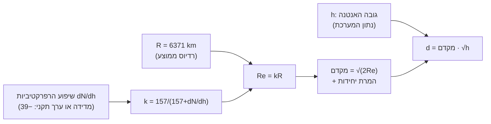

# כרטיסי ההתייעצות

השאלות ששאלתי בתוך השיעורים, ליד הפסקה שעליה שאלתי, עם התשובות.

## M0.1 · שיעור 1 · דציבלים ומשוואת הקשר הבסיסית

### הסבר פשוט · 2026-11-03

ליד: "נניח שיש לנו הספק P ואנחנו רוצים לבטא אותו בייצוג לוגריתמי. לפי מה שראינו, הצעד הראשון הוא"

> נניח שיש לנו הספק P ואנחנו רוצים לבטא אותו בייצוג לוגריתמי. לפי מה שראינו, הצעד הראשון הוא לחלק בהספק ייחוס $P_0$, למשל $P_0=1$ W, ורק אחר כך להפעיל את הלוגריתם:

**שאלה:** הסבר את הקטע המסומן.

**תשובה · claude-opus-5-5:**

הקטע אומר שאי אפשר להפעיל לוגריתם ישירות על הספק. קודם הופכים את $P$ ליחס חסר ממדים, $P/P_0$, ורק את היחס הזה מעבירים ללוגריתם. זה נותן את (7).

**הספק $P$:** אנרגיה ליחידת זמן, גודל פיזיקלי עם יחידות (W).

**ייצוג לוגריתמי:** החלפת גודל במעריך של 10 שנותן אותו, לפי (2): $\log x=y\Leftrightarrow 10^y=x$. מכאן כפל הופך לחיבור, לפי (3).

**הספק ייחוס $P_0$:** ערך קבוע שנבחר במוסכמה, באותן יחידות של $P$. הוא נקודת האפס של הסולם: כש-$P=P_0$, היחס הוא 1 והלוגריתם הוא 0.

**"לפי מה שראינו":** מפנה לחלק קודם בשיעור, שאינו בקטע שלפניי. לפי זיכרון הקורס, שם נקבע שלוגריתם מוגדר רק למספרים חיוביים, ונבנו (1)–(6).

**למה מחלקים קודם.** הלוגריתם מוגדר על מספרים, לא על יחידות. ל-"$\log(5\,\text{W})$" אין משמעות, כי לפי (3) הוא היה צריך להיות $\log 5+\log(\text{W})$, ו-$\log(\text{W})$ אינו מוגדר. החלוקה ב-$P_0$ מבטלת את היחידות, ו-$P/P_0$ הוא מספר טהור וחיובי, שעליו (2) חלה.

**מה משמעות הבחירה ב-$P_0$.** לפי (4), $\log(P/P_0)=\log P-\log P_0$. כלומר $P_0$ רק מזיז את כל הסולם בקבוע ולא משנה הפרשים. לכן אותו הספק יקבל מספרים שונים בייחוסים שונים, וזה מקור (12): $+30$ בין dBm ל-dBW. הבחירה $P_0=1$ W בקטע היא בדיוק הייחוס של dBW, כאן עדיין בבלים, לפני ההכפלה ב-10 שב-(8).

**"ורק אחר כך":** הסדר אינו עניין של סגנון. החלוקה היא תנאי מוקדם לכך שהלוגריתם בכלל מוגדר.

מה ערך (7) כשההספק שווה בדיוק לייחוס, $P=P_0$, ומה זה אומר על המשמעות של 0 בסולם?
---
$\log 1=0$ bel. אפס בסולם הלוגריתמי פירושו "שווה לייחוס", לא "אין הספק".

<<עוד: למה לוגריתם מחייב גודל חסר-ממדים | איך בחירת $P_0$ מזיזה את הסולם | dBW מול dBm מ-(7)>>

**שאלה (דיון):** לא הבנתי כמה דברים לפי מה בוחרים ב-P ולפי מה P0. 
האם פשוט שמים את המספר שלהם ביחס בלי המדד שבו הם נמדדים או שצריך שהם יממדו על ידי מדד שווה?
בנוסף, את הלוגריתם מפעילים על כל אחד הנפרד או על היחס לאחר שקיבלנו מספר?

**תשובה · claude-opus-5-5:**

$P$ הוא ההספק שמודדים או מחשבים, כלומר הנתון. $P_0$ נבחר במוסכמה, וקובע איזו יחידת dB תקבל: $P_0=1$ W נותן dBW, ו-$P_0=1$ mW נותן dBm, לפי (11).

שניהם חייבים להיות באותה יחידה, ואז היא מתבטלת בחלוקה. זה בדיוק התנאי. אם מציבים מספרים מיחידות שונות, היחס שגוי ב-$10^3$ או יותר. לא משנה איזו יחידה משותפת בוחרים: $5\,\text{W}/1\,\text{W}$ ו-$5000\,\text{mW}/1000\,\text{mW}$ נותנים אותו $5$.

את הלוגריתם מפעילים על היחס, אחרי החלוקה, כי רק הוא מספר טהור. לפי (4) אפשר גם לחשב $\log P-\log P_0$ על המספרים בלבד, ותקבל אותה תוצאה בתנאי ששניהם באותה יחידה. אבל כל איבר לבד תלוי בבחירת היחידה וחסר משמעות פיזיקלית. רק ההפרש ביניהם מוגדר.

<<עוד: למה ההפרש בלתי תלוי ביחידה | בחירת ייחוס ב-dBsm ו-dBi | טעות ייחוס נפוצה: W מול mW>>

**שאלה (דיון):** מובן יותר עדיין  לא יושב לי למה איך אני בוחר את P0

**תשובה · claude-opus-5-5:**

$P_0$ לא נגזר מהפיזיקה. הוא נקבע לפי שאלה אחת: ביחס למה אתה רוצה למדוד. יש שני מקרים.

**יחס בין שני גדלים במערכת:** אין בחירה. $P_0$ הוא הגודל השני. בהגבר של מגבר, $P_0$ הוא הספק הכניסה ו-$P$ הוא הספק היציאה. באובדן של כבל ההפך: הכניסה חלקי היציאה. התוצאה היא dB "נקי", בלי סיומת.

**רמה מוחלטת:** $P_0$ הוא ייחוס קבוע שהתחום הסכים עליו, והוא נבחר כך שהמספרים הטיפוסיים יהיו נוחים:
- 1 mW (dBm) במקלטים, שבהם האותות קטנים.
- 1 W (dBW) במשדרים ובחלל.
- 1 m² (dBsm) ל-RCS.
- אנטנה איזוטרופית (dBi) להגבר אנטנה.
- 1 µPa (dB re 1 µPa) בסונאר.

בשני המקרים הבחירה לא משנה שום הפרש, כי לפי (4) $P_0$ רק מזיז את כל הסולם בקבוע. היא משנה רק את המספר שנכתב. לכן חובה לציין את הייחוס (dBm, dBW). מספר ב-dB בלי ייחוס הוא יחס, לא רמה.

<<עוד: למה סונאר אוויר ומים שונים | dBi מול dBd באנטנות | מתי ייחוס עמום גורם לטעויות>>

### הסבר פשוט · 2026-11-03

ליד: "גבולות שני כללים מגדירים את גבולות הייצוג. הראשון: אפשר לקבוע ערך ב-dB רק לגודל חיובי. לגו"

> כשמכשיר מדידה מציג "dB" לאות שהוא אפס בדיוק, למשל ערוץ שקט במחשב, הוא מציג מספר שלילי גדול שרירותי או "‎−∞": זה סימן שהמודל נשבר, לא מדידה.

**שאלה:** הסבר את הקטע המסומן.

**תשובה · claude-opus-5-5:**

הקטע אומר שכאשר הגודל הנמדד הוא אפס בדיוק, אין לו ערך dB, ולכן כל מה שהמכשיר מציג במקרה כזה הוא מוסכמת תצוגה ולא תוצאת מדידה.

**מונחים**

- **"‎−∞" כאן** אינו ערך אלא גבול: $\lim_{x\to0^+}10\log_{10}x=-\infty$. העקומה יורדת ללא חסם כש-$x$ מתקרב לאפס מימין, אבל $10\log 0$ עצמו אינו מוגדר. מכשיר שכותב "‎−∞" מדווח בעצם "הקלט מחוץ לתחום ההגדרה".
- **"המודל נשבר"**: ייצוג dB מניח שהגודל חיובי ממש (ראו (2) והכלל "לוגריתם רק לחיוביים" משיעור 1). ב-$x=0$ ההנחה לא מתקיימת, ולכן גם ההמרה לא מתקיימת. אין כאן "ערך קטן מאוד", יש קלט שהמיפוי אינו חל עליו.

**מה כל חלק עושה**

"אות שהוא אפס בדיוק" קובע את התנאי. המשמעות היא אפס מתמטי, לא "חלש".

"מספר שלילי גדול שרירותי או ‎−∞" מתאר את שתי הדרכים שבהן תוכנה מטפלת בלוג של אפס: או שהיא מציגה את הגבול, או שהיא קוטעת לרצפה קבועה.

"סימן שהמודל נשבר, לא מדידה" היא המסקנה: אל תכניס את המספר הזה לחישוב כאילו היה רמה.

**תיקון ודיוק לטקסט השיעור**

יש בקטע שני ניסוחים לא מדויקים.

1. **"שרירותי"** חזק מדי. הרצפה היא בחירה של המימוש, אבל בדרך כלל היא לא אקראית: לרוב היא נגזרת מאורך המילה הדיגיטלית או מסף תצוגה שהיצרן קבע. מה שנכון הוא שהיא לא מייצגת שום תכונה של האות.
2. **"ערוץ שקט במחשב"** נכון רק לשקט דיגיטלי, כלומר דגימות שערכן אפס בדיוק. ערוץ אנלוגי "שקט" אינו אפס, כי תמיד יש בו רעש (תרמי, קוונטיזציה). לכן מה שהמכשיר מראה במקרה כזה הוא רצפת הרעש, וזו כן מדידה תקפה של גודל חיובי. ההבחנה חשובה: מספר שלילי גדול על המסך יכול להיות מדידה אמיתית של רעש, או דגל של "אפס, לא מוגדר". הטקסט כפי שהוא כתוב מטשטש בין השניים.

<<עוד: למה רצפת התצוגה נקבעת מאורך המילה | dBFS כרמה מוחלטת מול סקאלה מלאה | רעש קוונטיזציה כגבול תחתון מעשי>>

### שאלה · 2026-11-03

ליד: "מהנדס כותב בדוח: "מתח של ‎−5 V על הנגד, כלומר הספק של ‎−5 W, שהם ‎7 dBW‎–". מה לא בסדר?"

> ק. הסימן של המתח רק אומר באיזה כיוון זורם הזרם.
> השנייה ב-dB: גם אילו היה כאן "גודל שלילי" כלשהו, אין לו ערך dB. כדי לכתוב dBW צריך לחשב $10\log(P/1\,\text{W})$, ו-$\log(-5)$ לא מוגדר, כי שום חזקה של 10 אינה שלילית.
> "‎−7 dBW" הוא ערך חוקי לגמרי, אבל הוא אומר משהו אחר: $10^{-0.7}\approx0.2$ W, הספק חיובי וקטן מוואט אחד. הכותב בלבל בין "שלילי" לבין "קטן מהייחוס". הסימן של מספר ליניארי והסימן של ערך dB הם שני דברים שונים לגמרי

**שאלה (דיון):** אין בעיה נוספת שהוא לא השתמש באותה יחידת מדידה והשתמש בW וגם ב-V?

**תשובה · claude-opus-5-5:**

כן, יש כאן טעות שלישית שהשיעור לא ציין. המעבר מוולט לוואט אינו בעיה כשלעצמו, כי הספק מחושב ממתח. הבעיה היא ש"‎−5 V, כלומר ‎−5 W" משווה את המספרים כאילו 1 V שווה 1 W.

ההספק בנגד הוא $P=V^2/R$. בלי $R$ אי אפשר לעבור ממתח להספק. עם 5 V מקבלים $25/R$ W, וזה יוצא 5 W רק אם $R=5\,\Omega$. אפשר גם לקבל 5 W מ-$P=VI$ עם זרם של 1 A, אבל אז, לפי אותה מוסכמת סימנים, זרם של ‎−1 A נותן $(-5)(-1)=+5$ W, ושוב לא הספק שלילי.

התיקון לטקסט השיעור: יש שלוש טעויות, לא שתיים. הספק שלילי, המרה V→W בלי $R$ (או בלי $I$), ו-dB לגודל שלילי.

<<עוד: dBV ולמה מתח נכנס כ-20log | מתי dB מתח שווה dB הספק>>

**שאלה (דיון):** אין בעיה נוספת שהוא לא השתמש באותה יחידת מדידה והשתמש בW וגם ב-V?

**תשובה · claude-opus-5-5:**

כן: המעבר מוולט לוואט לגיטימי, אבל "‎−5 V, כלומר ‎−5 W" מניח בשקט $R=5\,\Omega$, כי $P=V^2/R$, ובלי $R$ (או $I$) אי אפשר לקבוע את ההספק.

**שאלה (דיון):** אוקיי ואת השלישי לא הבנתי ד. הכותב בלבל בין "שלילי" לבין "קטן מהייחוס". הסימן של מספר ליניארי והסימן של ערך dB הם שני דברים שונים לגמרי.

**תשובה · claude-opus-5-5:**

מספר ליניארי שלילי פירושו גודל מתחת לאפס, שלהספק בלתי אפשרי, ואילו dB שלילי פירושו רק יחס קטן מ-1 לייחוס: ‎−7 dBW הם כ-0.2 W, הספק חיובי.

**שאלה (דיון):** כן אבל זה לא טעות נוספת לא? זה פשוט אותה טעות כמו ההספק...

**תשובה · claude-opus-5-5:**

נכון שזו לא טעות נוספת, אבל היא גם לא טעות ההספק: זה ההסבר לטעות השנייה, כי $\log$ של מספר שלילי אינו מוגדר לכל גודל שהוא, לא רק להספק.

**שאלה (דיון):** כאילו הבעיה זה לא dB שלילי אלא ההכנסה ללוג מספר שלישי (היחס)

**תשובה · claude-opus-5-5:**

נכון: dB שלילי חוקי לגמרי. הטעות היא הכנסת יחס שלילי, $P/1\,\text{W}=-5$, ללוג, ושם הוא אינו מוגדר; ה"‎−7" שבדוח הוא סימן שהועתק מהליניארי, לא תוצאה של חישוב.

### שאלה · 2026-11-03

ליד: "כדי לבטא ערך מוחלט ב-dB, קודם מחלקים אותו בערך ייחוס קבוע ומוסכם, ורק את היחס שמתקבל מעביר"

> כדי לבטא ערך מוחלט ב-dB, קודם מחלקים אותו בערך ייחוס קבוע ומוסכם, ורק את היחס שמתקבל מעבירים ל-dB. הדוגמה הנפוצה ביותר היא עוצמת אות ב-dBm. כדי להעביר הספק ל-dBm מחלקים אותו במיליוואט אחד, ואז מפעילים את (9):
> 
> $$P(\text{dBm})=10\log_{10}\!\left(\frac{P}{1\,\text{mW}}\right) \tag{11}$$

**שאלה (דיון):** לא אמרנו שההפך רוצים להמיר את ה-dB ליחידות המשך?

**תשובה · claude-opus-5-5:**

שני הכיוונים קיימים, והפסקה הזו מתארת רק אחד מהם: מערך מוחלט אל dB. ההמרה ההפוכה, מ-dB חזרה ליחידות פיזיקליות, מופיעה בהמשך אותו סעיף לפי (10): $36/10=3.6$, ואז $10^{3.6}\approx3981$ mW.

הנקודה שבה הפסקה מדייקת: אי אפשר להמיר "dB" ליחידות. dB הוא יחס טהור, ו-$10^{N/10}$ מחזיר מספר בלי יחידה. כדי לקבל וואטים צריך לדעת ביחס למה נלקח היחס. בדיוק את זה ה-"m" ב-dBm מקבעת. לכן ההמרה ההפוכה המלאה היא

$P=1\,\text{mW}\cdot10^{P(\text{dBm})/10}$,

כלומר היפוך של (11): קודם (10), ואחר כך הכפלה בייחוס. אם בכיוון ההפוך משמיטים את הכפלה בייחוס, נשארים עם מספר ולא עם הספק.

<<עוד: למה dBm ועוד dBm אסור | המעבר dBm↔dBW לפי (12)>>

**שאלה (דיון):** תסביר את הרעיון שוב (תתיחס גם להמשך מעין סיכום של הרעיון)

**תשובה · claude-opus-5-5:**

dB מתאר רק יחס. לכן ערך מוחלט נכנס ל-dB רק דרך ייחוס קבוע, והייחוס חוזר ביציאה. כל השאר נובע מזה.

**הכיוון קדימה, (11).** מחלקים את ההספק בייחוס כדי לקבל מספר טהור, ורק עליו מפעילים לוגריתם. במשדר של 4 W: $4000\,\text{mW}/1\,\text{mW}=4000$, ואז $10\log4000=36.02$ dBm. ה-"m" ביחידה אומרת שהייחוס הוא 1 mW.

**הכיוון חזרה, (10) ואחריה הכפלה בייחוס.** $10^{36/10}\approx3981$, ואחרי הכפלה ב-1 mW מקבלים 3981 mW. ההפרש מ-4000 mW נובע מהעיגול של 36.02 ל-36. ההשמטה של 0.02 dB שווה ל-0.47% בהספק.

**תיקון לטקסט השיעור.** בסוף הסעיף כתוב ש"מספר שלם של dB הוא דיוק מספיק", ולכך מובאת כראיה שגיאה של 0.01 dB (כרבע אחוז). זה לא מוכיח את הטענה. עיגול למספר שלם יכול להשמיט עד 0.5 dB, כלומר $10^{0.05}\approx1.12$ (הערכה ידנית), שגיאה של כ-12% בהספק. בדוגמה הזו השגיאה קטנה רק מפני ש-36.02 קרוב במקרה למספר שלם. הניסוח המדויק: שגיאה של עשיריות dB זניחה ביחס לפיזור רכיבים ולשגיאות מדידה. מספר שלם של dB מספיק לאומדן, לא לכל עבודה מעשית.

**הסיכום.** ערך מוחלט ב-dB הוא בעצם זוג: מספר ב-dB ויחידת ייחוס. המרה בכל כיוון חייבת לעבור דרך הייחוס.

<<עוד: dBW מול dBm, ההפרש 30 | למה 3 dB אינו פי 2 | שגיאת עיגול מקסימלית בשרשרת>>

### שאלה · 2026-11-03 · (הוסר מהשיעור)

ליד: "P(dBm)=10log⁡10 ⁣(P1 mW)(11)P(\text{dBm})=10\log_{10}\!\left(\frac{P}{1\,\text{mW}}\right)"

> P(dBm)=10log10​(1mWP​)

**שאלה (דיון):** ופה לא הבנתי מאיפה בא m ויש פה בעצם שני נקודות ייחוס שהם לא dB המוכר.

**תשובה · claude-opus-5-5:**

יש כאן נקודת ייחוס אחת בלבד, 1 mW, וה-"m" ביחידה היא רק התווית שלה. "dBm" פירושו "dB ביחס למיליוואט".

זה אותו dB שאתה מכיר מ-(8): $10\log(P/P_0)$. ב-(8) $P_0$ הוא כל ערך שבוחרים, ולכן התוצאה היא יחס בין שני גדלים. ב-(11) קובעים $P_0=1\,\text{mW}$ פעם אחת לתמיד. היחס נשאר מספר טהור, אבל כיוון שהמכנה ידוע, מספר ה-dB מקודד ערך מוחלט. ה-"m" שבשם היחידה רק מציינת איזה $P_0$ נבחר. לכן 36 dBm הוא בדיוק 36 dB מעל 1 mW.

אם "שתי הנקודות" הן ה-1 mW במכנה וה-4000 mW במונה, אז הכתיבה של 4 W כ-4000 mW אינה ייחוס שני. זו רק המרת יחידות, כדי שהיחידות יתבטלו ויישאר מספר טהור שמותר להפעיל עליו לוגריתם.

אותו עיקרון בדיוק נותן את dBW, עם ייחוס של 1 W. ההפרש בין 1 W ל-1 mW הוא פי 1000, כלומר 30 dB, ומכאן (12): $P(\text{dBm})=P(\text{dBW})+30$.

<<עוד: למה dBm+dBm אינו dBm | dBsm ו-dBi באותו עיקרון | בחירת ייחוס: מיליוואט מול וואט>>

**שאלה (דיון):** ו-P זה היחס?

**תשובה · claude-opus-5-5:**

לא. $P$ הוא ההספק עצמו, גודל מוחלט עם יחידות (למשל 4 W). היחס הוא $P/1\,\text{mW}$, המספר הטהור שבתוך הסוגריים ב-(11), ובדוגמה הוא 4000.

הבלבול מגיע מהסימון: אותה אות מופיעה בשני האגפים. $P(\text{dBm})$ באגף שמאל אינו גודל אחר. זה אותו הספק $P$, כתוב בסולם לוגריתמי ביחס ל-1 mW. מבחינה פורמלית אפשר היה לכתוב $L_P=10\log_{10}(P/P_0)$, כלומר "הרמה של $P$". הנדסת RF חוסכת את האות הנוספת ושמה את היחידה בסוגריים.

כך שיש שלושה דברים נפרדים: $P$ (ההספק, 4 W), היחס $P/P_0$ (המספר 4000) ו-$P(\text{dBm})$ (הרמה, 36.02 dBm).

<<עוד: למה לוגריתם רק למספר טהור | סימון $L_P$ בתקן ISO 80000 | dBm פחות dBm נותן dB>>

**שאלה (דיון):** לא הבנתי אני מכיר רק את P היחס $P/P_0$

**תשובה · claude-opus-5-5:**

ב-(8) $P$ אינו היחס. $P$ ו-$P_0$ הם שני הספקים, כל אחד עם יחידות, והיחס הוא המנה שלהם $P/P_0$.

כנראה הבלבול מגיע מ-(9), $N(\text{dB})=10\log N$. שם האות $N$ היא היחס עצמו, מספר טהור. (8) הוא אותו דבר, רק שבמקום $N$ כתבו את המנה במפורש: $N=P/P_0$.

ב-(11) זה נראה כך:
- $P=4\,\text{W}$, ההספק הנמדד.
- $P_0=1\,\text{mW}$, הייחוס הקבוע.
- $N=P/P_0=4000$, היחס, המקבילה של $N$ ב-(9).
- $10\log N=36.02$, וזה מה שנכתב כ-$P(\text{dBm})$.

ההבחנה: מה שמופיע עם יחידות (W, mW) הוא הספק, ומה שיוצא בלי יחידות הוא יחס.

<<עוד: למה לוגריתם רק למספר טהור | הגבר כיחס $P_{out}/P_{in}$ | מתי $P_0$ נבחר חופשי>>

**שאלה (דיון):** אין N ב-11...

**תשובה · claude-opus-5-5:**

נכון, $N$ לא מופיע ב-(11). אני הוספתי אותו בתור הקודם כדי לקשר ל-(9), וזה בלבל. אתקן: (11) כתוב ישירות במונחי $P$, בלי אות נפרדת ליחס.

הקשר בין (9) ל-(11) הוא הצבה. (9) היא $N(\text{dB})=10\log N$ עבור כל מספר טהור $N$. הטקסט אומר "מחלקים במיליוואט אחד, ואז מפעילים את (9)". כלומר מציבים במקום $N$ את המנה $P/1\,\text{mW}$, ומה שמתקבל הוא (11):

$P(\text{dBm})=10\log_{10}(P/1\,\text{mW})$

ב-(11) המנה עצמה ממלאת את התפקיד של $N$. היא לא מקבלת שם משלה, ובדוגמה ערכה 4000.

<<עוד: (11) כמקרה פרטי של (8) | למה dBW שונה ב-30 בדיוק | למה לוגריתם רק למספר טהור>>

### הסבר פשוט · 2026-11-03

ליד: "נעבור על הדוגמה המלאה, משדר שמוציא 4 W, צעד אחר צעד. קודם מביאים את ההספק ליחידה של הייחוס"

> נעבור על הדוגמה המלאה, משדר שמוציא 4 W, צעד אחר צעד.
> קודם מביאים את ההספק ליחידה של הייחוס: ‏4 W הם 4000 mW.
> מחלקים בייחוס: ‏$4000\,\text{mW}/1\,\text{mW}=4000$. זה מספר טהור, ולכן מותר להפעיל עליו לוגריתם.
> מוצאים את הלוגריתם: ‏$\log4000=3.602$. ‏4000 נמצא בין $10^3$ ל-$10^4$, ולכן המעריך שלו בין 3 ל-4.
> מכפילים ב-10 ומקבלים $36.02$, כלומר כ-36 dBm.
> ה-"m" הקטנה שבסוף היחידה מציינת שהיחס נלקח ביחס למיליוואט.
> 
> ההמרה חזרה הולכת לפי (10). מחלקים את 36 ב-10 ומקבלים 3.6, ואז מחשבים $10^{3.6}=3981$ mW. זה בערך 4000 mW, כלומר 4 W. מאיפה ההפרש של 19 mW? מהעיגול. הערך המדויק היה 36.02 dBm, ועיגלנו אותו ל-36. השארית שהשמטנו, 0.02 dB, שווה ליחס $10^{0.002}=1.0047$, כלומר 0.47%. זו גם ההוכחה הכי פשוטה לכך שבכל עבודה מעשית מספר שלם של dB הוא דיוק מספיק: שגיאה של מאית dB היא רבע אחוז. רכיבים במערכת אמיתית שונים זה מזה יותר מזה, ושגיאות המדידה גדולות יותר. מעכשיו, כשנכתוב "4 W הם 36 dBm", נדע שזה עיגול שמאבד חצי אחוז.
> 
> 36

**שאלה:** הסבר את הקטע המסומן.

**תשובה · claude-opus-5-5:**

הקטע ממיר הספק מוחלט של 4 W ל-dBm בארבעה צעדים, ממיר בחזרה, ומשתמש בהפרש שנוצר מהעיגול כדי לטעון שמספר שלם של dB הוא דיוק מספיק. הטענה האחרונה הזאת שגויה כפי שהיא מנוסחת, והתיקון מופיע בהמשך.

**מונחים**

ערך ייחוס הוא גודל קבוע ומוסכם $P_0$ באותן יחידות של $P$. החלוקה בו הופכת את $P$ למספר טהור, והמספר הזה הוא מה שעובר ל-dB לפי (8)–(9). היחידה dBm היא רמה מוחלטת: dB ביחס ל-$P_0=1\,\text{mW}$, כמו ב-(11).

מספר טהור הוא גודל חסר ממדים. רק עליו מוגדר לוגריתם, כי $\log(\text{W})$ אינו גודל בעל משמעות.

עיגול לוגריתמי: אם רמה ב-dB עוגלה ב-$\Delta$ dB, השגיאה היחסית בגודל הליניארי היא $10^{\Delta/10}-1$. זה נובע ישירות מ-(10).

**מה כל חלק עושה**

הצעד הראשון, 4 W = 4000 mW, מביא את $P$ ליחידות של $P_0$. אפשר היה לחלק גם ישירות, $4\,\text{W}/10^{-3}\,\text{W}$. המטרה היא רק שהיחידות יתבטלו.

הצעד השני, החלוקה, מייצר את המספר הטהור 4000. המשפט על "מותר להפעיל לוגריתם" מנסח את התנאי שלמעלה.

הצעד השלישי, $\log4000\approx3.602$, מגיע עם בדיקת סבירות: $10^3<4000<10^4$, ולכן הלוגריתם בין 3 ל-4. מבחינה מבנית, לפי (3): $\log4000=\log4+\log1000=0.602+3$. החלק השלם בא מהחזקה של 10, והשבר בא מ-4.

הצעד הרביעי הוא הכפלה ב-10, שנותנת $36.02$ dBm. זה (11) עצמה.

ההמרה חזרה לפי (10), $10^{3.6}\approx3981$ mW, מראה שהמעבר הלוך-חזור משמר את הערך עד כדי העיגול. ההפרש של כ-19 mW (כ-0.47%) נובע רק מכך ש-36.02 עוגל ל-36.

**טעויות בטקסט השיעור**

הטעות העיקרית היא במסקנה "מספר שלם של dB הוא דיוק מספיק". הדוגמה מוכיחה רק ש-4 W יושב במקרה 0.02 dB מעל מספר שלם. עיגול לשלם יכול לאבד עד 0.5 dB, כלומר $10^{0.05}\approx1.122$, שגיאה של כ-12% בהספק. ההערכה הזאת חושבה בראש, לא בכלי. לכן אחד המקרים אינו הוכחה למקרה הכללי. הטענה הנכונה: שגיאת העיגול לשלם חסומה ב-±0.5 dB, כלומר כ-+12% או ‎−11% בהספק. האם זה מספיק תלוי בשגיאות האחרות בתקציב, כמו פיזור רכיבים ושגיאות מדידה, שבדרך כלל מסדר של dB. הטיעון הזה תקף, אבל הוא טיעון אחר.

טעות קטנה: הטקסט מעגל את השארית ל-0.02 dB, אבל כותב $10^{0.002}=1.0047$. לפי הערכה, $10^{0.002}\approx1.0046$. הערך 1.0047 מתאים לשארית המדויקת 0.0206 dB, שכן $4000/3981\approx1.0048$. המסקנה של כחצי אחוז נשארת נכונה. רק הניסוח לא עקבי.

הערה על הניסוח: הצירוף "מאית dB היא רבע אחוז" נכון ($10^{0.001}\approx1.0023$, הערכה). אבל הוא מופיע מיד אחרי שארית של שתי מאיות, ולכן מבלבל. וכאמור, הוא לא רלוונטי לעיגול לשלם.

בנוסף, ה-"36" הבודד בסוף הקטע המסומן לא מופיע ב-<section>. כנראה זה שארית של הסימון ולא חלק מהטקסט.

<<עוד: חסם שגיאה בעיגול לחצי dB | למה $\log4=0.602$ בדיוק $2\log2$ | השוואת אותה המרה ב-dBW>>

**שאלה (דיון):** $$ N=10^{\,N(\text{dB})/10} $$ zv cgmo tu,v vnr, jzrv kt?

**תשובה · claude-opus-5-5:**

כן. זו בדיוק (10), ההמרה חזרה שבקטע. היא ההפכית של (9), ונובעת ישירות מהגדרת הלוגריתם (2): אם $N(\text{dB})/10=\log N$, אז $N=10^{N(\text{dB})/10}$.

בקטע, $N$ הוא היחס $P/1\,\text{mW}$ ולא ההספק עצמו. לכן מה שיוצא מ-$10^{36/10}=10^{3.6}\approx3981$ הוא מספר טהור, ורק הכפלה בייחוס מחזירה הספק: $3981\cdot1\,\text{mW}$. בצורה כללית לרמה מוחלטת: $P=P_0\cdot10^{L/10}$.

הערה לגבי החלוקה ב-10: היא נכונה רק לגדלי הספק. לגדלי שדה, מתח או לחץ, שבהם הרמה מוגדרת כ-$20\log$, ההמרה חזרה היא $10^{L/20}$, כמו ב-(35).

<<עוד: למה $20\log$ לגדלי שדה | פונקציה הפכית ועיגול: התפשטות שגיאה | המרה חזרה מ-dBW לעומת dBm>>

**שאלה (דיון):** תוכל להציג את זה מוסדר עם אותיות בלי הדוגמא כדי שאשים בסיכום?

**תשובה · claude-opus-5-5:**

ההמרה בין גודל מוחלט לרמה ב-dB, בצורה כללית ובסימני השיעור:

נתונים: גודל הספק $P>0$ וערך ייחוס $P_0$ באותן יחידות. למשל $P_0=1\,\text{mW}$ ל-dBm או $1\,\text{W}$ ל-dBW.

1. יחס טהור: $r=P/P_0$, גודל חסר ממדים, $r>0$.
2. רמה, לפי (8)–(9): $L=10\log_{10}(P/P_0)$, ביחידות dB ביחס ל-$P_0$. זו (11) כש-$P_0=1\,\text{mW}$.
3. המרה חזרה, לפי (10): $P=P_0\cdot10^{L/10}$.
4. גדלי שדה, כמו מתח, שדה או לחץ, עם ייחוס $X_0$: $L=20\log_{10}(X/X_0)$ ו-$X=X_0\cdot10^{L/20}$.
5. שגיאת עיגול: עיגול הרמה ב-$\Delta$ dB נותן שגיאה יחסית בהספק של $10^{\Delta/10}-1$. בעיגול לשלם $|\Delta|\le0.5$, ולכן השגיאה בין כ-‎−10.9% לכ-+12.2%. אלה ערכי הערכה, לא חישוב בכלי.

<<עוד: למה לשדה 20 ולא 10 | מעבר בין ייחוסים: dBm↔dBW | שגיאת עיגול בגדלי שדה>>

**שאלה (דיון):** בלי L עם מושגי משוואה 10

**תשובה · claude-opus-5-5:**

אותו סיכום בסימני (9)–(10), כש-$N$ הוא היחס הטהור ו-$N(\text{dB})$ הוא הרמה:

1. יחס טהור: $N=P/P_0$, כאשר $P>0$ ו-$P_0$ הוא ערך הייחוס באותן יחידות ($1\,\text{mW}$ ל-dBm, $1\,\text{W}$ ל-dBW).
2. רמה, לפי (9): $N(\text{dB})=10\log_{10}N$.
3. המרה חזרה, לפי (10): $N=10^{\,N(\text{dB})/10}$, ומכאן $P=P_0\cdot N$.
4. גדלי שדה (מתח, שדה, לחץ) עם $N=X/X_0$: $N(\text{dB})=20\log_{10}N$ ו-$N=10^{\,N(\text{dB})/20}$.
5. שגיאת עיגול: אם $N(\text{dB})$ מעוגל ב-$\Delta$ dB, אז $N$ מוכפל ב-$10^{\Delta/10}$. בעיגול לשלם $|\Delta|\le0.5$, ולכן השגיאה היחסית בין כ-‎−10.9% לכ-+12.2% (הערכה, לא חישוב בכלי).

הערה על הסימון: ב-(10) האות $N$ משמשת גם ליחס וגם, בתוך הסוגריים, לרמה. בסיכום כדאי לכתוב תמיד $N(\text{dB})$ במלואו, כדי שלא יתקבל $N=10^{N/10}$, שנראה כמו משוואה ב-$N$.

<<עוד: למה 20 log לגדלי שדה | גזירת (10) מתוך (2) | חסם שגיאה לעיגול לחצי dB>>

### הסבר פשוט · 2026-11-03

ליד: "שתי השורות האחרונות דורשות הסבר. dBsm (‏dB square meter) הוא dB של שטח ביחס למטר רבוע אחד."

> שתי השורות האחרונות דורשות הסבר. dBsm (‏dB square meter) הוא dB של שטח ביחס למטר רבוע אחד. משתמשים בו לשטח של אנטנה, ולחתך המכ"ם (RCS) של מטרה, שהוא שטח אפקטיבי. dBi הוא הגבר אנטנה ביחס להגבר של אנטנה איזוטרופית. לכן 0 dBi הוא, בהגדרה, ההגבר של אנטנה איזוטרופית. אנטנה של 30 dBi מרכזת בכיוון הקרן שלה פי 1000 יותר הספק לכל יחידת שטח ממה שהייתה מקבלת אנטנה איזוטרופית מאותו משדר. במקרה של dBi, הייחוס אינו יחידה פיזיקלית כמו וואט או מטר, אלא אנטנה מושגית. המבנה זהה בכל ארבע השורות: גודל חלקי ייחוס, לוגריתם, כפול 10.

**שאלה:** הסבר את הקטע המסומן.

**תשובה · claude-opus-5-5:**

הקטע מסביר שתי שורות בטבלה 2.1 שבהן הגודל אינו הספק: ב-dBsm הגודל הוא שטח וב-dBi הוא הגבר. בשתיהן ההגדרה זהה ל-dBm, $10\log(\text{גודל}/\text{ייחוס})$, ומשתנה רק הייחוס.

**המונחים**

- **ייחוס**: הגודל שבו מחלקים לפני הלוגריתם. הוא קובע מה פירוש "0" בסולם. ב-dBsm הוא $1\,\text{m}^2$, וב-dBi הוא $G_{iso}=1$.
- **שטח אפקטיבי של אנטנה**: היחס בין ההספק שהאנטנה מוסרת לעומס לבין צפיפות ההספק של הגל הפוגע, $A=P/S$. זה גודל חשמלי ולא השטח הגאומטרי של המתכת. זה השטח שהופיע ב-(23) וב-(32).
- **חתך מכ"ם (RCS, $\sigma$)**: השטח שמטרה הייתה צריכה כדי ליירט את הגל הפוגע ולפזר אותו באופן איזוטרופי, כך שבמקלט תתקבל אותה צפיפות הספק שהמטרה האמיתית מחזירה. גם זה שטח אפקטיבי, והוא יכול להיות גדול או קטן בהרבה מהחתך הגאומטרי.
- **אנטנה איזוטרופית**: אנטנה מושגית שמקרינה באופן שווה לכל הכיוונים. היא אינה ניתנת למימוש פיזי, ומשמשת כייחוס בלבד.
- **הגבר אנטנה $G$**: היחס בין צפיפות ההספק שהאנטנה יוצרת בכיוון נתון (בדרך כלל כיוון המקסימום) לבין צפיפות ההספק שאנטנה איזוטרופית הייתה יוצרת באותו מרחק, כשהיא מוזנת באותו הספק. האנטנה אינה מוסיפה הספק, היא רק מחלקת מחדש את ההספק בין הכיוונים.

**מה כל חלק עושה**

החלק על dBsm מגדיר אותו כ-$10\log(A/1\,\text{m}^2)$ ומציין את שני השימושים: שטח אנטנה ו-RCS. נקודה שהטקסט לא אומר: שטח אינו גודל הספקי, ובכל זאת מקדם הלוגריתם הוא 10 ולא 20. הסיבה היא ששטח נכנס לחישוב כמכפיל ליניארי של הספק, $P=S\cdot A$ (וכך גם $\sigma$ ב-(37) ו-(38)). לכן $10\log A$ מתחבר ישירות ל-dBm. זו בדיוק הטעות "$20\log\sigma$ במקום 10" שברשימת הטעויות של הקורס.

החלק על dBi מגדיר $10\log(G/G_{iso})$. מכיוון ש-$G_{iso}=1$ בהגדרה, זה בפועל $10\log G$, ולכן 0 dBi הוא ההגבר האיזוטרופי.

המשפט על 30 dBi מתרגם את המספר חזרה לפיזיקה, לפי (10): $10^{30/10}=1000$. כאן יש בטקסט שני ניסוחים לא מדויקים:
- כתוב "ממה שהייתה **מקבלת** אנטנה איזוטרופית". צריך להיות "ממה שהייתה **יוצרת** אנטנה איזוטרופית מאותו משדר, באותו מרחק". ההשוואה היא בין צפיפויות הספק בנקודה רחוקה, לא בין הספקים שנקלטים.
- "פי 1000" נכון רק בכיוון שבו מוגדר ה-$G$, בדרך כלל מרכז הקרן. בכיוונים אחרים ההגבר נמוך יותר, לעיתים מתחת ל-0 dBi.

המשפט "הייחוס אינו יחידה פיזיקלית אלא אנטנה מושגית" מבחין בין שני סוגי רמות. dBm, dBW ו-dBsm הם רמות מוחלטות, יחסית ליחידה. dBi הוא יחס בין שני גדלים חסרי ממד. לכן dBi מתנהג בתבניות (15)–(17) כמו dB רגיל: מותר לחבר אותו ל-dBm ולקבל dBm, כמו ב-(19).

המשפט המסכם, "גודל חלקי ייחוס, לוגריתם, כפול 10", הוא ההגדרה הכללית (8). היא מוכללת לכל גודל חיובי שמתנהג כהספק, כלומר נכנס לשרשרת כמכפיל של הספק.

<<עוד: גבר מול כיווניות (directivity) | dBd מול dBi: הפרש 2.15 | למה RCS שונה משטח גאומטרי>>

### שאלה · 2026-11-03 · (הוסר מהשיעור)

ליד: "השאלה. מהנדס שמתכנן מקלט GPS צריך לעקוב אחרי האות מהלוויין ועד המקלט, ולבדוק אם יש לו מרוו"

> אות GPS: מ-20 וואט בלוויין ל-10⁻¹⁶ וואט בקרקע
> השאלה. מהנדס

**שאלה (דיון):** זה כאילו פחות מפיקו וואט בקרקע?

**תשובה · claude-opus-5-5:**

כן, ובהרבה: האות בקרקע הוא $1.41\cdot10^{-16}$ W, כלומר בערך 141 אטו-וואט ($10^{-18}$ W), ולא בסדר גודל של פיקו-וואט.

ב-dB רואים את זה בחיסור אחד: 1 pW הוא $-120$ dBW, והאות הוא $-158.5$ dBW. האות נמצא אפוא 38.5 dB מתחת לפיקו-וואט, כלומר חלש ממנו פי $10^{3.85}\approx7{,}000$ (חישוב בראש, הערכה).

"פיקו-וואט וחצי" מופיע בהמשך ה-section, אבל שם מדובר בהספק ההפרעה שהמקלט עוד סובל: $-118.6$ dBW, שהם $1.38\cdot10^{-12}$ W. זה האות ($-158.5$) ועוד 39.9 dB של J/S, ולכן הוא גדול מהאות פי כ-10,000.

<<עוד: אטו-וואט ביחס לרעש התרמי | למה J/S מוגדר ביחס לאות | רמת האות כשדה ב-µV/m>>

### שאלה · 2026-11-03

ליד: "עד כאן בנינו את כל השפה: dB הוא יחס, ורמה מוחלטת היא יחס לייחוס שמופיע בשם היחידה. עדיין ח"

> 27.5 dB הם בערך פי 560

**שאלה (דיון):** איך זה לא מתקרב מאוד ל-30?

**תשובה · claude-opus-5-5:**

**27.5 dB קרוב ל-30 dB בסולם הלוגריתמי, אבל פער של 2.5 dB הוא יחס של כמעט פי 2 ולא תוספת קטנה.** לכן התוצאה היא כמחצית מ-1000 ולא כמעט 1000.

ב-dB, הפרש קבוע הוא יחס קבוע. לפי (10):

$27.5 = 30 - 2.5 \Rightarrow 10^{27.5/10} = 10^{3}\cdot10^{-0.25} = 1000/1.78 \approx 562$

הערה: 1.78 הוא ערך משוער, לא מכלי חישוב.

בדיקה בראש: 3 dB הם בערך פי 2. 2.5 dB קצת פחות, ולכן התוצאה קצת יותר מ-500.

אותו מספר כבר הופיע בפסקה בצורה הפוכה: הקטנת החתך ב-10 dB הקטינה את הטווח ב-$10/4 = 2.5$ dB, כלומר פי 1.78. "קרוב ב-dB" פירושו "קרוב ביחס", ופער של 2.5 dB אינו קרוב.

<<עוד: טבלת dB↔ליניארי לזיכרון | למה 1 dB הוא כ-26% | שגיאת עיגול של 3 dB לפי 2>>

### שאלה · 2026-11-03 · (הוסר מהשיעור)

ליד: "נתחיל בשלוש התבניות. כל משוואת dB בקורס הזה, ארוכה ככל שתהיה, בנויה מאחת משלוש תבניות או מ"

> כל משוואת dB בקורס הזה, ארוכה ככל שתהיה, בנויה מאחת משלוש תבניות או משילוב שלהן. מספר האיברים בה לא משנה. כשמכירים את שלוש התבניות, כל משוואה נבדקת בבדיקת יחידות פשוטה,

**שאלה (דיון):** יש פה בקורס מכלל סוגי ההנדסה זה נכון לכתוב אז כמעט בכל סוגי ההנדסה?

**תשובה · claude-opus-5-5:**

כן, בכל תחום שבו dB הוא $10\log$ של יחס הספקים או $20\log$ של יחס גדלי שדה, וכל עוד המשוואה הפיזיקלית היא מכפלה של חזקות. התנאי הוא מתמטי ולא תלוי תחום: אם $y=k\prod x_i^{a_i}$, אז $10\log y=10\log k+\sum 10a_i\log x_i$. כל איבר כזה הוא קבוע, יחס, או $N\log x$, כלומר התבניות (15) עד (17). זה חל על אקוסטיקה וסונאר, דיאגרמות Bode בבקרה, אודיו, סיבים אופטיים ו-EMC. ב-dBV, ‏dBµV/m ו-dB re 1 µPa מקבלים אותו מבנה עם $20\log$.

הטקסט מנסח את זה רחב מדי. התבניות מכסות רק קשרים כפליים, ואינן מכסות סכום של גדלים. שתי דוגמאות לכך:

- חיבור הספקים לא קוהרנטיים, (14), שכבר בקורס: $P_{tot}=10\log(10^{P_1/10}+10^{P_2/10})$, וזו אינה אף אחת מהתבניות.
- נוסחת Friis לשרשור רעש, $F=F_1+(F_2-1)/G_1+\dots$, שאותה מחשבים בליניארי ולא ב-dB.

לכן ניסוח מדויק למאמר: "כל קשר כפלי בין גדלים, אחרי מעבר ל-dB, נבנה משלוש התבניות. סכומים של הספקים יוצאים מהן ומחייבים חזרה לליניארי."

<<עוד: למה רעש מחושב בליניארי | dB בדיאגרמות Bode | חיבור קוהרנטי מול לא קוהרנטי>>

### הסבר פשוט · 2026-11-03

ליד: "A(dBm)±B(dB)=C(dBm)(15)A(\text{dBm})\pm B(\text{dB})=C(\text{dBm}) \tag{15}A(dBm)±B(dB)=C("

> A(dBm)±B(dB)=C(dBm)

**שאלה:** הסבר את הקטע המסומן.

**תשובה · claude-opus-5-5:**

משוואה (15) אומרת שכאשר מוסיפים לרמה מוחלטת יחס טהור, או מחסירים ממנה יחס טהור, מתקבלת שוב רמה מוחלטת באותה יחידה. כך מתארים מעבר של אות דרך רכיב שמגביר או מנחית אותו.

**המונחים**

רמה מוחלטת ($A$, $C$) היא $10\log(P/P_0)$, כאשר $P_0$ הוא ערך ייחוס פיזיקלי קבוע. ב-dBm הייחוס הוא $P_0=1\,\text{mW}$, לפי (11). המספר מייצג הספק ממשי, ויש לו משמעות רק יחד עם הייחוס.

יחס ($B$) הוא $10\log N$ עבור $N$ חסר ממדים, לפי (9). הוא מייצג פי-כמה, לא כמות. אין בו ייחוס, ולכן היחידה היא dB בלבד.

הגבר הוא $N=P_{out}/P_{in}$. אובדן הוא $N=P_{in}/P_{out}$, כלומר ההופכי, כפי שנקבע בשיעור 1.

**מה כל חלק עושה**

$A(\text{dBm})$ הוא ההספק שנכנס לרכיב, ביחס ל-1 mW.

$B(\text{dB})$ הוא פעולת הרכיב. בתחום הליניארי זו הכפלה ב-$G$. בתחום הלוגריתמי, לפי כלל הכפל (3), הכפלה הופכת לחיבור: $10\log\frac{PG}{1\,\text{mW}}=10\log\frac{P}{1\,\text{mW}}+10\log G$.

$\pm$: הפלוס מתאים להגבר. המינוס מתאים לאובדן, כי אובדן $L$ הוא היחס ההפוך, ולכן $10\log(1/L)=-10\log L$. הערה אחת שלא מופיעה בטקסט: הסימן הוא עניין של מוסכמה. אפשר גם לכתוב אובדן כהגבר שלילי ולחבר, למשל $+(-3\,\text{dB})$. התוצאה זהה. מה שחשוב הוא לא להפוך את הסימן פעמיים.

$C(\text{dBm})$: הייחוס 1 mW מופיע רק באיבר של $A$, ולכן הוא עובר לתוצאה. זו הסיבה ש-$C$ נשאר מוחלט ונמדד ב-dBm.

**המשמעות המבנית**

מכאן נובע הכלל משיעור 1: לכל היותר איבר מוחלט אחד בכל אגף. המספר של $C$ יוצא נכון גם בלי הכלל, אבל הכלל הוא שמבטיח שליחידה שלו יש משמעות. אם מחברים שני איברים מוחלטים, למשל dBm ועוד dBm, הייחוס מופיע פעמיים. מתקבל $10\log\frac{P_1P_2}{(1\,\text{mW})^2}$, כלומר מכפלת הספקים, שאינה הספק.

**הדוגמה בטקסט**

הדוגמה עקבית: $36+20=56$ dBm, ו-$10^{5.6}$ mW ≈ 398 W. זו הערכה, לא חישוב בכלי. אין טעות בקטע.

<<עוד: למה dBm+dBm אינו dBm | תבנית (16): הפרש רמות נותן dB | שרשרת רכיבים כסכום יחסים>>

---

## M0.1 · שיעור 2 · דציבלים ומשוואת הקשר הבסיסית

### שאלה · 2026-11-04

ליד: "אבחון קצר לפני שממשיכים. ענו על שלוש השאלות בלי מחשבון. (א) משדר של 2 W מחובר לאנטנה עם הג"

> $10^{100/10} = 10^{10}$. ההספק שמגיע הוא אחד חלקי עשרה מיליארד מההספק שנכנס.

**שאלה (דיון):** לפי איזו נוסחא זו?

**תשובה · claude-opus-5-5:**

זו משוואה (10) משיעור 1: $N = 10^{N(\text{dB})/10}$, ההפיכה של (9), $N(\text{dB}) = 10\log N$. המעבר ביניהן הוא הגדרת הלוגריתם (2): $\log x = y \Leftrightarrow 10^y = x$. מחלקים את 100 dB ב-10 כדי לבטל את הגורם 10 שלפני ה-log, ומקבלים $\log N = 10$, ולכן $N = 10^{10}$.

הכיוון נקבע לפי הגדרת האובדן מטבלה 2.1: אובדן הוא in/out. לכן $P_{in}/P_{out} = 10^{10}$, כלומר $P_{out} = P_{in}\cdot 10^{-10}$, וזה מה שכתוב בפסקה. אילו זה היה הגבר (out/in), היחס היה הפוך.

<<עוד: למה 10 ולא 20 כאן | אנטילוג בראש לערכים לא שלמים | אובדן כגורם $10^{-L/10}$ במכפלה>>

### הסבר פשוט · 2026-11-04

ליד: "נפגשנו לראשונה: שיעור 1: ‏1 W = 30 dBm, ‏4 W = 36.02 dBm; אנטנה עם G = 1000 היא 30 dBidBm"

> dBi

**שאלה:** הסבר את הקטע המסומן.

**תשובה · claude-opus-5-5:**

dBi הוא הגבר של אנטנה בדציבלים, כשהייחוס הוא רדיאטור איזוטרופי ללא אובדן שמוזן באותו הספק. לכן הוא יחס ולא רמה מוחלטת, וזו הסיבה שמותר להוסיף אותו ל-dBm.

**הגדרה כללית.** נסמן ב-$U(\theta,\phi)$ את עוצמת הקרינה של האנטנה, כלומר ההספק ליחידת זווית מרחבית (W/sr), ב-$P_{in}$ את ההספק שנכנס לאנטנה, וב-$\theta,\phi$ את הכיוון. הגבר בכיוון הזה הוא:

$G(\theta,\phi) = \dfrac{U(\theta,\phi)}{P_{in}/4\pi}$, ובדציבלים $G(\text{dBi}) = 10\log G$.

המכנה $P_{in}/4\pi$ הוא העוצמה שהייתה מתקבלת אילו כל $P_{in}$ הוקרן באופן שווה על $4\pi$ סטרדיאן. זה מה שמשמעו "ביחס לאיזוטרופית". הסיומת i מציינת את הייחוס, בדיוק כמו ש-m ב-dBm מציינת ייחוס של 1 mW.

**המונחים.**

- **אנטנה איזוטרופית:** רדיאטור נקודתי דמיוני שמקרין באותה עוצמה לכל כיוון. אי אפשר לבנות אותה, והיא משמשת רק כקנה מידה.
- **הגבר מול כיווניות:** הכיווניות מתייחסת להספק המוקרן, והגבר מתייחס להספק הנכנס. לכן הגבר כולל את אובדני האנטנה עצמה, $G = \eta D$, כאשר $\eta$ היא היעילות. משוואה (19) צריכה את הגבר, לא את הכיווניות.
- **dBd:** ייחוס לדיפול חצי-גל במקום לאיזוטרופית. $\text{dBi} = \text{dBd} + 2.15$. זה ההפרש שהשיעור מזכיר בדיון על ERP מול EIRP.

**מה כל חלק בשורה עושה.**

- "$G = 1000$ היא 30 dBi" היא הפעלה ישירה של (9): $10\log 1000 = 30$.
- הטענה שהוא "מספר יחסי" אומרת שהוא נכנס לתבנית (15): ערך מוחלט ועוד יחס. לכן $\text{dBm} + \text{dBi} = \text{dBm}$.
- "הגבר הוא out/in ומוסיפים אותו" קובע שבמשוואה (19) הסימן של $G_T$ ושל $G_R$ חיובי. הגבר שלילי ב-dBi מוריד את התוצאה בלי שום שינוי בנוסחה.

**תיקון לטקסט השיעור.** בשאלה (א) כתוב "ההספק ב-dBm שיוצא מהאנטנה בכיוון הקרן", והתשובה היא 43.01 dBm. זה לא מדויק. ההספק שיוצא מהאנטנה בפועל הוא לכל היותר 33.01 dBm, כי אנטנה לא מייצרת הספק, כפי שהשיעור עצמו אומר בהמשך. 43.01 dBm הוא ה-EIRP (ה-ERP בהגדרת השיעור). זה ההספק שרדיאטור איזוטרופי היה צריך להקרין כדי לייצר את אותה עוצמה בכיוון הקרן. הניסוח הנכון: "מה ה-ERP בכיוון הקרן".

<<עוד: למה הגבר מקסימלי תלוי בשטח | יעילות אנטנה והפרש הגבר-כיווניות | dBic ו-dBil לקיטוב מעגלי>>

### הסבר פשוט · 2026-11-04 · (הוסר מהשיעור)

ליד: "הקשר החד-כיווני הבסיסי בנוי מארבעה רכיבים: משדר, מקלט, שתי אנטנות ונתיב התפשטות ביניהן. כד"

> נתיב התפשטות ביניהן.

**שאלה:** הסבר את הקטע המסומן.

**תשובה:**

"נתיב התפשטות ביניהן" הוא כל מה שקורה לאות מרגע שעזב את אנטנת השידור ועד שהגיע לאנטנת הקליטה. זה הרכיב היחיד בקשר שאינו חומרה. אין לו הגבר, יש לו רק אובדנים.

**מונחים**

- **התפשטות (propagation):** תנועת הגל האלקטרומגנטי בתווך בין שתי נקודות, כולל השינוי בעוצמתו לאורך הדרך.
- **נתיב:** הגאומטריה (מרחק, כיוון, קו ראייה או לא) והתווך (ריק, אוויר, גשם) שהגל עובר בהם בין שתי האנטנות.

**מה החלק הזה עושה בקשר**

הפסקה מפרקת את הקשר כך שכל רכיב יקבל איבר משלו במשוואה. המשדר תורם $P_T$, אנטנת השידור $G_T(\theta)$, אנטנת הקליטה $G_R$, והמקלט מוגדר דרך הרגישות שלו. לנתיב שייכים שני איברים שליליים, שמופיעים בהמשך השיעור, מחוץ לסעיף הזה:

- **אובדן פיזור $L_s$** (משוואות (22)–(23)). זה אובדן גאומטרי, לא בליעה. אותו הספק נפרס על פני שטח כדורי שגדל כ-$d^2$, והאנטנה הקולטת תופסת רק חלק ממנו.
- **הנחתה אטמוספרית $L_a=\alpha d$** (משוואה (24)). זו בליעה אמיתית של אנרגיה בתווך, בעיקר באדי מים ובחמצן.

שניהם נכנסים למאזן $P_R=P_T+G_T-L_s-L_a+G_R$ (19). מ

### הסבר פשוט · 2026-11-04

ליד: "בהגדרה יש שתי בחירות שכדאי להבין. הראשונה היא ש-GTG_TGT​ נלקח בכיוון המקלט ולא בשיא הקרן."

> ש-$G_T$ נלקח בכיוון המקלט ולא בשיא הקרן.

**שאלה:** הסבר את הקטע המסומן.

**תשובה · claude-opus-5-5:**

$G_T$ במשוואת ה-ERP הוא ההגבר בכיוון שבו נמצא המקלט, ולא ההגבר המרבי שמופיע בדף הנתונים של האנטנה. לכן ה-ERP הוא תכונה של הזוג משדר–כיוון, ולא של המשדר לבדו.

**דפוס קרינה (הגבר כפונקציה של כיוון).** הגבר של אנטנה אינו מספר אחד. הוא פונקציה $G_T(\theta)$ (ובכלל $G_T(\theta,\phi)$) שמחזירה לכל כיוון את היחס בין העוצמה שהאנטנה מקרינה לשם לבין העוצמה שאנטנה איזוטרופית עם אותו הספק הייתה מקרינה לאותו כיוון. מכיוון שההספק הכולל נשמר, הגבר גבוה בכיוון אחד בא על חשבון כיוונים אחרים.

**שיא הקרן (boresight).** הכיוון שבו $G_T(\theta)$ מקבל את ערכו המרבי. הערך "הגבר האנטנה" שמצוטט בדרך כלל הוא הערך הזה.

**מחוץ לקרן הראשית.** אלה כיוונים שבהם ההגבר נמוך בהרבה מהשיא, למשל באונות הצד. שם ההגבר יכול להיות נמוך מ-0 dBi, כלומר האנטנה מקרינה לשם פחות מאנטנה איזוטרופית.

מה כל חלק בטענה עושה:

- **"נלקח בכיוון המקלט"** קובע שבמשוואה $\text{ERP}=P_T\,G_T(\theta)$ מציבים את $\theta$ של המקלט. אותו דבר חל על $G_T$ ב-(19). המשוואה מתארת קשר חד-כיווני מסוים, ולכן כל גודל בה נלקח לאורך הנתיב הזה.
- **"ולא בשיא הקרן"** מזהיר מפני הטעות הנפוצה להציב את ההגבר המרבי מדף הנתונים. אם המקלט אינו על ציר הקרן, הצבה כזו מנפחת את ה-ERP, ואחריו גם את $P_R$, את המרווח (25) ואת הטווח האפקטיבי (26)–(27). ההפרש בין השיא לערך בכיוון המקלט נכנס בדיוק ב-dB לכל אחד מהם.
- **"גם כשהמשדר והאנטנה זהים"** מבהיר שה-ERP אינו מאפיין של הציוד. לאותה מערכת יש ERP שונה לכל מקלט, לפי הזווית שבה הוא נמצא.

אותו עיקרון חל גם על $G_R$ בצד הקליטה: ההגבר של אנטנת המקלט בכיוון המשדר. השיעור לא אומר זאת במפורש בקטע הזה.

תיקון לטקסט השיעור באותה פסקה: המשפט "אז מבחינים בין ERP לבין EIRP, שמוגדר ביחס לאנטנה איזוטרופית ודאות גבוהה" מכיל שארית עריכה. המילים "ודאות גבוהה" אינן חלק מההגדרה. הנוסח הנכון: EIRP מוגדר ביחס לאנטנה איזוטרופית, ו-ERP במובן של תחום השידורים מוגדר ביחס לדיפול חצי-גל. לכן EIRP = ERP(dipole) + 2.15 dB.

<<עוד: רוחב אלומה ונקודות −3 dB | אונות צד ומשמעותן ל-EW | למה הגבר כולל נשמר>>

### שאלה · 2026-11-04

ליד: "דוגמה. משדר של 1 W, כלומר 30 dBm, מחובר לאנטנה עם הגבר של 10 dB בכיוון המקלט. ה-ERP הוא 30"

> משדר של 1 W, כלומר 30 dBm, מחובר לאנטנה עם הגבר של 10 dB בכיוון המקלט. ה-ERP הוא $30 + 10 = 40$ dBm. אם נחליף את האנטנה באנטנה עם הגבר של −3 dB, נקבל ERP של $30 - 3 = 27$ dBm, כלומר כ-501 mW. האנטנה "גזלה" מחצית מההספק של המשדר

**שאלה (דיון):** ל הבנתי את עיניין הגזילה.

**תשובה · claude-opus-5-5:**

האנטנה לא באמת גוזלת הספק. "גזלה" בשיעור הוא ניסוח לא מדויק, וזה התיקון.

$G_T(\theta)=-3$ dB פירושו $10^{-0.3}\approx0.501$. בכיוון המקלט ($\theta$), צפיפות ההספק היא חצי ממה שאנטנה איזוטרופית הייתה מייצרת עם אותו $P_T$. לכן ה-ERP בכיוון הזה הוא $1\text{ W}\cdot0.501\approx501$ mW, כלומר 27 dBm.

ההספק שחסר בכיוון הזה לא נעלם. ההגבר מוגדר כממוצע על כל הכדור: אצל אנטנה ללא אובדנים, הממוצע של $G$ על כל הכיוונים הוא בדיוק 1. מה שחסר בכיוון $\theta$ הוקרן לכיוונים אחרים, שבהם $G>1$. אנטנה לא יכולה להוסיף הספק, ולכן גם לא "לוקחת" אותו, אלא רק מחלקת אותו מחדש בין הכיוונים.

אובדן ממשי קיים רק דרך נצילות האנטנה, כלומר חום בהולכה ובדיאלקטריק. זה חלק אחר של ה-$G$, והדוגמה לא מבחינה בינו לבין הפיזור הכיווני.

ניסוח נכון לשורה בשיעור: "בכיוון המקלט האנטנה מקרינה רק כמחצית מהעוצמה שהייתה מקרינה אנטנה איזוטרופית."

<<עוד: למה ממוצע ההגבר על הכדור הוא 1 | הגבר מול כיווניות ונצילות | שוט −3 dBi במאזן ש2>>

**שאלה (דיון):** לא הבנתי זאת בדוגמא היא לא איזוטורפית?

**תשובה · claude-opus-5-5:**

נכון, האנטנה בדוגמה אינה איזוטרופית. האנטנה האיזוטרופית לא קיימת בדוגמה כרכיב. היא רק קנה המידה שמולו מוגדר $G_T$.

$G_T(\theta)$ עונה על השאלה: פי כמה צפיפות ההספק שהאנטנה האמיתית מייצרת בכיוון $\theta$ גדולה מזו שאנטנה איזוטרופית דמיונית הייתה מייצרת עם אותו $P_T$. לכן:

- $G_T=+10$ dB: בכיוון המקלט האנטנה האמיתית חזקה פי 10 מהייחוס.
- $G_T=-3$ dB: בכיוון המקלט היא חלשה פי 2 מהייחוס.

שתי האנטנות בדוגמה כיווניות. ההבדל ביניהן הוא רק היכן המקלט נמצא ביחס לדפוס הקרינה שלהן: בקרן הראשית או מחוצה לה. בגלל זה ה-ERP מתפרש כ"הספק שאנטנה איזוטרופית הייתה צריכה להקרין כדי לתת את אותה עוצמה בכיוון הזה".

<<עוד: למה ממוצע ההגבר על הכדור 1 | נצילות מול כיווניות (directivity) | dBi מול dBd>>

**שאלה (דיון):** הבנתי כאילו אנטנה איזוטרפית הייתה מביאה את הביצועים המקסימליים כמו בנייר לכאורה

**תשובה · claude-opus-5-5:**

לא. האנטנה האיזוטרופית אינה המקסימום אלא הממוצע. היא "אידיאלית" רק במובן שהיא מושג תיאורטי שאי אפשר לבנות, לא במובן שהיא הטובה ביותר.

אנטנה ללא אובדנים מקרינה את כל $P_T$, והממוצע של $G$ על פני כל הכדור שווה בדיוק 1 (0 dB), בדיוק כמו אצל האיזוטרופית. ההבדל הוא רק בפיזור: האיזוטרופית נותנת $G=1$ בכל כיוון, והכיוונית נותנת $G>1$ בכיוונים מסוימים ו-$G<1$ באחרים.

לכן בדוגמה הראשונה ($G_T=+10$ dB) האנטנה עדיפה פי 10 על האיזוטרופית, כי המקלט נמצא בקרן הראשית. בדוגמה השנייה ($G_T=-3$ dB) היא נחותה ממנה, כי המקלט מחוץ לקרן.

האיזוטרופית עדיפה רק כשהכיוון לא ידוע או משתנה, למשל במקלט שצריך לקלוט מכל הכיוונים.

<<עוד: למה ממוצע ההגבר שווה 1 | נצילות מול כיווניות: $G=\eta D$ | הקשר בין רוחב קרן להגבר>>

**שאלה (דיון):** אז נשתמש בה בעיקר במכ"מים או שמכ"מים גם יהיו מכוונים לכיוון מסויים בעצם.

**תשובה · claude-opus-5-5:**

לא. מכ"ם משתמש כמעט תמיד באנטנה כיוונית מאוד, עם הגבר גבוה, ומכסה את כל הכיוונים על ידי סריקה של הקרן: סיבוב מכני או היגוי אלקטרוני במערך מופע. הסיבה כפולה. ההגבר נכנס פעמיים, בשידור ובקליטה (שני קשרים חד-כיווניים, כמו בש2). בנוסף, קרן צרה היא מה שנותן למכ"ם את כיוון המטרה.

תיקון לניסוח הקודם שלי: אנטנה איזוטרופית אי אפשר לבנות בכלל. מה שמשתמשים בו כשהכיוון לא ידוע הוא אנטנה "אומני", שהיא אחידה רק במישור אחד, למשל שוט שמכסה את כל האזימוט. אנטנות כאלה מופיעות במקלטי GPS, ברדיו טקטי וב-RWR, שצריך לקלוט איום מכל כיוון.

<<עוד: למה איזוטרופית אינה ניתנת לבנייה | הגבר כפול במכ"ם: $G^2$ | פשרת רוחב קרן מול זמן סריקה>>

### שאלה · 2026-11-04

ליד: "אחרי שהגדרנו את נקודת המוצא, השאלה היא מה קורה לאות בדרך. האיור הבא מתאר זאת כגרף של רמת ה"

> אחרי שהגדרנו את נקודת המוצא

**שאלה (דיון):** איפה הגדרנו את נקודת המוצא?
הגדרנו את כל המסלול לא? פשוט לא ירדנו למה קורה בתוכו...

**תשובה · claude-opus-5-5:**

נקודת המוצא היא ההספק שיוצא מהמשדר ומהאנטנה בכיוון המקלט: $P_T$ וה-ERP, $\text{ERP}=P_TG_T(\theta)$, ביחס לאיזוטרופית. זה הקצה השמאלי של איור 2.1, עד המדרגה הראשונה.

הקטע שלפני הפסקה הזאת לא מופיע לי ב-<section>. לכן אני מסתמך על סיכום השיעור: שם הוגדרו פירוק המערכת לקשרים חד-כיווניים וה-ERP.

אתה צודק חלקית. הפירוק לקשרים הגדיר את המסלול כמבנה: משדר, נתיב, מקלט. לכן "נקודת המוצא" מתאר רק חלק ממה שהוגדר. ניסוח מדויק יותר: "אחרי שהגדרנו את הקשר החד-כיווני ואת ה-ERP שבראשו". מה שעוד לא הוגדר הוא מה שקורה בתוך הנתיב, כלומר $L_s$, $L_a$ ו-$G_R$. זה בדיוק מה שהאיור והמשוואה (19) עושים.

<<עוד: למה ERP ביחס לאיזוטרופית | למה מכ"ם הוא שני קשרים>>

**שאלה (דיון):** רגע אז לא הבנתי מה המסלול האמיתי מכל המרכיבים שבתוך קשר חד כיווני

**תשובה · claude-opus-5-5:**

המסלול הוא שרשרת של חמש נקודות. כל מעבר בין שתי נקודות הוא מדרגה אחת באיור 2.1 ואיבר אחד במשוואה (19):

1. **מוצא המשדר:** $P_T$ (dBm). זו הרמה המוחלטת היחידה בצד ימין.
2. **אנטנת השידור:** $+G_T$, בכיוון המקלט. אחריה האות נמצא ברמת ה-ERP. זו עדיין נקודה בצד המשדר, לא באמצע הדרך.
3. **הנתיב באוויר:** $-L_s - L_a$. זה החלק היחיד שהוא באמת "בדרך". האות נחלש בגלל הפיזור על פני שטח גדל ובגלל בליעה באטמוספרה.
4. **רגע לפני אנטנת הקליטה:** בדוגמה זה −62 dBm. זו עוד רמה ולא רכיב.
5. **אנטנת הקליטה:** $+G_R$. אחריה מגיעים ל-$P_R$ בכניסה למקלט. כאן המשוואה נגמרת. מה שקורה בתוך המקלט כבר לא שייך לה.

תיקון לתשובה הקודמת שלי: כתבתי ש-$G_R$ נמצא "בתוך הנתיב". זה לא נכון. $G_R$ שייך לקצה המקבל, בדיוק כמו ש-$G_T$ שייך לקצה המשדר. בתוך הנתיב יש רק $L_s$ ו-$L_a$.

<<עוד: למה ERP מוגדר בכיוון המקלט | איפה נכנסים אובדני כבלים | מה קורה אחרי כניסת המקלט>>

**שאלה (דיון):** אבלחסר נתיב ההתפשטות והמקלט לא?

**תשובה · claude-opus-5-5:**

נתיב ההתפשטות לא חסר; הוא סעיף 3, $-L_s-L_a$. המקלט עצמו באמת לא נמצא במשוואה (19), וזה מכוון: היא נגמרת ב-$P_R$, בכניסה למקלט.

המקלט נכנס בשלב הבא דרך הרגישות $P_{sens}$, שהיא תכונה של המקלט ונמדדת לפי קריטריון בכניסה שלו. ההשוואה נעשית במרווח $M=P_R-P_{sens}$ (25), והקשר מתקיים כש-$M\ge0$. כלומר (19) עונה על השאלה כמה הספק מגיע, ו-(25) עונה על השאלה אם זה מספיק. זה כבר מחוץ ל-<section>, לפי סיכום השיעור.

תיקון לתשובה הקודמת שלי: כתבתי "חמש נקודות", אבל ערבבתי רמות עם מעברים. למעשה יש ארבע רמות: $P_T$, ה-ERP, הרמה לפני אנטנת הקליטה ו-$P_R$. ביניהן יש שלוש מדרגות: $+G_T$, ‏$-L_s-L_a$ ו-$+G_R$.

<<עוד: רגישות לפי קריטריון ורעש | מרווח הופך לטווח אפקטיבי | למה המקלט לא נכנס ל-(19)>>

### שאלה · 2026-11-04

ליד: "PR=PT+GT−Ls−La+GR(19)P_R = P_T + G_T - L_s - L_a + G_R \tag{19}PR​=PT​+GT​−Ls​−La​+GR​(19)"

> $P_R$: ההספק המתקבל בכניסה למקלט (dBm).
> 
> $P_T$: הספק המוצא של המשדר (dBm).
> 
> $G_T$: הגבר אנטנת השידור בכיוון המקלט (dB ביחס לאיזוטרופית).
> 
> $L_s$: אובדן הפיזור (spreading loss) בין שתי אנטנות איזוטרופיות (dB, חיובי).
> 
> $L_a$: ההנחתה האטמוספרית לאורך הנתיב (dB, חיובי).
> 
> $G_R$: הגבר אנטנת הקליטה בכיוון המשדר (dB ביחס לאיזוטרופית).

**שאלה (דיון):** תראה קראתי את הגרף הקודםואני קודם להגדיר ולהבין את המשוואה ואז לדעתי יהיה יותר נכון לגשת למסלול בתמונה מה אתה חושב? 
כי לא הגדרנו אף מושג פה.

**תשובה · claude-opus-5-5:**

כן, נכון לגשת קודם למשוואה ולהגדרות, ורק אחר כך לאיור, כי האיור הוא רק הצגה גרפית של המשוואה. אבל אני חולק על "לא הגדרנו אף מושג". ששת הגדלים מוגדרים ברשימה שמתחת ל-(19), והיחידות שלהם (dB, dBm, dBi) הוגדרו בשיעור 1. מה שחסר בסקשן הזה הוא שני דברים: הגדרה כללית של "קשר", והגדרה של $L_s$ ו-$L_a$ שהיא יותר משם בלבד.

ההגדרה הכללית שחסרה: קשר חד-כיווני הוא שרשרת של רכיבים בין מוצא המשדר לכניסת המקלט. כל רכיב $i$ מאופיין ביחס הספקים $g_i = P_{out,i}/P_{in,i}$. אם $g_i>1$ הרכיב נקרא הגבר. אם $g_i<1$ כותבים אותו כאובדן $L_i = 1/g_i$. כיוון שהמוצא של כל רכיב הוא הכניסה של הבא, מתקבל $P_R = P_T\prod_i g_i$. לוקחים לוגריתם, ולפי (3) המכפלה הופכת לסכום:

$P_R(\text{dBm}) = P_T(\text{dBm}) + \sum_i 10\log g_i$

משוואה (19) היא המקרה הפרטי שבו יש בדיוק ארבעה רכיבים: אנטנת שידור, פיזור במרחב, אטמוספרה ואנטנת קליטה. כל רכיב נוסף, למשל כבל, גשם או חסימה, הוא עוד איבר בסכום. זה מה שהסקשן מתכוון אליו כשהוא אומר "מזג אוויר רע ונתיב בלי קו ראייה מוסיפים איברי אובדן".

ההגדרה של $L_s$ שבסקשן ("בין שתי אנטנות איזוטרופיות") היא הנקודה שעליה הכול נשען. $L_s$ הוא היחס בין ההספק שיוצא מרדיאטור איזוטרופי לבין ההספק שקולט רדיאטור איזוטרופי שני, בריק. זו גאומטריה בלבד. מכיוון שנקודת הייחוס איזוטרופית, $G_T$ ו-$G_R$ מוגדרים ביחס לאיזוטרופית ובכיוון הצד השני של הקשר. הם בדיוק הסטייה של כל אנטנה אמיתית מנקודת הייחוס הזאת. בלי ההנחה הזאת היה נוצר ספירה כפולה או חסר: אם $L_s$ היה מוגדר בין שתי אנטנות דיפול, ו-$G$ נמדד ב-dBi, התוצאה הייתה שגויה ב-2.15 dB לכל צד. $L_a$ הוא יחס נוסף, שמבטא את הבליעה בתווך מעבר לפיזור. הנוסחאות של שניהם, (22)–(24), מופיעות בהמשך השיעור ולא בסקשן הזה.

אחרי ההגדרה הזאת האיור כבר לא דורש פרשנות. הגובה שלו בנקודה ה-$k$ לאורך הנתיב הוא הסכום החלקי $P_T + \sum_{j\le k} 10\log g_j$. לכן ב-$k=1$ מתקבל ה-ERP (40 dBm בדוגמה), ולפני האיבר האחרון מתקבלת הרמה שמגיעה לאנטנת הקליטה (‎−62 dBm).

ביקורת על הסקשן: הוא מציג את האיור לפני ההגדרות. זה מתאים למי שבונה אינטואיציה מתמונה, אבל לא לסדר שאתה עובד בו, ולכן כדאי לקרוא את רשימת "כאשר" לפני האיור.

<<עוד: למה הייחוס דווקא איזוטרופי | כבלים ו-VSWR כאיברים נוספים | גזירת $L_s$ מ-(20) ו-(21)>>

**שאלה (דיון):** תתיל מהתחלה לגבי הdB כמבון שהגדרנו התכוונתי לפרמטרים במשוואה. 
בנוסף, הגדרנו בתחילת השיעור כי קשר חד כיווני מורכב ממשדר מקלט שתי אנטנות ונתיב התפשטות. 
כרגע אתה מגדיר אחרת וזה מבלבל נורא מה נכון נאי לא יודע . 
בנוף הערבוב בין עברית למפרים עשוה כאב ראש מבחינת איך שזה כתוב.

**תשובה · claude-opus-5-5:**

שתי ההגדרות מתארות את אותו קשר. ההגדרה מתחילת השיעור מונה את **הרכיבים הפיזיקליים**: משדר, אנטנת שידור, נתיב, אנטנת קליטה ומקלט. ההגדרה שלי מונה את **הגדלים במשוואה**, כלומר את יחסי ההספק. הבלבול נוצר כי כתבתי בתשובה הקודמת "ארבעה רכיבים", וזה לא מדויק. התיקון: יש ארבעה **יחסים** שבאים משלושה רכיבים פיזיקליים. הנתיב לבדו תורם שני יחסים. המשדר והמקלט אינם יחסים בכלל. הם שתי נקודות הקצה, שבהן נמדד הספק מוחלט.

אתה צודק גם בטענה השנייה. הרשימה שמתחת ל-(19) נותנת לכל פרמטר שם ויחידה, אבל לא הגדרה במובן המתמטי, כלומר את היחס שהוא מבטא. הטבלה הבאה משלימה את זה. העמודה הראשונה היא הרכיב לפי הגדרת השיעור.

| רכיב פיזיקלי | פרמטר | מה הוא (במילים) | יחידה |
|---|---|---|---|
| משדר | $P_T$ | ההספק שהמשדר מוסר במוצא שלו לאנטנה | dBm (מוחלט) |
| אנטנת שידור | $G_T$ | צפיפות ההספק שהאנטנה מקרינה בכיוון המקלט, חלקי הצפיפות שהייתה מקרינה אנטנה איזוטרופית שמקבלת אותו הספק | dBi (יחס) |
| נתיב | $L_s$ | ההספק שנכנס לאנטנה איזוטרופית משדרת, חלקי ההספק שקולטת אנטנה איזוטרופית במרחק $d$, בריק | dB (יחס, ≥ 1) |
| נתיב | $L_a$ | ההספק שהיה מגיע בריק, חלקי ההספק שמגיע דרך האוויר בפועל (הבליעה בלבד) | dB (יחס, ≥ 1) |
| אנטנת קליטה | $G_R$ | ההספק שהאנטנה מוסרת כשהגל מגיע מכיוון המשדר, חלקי מה שהייתה מוסרת אנטנה איזוטרופית באותה נקודה | dBi (יחס) |
| מקלט | $P_R$ | ההספק שמגיע לכניסת המקלט | dBm (מוחלט) |

כך נראה המעבר מהרכיבים למשוואה, שלב אחרי שלב:

1. המשדר מוסר הספק מוחלט. זה $P_T$, האיבר המוחלט היחיד באגף ימין.
2. אנטנת השידור מכפילה בגורם $G_T$. היא לא מייצרת הספק, אלא מרכזת אותו בכיוון המקלט.
3. הנתיב מחלק בשני גורמים נפרדים, ולכן הוא תורם שני איברים. הסיבה לפיצול: מקורם פיזיקלי שונה. $L_s$ נובע מגאומטריה בלבד, ההספק מתפזר על כדור. $L_a$ נובע מבליעה בתווך. בריק $L_a = 0$ dB, ו-$L_s$ נשאר כמו שהוא.
4. אנטנת הקליטה מכפילה בגורם $G_R$.
5. מה שנשאר מגיע למקלט. זה $P_R$, האיבר המוחלט באגף שמאל. המקלט עצמו לא מופיע במשוואה (19). הוא ייכנס בהמשך דרך הרגישות שלו.

לכן בצורה ליניארית:

$$P_R = P_T \cdot G_T \cdot \frac{1}{L_s} \cdot \frac{1}{L_a} \cdot G_R$$

ולפי (3), אחרי לוגריתם:

$$P_R = P_T + G_T - L_s - L_a + G_R \tag{19}$$

**איפה נכנסות ההנחות ומה נשבר בלעדיהן:**

- **אנטנות מכוונות זו לזו.** $G_T$ ו-$G_R$ מוגדרים בכיוון הצד השני. אם האנטנה לא מכוונת, משתמשים בהגבר בכיוון האמיתי, שעשוי להיות נמוך בהרבה.
- **קו ראייה.** בלעדיו הנתיב תורם עוד יחסים, למשל חסימה או החזרה מהקרקע, ולכן חסרים איברים במשוואה.
- **מזג אוויר טוב.** גשם מוסיף בליעה שאינה כלולה ב-$L_a$ של אוויר צלול.
- **ייחוס איזוטרופי משותף.** אם $L_s$ מוגדר בין איזוטרופיות, גם $G_T$ ו-$G_R$ חייבים להיות ביחס לאיזוטרופית. אחרת נוצרת טעות שיטתית.

**מספר אחד, כדי להבין את סדר הגודל:** בדוגמה של השיעור $L_s = 100$ dB. ליניארית זה $10^{100/10} = 10^{10}$. כלומר מתוך כל עשרה מיליארד חלקי הספק שאנטנה איזוטרופית משדרת, אנטנה איזוטרופית בצד השני קולטת חלק אחד. (חישוב ישיר מ-(10), לא מכלי.)

לגבי העברית והנוסחאות: מעכשיו אכתוב נוסחאות בשורה נפרדת ולא בתוך משפט בעברית, בכל מקום שאפשר.

ביקורת על הסקשן: הרשימה שמתחת ל-(19) נותנת לכל פרמטר שם ויחידה ולא את היחס שהוא מגדיר. בנוסף, היא לא מסמנת שהנתיב תורם שני איברים בעוד שכל אחת מהאנטנות תורמת איבר אחד. בלי שני אלה קשה לעבור מהגדרת הרכיבים בתחילת השיעור אל המשוואה.

<<עוד: למה הגבר אנטנה אינו יוצר הספק | גזירת $L_s$ מגאומטריית הכדור | איפה המקלט נכנס: רגישות ומרווח>>

**שאלה (דיון):** אוקיי זה כבר הסבר טוב יותר לא הבנתי מה ההבדל בין הנתיבים. 
בנוסף, אז מה זה נתיב ההתפשטות?
ולמה היינו צריכים את ERP אם לכל אחד נמדד בגודל כבר.

**תשובה · claude-opus-5-5:**

יש נתיב התפשטות אחד בלבד. הוא תורם למשוואה שני אובדנים נפרדים, $L_s$ ו-$L_a$, כי בתוכו פועלים שני מנגנונים פיזיקליים שונים.

**מה זה נתיב ההתפשטות.** זה כל מה שהגל עובר בין אנטנת השידור לאנטנת הקליטה: המרחק עצמו והתווך שממלא אותו. בתחום שבו (19) תקפה, הנתיב הוא קו ראייה דרך אוויר צלול. בתנאים אחרים, כמו גשם, קרקע קרובה או חסימה, אותו נתיב תורם איברי אובדן נוספים.

**ההבדל בין שני האובדנים בנתיב.**

אובדן הפיזור $L_s$ הוא גאומטריה. ההספק לא נעלם, אלא מתפזר על פני כדור ששטחו גדל עם ריבוע המרחק. אנטנת הקליטה תופסת רק חלק קטן מהשטח הזה. האובדן קיים גם בריק מוחלט. הוא גדל ב-$20\log d$, כלומר הכפלת מרחק מוסיפה 6.02 dB, בכל מרחק.

ההנחתה האטמוספרית $L_a$ היא בליעה. מולקולות של חמצן ואדי מים הופכות חלק מהאנרגיה לחום, וזה הספק שבאמת נעלם. בריק היא 0 dB. היא גדלה ליניארית במרחק, $L_a=\alpha d$ לפי (24), ולכן הכפלת מרחק מכפילה אותה.

בדיקה מספרית בחישוב ידני, ב-50 GHz ו-20 km: $L_s = 32.44+26.02+93.98 = 152.44$ dB, לעומת $L_a = 0.4\times 20 = 8$ dB. שני האובדנים נובעים מאותו נתיב, אבל הם שונים בסדר גודל ובתלות במרחק. לכן מפרידים ביניהם.

**למה צריך ERP.** ERP אינו גודל חדש. זה הסכום החלקי $P_T+G_T$, הנקודה הראשונה באיור 2.1. הוא נחוץ משתי סיבות:

1. **רק הוא נראה מבחוץ.** המקלט, או מאזין במלחמה אלקטרונית, מודד את ההספק שמגיע אליו. הוא לא יכול להפריד בין הספק המשדר להגבר האנטנה. משדר של 10 W עם אנטנה של 10 dBi ומשדר של 100 W עם אנטנה של 0 dBi נותנים את אותו ERP, 50 dBm, ולכן נראים בצד השני זהים לחלוטין.
2. **הוא נקודת החיבור בין צד המשדר לנתיב.** צפיפות ההספק במרחק $d$, לפי (20), היא $\text{ERP}/4\pi d^2$. בנוסחה הזאת משתמשים בגודל אחד, בלי לדעת איך הוא התחלק בין המשדר לאנטנה.

**הסתייגות על ERP.** בשיעור, בעקבות המקור, ERP מוגדר ביחס לאנטנה איזוטרופית. בשימוש התקני בתעשייה הגודל הזה נקרא EIRP, ואילו ERP מוגדר ביחס לדיפול ונמוך ממנו ב-2.15 dB. כשקוראים מפרט טכני, צריך לבדוק איזו הגדרה הוא משתמש בה.

**תיקונים לתשובה הקודמת שלי.**

- בטבלה כתבתי "dB (יחס, ≥ 1)". הדיוק: כיחס ליניארי $L\ge1$, וב-dB $L\ge0$.
- התשובה נקטעה באמצע הסעיף האחרון. השלמתו: אם $L_s$ מוגדר בין שתי אנטנות איזוטרופיות, גם $G_T$ וגם $G_R$ חייבים להיות ב-dBi. אחרת נוצרת שגיאה של 2.15 dB לכל אנטנה.

<<עוד: גזירת $L_s$ משטח הכדור | למה $L_s$ תלוי בתדר | ERP מול EIRP במפרטים>>

**שאלה (דיון):** רגע אז נתיב התתפשטות הוא חיבור של שתי ה-L השונים?
בנוסף אשמח להתייסחות למקרים לא אידאליים לאן זה מוסיף?

**תשובה · claude-opus-5-5:**

כן, אבל רק במובן של האובדן. **האובדן** של נתיב ההתפשטות בתחום שבו (19) תקפה הוא $L_s + L_a$ ב-dB, ובצורה ליניארית המכפלה $L_s \cdot L_a$. הנתיב עצמו הוא הישות הפיזיקלית, כלומר המרחק והתווך. $L_s$ ו-$L_a$ הם שני המספרים שהוא תורם.

הגזירה בשני צעדים:

1. בצורה הליניארית הנתיב מחלק את ההספק פעמיים: $P_{\text{after}} = P_{\text{before}}\cdot\frac{1}{L_s}\cdot\frac{1}{L_a}$. פעם אחת בגלל הפיזור על הכדור, ופעם שנייה בגלל הבליעה. שני המנגנונים פועלים על אותו גל באותו נתיב, ולכן הגורמים מוכפלים.
2. מגדירים $L_{\text{path}} = L_s\cdot L_a$. אחרי לוגריתם, לפי (3), מקבלים $L_{\text{path}}(\text{dB}) = L_s + L_a$. המשוואה (19) הופכת ל-$P_R = P_T + G_T - L_{\text{path}} + G_R$.

מספר אחד, בחישוב ידני ולא בכלי, מהדוגמה הקודמת ב-50 GHz ו-20 km: $L_{\text{path}} = 152.44 + 8 = 160.44$ dB.

**מקרים לא אידיאליים.** לא כולם נכנסים לאותו מקום במשוואה, ולא כולם מוסיפים איבר. יש שלושה סוגים:

| מקור | איפה בשרשרת | מה קורה במשוואה |
|---|---|---|
| גשם, ערפל, עננים | נתיב | איבר אובדן נוסף, $\alpha_{\text{rain}}\,d$, באותה צורה כמו (24) |
| חסימה, או נתיב שעובר את האופק | נתיב | איבר אובדן נוסף (עקיפה) |
| קרקע או מים קרובים (two-ray) | נתיב | **מחליף** את $L_s$: הפיזור גדל ב-$40\log d$ במקום ב-$20\log d$ |
| אנטנה שלא מכוונת לצד השני | אנטנה | אותו איבר $G_T$ או $G_R$ עם ערך אחר, ההגבר בכיוון האמיתי, ויכול להיות שלילי |
| כבלים ומחברים | בין המשדר לאנטנה, או בין האנטנה למקלט | איבר אובדן נוסף, אבל **לא** בנתיב |
| אי-התאמה בקיטוב | בין הגל לאנטנת הקליטה | איבר אובדן נוסף, לא בנתיב |

איפה נכנסת כל הנחה של (19) ומה נשבר בלעדיה:

- **"מזג אוויר טוב"** מגביל את $L_a$ לבליעה של אוויר צלול. בלי ההנחה הזאת הנתיב תורם איבר שלישי.
- **"קו ראייה, רחוק מהקרקע"** הוא מה שמבטיח שהגל מגיע במסלול ישיר אחד, ושלכן $L_s$ הוא הגאומטריה הכדורית של (22). ליד הקרקע מגיעים שני גלים, ישיר ומוחזר, והם מתאבכים. במקרה הזה נשבר המודל של $L_s$ עצמו, ולא רק נוסף אובדן.
- **"אנטנות מכוונות"** לא מוסיפה איבר. היא קובעת איזה ערך מציבים ב-$G_T$ וב-$G_R$.
- **"אנטנות תואמות זו לזו"** פירושה התאמה בקיטוב. בלעדיה נוסף אובדן בנקודת הקליטה.

הכבלים לא מוזכרים ב-(19) כלל, כי $P_T$ ו-$P_R$ מוגדרים במוצא המשדר ובכניסת המקלט. לכן כל אובדן שנמצא בין המשדר לאנטנה, או בין האנטנה למקלט, הוא איבר נפרד. הנוסחאות לעקיפה, לקיטוב ולכבלים לא מופיעות בסקשן הזה. מהזיכרון של הקורס נראה ש-two-ray יפותח ב-M0.8 וב-M1.3, והאופק ב-M1.3. לגבי כבלים, אני מניח שהם ייכנסו בשיעור 3 («קשרים מעשיים»), אבל זה עוד לא נכתב.

ביקורת על טקסט השיעור: המשפט "מזג אוויר רע ונתיב בלי קו ראייה מוסיפים איברי אובדן נוספים" מדויק לגבי גשם ולגבי חסימה, אבל לא לגבי השפעת הקרקע. שם צריך להחליף את $L_s$, ולא להוסיף איבר.

<<עוד: גזירת 40log d ב-two-ray | אובדן קיטוב כפונקציה של זווית | למה כבלים אינם חלק מהנתיב>>

**שאלה (דיון):** אוקיי עכשיו זה כבר מובן רק לא הבנתי מספיק למה נדרש ERP

**תשובה · claude-opus-5-5:**

ERP אינו נחוץ מתמטית: אפשר לחשב את (19) בלי לעצור בו. הוא נחוץ כי זו הנקודה שבה צד המשדר נגמר. כל מה שנמצא אחריה, בנתיב ובכל מקלט, תלוי רק במכפלה $P_T G_T$ ולא בכל גורם בנפרד.

הגזירה מראה למה זה כך:

1. צפיפות ההספק במרחק $d$, בכיוון $\theta$ ובריק, היא $S = P_T G_T(\theta)/4\pi d^2$. זו משוואה (20), שבה המונה מסומן ERP.
2. כל מה שקורה אחר כך מוכפל ב-$S$. אנטנת הקליטה אוספת $S\cdot A_e$, האטמוספרה מחלקת ב-$L_a$. לכן $P_T$ ו-$G_T$ מופיעים בהמשך השרשרת רק כמכפלה.
3. המסקנה: שני משדרים שונים עם אותה מכפלה מייצרים את אותו שדה בכל נקודה בכיוון $\theta$. אין מדידה בצד הקולט שיכולה להפריד ביניהם. במילים: ERP הוא הגודל היחיד מצד המשדר שקיים פיזיקלית מחוץ למשדר.

ההנחות שנכנסות כאן: שדה רחוק, כלומר $S$ דועך כ-$1/d^2$ בכיוון קבוע. בשדה קרוב, בתוך $2D^2/\lambda$, הפיזור של ההספק בין האנטנה לסביבה מסובך יותר, ואי אפשר לצמצם אותו למספר אחד. בלי ההנחה הזאת ERP מאבד את המשמעות שלו.

מכאן שלושה שימושים מעשיים:

- **פירוק הניתוח.** את ERP מחשבים פעם אחת, ואז מחברים אליו כל קשר בנפרד. מאזין, מקלט ידידותי וקורבן של הפרעה נבדלים רק ב-$L_s$, ב-$L_a$ וב-$G_R$. זה המבנה של "תת-ניתוח שמוסר מספר אחד" מהסקשן.
- **מה שהצד השני יכול לדעת.** מודיעין אלקטרוני מסיק ERP מהמדידה, לא $P_T$ ולא $G_T$. לכן ERP הוא גם השפה של מפרטים, של רישוי ושל תקני הפרעה: ההפרעה לאחרים תלויה רק בו.
- **תלות בכיוון.** $\text{ERP}(\theta)=P_T G_T(\theta)$ הוא פונקציה של הכיוון, לא מספר אחד. מפרט שנותן ERP בלי כיוון נותן בדרך כלל את ערך השיא, בכיוון הקרן.

מספר אחד, בחישוב ידני כי אין כלי בתור הזה: עבור ה-ERP של הדוגמה, 40 dBm שהם 10 W, הצפיפות ב-1 km היא $10/(4\pi\cdot10^6)\approx 7.96\cdot10^{-7}$ W/m², כלומר כ-0.8 µW/m². זה נכון לכל צירוף של $P_T$ ו-$G_T$ שנותן 10 W.

ביקורת על הסקשן: ERP מופיע בו רק כתווית של נקודה באיור 2.1, בלי לומר שהוא הגודל היחיד מצד המשדר שנצפה מבחוץ. זה החסר שגרם לשאלה.

תיקון לתור הקודם שלי, שנקטע: המשפט בסקשן "מזג אוויר רע ונתיב בלי קו ראייה מוסיפים איברי אובדן נוספים" מדויק לגבי גשם ולגבי חסימה. הוא לא מדויק לגבי נתיב קרוב לקרקע. שם ההתפשטות לא מוסיפה איבר אלא מחליפה את המודל של $L_s$, מ-$20\log d$ ל-$40\log d$.

<<עוד: למה מפרטים מגבילים ERP ולא הספק | איך מאזין משחזר ERP ממדידה | ERP בשדה קרוב: מה נשבר>>

**שאלה (דיון):** לא הבנתי אבל מה הוא במה הוא תורם, מה הוא מסמל עבורי וכו

**תשובה · claude-opus-5-5:**

ERP הוא ההספק שמשדר עם **אנטנה איזוטרופית** היה צריך כדי ליצור, בכיוון המקלט, את אותה עוצמת אות שהמשדר האמיתי שלך יוצר שם עם האנטנה שלו. זו המשמעות שלו בשבילך: מספר אחד שמחליף את הזוג "משדר + אנטנת שידור" במקור איזוטרופי שקול.

ההגדרה: $\text{ERP}(\theta) = P_T\,G_T(\theta)$, וב-dB $\text{ERP} = P_T + G_T$. הייחוס הוא איזוטרופי, כי כך השיעור מגדיר אותו.

מה הוא תורם למשוואה, בשלושה צעדים:

1. מקבצים ב-(19) את שני האיברים הראשונים: $P_R = (P_T + G_T) - L_s - L_a + G_R$.
2. מציבים את ההגדרה: $P_R = \text{ERP} - L_s - L_a + G_R$.
3. המשוואה מתחלקת כעת לשני חצאים בלתי תלויים. הצד הראשון הוא ERP, כל מה שהמשדר "מתחייב" לו. הצד השני הוא $-L_s - L_a + G_R$, כל מה שקורה מהרגע שהגל עזב את האנטנה. כדי לחשב את הצד השני לא צריך לדעת מה יש בתוך המשדר.

הצעד הזה תקף כי $L_s$ מוגדר בין שתי אנטנות **איזוטרופיות**. $L_s$ "מצפה" שבתחילת הנתיב יעמוד מקור איזוטרופי, ו-ERP הוא בדיוק המקור הזה. אילו ERP היה ביחס לדיפול, החיבור היה שגוי ב-2.15 dB.

מספר, בחישוב ידני כי אין כלי בתור הזה. בדוגמה של הסקשן המשדר מוציא 1 W (30 dBm) לאנטנה של 10 dB, ולכן ERP = 40 dBm = 10 W. המשמעות: בכיוון המקלט האות שלך זהה לאות של משדר בהספק 10 W עם אנטנה איזוטרופית. 9 ה-W ה"נוספים" אינם הספק שנוצר. האנטנה לקחה הספק מכיוונים אחרים וריכזה אותו בכיוון הזה. בכיוון שבו $G_T(\theta) = -3$ dB, אותו משדר שקול ל-27 dBm בלבד (501 mW). לכן ERP הוא תמיד "בכיוון מסוים".

מה זה נותן לך בפועל:

- **השוואה בין משדרים.** 1 W עם אנטנה של 10 dB ו-10 W עם אנטנה של 0 dB הם אותו משדר מבחינת כל מי שנמצא בכיוון הזה.
- **מה שהצד השני רואה.** מקלט או מאזין יכול למדוד ERP, אבל לא $P_T$ ולא $G_T$ בנפרד.
- **ממשק בין תת-ניתוחים.** מי שמתכנן את המשדר מוסר מספר אחד, ומי שמנתח את הנתיב מתחיל ממנו.

ביקורת על התשובה הקודמת שלי: היא הסבירה **למה** ERP שימושי (המכפלה $P_TG_T$, צפיפות ההספק), אבל לא אמרה **מה הוא**, כלומר ההספק של מקור איזוטרופי שקול. בלי ההגדרה הזאת השימושים נשמעים שרירותיים.

<<עוד: ERP מול EIRP במפרטים | ERP כפונקציה של כיוון | איך מאזין מודד ERP>>

**שאלה (דיון):** הבנתי אבל הוא רק מפשט אז. 
חבל שלא למדנו בסדר הפוך זה היה מובן יותר.

**תשובה · claude-opus-5-5:**

מתמטית אתה צודק: ב-(19) ERP הוא קיבוץ של שני האיברים הראשונים, $P_T+G_T$, ואינו מוסיף שום מידע. אנחנו עדיין חלוקים על המילה "רק". יש מצבים שבהם ERP הוא הנתון היחיד שיש בידך, ואז הוא הקלט של החישוב ולא פישוט שלו.

המקרה המובהק הוא מי שנמצא בצד המקבל. מאזין, או מי שבודק הפרעה, יכול להסיק ממדידה את ה-ERP בכיוון שלו, אבל לא את $P_T$ ואת $G_T$ בנפרד. גם מפרטים ורישיונות נותנים לרוב ERP. במצב כזה אי אפשר להציב ב-(19) בצורתה המלאה, כי שני האיברים אינם ידועים כל אחד לחוד. הצורה היחידה שאפשר לחשב בה היא $P_R=\text{ERP}-L_s-L_a+G_R$. כלומר הקיבוץ אינו רק נוחות סימון. הוא משקף את הגבול של מה שאפשר לדעת על משדר מבחוץ.

לגבי הסדר: מסכים, ולדרך שבה אתה לומד הסדר ההפוך עדיף. הוא היה צריך להיות:

1. קשר חד-כיווני כשרשרת של יחסי הספק.
2. משוואה (19) יחד עם ההגדרה של כל פרמטר כיחס.
3. ERP כסכום החלקי הראשון, שמפרק את המשוואה לצד המשדר ולצד הנתיב והקליטה.
4. איור 2.1 כגרף של הסכומים החלקיים.

בסקשן האיור מופיע ראשון, ו-ERP מופיע בו רק כתווית על נקודה בגרף. לכן הוא נראה כמו שם של נקודה ולא כגודל בפני עצמו. זו ביקורת מוצדקת על מבנה הסקשן.

<<עוד: ERP מול EIRP במפרטים אמיתיים | איך מאזין מסיק ERP ממדידה | ERP כפונקציה של הכיוון>>

**שאלה (דיון):** איך מאזין מסיק ERP ממדידה

**תשובה · claude-opus-5-5:**

המאזין מבודד את ERP מ-(19): הוא מודד $P_R$ ומחשב את $L_s$, $L_a$ ו-$G_R$ בעצמו. לשם כך הוא חייב לדעת את המרחק למשדר, ומדידת הספק לבדה לא נותנת אותו.

**הגזירה, צעד אחר צעד:**

1. מתחילים מ-(19) בצורה המקובצת: $P_R=\text{ERP}-L_s-L_a+G_R$.
2. מעבירים אגפים. מותר לעשות זאת, כי כל האיברים חוץ מ-ERP ו-$P_R$ הם יחסים ב-dB, ולכן נשמר הכלל של איבר מוחלט אחד בכל אגף:
$$\text{ERP}=P_R+L_s+L_a-G_R$$
3. כל איבר באגף ימין מגיע ממקור אחר:
 - $P_R$: מדידה במקלט של המאזין, בכניסה למקלט, אחרי כיול הכבלים.
 - $G_R$: האנטנה שלו, והוא מכיר את דיאגרמת הקרינה שלה. אבל הוא צריך את ההגבר **בכיוון המשדר**, ולכן הוא צריך גם לדעת מאיזה כיוון האות מגיע.
 - $L_s$: לפי (23), $32.44+20\log d_{km}+20\log f_{MHz}$. את התדר הוא מודד. את $d$ אי אפשר להסיק מ-$P_R$.
 - $L_a$: לפי (24), $\alpha d$. גם כאן צריך את $d$.
4. המסקנה: מדידת הספק נותנת רק את הצירוף $\text{ERP}-20\log d_{km}$, ובהנחתה זניחה זה כל המידע שיש בה. משדר חלש וקרוב נראה בדיוק כמו משדר חזק ורחוק. כדי לחלץ ERP צריך את $d$ ממקור נוסף: מיקום ידוע של המשדר, או איכון מכמה עמדות (כיווני הגעה מעמדות שונות שנחתכים בנקודה אחת). איכון הוא חומר של M4, והסקשן הזה לא עוסק בו.

**היכן נכנסת כל הנחה ומה נשבר בלעדיה:**

- **קו ראייה, רחוק מהקרקע.** בלעדיו $L_s$ אינו (23). אם מציבים $20\log d$ כשבפועל התלות היא $40\log d$, ה-ERP המוסק נמוך מהאמיתי.
- **התאמת קיטוב.** אובדן קיטוב שהמאזין לא יודע עליו נבלע ב-$P_R$ ומקטין את ה-ERP המוסק.
- **הכיוון.** התוצאה היא $\text{ERP}(\theta)$ בכיוון של המאזין בלבד. אם המאזין נמצא מחוץ לקרן הראשית, הוא מודד ERP של אונת צד ולא את ערך השיא. ערך השיא נמדד רק כשהקרן עוברת עליו, למשל כשאנטנה סורקת מסתובבת.

**מספר אחד.** החישוב ידני, לא בכלי. זהו נתיב הדוגמה של הסקשן מהצד של המאזין: $P_R=-59$ dBm, $L_s=100$ dB, $L_a=2$ dB, $G_R=+3$ dB. מקבלים $\text{ERP}=-59+100+2-3=40$ dBm. אובדן פיזור של 100 dB ב-1 GHz מתאים לכ-2.39 km. אם המאזין מעריך את המרחק בטעות כ-4.78 km, כלומר פי 2, $L_s$ גדל ב-$20\log2=6.02$ dB, ו-ERP המוסק יוצא 46.02 dBm. זו הערכה גבוהה פי 4 בהספק. לכן שגיאה במרחק היא שגיאת ה-ERP הדומיננטית, באותו מבנה שהסקשן מתאר: $L_s$ הוא האיבר שקל לטעות בו בעשרות dB.

**תיקון לתור הקודם שלי.** כתבתי "מאזין יכול להסיק ממדידה את ה-ERP בכיוון שלו". זה לא מדויק. ממדידה בלבד הוא מסיק $P_R$. ERP מתקבל רק בתוספת מרחק ידוע או משוער. ההבחנה שעמדה בבסיס הטענה נשארת נכונה: גם עם המרחק, אי אפשר להפריד בין $P_T$ ל-$G_T$.

**ביקורת.** בפועל המרחק הוא לרוב הנתון החלש ביותר. לכן ERP של מקור לא משתף פעולה הוא בדרך כלל טווח של ערכים ולא מספר אחד.

<<עוד: איכון משדר מכמה עמדות | ERP של מכ"ם סורק | מדידת שדה ב-µV/m>>

### שאלה · 2026-11-04

ליד: "בדוגמה של −59 dBm קיבלנו את אובדן הפיזור כנתון מוכן, 100 dB. אבל רק אותו צריך לחשב מחדש בכ"

> המשדר ואת הגבר האנטנות קוראים בגיליון הנתונים של היצרן,

**שאלה (דיון):** אבל אם אני היצרן חחח?

**תשובה · claude-opus-5-5:**

אז אתה לא קורא אותם, אתה מודד אותם. אבל ההבחנה בפסקה נשארת: $P_T$ ו-$G$ הם תכונות של המכשיר, ו-$L_s$ הוא תכונה של הנתיב.

הניסוח "קוראים בגיליון" מקצר את זה. הנקודה האמיתית היא שאת $P_T$ ואת $G$ קובעים או מודדים פעם אחת, והם לא משתנים בין פריסה לפריסה. את $L_s$ צריך לחשב מחדש לכל $d$ ו-$f$.

כיצרן, את $P_T$ מודדים במד הספק מכויל במוצא המשדר, לתוך עומס מתואם. את $G$ מודדים בתא אל-הדי, בהשוואה לאנטנת ייחוס או בשיטת שלוש האנטנות, שלא צריכה ייחוס. אפשר גם לחשב אותו מראש מהמפתח, לפי $G = 4\pi A_e/\lambda^2$ ביחד עם הנצילות. את הגזירה של הקשר הזה רואים ב-M1.

<<עוד: שיטת שלוש האנטנות למדידת הגבר | הגבר מול כיווניות ונצילות | למה מודדים בשדה רחוק>>

### שאלה · 2026-11-06

ליד: "למה זה קשה. המערכות נבדלות במי משדר, מי רוצה שהאות יגיע ואיפה המקלט. במכ"ם האנרגיה עושה דר"

> למה זה קשה. המערכות נבדלות במי מ

**שאלה (דיון):** אני הבנתי את זה כך תקן אותי אם אני טועה. ישנם שלושה מצבים במערכות התקשורת: 
תקשורת: מצב בו הצדדים משתפים פעולה, משמע  מכ"ם שולח פולס (פרץ קצר של אנרגיית גלים אלקטרומגנטיים), והפולס פוגע במטרה וחוזר כהד (החלק מהפולס שחוזר מהמטרה) אל המקלט שנמצא ליד המשדר.
ציטוט - interception: מצב בו צד אחד לא יודע שמקשיבים לו,   מכ"ם שולח פולס אבל הפולס שחוזר נקלט אצל מקלט שהוא לא היה מיועד לו. 
שיבוש - jamming: מצב בו צד אחד פועל אקטיבית נגד השני, הוא מצי משדר המכניס הספק למקלט של האחר, וכך הוא מקווה כי הפולס החוזר ייבלע ברעש, והאויב לא יבין מה האות לה ציפה.

**תשובה · claude-opus-5-5:**

**אתה צודק שיש שלושה מצבים, אבל המצב הראשון שגוי:** תקשורת היא לא מכ"ם. ויש תיקון גם בציטוט ובשיבוש.

הפסקה שסימנת נקטעת אצלי אחרי "במכ"ם האנרגיה עושה דר", ולכן אני מתייחס לעיקרון ולא לנוסח המלא.

**תקשורת.** משדר אחד ומקלט אחר, ושניהם רוצים שהאות יגיע. האות עובר את הדרך פעם אחת: קשר חד-כיווני, משוואה (19). אין כאן פולס ואין הד.

**מכ"ם.** מקרה נפרד. אותו צד משדר וקולט, והאנרגיה עוברת את הדרך פעמיים: למטרה ובחזרה. לכן ההד נחלש הרבה יותר מהר עם המרחק.

**ציטוט.** מקלט זר קולט את הפולס המשודר עצמו, ישירות מהמשדר, ולא את ההד. כלומר המצותת נמצא על דרך חד-כיוונית, והמכ"ם נמצא על דרך כפולה. מכאן היתרון המובנה של הצד המצותת: הוא יכול לגלות את המכ"ם ממרחק גדול בהרבה מזה שבו המכ"ם מגלה אותו.

**שיבוש.** התיאור שלך נכון ברובו, אבל הוא לא מוגבל למכ"ם: אפשר לשבש גם קשר תקשורת. המטרה היא להוריד את יחס האות לרעש-הפרעה במקלט של הצד השני, מתחת למה שהוא צריך. מול מכ"ם המשבש נהנה מאותו יתרון: האות שלו עובר דרך חד-כיוונית, וההד עובר דרך כפולה.

<<עוד: למה ההד דועך כ-40log D | מרחק פריצה של המשבש | ציטוט הד מול ציטוט פולס>>

**שאלה (דיון):** אה אז פשוט להחליף את המילה מכ"ם  בתקשורת ? או הדוגמא לא טובה?

**תשובה · claude-opus-5-5:**

לא מספיק להחליף מילה. הדוגמה שלך מתארת מכ"ם: פולס, הד, ומקלט ליד המשדר. המנגנון הזה לא קיים בתקשורת. בתקשורת יש משדר במקום אחד ומקלט במקום אחר, שניהם רוצים שהאות יגיע, והאות עובר את הדרך פעם אחת.

לכן גם החלוקה ל"שלושה מצבים" צריכה תיקון. מכ"ם אינו דוגמה לתקשורת אלא מקרה נפרד. מה שמבחין בין המקרים הוא שלוש השאלות שבפסקה: מי משדר, מי רוצה שהאות יגיע, ואיפה המקלט.

- **תקשורת:** א' משדר, ב' קולט, ושניהם רוצים שהאות יגיע.
- **מכ"ם:** אותו צד משדר וקולט, והאות חוזר מהמטרה.
- **ציטוט:** מקלט זר קולט את השידור הישיר, בלי שהמשדר רוצה בכך.
- **שיבוש:** צד נוסף משדר כדי שהאות הרצוי לא ייקלט.

<<עוד: למה ההד נחלש כ-40log D | יתרון המצותת במרחק הגילוי | שיבוש קשר מול שיבוש מכ"ם>>

**שאלה (דיון):** אוקיי אבל ככה הסברת... טו הבנתי. 
אז רגע המושגים שהוגדרו, מקלט אנטנה ומשדר הם מיועדים לכל מערכת תקשורתית. 
מתחת לכך יש מכם, ציטוט ושיבוש בנפרד. 
מכ"ם אותו צד משדר וקולט. 
תקשורת רדיו רגיל צד א משדר וב קולט מאותו צד. 
ציטוט צד א משדר אבל ב זר קולט. 
ושיבוש צד אויב משדר אות כדי שהאות שצד א מקווה לקבל אותו תבלע ברעש

**תשובה · claude-opus-5-5:**

כמעט: המבנה נכון, אבל צריך לתקן שלוש נקודות.

**מה למעלה בהיררכיה.** משדר, אנטנה ומקלט הם רכיבים של כל קשר רדיו, לא רק של תקשורת. לכן תקשורת אינה הקטגוריה העליונה. היא אחד מארבעה מצבים שווי מעמד: תקשורת, מכ"ם, ציטוט ושיבוש. כולם בנויים מאותם רכיבים, ונבדלים רק בשלוש השאלות: מי משדר, מי רוצה שהאות יגיע, ואיפה המקלט.

**תקשורת.** "מאותו צד" נכון במובן של שיתוף פעולה, כלומר א' וב' באותו צד. אבל המקלט נמצא במקום אחר, לא ליד המשדר. זה ההבדל בינה לבין מכ"ם.

**שיבוש.** הניסוח שלך מתאים לתקשורת. במכ"ם הנפגע הוא המכ"ם עצמו, כי הוא מצפה להד שלו. בניסוח כללי: המשבש מכניס הספק למקלט של מי שמצפה לאות, כך שיחס האות להפרעה יורד מתחת לסף הנדרש. "ייבלע ברעש" הוא דימוי. בפועל ההפרעה מצטרפת לרעש ומכסה את האות.

<<עוד: למה המצותת מגלה ממרחק גדול | יתרון המשבש מול הד כפול | שיבוש קשר מול שיבוש מכ"ם>>

**שאלה (דיון):** המשבש מכניס הספק למקלט של מי שמצפה לאות, כך שיחס האות להפרעה יורד מתחת לסף הנדרש.

**תשובה · claude-opus-5-5:**

המשפט אומר שהמשבש לא נוגע באות עצמו. הוא מגדיל את מה שמתחרה באות בתוך המקלט, עד שהמקלט כבר לא מצליח להפריד ביניהם.

הספק הוא אנרגיה ליחידת זמן, ונמדד ב-W או ב-dBm. המקלט מקבל בו-זמנית את האות הרצוי בהספק $P_s$ ואת ההפרעה בהספק $P_i$. היחס ביניהם, ב-dB:

$$\text{SIR}=P_s-P_i$$

כאן $P_s$ הוא הספק האות הרצוי במקלט (dBm), $P_i$ הוא הספק ההפרעה במקלט (dBm), ו-SIR הוא יחס האות להפרעה (dB).

לכל מקלט יש סף, כלומר ערך מינימלי של היחס שמתחתיו הוא לא מפענח הודעה (בתקשורת) או לא מגלה הד (במכ"ם). המשבש מגדיל את $P_i$ עד שהיחס יורד מתחת לסף.

דיוק לניסוח שלי: גם בלי משבש קיים רעש תרמי במקלט. לכן הגודל המלא הוא יחס האות לסכום של ההפרעה והרעש (SINR). הסכום הזה מחושב בהספקים ליניאריים, לפי (14), ולא בחיבור ערכי dB.

<<עוד: למה המשבש מנצח מול מכ"ם | מרחק פריצה של מכ"ם | חיבור רעש והפרעה לפי (14)>>

**שאלה (דיון):** שאר ההגדרות ראית? הם מדויקות?

**תשובה · claude-opus-5-5:**

כן, ובדקתי את כולן: הגדרות המכ"ם והציטוט נכונות, וחסר בכל אחת פרט אחד שמבדיל אותה מהמצבים האחרים.

**מכ"ם.** "אותו צד משדר וקולט" נכון, אבל לא מספיק. צריך להוסיף שמה שנקלט הוא ההד מהמטרה, ולכן האנרגיה עוברת את הדרך פעמיים.

**ציטוט.** "א' משדר וב' זר קולט" נכון. חסרות שתי תוספות. הראשונה: זה קורה בלי רצונו של א'. השנייה: ב' קולט את השידור הישיר, בדרך חד-כיוונית. מכאן היתרון של המצותת בטווח.

על **תקשורת** ו**שיבוש** כבר ענו התיקונים הקודמים: המקלט נמצא במקום אחר, והנפגע הוא מי שמצפה לאות, כולל מכ"ם.

הסתייגות: הפסקה בשיעור נקטעת אצלי באמצע, ולכן אני בודק את ההגדרות שלך מול העיקרון שבה ולא מול הנוסח המלא.

<<עוד: למה ההד נחלש כ-40log D | יתרון הטווח של המצותת | שיבוש מכ"ם מול שיבוש תקשורת>>

### שאלה · 2026-11-07

ליד: "נתונה אנטנה שמוזן לה הספק PPP בכבל, ונתון כיוון θ\thetaθ ביחס לאנטנה. נציב מקלט קטן בכיוון"

> הגבר

**שאלה (דיון):** הגבר זה כמה היא מגדילה או מורידה את ההספק?

**תשובה · claude-opus-5-5:**

לא. הגבר אנטנה לא מגדיל את ההספק הכולל, כי האנטנה פסיבית ולא מוסיפה אנרגיה. ההגבר מודד כמה היא מרכזת את ההספק בכיוון $\theta$, בהשוואה לאנטנה איזוטרופית (מקרינה שווה לכל הכיוונים) שמוזן לה אותו הספק $P$.

$$G(\theta)=\frac{S(\theta)}{S_{iso}}=\frac{S(\theta)}{P/4\pi d^2}$$

כאן $S(\theta)$ היא צפיפות ההספק (וואט למ"ר) שהמקלט הקטן מודד במרחק $d$ בכיוון $\theta$. $S_{iso}=P/4\pi d^2$ היא צפיפות ההספק שהייתה נמדדת באותה נקודה אילו $P$ היה מתפזר שווה על פני כדור ששטחו $4\pi d^2$.

ההספק הכולל שהאנטנה מקרינה הוא לכל היותר $P$. אנטנה ממשית מאבדת חלק ממנו כחום, ולכן הוא אפילו קטן יותר. מכאן נובע ש-$G>1$ בכיוון אחד מחייב $G<1$ בכיוונים אחרים. במילים שלך: ההגבר "מגדיל" או "מוריד" רק ביחס לאיזוטרופית, ורק בכיוון מסוים. סך ההספק לא גדל.

ב-dB כותבים $10\log G$, ביחידות dBi (ה-i מציין ייחוס לאיזוטרופית).

<<עוד: למה ממוצע ההגבר על הכדור ≤1 | הגבר מול כיווניות ונצילות | למה $\text{ERP}=P+G$ אינו הספק אמיתי>>

**שאלה (דיון):** אוקי ובשיל להגיע לERP נצטרך קודם לחשב את היחס ואז להציב אותו בנסוחה של ERP?

**תשובה · claude-opus-5-5:**

כן, אבל בפועל לרוב לא מחשבים את היחס בעצמך. $G(\theta)$ נתון מגיליון הנתונים של האנטנה או מתבנית הקרינה שלה, ומציבים אותו:

$$\text{ERP}(\theta)=P\cdot G(\theta)$$

$P$ הוא ההספק שמוזן לאנטנה בכבל (וואט), ו-$G(\theta)$ הוא ההגבר הליניארי בכיוון $\theta$ שבו נמצא המקלט. ERP הוא ההספק שאנטנה איזוטרופית הייתה צריכה לקבל כדי לייצר את אותה צפיפות הספק $S(\theta)$ בכיוון הזה. לכן מתקיים $S(\theta)=\text{ERP}/4\pi d^2$, וזו משוואה (20).

ב-dB המכפלה הופכת לחיבור:

$$\text{ERP}(\text{dBm})=P(\text{dBm})+G(\text{dBi})$$

לדוגמה, 30 dBm עם הגבר של 10 dBi נותנים 40 dBm.

שתי הסתייגויות:
- ההגבר הוא בכיוון המקלט ולא ההגבר המרבי.
- בקורס ERP מוגדר ביחס לאיזוטרופית. בספרות יש מי שמגדירים ERP ביחס לדיפול (אנטנת מוט חצי-גל), ואז הוא נמוך ב-2.15 dB. גרסת הייחוס לאיזוטרופית נקראת שם EIRP.

<<עוד: EIRP מול ERP ביחס לדיפול | מאיפה תבנית קרינה נמדדת | הגבר מול כיווניות ויעילות>>

### שאלה · 2026-11-07

ליד: "איך בנויה ההגדרה. כל תנאי מונע השוואה לא הוגנת. "אותו הספק בכניסה": ההגבר מודד רק את חלוקת"

> ERP

**שאלה (דיון):** לא הבנתי מה זה ERP בעצם. הבנתי ממה מורכבת הנוסחא אבל למה זה חשוב

**תשובה · claude-opus-5-5:**

ERP הוא המספר היחיד שקובע מה מגיע לנקודה מסוימת במרחב. למקלט לא משנה איך המשדר הגיע אליו, בין אם בהספק גבוה ואנטנה פשוטה ובין אם בהספק נמוך ואנטנה ממקדת.

הגדרה: ERP הוא ההספק שאנטנה איזוטרופית הייתה צריכה לקבל כדי ליצור, בכיוון המקלט, את אותה צפיפות הספק שהמערכת האמיתית יוצרת. ב-dB:

$$\text{ERP}=P_T+G_T$$

$P_T$ הוא הספק המשדר בכניסה לאנטנה (dBm). $G_T$ הוא הגבר האנטנה בכיוון המקלט (dBi).

החשיבות נובעת משלושה דברים:
- כל מה שקורה אחרי האנטנה תלוי רק בו. ב-(20) צפיפות ההספק במרחק $d$ היא $S=\text{ERP}/4\pi d^2$, וב-(34) השדה הוא $E=\sqrt{30\,\text{ERP}}/d$. לכן מערכת של 30 dBm עם אנטנה של 10 dBi ומערכת של 40 dBm עם אנטנה איזוטרופית זהות לחלוטין מנקודת המבט של המקלט.
- זה הגודל שמשווים ומסדירים. רגולציה, תקציבי קשר והשוואה בין משדרים נעשים ב-ERP, כי הספק לבדו מטעה.
- הוא תלוי כיוון. מחוץ לאלומה $G_T$ נמוך, ולכן גם ה-ERP נמוך.

הסתייגות על מוסכמות: בקורס ERP מוגדר ביחס לאנטנה איזוטרופית. בספרות ובתקינה זה נקרא בדרך כלל EIRP, ואילו "ERP" שם מתייחס לדיפול חצי-גל, שמוסיף הפרש של 2.15 dB. כשקוראים מקור חיצוני כדאי לבדוק לאיזו מוסכמה הוא מתכוון.

<<עוד: ERP מול EIRP בתקינה | למה הגבר אינו מוסיף אנרגיה | ERP מחוץ לאלומה הראשית>>

**שאלה (דיון):** אני שואל מה אכפת לי מהאטנה האיזוטורפית דווקא מעניין אותי האמיתית לא?

**תשובה · claude-opus-5-5:**

נכון, מה שמעניין אותך הוא האנטנה האמיתית. האיזוטרופית היא רק יחידת מידה ואינה חלק מהמערכת. ERP מתאר את המערכת האמיתית במספר אחד, כמו ש-dBm מתאר הספק ביחס ל-1 mW, שאף אחד לא משדר.

למה דווקא היא: באנטנה איזוטרופית החישוב טריוויאלי, כי ההספק מתפזר שווה על כדור:

$$S=\frac{P}{4\pi d^2}$$

$S$ הוא צפיפות ההספק (W/m²), $P$ ההספק המשודר (W), ו-$d$ המרחק (m).

אנטנה אמיתית מפזרת באופן לא אחיד, ולכן היה צריך לשאת את כל דפוס הקרינה שלה לתוך החישוב. ההגדרה עוקפת את זה: את כל מה שהאנטנה האמיתית עושה בכיוון המקלט דוחסים למספר אחד, $G_T$. אחר כך ממשיכים בנוסחה הפשוטה (20) כאילו מדובר באיזוטרופית עם הספק $\text{ERP}$. התוצאה במקלט היא של האנטנה האמיתית, והאיזוטרופית משמשת רק כדי שהחישוב יישאר פשוט.

<<עוד: למה איזוטרופית אינה קיימת פיזית | ייחוס לדיפול: מאיפה 2.15 dB | ERP מחוץ לאלומה: אונות צד>>

**שאלה (דיון):** אז שוב לא הבנתי את ההגדרה הזו 
ERP הוא ההספק שאנטנה איזוטרופית הייתה צריכה לקבל כדי ליצור, בכיוון המקלט, את אותה צפיפות הספק שהמערכת האמיתית יוצרת.

**תשובה · claude-opus-5-5:**

ERP הוא מספר אחד בוואטים: מכפלת הספק המשדר בהגבר האנטנה בכיוון המקלט. המשפט על "אנטנה איזוטרופית שהייתה צריכה לקבל" הוא רק דרך לומר מה המכפלה הזאת מייצגת. הנה הבנייה מהיסוד.

**השאלה.** משדר מכניס הספק לאנטנה, והאנטנה שולחת אותו לחלל. המקלט נמצא בנקודה אחת, במרחק ובכיוון מסוימים. רוצים לדעת כמה מגיע לנקודה הזאת, ורוצים לדעת זאת במספר אחד שאינו תלוי בפרטי המשדר.

**מושג 1: הספק.** הספק הוא אנרגיה ליחידת זמן (וואט = ג'אול לשנייה). $P_T$ הוא ההספק שהמשדר מכניס לאנטנה.

**מושג 2: צפיפות הספק.** בנקודה במרחב מודדים כמה הספק עובר דרך משטח של מטר רבוע אחד שניצב לכיוון ההתקדמות. זו צפיפות ההספק $S$, ביחידות W/m². המקלט "רואה" רק את $S$ בנקודה שלו.

**מושג 3: אנטנה איזוטרופית.** זו אנטנה דמיונית ששולחת את ההספק באופן שווה לכל הכיוונים. במרחק $d$ ההספק מתפזר על פני כדור ששטחו $4\pi d^2$, ולכן:

$$S_{iso}=\frac{P}{4\pi d^2}$$

כאן $P$ הוא ההספק שנכנס לאנטנה האיזוטרופית (W), $d$ הוא המרחק (m), ו-$4\pi d^2$ הוא שטח הכדור (m²).

**מושג 4: הגבר.** אנטנה אמיתית מקבלת את אותו $P_T$, אבל מחלקת אותו באופן לא שווה: לכיוון אחד היא שולחת יותר, ולכיוונים אחרים פחות. ההגבר בכיוון מסוים מוגדר כיחס:

$$G_T=\frac{S_{real}}{S_{iso}}$$

$S_{real}$ היא צפיפות ההספק שהאנטנה האמיתית יוצרת בכיוון המקלט, ו-$S_{iso}$ היא צפיפות ההספק שאיזוטרופית הייתה יוצרת באותו מרחק. התנאי הוא ששתיהן מקבלות **אותו** הספק $P_T$. בגלל התנאי הזה $G_T$ מודד רק את חלוקת ההספק בין הכיוונים, ולא כמה הספק נכנס. זה התנאי שמוזכר בפסקה שבה עצרת.

**צעד 1: מה מגיע למקלט מהמערכת האמיתית.** מהגדרת ההגבר, $S_{real}=G_T\cdot S_{iso}$. מציבים את הנוסחה של האיזוטרופית עם $P=P_T$:

$$S_{real}=\frac{G_T\,P_T}{4\pi d^2}$$

כאן $G_T$ הוא ההגבר בכיוון המקלט (יחס ללא יחידות), $P_T$ הוא הספק המשדר (W), ו-$d$ הוא המרחק (m).

**צעד 2: השאלה ההפוכה.** שואלים: איזה הספק $P$ צריך להכניס לאנטנה איזוטרופית כדי שבנקודה של המקלט תתקבל בדיוק אותה $S_{real}$? משווים:

$$\frac{P}{4\pi d^2}=\frac{G_T\,P_T}{4\pi d^2}$$

$P$ הוא ההספק הנעלם של האיזוטרופית. שאר הגורמים כמו קודם.

**צעד 3: פותרים.** המכנה $4\pi d^2$ זהה בשני האגפים, ולכן הוא מצטמצם:

$$P=G_T\,P_T\equiv\text{ERP}$$

זה כל התוכן של ההגדרה. "ההספק שאיזוטרופית הייתה צריכה לקבל" הוא בדיוק $G_T P_T$. כיוון שהמרחק הצטמצם, התשובה אינה תלויה ב-$d$. זה מספר שמאפיין את המשדר באותו כיוון, ולא את המקום של המקלט.

**צעד 4: ב-dB.** מכפלה הופכת לחיבור לפי (3):

$$\text{ERP}=P_T+G_T$$

כאן $P_T$ ב-dBm, $G_T$ ב-dBi (הגבר ביחס לאיזוטרופית ב-dB), ו-ERP ב-dBm.

**מה יצא.** ההגדרה במשפט וההגדרה בנוסחה הן אותו דבר. הנוסחה אומרת "כפול את ההספק בהגבר", והמשפט מסביר מה המכפלה מייצגת: מבחינת המקלט, המשדר האמיתי בלתי ניתן להבחנה ממקור איזוטרופי בהספק ERP. לכן מכאן והלאה מחשבים עם הנוסחה הפשוטה של הכדור, (20), ומציבים ERP במקום $P$. האיזוטרופית לא קיימת במערכת. היא רק הסטנדרט שביחס אליו מגדירים את $G_T$, ולכן גם את ERP.

<<עוד: למה ERP תלוי בכיוון | EIRP מול ERP דיפול | איך מודדים הגבר בפועל>>

**שאלה (דיון):** נוכל להגדיר את ההספק המוקרן האפקטיבי (Effective Radiated Power, ERP) של משדר בהספק $P_T$ עם אנטנה בהגבר $G_T(\theta)$, בעצם מודד מה ההספק שיגיע אל המקלט מהאנט

**תשובה · claude-opus-5-5:**

כמעט: התלות בכיוון, $G_T(\theta)$, נכונה, אבל ERP אינו ההספק שמגיע למקלט. הוא תכונה של המשדר בכיוון נתון ואינו תלוי במרחק, כי $d$ הצטמצם בצעד 3.

$$\text{ERP}(\theta)=P_T+G_T(\theta)$$

כאן $\theta$ הוא הכיוון מהאנטנה אל המקלט, $P_T$ הוא ההספק בכניסה לאנטנה (dBm), $G_T(\theta)$ הוא ההגבר בכיוון הזה (dBi), ו-ERP נמדד ב-dBm.

כדי לקבל את מה שמגיע למקלט צריך להוסיף את הדרך ואת אנטנת המקלט, לפי (19):

$$P_R=\text{ERP}-L_s-L_a+G_R$$

$L_s$ הוא אובדן הפיזור (22), $L_a$ הוא ההנחתה האטמוספרית (24), ו-$G_R$ הוא הגבר אנטנת המקלט.

השלמה למשפט שנקטע בתור הקודם: מבחינת המקלט, המשדר האמיתי שקול לאנטנה איזוטרופית שמקבלת הספק ERP. זה נכון רק בכיוון $\theta$ שלו.

<<עוד: ERP מול EIRP בתקינה | ERP באונות צד | למה $d$ מצטמצם פיזיקלית>>

**שאלה (דיון):** אז באמת אני לא מבין מהו ERP

**תשובה · claude-opus-5-5:**

ERP הוא ההספק שהמשדר נראה כאילו יש לו, כשמסתכלים עליו מכיוון אחד מסוים. זה לא ההספק שהוא באמת מוציא, וגם לא מה שמגיע למקלט.

הדרך הכי ישירה לראות את זה היא הגדרה דרך מדידה. עומדים בכיוון $\theta$ במרחק כלשהו $d$, מודדים את צפיפות ההספק $S$ בנקודה, ומחשבים:

$$\text{ERP}(\theta)=4\pi d^2\,S$$

$S$ היא צפיפות ההספק שנמדדה (W/m²). $4\pi d^2$ הוא שטח כדור ברדיוס $d$ (m²). ERP יוצא ב-W.

המשמעות: "אילו כל הכדור היה מקבל את מה שאני מקבל כאן, זה היה סך ההספק". אם תמדוד במרחק גדול יותר, $S$ קטנה פי $d^2$ והתוצאה לא משתנה. לכן ERP מאפיין את המשדר באותו כיוון ולא את המיקום.

בכיוון האלומה $S$ גבוהה, ולכן ERP גדול מ-$P_T$. מחוץ לאלומה ERP קטן מ-$P_T$. אם תעשה את המדידה הזאת סביב כל הכדור ותמצע, תקבל בחזרה את $P_T$ (בהנחה שאין הפסדים באנטנה).

<<עוד: למה הממוצע על הכדור הוא $P_T$ | ERP מול EIRP בתקינה | מדידת ERP בשדה בפועל>>

**שאלה (דיון):** אותה נקודה במילים אחרות: דרך אחרת (גאומטרית, אלגברית או פיזיקלית), באותה רמה.

**תשובה · claude-opus-5-5:**

ERP הוא ההספק ליחידת זווית מרחבית בכיוון $\theta$, מוכפל במספר הזוויות המרחביות בכדור שלם. זו אותה כמות בלי מרחק בכלל.

זווית מרחבית $\Omega$ היא שטח על כדור חלקי ריבוע הרדיוס, ביחידות סטרדיאן (sr). הכדור כולו הוא $4\pi$ sr. נגדיר עוצמת קרינה $U(\theta)$: ההספק שיוצא מהאנטנה לסטרדיאן אחד בכיוון $\theta$ (W/sr). אז:

$$\text{ERP}(\theta)=4\pi\,U(\theta)$$

כאן $4\pi$ הוא מספר הסטרדיאנים בכדור, ו-$U(\theta)$ היא עוצמת הקרינה בכיוון המקלט.

המשמעות הגאומטרית: נניח שהאנטנה דוחסת את כל $P_T$ לחרוט שזוויתו המרחבית $\Omega$. אז $U=P_T/\Omega$, ולכן:

$$\text{ERP}=P_T\cdot\frac{4\pi}{\Omega}$$

$P_T$ הוא הספק המשדר, ו-$4\pi/\Omega$ הוא פי כמה האלומה צרה מהכדור. היחס הזה הוא בדיוק $G_T$ במודל הזה. ERP הוא ההספק שהיה נדרש כדי למלא את כל הכדור בעוצמה שיש בתוך האלומה.

<<עוד: הגבר כיחס $4\pi/\Omega$ ומגבלותיו | ERP באונות צד ובכיוון אפס | EIRP מול ERP בתקינה>>

**שאלה (דיון):** אותה נקודה במילים אחרות: דרך אחרת (גאומטרית, אלגברית או פיזיקלית), באותה רמה.

**תשובה · claude-opus-5-5:**

ERP הוא ההספק של "נורה חשופה" שהייתה נראית בדיוק כמו המשדר שלך, אילו הסתכלת עליו מכיוון אחד בלבד.

נורה חשופה מאירה את כל הכיוונים באופן שווה, כלומר היא אנטנה איזוטרופית. פנס הוא נורה של 1 W עם מחזיר אור שמרכז את האור לאלומה. אם אתה עומד בתוך האלומה ורואה רק את האור שמגיע אליך, אין לך דרך לדעת אם מולך פנס של 1 W או נורה חשופה של 100 W. ה-ERP של הפנס בכיוון שלך הוא 100 W.

המחזיר לא יוצר הספק. הוא לוקח הספק מכיוונים אחרים ומעביר אותו אליך. לכן הנורה החשופה השקולה גדולה ככל שהאלומה צרה יותר, וזה בדיוק $G_T$. אם תעמוד מאחורי הפנס, הנורה השקולה תהיה חלשה מ-1 W.

<<עוד: ERP כמחלקת שקילות של זוגות | למה EIRP ו-ERP נבדלים ב-2.15 dB>>

**שאלה (דיון):** אז ERP מייצג את הספק שהיה יוצא אילו הייתה אנטנה איזוטורפית אז אני שאל שוב למה זה מעניין בכלל

**תשובה · claude-opus-5-5:**

זה מעניין כי ERP הוא המספר היחיד על המשדר שהמקלט צריך. כל השאר, כמו כמה וואט יש במשדר, איזו אנטנה ואיך נראית האלומה, לא משפיע על מה שמגיע אליו מעבר למכפלה הזאת.

תיקון קטן לניסוח שלך: ERP אינו "ההספק שהיה יוצא מאיזוטרופית" באופן כללי. הוא ההספק שאיזוטרופית הייתה צריכה לקבל כדי ליצור את אותה צפיפות הספק בכיוון המקלט בלבד.

התועלת המעשית היא בשלושה מקומות:

- **הפרדה בתקציב הקשר.** משוואה (19) מתפרקת לשלושה חלקים בלתי תלויים: צד המשדר (ERP), הדרך ($L_s$, $L_a$) וצד המקלט ($G_R$). מי שמתכנן את המקלט לא צריך לדעת דבר על המשדר מלבד ERP.
- **השוואה בין מערכות.** משדר של 10 W עם הגבר 20 dBi ומשדר של 1 kW עם הגבר 0 dBi זהים בעיני המקלט. ERP מראה זאת מיד, וגם מראה שאפשר להחליף הספק בהגבר.
- **מה שבאמת ידוע או מוגבל.** רגולציה מגבילה ERP, ולא $P_T$. ב-EW, מה שמודדים על משדר עוין הוא ERP, כי אין לך גישה לרכיבים שלו.

<<עוד: ERP מול EIRP וייחוס לדיפול | החלפת הספק בהגבר: מחיר ואלומה | מדידת ERP של משדר עוין>>

**שאלה (דיון):** עדיין לא מובנת לי ההגדרה שלו. 
אני מבחינתי מבין את ההגדרה עד היחס הגבר האנטנה.

**תשובה · claude-opus-5-5:**

אם הבנת את היחס $G_T=S_{real}/S_{iso}$, נשאר רק צעד אחד: ERP הוא המספר שמציבים במקום $P$ בנוסחת האיזוטרופית כדי לקבל את $S_{real}$.

נוסחת האיזוטרופית:

$$S_{iso}=\frac{P_T}{4\pi d^2}$$

מכפילים את שני האגפים ב-$G_T$ ומקבלים:

$$S_{real}=\frac{G_T P_T}{4\pi d^2}$$

זו בדיוק אותה נוסחה, רק שבמונה מופיע $G_T P_T$ במקום $P_T$. למכפלה הזאת קוראים ERP. ERP אינו מושג חדש: זה שם לתוצאה של ההגבר.

תיקון למה שנאמר בשרשור: בשימוש התקני, ERP מוגדר ביחס לדיפול חצי-גל, וההגדרה ביחס לאיזוטרופית נקראת EIRP. ההפרש ביניהם הוא 2.15 dB. בקורס הזה, לפי המוסכמה שנקבעה, ERP פירושו ביחס לאיזוטרופית, כלומר מה שבספרות נקרא EIRP.

<<עוד: ERP מול EIRP ו-2.15 dB | למה ERP אינו תלוי במרחק>>

**שאלה (דיון):** עדיין לא מובנת לי ההגדרה שלו. 
אני מבחינתי מבין את ההגדרה עד היחס הגבר האנטנה.

**תשובה · claude-opus-5-5:**

ההגדרה של ERP היא אותה השוואה שמגדירה את ההגבר, רק שקוראים אותה בכיוון ההפוך. בהגבר מקבעים את ההספק בכניסה ומשווים צפיפויות. ב-ERP מקבעים את הצפיפות ומשווים הספקים בכניסה.

**הגבר, כפי שהוא בנוי בשיעור.** יש שתי אנטנות: האמיתית ואיזוטרופית. שתיהן מקבלות **אותו הספק בכניסה** $P_T$, ומודדים אותן **באותו כיוון** $\theta$ ו**באותו מרחק** $d$. משווים את צפיפות ההספק $S$, כלומר הספק ליחידת שטח (W/m²):

$$G_T(\theta)=\frac{S_{real}}{S_{iso}}\Big|_{P_T\ \text{שווה}}$$

התנאים זהים בשני הצדדים, ולכן היחס מודד רק את אופן חלוקת ההספק בין הכיוונים.

**ERP: אותן שתי אנטנות, תנאי אחר מוקבע.** משאירים את הכיוון ואת המרחק, אבל עכשיו דורשים שבנקודה הזאת **הצפיפות תהיה שווה**. השאלה הופכת ל: כמה הספק צריך להכניס לאיזוטרופית כדי שתיצור את $S_{real}$? התשובה היא ERP:

$$S_{iso}\big|_{P=\text{ERP}}=S_{real}$$

**גזירה.**

צעד 1. האיזוטרופית מפזרת את ההספק שלה שווה על כדור שרדיוסו $d$, ולכן הצפיפות שלה היא $\text{ERP}/4\pi d^2$.

צעד 2. לפי הגדרת ההגבר, הצפיפות של האנטנה האמיתית היא $G_T$ כפול הצפיפות של איזוטרופית שמקבלת $P_T$, כלומר $G_TP_T/4\pi d^2$.

צעד 3. משווים בין השתיים לפי דרישת ההגדרה:

$$\frac{\text{ERP}}{4\pi d^2}=\frac{G_T P_T}{4\pi d^2}$$

צעד 4. $4\pi d^2$ מופיע בשני האגפים ומצטמצם:

$$\text{ERP}(\theta)=G_T(\theta)\,P_T$$

כאן $P_T$ הוא ההספק בכניסה לאנטנה, ו-$G_T(\theta)$ הוא ההגבר בכיוון המקלט כיחס ליניארי. ב-dB התוצאה היא $\text{ERP}=P_T+G_T$.

**איפה נכנסות ההנחות.**
- בצעד 1 ההנחה היא שהצפיפות יורדת כמו $1/d^2$, כלומר שהמקלט נמצא בשדה הרחוק. קרוב לאנטנה זה לא מתקיים, $d$ לא מצטמצם בצעד 4, והמספר שמתקבל תלוי במקום המדידה ואינו תכונה של המשדר.
- בצעד 2 נכנסת ההנחה שההגבר נמדד בכיוון המקלט. אם מציבים את הגבר השיא כשהמקלט נמצא מחוץ לאלומה, ה-ERP שיוצא שגוי.

**מספר.** משדר של 10 W, כלומר 40 dBm, עם אנטנה של 20 dBi (פי 100) נותן ERP של 1000 W, כלומר 60 dBm. זה חישוב ידני ולא תוצאה מכלי חישוב. המשמעות: כדי שאיזוטרופית תיצור אצל המקלט את אותה צפיפות, היא צריכה לקבל 1 kW.

**ביקורת.** בשם "הספק מוקרן" יש משהו מטעה. שום דבר לא מקרין 1000 W. ERP הוא הספק כניסה היפותטי של אנטנת ייחוס, ולא הספק שקיים במערכת.

<<עוד: ERP בשדה הקרוב | הגבר מול כיווניות והפסדי אנטנה | מדידת ERP של משדר עוין>>

**שאלה (דיון):** לא מובן לי הרעיון מאחורי ומה הוא מייצג ואיך הוא תורם. 
את היחס לדוגמא הבנתי אנחנו רוצים לראות כמה האנטנה שלנו מרכז הספק לכיוון מסוים, בלי תלות מרחק.

**תשובה · claude-opus-5-5:**

ERP מייצג כמה חזק המשדר בכיוון מסוים, בוואטים. הוא משלים את מה שההגבר לא אומר: ההגבר אומר **פי כמה** האנטנה מרכזת הספק בכיוון, אבל לא **כמה** הספק יש לרכז. ERP מצרף את שתי התשובות למספר אחד.

התיאור שלך של ההגבר נכון, עם שני דיוקים. הוא יחס ביחס לאיזוטרופית שמקבלת אותו הספק, כלומר מספר חסר יחידות. והאי-תלות במרחק מתקיימת רק בשדה הרחוק.

השאלה שמאחורי ERP: מקלט עומד בכיוון $\theta$ ובמרחק $d$ מהמשדר. מה הוא מקבל, ואילו פרטים על המשדר הוא צריך כדי לחשב את זה? זה מעניין כי למשדר יש הרבה פרמטרים (הספק, סוג אנטנה, צורת אלומה), ונשאלת השאלה כמה מהם באמת משפיעים על המקלט.

המושגים שנחוצים, לפי הסדר:

- **אנרגיה** היא היכולת לבצע עבודה, ונמדדת בג'אול (J).
- **הספק** $P$ הוא אנרגיה ליחידת זמן, ונמדד בוואט (W = J/s).
- **$P_T$** הוא ההספק שהמשדר מכניס לאנטנה.
- **צפיפות הספק** $S$ היא הספק שעובר דרך מטר רבוע אחד הניצב לכיוון ההתקדמות, ונמדדת ב-W/m². זה מה שהמקלט "רואה".
- **אנטנה איזוטרופית** היא אנטנה דמיונית שמפזרת הספק שווה לכל הכיוונים.
- **שדה רחוק** הוא מרחק שבו הגל כבר מתפשט כמו מנקודה, והצפיפות יורדת כמו $1/d^2$.
- **$G_T(\theta)$** הוא ההגבר: היחס בין הצפיפות של האנטנה האמיתית לצפיפות של איזוטרופית שמקבלת אותו $P_T$, באותו כיוון ובאותו מרחק.

הפיתוח מתחיל באיזוטרופית. היא מפזרת את $P_T$ שווה על פני כדור ברדיוס $d$, ולכן מחלקים את ההספק בשטח הכדור:

$$S_{iso}=\frac{P_T}{4\pi d^2}$$

כאן $S_{iso}$ היא הצפיפות שהאיזוטרופית יוצרת, $P_T$ הוא הספק הכניסה, ו-$4\pi d^2$ הוא שטח הכדור (m²). ההנחה שנכנסת בצעד הזה היא שדה רחוק. בלעדיה החלוקה בשטח הכדור לא מתארת את הצפיפות המקומית.

עכשיו האנטנה האמיתית. לפי הגדרת ההגבר, הצפיפות שלה בכיוון $\theta$ גדולה פי $G_T(\theta)$ מזו של האיזוטרופית:

$$S_{real}=G_T(\theta)\,S_{iso}=\frac{G_T(\theta)\,P_T}{4\pi d^2}$$

$S_{real}$ היא מה שהמקלט מקבל בפועל ליחידת שטח. ההנחה כאן היא ש-$G_T$ נלקח בכיוון המקלט ולא בשיא האלומה.

ועכשיו התצפית שבשבילה קיים ERP. המשדר מופיע בנוסחה הזאת **רק** דרך המכפלה $G_T P_T$. ההספק לבדו לא משנה, וההגבר לבדו לא משנה, רק המכפלה. לכן נותנים לה שם:

$$\text{ERP}(\theta)=G_T(\theta)\,P_T$$

$P_T$ ב-W, ו-$G_T$ יחס ליניארי, ולכן ERP יוצא ב-W. ב-dB זה $\text{ERP}=P_T+G_T$.

אחרי ההצבה, הצפיפות אצל המקלט היא משוואה (20) של השיעור:

$$S=\frac{\text{ERP}}{4\pi d^2}$$

ומכאן נובעת המשמעות. ERP הוא ההספק שאיזוטרופית הייתה צריכה לקבל כדי ליצור אצל המקלט בדיוק את אותה צפיפות. הוא תכונה של המשדר באותו כיוון, והוא לא תלוי ב-$d$, מאותה סיבה שההגבר לא תלוי בו.

מספר, בחישוב ידני ולא בכלי: משדר של 10 W עם $G_T=100$ (20 dBi) נותן ERP של 1000 W. במרחק 1 km:

$$S=\frac{1000}{4\pi\cdot10^6}\approx7.96\cdot10^{-5}\ \text{W/m}^2$$

איזוטרופית שמקבלת 1000 W תיצור בדיוק את אותו ערך. מבחינת המקלט אין דרך להבחין בין שני המשדרים.

ERP תורם בשלושה מקומות:

- **פירוק תקציב הקשר.** במשוואה (19) צד המשדר הוא $P_T+G_T$, כלומר ERP. אחריו באים אובדני הדרך $L_s$ ו-$L_a$, ואחריהם צד המקלט $G_R$. מתכנן המקלט צריך מהמשדר מספר אחד בלבד.
- **החלפה בין הספק להגבר.** אפשר להגיע לאותו ERP עם הרבה הספק ואנטנה רחבה, או עם מעט הספק ואנטנה ממקדת. ERP מראה ששתי הדרכים שקולות בכיוון הזה.
- **מה שאפשר למדוד ולהגביל.** מבחוץ, למשל ב-EW מול משדר עוין, מודדים $S$ ומקבלים ERP. את $P_T$ ואת $G_T$ בנפרד אי אפשר לחלץ. גם רגולציה מגבילה ERP.

התשובה לשאלה: ההגבר מתאר את האנטנה, ERP מתאר את המשדר כולו כפי שהוא נראה מכיוון אחד. זה המספר היחיד מצד המשדר שהמקלט צריך.

ביקורת: "הספק מוקרן" הוא שם מטעה. אין בשום מקום במערכת 1000 W. זה הספק כניסה היפותטי של אנטנת ייחוס.

<<עוד: למה ממוצע ERP על הכדור הוא $P_T$ | ERP מול EIRP: הפרש 2.15 dB | איפה השדה הרחוק מתחיל>>

**שאלה (דיון):** אוקי אני מתחיל להבין אבל עדיין לא למה זה פאקינג מעניין 
הוא ההספק שאיזוטרופית הייתה צריכה לקבל כדי ליצור אצל המקלט בדיוק את אותה צפיפות.

**תשובה · claude-opus-5-5:**

זה מעניין כי ERP הוא **הדבר היחיד במשדר שאפשר לראות מבחוץ**. $P_T$ ו-$G_T$ בנפרד הם פרטים פנימיים שהמקלט לא יכול להבחין ביניהם, ו-ERP הוא מה שנשאר מהמשדר אחרי שמסתכלים עליו מנקודה אחת.

הנימוק מהנוסחה שכבר גזרנו, משוואה (20):

$$S=\frac{\text{ERP}}{4\pi d^2}$$

$S$ היא צפיפות ההספק אצל המקלט (W/m²) ו-$d$ הוא המרחק. המקלט מודד את $S$ ויודע את $d$, ולכן יכול לחלץ מכאן מספר אחד בלבד, $\text{ERP}=S\cdot4\pi d^2$. כל זוג $(P_T,G_T)$ עם אותה מכפלה נותן בדיוק אותה מדידה, כך שאין שום ניסוי בנקודה הזאת שיפריד ביניהם.

מספר (חישוב ידני, לא בכלי): נמדד $S\approx7.96\cdot10^{-5}$ W/m² במרחק 1 km. מכאן $\text{ERP}\approx1000$ W. מולך יכול לעמוד 10 W עם הגבר 100, או 1000 W עם הגבר 1, או 1 W עם הגבר 1000. מבחינת כל מה שקורה אצלך הם זהים.

עכשיו למה ההגדרה עוברת דווקא דרך איזוטרופית, וזה החלק שציטטת. האיזוטרופית היא האנטנה היחידה שהצפיפות שלה היא גאומטריה טהורה: הספק חלקי שטח כדור. כשמבטאים כל משדר, עם כל צורת אלומה, כ"איזוטרופית שקולה", נוסחה אחת ($4\pi d^2$) משרתת את כולם. אין צורך בנוסחה נפרדת לכל אנטנה. האיזוטרופית כאן היא **יחידת מידה**, כמו מטר: לא מתעניינים בה עצמה, אלא בכך שכולם נמדדים מולה.

התוצאה המעשית: כל מה שאחרי המשדר בשרשרת, כלומר (19), (34) ו-(39), מתחיל מ-ERP ולא צריך לדעת כלום נוסף על המשדר.

ביקורת: "השקילות" היא בכיוון אחד בלבד. בכיוון אחר ה-ERP של אותו משדר שונה, ושלושת המשדרים מהדוגמה כבר אינם זהים שם. ERP הוא תכונה של משדר+כיוון, לא של משדר.

<<עוד: חילוץ ERP ממדידה ב-EW | למה הגבר זול מהספק | ERP מול EIRP: הייחוס דיפול>>

**שאלה (דיון):** ERP מייצג כמה חזק המשדר בכיוון מסוים, בוואטים. ההגבר מסמל לנו פי כמה האנטנה מרכזת הספק לכיוון מסוים, וERP מוסיף גם את היכולת שלנו לומר מספר אחד המייצג כמה.  ERP מתאר את המשדר כולו כפי שהוא נראה מכיוון אחד. זה המספר היחיד מצד המשדר שהמקלט צריך. הוא הדבר היחיד במשדר שניתן לראות מבחו. מהמקלט, 
מכאן,  בהספק $P_T$ עם אנטנה בהגבר $G_T(\theta)$,הוא ההספק שהמשדר נראה כאילו יש לו, כשמסתכלים עליו מכיוון אחד מסוים:   $\text{ERP}\,[\text{dBm}]=P_T\,[\text{dBm}]+G_T(\theta)\,[\text{dBi}]$

**תשובה · claude-opus-5-5:**

הסיכום שלך נכון, והנוסחה נכונה. כדי שהוא יהיה מדויק לגמרי חסרים בו שלושה דברים.

**1. חסר רכיב האיזוטרופית.** "ההספק שהמשדר נראה כאילו יש לו" אינו מוגדר עד שאומרים באיזו אנטנה מדובר. הניסוח המלא: ההספק שהמשדר היה צריך, **אילו הקרין שווה לכל הכיוונים**, כדי ליצור את אותה צפיפות בכיוון $\theta$. בלי התוספת הזאת המשפט לא קובע מספר אחד.

**2. "הדבר היחיד שניתן לראות מבחוץ" נכון רק מנקודת תצפית אחת.** מכיוון אחד אי אפשר להפריד בין $P_T$ ל-$G_T$. אבל מי שמודד את ה-ERP בכל הכיוונים יכול לחלץ את ההספק הכולל שהאנטנה מקרינה:

$$P_{rad}=\frac{1}{4\pi}\oint \text{ERP}(\theta,\phi)\,d\Omega$$

- $P_{rad}$ הוא ההספק שיוצא מהאנטנה בפועל לכל הכיוונים יחד (W).
- $\text{ERP}(\theta,\phi)$ הוא ה-ERP בכיוון שמוגדר על ידי שתי זוויות: $\theta$ בגובה ו-$\phi$ באזימוט.
- $d\Omega$ הוא אלמנט של זווית מרחבית, כלומר "שטח" על כדור שרדיוסו 1. סך הזווית המרחבית של כדור שלם הוא $4\pi$.

במילים: ממוצע ה-ERP על פני כל הכדור שווה להספק המוקרן. הסיבה היא שהמחזיר רק מעביר הספק בין כיוונים ולא יוצר אותו. גם אחרי מדידה כזו נשאר דבר אחד שאי אפשר לראות מבחוץ: ההפסדים בתוך האנטנה, כלומר ההפרש בין $P_T$ ל-$P_{rad}$.

**3. "המספר היחיד שהמקלט צריך" נכון רק לגבי כמות ההספק.** על השאלה כמה הספק מגיע, ERP עונה לבד. אבל המקלט צריך לדעת גם את התדר, שנכנס ל-$L_s$ במשוואה (23), וגם את הקיטוב, את רוחב הפס ואת האפנון. אלה אינם חלק מ-ERP.

**דיוק בנוסחה.** $P_T$ הוא ההספק **בכניסה לאנטנה**. הפסדי כבל שבין המשדר לאנטנה כבר הורדו ממנו. $G_T(\theta)$ ב-dBi הוא הגבר, לא כיווניות, ולכן הוא כבר כולל את ההפסדים בתוך האנטנה. וכמו שנאמר קודם בשרשור: בספרות הגודל הזה נקרא EIRP, ובקורס הוא נקרא ERP לפי המוסכמה שנקבעה.

**ביקורת על הניסוח "כמה חזק המשדר".** הוא נוח, אבל מזמין את הטעות "משדר של 60 dBm". ERP הוא תכונה של משדר וכיוון יחד, ובלי הכיוון המספר חסר משמעות.

<<עוד: גזירת האינטגרל של ההספק המוקרן | הגבר מול כיווניות ויעילות | EIRP מול ERP ו-2.15 dB>>

**שאלה (דיון):** ERP מייצג כמה חזק המשדר בכיוון מסוים, בוואטים. ההגבר מסמל לנו פי כמה האנטנה מרכזת הספק לכיוון מסוים, וERP מוסיף גם את היכולת שלנו לומר מספר אחד המייצג כמה.  ERP מתאר את המשדר כולו כפי שהוא נראה מכיוון אחד. זה המספר היחיד מצד המשדר שהמקלט צריך כדי לדעת כמה הספק נכנס. הוא הדבר היחיד במשדר שניתן לראות מבחוץ כאשר מסתכלים מכיוון אחד. מהמקלט. 
מכאן,  בהספק $P_T$ עם אנטנה בהגבר $G_T(\theta)$,הוא ההספק שהמשדר נראה כאילו יש לו בהשוואה לאנטנה איזוטרפית, כשמסתכלים עליו מכיוון אחד מסוים

**תשובה · claude-opus-5-5:**

עכשיו הסיכום נכון. נשארו שני דיוקים קטנים בניסוח.

**"כמה הספק נכנס".** עדיף "כמה הספק **מגיע** אליו", כלומר צפיפות ההספק $S$ אצל המקלט. מה שנכנס בפועל למקלט תלוי גם בדרך ($L_s$, $L_a$) ובאנטנה שלו ($G_R$), כמו במשוואה (19).

**"בהשוואה לאנטנה איזוטרופית".** הניסוח עדיין פתוח לפרשנות. הנוסח המדויק הוא: ERP הוא ההספק שאנטנה איזוטרופית הייתה צריכה **לקבל בכניסה** כדי ליצור **אותה צפיפות הספק** בכיוון $\theta$, בשדה הרחוק.

הסייג "הדבר היחיד שניתן לראות מבחוץ" נכון רק לגבי **כמות** ההספק. גם תדר, קיטוב ואפנון נראים מבחוץ, אבל הם אינם חלק מ-ERP.

<<עוד: ERP מול EIRP בספרות | מדידת ERP של משדר עוין | למה ERP לא תלוי במרחק>>

**שאלה (דיון):** סבבה אז אם אני רוצה לפשט להבנתי ERP מייצג כמה חזק המשדר בכיוון מסוים מול נקודת הייחסות שלנו שהיא האנטנה האיזטורפית?

**תשובה · claude-opus-5-5:**

כן, הפישוט הזה מספיק לעבודה, בתנאי שזוכרים הבחנה אחת: האיזוטרופית היא **יחידת המידה** של ERP, ולא מספר שמשווים אליו.

"מול האיזוטרופית" מתאים יותר להגבר. $G_T$ הוא יחס חסר יחידות, כלומר פי כמה הצפיפות גדולה מזו של איזוטרופית שמקבלת **אותו** $P_T$. ERP אינו יחס. הוא הספק מוחלט ב-W או ב-dBm, שנמדד "בוואטים של איזוטרופית": כמה הספק הייתה איזוטרופית צריכה לקבל בכניסה כדי ליצור את אותה צפיפות בכיוון $\theta$, בשדה הרחוק.

ניסוח מקוצר שעדיין מדויק: **ERP הוא החוזק של המשדר בכיוון מסוים, מבוטא כהספק של איזוטרופית שקולה.**

<<עוד: למה dBi יחסי ו-dBm מוחלט | ERP מול EIRP ודיפול חצי-גל | ERP ממוצע על הכדור והספק מוקרן>>

**שאלה (דיון):** אז שאומרים לי 30 dBm  
ששווה לERP אזי אני חושב ישר בראש 30 dBm   חוזק של המשדר האמיתי בכיוון מסוים, אילו האנטנה הייתה איזוטרופית זה ההספק שהיא הייתה צריכה לקבל והייתה מביאה כך לכל כיוון.

**תשובה · claude-opus-5-5:**

כן, זו הקריאה הנכונה, עם סייג אחד על "לכל כיוון". 30 dBm (1 W) הם הספק הכניסה שאיזוטרופית הייתה צריכה כדי ליצור את אותה צפיפות הספק שהמשדר האמיתי יוצר **בכיוון $\theta$**, בשדה הרחוק.

הסייג: נכון שהאיזוטרופית ההיפותטית מביאה את הצפיפות הזאת לכל כיוון, אבל המשדר האמיתי מביא אותה **רק בכיוון $\theta$**. בכיוון אחר ה-ERP שלו שונה, כי $G_T(\theta)$ משתנה עם הכיוון. לכן "30 dBm ERP" בלי כיוון הוא מספר חסר. כשלא מציינים כיוון, בדרך כלל הכוונה לשיא האלומה, וזו הנחה שכדאי לוודא.

המשמעות המעשית: בכיוון $\theta$ ובמרחק $d$ אפשר להציב 1 W במשוואה (20), $S=\text{ERP}/4\pi d^2$, בלי לדעת שום דבר נוסף על המשדר.

<<עוד: ERP של שיא האלומה מול צד | אותו ERP משני זוגות $P_T,G_T$ | ERP מול EIRP בספרות>>

**שאלה (דיון):** אוקי עכשיו לגבי משהו שכתבת קודם שאם יש לי את  הERP בכל כיוון אני יכול למדוד הספק? 
זה די שימושי כדי לחלץ ואז יכולת לשבש או לצטט לא?

**תשובה · claude-opus-5-5:**

כן, אבל מה שמתקבל הוא $P_{rad}$, ההספק שהאנטנה מקרינה בפועל, ולא $P_T$. הסיבה היא שההפסדים בתוך האנטנה נשארים בלתי נראים מבחוץ.

לשיבוש ולהאזנה (אני מניח ש"לצטט" פירושו ליירט) זה שימושי פחות ממה שנראה. בשני המקרים קובע ה-ERP **בכיוון שלך**, ולא ההספק הכולל:

- **האזנה:** מה שמגיע למאזין הוא $\text{ERP}(\theta_{\text{מאזין}})$ במשוואה (19). אם המאזין נמצא באונת צד, $P_{rad}$ גבוה לא עוזר לו.
- **שיבוש:** יחס השיבוש תלוי ב-ERP של המשבש לכיוון המקלט המותקף, מול ה-ERP של המשדר הרצוי לכיוון אותו מקלט. בהבדל הזה, עם תיקון ההגבר של המקלט לכל אחד מהכיוונים, עוסקת משוואה (46). $P_{rad}$ של המשדר המותקף לא נכנס לחישוב.

השימוש האמיתי של $P_{rad}$ הוא **זיהוי וסיווג של משדר** (פרמטר במאגרי ELINT), למשל כדי להבחין בין סוגי מכ"ם.

ובפועל אי אפשר להקיף את המשדר ולמדוד אותו מכל הכיוונים. מנקודת יירוט אחת רואים ERP אחד, וגם אותו מחלצים רק אם יודעים את המרחק $d$.

<<עוד: למה ERP מכיוון אחד מטעה | הערכת $P_T$ מאונה ראשית וצדדית | ERP ומרחק פריצה של משבש>>

**שאלה (דיון):** מעניין, אז תיאורטית אם יש ERP מכמה כיוונים, אתה יכול לחלץ הספק של משדר ולזהות איזה משדר זה? 
האם גם באיזה מרחק הוא או שזה קשה?

**תשובה · claude-opus-5-5:**

חלקית. מכמה כיוונים מקבלים כמה דגימות של תבנית הקרינה, לא את האינטגרל על כל הכדור, ולכן $P_{rad}$ מתקבל רק אם מניחים מודל של צורת האלומה. הזיהוי בפועל נשען בעיקר על פרמטרים אחרים: תדר, אפנון ומבנה הפולסים. ה-ERP הוא רק אחד מהם.

המרחק הוא הבעיה העיקרית. מקלט בודד מודד רק את $S$, ומשוואה (20) קושרת שני נעלמים:

$$S=\frac{\text{ERP}}{4\pi d^2}$$

כאן $S$ היא צפיפות ההספק הנמדדת (W/m²), $\text{ERP}$ הוא ההספק השקול בכיוון המקלט ו-$d$ הוא המרחק. מדידת עוצמה בלבד לא מפרידה בין משדר חזק ורחוק לבין משדר חלש וקרוב. אם ה-ERP ידוע ממאגר, אפשר להעריך את $d$, אבל ההערכה גסה: שגיאה של 6 dB ב-ERP מכפילה או מחצה את המרחק.

לכן מרחק מחשבים גאומטרית ולא מעוצמה. משתמשים בכיוון ההגעה (DF) מכמה אתרים ובחיתוך הקווים ביניהם, או בהפרשי זמני הגעה בין מקלטים. רק אחרי שה-$d$ ידוע, ה-ERP מתקבל ממנו.

<<עוד: איכון בחיתוך כיווני DF | הפרשי זמני הגעה (TDOA) | שגיאת מרחק משגיאת ERP>>

**שאלה (דיון):** מובן, ופועל זה רק תיאורטי כי בלתי אפשרי לקבל ERP מכה כיוונים?

**תשובה · claude-opus-5-5:**

לא, זה אפשרי בפועל, ואני צריך לתקן את מה שכתבתי קודם, "אי אפשר להקיף את המשדר", כי הניסוח הזה מוגזם. מה שנדיר הוא כיסוי של **כל הכדור**, לא מדידה מכמה כיוונים.

שלושה מצבים שבהם מקבלים ERP מכיוונים רבים:

- **אנטנה סורקת** (למשל מכ"ם מסתובב): האלומה עוברת על פני מקלט יחיד, והעוצמה כפונקציה של הזמן משרטטת חתך של תבנית הקרינה באזימוט, כולל אונות הצד. זה מקור מרכזי למידע על אנטנות במאגרי ELINT.
- **פלטפורמה נעה**: מטוס איסוף שמקיף את המשדר דוגם כיוונים רבים.
- **כמה אתרים קבועים**: כל אתר דוגם כיוון אחר.

המגבלה היא שמקבלים בעיקר חתך אחד, בדרך כלל אזימוט בגובה אחד. לכן חישוב $P_{rad}$ עדיין דורש הנחה על צורת האלומה בגובה. בנוסף, כל דגימה נותנת ERP רק אם ידוע המרחק $d$ לאותה נקודה.

<<עוד: חילוץ תבנית קרינה מסריקת מכ"ם | מדידת אנטנה בחדר אל-הד | למה חתך אזימוט אינו מספיק>>

### שאלה · 2026-11-07

ליד: "דוגמה. משדר של 1 W, כלומר 30 dBm, מחובר לאנטנה בהגבר 10 dBi, והמקלט בכיוון ההגבר. ה-ERP הו"

> ההגבר. ה-ERP הוא $30+10=40$ dBm, כלומר $10^{40/10}=10^4$ mW, או 10 W: אנטנה איזוטרופית הייתה צריכה משדר של 10 W לאותה תוצאה, והמשדר עדיין מוציא 1 W בלבד. ה-40 dBm תקפים רק בכיוון המקלט; מקלט ציתות בצד האלומה רואה ERP נמוך לפעמים בעשרות dB.

**שאלה (דיון):** עכשיו נפל לי האסימון הERP מייצג כמה היכולת ריכוז לכיוון מסוים של האנטנה תורמת למשדר.

**תשובה · claude-opus-5-5:**

כמעט. מה שתיארת הוא ההגבר $G_T$, ולא ה-ERP. ה-ERP הוא התוצאה: הספק המשדר יחד עם ההגבר, בכיוון מסוים.

$$\text{ERP}=P_T+G_T$$

- $P_T$ הוא הספק המשדר ב-dBm.
- $G_T$ הוא הגבר האנטנה ב-dBi בכיוון המקלט, כלומר פי כמה הצפיפות בכיוון הזה גבוהה מזו של אנטנה איזוטרופית שמקבלת אותו הספק.
- ERP הוא ההספק שמשדר איזוטרופי היה צריך כדי ליצור את אותה צפיפות הספק $S$ (הספק ליחידת שטח, W/m²) באותו כיוון.

תיקון נוסף: האנטנה לא "תורמת למשדר". היא לא מוסיפה הספק, רק מחלקת אותו מחדש. סך ההספק המוקרן נשאר 1 W, והרווח בכיוון האלומה בא על חשבון הכיוונים האחרים. לכן ה-ERP הוא תכונה של כיוון, ולא של המערכת כולה.

הערת מוסכמה: בקורס ERP מוגדר ביחס לאיזוטרופית. בספרות זה נקרא בדרך כלל EIRP, ואילו "ERP" שם מתייחס לדיפול, כלומר נמוך ב-2.15 dB.

<<עוד: למה ההספק הכולל לא משתנה | EIRP מול ERP ביחס לדיפול | ERP בצד האלומה למצותת>>

**שאלה (דיון):** ברור ברור אני התכוונתי שERP מראה את ההבדל בין הההספק שקיבלנו עם שימוש באנטנה שלנו המרוכזת לכיוון מוים לעומת אנטנה דמיונית שמחלקת הכל שווה

**תשובה · claude-opus-5-5:**

ההשוואה לאנטנה איזוטרופית היא אכן הלב של העניין, אבל **ההבדל** עצמו הוא $G_T$, לא ה-ERP.

ה-ERP הוא **רמה מוחלטת** ב-dBm, לא הפרש. בדוגמה של הפסקה:

$$G_T=\text{ERP}-P_T=40-30=10\ \text{dB}$$

- $\text{ERP}=40$ dBm: ההספק שמשדר איזוטרופי היה צריך כדי לתת את אותה צפיפות בכיוון המקלט.
- $P_T=30$ dBm: מה שהמשדר שלנו מוציא בפועל.
- $G_T=10$ dBi: הפער ביניהם, כלומר תרומת הריכוז.

בניסוח מדויק: ERP אומר **כמה** הספק איזוטרופי שקול נדרש. ההגבר אומר **בכמה** זה יותר ממה שבאמת מוזן לאנטנה. ההבחנה חשובה במשוואה (19), כי שם נכנס ה-ERP כרמה ($P_T+G_T$), ומחסירים ממנו אובדנים כדי לקבל הספק מוחלט במקלט.

<<עוד: ERP בצד אלומה, מקלט ציתות | למה הגבר בא על חשבון כיוונים | EIRP מול ERP דיפול, 2.15 dB>>

**שאלה (דיון):** לא הבנתי תראה עם הדוגמא מה ה-40 בדוגמא מייצג.

**תשובה · claude-opus-5-5:**

ה-40 dBm הוא הספק של משדר דמיוני: משדר שמחובר לאנטנה איזוטרופית היה צריך להוציא 10 W, כלומר 40 dBm, כדי שהמקלט יקבל בדיוק את מה שהוא מקבל מהמערכת שלנו. זה לא הספק שקיים במערכת. זה מספר השוואה. הנה הדרך אליו, מההתחלה.

**מה השאלה.** למקלט לא משנה איזה משדר ואיזו אנטנה יש בצד השני. משנה לו רק כמה הספק מגיע אליו מהכיוון שבו הוא נמצא. רוצים מספר אחד שמתאר את זה, כך שאפשר להשוות בין מערכות שונות.

**מושגים.**

- **הספק** $P$ הוא אנרגיה ליחידת זמן, ביחידות W (ג'אול לשנייה). המשדר בדוגמה מוציא $P_T=1$ W.
- **dBm** הוא כתיבה לוגריתמית של הספק ביחס ל-1 mW, לפי (11). 1 W הם 1000 mW, ולכן:

$$P(\text{dBm})=10\log\frac{1000\ \text{mW}}{1\ \text{mW}}=30\ \text{dBm}$$

- **אנטנה איזוטרופית** היא אנטנה דמיונית שמפזרת את ההספק באופן שווה לכל הכיוונים.
- **צפיפות הספק** $S$ היא הספק ליחידת שטח (W/m²) במרחק $d$ מהאנטנה. זה מה שהמקלט "רואה". באנטנה איזוטרופית ההספק מתחלק שווה על פני כדור, ולפי (20):

$$S_{iso}=\frac{P}{4\pi d^2}$$

כאן $P$ הוא ההספק המוזן לאנטנה, $d$ הוא המרחק, ו-$4\pi d^2$ הוא שטח פני כדור ברדיוס $d$.

- **הגבר** $G_T$ אומר פי כמה הצפיפות בכיוון מסוים גבוהה מזו שהייתה מתקבלת מאנטנה איזוטרופית עם אותו הספק מוזן. 10 dBi פירושם פי $10^{10/10}=10$.

**הפיתוח.**

צעד 1: מה היה קורה עם אנטנה איזוטרופית. 1 W מתפזר שווה על הכדור, והצפיפות במקלט היא:

$$S_{iso}=\frac{1\ \text{W}}{4\pi d^2}$$

צעד 2: מה קורה עם האנטנה שלנו. היא מקבלת אותו 1 W, אבל מרכזת אותו כך שבכיוון המקלט הצפיפות גבוהה פי 10. בכיוונים אחרים הצפיפות נמוכה יותר, והסכום הכולל נשאר 1 W:

$$S=10\cdot\frac{1\ \text{W}}{4\pi d^2}$$

צעד 3: השאלה ההפוכה. איזה הספק $P_{eq}$, אילו הוזן לאנטנה איזוטרופית, היה נותן את אותה צפיפות $S$ במקלט? משווים:

$$\frac{P_{eq}}{4\pi d^2}=10\cdot\frac{1\ \text{W}}{4\pi d^2}$$

$P_{eq}$ הוא ההספק השקול. המכנה $4\pi d^2$ זהה בשני האגפים ומצטמצם, ולכן:

$$P_{eq}=10\ \text{W}$$

צעד 4: מעבר ל-dBm. 10 W הם $10^4$ mW, ולכן $P_{eq}=40$ dBm. ב-dB הכפל בפי 10 הופך לחיבור, וזה בדיוק החישוב שבפסקה:

$$\text{ERP}=P_T+G_T=30+10=40\ \text{dBm}$$

**מה יצא.** $P_{eq}$ הזה הוא ה-ERP. ה-40 dBm אומרים: "מבחינת המקלט בכיוון הזה, המערכת שלנו נראית כמו משדר של 10 W עם אנטנה איזוטרופית." במציאות אין במערכת 10 W. המשדר מוציא 1 W, וה"תוספת" באה מכך שההספק לא נשלח לכיוונים אחרים.

לכן הפסקה מדגישה שה-40 dBm תקפים רק בכיוון המקלט. מקלט שעומד בצד האלומה, במקום שבו ההגבר נמוך, יחשב באותה דרך ERP נמוך בהרבה.

הספק שקול כזה הוא הדבר הנוח להכניס למשוואה (19). ממנו מחסירים את האובדנים בדרך ומקבלים את ההספק במקלט, בלי לחשוב יותר על צורת האנטנה.

<<עוד: למה מכנה $4\pi d^2$ מצטמצם תמיד | ERP באונת צד: מקלט ציתות | EIRP מול ERP דיפולי: 2.15 dB>>

**שאלה (דיון):** ERP מייצג כמה חזק המשדר בכיוון מסוים, בוואטים. ההגבר מסמל לנו פי כמה האנטנה מרכזת הספק לכיוון מסוים, וERP מוסיף גם את היכולת שלנו לומר מספר אחד המייצג כמה.  
ERP אומר כי המקלט בכיוון הזה יראה את המערכת שלנו כמו משדר של הספק מסוים עם אנטנה איזוטורפית. 
במציאות, אנחנו לא עם ההספק האיזוטורפי אלא רק מכוונים ומרכזים את ההספק שלנו לכיוון כדי שיראה כך. 

מכאן,  בהספק $P_T$ עם אנטנה בהגבר $G_T(\theta)$,:   $\text{ERP}\,[\text{dBm}]=P_T\,[\text{dBm}]+G_T(\theta)\,[\text{dBi}]$

**תשובה · claude-opus-5-5:**

הניסוח שלך נכון, והנוסחה נכונה. יש שני דיוקים קטנים.

**מה חזק בכיוון.** ה-ERP מתאר את **המערכת**, כלומר משדר יחד עם אנטנה, ולא את המשדר. המשדר עצמו נשאר $P_T$ בכל כיוון.

**הכיוון.** כיוון במרחב נקבע בשני זוויות, ולכן בכתיבה כללית:

$$\text{ERP}(\theta,\varphi)=P_T+G_T(\theta,\varphi)$$

- $\theta$ היא זווית הגובה ו-$\varphi$ היא זווית האזימוט, כלומר הכיוון האופקי.
- $P_T$ הוא ההספק המוזן לאנטנה, ב-dBm.
- $G_T(\theta,\varphi)$ הוא ההגבר בכיוון הזה, ב-dBi.

אם יש אובדן בכבל שבין המשדר לאנטנה, $P_T$ צריך להיות ההספק שמגיע בפועל לאנטנה, ולא ההספק ביציאת המשדר. ב-<section> הנוכחי זה לא מופיע.

<<עוד: אובדן כבל לפני האנטנה | למה ממוצע ההגבר על כל הכיוונים הוא 1 | ERP מול EIRP בספרות>>

**שאלה (דיון):** ERP מייצג כמה חזקה המערכת שלנו (משדר+ אנטנה) בכיוון מסוים, בוואטים. ההגבר מסמל לנו פי כמה המערכת מרכזת הספק לכיוון מסוים, וERP מוסיף גם את היכולת שלנו לומר מספר אחד המייצג כמה.

**תשובה · claude-opus-5-5:**

הניסוח נכון כמעט במלואו. נשאר תיקון אחד בחלוקת התפקידים.

**ההגבר שייך לאנטנה, לא למערכת.** $G_T(\theta,\varphi)$ תלוי רק בצורת האנטנה ובכיוון. אותה אנטנה עם משדר של 1 W או של 100 W נותנת את אותו הגבר. ה-ERP הוא הגודל היחיד שמשלב את שניהם, ולכן הוא זה שמתאר את המערכת.

**"בוואטים" אינו חלק מההגדרה.** ERP הוא הספק, ואפשר לכתוב אותו ב-W או ב-dBm: בדוגמה 10 W ו-40 dBm הם אותו ערך. בקורס עובדים ב-dBm כי כך הוא נכנס ישירות ל-(19).

**"כמה חזקה" פירושו הספק שקול, לא הספק שקיים.** המערכת מקרינה 1 W בסך הכול. ה-10 W הם הערך שאיזוטרופית הייתה צריכה כדי ליצור אותה צפיפות בכיוון הזה.

<<עוד: הגבר מול כיווניות ויעילות | למה הממוצע של G על הכדור 1 | ERP ביחס לדיפול: 2.15 dB>>

### הסבר פשוט · 2026-11-07

ליד: "dBi מול dBd. דיפול של חצי אורך גל הוא אנטנה אמיתית פשוטה, בהגבר פי 1.64 בכיוון המועדף, כלו"

> dBi מול dBd. דיפול של חצי אורך גל הוא אנטנה אמיתית פשוטה, בהגבר פי 1.64 בכיוון המועדף, כלומר $10\log1.64=2.15$ dBi ודאות גבוהה. יש יצרנים שמודדים הגבר ביחס לדיפול, ביחידות d

**שאלה:** הסבר את הקטע המסומן.

**תשובה · claude-opus-5-5:**

הקטע מגדיר שתי יחידות להגבר אנטנה שנבדלות רק בייחוס. dBi מודד ביחס לאנטנה איזוטרופית, ו-dBd מודד ביחס לדיפול חצי-גל. לכן הן נבדלות בקבוע אחד:

$$G(\text{dBi}) = G(\text{dBd}) + 2.15$$

כאן $G$ הוא הגבר האנטנה, אותו גודל פיזיקלי שנרשם בשתי סקלות שונות.

**המונחים**

- **הגבר אנטנה $G$:** היחס בין צפיפות ההספק שהאנטנה מקרינה בכיוון נתון לבין צפיפות ההספק שהייתה מקרינה אנטנת ייחוס שמוזנת באותו הספק, באותו מרחק. האנטנה לא מייצרת הספק. היא רק מרכזת אותו בכיוונים מסוימים על חשבון אחרים.
- **אנטנה איזוטרופית:** אנטנה דמיונית שמקרינה באופן שווה לכל הכיוונים. היא לא ניתנת לבנייה, ולכן משמשת ייחוס תיאורטי בלבד. ההגבר שלה הוא $G=1$, כלומר 0 dBi.
- **אורך גל $\lambda$:** המרחק שהגל עובר במחזור אחד, $\lambda=c/f$. כאן $c$ היא מהירות האור ו-$f$ התדר.
- **דיפול חצי-גל:** מוליך ישר שאורכו הכולל כ-$\lambda/2$, מוזן במרכזו. זו אנטנה אמיתית ופשוטה, ולכן ייחוס שאפשר לבנות ולמדוד מולו במעבדה.
- **כיוון מועדף:** הכיוון שבו ההגבר מרבי. בדיפול זה הניצב לציר המוליך. לאורך הציר עצמו הדיפול כמעט לא מקרין, וזה מה שמאפשר לו להגיע ל-1.64 בניצב.
- **"ודאות גבוהה":** תג הוודאות של הקורס. הערך 1.64 נגזר מהתפלגות הזרם בדיפול אידאלי, ואינו מדידה של אנטנה מסוימת.

**מה כל חלק עושה**

1.64 הוא ההגבר הליניארי של הדיפול ביחס לאיזוטרופית. ההמרה ל-dB היא לפי (9):

$$10\log 1.64 \approx 2.15\ \text{dBi}$$

ה-2.15 הוא אפוא ההגבר של הדיפול עצמו ביחס לאיזוטרופית. החישוב נעשה ידנית ולא בכלי: $\log 1.64\approx0.2148$.

המשפט על היצרנים אומר שהגבר הנמסר ב-dBd כבר "בלע" את ה-2.15 לתוך הייחוס. אנטנה של 3 dBd היא 5.15 dBi. ההשלכה המעשית: משוואת הקשר (19) והנוסחה (36), $A_e=G\lambda^2/4\pi$, מניחות $G$ ביחס לאיזוטרופית. הצבה של ערך ב-dBd ישירות תיתן שגיאה של 2.15 dB. הכיוון של השגיאה: ההגבר יוערך בחסר, כי ערך ה-dBd נמוך ב-2.15 מערך ה-dBi של אותה אנטנה.

**תוספת שאינה בקטע המסומן**

ה-section שלפניי מכיל רק את הכותרת, ולכן אני לא יודע אם השיעור מתייחס לכך בהמשך. בתעשייה ERP מוגדר לרוב ביחס לדיפול, ו-EIRP ביחס לאיזוטרופית:

$$\text{EIRP} = \text{ERP} + 2.15\ \text{dB}$$

בקורס, ERP מוגדר ביחס לאיזוטרופית. לכן כשמשווים נתון מגיליון יצרן או מרגולטור, צריך לבדוק איזה ייחוס הוא משתמש בו.

<<עוד: גזירת 1.64 מהתפלגות הזרם | ERP מול EIRP ברגולציה | מקור הקבוע 49.2 בדיפול>>

### שאלה · 2026-11-07

ליד: "EIRP [dBm]=ERPdipole [dBm]+2.15\text{EIRP}\,[\text{dBm}]=\text{ERP}_{dipole}\,[\text{dBm}]"

> EIRP[dBm]=ERPdipole​[dBm]+2.15

**שאלה (דיון):** אז תמיד קודם נחשב ERP ואז נוסיף 2.15?

**תשובה · claude-opus-5-5:**

לא. מוסיפים 2.15 רק כשהנתון שבידך הוא ERP ביחס לדיפול. אם יש לך הספק משדר והגבר ב-dBi, מחשבים EIRP ישירות ואין שום תוספת:

$$\text{EIRP}=P_T+G_{T,\text{dBi}}$$

כאן $P_T$ הוא הספק המשדר ב-dBm, ו-$G_{T,\text{dBi}}$ הוא הגבר האנטנה בכיוון המקלט, ביחס לאנטנה איזוטרופית.

המספר 2.15 הוא הגבר של דיפול חצי-גל ביחס לאיזוטרופית ($10\log1.64$). לכן הכלל הכללי הוא להמיר את הייחוס, לא להוסיף תמיד. מ-dBd ל-dBi מוסיפים 2.15, ובכיוון ההפוך מחסירים 2.15.

שים לב גם לסימון: בשיעורים הקודמים בקורס הסימון ERP שימש ביחס לאיזוטרופית, כלומר בפועל כ-EIRP. ב-<section> מופיעה רק הכותרת, ולכן אין לי בסיס לומר איך השיעור מגדיר כאן את ERP מעבר לנוסחה המסומנת. בכל מספר שמגיע ממקור חיצוני, בדוק לאיזה ייחוס הוא מתייחס.

<<עוד: למה דיפול חצי-גל נותן 1.64 | ERP ו-EIRP בתקנות רישוי | מקור הקבוע 49.2 בדיפול>>

### שאלה · 2026-11-07

ליד: "הדוגמה המספרית. המשדר מוציא 1 W, כלומר +30+30+30 dBm. הגבר אנטנת השידור הוא +10+10+10 dB,"

> המשדר מוציא 1 W, כלומר $+30$ dBm. הגבר אנטנת השידור הוא $+10$ dB, אובדן ההתפשטות 100 dB, ההנחתה האטמוספרית 2 dB, והגבר אנטנת הקליטה $+3$ dB. נציב ב-(19):
> 
> $$P_R=+30+10-100-2+3=-59\ \text{dBm}$$

**שאלה (דיון):** איך יש הבדל בין הגבר אנטנת הקליטה לשידור זה לא אמור להיות דומה.

**תשובה · claude-opus-5-5:**

הם לא אמורים להיות שווים, כי מדובר בשתי אנטנות שונות. הדמיון שאתה מחפש קיים רק בתוך אנטנה אחת: לפי עקרון ההדדיות (reciprocity), אותה אנטנה בעלת אותו הגבר בשידור ובקליטה. אבל $G_T$ שייך לאנטנה של המשדר, ו-$G_R$ שייך לאנטנה של המקלט, ואין שום דרישה שהן יהיו זהות.

הגבר של אנטנה הוא היחס בין ההספק שהיא מעבירה בכיוון מסוים לבין מה שאנטנה איזוטרופית (המקרינה שווה לכל הכיוונים) הייתה מעבירה באותו כיוון. ההגבר נקבע בעיקר לפי גודל האנטנה, כפי שמראה (36):

$$A_e=\frac{G\lambda^2}{4\pi}$$

$A_e$ הוא השטח האפקטיבי של האנטנה (m²), $G$ הוא ההגבר (יחס ליניארי), ו-$\lambda$ הוא אורך הגל (m). בתדר נתון, אנטנה גדולה יותר נותנת הגבר גדול יותר.

לכן הצירוף $+10$ dB בשידור ו-$+3$ dB בקליטה הוא תרחיש רגיל: אנטנה מכוונת בתחנה קבועה ואנטנה קטנה במכשיר נייד. ב-<section> לא מצוין איזו אנטנה יש בכל צד, ולכן זו פרשנות שלי ולא דבר שכתוב בשיעור.

<<עוד: הוכחת עקרון ההדדיות | מתי להחליף צדדים משנה $P_R$ | ‏$G_T$ ו-$G_R$ כפונקציה של כיוון>>

**שאלה (דיון):** מובן אז אם יש שתי אנטנות שונות אני מחשב ERP לכל אחת?\

**תשובה · claude-opus-5-5:**

לא. ERP מחשבים רק לצד המשדר, כי הוא מתאר כמה הספק יוצא לאוויר בכיוון המקלט: הספק המשדר ועוד הגבר אנטנת השידור.

$$\text{ERP}=P_T+G_T$$

$P_T$ הוא הספק המשדר (dBm), ו-$G_T$ הוא הגבר אנטנת השידור בכיוון המקלט (dB). בדוגמה: $30+10=40$ dBm.

אנטנת הקליטה לא מקרינה בקשר הזה, ולכן אין לה ERP. ההגבר שלה, $G_R$, נכנס רק בקצה של (19):

$$P_R=\text{ERP}-L_s-L_a+G_R=40-100-2+3=-59\ \text{dBm}$$

$L_s$ הוא אובדן ההתפשטות, $L_a$ ההנחתה האטמוספרית ו-$G_R$ הגבר אנטנת הקליטה, כולם ב-dB.

ERP לכל צד מחשבים רק בקשר דו-כיווני, כשכל תחנה משדרת בתורה. אז כל כיוון הוא קשר חד-כיווני נפרד, עם ERP משלו.

<<עוד: קשר דו-כיווני כשני תקציבים | למה ERP תלוי בכיוון | ERP מול EIRP ודיפול>>

**שאלה (דיון):** אז לא הבנתי איך הייתי אמור להגיע להגבר של אנטנת הקליטה?

**תשובה · claude-opus-5-5:**

בדוגמה הזאת לא היית אמור לחשב את הגבר אנטנת הקליטה. $G_R=+3$ dB הוא נתון של הבעיה, בדיוק כמו הספק המשדר (1 W) או אובדן ההתפשטות (100 dB). משוואה (19) לא מפיקה את ההגבר. היא מקבלת אותו כקלט.

מה השאלה ולמה היא מעניינת: (19) מחברת חמישה גדלים. כדי להשתמש בה צריך לדעת מאיפה מגיע כל אחד מהם. חלקם מחושבים מתוך נתוני הקשר עצמו, כמו $L_s$ מתוך מרחק ותדר לפי (23). אחרים הם תכונות של רכיב, וקוראים אותם מהמפרט שלו. $G_R$ שייך לסוג השני.

הגבר של אנטנה מוגדר כך: נמדד ההספק שהאנטנה קולטת (או מקרינה) בכיוון מסוים, ומחלקים אותו בהספק שאנטנה איזוטרופית הייתה קולטת באותו מקום. אנטנה איזוטרופית היא אנטנה דמיונית שרגישה באותה מידה לכל הכיוונים. ההגבר הוא יחס בין שני הספקים, ולכן הוא חסר ממד. ב-dB:

$$G(\text{dB})=10\log G$$

$G$ הוא היחס הליניארי. $+3$ dB פירושו שהאנטנה קולטת בערך פי 2 מאנטנה איזוטרופית (הערכה: $10^{0.3}\approx2$).

יש שתי דרכים לקבל את המספר הזה במציאות.

הדרך הראשונה היא מדידה או גיליון נתונים. יצרן האנטנה מודד את ההגבר שלה, ומי שמתכנן את הקשר מעתיק את המספר. זה המצב בדוגמה של השיעור.

הדרך השנייה היא חישוב מתוך השטח האפקטיבי. השטח האפקטיבי $A_e$ מוגדר כיחס בין ההספק שהאנטנה מוסרת למקלט לבין צפיפות ההספק של הגל שמגיע אליה. צפיפות ההספק היא הספק ליחידת שטח, ב-W/m². אם $A_e$ ידוע, מבודדים את $G$ מתוך (36):

$$G=\frac{4\pi A_e}{\lambda^2}$$

$G$ הוא ההגבר הליניארי. $A_e$ הוא השטח האפקטיבי (m²). $\lambda$ הוא אורך הגל (m), שמתקבל מהתדר $f$ (Hz) לפי $\lambda=c/f$, כאשר $c=3\cdot10^8$ m/s היא מהירות האור. אחרי שמחשבים את $G$ ממירים אותו ל-dB לפי הנוסחה הקודמת.

הקשר בין $A_e$ לבין המידות הפיזיות של האנטנה לא מופיע ב-<section>. לפי זיכרון הקורס הוא נגזר ב-M1.

תיקון למה שאמרתי קודם: הטענה ש"אנטנה גדולה יותר נותנת הגבר גדול יותר" נכונה לאנטנות צמצם, כמו צלחת או מערך. היא לא נכונה לכל אנטנה. דיפול חצי-גל, למשל, נותן בערך 2.15 dBi בכל תדר, וזה ערך ידוע שאני בטוח בו ברמה גבוהה. במקרה כזה מסתמכים על ערך הייחוס הידוע ולא על חישוב מתוך הגודל.

מה יצא, ואיך זה עונה על השאלה: בבעיה כמו בשיעור, $G_R$ ניתן לך. בבעיה אמיתית לוקחים אותו ממפרט האנטנה, או מחשבים אותו מ-$A_e$ ומאורך הגל לפי (36). אין דרך לחלץ אותו מתוך שאר נתוני הקשר.

<<עוד: גזירת השטח האפקטיבי מהמידות | למה לדיפול 2.15 dBi | הגבר מול כיווניות ויעילות>>

### שאלה · 2026-11-07

ליד: "כל איבר במשוואה. מבנה המשוואה היא סכום, ולכן דציבל בכל מקום שווה לדציבל בכל מקום אחר. PTP_"

> משוואה היא סכום, ולכן דציבל בכל מקום שווה לדציבל בכל מקום אחר. $P_T$, ב-dBm, הוא נקודת המוצא: הכפלת המשדר, 3 dB, מעלה את $P_R$ ב-3 dB. $G_T$ ו-$G_R$, ב-dBi, נכנסים בפלוס, ולכ

**שאלה (דיון):** רשמח לדעת מה היחס אליו מתייחס פה הdB. 
ובנוסף עוד חידוד קטן dBi יכול להמדד מול יחידות ההספק הקלאסיות? כי אני לא מבין מה הוא מייצג (אני יודע שייחוס מול איזורטורפית)

**תשובה · claude-opus-5-5:**

**ב"dB בכל מקום שווה ל-dB בכל מקום אחר" ה-dB מבטא יחס בין ערך חדש לערך ישן של אותו איבר.** הכפלת $P_T$ פי 2 היא יחס $2$, כלומר $+3$ dB. מאחר ש-(19) היא סכום, השינוי עובר ל-$P_R$ כמו שהוא. זה תקף לכל איבר, ולכן אין "dB של משדר" ששונה מ"dB של אנטנה".

מעבר לזה, לכל איבר ב-(19) יש ייחוס משלו:
- $P_T$ ב-dBm מתייחס ל-1 mW (11). זה האיבר המוחלט היחיד.
- $G_T$ ו-$G_R$ הם הגבר, כלומר out/in.
- $L_s$ ו-$L_a$ הם אובדן, כלומר in/out.

ההגבר והאובדן הם יחסים חסרי ממד, ולכן ההוספה שלהם ל-dBm משאירה את התוצאה ב-dBm.

**dBi לא נמדד מול יחידות הספק.** זה יחס חסר ממד, וההגדרה שלו היא:

$$G=\frac{S(\theta,\phi)}{S_{iso}}$$

- $S(\theta,\phi)$: צפיפות ההספק (W/m², הספק ליחידת שטח) שהאנטנה מקרינה בכיוון $(\theta,\phi)$.
- $S_{iso}$: צפיפות ההספק שאנטנה איזוטרופית הייתה מקרינה באותו מרחק, כשהיא מוזנת באותו הספק.

$\text{dBi}=10\log G$.

האנטנה לא מייצרת הספק. היא מרכזת את ההספק בכיוון אחד על חשבון כיוונים אחרים. לכן מותר לכתוב dBm + dBi = dBm, למשל ERP: 30 dBm + 10 dBi = 40 dBm. לעומת זאת, dBi לבדו אף פעם אינו הספק.

<<עוד: למה הגבר ממוצע על כדור=1 | dBi מול dBd (דיפול) | הגבר מקלט דרך $A_e$ (36)>>

**שאלה (דיון):** מובן, תסביר על ההבדל אם להעדיף הגדלת אנטנה או משדר יותר חזק.

**תשובה · claude-opus-5-5:**

**מבחינת (19) אין הבדל: כל dB ב-$G_T$, ב-$G_R$ או ב-$P_T$ מוסיף dB אחד ל-$P_R$. ההבדל הוא במחיר ובתופעות הלוואי.**

ההגבר והשטח האפקטיבי קשורים זה לזה לפי (36):

$$A_e=\frac{G\lambda^2}{4\pi}$$

- $A_e$: השטח האפקטיבי של האנטנה (m²).
- $\lambda$: אורך הגל (m).

כלומר, הגבר גבוה יותר דורש אנטנה גדולה יותר, או תדר גבוה יותר באותו גודל. האנטנה לא מוסיפה הספק אלא מצרה את האלומה. לכן היא דורשת כיוון מדויק אל הצד השני ומכסה פחות כיוונים.

**משדר חזק יותר** משפר את הקשר לכל הכיוונים, אבל עולה באנרגיה ובחום. בנוסף, ה-ERP כפוף למגבלות רגולציה, והאות מגיע חזק יותר גם למי שמאזין (EW) ומפריע יותר לאחרים.

**הגבר במקלט ($G_R$)** הוא הזול ביותר מבחינת חשיפה, כי הוא לא מקרין דבר. יש לו גם יתרון נוסף: הוא מחליש הפרעות שמגיעות מכיוונים אחרים. ההשפעה שלו על הרעש נדחית ל-M1.4.

<<עוד: כיוון מול רוחב אלומה | השפעת $G_R$ על SIR (46) | מגבלות ERP רגולטוריות>>

**שאלה (דיון):** התכוונתי יותר מבחינת הנוסחא

**תשובה · claude-opus-5-5:**

**מבחינת (19) אין הבדל: $P_T$, $G_T$ ו-$G_R$ הם איברים בסכום, וכל dB באחד מהם הוא dB ב-$P_R$. ההבדל מופיע רק כשכותבים את ההגבר דרך הגודל הפיזי של האנטנה.**

נכתוב את (19) בצורה ליניארית, עם (22):

$$P_R=P_T\,G_T\,G_R\left(\frac{\lambda}{4\pi d}\right)^2$$

נציב לפי (36) $G=4\pi A_e/\lambda^2$ לכל אחת משתי האנטנות:

$$P_R=\frac{P_T\,A_T\,A_R}{\lambda^2 d^2}$$

- $A_T$, $A_R$: השטחים האפקטיביים של אנטנת המשדר ושל אנטנת המקלט (m²).
- $\lambda$: אורך הגל (m). $d$: המרחק (m).

בצורה הזאת $P_T$, $A_T$ ו-$A_R$ מופיעים באופן סימטרי. הכפלת ההספק, או הכפלת השטח של אחת האנטנות, נותנת כל אחת $+3$ dB.

ההבדל היחיד בנוסחה: $P_T$ אינו תלוי ב-$\lambda$, ואילו ההגבר של אנטנה בשטח קבוע גדל פי $1/\lambda^2$. כשהשטח של שתי האנטנות קבוע, מעבר לתדר גבוה יותר מגדיל את $P_R$. משדר חזק יותר לא נותן את היתרון הזה.

<<עוד: אנטנה אחת קבועה ואחת איזוטרופית | למה Ls "גדל" עם התדר | גבול: הנחתה בתדר גבוה>>

**שאלה (דיון):** אז מה זה למה זה כתוב, 
מכאן, לדוגמא הכפלת המשדר, 3 dB, מעלה את $P_R$ ב-3 dB, לעומת זאת המקלטים נכנסים בפלוס, על כן, 3 dB באנטנת הקליטה שווים להכפלת המשדר. מכאן בתכנון ניתן להחליף לעיתים משדר חזק באנטנה גדולה.

**תשובה · claude-opus-5-5:**

**המשפט כתוב כדי לקבוע את הכלל המעשי שנובע מכך ש-(19) היא סכום: כל איבר ניתן להמרה בכל איבר אחר, dB תמורת dB.** לכן תקציב קשר הוא החלטה איפה "לקנות" את ה-dB, ולא רק חישוב.

תיקון אחד בניסוח שלך: לא "המקלטים" נכנסים בפלוס, אלא **ההגברים** $G_T$ ו-$G_R$ ב-dBi. המקלט עצמו נכנס למשוואה רק דרך $G_R$, ובהמשך דרך הרגישות $P_{sens}$ ב-(25).

חידוד לגבי "אנטנה גדולה": $+3$ dB ב-$G_R$ פירושו הכפלת השטח האפקטיבי $A_e$ לפי (36), בתדר קבוע. זה לא אומר הכפלת הממדים. הכפלת קוטר של צלחת מכפילה את השטח פי 4, כלומר $+6$ dB.

<<עוד: למה הכפלת קוטר נותנת 6 dB | מתי עדיף משדר על אנטנה | מגבלות ERP ברגולציה>>

### שאלה · 2026-11-07

ליד: "שתי טעויות שהמשוואה אוסרת. הראשונה היא להשתמש ב-(19) מחוץ לתנאים שלה. עם גבעה בדרך או גשם"

> $P_T+P_R$ ב-dBm. הבדיקה היא ספירה: בכל אגף איבר מוחלט אחד, וסכום של שני ערכים ב-dBm הוא מכפלה של הספקים, בלי משמעות פיזיקלית.

**שאלה (דיון):** אז אם נניח אני מחפש את אחד ההגברים אי תראה הנוסחא

**תשובה · claude-opus-5-5:**

מעבירים אגפים ב-(19) כמו במשוואה רגילה. כל איבר שעובר אגף מחליף סימן.

לחילוץ הגבר המקלט:

$$G_R=P_R-P_T-G_T+L_s+L_a$$

לחילוץ הגבר המשדר:

$$G_T=P_R-P_T-G_R+L_s+L_a$$

כאן $P_R$ ו-$P_T$ הם הספק הקליטה וההספק המשודר ב-dBm, $L_s$ הוא אובדן ההתפשטות לפי (23), ו-$L_a=\alpha d$ הוא ההנחתה לפי (24). הכול ב-dB.

בדיקת הספירה מהפסקה המסומנת עוברת. באגף ימין יש $P_R-P_T$, הפרש של שני ערכי dBm, כלומר מנה של הספקים. לכן התוצאה חסרת ייחוס מוחלט, ב-dB (dBi), כמו שהגבר צריך להיות. אסור הוא סכום של שני ערכי dBm, לא הפרש.

אם $P_R$ ידוע רק כרגישות, $P_{sens}$, מקבלים את ההגבר המינימלי הנדרש. אפשר גם להוסיף את המרווח $M$ מ-(25):

$$G_{R,min}=P_{sens}+M-P_T-G_T+L_s+L_a$$

<<עוד: הגבר נדרש מתוך מרווח רצוי | חילוץ מרחק מ-(19) | הגבר דרך שטח אפקטיבי (36)>>

**שאלה (דיון):** אז מאיך שבנויה הנוסחה אין סיכוי לסכום אז למה זה צוין...

**תשובה · claude-opus-5-5:**

אתה צודק: ב-(19) כשהיא כתובה נכון, ובכל העברת אגפים נכונה ממנה, סכום של שני ערכי dBm לא יכול להופיע. הבדיקה לא נועדה לנוסחה הנכונה. היא נועדה לגלות טעות בנוסחה שאתה כותב או מקבל.

היא תופסת שני מקרים:

1. טעות סימן בהעברת אגף, בדיוק בפעולה שעשית עכשיו. למשל $G_R=P_R+P_T-\dots$ במקום $P_R-P_T$. הספירה מראה מיד שבאגף ימין יש שני איברים מוחלטים בסימן חיובי, ולכן התוצאה שגויה עוד לפני שמציבים מספרים.

2. נוסחה שמגיעה מבחוץ: ממקור, מגיליון חישוב או מסוכן AI. שם אין ערובה שהמבנה נשמר. "dBm+dBm=dBm" רשומה אצלנו כטעות נפוצה, ולא בכדי.

לכן זו בדיקת תקינות שעולה שנייה אחת, כמו בדיקת יחידות בפיזיקה.

<<עוד: חוק הספירה מתבניות (15)–(17) | בדיקת נוסחה ממקור חיצוני | מתי חיבור הספקים לפי (14) נכון>>

### הסבר פשוט · 2026-11-07

ליד: "איך בנויות ההגדרות. ב-(20) עומד במונה ה-ERP ולא PTP_TPT​, כי ה-ERP הוא ההספק שאנטנה איזוטר"

> כל עוד מציבים את ה-ERP בכיוון הנקודה. במכנה שטח הכדור, ולכן הצפיפות יורדת כאחד חלקי ריבוע המרחק. ב-(20) אין תדר בכלל. בהגדרת $A_e$ מופיעה דרישת ההתאמה. התאמה לגל: הדוגמה העיקרית היא קיטוב, ואנטנה שמסובבת לא נכון מקבלת שטח אפקטיבי קטן בהרבה. התאמה למקלט נוגעת לנקודת החיבור בין האנטנה לכבל ולמקלט: בחיבור לא מותאם חלק מההספק חוזר לאנטנה ומוקרן ממנה שוב, ולכן ההספק שנמסר קטן, ואיתו $A_e$. ב-(21) השטח פרופורציוני ל-$\lambda^2$, ולכן קטן פי ארבעה בכל הכפלה של התדר, וה-$4\pi$ שבמכנה שלו יתבטל מיד מול ה-$4\pi$ של הכדור.
> 
> 35

**שאלה:** הסבר את הקטע המסומן.

**תשובה · claude-opus-5-5:**

הקטע מפרק את (20) ו-(21) לתפקידים: (20) קובעת כמה הספק עובר דרך כל מטר רבוע במרחק $d$, ו-(21) קובעת כמה מטרים רבועים האנטנה הקולטת "תופסת". מכאן שהתלות בתדר נכנסת רק דרך השטח האפקטיבי ולא דרך הגל. בסוף הקטע יש טענה אחת שגויה, והיא מתוקנת בהמשך.

**המונחים**

- **הספק**: אנרגיה ליחידת זמן, ביחידות W.
- **צפיפות הספק $S$**: הספק שעובר דרך משטח, חלקי שטח המשטח, ביחידות W/m².
- **ERP**: ההספק שאנטנה איזוטרופית (קורנת שווה לכל הכיוונים) הייתה צריכה לשדר כדי ליצור בכיוון מסוים את אותה צפיפות שהאנטנה האמיתית יוצרת בו. בשיעור הוא מוגדר כ-$P_T+G_T$ ב-dB.
- **$G_T$**: הגבר המשדר בכיוון המקלט.
- **$\lambda$**: אורך הגל, כלומר המרחק בין שתי נקודות עוקבות באותו מופע של הגל. מתקיים $\lambda=c/f$, כאשר $c$ מהירות האור ו-$f$ התדר.
- **שטח אפקטיבי $A_e$**: היחס בין ההספק שהאנטנה מוסרת למקלט לבין צפיפות ההספק של הגל שפוגע בה. זה שטח שקול ולא שטח פיזי.
- **קיטוב**: הכיוון שבו השדה החשמלי של הגל מתנודד, בניצב לכיוון ההתקדמות.
- **התאמה (למקלט)**: מצב שבו בנקודת החיבור אנטנה–כבל–מקלט אין החזרה של הספק.

**מה כל חלק עושה**

$$S=\frac{\text{ERP}}{4\pi d^2}\qquad(20)$$

כאן $S$ היא צפיפות ההספק במרחק $d$, ERP הוא ההספק האיזוטרופי השקול בכיוון הנקודה, ו-$4\pi d^2$ הוא שטח פני כדור ברדיוס $d$. ה-ERP עומד במונה ולא $P_T$, כי החלוקה בשטח הכדור מניחה פיזור שווה לכל הכיוונים, וזה נכון רק לאנטנה איזוטרופית. לכן מציבים את ההספק שאנטנה כזו הייתה צריכה לשדר כדי לתת את הצפיפות בכיוון הנקודה. השטח גדל כ-$d^2$, ולכן $S$ יורדת כ-$1/d^2$. אין ב-(20) תדר: הגל עצמו לא נחלש יותר בתדר גבוה.

דרישת ההתאמה בהגדרת $A_e$ קובעת שהשטח הוא של אנטנה בתנאים אידיאליים. יש לה שני חלקים:

- **התאמה לגל**: קיטוב האנטנה צריך להתאים לקיטוב הגל. אנטנה מסובבת קולטת רק את רכיב השדה שבכיוונה, ולכן $A_e$ קטן.
- **התאמה למקלט**: בחיבור לא מותאם חלק מההספק שנקלט מוחזר בנקודת החיבור ונפלט חזרה מהאנטנה. ההספק שנמסר למקלט קטן, ואיתו $A_e$, כי $A_e$ מוגדר דרך ההספק שנמסר.

$$A_{e,iso}=\frac{\lambda^2}{4\pi}\qquad(21)$$

$A_{e,iso}$ הוא השטח האפקטיבי של אנטנה איזוטרופית מותאמת. מכיוון ש-$\lambda=c/f$, הכפלת התדר מקטינה את $\lambda$ פי 2 ואת $\lambda^2$ פי 4. מכאן בא כל רכיב התדר ב-(22) וב-(23).

**התיקון**

הטענה ש"ה-$4\pi$ שבמכנה של (21) יתבטל מול ה-$4\pi$ של הכדור" שגויה. ההספק המתקבל הוא מכפלת הצפיפות בשטח, ושני ה-$4\pi$ נמצאים במכנה. לכן הם מוכפלים זה בזה ואינם מתבטלים:

$$P_A=S\cdot A_{e,iso}=\frac{\text{ERP}}{4\pi d^2}\cdot\frac{\lambda^2}{4\pi}=\frac{\text{ERP}}{(4\pi d/\lambda)^2}$$

כאן $P_A$ הוא ההספק באתר האנטנה הקולטת, והמכנה הוא בדיוק $L_s$ של (22). הריבוע של $4\pi$ ב-(22) מגיע משני המקורות האלה.

<<עוד: למה אנטנה איזוטרופית תלויה ב-λ | הפסד קיטוב כפונקציה של זווית | אובדן אי-התאמה דרך מקדם החזרה>>

**שאלה (דיון):** את המשוואות הבנתי יותר רציתי להבין למה הן תורמות נביתוח נניח במשוואה עשרים הבנתי אם אני רוצה להגיע להספק מסוים שיגיע למקלט אני יכול להביא משדר חזק יותר או לחילופין אנטנה גדולה יותר או לחילופין להוריד את האובדן. 
פה מה ? איך זה מתקשר הנדסית.

**תשובה · claude-opus-5-5:**

מה שתיארת הוא (19), שבה כל הידיות יחד. התרומה של (20) ו-(21) היא שהן מפצלות את הקשר לשני צדדים נפרדים, וכל צד מקבל החלטה הנדסית משלו.

(20) מתארת את צד המשדר בלבד. $S$ במרחק $d$ תלויה רק ב-ERP ובמרחק, ולא במקלט שיעמוד שם. לכן אפשר לדבר על "כמה אות יש בנקודה" בלי לדעת מי קולט, וזה הבסיס למגבלות רגולציה, לבטיחות קרינה ולחישוב הפרעה למערכות אחרות. הידיות שלה הן $P_T$, הגבר המשדר בכיוון היעד ($G_T$ נכלל ב-ERP) והמרחק. ובשורה התחתונה: אין בה תדר, ולכן בחירת תדר לא משנה כמה אות מגיע לנקודה.

(21) מתארת את צד המקלט: כמה מהצפיפות הזאת האנטנה הקולטת "תופסת". המסקנה ההנדסית היא שהמחיר של תדר גבוה הוא מחיר של שטח קליטה, לא של התפשטות. ממשוואה (36) מש3:

$$A_e=\frac{G\lambda^2}{4\pi}$$

כאן $A_e$ הוא השטח האפקטיבי, $G$ הגבר האנטנה ו-$\lambda$ אורך הגל. אם שומרים על שטח פיזי קבוע ומעלים את התדר, $\lambda$ קטנה, ולכן $G$ גדל כ-$1/\lambda^2$, כלומר כ-$f^2$. הגידול הזה מפצה בדיוק על הירידה בשטח האפקטיבי. זו הסיבה שקשרי לוויין ומכ"מים עוברים לתדרים גבוהים: באותה צלחת מקבלים יותר הגבר, ואלומה צרה יותר.

התרגום לתכנון: (20) עונה על השאלה "מה אני שם באוויר", ו-(21) עונה על השאלה "כמה גדולה צריכה להיות האנטנה הקולטת בתדר שבחרתי".

<<עוד: צלחת קבועה בשני הקצוות | למה מכ"מים עוברים לתדר גבוה | מגבלות רגולציה על צפיפות הספק>>

**שאלה (דיון):** עכשיו מובן, אבל בטוח שיש חשבון לתדר גבוה וזה לא רק פרס.

**תשובה · claude-opus-5-5:**

כן, יש מחיר, ושלושה חלקים שלו כבר נמצאים בשיעור או בזיכרון הקורס.

**הנחתה אטמוספרית.** במשוואה (24), $L_a=\alpha d$, כאשר $\alpha$ הוא האובדן לקילומטר באוויר (dB/km). $\alpha$ תלוי מאוד בתדר: גשם, אדי מים וחמצן (למשל ב-60 GHz) בולעים הרבה יותר בתדרים גבוהים. כאן אני מתקן את מה שאמרתי קודם, ש"בחירת תדר לא משנה כמה אות מגיע לנקודה". זה נכון רק בריק, כלומר רק ל-(20). באוויר התדר נכנס דרך $L_a$.

**אלומה צרה.** ההגבר שקיבלת "בחינם" פירושו אלומה צרה. צריך לכוון את האנטנה במדויק ולעקוב אחרי מטרה נעה, וקשה יותר לכסות שטח רחב.

**אנטנה בהגבר קבוע.** הפיצוי שתיארתי קודם עובד רק כשהשטח הפיזי של האנטנה קבוע. אם האנטנה הקולטת נבחרת לפי כיסוי, למשל אנטנה כל-כיוונית בטלפון, ההגבר $G$ קבוע. במקרה כזה $A_e$ קטן כ-$\lambda^2$, והאובדן גדל ב-6 dB בכל הכפלה של התדר.

מחיר נוסף, שאינו מופיע ב-section ולכן אציג אותו כידע כללי בוודאות גבוהה: רכיבים בתדר גבוה יקרים יותר ורועשים יותר, ודיוק פני הצלחת צריך להיות קטן בהרבה מ-$\lambda$.

<<עוד: למה הגשם בולע בתדר גבוה | דיוק משטח הצלחת מול λ | עקיפה מעבר למכשולים ותדר>>

### שאלה · 2026-11-07 · (הוסר מהשיעור)

ליד: "Ls=4πd2λ2/4π=(4πdλ)2(22)L_s=\frac{4\pi d^2}{\lambda^2/4\pi}=\left(\frac{4\pi d}{\lambda}\r"

> ין אנטנות איזוטרופיות. את ההגברים של אנטנות אמיתיות מוסיפים בנפרד, כמו ב-(19).

**שאלה (דיון):** לא הבנתי הוא לא תלוי בכל בהגברים.
אגב במציאות כמה זה משתנה? כי כמעט תמיד יהיו הרים וכו

**תשובה · claude-opus-5-5:**

$L_s$ לא תלוי בהגברים כי הוא מוגדר כקשר בין שתי אנטנות איזוטרופיות. זו חלוקה חשבונאית, לא טענה שההגבר לא משפיע על ההספק המתקבל.

הספק המשדר מתפזר על שטח הכדור $4\pi d^2$. אנטנה איזוטרופית קולטת ממנו שטח $\lambda^2/4\pi$ (21). היחס ביניהם הוא $L_s$. אנטנה אמיתית משנה שני דברים: במשדר היא מרכזת את ההספק בכיוון המקלט, כך שצפיפות ההספק גדלה פי $G_T$. במקלט שטחה האפקטיבי גדל ל-$A_e=G_R\lambda^2/4\pi$ (36). לכן:

$$\frac{P_R}{P_T}=\frac{G_T\,G_R}{L_s}$$

כאן $P_R/P_T$ הוא היחס הליניארי בין ההספק המתקבל להספק המשודר, $G_T$ ו-$G_R$ הם הגברי המשדר והמקלט, ו-$L_s$ הוא אובדן ההתפשטות לפי (22). ב-dB זו בדיוק משוואה (19): האיברים מופרדים, וההגברים נכנסים בנפרד.

לגבי השטח: $L_s$ עצמו לא משתנה, כי הוא תמיד ערך החלל הריק. השטח מוסיף אובדן עודף (excess loss), שנרשם כאיבר נוסף בצד של $L_a$. סדרי הגודל הבאים הם הערכה כללית, לא חישוב:

- **השתקפות מהקרקע (two-ray):** יכולה לחזק את האות עד כ-6 dB מעל ערך החלל הריק, או לבטל אותו כמעט לחלוטין. מעבר למרחק מסוים האובדן גדל כ-$40\log d$ במקום $20\log d$.
- **רכס החוסם את קו הראייה:** עקיפה (diffraction) מוסיפה בערך 6 עד 30 dB ויותר, לפי עומק החסימה.
- **עיר:** בערך 20 עד 40 dB מעל חלל ריק.

<<עוד: מודל two-ray ו-$40\log d$ | עקיפה מעל רכס (knife-edge) | מודלי התפשטות אמפיריים לשטח>>

### שאלה · 2026-11-07

ליד: "מאיפה בא התדר. טענה שגויה שחוזרת הרבה היא שגל בתדר גבוה "נחלש מהר יותר" בדרך. לפי (20) הצפ"

> ענה שגויה שחוזרת הרבה היא שגל בתדר גבוה "נחלש מהר יותר" בדרך. לפי (20) הצפיפות אינה תלויה בתדר, והתדר נכנס רק בצעד 3, דרך השטח האיזוטרופי. בטבלה כדאי להשוות את שתי העמודות האחרונות, ב-10 W וב-20 km.

**שאלה (דיון):** מעניין, אז השטח האפקטיבי של אנטנה איזוטרפית זה בעצם בעצם הטווח ? 
והצפיפות זה כמה עובר בכל מטר רבוע בתוך הטווח?

**תשובה · claude-opus-5-5:**

לא. השטח האפקטיבי אינו הטווח. הם שני גדלים שונים שנפגשים רק בסוף החישוב.

הטווח $d$ (מטרים) נכנס בצעד של הכדור. ההספק שהמשדר מקרין מתפזר על פני כדור ברדיוס $d$, ולכן לפי (20):

$$S=\frac{\text{ERP}}{4\pi d^2}$$

כאן $\text{ERP}$ הוא ההספק המוקרן ביחס לאיזוטרופית (W), ו-$4\pi d^2$ הוא שטח פני הכדור (m²). זו הצפיפות $S$, והחלק השני של השאלה שלך כמעט מדויק: $S$ היא ההספק שעובר דרך כל מטר רבוע של פני הכדור במרחק $d$, ביחידות W/m². היא אינה "בתוך הטווח" אלא על הקליפה שבמרחק $d$.

השטח האפקטיבי, לפי (21), שייך לאנטנה המקבלת ואינו תלוי במרחק כלל:

$$A_{e,iso}=\frac{\lambda^2}{4\pi}$$

כאן $\lambda$ הוא אורך הגל (m). זה השטח (m²) שהאנטנה "קוצרת" מהצפיפות שעוברת דרכה, ולכן ההספק שנקלט הוא $P=S\cdot A_{e,iso}$. התדר נכנס רק כאן, דרך $\lambda$, וזה כל מה שהפסקה טוענת: ב-100 MHz השטח הוא 0.716 m², ובתדר גבוה הוא קטן יותר, אף שהצפיפות זהה.

<<עוד: למה $A_e$ שווה $\lambda^2/4\pi$ | איך (20) ו-(21) נותנות את (22)>>

**שאלה (דיון):** אז פחות הבנתי את העיקרון של השטח הפאקטיבי.

**תשובה · claude-opus-5-5:**

השטח האפקטיבי הוא היחס בין ההספק שהאנטנה מוסרת למקלט לבין הצפיפות שפוגעת בה:

$$A_e=\frac{P}{S}$$

כאן $P$ הוא ההספק הנקלט (W), ו-$S$ הוא הצפיפות במקום האנטנה (W/m²). המשמעות היא גודל של "חלון" דמיוני: אילו האנטנה הייתה בולעת במלואה את כל מה שעובר דרך חלון כזה ולא שום דבר מחוצה לו, היא הייתה קולטת בדיוק את $P$.

זה אינו השטח הפיזי של האנטנה. דיפול דק כמעט אינו תופס שטח, ובכל זאת יש לו שטח אפקטיבי ממשי. אנטנה מתקשרת עם השדה באזור שגודלו בסדר גודל של אורך גל סביבה, ולכן $A_e$ מתנהג כמו $\lambda^2$. הגורם $1/4\pi$ באיזוטרופית, לפי (21), נגזר ב-M1 ולא בסעיף הזה.

המסקנה לפסקה: בצפיפות $S$ זהה, תדר גבוה פי 10 נותן $\lambda$ קטן פי 10 וחלון קטן פי 100. ב-100 MHz השטח הוא 0.716 m², וב-1 GHz הוא 0.00716 m², כלומר 20 dB פחות הספק נקלט.

<<עוד: למה דווקא λ²/4π | אנטנה עם הגבר: A_e=Gλ²/4π | צלחת: שטח פיזי מול אפקטיבי>>

**שאלה (דיון):** אז השטח האפקטיבי ב-21 היהי קולט בידיוק את $\lambda^2$?

**תשובה · claude-opus-5-5:**

לא. לפי (21) האנטנה האיזוטרופית קולטת כאילו יש לה חלון בשטח $\lambda^2/4\pi$, ולא $\lambda^2$:

$$A_{e,iso}=\frac{\lambda^2}{4\pi}\approx0.08\,\lambda^2$$

כאן $\lambda$ הוא אורך הגל (m), ו-$4\pi\approx12.57$ הוא מספר טהור, כך שהחלון קטן מ-$\lambda^2$ בערך פי 12.6. ב-100 MHz, למשל, $\lambda=3$ m ולכן $\lambda^2=9$ m², אבל $A_{e,iso}=0.716$ m².

כשכתבתי קודם ש-$A_e$ "מתנהג כמו $\lambda^2$", הכוונה הייתה לקנה מידה: השטח גדל ביחס ל-$\lambda^2$, ולא שהוא שווה ל-$\lambda^2$.

גם הניסוח "קולט את $\lambda^2$" אינו מדויק. האנטנה קולטת הספק, $P=S\cdot A_{e,iso}$, והשטח הוא רק הגורם שממיר צפיפות (W/m²) להספק (W).

<<עוד: מאיפה בא הגורם 1/4π | שטח אפקטיבי של אנטנה עם הגבר>>

**שאלה (דיון):** שוב  לא הבנתי את העיינין עם צפיות ושטח אפקטיבי אשמח לדוגמא ולא לדימויים.

**תשובה · claude-opus-5-5:**

**השאלה:** למה מקלט רחוק קולט פחות הספק בתדר גבוה, אם הגל עצמו לא נחלש יותר בדרך? כדי לענות, מפרידים את החישוב לשני צעדים: כמה הספק מגיע לכל מטר רבוע במקום המקלט (צפיפות), וכמה מזה האנטנה לוקחת (שטח אפקטיבי). רק הצעד השני תלוי בתדר.

**מושגים**

- **הספק $P$:** אנרגיה ליחידת זמן, ביחידות ואט (W). אנרגיה היא הגודל שהמשדר מוציא והמקלט מקבל.
- **צפיפות הספק $S$:** הספק שעובר דרך שטח של מטר רבוע אחד, ניצב לכיוון ההתקדמות. יחידות: W/m².
- **אורך גל $\lambda$:** המרחק בין שתי פסגות סמוכות של הגל, במטרים.

$$\lambda=\frac{c}{f}$$

$c=3\cdot10^8$ m/s היא מהירות האור, ו-$f$ הוא התדר ב-Hz.

**דוגמה מספרית.** החישובים כאן ידניים ומעוגלים, ולא בוצעו בכלי. הנתונים: משדר עם $\text{ERP}=100$ W, ומקלט במרחק $d=10$ km, כלומר $10^4$ m.

**צעד 1: הצפיפות במקום המקלט.** 100 ה-W מתפזרים באופן שווה על פני כדור ברדיוס $d$, כי זו ההגדרה של קרינה איזוטרופית. כדי לקבל כמה מגיע לכל מטר רבוע, מחלקים את ההספק בשטח הכדור, לפי (20):

$$S=\frac{\text{ERP}}{4\pi d^2}$$

$4\pi d^2$ הוא שטח פני הכדור (m²). שטח הכדור כאן הוא $4\pi\cdot10^8\approx1.257\cdot10^9$ m², ולכן:

$$S=\frac{100}{1.257\cdot10^9}\approx7.96\cdot10^{-8}\ \text{W/m}^2$$

התדר לא הופיע בשום מקום. בין שהמשדר עובד ב-100 MHz ובין שב-1 GHz, דרך כל מטר רבוע במרחק 10 km עוברים $7.96\cdot10^{-8}$ W.

**צעד 2: כמה האנטנה לוקחת.** השטח האפקטיבי $A_e$ (m²) הוא המספר שבו מכפילים את הצפיפות כדי לקבל את ההספק שהאנטנה מוסרת למקלט:

$$P=S\cdot A_e$$

$P$ הוא ההספק הנקלט (W). עבור אנטנה איזוטרופית, (21) קובעת את $A_e$:

$$A_{e,iso}=\frac{\lambda^2}{4\pi}$$

**צעד 3: אותה צפיפות, שני תדרים.**

ב-100 MHz:
- $\lambda=3$ m, ולכן $A_e\approx0.716$ m².
- $P\approx7.96\cdot10^{-8}\cdot0.716\approx5.70\cdot10^{-8}$ W, כלומר בערך −42.4 dBm.

ב-1 GHz:
- $\lambda=0.3$ m, ולכן $A_e\approx0.00716$ m².
- $P\approx5.70\cdot10^{-10}$ W, כלומר בערך −62.4 dBm.

**מה יצא.** הגל הביא לשני המקלטים אותה כמות הספק לכל מטר רבוע. ההבדל של פי 100, כלומר 20 dB, נוצר רק בצעד 3: אנטנה איזוטרופית ב-1 GHz אוספת מאותה צפיפות שטח קטן פי 100. לכן הטענה "תדר גבוה נחלש מהר יותר בדרך" שגויה. הדרך זהה, והאנטנה המקבלת היא שקטנה יותר.

**בדיקה מול (23):** אובדן ההתפשטות ב-10 km וב-100 MHz יוצא $32.44+20+40=92.44$ dB. ההספק המשודר הוא 50 dBm, ו-$50-92.44=-42.44$ dBm, וזה מתאים לתוצאה בצעד 3.

<<עוד: למה דווקא $\lambda^2/4\pi$ | אנטנה עם הגבר בתדר גבוה | אותה דוגמה עם הנחתה $\alpha d$>>

### בדוק אותי · 2026-11-07

ליד: "מה לא הוכחנו. שלוש נקודות. הראשונה היא (21), שנלקחה כנתון; את הגזירה מתורת האנטנות נעשה במ"

> כן $L_s$ אינו נמדד ישירות אלא רישום חשבונאי;

**שאלה (דיון):** אז אם הבנתי: בפועל לא נשתמש בנוסחאת החישוב של אובדון ההתפשטות? אלא זה תמיד יהיה על פי מדידות ולא על פי חשבון?

**תשובה · claude-opus-5-5:**

✗ לא נכון: $L_s$ מחושב כמעט תמיד ולא נמדד. בתקציב קשר משתמשים ישירות ב-(22) או (23).

"לא נמדד ישירות" פירושו שאין מכשיר שמודד את $L_s$ לבדו. מה שנמדד הוא $P_R$, ההספק במקלט. הפירוק שלו לאיברים של (19) הוא חלוקה חשבונאית שתלויה במוסכמה. $L_s$ כולל בתוכו את השטח האפקטיבי של אנטנה איזוטרופית (21), ולכן התלות שלו בתדר היא תלות של האנטנה ולא של הגל.

כשמודדים בשטח, ההפרש בין $P_R$ הנמדד לבין החישוב מיוחס לאיברים אחרים: $L_a$, החזרות מהקרקע, הסתרה. $L_s$ עצמו נשאר הערך המחושב.

הניסוח הנכון: $L_s$ הוא איבר מחושב במודל. המדידה בודקת את סכום כל האיברים ולא את $L_s$ בנפרד.

<<עוד: איך מפרידים $L_a$ ממדידת שטח | למה התדר שייך לאנטנה | מודל two-ray מול מרחב חופשי>>

**שאלה (דיון):** אז מחשבים אותו עם 21

**תשובה · claude-opus-5-5:**

◐ חלקית: מחשבים את $L_s$ עם (22) או (23). (21) היא רכיב בתוך (22), לא הנוסחה שמציבים בה.

(21) נותנת את השטח האפקטיבי של אנטנה איזוטרופית, $A_{e,iso}=\lambda^2/4\pi$. כדי לקבל את $L_s$ מחלקים את שטח הכדור בשטח הזה:

$$L_s=\frac{4\pi d^2}{A_{e,iso}}=\frac{4\pi d^2}{\lambda^2/4\pi}=\left(\frac{4\pi d}{\lambda}\right)^2$$

$d$ הוא המרחק בין המשדר למקלט, $\lambda$ הוא אורך הגל, ו-$4\pi d^2$ הוא שטח הכדור שעליו ההספק מתפזר לפי (20).

הצבת (21) נותנת את (22). (23) היא אותה (22) ב-dB, עם $d$ ב-km ו-$f$ ב-MHz. בפועל מציבים ב-(23).

הניסוח הנכון: (21) מסבירה מאיפה מגיעה התלות בתדר. (22) ו-(23) הן הנוסחאות שבהן מחשבים.

<<עוד: גזירת הקבוע 32.44 | למה (21) נלקחה כנתון | גזירת $A_e$ ב-M1>>

### שאלה · 2026-11-07

ליד: "זו ההדדיות בלשון שטחים: אותו GGG מתאר ריכוז הספק בשידור ושטח איסוף בקליטה, ולכן אנטנה שאוס"

> 71.6

**שאלה (דיון):** מאיפה 71.6?

**תשובה · claude-opus-5-5:**

$71.6$ הוא תוצאה של נוסחת השטח האפקטיבי (36), עם $c=3\cdot10^8$ m/s. טקסט הפסקה לא מופיע אצלי מעבר לכותרת, ולכן אני מסיק את ההקשר מהמספר:

$$A_e=\frac{G\lambda^2}{4\pi},\qquad \lambda=\frac{c}{f}$$

- $A_e$: השטח האפקטיבי, כלומר השטח שממנו האנטנה "אוספת" את צפיפות ההספק $S$.
- $G$: ההגבר הליניארי (לא ב-dB).
- $\lambda$: אורך הגל.
- $f$: התדר.

ב-100 MHz מתקבל $\lambda=3$ מ', ולכן $\lambda^2/4\pi=9/12.566\approx0.716$ m², זה השטח האיזוטרופי מ-(21). המספר $71.6$ הוא $0.716\times100$, ויש לו שתי קריאות אפשריות:

- **$G=100$ (20 dBi) ב-100 MHz:** $A_e\approx71.6$ m².
- **אנטנה איזוטרופית ($G=1$) ב-1 GHz:** $\lambda=0.3$ מ', ו-$A_e=0.09/4\pi\approx0.00716$ m², כלומר $71.6$ cm².

היחידה שליד המספר בפסקה קובעת איזו מהשתיים נכונה. בשני המקרים החישוב ידני ומעוגל.

<<עוד: למה $A_e$ גדל כמו $\lambda^2$ | גזירת $\lambda^2/4\pi$ מהדדיות>>

**שאלה (דיון):** נניח הראשונה איך זה נראה

**תשובה · claude-opus-5-5:**

בערך כמו צלחת ברוחב כ-10–12 מטר, או מערך של כמה אנטנות Yagi על תורן. ב-100 MHz בונים את זה כמעט תמיד כמערך ולא כצלחת. כל המספרים כאן הם הערכות בחישוב ידני, לא מכלי.

הקשר בין השטח האפקטיבי לשטח הפיזי של הפתח:

$$A_e=\eta\,A_{phys}$$

- $\eta$ (יעילות פתח): השבר מהשטח הפיזי שתורם בפועל לאיסוף. בצלחות הוא בדרך כלל כ-0.5–0.7 (הערכה).
- $A_{phys}$: השטח הגיאומטרי של הפתח.

**צלחת עגולה.** עם $\eta=1$ (גבול עליון) $A_{phys}=71.6$ m², ולכן הקוטר $D=\sqrt{4A_{phys}/\pi}\approx9.5$ מ'. עם $\eta\approx0.6$ השטח הפיזי הוא כ-119 m², והקוטר כ-12 מ'.

**מערך Yagi.** Yagi בודדת ב-100 MHz נותנת בערך 10–13 dBi (הערכה). כדי להגיע ל-20 dBi צריך כ-4–8 Yagi מסונכרנות, פרוסות על כמה מטרים בכל ציר.

<<עוד: למה צלחת לא מעשית ב-100 MHz | קשר הגבר לרוחב אלומה | יעילות פתח ומה מקטין אותה>>

**שאלה (דיון):** התכוונתי לחישוב

**תשובה · claude-opus-5-5:**

החישוב לקריאה הראשונה (20 dBi ב-100 MHz) לפי (36), בארבעה צעדים. זה חישוב ידני, לא מכלי.

אורך הגל:

$$\lambda=\frac{c}{f}=\frac{3\cdot10^8}{10^8}=3\ \text{m}$$

כאן $c$ היא מהירות האור ב-m/s, ו-$f=100$ MHz $=10^8$ Hz.

השטח האיזוטרופי (21):

$$\frac{\lambda^2}{4\pi}=\frac{9}{12.566}\approx0.716\ \text{m}^2$$

ההגבר הליניארי לפי (10):

$$G=10^{20/10}=100$$

השטח האפקטיבי:

$$A_e=G\cdot\frac{\lambda^2}{4\pi}=100\times0.716\approx71.6\ \text{m}^2$$

<<עוד: אותו חישוב כולו ב-dB | איך $A_e$ משתנה עם התדר | למה $\lambda^2$ ולא $\lambda$>>

**שאלה (דיון):** 3 GHz

**תשובה · claude-opus-5-5:**

ב-3 GHz, עם אותו הגבר של 20 dBi, השטח האפקטיבי הוא כ-$0.0796$ m², כלומר כ-796 cm². זה חישוב ידני, לא מכלי.

$$\lambda=\frac{3\cdot10^8}{3\cdot10^9}=0.1\ \text{m}$$

$$A_e=G\cdot\frac{\lambda^2}{4\pi}=100\times\frac{0.01}{12.566}\approx0.0796\ \text{m}^2$$

- $\lambda$: אורך הגל ב-3 GHz.
- $\lambda^2/4\pi\approx7.96$ cm²: השטח האיזוטרופי (21) בתדר הזה.
- $G=100$: ההגבר הליניארי.

השטח קטן פי $(3000/100)^2=900$ ביחס ל-100 MHz, כי ב-(36) $A_e\propto\lambda^2$ כשההגבר קבוע. זה המקור של התלות בתדר ב-$L_s$ (22).

<<עוד: קוטר צלחת מקבילה ב-3 GHz | הגבר בשטח קבוע כשהתדר עולה | השוואת $P_R$ בין 100 MHz ל-3 GHz>>

### שאלה · 2026-11-07

ליד: "אנטנה בהגבר 20 dBi עובדת ב-3 GHz (c=3⋅108c=3\cdot10^8c=3⋅108 m/s). מה השטח האפקטיבי שלה?הת"

> אורך הגל $\lambda=3\cdot10^8/3\cdot10^9=0.1$ m. השטח האיזוטרופי לפי (21): $0.01/4\pi=7.96\cdot10^{-4}$ m², כלומר 7.96 cm². 20 dBi הם פי 100, ולכן $A_e=G\lambda^2/4\pi=100\cdot7.96=796$ cm²

**שאלה (דיון):** איפה היית הטעות שלי אתה יכול להסתכל הפתרון שלי במחברת

**תשובה · claude-opus-5-5:**

את המחברת שלך אני לא רואה; יש לי רק את הקטע שסימנת. בקטע הזה אין טעות: התוצאה $A_e\approx796$ cm² $\approx0.08$ m² נכונה.

בדיקה צעד אחר צעד לפי (36):

$$A_e=\frac{G\lambda^2}{4\pi}$$

$G$ הוא ההגבר הליניארי, $\lambda$ אורך הגל, ו-$A_e$ השטח האפקטיבי.

- $\lambda=c/f=0.1$ m, ולכן $\lambda^2=0.01$ m².
- $0.01/4\pi\approx7.96\cdot10^{-4}$ m², כלומר 7.96 cm², כי 1 m² = $10^4$ cm².
- 20 dBi הם $10^{20/10}=100$ לפי (10), ולכן $A_e\approx796$ cm².

אם במחברת יצא לך מספר אחר, אלה שלוש הטעויות הסבירות:

- **79.6 cm²:** המרת dB להגבר ב-$10^{20/20}=10$ במקום $10^{20/10}=100$. זה בלבול בין 20log לגדלי שדה לבין 10log להספק.
- **פי 10 גדול מדי:** שכחת להעלות את $\lambda$ בריבוע וחילקת 0.1 ב-$4\pi$.
- **פי 100 קטן מדי:** המרה מ-m² ל-cm² בכפל ב-100 במקום ב-$10^4$.

אם תדביק כאן את המספר או את השורה שכתבת, אצביע על הצעד המדויק.

<<עוד: למה $A_e$ קטן כשהתדר עולה | גזירת $A_e$ מהאנטנה האיזוטרופית | מ-$A_e$ לקוטר צלחת>>

**שאלה (דיון):** למה $A_e$ קטן כשהתדר עולה

**תשובה · claude-opus-5-5:**

$A_e$ קטן עם התדר **רק כשמחזיקים את ההגבר $G$ קבוע**: לפי (36) $A_e$ פרופורציוני ל-$\lambda^2$, ו-$\lambda$ קטן כש-$f$ עולה. כשמחזיקים קבוע את הגודל הפיזי של האנטנה, $A_e$ כמעט לא משתנה, וההגבר הוא שגדל. לכן הניסוח "$A_e$ קטן כשהתדר עולה" אינו נכון באופן כללי. הוא נכון רק תחת הנחה אחת.

המעבר מ-(36) לתדר, צעד אחר צעד. מציבים $\lambda=c/f$, כי אורך הגל הוא המרחק שהגל עובר במחזור אחד:

$$A_e=\frac{G\lambda^2}{4\pi}=\frac{G\,c^2}{4\pi f^2}$$

$G$ הוא ההגבר הליניארי ביחס לאנטנה איזוטרופית, $c$ מהירות האור, $f$ התדר, ו-$A_e$ השטח שמכפילים בצפיפות ההספק $S$ (W/m²) כדי לקבל את ההספק שהאנטנה קולטת.

כאן נכנסת ההנחה. אם $G$ קבוע, $A_e\propto 1/f^2$, כלומר הכפלת התדר מקטינה את השטח פי 4. המקור הפיזי הוא האיבר $\lambda^2/4\pi$, השטח של האנטנה האיזוטרופית (21). אנטנה איזוטרופית "תופסת" אזור שגודלו מסדר אורך הגל, ו-$G$ רק מכפיל אותו. למה השטח האיזוטרופי הוא בדיוק $\lambda^2/4\pi$ לא מוכח בסעיף 2.4. הגזירה מובטחת ל-M1.

מה נשבר כשמוותרים על ההנחה. באנטנה בעלת פתח פיזי בשטח $A_{phys}$ מתקיים בקירוב $A_e=\eta A_{phys}$, כאשר $\eta$ היא יעילות הפתח, מספר בין 0 ל-1 שכמעט אינו תלוי בתדר. היחס הזה אינו מופיע בסעיף 2.4. הוא שייך ל-M1. הופכים את (36):

$$G=\frac{4\pi A_e}{\lambda^2}=\frac{4\pi\,\eta A_{phys}\,f^2}{c^2}$$

בשטח פיזי קבוע $A_e$ קבוע ו-$G$ גדל כ-$f^2$, כלומר $+20\log f$ ב-dB. זו אותה נקודה שבשיעור 2 נוסחה כך: התלות בתדר ב-(22) באה מהשטח האפקטיבי ולא מהיחלשות הגל. $L_s$ גדל עם $f$ כי הוא מוגדר עם אנטנת קליטה איזוטרופית, כלומר $G=1$ קבוע.

מספר להמחשה (חישוב ידני, לא מכלי). אותה אנטנה של 20 dBi, $G=100$, ב-30 GHz במקום 3 GHz: $\lambda=0.01$ m, ולכן

$$A_e=\frac{100\cdot10^{-4}}{4\pi}\approx7.96\cdot10^{-4}\ \text{m}^2$$

כלומר 7.96 cm² במקום 796 cm². פי 10 בתדר נותן פי 100 בשטח. בכיוון ההפוך, צלחת שגודלה הפיזי נשאר קבוע ומועברת מ-3 ל-30 GHz שומרת על כ-796 cm², וההגבר שלה עולה בכ-20 dB, מ-20 ל-40 dBi בקירוב.

ביקורת: "$A_e$ קטן בתדר גבוה" ו"תדר גבוה דועך בריק" הם שני צדדים של אותו בלבול. בשניהם השאלה הנכונה היא מה מחזיקים קבוע, את ההגבר או את הגודל הפיזי. במאמר כדאי לנקוב בזה במפורש.

<<עוד: גזירת $\lambda^2/4\pi$ מהדדיות | קשר יעילות פתח לרוחב אלומה | קישור שתי האנטנות בתדר גבוה>>

### שאלה · 2026-11-07 · (הוסר מהשיעור)

ליד: "אותו גל בשלושה תדרים: הצפיפות קבועה, השטח האיזוטרופי קטןמחושב בדף · math.jsתדראורך גל λ (m"

> 1 GHz

**שאלה (דיון):** נניח ב-2 GHz מה אורך הגל? 0.6?

**תשובה · claude-opus-5-5:**

לא: ב-2 GHz אורך הגל הוא 0.15 m (חישוב ידני, לא בכלי), לא 0.6.

$$\lambda=\frac{c}{f}=\frac{3\cdot10^8}{2\cdot10^9}=0.15\ \text{m}$$

כאן $\lambda$ הוא אורך הגל במטרים, $c=3\cdot10^8$ m/s היא מהירות האור (המוסכמה בקורס), ו-$f$ הוא התדר ב-Hz.

אורך הגל הפוך לתדר. ב-1 GHz הוא 0.3 m, ולכן הכפלת התדר ל-2 GHz חוצה אותו ל-0.15. אורך גל של 0.6 m שייך ל-500 MHz. נראה שהכפלת במקום לחלק.

בהקשר של הטבלה: לפי (21) השטח האיזוטרופי תלוי ב-$\lambda^2$. לכן ב-2 GHz הוא קטן פי 4 מאשר ב-1 GHz, כלומר בכ-6 dB (הערכה ידנית: $20\log2\approx6.02$).

<<עוד: השטח האיזוטרופי ב-2 GHz במספרים | למה $\lambda^2$ נותן 6 dB לאוקטבה | בדיקת יחידות ב-(23) מול λ>>

### שאלה · 2026-11-07 · (הוסר מהשיעור)

ליד: "משדר עובר מ-1 GHz ל-2 GHz באותו ERP, ומקלט עם אנטנה איזוטרופית נשאר באותו מקום. למה ההספק"

> משדר עובר מ-1 GHz ל-2 GHz באותו ERP, ומקלט עם אנטנה איזוטרופית נשאר באותו מקום. למה ההספק שהמקלט מקבל קטן, אף שהגל עצמו לא נחלש? בכמה dB?

**שאלה (דיון):** היא תאסוף פחות -3 dB זו ירידה בין 0ץ3 ל0ץ15 באור הגל לא?

**תשובה · claude-opus-5-5:**

אתה צודק שהאנטנה אוספת פחות ושאורך הגל יורד מ-0.3 m ל-0.15 m, אבל הירידה היא כ-6 dB, לא 3 dB. השטח האפקטיבי תלוי בריבוע של אורך הגל, ולא באורך הגל עצמו.

השטח האפקטיבי של אנטנה איזוטרופית, משוואה (21):

$$A_{e,iso}=\frac{\lambda^2}{4\pi}$$

$A_{e,iso}$ הוא השטח (m²) שהאנטנה "חותכת" מצפיפות ההספק $S$ של הגל, כך ש-$P=S\cdot A_e$. $\lambda$ הוא אורך הגל.

כשאורך הגל קטן פי 2, השטח קטן פי 4:

$$10\log 4 = 20\log 2 = 6.02\ \text{dB}$$

(לפי $\log2=0.301$ מש1.) זה אותו איבר $20\log f$ שמופיע ב-(23).

ההחלפה של 10log ב-20log, או של $\lambda$ ב-$\lambda^2$, נמצאת ברשימת הטעויות הנפוצות שבקורס.

<<עוד: למה $A_e$ תלוי ב-$\lambda^2$ | אנטנה בשטח קבוע: התמונה מתהפכת | מכ"ם: $-20\log F$ מול $+20\log F$>>

### שאלה · 2026-11-08

ליד: "באיור 2.2 כדאי לעקוב אחרי הקו מ-1 GHz ל-20 km ולמקום שבו הוא חוצה את הסולם האמצעי."

> ת הסולם האמצעי.
> 
> 58

**שאלה (דיון):** לא הבנתי באמת מה עשינו ב-23, למה היא תורמת, מה הקשר שלה לסרגל בעמוד הבא, אשמח לסקירה מסודרת.

**תשובה · claude-opus-5-5:**

(23) לא מוסיפה פיזיקה חדשה. היא (22) אחרי שלוש פעולות: החלפת $\lambda$ בתדר, מעבר ל-dB, ואיחוד כל הקבועים והמרות היחידות למספר אחד, 32.44. התרומה שלה היא שהאובדן הופך לסכום של איבר קבוע, איבר שתלוי רק במרחק ואיבר שתלוי רק בתדר. התכונה הזאת בדיוק מאפשרת לבנות את הנומוגרף באיור 2.2 ולאמוד בראש.

**נקודת המוצא היא (22)**

$$L_s=\left(\frac{4\pi d}{\lambda}\right)^2$$

$L_s$ הוא אובדן ההתפשטות (אובדן הפיזור): היחס, במוסכמה in/out, בין ההספק שמשדרת אנטנה איזוטרופית לבין ההספק שאנטנה איזוטרופית קולטת במרחק $d$ בחלל ריק. $d$ הוא המרחק בין האנטנות, ו-$\lambda$ הוא אורך הגל. ב-(19) מחסירים אותו.

**צעד 1: מאורך גל לתדר.** מציבים $\lambda=c/f$:

$$L_s=\left(\frac{4\pi d f}{c}\right)^2$$

$c$ היא מהירות האור, $3\cdot10^8$ m/s, ו-$f$ הוא התדר ב-Hz.

**צעד 2: מעבר ל-dB.** לפי (5), $10\log$ של ריבוע הוא $20\log$, והלוגריתם של מכפלה הוא סכום (3):

$$L_s(\text{dB})=20\log\frac{4\pi}{c}+20\log d_{m}+20\log f_{Hz}$$

כאן $d_m$ הוא המרחק במטרים ו-$f_{Hz}$ התדר בהרץ. האיבר הראשון יוצא בערך $-147.56$ dB (חישוב ידני: $21.98-169.54$, לא בכלי).

**צעד 3: איחוד היחידות לתוך הקבוע.** $d_m=1000\,d_{km}$, ולכן $20\log d_m=20\log d_{km}+60$. כמו כן $f_{Hz}=10^6 f_{MHz}$, ולכן $20\log f_{Hz}=20\log f_{MHz}+120$. בסך הכול:

$$-147.56+60+120=32.44$$

ומכאן (23):

$$L_s=32.44+20\log d_{km}+20\log f_{MHz}$$

32.44 אינו קבוע פיזיקלי. הוא $4\pi$, $c$ ושתי המרות יחידות, דחוסים יחד. לכן הוא תקף רק עם km ו-MHz. הצבה של מטרים במקום ק"מ מוסיפה 60 dB שגיאה, והצבה של GHz במקום MHz מחסירה 60 dB. זו הטעות הנפוצה ביותר בשימוש בנוסחה.

**מה (23) תורמת. שלושה דברים:**

הראשון: היא משתלבת ישירות ב-(19). התקציב כולו הוא חיבור וחיסור של מספרים ב-dB, ו-$L_s$ נכנס אליו כמספר אחד בלי לעבור דרך מכפלות.

השני: היא מפרידה את המשתנים. כל משתנה נכנס באיבר משלו עם אותו שיפוע, 20 dB לעשור, כלומר בערך 6.02 dB להכפלה. מכאן אפשר לקרוא את הרגישות ישירות: הכפלת המרחק עולה 6 dB בכל תדר, והכפלת התדר עולה 6 dB בכל מרחק. ב-(22) המידע הזה קיים, אבל לא נקרא במבט אחד.

השלישי: היא מאפשרת אומדן בראש סביב עוגן. ב-1 km וב-1 GHz (1000 MHz):

$$L_s=32.44+0+60=92.44$$

מכאן מוסיפים $20\log$ של יחס המרחק ו-$20\log$ של יחס התדר לנקודת העוגן. ל-20 km ב-1 GHz: $20\log20=26.02$, ולכן $L_s=118.46$ dB. זה הערך שכבר הופיע בש2.

**תיקון שחשוב להחזיק:** התדר מופיע ב-(23) לא מפני שגל בתדר גבוה נחלש יותר בחלל ריק. הצפיפות $S$ ב-(20) לא תלויה בתדר בכלל. התלות מגיעה מהשטח האפקטיבי של האנטנה האיזוטרופית הקולטת, $A_{e,iso}=\lambda^2/4\pi$ (21): בתדר גבוה האנטנה הקולטת "קטנה" ואוספת פחות מאותה צפיפות. זה כתוב בש2, ו-32.44 מסתיר את זה.

**הקשר לסרגל: הגדרה כללית.** נומוגרף של סולמות מקבילים הוא מחשב גרפי למשוואה מהצורה:

$$F_2(z)=F_1(x)+F_3(y)$$

$x$, $y$ ו-$z$ הם המשתנים, ו-$F_1$, $F_2$, $F_3$ הן פונקציות כלשהן של כל משתנה בנפרד. על שלושה קווים מקבילים מסמנים כל ערך בגובה פרופורציוני ל-$F$ שלו.

התכונה הגאומטרית שעליה זה עומד: אם הקו האמצעי נמצא בדיוק באמצע בין שני החיצוניים, קו ישר שעובר בגובה $y_1$ על השמאלי ובגובה $y_3$ על הימני חוצה את האמצעי בגובה:

$$y_2=\frac{y_1+y_3}{2}$$

$y_1$, $y_2$ ו-$y_3$ הם הגבהים על שלושת הקווים. זה פשוט אינטרפולציה ליניארית של קו ישר בנקודת האמצע.

**הקשר לסרגל: הצבת (23).** בוחרים:

$$y_1=m\cdot20\log d_{km},\qquad y_3=m\cdot20\log f_{MHz}$$

$m$ הוא קנה המידה, למשל מ"מ ל-dB. אז:

$$y_2=\frac m2\left(20\log d_{km}+20\log f_{MHz}\right)$$

ולכן הסולם האמצעי מסומן ישירות ב-$L_s=32.44+2y_2/m$. שתי מסקנות. ראשית, הקבוע 32.44 רק מזיז את המספרים על הסולם האמצעי ולא משנה את הגאומטריה. שנית, בסולם האמצעי כל dB תופס חצי מהאורך שהוא תופס בסולמות החיצוניים. אם הקו האמצעי אינו בדיוק באמצע, היחסים משתנים אבל העיקרון נשאר.

לכן (23) היא תנאי לסרגל. הלוגריתם הופך את המכפלה של (22) לסכום, וסכום של פונקציות נפרדות הוא בדיוק מה שקו ישר על שלושה סולמות מקבילים יודע לחשב. חשוב להבחין: לא ראיתי את איור 2.2 עצמו, רק את ה-anchor. לא אוכל לומר איך הסולמות שם מכוילים, למשל באיזה צד נמצא המרחק.

**הנקודה שה-anchor מבקש.** לפי (23), קו מ-1 GHz ל-20 km אמור לחצות את הסולם האמצעי ב-118.46 dB. בקריאה מהאיור צפוי בערך 118–119. אם קראת משהו רחוק מזה, כמעט תמיד הסיבה היא סולם שנקרא ביחידה הלא נכונה. המספר 58 בטקסט שסימנת אינו תוצאה של (23) לנקודה הזאת. אם הוא מספר עמוד, אין לו משמעות כאן.

**גבולות הסרגל.** הוא נותן חלל ריק בין אנטנות איזוטרופיות בלבד:

- אין בו הנחתה אטמוספרית $L_a=\alpha d$ (24).
- אין בו החזרה מהקרקע.
- אין בו הגברי אנטנות; אלה נכנסים בנפרד ב-(19).

דיוק הקריאה שלו הוא בערך חצי dB עד dB (הערכה). לכן על הסרגל אין הבדל בין 32.4 ל-32.44. בשרשרת מחושבת משתמשים ב-32.44 בעקביות, לפי המוסכמה של הקורס.

**בדיקה עצמית: $L_s$ ב-10 km וב-2.4 GHz?**

---

$92.44+20+20\log2.4=92.44+20+7.60=120.04$ dB (חישוב ידני).

<<עוד: גרסאות הקבוע: GHz, מיילים, מטרים | נומוגרף שכולל גם הנחתה αd | למה תדר גבוה אינו דועך>>

### שאלה · 2026-11-08

ליד: "הנומוגרף. נומוגרף (nomograph) הוא סרגל גרפי שמחשב נוסחה בקו ישר בין סולמות לוגריתמיים. הוא"

> דפס, ולכן הנומוגרף מתאים לבדיקה בדיוק של דציבל, ולא לתקציב מדויק.

**שאלה (דיון):** לא הבנתי במה הנומוגרף עוזר?

**תשובה · claude-opus-5-5:**

הנומוגרף מאפשר לקבל את $L_s$ בלי מחשבון ובלי לוגריתמים: מניחים סרגל בין ערך $d$ על סולם אחד לערך $f$ על סולם שני, וקוראים את $L_s$ בנקודה שבה הקו חוצה את הסולם השלישי.

זה עובד כי משוואה (23) היא סכום של איברים לוגריתמיים:

$$L_s=32.44+20\log d_{km}+20\log f_{MHz}$$

כאן $L_s$ הוא אובדן ההתפשטות ב-dB, $d_{km}$ המרחק בקילומטרים ו-$f_{MHz}$ התדר במגה-הרץ. כשמסמנים את הסולמות במרווחים לוגריתמיים, חיבור של שני איברים הופך לקו ישר בין שלוש נקודות, והקבוע 32.44 כבר מגולם במיקום הסולם האמצעי.

התועלת היא בדיקת שפיות מהירה: הוא מראה מיד אם תוצאה שחישבת סבירה בסדר גודל של כ-dB אחד. כפי שכתוב בפסקה שסימנת, הוא לא מתאים לתקציב קשר מדויק.

<<עוד: למה סכום לוגים הופך לקו | איך בונים סולם לוגריתמי | נומוגרף מול חישוב בראש>>

### שאלה · 2026-11-08

ליד: "שלוש טעויות יחידות. ביקורת הטעות הנפוצה ביותר ב-(23) היא יחידה אחרת. ב-20 km וב-1 GHz (118"

> 6 dB): 20,000 m במקום 20 km נותנים 178.46 dB (+60); 1 GHz במקום 1000 MHz נותן 58.46 dB (−60); ו-20 מיילים ימיים (37.04 km) שמוצבים כ-20 נותנים 118.46 במקום 123.81 dB, טעות של 5.35 dB שאינה נראית חשודה. שתי ב

**שאלה (דיון):** הנומוגרף הוא רק לשני יחידות GHZ וKM.

**תשובה · claude-opus-5-5:**

לא בהכרח. הפסקה שעצרת בה עוסקת ב-(23), ו-(23) מחייבת **km ו-MHz**, לא GHz:

$$L_s=32.44+20\log d_{km}+20\log f_{MHz}$$

$L_s$ הוא אובדן ההתפשטות ב-dB, $d_{km}$ המרחק בקילומטרים ו-$f_{MHz}$ התדר במגה-הרץ.

נומוגרף תקף רק ביחידות שמודפסות על הסקאלות שלו. טקסט הנומוגרף עצמו לא מופיע ב-<section> שלפניי, ולכן איני יכול לאשר באילו יחידות הוא מסומן.

אם הסקאלה מסומנת ב-GHz, הקבוע משתנה, כי $20\log1000=60$:

$$L_s=92.44+20\log d_{km}+20\log f_{GHz}$$

זה העוגן 92.44 משיעור 2. הצבת GHz בנוסחה עם 32.44 היא בדיוק הטעות של −60 dB שבפסקה.

<<עוד: למה 32.44 ולא 32.4 | גזירת הקבוע 92.44 מ-(22) | איך נומוגרף מממש סכום לוגריתמים>>

**שאלה (דיון):** אגב נניח וחישבתי לפי תדר אחר ויחידת מרחק אחרת (מתכונן). מבחינת הסנוחא של משוואת הקשר החד כיווני אין הבדל?
ורק מי שידע על פי איזה מידות חושבו ישים לב?

**תשובה · claude-opus-5-5:**

**הצורה זהה: רק הקבוע משתנה. אבל ההנחה שרק מי שיודע את היחידות ישים לב נכונה רק כשהקבוע לא תוקן.**

לכל בחירה של יחידות, משוואה (22) נותנת:

$$L_s=20\log\frac{4\pi u_d u_f}{c}+20\log d+20\log f$$

- $u_d$: יחידת המרחק במטרים.
- $u_f$: יחידת התדר בהרץ.
- $c$: מהירות האור.

עבור km ו-MHz מתקבל 32.44. עבור m ו-Hz מתקבל בערך −147.56 (הערכה, לא מכלי חישוב).

$L_s$ עצמו הוא יחס חסר ממד. לכן אם הקבוע מותאם, התוצאה ב-dB זהה בכל מערכת יחידות, ואין מה לגלות.

אם הקבוע לא הותאם, הטעות נחשפת גם בלי לדעת את היחידות: בהשוואה לעוגן (92.44 ב-1 km וב-1 GHz) או לסדר גודל סביר. הסטייה של ±60 dB צועקת. הסטייה של 5.35 dB במייל ימי לא נראית חשודה, ולכן היא המסוכנת.

נקודה שקל לפספס: ב-(24), $L_a=\alpha d$. אם $\alpha$ נתון ב-dB/km, גם $d$ חייב להיות ב-km. החלפת יחידת מרחק נוגעת גם באיבר הזה, לא רק בקבוע של (23).

<<עוד: גזירת 32.44 צעד אחר צעד | כלל ציון יחידות במאמר | בדיקת שפיות לפי עוגנים>>

### שאלה · 2026-11-08

ליד: "פשרת התדר. פשרה לפי (23) תדר גבוה פי 10 עולה 20 dB, אבל רק כשהשטח האפקטיבי של האנטנות קטן"

> פשרת התדר. פשרה לפי (23) תדר גבוה פי 10 עולה 20 dB, אבל רק כשהשטח האפקטיבי של האנטנות קטן עם התדר, כמו באנטנה איזוטרופית. לאנטנה בגודל פיזי קבוע יש שטח אפקטיבי קבוע, ולכן לפי $G=4\pi A_e/\lambda^2$ מסעיף 2.4 ההגבר שלה גדל כריבוע התדר. נציב בשתי האנטנות במשוואת הקשר הלינארית $P_R=P_TG_TG_R/L_s$: $G_T=4\pi A_T/\lambda^2$, $G_R=4\pi A_R/\lambda^2$ ו-$L_s=(4\pi d/\lambda)^2$. במונה מתקבל $(4\pi)^2A_TA_R/\lambda^4$, ובמכנה $(4\pi)^2d^2/\lambda^2$. ה-$(4\pi)^2$ מתבטל, ומ-$\lambda^4$ נשאר $\lambda^2$ במכנה:
> 
> $$P_R=\frac{P_T\,A_T\,A_R}{\lambda^2d^2}$$
> 
> ($A_T$, $A_R$: השטחים האפקטיביים.) כשהם קבועים, ההספק המתקבל גדל כריבוע התדר. בגרף כדאי להשוות את שלושת הקווים ב-10 GHz, באותו מרחק.
> 
> 76

**שאלה (דיון):** לא הבנתי כלום

**תשובה · claude-opus-5-5:**

**הפסקה אומרת דבר אחד: התשובה לשאלה "כמה עולה תדר גבוה" תלויה במה שמחזיקים קבוע. האם קבוע ההגבר של האנטנה, או הגודל הפיזי שלה.**

**מקרה א: הגבר קבוע** (למשל אנטנה איזוטרופית, $G=1$). השטח האפקטיבי שלה, השטח שממנו היא "אוספת" הספק מהגל, הוא (21):

$$A_e=\frac{\lambda^2}{4\pi}$$

($\lambda$: אורך הגל.) כשהתדר גדל פי 10, $\lambda$ קטן פי 10 ו-$A_e$ קטן פי 100, כלומר ב-20 dB. זה ה-20 dB ש-(23) מראה. הגל עצמו לא נחלש יותר; האנטנה פשוט קטנה.

**מקרה ב: גודל פיזי קבוע** (צלחת של מטר אחד בשני הקצוות). עכשיו $A_e$ קבוע, וההגבר גדל:

$$G=\frac{4\pi A_e}{\lambda^2}$$

($G$: הגבר האנטנה, ליניארי.) בתדר גבוה פי 10 ההגבר גדל פי 100, כלומר ב-20 dB, בכל אחד משני הקצוות. החשבון ב-dB: $+20$ במשדר, $+20$ במקלט, $-20$ מ-$L_s$. נשאר $+20$ dB לטובת התדר הגבוה.

הנוסחה שבפסקה היא אותו חשבון בצורה ליניארית:

$$P_R=\frac{P_T A_T A_R}{\lambda^2 d^2}$$

($P_R$: הספק מתקבל; $P_T$: הספק משודר; $A_T$, $A_R$: השטחים האפקטיביים של אנטנת המשדר ושל אנטנת המקלט; $d$: המרחק.) $\lambda^2$ נמצא במכנה, ולכן כשהשטחים קבועים, $P_R$ גדל כריבוע התדר.

תיקון לטקסט: ה-"76" בסוף הפסקה הוא שארית מספור עמוד ולא חלק מהתוכן.

```think
צלחות קבועות בשני הקצוות, מעבר מ-1 GHz ל-10 GHz. בכמה משתנה $P_R$?
---
עולה ב-20 dB (פי 100).
```

<<עוד: מה מגביל צלחת גדולה בתדר גבוה | הנחתה אטמוספרית שמבטלת את הרווח | חשבון ה-dB מול (19) צעד-צעד>>

**שאלה (דיון):** הבנתי מה אתה אומר אז בגדול אם מדובר בהגבר קבוע, העלאת התדר גורמת דווקא לירידה בהגבר. 
לעומת זאת בהגבר עולה לעלייה בהגבר. 
אוקי, ואיך זה מתקשר בפועל?

**תשובה · claude-opus-5-5:**

**התיקון: כשההגבר קבוע, הוא לא יורד. מה שיורד בתדר גבוה הוא השטח האפקטיבי $A_e$, ולכן ההספק המתקבל. וכשהגודל הפיזי קבוע, ההגבר עולה.** כלומר המשתנה שמחזיקים קבוע הוא גודל האנטנה, לא ההגבר.

בפועל אנטנות כיווניות (צלחות, מערכים) נבנות בגודל פיזי נתון. לכן במקרה הזה, ובתנאי שבשני הקצוות האנטנה כיוונית, מעבר לתדר גבוה משפר את הקשר. זו אחת הסיבות שקשרי חלל ולוויין עולים בתדר. ה-20 dB של (23) רלוונטיים רק כשאחד הקצוות לא כיווני, כמו מכשיר יד או רחפן עם אנטנה פשוטה.

לרווח הזה יש מחיר, שלוש עלויות בפועל:

- **אלומה צרה יותר.** רוחב האלומה פרופורציוני ל-$\lambda/D$, כש-$D$ הוא קוטר האנטנה. ההגבר הגבוה מגיע מריכוז ההספק לכיוון צר, ולכן נדרש כיוון מדויק.
- **הנחתה אטמוספרית.** $\alpha$ ב-(24) גדל עם התדר, בעיקר בגשם ובפס Ka (26.5–40 GHz) ומעליו.
- **רכיבים.** בתדרים גבוהים הם יקרים יותר ורועשים יותר.

<<עוד: רוחב אלומה מול הגבר | Voyager: למה X-band ולא S | גשם מול רווח הגבר ב-Ka>>

### שאלה · 2026-11-08

ליד: "משמעות למערכת. משמעות מבצעית מכאן חלוקה של מערכות לפי האנטנות שהן יכולות לשאת. מערכת שצד א"

> קובע איזו אנטנה המערכת צריכה, ומכאן את התדר.

**שאלה (דיון):** לאר הבנתי איך הוא קובע

**תשובה · claude-opus-5-5:**

הפלטפורמה קובעת שני דברים: את הגודל הפיזי המקסימלי של האנטנה, ואת היכולת שלה לכוון אותה. שני אלה קובעים את סוג האנטנה, ודרכה את התדר. (טקסט הפסקה עצמה לא הגיע אליי, אלא רק כותרת 2.6. לכן ההסבר בנוי על משוואות שכבר נלמדו.)

המפתח הוא (36):

$$A_e=\frac{G\lambda^2}{4\pi}$$

$A_e$ הוא השטח האפקטיבי (m²), $G$ הוא הגבר האנטנה (ליניארי), ו-$\lambda$ הוא אורך הגל.

**מקרה א: הפלטפורמה לא יכולה לכוון.** זה המצב במכשיר יד, ברחפן או בכל מערכת שהכיוון לצד השני לא ידוע לה. היא נאלצת להשתמש באנטנה כמעט כל-כיוונית, כלומר $G\approx1$. לכן $A_e\approx\lambda^2/4\pi$, השטח קטן ככל שהתדר עולה, והאובדן ב-(23) גדל ב-$20\log f$. המסקנה: תדר נמוך. החסם התחתון על התדר נובע מכך שאנטנה יעילה צריכה ממד של כ-$\lambda/2$, וזה אורך שהפלטפורמה צריכה להיות מסוגלת לשאת.

**מקרה ב: שני הצדדים נושאים צלחת גדולה ויכולים לכוון.** כאן השטח $A$ קבוע לפי גודל הפלטפורמה, ולכן $G=4\pi A/\lambda^2$ גדל ככל שהתדר עולה. בכל צד מרוויחים $+20\log f$. המסקנה: תדר גבוה. התקרה נקבעת על ידי ההנחתה $L_a$ (24) ועל ידי דיוק ההצבעה, כי רוחב האלומה הוא בערך $\lambda/L$, כאשר $L$ הוא קוטר האנטנה. זה המקרה של Voyager.

<<עוד: רוחב אלומה מול דיוק הצבעה | מקרה מעורב: צלחת מול שפופרת | למה Voyager בפס X>>

### שאלה · 2026-11-08

ליד: "נתון גל בתדר fff שעובר באוויר אחיד, כלומר אוויר שהרכבו, הלחץ והטמפרטורה שלו זהים לאורך המס"

> אינו שלילי, ואפס רק כשאין בליעה כלל. הוא תלוי בתדר ובמצב האוויר: לחות, לחץ וטמפרטורה. ההגדרה

**שאלה (דיון):** שני דברים חשובים אך יודעים מה נשאר מההספק לאחר קילומטר אחד, ודבר שני איך יודעים מהו a הרי שני הדברים האלה מופיעים בנסחה.

**תשובה · claude-sonnet-5-5:**

הקטע המסומן אומר ש-$\alpha$ (מקדם ההנחתה, ב-dB לקילומטר) תלוי בתדר ובמצב האוויר, ולכן אין לו נוסחה אחת. הוא נמדד או נלקח ממודל, והשיעור קובע אותו כערך נתון.

אני מבין את שאלתך כך: אם $\alpha$ הוא מה שנשאר מההספק אחרי קילומטר אחד, איך יודעים אותו? והאם שני הדברים האלה מופיעים במשוואה $L_a=\alpha d$ (24)?

כן, אבל הם אותו דבר, לא שניים. $\alpha$ הוא בדיוק ההספק שאובד בכל קילומטר, בדציבלים. אם אחרי קילומטר אחד נשאר חצי מההספק, אז $\alpha=10\log 2\approx 3.01$ dB/km. ביחידות dB האובדן מצטבר בחיבור, ולכן $L_a=\alpha d$ לינארי במרחק. זה לא קורה בהספק הלינארי, שם האובדן מתפלג בכפל לאורך המרחק.

אם יש לך את $\alpha$, אתה יודע כמה נשאר אחרי קילומטר. אם אתה יודע כמה נשאר אחרי קילומטר, אתה יודע את $\alpha$. השאלה היחידה היא מאיפה מגיע הערך. מקורותיו הם מדידה בשטח או טבלאות ומודלים של הנחתה בגזים ובגשם, למשל ITU-R P.676 שמופיע בתרגיל של ש2. הערך תלוי בתדר, בלחות, בלחץ ובטמפרטורה, כפי שכתוב בקטע. בשיעור 50 GHz הוא 0.4 dB/km.

הנחה שחשוב לשים לב אליה: "אוויר אחיד" מבטיח ש-$\alpha$ קבוע לאורך המסלול. אחרת $L_a$ הוא אינטגרל של $\alpha$ לאורך המסלול ולא מכפלה פשוטה.

<<עוד: למה האובדן מצטבר בחיבור | הנחתה כשהאוויר לא אחיד | איך נמדד α בפועל>>

### שאלה · 2026-11-08

ליד: "מרווח של 6 dB נותן 10−6/20=0.50110^{-6/20}=0.50110−6/20=0.501, כלומר הטווח יורד לחצי, ל-95"

> נותן $10^{-6/20}=0.501$,

**שאלה (דיון):** איך זה K לא? אז למה M =K?

**תשובה · claude-sonnet-5-5:**

M אינו שווה ל-K. השינוי ב-M הוא שמוריד את K ב-6 dB, ומכאן מגיע הגורם 0.501. אני מנחש מה בלבל אותך, כי השאלה לא מפורטת, ותקן אותי אם התכוונת למשהו אחר.

ב-(26) הגודל K הוא תקרת האובדן שהקשר מאפשר: $20\log d_{km}+\alpha d=K$. הוא נקבע מהספק השידור, ההגברים, התדר והרגישות. ב-(25) הגודל $M=P_R-P_{sens}$ הוא כמה dB נשארו מעל הרגישות במרחק נתון. הם שני גדלים שונים.

כשמרווח של 6 dB נשחק, למשל בגלל אובדן נוסף או הספק חלש יותר, תקרת האובדן יורדת מ-K ל-$K-6$. כשאין הנחתה ($\alpha=0$), (27) נותן:

$$d' = 10^{(K-6)/20} = d\cdot 10^{-6/20}$$

כאן $d'$ הוא הטווח החדש ו-$d$ הטווח המקורי. הגורם הוא $10^{-6/20}=0.5012$, ולכן $189.6\cdot0.5012=95.03$ ק"מ.

החלוקה לחצי תקפה רק בלי הנחתה. כש-$\alpha d$ קיים, הטווח אינו פרופורציוני ל-$10^{K/20}$, ו-6 dB חותכים פחות מחצי. ההנחתה הוסיפה אובדן שגדל עם d, ולכן ירידה בטווח מחזירה גם אותו.

<<עוד: למה הנחתה משנה את חצי הטווח | פתרון (26) עם α ≠ 0 | ההבדל בין K ל-M בתקציב>>

**שאלה (דיון):** אה הבנתי כאילו מחשבים מה משמעות הורדת המרווח.

**תשובה · claude-sonnet-5-5:**

כן, בדיוק. הורדת המרווח ב-6 dB שקולה להורדת תקרת האובדן $K$ ב-6 dB, ואת השינוי הזה ממירים בעזרת (27) לשינוי בטווח.

דבר אחד כדאי לדייק. בלי הנחתה, מרווח של 6 dB שווה לגורם 0.501 בטווח, כלומר בערך חצי. עם הנחתה ($\alpha>0$) אין גורם קבוע. הטווח החדש נקבע מהמשוואה $20\log d'+\alpha d'=K-6$, והיא נפתרת מספרית, לא בנוסחה סגורה.

בתשובה הקודמת כתבתי שעם הנחתה "6 dB חותכים פחות מחצי". זה הפוך, ואני מתקן. ההנחתה מוסיפה אובדן שגדל עם המרחק, ולכן הטווח יורד ליותר מחצי, כלומר הוא נחתך יותר מ-50%. הנימוק שלי שם ("ירידה בטווח מחזירה גם אותו") נכון, אבל המסקנה שגויה: הטווח החדש קטן מ-$0.501\,d$. הסיבה היא שכל ירידה ב-$d$ מקטינה גם את $\alpha d$, ולכן כדי להיות אפשרי בתקרה $K-6$ הוא צריך ליפול פחות מ-0.501. אני בודק את הכיוון שוב: אם הטווח יורד, $\alpha d$ קטן, ולכן נשאר "יותר מקום" ל-$20\log d$, כלומר $d'>0.501\,d$. הכיוון הנכון הוא אפוא "יותר מחצי", והטווח נחתך פחות מחצי, כפי שכתבתי במקור. ה"תיקון" שלי למעלה שגוי, והטענה המקורית הייתה נכונה.

לסיכום: עם הנחתה 6 dB חותכים פחות מחצי מהטווח, כי $d'>0.501\,d$.

<<עוד: פתרון מספרי של $20\log d+\alpha d=K$ | דוגמה עם הנחתה וטווח חדש | למה הנחתה מקטינה את החיתוך>>

### שאלה · 2026-11-08

ליד: "191, 190.5 או 189.7. ביקורת ב- הטווח של אותה דוגמה הוא 191 km: עם 32.4 של המקור K=45.6K=45"

> טווח בתוך כ-12%, כ-23 km לכ

**שאלה (דיון):** זו לא סטייה מטורפת עבור ניתוח מהימן?

**תשובה · claude-sonnet-5-5:**

לא, זו לא סטייה מטורפת. המספרים 191, 190.5 ו-189.7 שונים זה מזה בפחות מ-1%, וזה רעש עיגול של קבועים. ה-12% הם עניין אחר.

ה-12% (כ-23 km) הם, לפי קריאתי, ההשפעה של שגיאה של 1 dB אחד ב-$K$ בלבד. הציטוט שסימנת קטוע, ולכן אני מניח שזה מה שהוא אומר. בלי הנחתה $d=10^{K/20}$ (27), ולכן שגיאה של 1 dB כופלת את הטווח ב-$10^{1/20}=1.122$. על טווח של 189.6 km זה כ-23.1 km. זו גם לא סטייה, אלא תכונה של הנוסחה: הטווח רגיש מאוד ל-dB. לכן מנתחים אותו דרך תקציב שגיאות ב-dB, ולא דרך טווח בק"מ.

הפער בין התוצאות במקור לתוצאה שלנו קטן בהרבה. הוא נובע מהחלפת 32.44 ב-32.4, ומכך ש-$K$ מעוגל ל-45.6 או 45. הפער של 0.04 dB בין 32.4 ל-32.44 משנה את הטווח בכ-0.5%, כלומר פחות מ-1 km. זה ההבדל בין 189.6 (עם 32.44, $K=45.56$) לבין 190.5 ו-191 (עיגולים של $K$). לכן ניתוח מהימן צריך לשמור את הקבוע המדויק לאורך השרשרת, ולדווח על שגיאת הקלט (כמו ה-1 dB) בנפרד משגיאת העיגול.

<<עוד: למה 1 dB נותן 12% בטווח | איך הנחתה משנה את רגישות הטווח | תקציב שגיאות RSS לטווח>>

**שאלה (דיון):** רגע לא הבנתי איפה הרגישות שמזיזה 12%

**תשובה · claude-sonnet-5-5:**

**מה השאלה ולמה היא מעניינת.** אתה שואל איפה בחישוב הטווח יושבת הרגישות שגורמת לשינוי של 12%. התשובה: היא יושבת בחזקה $d=10^{K/20}$. שינוי קטן ב-$K$, שנמדד ב-dB, מתורגם לשינוי גדול יחסית בטווח. הנקודה חשובה כי בניתוח מהימן צריך לדעת אילו קלטים מזיזים את התוצאה הכי הרבה.

**מושגים.**
- $K$ הוא "תקציב ה-dB" שנשאר לאובדן הפיזור אחרי שמפחיתים מההספק המשודר את כל השאר. בשיעור הוא מוגדר במשוואה (26). הוא נמדד ב-dB.
- $d$ הוא הטווח בק"מ.
- במקרה ללא הנחתה, כלומר $\alpha d=0$, משוואה (26) הופכת ל-$20\log d_{km}+\ldots=K$. זה הצורה שבה אנחנו משתמשים כאן.

**הפיתוח.**

הצעד הראשון: הופכים את הלוגריתם לפי (27).

$$d=10^{K/20}$$

כאן $K$ הוא תקציב ה-dB, ו-20 מופיע כי $L_s$ תלוי ב-$d^2$, ולכן $10\log d^2=20\log d$.

הצעד השני: משנים את $K$ ב-1 dB. כל תוספת של 1 ב-$K$ מכפילה את $d$ בגורם קבוע.

$$\frac{d(K+1)}{d(K)}=10^{(K+1)/20}\cdot 10^{-K/20}=10^{1/20}$$

הגורם הזה לא תלוי ב-$K$. החישוב נותן $10^{1/20}=1.1220$, כלומר גידול של 12.2% בטווח על כל 1 dB.

הצעד השלישי: מציבים מספרים. עם $K=45.56$ מקבלים $d=189.67$ km. עם $K=46.56$, כלומר 1 dB יותר, מקבלים $212.81$ km. ההפרש הוא 23.14 km. עם $K=44.56$ מקבלים $169.04$ km, כלומר 20.63 km פחות.

**מה יצא.** ה-12% הם בדיוק 1 dB של $K$. ה-23 km הם 12.2% מ-189.67 km. הרגישות היא היחס $\Delta d/d\approx 0.122$ לכל dB. זה ההסבר שלי לקטע שסימנת. הציטוט שלך קטוע, ולכן אינני יכול לאשר שהמקור מתכוון לשגיאה של 1 dB דווקא. בדוק בטקסט מה הוא מגדיר כשינוי ב-$K$.

הפער בין 189.7, 190.5 ו-191 הוא עניין אחר. הוא נובע מעיגול הקבועים, ו-0.9 km מתוך 189.7 הם כ-0.5%, כלומר כ-0.04 dB. זה קטן פי כ-25 משגיאה של 1 dB.

<<עוד: למה הגורם 1.122 קבוע | תקציב שגיאות RSS על הטווח | הרגישות כשיש הנחתה>>

### שאלה · 2026-11-08

ליד: "20log⁡dkm+α dkm=K,K=PT+GT+GR−32.44−20log⁡fMHz−Psens(26)20\log d_{km}+\alpha\,d_{km}=K,\qqu"

> =K,K=P

**שאלה (דיון):** אובדן ההתפשטות לא נלקח בתוך הנסוחא?

**תשובה · claude-sonnet-5-5:**

כן, הוא נלקח, אבל מוסתר בתוך הקבוע $K$ ובאיבר $20\log d_{km}$, ולא מופיע כאיבר נפרד.

הנה הפירוק. מ-(19) ו-(23) מקבלים:

$$P_R=P_T+G_T+G_R-\left(32.44+20\log d_{km}+20\log f_{MHz}\right)-\alpha d_{km}$$

כאן $32.44+20\log d_{km}+20\log f_{MHz}$ הוא $L_s$, אובדן ההתפשטות. $\alpha d_{km}$ הוא $L_a$, ההנחתה האטמוספרית.

הטווח האפקטיבי הוא המרחק שבו $P_R=P_{sens}$. מציבים $P_R=P_{sens}$ ומעבירים אגפים. את כל מה שאינו תלוי במרחק אוספים ל-$K$, ונשארים בצד שמאל רק האיברים התלויים ב-$d$:

- $20\log d_{km}$ הוא החלק של $L_s$ שתלוי במרחק.
- $\alpha d_{km}$ הוא $L_a$.
- $-32.44-20\log f_{MHz}$, החלק של $L_s$ שאינו תלוי במרחק, עבר לאגף ימין והוא נמצא ב-$K$ עם הסימן ההפוך.

אז $L_s$ מחולק בין שני האגפים, וזה כל מה שנראה כמו היעלמות.

<<עוד: למה סימן 32.44 הופך ב-K | פתרון (26) כשיש הנחתה | מקרה בלי הנחתה (27)>>

**שאלה (דיון):** סליחה דיברתי על ההזנחה האטמספורית אבל זה החלק השני שפשוט שווה

**תשובה · claude-sonnet-5-5:**

הבנתי, אתה שואל על $\alpha d_{km}$. הוא לא מוזנח ולא נעלם. הוא נשאר באגף שמאל של (26) במלואו, ולכן אין לו מקום ב-$K$.

הסיבה פשוטה: $L_a=\alpha d_{km}$ תלוי ב-$d$ (משוואה 24), ו-$K$ מכיל רק איברים שאינם תלויים ב-$d$. לכן $\alpha d_{km}$ נשאר באגף שמאל יחד עם $20\log d_{km}$.

כך נראה האגף השמאל כולו:

$$20\log d_{km}+\alpha\,d_{km}=K$$

הוא סכום של שני איברים התלויים במרחק. הראשון הוא החלק של $L_s$ שתלוי ב-$d$, והשני הוא $L_a$.

בגלל הסכום הזה אי אפשר לבודד את $d$ בצורה סגורה, ולכן (27), $d=10^{K/20}$, תקף רק כש-$\alpha=0$. כש-$\alpha>0$ פותרים את (26) באופן נומרי.

כשיש הנחתה, הטווח קטן מ-$10^{K/20}$. כל קילומטר מוסיף עוד $\alpha$ dB של אובדן, ולכן ההגעה ל-$K$ מתרחשת מוקדם יותר.

<<עוד: פתרון נומרי של (26) | מתי אפשר להזניח את α | דוגמה: 50 GHz עם α=0.4>>

### שאלה · 2026-11-08

ליד: "נתון גודל eee שערכו משתנה ממקרה למקרה (ממכשיר למכשיר, מיום ליום), ונסמן ב-⟨⋅⟩\langle\cdot\"

> ית התקן (standard deviation) $\sigma$ של $e$ היא השורש של ממוצע ריבועי ההפרשים מהממוצע:
> 
> $$\sigma=\sqrt{\left\langle (e-\mu)^2\right\rangle}$$

**שאלה (דיון):** ההסבר נחתך בגלל מעבר העמודים אני רוצה שפושט תכתו את התיבה כא עם הסבר

**תשובה · claude-sonnet-5-5:**

הנה ההגדרה המלאה, כפי שהיא נחתכה בין העמודים.

נתון גודל $e$ שערכו משתנה ממקרה למקרה (ממכשיר למכשיר, מיום ליום). נסמן ב-$\langle\cdot\rangle$ ממוצע על כל המקרים, ו-$\mu=\langle e\rangle$ הוא הממוצע של $e$. סטיית התקן (standard deviation) $\sigma$ של $e$ היא השורש של ממוצע ריבועי ההפרשים מהממוצע:

$$\sigma=\sqrt{\left\langle (e-\mu)^2\right\rangle}$$

הגורמים בנוסחה:
- $e-\mu$ הוא ההפרש של מקרה אחד מהממוצע. הוא יכול להיות חיובי או שלילי.
- $(e-\mu)^2$ הוא ריבוע ההפרש. הריבוע מונע מסטיות חיוביות ושליליות לבטל זו את זו.
- $\langle(e-\mu)^2\rangle$ הוא הממוצע של הריבועים האלה, ונקרא שונות (variance).
- השורש מחזיר את התוצאה ליחידות של $e$. אם $e$ נמדד ב-dB, גם $\sigma$ נמדד ב-dB.

ההסבר בקצרה: $\sigma$ היא גודל הסטייה האופיינית של $e$ מהממוצע שלו, ולכן היא מודדת את אי-הוודאות של הגודל. בהמשך 3.5 היא משמשת לתקציב שגיאות. שגיאות בלתי תלויות מחברים לפי ריבועים, $\sigma_{tot}=\sqrt{\sigma_1^2+\sigma_2^2+\cdots}$. זה אותו עיקרון כמו ה-RSS של משוואה (28).

הערה על הטקסט: בקטע שהצגת סימון הממוצע נקטע באמצע ($\langle\cdot\rangle$ מופיע שבור). אין לי את המשפט המלא מהשיעור, ולכן ההגדרות של $\langle\cdot\rangle$ ושל $\mu$ למעלה הן הניסוח שלי ולא ציטוט.

<<עוד: למה מרובעים ולא ערך מוחלט | גזירת RSS לשגיאות בלתי תלויות | שונות מול סטיית תקן ביחידות>>

---

## M0.1 · שיעור 3 · דציבלים ומשוואת הקשר הבסיסית

### הסבר פשוט · 2026-11-10

ליד: "נניח שעל השולחן מונחים שני דפי נתונים של מקלטים. באחד הרגישות היא ‎−120 dBm, ובשני ‎3 µV/m"

> µV/m

**שאלה:** הסבר את הקטע המסומן.

**תשובה · claude-sonnet-5-5:**

µV/m הוא מיקרו-וולט למטר: יחידה של עוצמת שדה חשמלי, $\vec E=\vec F/q$, כלומר כוח לכל יחידת מטען. הערך 3 µV/m פירושו $3\cdot10^{-6}$ וולט למטר, והוא מתאר מה יש באוויר באתר המקלט, לפני שאנטנה לוכדת אותו.

**מונחים**

- **מיקרו (µ)**: הקידומת $10^{-6}$.
- **וולט למטר (V/m)**: היחידה של $E$. 1 V/m הוא שדה שמפעיל כוח של 1 ניוטון על מטען של 1 קולון. הניוטון הוא יחידת כוח והקולון הוא יחידת מטען.
- **למה זה שונה מ-dBm**: dBm מוגדר רק כהספק בחוט, כלומר מה שהאנטנה כבר מסרה למקלט (ראו שיעור 3, פרק 4). µV/m מוגדר במרחב, לפני האנטנה.

**מה זה אומר לגבי שני דפי הנתונים**

המשפט בשיעור מציג שתי רגישויות שאי אפשר להשוות ישירות: ‎−120 dBm הוא הספק בכניסת המקלט, ו-3 µV/m הוא שדה באוויר. כדי להשוות ביניהן צריך להמיר באמצעות משוואה (37):

$$P(\text{dBm})=-77.21+20\log E_{\mu V/m}-20\log F_{MHz}$$

- $P$ הוא ההספק באנטנה האיזוטרופית המדומה, שהיא אנטנה מותאמת שמקבלת מכל הכיוונים באופן שווה.
- $E_{\mu V/m}$ הוא השדה האפקטיבי (RMS) ב-µV/m. אם הדף נותן ערך שיא, מחלקים ב-$\sqrt2$ לפי (30).
- $F_{MHz}$ הוא התדר ב-MHz. התדר נכנס כי שטח האנטנה האפקטיבי קטן ככל שהתדר עולה (36).
- המקדם 20 בלוגריתם נובע מכך שההספק פרופורציוני ל-$E^2$ (33).

**המסקנה המעשית**

ההמרה תלויה בתדר, ולכן אי אפשר לדרג מקלטים לפי dBm מול µV/m בלי לדעת את התדר. ב-413.5 MHz שני הערכים שווים: ‎3 µV/m מתאים ל-‎−120 dBm. מתחת לתדר הזה ‎3 µV/m הוא הספק גבוה יותר (גרוע יותר) מ-‎−120 dBm. מעליו הוא הספק נמוך יותר.

<<עוד: למה 20log ולא 10log בשדה | בדיקת המעבר ב-413.5 MHz | שיא מול RMS בקריאת דף נתונים>>

### הסבר פשוט · 2026-11-10

ליד: "השדה החשמלי E⃗\vec EE בנקודה הוא הכוח F⃗\vec FF שפועל על מטען בוחן קטן qqq שמונח בנקודה, מ"

> ההגדרה תקפה כשהמטען $q$ קטן מספיק כדי לא להזיז את המטענים שיוצרים את השדה. היחידה היא N/C. מכיוון ש-J = N·m, מתקיים N = J/m, ולכן N/C = J/(C·m) = V/m. בקשר רדיו משתמשים ב-µV/m.

**שאלה:** הסבר את הקטע המסומן.

**תשובה · claude-sonnet-5-5:**

הקטע אומר שיחידת השדה החשמלי, N/C, שווה ל-V/m, ושבקשר רדיו מודדים אותו ב-µV/m, כלומר מיליונית של V/m.

הגדרות של מה שעלול להיות לא ברור:

- **מטען בוחן** הוא מטען קטן שמונח בנקודה כדי למדוד את השדה בה. התנאי "קטן מספיק" נחוץ משום שהמטען עצמו יוצר שדה. מטען גדול יזיז את המטענים שיוצרים את השדה המקורי, ואז מה שנמדד כבר לא השדה שהיה שם קודם. ההגדרה המדויקת היא הגבול $\vec E=\lim_{q\to0}\vec F/q$.
- **N (ניוטון)** היא יחידת כוח.
- **J (ג'ול)** היא יחידת אנרגיה ועבודה. $1\,\text{J}=1\,\text{N}\cdot\text{m}$, כלומר עבודה היא כוח כפול דרך.
- **C (קולון)** היא יחידת מטען.
- **V (וולט)** היא אנרגיה ליחידת מטען: $1\,\text{V}=1\,\text{J/C}$.
- **µ (מיקרו)** פירושו $10^{-6}$. לכן $1\,\mu\text{V/m}=10^{-6}\,\text{V/m}$.

מה עושה כל חלק:

1. **התנאי על $q$** מבטיח שהשדה שמודדים הוא השדה של המקור ולא שדה שהמדידה שיבשה.
2. **שרשרת היחידות** מתחילה ב-$\text{N/C}$. מ-$\text{J}=\text{N}\cdot\text{m}$ נובע $\text{N}=\text{J/m}$. הצבה נותנת $\text{N/C}=\text{J}/(\text{C}\cdot\text{m})$. מכיוון ש-$\text{J/C}=\text{V}$, התוצאה היא $\text{V/m}$. ההגדרה $\vec E=\vec F/q$ והיחידה V/m הן אותו גודל פיזיקלי, והראשונה היא הגדרה מכנית והשנייה חשמלית.
3. **המשפט האחרון** הוא עניין של סדרי גודל. שדה של אות רדיו במקלט הוא קטן מאוד, ולכן V/m לא נוח. שדה של 3 µV/m הוא $3\cdot10^{-6}$ V/m.

הערה לגבי המשך השיעור: השדה בקורס הוא תמיד ערך אפקטיבי (RMS) ולא שיא, כפי שנקבע במשוואה (30).

<<עוד: למה כוח חלקי מטען נותן וולט למטר | מעבר מ-µV/m להספק בחוט | דציבלים של שדה: dBµV/m>>

### הסבר פשוט · 2026-11-10

ליד: "ביקורת עצמית שהמקור מודה בה. ספר המקור של הקורס, EW 101 של דייוויד אדמי (EW 101: A First C"

> באתר", כלומר בין שתי האנטנות, ב-dBm. אבל dBm הוא רק הייצוג הלוגריתמי של מיליוואטים, והספק מוגדר רק בחוט או במעגל. בדרך בין האנטנות, התיאור המדויק הוא עוצמת השדה החשמלי ב-µV/m. ועדיין אדמי מוכן להגן על המוסכמה מול מי שמחשיב קפדנות לעניין דתי, ויש לכך סיבה: היא שומרת על שרשרת הקשר כחיבור של שורות ב-dB ביחידה אחת, והתשובה בכניסת המקלט יוצאת נכונה. המחיר הוא שמספר ב-dBm באמצע הדרך מקבל מובן רק אם מסכימים איזו אנטנה הייתה אוספת אותו. זה הנושא של סעיף 4.4.

**שאלה:** הסבר את הקטע המסומן.

**תשובה · claude-sonnet-5-5:**

הקטע אומר שהמוסכמה "הספק ב-dBm באתר" לא מוגדרת פיזיקלית, כי הספק נמדד רק בחוט או במעגל. אדמי מגן עליה בכל זאת, משום שהיא מאפשרת לחבר את כל שרשרת הקשר כשורות ב-dB ביחידה אחת. המחיר הוא שהמספר באמצע הדרך מתפרש רק ביחס לאנטנה מסוימת.

**מונחים**

- **dBm**: ייצוג לוגריתמי של הספק ביחס ל-1 mW, לפי $P(\text{dBm})=10\log(P/1\,\text{mW})$ (משוואה 11). זו דרך לכתוב הספק, לא גודל פיזיקלי נוסף.
- **הספק מוגדר רק בחוט**: הספק הוא מתח כפול זרם (או אנרגיה ליחידת זמן דרך מעגל). באוויר אין חוט, ולכן אין "הספק בנקודה". מה שמוגדר שם הוא השדה החשמלי $\vec E=\vec F/q$, כלומר הכוח ליחידת מטען, ביחידות V/m. µV/m הוא מיליונית V/m.
- **"באתר" (in situ)**: במקום מסוים בין האנטנות, לא בכניסת המקלט.
- **אנטנה שהייתה אוספת אותו**: זו האנטנה הדמיונית האיזוטרופית המותאמת מהשיעור. היא נותנת $P=S\lambda^2/4\pi$ (35), כאשר $S$ הוא צפיפות ההספק באוויר ב-W/m², ו-$\lambda$ הוא אורך הגל. לכן ערך ה-dBm באתר תלוי גם בתדר.

**מה כל חלק עושה**

1. "dBm הוא רק ייצוג... התיאור המדויק הוא E ב-µV/m": הטענה היא שיש לבחור בין שני תיאורים. התיאור המדויק של מה שקיים באוויר הוא השדה, ואילו dBm מתאים לחוט.
2. "אדמי מוכן להגן על המוסכמה": ההגנה היא שימושית ולא עקרונית. כל שורה בשרשרת היא ב-dB, ואז $P_A=\text{ERP}-L_s-L_a$ ו-$P_R=P_A+G_R$ הם חיבור וחיסור פשוטים. התוצאה בכניסת המקלט נכונה, כי שם יש חוט והספק מוגדר באמת.
3. "המחיר": ה-dBm שבאמצע הוא מספר מומצא, ותוכנו נקבע לפי האנטנה שמניחים. לכן −77.21 במשוואה (37) מקשר בין E ל-P דרך התדר. בלי לציין תדר ואנטנה, השוואת ערכי dBm באתר אינה תקפה (למשל ערכי dBm באתר בין תדרים שונים).

**הערה על הניסוח בשיעור**: "מובן רק אם מסכימים איזו אנטנה" מדויק, אבל ההסכמה הרגילה היא איזוטרופית מותאמת, ואז $A_e=\lambda^2/4\pi$ (21). זה מה שמבטיח שהמספר ב-dBm באתר מתאים ל-$E$ ול-$F$ לפי (37). סעיף 4.4 לא נמצא בקטע שאני רואה כאן, ולכן אני לא מתאר מה כתוב בו.

<<עוד: למה התדר נכנס להמרה E↔P | אנטנה איזוטרופית כמוסכמה, לא מכשיר | ההבדל בין צפיפות הספק להספק>>

**שאלה (דיון):** לא הבנתי האמת מה המשמעות ומה הבעיה

**תשובה · claude-sonnet-5-5:**

המשמעות: כשכותבים "הספק −90 dBm באמצע הדרך", אין שום מכשיר או גודל פיזיקלי שמודד את המספר הזה באוויר. הוא נקבע רק אחרי שמחליטים איזו אנטנה הייתה "קולטת" אותו.

**השאלה ולמה היא מעניינת**

בשרשרת קשר רוצים לדעת כמה הספק מגיע למקלט. אפשר לחשב את זה בשורות חיבור וחיסור ב-dB. הנוחות הזאת גרמה לכתוב "הספק באתר" גם לנקודות שבהן אין חוט. הפגם הוא שהמספר הזה לא מוגדר בלי הנחה נוספת.

**מושגים**

- **הספק (power)**: אנרגיה ליחידת זמן. במעגל הוא מתח כפול זרם, וזה מוגדר היטב רק כשיש חוט שבו עובר זרם.
- **dBm**: דרך לכתוב הספק במיליוואטים בסקאלה לוגריתמית, לפי (11): $P(\text{dBm})=10\log(P/1\,\text{mW})$. הוא לא גודל חדש. הוא רק כתיבה אחרת של הספק.
- **שדה חשמלי $E$**: הכוח על מטען, לכל יחידת מטען: $\vec E=\vec F/q$, ביחידות V/m. זה מה שגל רדיו באמת יוצר בנקודה באוויר, גם אם אין שם שום מכשיר.
- **צפיפות הספק $S$**: ההספק שהגל נושא דרך כל מטר רבוע, ב-W/m². היא קשורה לשדה לפי (33): $S=E^2/Z_0$. כאן $Z_0\approx377\,\Omega$ הוא קבוע של הריק.
- **שטח אפקטיבי $A_e$**: כמה מטרים רבועים של הגל אנטנה "אוספת". ההספק שהיא מוסרת לחוט הוא $P=S\cdot A_e$.

**הפיתוח**

1. באוויר, בנקודה ללא אנטנה, מה שקיים הוא $E$ ו-$S$. אין שם $P$, כי אין חוט.
2. כדי לקבל הספק, צריך לשים אנטנה. אז $P=S\,A_e$.
3. $A_e$ תלוי באנטנה. לפי (36): $A_e=G\lambda^2/4\pi$, כאשר $G$ הוא ההגבר של האנטנה ו-$\lambda$ אורך הגל. אנטנה אחרת או תדר אחר נותנים $P$ אחר, באותו שדה בדיוק.
4. לכן המספר "dBm באתר" הוא חצי עובדה וחצי הסכמה. העובדה: ערך $S$. ההסכמה: איזו אנטנה. המוסכמה הרגילה היא איזוטרופית מותאמת עם $G=1$, כלומר $A_e=\lambda^2/4\pi$ (35).

**מה יצא**

הבעיה היא שבאותה נקודה, עם אותו שדה, הערך ב-dBm משתנה עם התדר. לכן 10 µV/m ב-100 MHz הם −97.21 dBm, ובדיוק אותו שדה ב-1 GHz הם −117.21 dBm. מי שמשווה ערכי dBm באתר בין תדרים עלול להסיק שהאות נחלש, אף שהשדה זהה.

המוסכמה בכל זאת עובדת כי בסוף השרשרת, בכניסת המקלט, יש חוט, והתוצאה שם נכונה. לכן אדמי מגן עליה: הערכים באמצע הם כלי חישוב, לא מדידה. כשצריך תיאור פיזיקלי אמיתי של הנקודה, משתמשים ב-µV/m.

<<עוד: למה dBm באתר תלוי בתדר | הגזירה של −77.21 | מתי להעדיף µV/m על dBm>>

**שאלה (דיון):** כאילו הבנתי הבעיה שאנחנו אמורים לדעת איזו אנטנה קולטת מראש כדי להגיע לחישוב, וחייבים להכיר את התדר שלה זה זה משנה את השטח האפקטיבי

**תשובה · claude-sonnet-5-5:**

כמעט, אבל יש כאן שתי נקודות שצריך להפריד: אתה לא צריך לדעת מראש את האנטנה האמיתית, ואת התדר צריך לדעת לא בגלל האנטנה אלא בגלל הגל.

התדר הוא תדר האות, כלומר של הגל עצמו. הוא קובע את $\lambda$, ו-$\lambda$ נכנס לשטח האפקטיבי ב-(36): $A_e=G\lambda^2/4\pi$. לכן בלי התדר אי אפשר להמיר שדה להספק.

לגבי האנטנה, ה-dBm באתר מוגדר ביחס לאנטנה **מוסכמת**, איזוטרופית מותאמת עם $G=1$. היא לא האנטנה שבפועל תקלוט את האות. היא כלי חישוב קבוע, ולכן אותו שדה ואותו תדר נותנים תמיד אותו מספר, בלי קשר למקלט שיבוא אחר כך. את האנטנה האמיתית מוסיפים רק בסוף השרשרת, דרך $G_R$ ב-$P_R=P_A+G_R$.

בסך הכול, הנתונים הדרושים להמרה הם $E$ ו-$F$ והמוסכמה "איזוטרופית". זה מה שמופיע ב-(37), ושם נכנס התדר.

שים לב לתיקון קטן בהסבר הקודם שלי: כתבתי שהמוסכמה היא $A_e=\lambda^2/4\pi$ והפניתי ל-(35) במקום ל-(21) ול-(36) עם $G=1$. הערך נכון, וההפניה לא מדויקת.

<<עוד: למה אותו שדה נותן dBm שונה בתדרים שונים | גזירת $-77.21$ במשוואה (37) | איך $G_R$ נכנס אחרי האנטנה המוסכמת>>

**שאלה (דיון):** יופי אז לא הבנתי מה כל כך בעייתי אתה מגיע לאותו G בכל חישוב, אתה פשוט תושפע ותגיע לתואה אחרת אם התדר שונה. (אני יוצא מנקודת הנחה כי באורך האות משתמשים במהירות האור ולא המבירות אחרת)

**תשובה · claude-sonnet-5-5:**

הבעיה לא נוגעת לחישוב עצמו. החישוב תקין, ואתה צודק שאין בו שום חוסר עקביות. הבעיה היא במה שהמספר "אומר" כשהוא עומד לבד.

אתה צודק בשתי הנקודות. G=1 קבוע בכל חישוב. λ=c/F, עם c≈3·10⁸ מ/ש, כי הגל נע בריק (באוויר בקירוב). לכן אותו שדה בתדר אחר נותן תוצאה אחרת, וזה בדיוק מה ש-(37) מתאר.

הפגם הוא פרשני. שני נתונים "−97.21 dBm באתר" ו"−117.21 dBm באתר" נראים כמו שתי עוצמות שונות. אבל הם יכולים לתאר שדה זהה, 10 µV/m, פעם ב-100 MHz ופעם ב-1 GHz. ההבדל של 20 dB נובע כולו מהמוסכמה (השטח האיזוטרופי קטן ב-1 GHz), ולא מכך שהגל חלש יותר. מי שקורא רק את ה-dBm מסיק בטעות שהאות נחלש.

ל-E ב-µV/m אין הבעיה הזאת. הוא מתאר את מה שקיים בנקודה, ואפשר להשוות אותו בין תדרים ישירות. ל-dBm באתר יש משמעות רק עם שלושה פרטים יחד: הערך, התדר והמוסכמה "איזוטרופית מותאמת".

לכן אדמי לא טועה בחישוב, והביקורת נוגעת רק לשימוש במספר כתיאור של הנקודה.

<<עוד: למה אותו שדה נותן dBm שונה | בדיקת (37) על 10 µV/m | מתי dBm באתר עדיין שימושי>>

**שאלה (דיון):** אוקי אני מניח כי המסוכמה היא כללית בכל ניתוח, ואז התדר הוא אחד שמתשנה ככל הנראה והערך?

**תשובה · claude-sonnet-5-5:**

כן, המוסכמה (איזוטרופית מותאמת, $G=1$) קבועה בכל ניתוח. מה שמשתנה מניתוח לניתוח הוא התדר, ואיתו ערך ה-dBm באתר, גם כשהשדה $E$ נשאר זהה.

ליתר דיוק, ה-dBm באתר הוא פונקציה של שני משתנים, $E$ ו-$F$, לפי (37):

$$P(\text{dBm})=-77.21+20\log E_{\mu V/m}-20\log F_{MHz}$$

כאן $E_{\mu V/m}$ הוא השדה האפקטיבי ב-µV/m, ו-$F_{MHz}$ הוא התדר ב-MHz. הקבוע $-77.21$ בא מהמוסכמה, ולכן הוא זהה בכל ניתוח שמשתמש בה.

מזה נובע:

- שדה קבוע ותדר עולה: ה-dBm יורד. הכפלת התדר מורידה כ-6.02 dB, ופי 10 בתדר מורידים 20 dB. זה המקרה של 10 µV/m ב-100 MHz מול 1 GHz.
- תדר קבוע ושדה משתנה: ה-dBm עוקב אחרי $20\log E$.

בניתוח אחד של קשר בתדר יחיד התדר קבוע, ולכן ה-dBm באתר משתנה רק עם השדה, והשוואה בין נקודות לאורך הדרך תקפה. הבעיה מתעוררת רק כשמשווים בין תדרים שונים, או כשמעבירים את המספר הלאה בלי לציין באיזה תדר חושב.

<<עוד: למה −77.21 בדיוק | השוואת שני תדרים באותו שדה | מתי dBm באתר מטעה>>

### הסבר פשוט · 2026-11-10

ליד: "האיור מראה ששתי האנטנות הן הממירים בין שני התיאורים. אנטנת השידור הופכת הספק בחוט לשדה במר"

> הספק ב-dBm" שמישהו יכול למדוד בלי להכניס אנטנה.

**שאלה:** הסבר את הקטע המסומן.

**תשובה · claude-sonnet-5-5:**

הקטע המסומן אומר: אין דבר כזה "הספק ב-dBm" שאפשר למדוד באוויר בלי להכניס אנטנה, כי dBm מוגדר רק בחוט, ובאוויר הגודל שמוגדר ושמדדים הוא השדה החשמלי.

מה שלפני המשפט נקטע ב-anchor, ולכן אני לא רואה את המשפט המלא. אני מסתמך על כותרת הסעיף ("הספק מוגדר רק בחוט") ועל הקטע המסומן. אם ההקשר המלא אומר משהו נוסף, כדאי לבדוק מולו.

מונחים:

- **הספק בחוט:** אנרגיה לשנייה שעוברת בקו תמסורת, למשל כבל, ונמדדת ב-W או ב-dBm. הגודל הזה מוגדר בנקודה מסוימת בקו.
- **שדה חשמלי $\vec E$:** הכוח ליחידת מטען, $\vec E=\vec F/q$, ביחידות V/m. זהו גודל של נקודה במרחב, והוא קיים גם בלי אנטנה.
- **ממיר:** אנטנה שהופכת הספק בחוט לשדה באוויר (שידור), או שדה באוויר להספק בחוט (קליטה).

מה כל חלק עושה בקטע:

- "הספק ב-dBm" שמוזכר במרכאות הוא הביטוי שהסעיף מבקר. הוא נראה כמו מדידה של האוויר, אבל הוא לא כזה.
- "בלי להכניס אנטנה" הוא לב הטענה. ההספק ב-dBm הוא תוצר של האנטנה, והוא תלוי בשטח האפקטיבי שלה $A_e=G\lambda^2/4\pi$ (36). לכן אותו שדה נותן הספק שונה באנטנות שונות ובתדרים שונים.
- המסקנה המעשית היא שבאוויר מציינים שדה ב-µV/m. כדי להגיע להספק בחוט צריך אנטנה מוגדרת, ואז משתמשים ב-(37):

$$P(\text{dBm})=-77.21+20\log E_{\mu V/m}-20\log F_{MHz}$$

כאן $E_{\mu V/m}$ הוא השדה האפקטיבי (RMS) ב-µV/m, ו-$F_{MHz}$ הוא התדר ב-MHz. ההספק מתייחס לאנטנה דמיונית איזוטרופית מותאמת. התלות ב-$-20\log F$ באה מ-$A_e$, לא מהיחלשות הגל.

דוגמה לכך מהזיכרון של הקורס: אותו שדה של 1 µV/m נותן −117.21 dBm ב-100 MHz ו-−137.21 dBm ב-1 GHz. לכן השוואת רגישויות ב-dBm בין תדרים בלי לציין תדר היא שגויה.

<<עוד: למה dBm תלוי בתדר באותו שדה | גזירת (37) מ-(35) | רגישות בשדה מול dBm>>

### הסבר פשוט · 2026-11-10 · (הוסר מהשיעור)

ליד: "גל אלקטרומגנטי במרחב חופשי, רחוק מהמקור, מורכב משדה חשמלי E⃗\vec EE ומשדה מגנטי B⃗\vec BB"

> בכל נקודה ובכל רגע $|\vec E|/|\vec B|=c$.

**שאלה:** הסבר את הקטע המסומן.

**תשובה:**

היחס בין גודל השדה החשמלי לגודל השדה המגנטי בגל אלקטרומגנטי הוא קבוע ושווה למהירות האור $c$, בכל נקודה ובכל רגע. זה נכון לגל מישורי (או לגל רחוק מהמקור, שמתנהג כמעט כמישורי) במרחב חופשי.

מונחים:

- $\vec E$ הוא השדה החשמלי: הכוח ליחידת מטען, $\vec E=\vec F/q$, ביחידות V/m.
- $\vec B$ הוא השדה המגנטי. הוא מתאר את הכוח שפועל על מטען נע, ויחידתו טסלה (T).
- $|\vec E|$ ו-$|\vec B|$ הם הגדלים (הנורמות) של הווקטורים, בלי הכיוון. אם שניהם אפקטיביים (RMS) או שניהם שיא, היחס זהה, כי אותו גורם $\sqrt2$ מצטמצם.
- $c\approx3\cdot10^8$ m/s היא מהירות האור בריק.

מה הקטע אומר:

### שאלה · 2026-11-10

ליד: "איך ההגדרה בנויה. הניצבות לכיוון ההתקדמות מבדילה בין גל אלקטרומגנטי לגל קול. בקול, האוויר"

> הניצבות לכיוון ההתקדמות מבדילה בין גל אלקטרומגנטי לגל קול. בקול, האוויר נדחס ומתרחב לאורך כיוון ההתקדמות, ולכן הוא גל אורכי. כאן השדות נעים לרוחב. הכיוון שבו $\vec E$ מתנודד, ניצב לכיוון ההתקדמות, נקרא הקיטוב של הגל

**שאלה (דיון):** רני לא מצליח לדמיין את זה

**תשובה · claude-sonnet-5-5:**

הדרך הפשוטה לדמיין את זה היא לשים לב לשני דברים: לאן הגל מתקדם, ולאן השדה מצביע ברגע נתון. (שמעתי "רני לא מצליח לדמיין את זה", ואני מניח שהכוונה לפסקה. אם הכוונה למשהו אחר, כתוב לי.)

בגל קול, חלקיק אוויר מתקרב ומתרחק לאורך ציר ההתקדמות. אם הגל נע ימינה, הדחיסות נעות ימינה והחלקיקים רועדים ימינה ושמאלה. זה אורכי.

בגל אלקטרומגנטי אין חומר שנע. בכל נקודה במרחב יש וקטור $\vec E$ שגודלו וכיוונו משתנים בזמן. אם הגל מתקדם בכיוון $x$, הווקטור $\vec E$ מצביע למשל בכיוון $y$. הוא גדל, מתאפס, מתהפך וחוזר חלילה, והוא אף פעם לא מצביע לאורך $x$. $\vec B$ מתנודד בכיוון $z$. שלושת הכיוונים ניצבים זה לזה.

כדי לראות את זה, קבע רגע בזמן וצייר חץ $\vec E$ בכל נקודה לאורך ציר $x$. אורכי החצים יוצרים גל סינוסי, והחצים עצמם אנכיים. כשהזמן מתקדם, התבנית הזאת זזה ימינה במהירות $c$. הנקודות עצמן לא זזות, ורק ערך השדה בכל נקודה משתנה.

הקיטוב הוא הכיוון של החצים האלה. כאן הוא $y$, כלומר קיטוב אנכי אם $y$ הוא למעלה.

אשמח להרחיב על כל אחד מהנושאים האלה:

<<עוד: למה שדה ניצב ולא אורכי | קיטוב מעגלי מול ליניארי | הקשר בין E ל-B בגל>>

### שאלה · 2026-11-10

ליד: "למה מספיק לתאר את E. אם ידוע E⃗\vec EE וידוע כיוון ההתקדמות, אפשר לקבוע את B⃗\vec BB: הכיו"

> ית. לשדה של 1 mV/m מתאים שדה מגנטי של $10^{-3}/(3\cdot10^8)=3.33\cdot10^{-12}$ T, מספר זעיר ולא נוח. לעומת זאת, מוליך פשוט מגיב ישירות ל-$\vec E$.

**שאלה (דיון):** זה ברוב התקשורות ממכ"ם ללווין ועד לרדיו בדרך כלל מתייחסים רק לחשמלי?

**תשובה · claude-sonnet-5-5:**

כן, ברוב היישומים האלה מתארים ומודדים רק את $\vec E$. אבל הניסוח "רק לחשמלי" מדויק רק בחלקו: ה-B לא נעלם, הוא פשוט נגזר מ-E ולכן אין בו מידע נוסף.

בגל מישורי בריק $|\vec E|/|\vec B| = c$, והכיוון של $\vec B$ נקבע מ-$\vec E$ ומכיוון ההתקדמות. לכן הערך $B = E/c$ אינו מוסיף כלום, וזה מה שהפסקה אומרת. הדוגמה שלה נכונה: ל-1 mV/m מתאים $B = 10^{-3}/(3\cdot10^8)=3.33\cdot10^{-12}$ T.

הסיבה לבחירה ב-E היא מעשית, לא עקרונית. אנטנה (מוליך) מגיבה ישירות ל-$\vec E$, כי הכוח על המטען הוא $\vec F = q\vec E$, והמתח שנוצר הוא ב-V. בנוסף, המספרים ב-E נוחים (µV/m), ואילו ב-B הם זעירים.

הדיוק הנדרש: האמירה תקפה לשדה הרחוק, כלומר לגל שכבר מתקדם כגל מישורי. בשדה הקרוב ובאנטנות מסוג לולאה (למשל RFID, או אנטנת לולאה ל-AM), B הוא השדה שמיוחס לו תפקיד מרכזי ואינו נגזר פשוט מ-E. גם ההספק לא "מתעלם" מ-B: ב-(31) וינקטור פוינטינג הוא $\vec E\times\vec B/\mu_0$, וב-(33) $S=E^2/Z_0$ הוא כבר הצורה שבה B הוחלף ב-E.

<<עוד: שדה קרוב מול שדה רחוק | אנטנת לולאה ומדידת B | למה $S=E^2/Z_0$ מכיל את B>>

### הסבר פשוט · 2026-11-10

ליד: "ערך אפקטיבי. השדה מחליף סימן פעמיים בכל מחזור, ולכן הממוצע שלו אפס, ואפס אינו אומר דבר על"

> רך אפקטיבי. השדה מחליף סימן פעמיים בכל מחזור, ולכן הממוצע שלו אפס, ואפס אינו אומר דבר על עוצמת הגל. ההספק, לעומת זאת, תלוי ב-$E^2$, שתמיד חיובי. לכן מגדירים ערך אחד שמייצג את הגל דרך הממוצע של הריבוע.

**שאלה:** הסבר את הקטע המסומן.

**תשובה · claude-sonnet-5-5:**

הקטע אומר שגל סינוסואידי לא ניתן לתיאור לפי ממוצע השדה, כי הממוצע מתאפס. לכן מחשבים את הממוצע של $E^2$, שמייצג את ההספק, ולוקחים ממנו שורש.

הגדרה כללית של ערך אפקטיבי (RMS, root mean square): לאות $e(t)$ מחזורי בעל מחזור $T$,

$$E_{eff}=\sqrt{\frac{1}{T}\int_0^T e(t)^2\,dt}$$

כאן $e(t)$ הוא ערך השדה ברגע $t$, $T$ הוא משך מחזור אחד, האינטגרל מסכם את $e^2$ על המחזור, והחילוק ב-$T$ הופך אותו לממוצע. השורש מחזיר את היחידות ל-V/m.

מה כל חלק בקטע עושה:

- "מחליף סימן פעמיים בכל מחזור, ולכן הממוצע אפס": בסינוס, החצי החיובי והחצי השלילי מבטלים זה את זה. הממוצע אפס גם לגל חלש וגם לגל חזק, ולכן הוא לא מבדיל ביניהם.
- "ההספק תלוי ב-$E^2$": לפי (33), $S=E^2/Z_0$, כאשר $S$ הוא צפיפות ההספק בוואט למטר רבוע ו-$Z_0$ הוא עכבת הריק. הריבוע חיובי תמיד, ולכן אין ביטול בין חצאי המחזור.
- "ממוצע הריבוע": זו הסיבה שבנוסחה יש ממוצע של ריבוע ואז שורש. הממוצע של $E^2$ נותן את ההספק הממוצע (כפול $1/Z_0$). השורש מחזיר גודל בעל יחידות של שדה.

לסינוס $e=E_p\sin\omega t$, כש-$E_p$ הוא משרעת השיא, הממוצע של $\sin^2$ על מחזור הוא $1/2$. לכן $E_{eff}=E_p/\sqrt2$, וזו (30). זה מבטיח ש-$S=E_{eff}^2/Z_0$ נותן ישירות את ההספק הממוצע, בלי גורם $1/2$ נוסף.

הערה קטנה על הניסוח: "ערך אחד שמייצג את הגל" נכון רק עבור עוצמה. האפקטיבי לא נושא מידע על פאזה או על סימן, והוא מוגדר כך שההספק יצא נכון.

<<עוד: גזירת $1/\sqrt2$ באינטגרל | RMS לאותות שאינם סינוס | למה "RMS או שיא" משנה 3 dB>>

### שאלה · 2026-11-10

ליד: "ערך אפקטיבי. השדה מחליף סימן פעמיים בכל מחזור, ולכן הממוצע שלו אפס, ואפס אינו אומר דבר על"

> השדה מחליף סימן פעמיים בכל מחזור, ולכן הממוצע שלו אפס, ואפס אינו אומר דבר על עוצמת הגל. ההספק, לעומת זאת, תלוי ב-$E^2$, שתמיד חיובי. לכן מגדירים

**שאלה (דיון):** לא הבנתי באמת מה זה ערך אפקטיבי, ומה זה תנוד סינוסית ורגילה

**תשובה · claude-sonnet-5-5:**

ערך אפקטיבי (RMS) של גודל משתנה $s(t)$ הוא השורש של הממוצע של הריבוע שלו:

$$s_{eff}=\sqrt{\langle s^2\rangle}$$

כאן $\langle\cdot\rangle$ הוא ממוצע על פני מחזור שלם, ו-$s^2$ הוא ריבוע הערך ברגע נתון. הריבוע שולל את הסימן, ולכן הממוצע לא מתאפס. השורש מחזיר את היחידות למקור, כלומר V/m ולא (V/m)². המשמעות: זה הערך הקבוע שהיה נותן את אותו הספק ממוצע. לכן ההספק הוא $S=E_{eff}^2/Z_0$ (33), ללא גורמי תיקון.

"סינוסי" פירושו שהשדה בנקודה קבועה משתנה בזמן לפי

$$E(t)=E_p\sin(2\pi f t)$$

כאן $E_p$ הוא השיא (המשרעת), $f$ התדר במחזורים לשנייה, ו-$t$ הזמן. השדה עולה ל-$+E_p$, יורד ל-$-E_p$ וחוזר חלילה, ולכן הסימן מתחלף פעמיים בכל מחזור. אין בטקסט "תנוד רגיל" כמונח נפרד. אם כוונתך להבדיל בין סינוס לצורות גל אחרות, הערך האפקטיבי תלוי בצורה.

עבור סינוס, הממוצע של $\sin^2$ על מחזור הוא $1/2$, ולכן $\langle E^2\rangle=E_p^2/2$ ומתקבל

$$E_{eff}=\frac{E_p}{\sqrt2}\approx0.707\,E_p$$

דוגמה לכך: שיא 100 µV/m נותן 70.71 µV/m (כבר מופיע בשיעור 3). הגורם $1/\sqrt2$ תקף רק לסינוס. לגל ריבועי, למשל, האפקטיבי שווה לשיא.

<<עוד: למה הממוצע של סינוס בריבוע חצי | ערך אפקטיבי של גל ריבועי ומשולש | למה בקורס תמיד משתמשים באפקטיבי>>

**שאלה (דיון):** איך אני יודע אם הגל הוא ינוסי או רגיל בעצם?

**תשובה · claude-sonnet-5-5:**

אין הבחנה בין "סינוסי" ל"רגיל". סינוס הוא צורת גל אחת, וכל צורה אחרת (ריבועית, משולשת, פולס) היא גל לא סינוסי. את הצורה קובעים לפי מה שהמקור מייצר או לפי מה שרואים באוסצילוסקופ, ולא לפי הנוסחה.

הדרך המעשית לדעת: להסתכל על $E(t)$ בזמן. אם הוא תואם $E_p\sin(2\pi f t)$ בתדר אחד בלבד, הגל סינוסי. בספקטרום זה נראה כקו יחיד בתדר $f$. כל צורה אחרת מכילה גם תדרים נוספים.

בהקשר של השיעור, משדרי רדיו ומכ"ם משדרים גל נושא סינוסי. לכן ההנחה $E_{eff}=E_p/\sqrt2$ סבירה כמעט תמיד. גם גל מאופנן הוא סינוס בקירוב טוב בטווח זמן קצר.

תיקון לדבריי הקודמים: כתבתי ש"הערך האפקטיבי תלוי בצורה", וזה נכון, אבל הדוגמה של גל ריבועי חלקית. הגל הריבועי הסימטרי, שמחליף בין $+E_p$ ל-$-E_p$, אכן נותן $E_{eff}=E_p$. גל ריבועי שמחליף בין $0$ ל-$E_p$ נותן $E_p/\sqrt2$. זה גל אחר, והוא אינו מחליף סימן.

אם הצורה לא ידועה, מחשבים ישירות לפי ההגדרה, $\sqrt{\langle E^2\rangle}$ על מחזור. בשיעור כל השדות הם אפקטיביים, ולכן שואלים "RMS או שיא?" כשהמקור לא מציין.

<<עוד: למה ממוצע sin² שווה חצי | ערך אפקטיבי של גל לא סינוסי | פולס מאופנן וקירוב סינוסי>>

**שאלה (דיון):** איך אני יודע לא הבנתי מה זה להסתבכל על Et

**תשובה · claude-sonnet-5-5:**

השאלה היא איך קובעים אם השדה הוא סינוס, כדי לדעת אם מותר להשתמש ב-$E_{eff}=E_p/\sqrt2$. "להסתכל על $E(t)$" פירושו להסתכל על הערך של השדה כפונקציה של הזמן.

**מושגים.** $E$ הוא השדה החשמלי בנקודה אחת במרחב, ביחידות V/m (שיעור 3 הגדיר אותו כ-$\vec E=\vec F/q$, כלומר כוח ליחידת מטען). $t$ הוא הזמן. $E(t)$ הוא הכלל שאומר מה ערך השדה בכל רגע באותה נקודה. אין כאן נוסחה שצריך לחשב. זו רשימת מספרים: ברגע 1 השדה היה כך, ברגע 2 כך.

**איך "מסתכלים" עליו.**
1. בוחרים נקודה אחת וממקמים בה אנטנה. האנטנה מתרגמת את השדה למתח חשמלי ביחס ישר לשדה.
2. אוסצילוסקופ מציג את המתח הזה בגרף. הציר האופקי הוא הזמן, והציר האנכי הוא $E$. הגרף הוא $E(t)$.
3. משווים את הצורה בגרף לצורה של סינוס.

**מה זו צורת סינוס.** זו הצורה של

$$E(t)=E_p\sin(2\pi f t)$$

כאשר $E_p$ הוא הגובה המרבי, $f$ הוא מספר המחזורים בשנייה, ו-$T=1/f$ הוא משך מחזור. בדיקה על ארבעה רגעים:

- ב-$t=0$ השדה אפס.
- ב-$t=T/4$ השדה $+E_p$.
- ב-$t=T/2$ השדה אפס.
- ב-$t=3T/4$ השדה $-E_p$.

בין הנקודות העקומה חלקה, בלי פינות ובלי קטעים ישרים. גל ריבועי נראה כמו מדרגות עם שטחים שטוחים, וגל משולש נראה כקווים ישרים עם פינות. אם הגרף חלק ויש בו רק עליות וירידות כאלה, הוא סינוס.

**מה יוצא.** אם הגרף תואם, הגל סינוסי ומותר $E_{eff}=E_p/\sqrt2$. אם לא, מחשבים $\sqrt{\langle E^2\rangle}$ על המחזור, כמו בהגדרה.

**בפועל.** בתדרי רדיו המחזור קצר מאוד. ב-100 MHz הוא 10 ns, ואוסצילוסקופ רגיל מתקשה להציג אותו. לכן בודקים בדרך אחרת: מנתח ספקטרום מציג אילו תדרים יש בגל. קו יחיד ב-$f$ מעיד על סינוס. לרוב אפילו לא בודקים, כי משדר רדיו או מכ"ם מיוצר כך שהגל הנושא שלו סינוסי.

<<עוד: למה קו יחיד בספקטרום פירושו סינוס | ממוצע $\sin^2$ שווה חצי | אפקטיבי של גל ריבועי מ-0>>

### שאלה · 2026-11-10

ליד: "שגיאה נפוצה: שיא במקום אפקטיבי. מכשיר מדידה או דף נתונים יכולים לתת את ערך השיא, ומי שמציב"

> שיא במקום אפקטיבי. מכשיר מדידה או דף נתונים יכולים לתת את ערך השיא, ומי שמציב אותו בנוסחת הספק בלי לבדוק מקבל הספק כפול, כלומר שגיאה של 3.01 dB. השגיאה הזאת אינה בולטת, כי היא נבלעת בתקציב קשר של עשרות dB. כדי לתפוס אותה, שואלים על כל מספר שדה "RMS או שיא?". אם המספר גבוה פי $\sqrt2\approx1.41$ מהצפוי, כנראה זה השיא.

**שאלה (דיון):** מה יותר נכון בשביל ניתוח? ובשביל מה RMS בכלל קיים מה מטרתו?

**תשובה · claude-sonnet-5-5:**

לניתוח הספק וקשר, RMS (ערך אפקטיבי) הוא הנכון. השיא נכון כשהשאלה היא על מקסימום רגעי: פריצת מתח, הרס רכיב, או רוויה של מקלט.

**מטרת ה-RMS.** שדה גלי משתנה בזמן, ולכן אין לו ערך אחד. הספק, לעומת זאת, תלוי בריבוע השדה ונמדד בממוצע. הערך האפקטיבי מוגדר כך שריבועו שווה לממוצע הזמני של ריבוע השדה:

$$E_{eff}=\sqrt{\langle E^2\rangle}$$

כאן $\langle\cdot\rangle$ הוא ממוצע על פני זמן ארוך, והוא נותן ערך קבוע אחד. שדה קבוע שגודלו $E_{eff}$ מוביל אותו הספק ממוצע כמו השדה המשתנה, ולכן אפשר להשתמש בנוסחאות של גודל קבוע גם לגל מתנודד. זו כל מטרתו.

**הגזירה לגל סינוסי.** נניח $E(t)=E_p\cos\omega t$, כאשר $E_p$ הוא השיא ו-$\omega$ התדירות הזוויתית.

1. הריבוע הוא $E_p^2\cos^2\omega t$.
2. הממוצע של $\cos^2$ על פני מחזור הוא $1/2$. הסיבה היא ש-$\cos^2=(1+\cos2\omega t)/2$, והאיבר המתנודד מתאפס בממוצע.
3. לכן $E_{eff}^2=E_p^2/2$, כלומר $E_{eff}=E_p/\sqrt2\approx0.707\,E_p$, כמו ב-(30).

לפיכך $S=E_{eff}^2/Z_0$ ב-(33) נכונה רק עם הערך האפקטיבי. אם מציבים את השיא, מקבלים $E_p^2/Z_0$, כפול מההספק הממוצע האמיתי. זה היחס $10\log2=3.01$ dB שבפסקה.

**איפה ההנחה נכנסת.** הגורם $\sqrt2$ נכון רק לגל סינוסי טהור. לצורות גל אחרות היחס בין שיא לאפקטיבי שונה (מכונה crest factor). לדוגמה, ברעש או באפנון מורכב השיא גבוה בהרבה מ-$\sqrt2$ כפול האפקטיבי. לכן הכלל "פי 1.41 ⇒ שיא" בפסקה תקף רק לאות סינוסי, ויש לציין זאת. בלי זה הכלל מטעה באותות כאלה.

**ביקורת:** שיא 100 µV/m נותן $100\cdot0.7071=70.71$ µV/m אפקטיבי. זה מתאים לערך שבזיכרון הקורס.

<<עוד: crest factor ברעש ובאפנון | למה ממוצעים את E² ולא את E | RMS מול שיא ברוויית מקלט>>

**שאלה (דיון):** RMS רוצה למדוד ממצוע ו"שגרה" ושיא "החמור ביותר או חריגה"

**תשובה · claude-sonnet-5-5:**

הבנת נכון בעיקרון, ויש שתי נקודות שבהן הניסוח צריך דיוק.

RMS אכן מודד "ממוצע", אבל לא ממוצע של השדה עצמו. ממוצע של $E(t)$ לאורך מחזור הוא אפס, כי השדה חיובי ושלילי בסימטריה. לכן RMS ממצע את **הריבוע**, ואז לוקחים שורש כדי לחזור ליחידות של שדה. זה מה שהופך אותו למדד של "עוצמה שגרתית" ולא של "כיוון", ובגלל זה הוא קשור להספק.

שיא הוא אכן "המקרה החמור", אבל בדיוק מוגדר: הערך המוחלט המקסימלי של $E(t)$ בתוך חלון הזמן שבחרת. הוא מתאים לשאלות של סף: האם המתח יפרוץ את הבידוד, האם המקלט ייכנס לרוויה. הוא לא "חריגה" במובן סטטיסטי. בגל סינוסי תקין הוא מופיע בכל מחזור.

תיקון קטן לניסוח שלי קודם: כתבתי שברעש "השיא גבוה בהרבה מ-$\sqrt2$ כפול האפקטיבי". ברעש גאוסי אין שיא מוחלט חסום, והשיא שנמדד תלוי באורך חלון המדידה. לכן הערך הנכון הוא crest factor שנקבע לפי ההתפלגות והחלון, ולא מספר קבוע.

כלל מעשי: שאלה על אנרגיה, חימום או קשר ממוצע, אז RMS. שאלה על גבול שאסור לעבור ברגע כלשהו, אז שיא.

<<עוד: crest factor ברעש גאוסי | RMS מול ממוצע מוחלט | למה ריבוע ולא ערך מוחלט>>

### שאלה · 2026-11-10

ליד: "איך ההגדרה בנויה. המכפלה הווקטורית מצביעה בניצב גם ל-E⃗\vec EE וגם ל-B⃗\vec BB, ולכן היא נ"

> וקטור פוינטינג

**שאלה (דיון):** טכנית הסעיף הזה מבחינת התנהגות הגל לא חיד לי הרבה לא?
ולמה חשוב לי לדעת את הממוצע, והדושל של וקטור פויטינג

**תשובה · claude-sonnet-5-5:**

לא, זה לא חידוש בהתנהגות הגל. ההתנהגות (E ו-B מאונכים זה לזה ולכיוון ההתקדמות, $|E|/|B|=c$) כבר הוגדרה לפני הסעיף. מה שהסעיף מוסיף הוא כלי חשבוני: הוא הופך שדה למספר של הספק ליחידת שטח. בלי זה אין חיבור בין שדה ב-µV/m לבין ה-dBm שבמקלט.

הסיבה שחשוב הממוצע היא שהמקלט והמעגל לא רואים את הערך הרגעי. התדר הוא מגה-הרץ עד גיגה-הרץ, והערך הרגעי של $\vec S(t)=\vec E(t)\times\vec B(t)/\mu_0$ מתנדנד עם תדר כפול ועובר דרך אפס. ההספק שנמדד, שנקלט וששייך לו תקציב קשר הוא הממוצע בזמן $S$, ולכן הוא הערך שנכנס ל-(20) ול-(35). זה גם הטעם שבקורס כל E הוא אפקטיבי (30): $E_{eff}^2/Z_0$ נותן את הממוצע ישירות, כמו ב-(33), בלי גורם 2 שמופיע כשמשתמשים בשיא. מי שמציב שיא ב-(33) מקבל הספק גדול פי 2, כלומר טעות של 3 dB. זו אחת הטעויות הנפוצות שרשומות בקורס.

לגבי "הדושל": אני מניח שהכוונה לכיוון (ה"דושל" כנראה שגיאת הקלדה). אם הכוונה לכיוון, הכיוון של $\vec S$ הוא כיוון זרימת האנרגיה, כלומר כיוון ההתקדמות. הוא נובע מהכיוון של המכפלה הווקטורית, שמאונכת ל-E ול-B. בלי כיוון אין משמעות להספק "דרך שטח", כי רק הרכיב הניצב למשטח נספר. אם התכוונת למשהו אחר, כתוב לי.

<<עוד: למה הממוצע של cos² הוא חצי | הגזירה של $S=E^2/Z_0$ | פוינטינג בגל לא מישורי>>

**שאלה (דיון):** מה שאני מתכוון את צפיפות הכרנו לפניו, הגל בנקודה 1 לא מעניין כי הוא נע, ואת הכיוון ידענו גם לפניו לפי שתי השדות. 
חוץ מהגודל מה הוא עזר

**תשובה · claude-sonnet-5-5:**

חוץ מהגודל, הוא נותן לך שלושה דברים. הראשון הוא ההגדרה של "הספק ליחידת שטח" כמושג פיזיקלי. השני הוא הסימן והכיוון כתוצאה של חוק ולא כניחוש. השלישי הוא קשר כמותי בין E לבין S.

אתה צודק שכיוון ההתקדמות כבר היה ידוע מ-E ו-B. אתה צודק גם שהגל נע, ולכן הערך בנקודה אחת ברגע אחד לא מעניין. מה שנשאר חלוק הוא הטענה שהגודל הוא "רק" מספר. הגודל הוא התוכן החדש, כי עד לסעיף הזה E ו-B הוגדרו כשדות ($\vec E=\vec F/q$), ואף אחד מהם לא הוגדר כנושא אנרגיה.

דבר אחד מהסעיף לא ידוע לי מנוסח השיעור שלפני העוגן. אני לא יכול לאשר אם הוא טוען שהאנרגיה מועברת בכיוון $\vec S$ כחוק, או רק מגדיר את $\vec S$. אם הוא רק מגדיר, ההגדרה לבדה לא מוכיחה שזו אנרגיה. ההוכחה היא משפט פוינטינג, שנגזר ממשוואות מקסוול. בקורס הוא נדחה ל-M0.2.

מה שהוא עוזר בו בפועל הוא שזה מאפשר את הצעד $S=E^2/Z_0$ (33). הצעד הזה הופך את מה שנמדד בשטח, שהוא $E$ ב-µV/m, להספק לכל מ"ר, ומשם ל-(35) ול-(37). בלי כמות שמחוברת לאנרגיה, אין סיבה ש-$E$ יקבע כמה הספק נקלט.

<<עוד: משפט פוינטינג ושימור אנרגיה | למה $|E|/|B|=c$ נותן $Z_0$ | פוינטינג בגל שאינו מישורי>>

### שאלה · 2026-11-10

ליד: "עכבת המרחב החופשי. אוהם הוא יחידת ההתנגדות, כלומר היחס בין מתח לזרם: 1 V על התנגדות של 1 Ω"

> עכבת המרחב החופשי. אוהם הוא יחידת ההתנגדות, כלומר היחס בין מתח לזרם: 1 V על התנגדות של 1 Ω מניע זרם של 1 A. גם לגל יש יחס כזה. מגדירים $\vec H=\vec B/\mu_0$, שגם לו קוראים "שדה מגנטי" ומודדים אותו ב-A/m. היחס $|\vec E|/|\vec H|$ נמדד אז ב-(V/m)/(A/m), כלומר באוהם. ביחס הזה, $|\vec E|/|\vec B|=c$ הופך ל-$|\vec E|/|\vec H|=\mu_0c$:

**שאלה (דיון):** הייתה פה קפיצה משמועתית ללא חוט מחבר לוקטור פיטינג

**תשובה · claude-sonnet-5-5:**

צודק: הפסקה מגדירה את $\vec H$ ומסיקה "אוהם" רק מהיחידות, ולא אומרת למה היחס הזה ראוי להיקרא עכבה. החוט המחבר הוא ההספק.

במעגל, ההספק הוא $P=V\cdot I$, וההתנגדות היא $R=V/I$. בגל, וקטור פוינטינג (31) נותן את צפיפות ההספק, כלומר הספק ליחידת שטח ב-W/m²:

$$S=\frac{|\vec E\times\vec B|}{\mu_0}=|\vec E|\,|\vec H|$$

השוויון השני נכון כי $\vec E\perp\vec B$ וכי $\vec H=\vec B/\mu_0$. $|\vec E|$ הוא עוצמת השדה החשמלי ב-V/m, ו-$|\vec H|$ הוא עוצמת $\vec H$ ב-A/m.

המבנה זהה ל-$V\cdot I$: $E$ משחק את תפקיד המתח, $H$ את תפקיד הזרם, ו-$E/H$ את תפקיד $R$. מכאן שגם $S=E^2/Z_0$ (33) מקביל ל-$V^2/R$. ההשוואה היא לפי תפקיד בחישוב ההספק, לא רק לפי יחידות.

הסתייגות: $E/H=\mu_0c$ נכון לגל מישורי מתקדם בריק, שבו $E$ ו-$H$ בפאזה. בשדה קרוב, או בגל עומד, היחס שונה.

<<עוד: הוכחה ש-E/H=Z₀ בגל מישורי | למה Z₀ שונה בשדה קרוב | עכבת גל בתווך שאינו ריק>>

**שאלה (דיון):** תגדיר מהתחלה במעין מיני שיערו מתמשך

**תשובה · claude-sonnet-5-5:**

אני מבין את הבקשה כ"תסביר מההתחלה, כמו מיני-שיעור". מתחיל מאפס, בלי להסתמך על התשובה הקודמת.

**השאלה ולמה היא מעניינת**

הפסקה קוראת ליחס בין שני שדות של גל, $|\vec E|/|\vec H|$, "עכבה", ומודדת אותה באוהם. השאלה היא אם זו רק התאמת יחידות או קשר אמיתי להתנגדות. התשובה: הקשר אמיתי, והוא עובר דרך ההספק. אחרי זה אפשר לחשב הספק של גל מעוצמת שדה בלבד, וזה מה ש-(33) ו-(34) עושים בהמשך.

**מושגים, לפני שמשתמשים בהם**

מטען $q$: תכונה של חומר שבגללה הוא מושפע משדה חשמלי. נמדד בקולון (C).

זרם $I$: כמה מטען עובר בנקודה בכל שנייה. $1\,\text{A}=1\,\text{C/s}$.

מתח $V$: כמה אנרגיה נמסרת לכל קולון של מטען שעובר. $1\,\text{V}=1\,\text{J/C}$, כשג'אול (J) הוא יחידת אנרגיה.

הספק: אנרגיה לשנייה. $1\,\text{W}=1\,\text{J/s}$.

שדה חשמלי $\vec E$: הכוח על מטען, ליחידת מטען, $\vec E=\vec F/q$. היחידה V/m. כך הוגדר בפרק 4.

צפיפות שטף מגנטי $\vec B$: השדה המגנטי הבסיסי. היחידה טסלה (T). הוא משפיע על מטען נע.

$\mu_0$: קבוע של הריק, $4\pi\cdot10^{-7}$ ביחידות T·m/A. הוא מחבר בין $B$ לבין $H$.

$\vec H$: מוגדר כ-$\vec H=\vec B/\mu_0$, ביחידות A/m.

$c$: מהירות האור, $3\cdot10^8$ m/s.

צפיפות הספק $S$: כמה הספק עובר דרך כל מטר רבוע של שטח הניצב לכיוון ההתקדמות, ב-W/m².

**שלב 1: מעגל, ולמה $R=V/I$ שייך להספק**

אנרגיה לשנייה היא (אנרגיה לקולון) כפול (קולון לשנייה):

$$P=V\cdot I$$

כאן $P$ הוא ההספק, $V$ המתח ו-$I$ הזרם. השלב מראה שהספק במעגל הוא מכפלת שני גדלים. ההתנגדות מוגדרת כ-$R=V/I$. אם מציבים $I=V/R$ מקבלים:

$$P=\frac{V^2}{R}$$

כאן $R$ הוא ההתנגדות באוהם. כלומר, כשיודעים את $R$, ההספק נקבע מהמתח בלבד.

**שלב 2: ליחידות של גל יש אותו מבנה**

נכפול את שני גדלי הגל ונבדוק מה היחידה של המכפלה:

$$\frac{\text{V}}{\text{m}}\cdot\frac{\text{A}}{\text{m}}=\frac{\text{V}\cdot\text{A}}{\text{m}^2}=\frac{\text{W}}{\text{m}^2}$$

הצעד האחרון נכון כי $\text{V}\cdot\text{A}=\text{W}$ לפי שלב 1. המכפלה $E\cdot H$ היא אפוא צפיפות הספק. זה חוט הקישור: במעגל $V\cdot I$ הוא הספק, ובגל $E\cdot H$ הוא הספק ליחידת שטח.

**שלב 3: וקטור פוינטינג נותן בדיוק את המכפלה הזאת**

וקטור פוינטינג (31) הוא:

$$\vec S=\frac{\vec E\times\vec B}{\mu_0}$$

$\vec S$ הוא וקטור שכיוונו כיוון זרימת ההספק וגודלו צפיפות ההספק. $\vec E\times\vec B$ הוא מכפלה וקטורית. גודלה $|\vec E||\vec B|\sin\theta$, כש-$\theta$ הזווית בין הוקטורים, וכיוונה ניצב לשניהם. בגל $\vec E\perp\vec B$, לכן $\sin\theta=1$. ואז:

$$S=\frac{|\vec E||\vec B|}{\mu_0}=|\vec E||\vec H|$$

השוויון האחרון נובע מ-$\vec H=\vec B/\mu_0$. זה מאשר את שלב 2: $E\cdot H$ הוא אכן צפיפות ההספק של הגל, לא רק מכפלה עם יחידות מתאימות. את (31) עצמה הלימוד מקבל כנתון. ההוכחה שלה והוכחת הגל המישורי מתוכננות ל-M0.2.

**שלב 4: היחס של הגל, הערך המספרי שלו**

הפרק קבע שבגל $|\vec E|/|\vec B|=c$, וגם זה יוכח ב-M0.2. נחלק ב-$\mu_0$ את מכנה היחס:

$$\frac{|\vec E|}{|\vec H|}=\frac{|\vec E|}{|\vec B|/\mu_0}=\mu_0\frac{|\vec E|}{|\vec B|}=\mu_0 c$$

כאן $|\vec E|/|\vec H|$ הוא היחס של הגל, הוא נמדד ב-V/A, כלומר באוהם. בשני אגפי השוויון נשארו $\mu_0$ ו-$c$ בלבד, ושניהם קבועים של הריק. הערך שחושב בכלי:

$$Z_0=\mu_0 c=4\pi\cdot10^{-7}\cdot3\cdot10^8\approx376.99\ \Omega$$

וזה שווה ל-$120\pi$ (גם $376.99$ בכלי). זה ה-$Z_0$ של (32). הערך המדויק, עם $c$ מדויק, הוא 376.73, והפער זניח לצורכינו.

**שלב 5: מה יוצא ואיך זה עונה על השאלה**

מציבים $H=E/Z_0$ ב-$S=EH$:

$$S=\frac{E^2}{Z_0}$$

זו (33). $S$ הוא צפיפות ההספק ב-W/m², $E$ עוצמת השדה החשמלי (אפקטיבית, לפי מוסכמת הקורס) ב-V/m, ו-$Z_0\approx377\,\Omega$. זה אותו מבנה כמו $P=V^2/R$ משלב 1, עם $E$ במקום $V$ ו-$Z_0$ במקום $R$. לדוגמה, שדה של $1\,\text{V/m}$ נותן $1/376.99\approx2.65\cdot10^{-3}\,\text{W/m}^2$ (חישוב בכלי).

לכן הקריאה "עכבה" מוצדקת. $Z_0$ ממלא את תפקיד $R$ בחישוב ההספק, ולא רק מתחלק באותן יחידות.

**הסתייגות על התחום**

$E/H=Z_0$ נכון לגל מישורי מתקדם בריק, שבו $E$ ו-$H$ באותה פאזה. בשדה קרוב לאנטנה או בגל עומד היחס אחר. וזה לא התנגדות במובן של חום: הגל לא מתחמם על "$377\,\Omega$", זו רק קביעת היחס בין שני שדות של הגל.

<<עוד: למה E/B=c מוכח ב-M0.2 | כיוון $\vec S$ והמכפלה הווקטורית | שדה קרוב מול שדה רחוק>>

**שאלה (דיון):** מה זה פאקינג אומר לי

**תשובה · claude-sonnet-5-5:**

מה שהפסקה אומרת לך: בגל אלקטרומגנטי בריק היחס $|\vec E|/|\vec H|$ הוא קבוע, $\mu_0c\approx 376.99\ \Omega$, ומשום כך אפשר לעבור מעוצמת שדה חשמלי להספק בלי לדעת דבר על $\vec H$.

הפסקה מגדירה את $\vec H=\vec B/\mu_0$ כדי לקבל יחס ביחידות של אוהם. היא לא מסבירה למה זו "עכבה" ולא סתם יחידות. ההסבר הוא ש-$S=|\vec E||\vec H|$ (מוקדם יותר בשיעור, וקטור פוינטינג (31)). זה אותו מבנה כמו $P=V\cdot I$, כש-$E$ משחק את המתח ו-$H$ את הזרם. אם $E/H=Z_0$ קבוע, אז $H=E/Z_0$, ומקבלים:

$$S=\frac{E^2}{Z_0}$$

כאן $S$ הוא צפיפות ההספק ב-W/m², $E$ הוא השדה החשמלי האפקטיבי ב-V/m, ו-$Z_0$ הוא עכבת המרחב החופשי באוהם. זו משוואה (33), המקבילה ל-$P=V^2/R$.

דוגמה מספרית אין כאן כי לא ביקשת, אבל הערך שיוצא מ-2 mV/m הוא $1.061\cdot10^{-8}$ W/m², וזה מה שהפסקה הבאה בונה עליו.

היחס הזה תקף לגל מישורי מתקדם בריק, לא בשדה קרוב ולא בגל עומד.

<<עוד: למה Z0 שווה ל-μ0·c | גזירת S=E·H מפוינטינג | שדה קרוב ושינוי היחס>>

**שאלה (דיון):** הבנתי, אבל, מה הפריוש המילול למה עכבת מרחב חופשי זה לא מעכב

**תשובה · claude-sonnet-5-5:**

"עכבה" כאן לא אומרת שהמרחב מעכב או מאט את הגל. היא אומרת שהמרחב קובע כמה שדה חשמלי $E$ חייב להיות לצד כל יחידה של שדה $H$ בגל שמתקדם. היחס בין השניים קבוע, והוא נקבע על ידי הריק עצמו.

השם בא מהמעגל, שבו עכבה היא היחס בין "דחיפה" (מתח) ל"תגובה" (זרם). זה לא בהכרח חסימה. לא כל עכבה מעכבת, כי לעתים היא רק קובעת את היחס בין שני גדלים.

אפשר לחשוב על כבל קואקסיאלי ארוך ללא הפסדים. לכבל כזה יש עכבה אופיינית, למשל 50 Ω, והוא לא מחמם ולא מבזבז כלום. הספק פשוט נע לאורכו, והיחס בין המתח לזרם של הגל הנע הוא 50 Ω. $Z_0$ של המרחב הוא אותו רעיון במרחב תלת-ממדי: אין בו הפסד, וההספק ממשיך הלאה.

ההפסד קורה רק כשהגל פוגש משהו שסופג אותו. אנטנה מותאמת, למשל, סופגת הספק מהגל ומעבירה אותו למקלט. ההתנגדות שההספק הזה "נופל עליה" היא של האנטנה והמקלט, לא של המרחב. אפשר לדמיין את הגל כזרם שפוגש נגד, אבל הנגד הוא ההתקן, ו-377 Ω מתארים רק את היחס בין השדות בגל.

דיוק נוסף: $Z_0$ הוא מספר ממשי, כלומר $E$ ו-$H$ באותה פאזה. לכן ההספק זורם קדימה ולא מתאגר ומשתחרר חזרה, כמו שקורה בקבל או בסליל. עכבה ממשית פירושה הספק שנישא הלאה, והיא לא מצביעה על חימום של המרחב.

<<עוד: למה Z0 ממשי ו-E,H באותה פאזה | עכבה אופיינית של כבל מול Z0 | אנטנה כנגד שסופג מהגל>>

### שאלה · 2026-11-10

ליד: "כל אחד מהגורמים משפיע כך. EEE מופיע בריבוע, ולכן שדה כפול נושא הספק פי 4, כלומר 6.02 dB. Z"

> עכבה גבוהה יותר אומרת הספק נמוך יותר,

**שאלה (דיון):** היא לא מספר קבוע אבל???

**תשובה · claude-sonnet-5-5:**

נכון, במרחב החופשי $Z_0=\mu_0 c=120\pi\approx377\ \Omega$ קבוע (משוואה (32)), ולכן המשפט "עכבה גבוהה יותר אומרת הספק נמוך יותר" לא מתאר משהו שמשתנה אצלנו. הוא קריאה של (33), $S=E^2/Z_0$, בהנחה ש-$E$ קבוע: אם היינו משווים לתווך אחר בעל עכבה $Z$ שונה, אותו שדה היה נושא הספק קטן יותר.

הניסוח חסר תנאי. אם מקבעים את $H$ (או את הזרם), אז $S=Z\,H^2$, והספק גדל עם העכבה. הכיוון תלוי במה נשאר קבוע.

בקורס $Z_0$ קבוע, ולכן הוא רק היסט קבוע ב-dB בין שדה להספק לכל שטח. בגלל זה (37) כולל את הקבוע −77.21.

<<עוד: למה Z₀ הוא μ₀c | עכבה של תווך שאינו ריק | מקור הקבוע −77.21>>

### שאלה · 2026-11-10 · (הוסר מהשיעור)

ליד: "E(dBμV/m)=20log⁡E1 μV/mE(\text{dB}\mu\text{V/m})=20\log\frac{E}{1\,\mu\text{V/m}}E(dBμV/m)"

> dBµV/m

**שאלה (דיון):** מה ז נותן לי בעצם

**תשובה · claude-sonnet-5-5:**

ההגדרה $E(\text{dB}\mu\text{V/m})=20\log\frac{E}{1\,\mu\text{V/m}}$ נותנת לך סקאלה לוגריתמית לעוצמת שדה חשמלי. בסקאלה הזאת הכפלה של השדה הופכת לחיבור, והיא מתחברת לשרשרת ה-dB של הקשר.

הסיבה שזה 20 ולא 10: $E$ הוא גודל שדה, והספק (צפיפות הספק) פרופורציוני לריבוע שלו לפי (33), $S=E^2/Z_0$. לכן $10\log S = 20\log E + \text{קבוע}$. זה אותו כלל כמו (13), $z=y^a\Rightarrow z(\text{dB})=a\,y(\text{dB})$, עם $a=2$.

מה זה נותן בפועל:

1. ידוע ש-1 mV/m = 60 dBµV/m. שדה של 2 mV/m הוא 66.02 dBµV/m, בלי חזקות של 10 בראש.
2. הכפלת השדה מוסיפה 6.02 dB, והכפלת המרחק מורידה 6.02 dB, כי $E\propto 1/d$ לפי (34).
3. המעבר להספק במקלט דרך (37): $P(\text{dBm})=-77.21+E(\text{dB}\mu\text{V/m})-20\log F_{MHz}$. כלומר dBµV/m הוא הצעד הראשון, ואחריו חיסור של 20 log התדר ו-77.21 נותנים הספק באנטנה איזוטרופית מותאמת. התדר נכנס כי שטח האנטנה האפקטיבי תלוי ב-$\lambda^2$ לפי (35).

היתרון המעשי הוא שתקנים, מפות כיסוי ורגישות מקלטי DF נקבעים בדרך כלל ב-dBµV/m. הערך אינו תלוי בתדר, בניגוד ל-dBm. לכן אפשר להשוות שדות בין תדרים, ו-dBm באתר המקלט כבר לא ניתן להשוואה כזאת.

<<עוד: מאיפה בא הקבוע −77.21 | למה dBµV/m לא תלוי בתדר | 1 µV/m = −145.76 dBW/m²>>

### שאלה · 2026-11-10

ליד: "E=30 ERPd(34)E=\frac{\sqrt{30\,\text{ERP}}}{d}\tag{34}E=d30ERP​​(34) EEE הוא השדה האפקטיבי"

> E=d30ERP​​(3

**שאלה (דיון):** מה זה נון בעצם בעולם המעשה?
את 33 הבנתי מה זה נותן

**תשובה · claude-sonnet-5-5:**

אם "נון" הוא (34), הוא נותן את עוצמת השדה החשמלי האפקטיבי $E$ (ב-V/m) במרחק $d$ (במטרים) ממשדר שה-ERP שלו (ההספק המוקרן האפקטיבי ביחס לאיזוטרופית, ב-W) ידוע, בהנחת מרחב חופשי. אם התכוונת לדבר אחר, כתוב לי.

בפועל, זה הגשר בין מה שמשדר מצהיר עליו, הספק וגבר אנטנה, לבין מה שמודדים או מגדירים בשטח: רגישות מקלט ב-µV/m, או מגבלות רגולציה על שדה.

הוא נובע מ-(33) ומ-(20): הצבת $S=\text{ERP}/4\pi d^2$ ב-$S=E^2/Z_0$ עם $Z_0=120\pi$ נותנת $E^2=120\pi\,\text{ERP}/(4\pi d^2)=30\,\text{ERP}/d^2$. השורש הוא (34). הקבוע 30 הוא פשוט $Z_0/4\pi$.

בכיוון ההפוך, מ-$E$ שנמדד אפשר לחשב איזה ERP יוצר אותו, ומ-(37) להמיר את זה להספק באנטנה.

<<עוד: הצבת מספרים ב-(34) ל-1 W | למה 30 ולא 49.2 לדיפול | מ-(34) ל-(37) צעד אחר צעד>>

**שאלה (דיון):** מה זה אומר בכלל השדה של משדר במרחק d
$E=\frac{\sqrt{30\,\text{ERP}}}{d}$?
אגב מכאן E*המונה שווה המרחק של המשדר?

**תשובה · claude-sonnet-5-5:**

לא. המונה $\sqrt{30\,\text{ERP}}$ אינו מרחק. הוא נקבע רק מהמשדר, ויחידתו V (וולט), כי $E\cdot d$ נותן V/m כפול m. אצלך $E$ הוא השדה, והמונה הוא המכפלה $E\cdot d$.

מה שהמשוואה אומרת: במרחב חופשי, השדה החשמלי האפקטיבי במרחק $d$ מהמשדר, בכיוון שבו נמדד ה-ERP, שווה לקבוע של המשדר חלקי המרחק. הכפלת המרחק מחצה את $E$. זה אותו חוק ריבוע-הפוך של (20), רק שהוא מופיע על שדה ולא על צפיפות הספק, כי $S\propto E^2$ לפי (33).

אפשר לקרוא את זה גם כך: $E\cdot d=\sqrt{30\,\text{ERP}}$ קבוע לאורך כל הקרן. כל משדר מאופיין במספר אחד שאינו תלוי במרחק, והמרחק רק מחלק אותו. לדוגמה, ב-ERP של 1 W המונה הוא $\sqrt{30}\approx5.48$ V. לכן ב-1 km השדה הוא 5.48 mV/m, כמו בשיעור.

<<עוד: למה E יורד כ-1/d וההספק כ-1/d² | מה קורה כש-ERP לא איזוטרופי | איך (34) נובע מ-(33) ו-(20)>>

**שאלה (דיון):** שוב אניבאמת לא מבין למה זה שימושי..
ומה זה אומר "שדה של משדר במרחק d) הרי שדה הוא טווח בין שני דברים.

**תשובה · claude-sonnet-5-5:**

שדה הוא לא טווח בין שני דברים. הוא ערך שמוגדר בכל נקודה במרחב: אם מניחים שם מטען בדיקה $q$ (מטען חשמלי, בקולון), פועל עליו כוח $\vec F$, והשדה הוא $\vec E=\vec F/q$. היחידה V/m היא כוח ליחידת מטען. המרחק, לעומת זאת, מופיע בנוסחה רק כדי לבחור באיזו נקודה מודדים.

הבלבול נובע כנראה מכך ש-V/m נראה כמו "וולט לאורך מטר", כלומר הפרש פוטנציאל על פני מרחק. זה אכן אותו גודל, אבל השדה עצמו קיים בנקודה אחת. "שדה המשדר במרחק $d$" פירושו: מציבים אנטנת מדידה (או מטען) במרחק $d$ מהמשדר, ושם יש ערך $E$. בנקודה קרובה יותר הערך גדול יותר, ובנקודה רחוקה יותר קטן יותר, ו-(34) נותנת את הערך בכל נקודה.

למה זה שימושי: שני גדלים שונים נקבעים לפי $E$ בנקודה שבה נמצא המקלט.

1. מקלט מגיב לשדה שבמקומו. לכן רגישות מוגדרת לעיתים ב-µV/m ולא בהספק. (34) אומרת איזה שדה יוצר משדר נתון באתר של המקלט, ו-(37) ממירה אותו להספק באנטנה. כך מחשבים אם יש קשר.

2. רגולציה ובטיחות מגבילות שדה בנקודות מסוימות, כמו שכונת מגורים. (34) נותנת את השדה בנקודה מההספק המוצהר. בשיעור זה המקרה של משדר FM מול מגבלת FCC.

דוגמה כמותית אפשר להוסיף אם תרצה.

<<עוד: דוגמה מספרית מ-(34) ל-(37) | למה V/m הוא כוח למטען | מגבלת FCC מול משדר FM>>

**שאלה (דיון):** דוגמה מספרית מ-(34) ל-(37)

**תשובה · claude-sonnet-5-5:**

**נתונים:** משדר עם ERP = 1 kW = 1000 W, תדר $F=100$ MHz, מרחק $d=20$ km $=20000$ m, מרחב חופשי.

**שלב 1, שדה לפי (34):**

$$E=\frac{\sqrt{30\cdot1000}}{20000}=\frac{173.2}{20000}=8.66\ \text{mV/m}=8660\ \mu\text{V/m}$$

המונה 173.2 V הוא קבוע המשדר. $E$ הוא אפקטיבי (RMS), כמו בכל הקורס.

**שלב 2, המרה להספק לפי (37):**

$$P(\text{dBm})=-77.21+20\log E_{\mu V/m}-20\log F_{MHz}$$

- $E_{\mu V/m}=8660$, ולכן $20\log 8660=78.75$.
- $F_{MHz}=100$ (לא GHz), ולכן $20\log100=40$.

$$P=-77.21+78.75-40=-38.46\ \text{dBm}$$

זה ההספק שמקבלת אנטנה איזוטרופית מותאמת באתר ההוא, כלומר $P_A$ לפי השיעור. ההספק במקלט הוא $P_R=P_A+G_R$. אם ההגבר של אנטנת המקלט הוא 10 dBi, מתקבל $-28.46$ dBm.

**בדיקה:** אותו מספר אפשר לקבל בלי שדה. $P_A=\text{ERP}-L_s$, ו-ERP של 1 kW הוא 60 dBm. $L_s=32.44+20\log20+20\log100=32.44+26.02+40=98.46$ dB. התוצאה: $60-98.46=-38.46$ dBm. שתי הדרכים מסכימות, כי (37) נגזרת מ-(34) ומ-(35).

<<עוד: גזירת −77.21 מ-(34) ו-(35) | למה (37) תלויה בתדר | בדיקת טווח לפי רגישות µV/m>>

**שאלה (דיון):** אה עכשיו שאני רואה כל ההגדרו בסעיפים האחרונים נבנות כדי לחזור למציאת הספק?

**תשובה · claude-sonnet-5-5:**

כמעט. ברוב הקורס ההספק הוא היעד, אבל לא כל מה שנבנה בסעיף 4.3 משרת אותו.

השרשרת (33)→(34)→(37)→(35) באמת קיימת כדי לתרגם בין שפת השדה, V/m, לשפת ההספק, dBm. מקלט שרגישותו מוגדרת בשדה, וגם מגבלות רגולציה על שדה, צריכים גשר להספק הנקלט, כי משוואת הקשר (19) עובדת בהספקים. בלי הגשר אי אפשר לחבר רגישות בשדה לתקציב הקשר.

שני דברים אינם "רק כדי לחזור להספק":

1. מגבלות FCC ובטיחות מוגדרות ב-$E$ עצמו. שם השדה הוא היעד, וההספק רק הנתון שממנו מחשבים אותו (34).

2. (32), (33) ו-$Z_0$ נחוצים גם ב-M0.2, שם יוכח הגל המישורי. הם לא נועדו רק לשרת את (37).

בדוגמה שחישבנו, אותו $P_A$ יצא משני המסלולים, דרך השדה ובלעדיו. אם הנתונים כבר בהספק, השדה מיותר. הוא נחוץ רק כשהמידע או הדרישה נתונים בשדה.

<<עוד: למה רגישות מוגדרת בשדה | מגבלת FCC כשדה ולא כהספק | איך (37) נגזרת מ-(34) ו-(35)>>

**שאלה (דיון):** תתן דוגמא למגבלות.

**תשובה · claude-sonnet-5-5:**

מגבלה אחת שכבר יש בשיעור: FCC סוג B למשדר FM, שדה של 54 dBµV/m בקו הגבול של אזור הכיסוי (52 km במקרה של המשדר מהשיעור). 54 dBµV/m הם 500 µV/m. זו מגבלה על $E$ עצמו, לא על הספק.

דוגמה שנייה, מהשיעור: מגבלת FCC Class B על פליטות של מכשירים דיגיטליים, שנמדדת בשדה במרחק מוגדר מהמכשיר. בשיעור היא מושווית ל-GPS, ושם היא יוצאת 41.3 dB מעל רגישות ה-GPS.

מה שבשיעור על המגבלות האלה אני יודע רק מזיכרון הקורס. ערכי המגבלות עצמם, מעבר למה שציינתי, אינם ב-<section> 4.3. אם תצטט אותם באמצעות מאמר, כדאי לאמת מול תקנות ה-FCC עצמן.

כך משתמשים ב-(34) מול מגבלה:

$$E_{\max}=\frac{\sqrt{30\,\text{ERP}}}{d}\ \Rightarrow\ d_{\min}=\frac{\sqrt{30\,\text{ERP}}}{E_{\max}}$$

- $E_{\max}$ היא המגבלה, ב-V/m אפקטיבי.
- $d_{\min}$ הוא המרחק שמעבר לו המשדר עומד במגבלה.

<<עוד: חישוב d_min למגבלה 500 µV/m | הפער של 33 dB במשדר FM | מגבלות חשיפה לאדם ובטיחות>>

**שאלה (דיון):** אה כאילו אני צריך שמדק יהיה מספיק רחוק?

**תשובה · claude-sonnet-5-5:**

כן, בדיוק. לפי (34) $E$ יורד עם $d$, ולכן יש מרחק מינימלי שמעבר לו המשדר עומד במגבלה: $d_{\min}=\sqrt{30\,\text{ERP}}/E_{\max}$. "מרחק" כאן הוא מרחק מהמשדר, ו-$E_{\max}$ הוא ערך המגבלה ב-V/m.

שני דיוקים:

1. תיקון לתשובה הקודמת שלי. FCC סוג B ב-54 dBµV/m (500 µV/m) הוא סף שמגדיר את קו הגבול של הכיסוי, כלומר השדה שהמשדר צריך לספק שם. זו דרישה מינימלית, לא תקרה שמרחיקים ממנה. לכן הניסוח שלי "מגבלה שמתחתיה צריך לעמוד" לא התאים לדוגמה הזאת. הדוגמה של $d_{\min}$ מתאימה למגבלות שדה מקסימליות, כמו בטיחות ופליטות של מכשירים. בהן אכן רוצים להיות רחוקים מספיק.

2. הנוסחה תקפה רק למרחב חופשי ובכיוון שבו נמדד ה-ERP. בקרוב מאוד למשדר, בשדה הקרוב, היא לא מחזיקה. במציאות קרקע ומכשולים משנים את התוצאה.

<<עוד: מה זה שדה קרוב מול רחוק | חישוב $d_{\min}$ מספרי | למה שדה מינימלי ב-FM>>

### שאלה · 2026-11-10

ליד: "S=E2Z0(33)S=\frac{E^2}{Z_0}\tag{33}S=Z0​E2​(33) SSS היא צפיפות ההספק הממוצעת (W/m²), EEE ה"

> $S$ היא צפיפות ההספק הממוצעת (W/m²), $E$ הוא השדה החשמלי האפקטיבי (V/m), ו-$Z_0=120\pi\ \Omega$ היא עכבת המרחב החופשי. הנוסחה תקפה לגל במרחב חופשי בתחום השדה הרחוק. אם $E$ נתון כערך שיא, $S=E_p^2/2Z_0$.

**שאלה (דיון):** דוגמא

**תשובה · claude-sonnet-5-5:**

שדה אפקטיבי של $E=2\ \text{mV/m}=2\cdot10^{-3}\ \text{V/m}$ נותן לפי (33):

$$S=\frac{E^2}{Z_0}=\frac{(2\cdot10^{-3})^2}{120\pi}\approx1.06\cdot10^{-8}\ \text{W/m}^2$$

כאן $E$ הוא הערך האפקטיבי (RMS), ו-$Z_0=120\pi\approx377\ \Omega$.

אם אותם 2 mV/m הם ערך שיא $E_p$, אז צריך את הנוסחה עם החצי:

$$S=\frac{E_p^2}{2Z_0}\approx5.3\cdot10^{-9}\ \text{W/m}^2$$

הערך קטן פי 2. זו הטעות הנפוצה: להציב ערך שיא ב-(33) כאילו הוא אפקטיבי.

<<עוד: דוגמה עם ERP ומרחק | המרת S ל-dBW/m² | למה ההספק בשיא מתחלק ב-2>>

**שאלה (דיון):** את ההצבה של המונה אני לא מבין אני הייתי מציב 2

**תשובה · claude-sonnet-5-5:**

המונה הוא $(2\cdot10^{-3})^2$ ולא $2^2$, כי היחידה של $E$ ב-(33) היא V/m, ו-$2\ \text{mV/m}$ הם $0.002\ \text{V/m}$. אילו הצבת 2 במקום $0.002$, היית מקבל $S=4/377\approx1.06\cdot10^{-2}\ \text{W/m}^2$, כלומר גדול פי מיליון ($10^6$) מהתוצאה הנכונה.

הסיבה לפי מיליון: השדה גדול פי 1000, והוא מורם בריבוע, ולכן ההספק גדול פי $1000^2=10^6$.

הנוסחה (33) נגזרת ביחידות SI: $E$ ב-V/m, $Z_0$ ב-Ω, ו-$S$ יוצא ב-W/m². אם מציבים mV/m, צריך להמיר ל-V/m לפני ההצבה. ההמרה גם נכנסת לריבוע:

$$(2\cdot10^{-3})^2=4\cdot10^{-6}$$

ואז $S=\dfrac{4\cdot10^{-6}}{377}\approx1.06\cdot10^{-8}\ \text{W/m}^2$.

<<עוד: למה $E^2/Z_0$ נותן הספק | המרת mV/m ל-dBµV/m | בדיקת יחידות של (33)>>

**שאלה (דיון):** כמה הערכים שחיבת בעשרוני

**תשובה · claude-sonnet-5-5:**

בכתיבה עשרונית, התוצאות מהשרשור הן:

- $S\approx1.06\cdot10^{-8}\ \text{W/m}^2 = 0.0000000106\ \text{W/m}^2$. אחרי הנקודה יש שבעה אפסים ואז 106, כלומר ערך של כ-10.6 ננו-וואט למ"ר.
- בערך שיא, $S\approx5.3\cdot10^{-9}\ \text{W/m}^2 = 0.0000000053\ \text{W/m}^2$. אחרי הנקודה יש שמונה אפסים ואז 53.
- בהצבה השגויה של 2 במקום 0.002: $S\approx1.06\cdot10^{-2}\ \text{W/m}^2 = 0.0106\ \text{W/m}^2$.

המונה הנכון הוא $(0.002)^2 = 0.000004 = 4\cdot10^{-6}$.

<<עוד: למה היחס פי מיליון הוא 60 dB | המרת S ל-dBW/m² | הערך האפקטיבי מול השיא>>

### שאלה · 2026-11-12

ליד: "PAP_APA​ הוא ההספק באתר לפי (35) בנקודה שצמודה לאנטנת הקליטה, על הקו שמגיע מהמשדר: PA=ERP−"

> כל האיברים ב-dB. ההספק בכניסת המקלט הוא $P_R=P_A+G_R$, כאשר $G_R$ הוא הגבר אנטנת הקליטה בכיוון המשדר.

**שאלה (דיון):** לא באמת מובן לי עד עכשיו מה הסעיף פה מייצג גם אנטטנה איזטורפית למדנו בפרקים ושיעורים קודמים. 
Pa אני לא מבין מה ההבדל משאר Pr התיאור נשמע דומה.

**תשובה · claude-opus-5-5:**

ההבדל הוא במה שכל גודל מתאר. $P_A$ מתאר את המקום: כמה אות יש בנקודה הזאת במרחב, בלי קשר לאנטנה שתשים שם. $P_R$ מתאר את המקלט שלך: כמה הספק האנטנה המסוימת שלך מעבירה בפועל לחוט.

כאן נכנסת התחבולה. באוויר אין dBm, יש רק שדה ב-V/m. כדי לתאר את המקום בשפה של משוואת הקשר, מציבים שם בדמיון אנטנה איזוטרופית, כלומר אנטנה עם $G=1$ (0 dBi) שקולטת באותה מידה מכל כיוון, ושואלים כמה הספק היא הייתה מוציאה. התשובה היא $P_A$. אנטנה כזאת לא קיימת במציאות. היא משמשת רק כסרגל ייחוס. מכאן שכל אנטנה אמיתית רק מוסיפה את ההגבר שלה מעל הסרגל: $P_R=P_A+G_R$. לכן התיאורים נשמעים דומים: $P_A$ הוא בדיוק $P_R$ במקרה הפרטי שבו $G_R=0$ dBi.

נמחיש עם משדר ה-FM מהשיעור, במרחק 30 km: שם $P_A=-24.99$ dBm. אנטנה של 6 dBi באותה נקודה נותנת $P_R=-18.99$ dBm, ואנטנת שוט של 3 dBi- נותנת $-27.99$ dBm. יש שני מקלטים עם שני ערכים שונים של $P_R$, אבל $P_A$ אחד, כי זה אותו מקום. בפועל יש לזה תפקיד ממשי: $P_A$ שווה ערך לשדה שנמדד באתר, ודרך (37) הוא מתורגם ישירות ל-µV/m.

<<עוד: למה $P_A$ תלוי בתדר | ‏$P_A$ כשורה בתקציב קשר>>

**שאלה (דיון):** שו אני לא מבן מה משעות ידיעה אות יש בנקודה במרחב בלי קשר לאנטנה זה כאילו כמה יש שם בלאו הכי ב"שדה"?

**תשובה · claude-opus-5-5:**

כן, בדיוק. השדה קיים בנקודה הזאת גם אם אין שם שום אנטנה. הוא נמדד ב-V/m, ודרך (33) הוא אומר כמה הספק זורם דרך כל מטר רבוע: $S=E^2/Z_0$, ב-W/m².

תחשוב על גשם. $S$ הוא כמות הגשם שיורדת על כל מטר רבוע. האנטנה היא דלי, וכמה מים נאספים בו תלוי בגודל הפתח שלו, כלומר בשטח האפקטיבי $A_e$. $P_A$ הוא כמה מים היו נאספים בדלי ייחוס סטנדרטי, אנטנה איזוטרופית ששטח הפתח שלה $\lambda^2/4\pi$. זה (35). כך אפשר לבטא את "כמה יש שם" ב-dBm, באותן יחידות של משוואת הקשר.

יש כאן נקודה עדינה: גודל דלי הייחוס תלוי בתדר. לכן $P_A$ הוא לא השדה עצמו. הוא השדה ועוד סרגל שתלוי בתדר, ומכאן האיבר $-20\log F$ ב-(37). המשמעות המעשית: באותו תדר, $P_A$ מתאר את המקום. בין תדרים שונים, מה שמשווים הוא השדה ב-µV/m.

<<עוד: למה הדלי קטן בתדר גבוה | מודדי שדה ברגולציה (FCC) | שדה ושטח בדרך לוולט בכניסה>>

**שאלה (דיון):** אוקיי האנולגיה מובנת אל מה הקשר G ?

**תשובה · claude-opus-5-5:**

$G$ אומר כמה גדול פתח הדלי האמיתי שלך ביחס לדלי הייחוס. זה בדיוק (36):

$$A_e=G\,\frac{\lambda^2}{4\pi}$$

$\frac{\lambda^2}{4\pi}$ הוא פתח דלי הייחוס האיזוטרופי, ו-$G$ הוא פי כמה הפתח שלך גדול ממנו. ההספק שנאסף הוא "גשם כפול פתח", כלומר $P_R=S\cdot A_e=G\cdot P_A$. ב-dB הכפל נהיה חיבור, ומכאן $P_R=P_A+G_R$.

דוגמה מוחשית: ב-100 MHz דלי הייחוס הוא $0.716$ m². אנטנה של 6 dBi, שזה פי 3.98, אוספת כאילו יש לה פתח של כ-$2.85$ m².

יש גם סייג אחד שהאנלוגיה צריכה: גודל הפתח תלוי בכיוון. אנטנה עם הגבר היא דלי שהפתח שלו גדול כלפי המשדר וקטן כלפי כיוונים אחרים. היא לא יוצרת אנרגיה, היא רק מחלקת אותה מחדש בין הכיוונים. לכן כתוב "$G_R$ בכיוון המשדר".

<<עוד: למה שטח הייחוס תלוי בתדר | הגבר מול כיווניות: היכן נכנסים אובדנים | אונות צד כפתח בכיוון ההפרעה>>

**שאלה (דיון):** עזוב רגע את המטאפורה דבר תכלס.

**תשובה · claude-opus-5-5:**

בשורה התחתונה: $P_A$ הוא מספר אחד ב-dBm שמתאר את רמת האות בנקודה, והוא לא תלוי באיזו אנטנה תשים שם. $G_R$ הוא מספר שלוקחים מדף הנתונים של האנטנה. מחברים את שניהם ומקבלים $P_R$, ההספק שנכנס בפועל למקלט.

מהנדס עובד כך בשלושה צעדים. קודם הוא משיג את $P_A$, או מחישוב ($\text{ERP}-L_s-L_a$) או ממדידת שדה באתר שמתורגמת דרך (37). אחר כך הוא קורא בדף הנתונים את ההגבר של האנטנה בכיוון המשדר, ב-dBi. בסוף הוא מחבר ומשווה לרגישות המקלט.

מספרים: שדה של 10 µV/m ב-100 MHz שקול ל-$P_A=-97.21$ dBm. עם אנטנה של 6 dBi מקבלים $P_R=-91.21$ dBm. אם רגישות המקלט היא $-100$ dBm, המרווח הוא 8.79 dB.

בשביל זה צריך את ההפרדה: כשמחליפים אנטנה משתנה רק $G_R$, וכשזזים למקום אחר משתנה רק $P_A$. כך לא צריך לחשב הכול מחדש בכל פעם.

<<עוד: למה dBi ולא dBd | מדידת שדה באתר בפועל | הגבר בכיוון שאינו המשדר>>

**שאלה (דיון):** אתה כבר רצת אני מבחינתי פה א $P_R=P_A+G_R$. 
P_A יעני תרצה או לא תרצה מעם קיום של משדר ואנטת שידור קיים ההספק בנקודה הזו.
Pr אורמ תשמע אם יש לך אנטנת קליטה אזי המגבר יקבל את זה. את מה שקיים + ההספק שמוסיף ההבר של אנטת השידור

**תשובה · claude-opus-5-5:**

כמעט נכון, יש טעות אחת: ב-$P_R$ מתווסף ההגבר של אנטנת **הקליטה** ($G_R$), לא של אנטנת השידור.

ההגבר של אנטנת השידור כבר נמצא בתוך $P_A$. הוא חלק מה-ERP (ההספק הנפלט בפועל בכיוון המקלט), ולכן גם חלק מ-$P_A=\text{ERP}-L_s-L_a$. אם מוסיפים אותו שוב ב-$P_R$, סופרים אותו פעמיים.

עוד דיוק קטן: $G_R$ לא "מוסיף הספק". האנטנה אוספת יותר מהשדה שכבר קיים בנקודה, כי בכיוון המשדר יש לה פתח קליטה גדול יותר מזה של אנטנת הייחוס. בכיוונים אחרים הפתח שלה קטן יותר. גם מה שמקבל את ההספק הוא המקלט, לא מגבר.

כך זה מתחלק בשרשרת:

- המשדר ואנטנת השידור (ERP)
- הדרך ($L_s$, $L_a$)
- התוצאה $P_A$: מה שקיים באתר, נמדד ביחס לאנטנה איזוטרופית
- אנטנת הקליטה ($G_R$)
- התוצאה $P_R$: מה שנכנס למקלט

לכל אנטנה יש מקום משלה בשרשרת, וכל אחת נספרת פעם אחת בלבד.

<<עוד: איך ERP כולל את G_T | למה הגבר אינו יוצר אנרגיה | P_R כשהאנטנה לא מכוונת>>

**שאלה (דיון):** מובן ו$P_A$ זה בעצם השדה במילים אחרות

**תשובה · claude-opus-5-5:**

כמעט. באותו תדר כן: $P_A$ הוא השדה שבאתר, מתורגם ל-dBm. כל שינוי בשדה מופיע ב-$P_A$ אחד לאחד, כך ששדה כפול מוסיף ל-$P_A$ בדיוק 6.02 dB.

אבל הוא לא השדה עצמו. השדה נמדד ב-µV/m, ואילו $P_A$ הוא כמה הספק האנטנה האיזוטרופית הדמיונית הייתה אוספת מהשדה הזה. השטח שהאנטנה הזאת אוספת ממנו, $\lambda^2/4\pi$, קטן ככל שהתדר עולה, ולכן ב-(37) יש את האיבר $-20\log F$.

לפי (37), אותו שדה של 1 µV/m נותן $P_A=-117.21$ dBm ב-100 MHz, אבל $-137.21$ dBm ב-1 GHz. זה הפרש של 20 dB באותו שדה בדיוק.

המסקנה המעשית: בתוך תדר אחד, $P_A$ והשדה הם שני שמות לאותו דבר. כשמשווים בין תדרים שונים, משווים את השדה ב-µV/m, לא את $P_A$.

<<עוד: למה dBµV/m לא תלוי בתדר | השוואת רגישויות של מקלטים בתדרים שונים | מתי עדיף למדוד שדה ומתי dBm>>

**שאלה (דיון):** אתה האמת לא הבנתי היכן עובר הגבול וההבדל. 
הבנתי מה רשמת פשוט לא ברורה לי הנקודה

**תשובה · claude-opus-5-5:**

השדה שייך למקום בלבד. $P_A$ שייך למקום ועוד לסרגל שבחרנו כדי למדוד אותו, ואורך הסרגל הזה משתנה עם התדר. הקו שמפריד ביניהם הוא סימן ה-+ במשוואה (35).

הנה מצב שבו זה משנה. על הגג שלך שני משדרים, אחד ב-100 MHz ואחד ב-1 GHz. כל אחד מהם יוצר באתר שדה של 1 µV/m בדיוק. לפי (33) זה אומר שדרך כל מטר רבוע עובר בדיוק אותו הספק בשני המקרים, $2.65\cdot10^{-15}$ W/m², כלומר $-115.76$ dBm/m². מבחינת האנרגיה שזורמת דרך הגג, אין בין שני האותות שום הבדל.

עכשיו מחשבים לשניהם את $P_A$ ומקבלים $-117.21$ dBm ב-100 MHz ו-$-137.21$ dBm ב-1 GHz. ההפרש הוא 20 dB, אף שהמקום זהה בשני המקרים. ההפרש הזה לא נמצא בגל. מקורו במה שהשווית אליו.

בציור, הגל זהה בשני הצדדים, והדבר היחיד שמשתנה הוא גודל הריבוע שדרכו סופרים:

```svg
<svg viewBox="0 0 520 230" xmlns="http://www.w3.org/2000/svg" font-family="sans-serif" font-size="13">
  <g stroke="currentColor" fill="none">
    <line x1="30" y1="40" x2="30" y2="170"/><line x1="60" y1="40" x2="60" y2="170"/><line x1="90" y1="40" x2="90" y2="170"/><line x1="120" y1="40" x2="120" y2="170"/>
    <line x1="290" y1="40" x2="290" y2="170"/><line x1="320" y1="40" x2="320" y2="170"/><line x1="350" y1="40" x2="350" y2="170"/><line x1="380" y1="40" x2="380" y2="170"/>
    <polyline points="145,60 160,105 145,150" />
    <polyline points="405,60 420,105 405,150" />
    <rect x="175" y="45" width="120" height="120" stroke-width="2.5"/>
    <rect x="440" y="96" width="18" height="18" stroke-width="2.5"/>
  </g>
  <text x="20" y="25" fill="currentColor">אותו שדה: 1 µV/m</text>
  <text x="290" y="25" fill="currentColor">אותו שדה: 1 µV/m</text>
  <text x="175" y="190" fill="currentColor">סרגל ב-100 MHz: 0.716 m²</text>
  <text x="175" y="210" fill="currentColor">P_A = −117.21 dBm</text>
  <text x="380" y="190" fill="currentColor">סרגל ב-1 GHz: 0.00716 m²</text>
  <text x="380" y="210" fill="currentColor">P_A = −137.21 dBm</text>
</svg>
```

שני הצדדים מקבלים אותה זרימה בדיוק, והסרגל של 1 GHz קטן מהסרגל של 100 MHz פי 100. מכאן כל ה-20 dB.

בניסוח מדויק, (35) ב-dB היא:

$$P_A=S_{(\text{dBm/m}^2)}+10\log\frac{\lambda^2}{4\pi}$$

האיבר הראשון הוא המקום, כלומר השדה עצמו מתורגם להספק למטר רבוע דרך (33). האיבר השני הוא הסרגל, שטח הקליטה של האנטנה האיזוטרופית, והוא תלוי רק בתדר: $-1.45$ dB ב-100 MHz ו-$-21.45$ dB ב-1 GHz. האיבר $-20\log F$ ב-(37) הוא האיבר השני הזה בצורה מקוצרת.

מזה יוצא איפה עובר הגבול. כל עוד התדר קבוע, הסרגל קבוע, ולכן $P_A$ והשדה עולים ויורדים יחד ואפשר להשתמש בהם כשמות לאותו דבר. כשהתדר משתנה, משתנה גם הסרגל, ו-$P_A$ מראה שינוי שאין לו שום קשר למה שקורה באתר.

מכאן מה שזה נותן לך בפועל. נניח שאתה כותב שאות ה-1 GHz חלש באתר ב-20 dB. לפי $P_A$ זה נשמע נכון, אבל פיזיקלית זה שגוי, כי הגל באתר זהה. זו בדיוק הסיבה שמגבלות EMC של FCC מוגדרות ב-dBµV/m ולא ב-dBm. מגבלה כזאת צריכה לתאר את המקום בלי קשר לתדר. מצד שני, $P_A$ הוא הכלי הנכון כשרוצים לדעת כמה ייכנס לחוט במקלט מסוים, כי שם הסרגל התלוי בתדר הוא חלק אמיתי מהתשובה: אנטנה עם $G_R$ נתון קטנה יותר בתדר גבוה, ולכן גם אוספת פחות.

<<עוד: למה אנטנה בשטח קבוע מרוויחה בתדר | מגבלות FCC ב-dBµV/m לעומת dBm | איך מתרגמים רגישות µV/m ל-dBm>>

**שאלה (דיון):** הבנתי כאילו Pa תלוי באנטנטנה הדימיונית והשדה לא

**תשובה · claude-opus-5-5:**

כן, בדיוק. השדה הוא תכונה של המקום בלבד. $P_A$ הוא מה שהאנטנה הדמיונית הייתה אוספת מהשדה הזה, ולכן הוא תלוי גם בה.

צריך לדייק נקודה אחת. האנטנה הדמיונית מוגדרת פעם אחת ולתמיד: איזוטרופית, עם הגבר יחידה ומותאמת. לכן אין בה שום דבר שאפשר לבחור, חוץ מהתדר. שטח הקליטה שלה הוא $\lambda^2/4\pi$, וזה כל מה שהיא מכניסה ל-$P_A$. בפועל, "$P_A$ תלוי באנטנה הדמיונית" פירושו "$P_A$ תלוי בתדר, והשדה לא". זה גם מה שנקטע בסוף התשובה הקודמת: כשהתדר משתנה, $P_A$ מראה שינוי שאין לו קשר למקום.

מה עושים עם זה בשטח: מגבלה רגולטורית או רגישות שצריכה לחול על כמה תדרים כותבים ב-µV/m. תקציב קשר לתדר אחד כותבים ב-dBm דרך $P_A$, כי שם הוא מתחבר ישירות ל-$G_R$ ולרגישות המקלט.

<<עוד: למה דווקא איזוטרופית ולא דיפול | 3 µV/m מול dBm בתדרים שונים | איך מודדים שדה בשטח>>

### שאלה · 2026-11-12

ליד: "השטח האפקטיבי AeA_eAe​ הוא ההספק שהאנטנה מוסרת למקלט מותאם, מחולק בצפיפות ההספק של הגל שמג"

> שטח האפקטיבי $A_e$ הוא ההספק שהאנטנה מוסרת למקלט מותאם, מחולק בצפיפות ההספק של הגל שמגיע אליה. עבור אנטנה בלי הפסדים, עם קיטוב תואם:
> 
> $$A_e=G\,\frac{\lambda^2}{4\pi}\tag{36}$$

**שאלה (דיון):** הגדרנו את זה כבר שיעור קודם לא?

**תשובה · claude-opus-5-5:**

חלקית. בשיעור 2 הופיע רק המקרה האיזוטרופי, $A_{e,iso}=\lambda^2/4\pi$ במשוואה (21). שם הוא שימש כדי להסביר למה אובדן הפיזור (22) תלוי בתדר: התלות באה מגודל האנטנה הקולטת, לא מכך שהגל נחלש יותר בתדר גבוה.

כאן יש שני דברים חדשים. הראשון הוא ההגדרה עצמה: $A_e$ הוא ההספק שהאנטנה מוסרת למקלט מותאם, מחולק בצפיפות ההספק שמגיעה אליה, כלומר השטח שממנו האנטנה "אוספת" את הגל. השני הוא ההכללה לכל אנטנה, בהכפלה ב-$G$:

$$A_e=G\,\frac{\lambda^2}{4\pi}\tag{36}$$

כשמציבים $G=1$ חוזרים בדיוק ל-(21). התנאים שמופיעים כאן, בלי הפסדים ועם קיטוב תואם, לא נאמרו בשיעור 2. הגזירה של (36) נדחית ל-M1.

<<עוד: למה הקיטוב משנה את ההספק | למה אנטנה מותאמת היא תנאי | מה $A_e$ ביחס לשטח הפיזי>>

**שאלה (דיון):** ובפועל מה עושים משתמשים ב-21?

**תשובה · claude-opus-5-5:**

ברוב העבודה לא מציבים ב-(21) ישירות, כי היא כבר "בפנים". בתקציב קשר ב-dB מפרקים את (36) לשני חלקים: $10\log A_e = G_R(\text{dBi}) + 10\log(\lambda^2/4\pi)$. החלק האיזוטרופי (21) נבלע בתוך $L_s$ שבמשוואה (22), ובפועל מחשבים אותו עם 32.44 לפי (23). את $G_R$ מוסיפים בנפרד, כמו שהוא מופיע בדף הנתונים של האנטנה. בגלל הפירוק הזה $L_s$ ו-$G_R$ מופיעים כאיברים נפרדים ב-(19).

זו גם התחבולה של 4.4: מחשבים קודם את ההספק שאנטנה איזוטרופית דמיונית הייתה קולטת, $P_A=\text{ERP}-L_s-L_a$, ואחר כך מוסיפים $G_R$.

עובדים עם $A_e$ במפורש כשהאנטנה ידועה לפי הגודל הפיזי שלה ולא לפי ההגבר, למשל צלחת. דוגמה: צלחת בקוטר 1 מ' עם נצילות 0.6 (נצילות מקובלת, ההנחה שלי) נותנת $A_e\approx0.471$ m². ב-10 GHz זה מתורגם ל-$G=4\pi A_e/\lambda^2\approx6580$, כלומר בערך 38.2 dBi. מכאן ממשיכים בתקציב הרגיל.

<<עוד: נצילות צלחת ומה מוריד אותה | למה צלחת קבועה מרוויחה בתדר גבוה | תיקון לאי-התאמת קיטוב>>

**שאלה (דיון):** התכונוותנתי מישהו מציב בכלל G אחר או תמיד הוא 1<

**תשובה · claude-opus-5-5:**

כמעט תמיד מציבים $G$ אחר מ-1. $G=1$ שייך רק לאנטנה האיזוטרופית הדמיונית, והיא נקודת ייחוס ולא אנטנה שקיימת. כל אנטנה אמיתית מרכזת את הקליטה בכיוונים מסוימים, ולכן ה-$G$ שלה בכיוון שממנו מגיע הגל שונה מ-1.

דווקא $G_R$ שמוסיפים מדף הנתונים בתקציב (19) הוא המקום שבו $G\neq1$ נכנס. הוא מגיע ב-dBi, כלומר כבר כתוב כיחס לאיזוטרופית. כמה סדרי גודל:

דיפול חצי גל: $G\approx1.64$, כלומר 2.15 dBi. ב-100 MHz זה נותן $A_e\approx1.17$ m², לעומת 0.716 m² לאנטנה איזוטרופית.

הצלחת מהתור הקודם: בערך 38 dBi, פי 6580.

אנטנת שוט קטנה במכשיר נישא: לרוב קרוב ל-0 dBi ולפעמים מתחת. גם $G<1$ אפשרי, וכך גם בכיוונים שמחוץ לאלומה הראשית.

ההגבר שמציבים הוא תמיד בכיוון שממנו מגיע הגל, ולא ההגבר המרבי של האנטנה.

<<עוד: למה אין אנטנה איזוטרופית אמיתית | dBi מול dBd | הגבר מול כיווניות והפסדים>>

**שאלה (דיון):** אז שו לא הבנתי אז למה צריך את 21 ולא מגדירים ישר את 36 ולמה הנוסחה הזו משמשץ

**תשובה · claude-opus-5-5:**

אתה צודק שאין כאן שתי נוסחאות: (21) היא פשוט (36) עם $G=1$. מה ששווה להבין הוא למה צריך את (36) בכלל, ומשם רואים גם למה (21) מופיעה לבד.

נתחיל מהבעיה. בשטח יש לך שדה שנמדד, נגיד 10 µV/m ב-100 MHz, ואנטנת יאגי (אנטנה כיוונית) שבדף הנתונים שלה כתוב 10 dBi. השאלה היא כמה dBm יגיעו למקלט. לפי (33) השדה נותן צפיפות הספק $S=E^2/Z_0$, ביחידות W/m². המקלט צריך וואטים. כדי לעבור מ-W/m² ל-W צריך להכפיל במשהו שהיחידות שלו m², כלומר בשטח. אבל דף הנתונים לא נותן שטח. הוא נותן הגבר, מספר בלי יחידות.

אז $A_e$ הוא בדיוק השטח הזה, גודל הרשת שהאנטנה פורשת מול הגל. (36) היא שער ההמרה בין מה שכתוב בדף הנתונים ($G$) למה שהפיזיקה צריכה (שטח):

```svg
<svg viewBox="0 0 520 220" xmlns="http://www.w3.org/2000/svg" font-family="sans-serif" font-size="13">
  <g stroke="currentColor" fill="none">
    <line x1="30" y1="30" x2="30" y2="190"/><line x1="60" y1="30" x2="60" y2="190"/><line x1="90" y1="30" x2="90" y2="190"/>
    <line x1="100" y1="110" x2="150" y2="110"/><polyline points="142,104 150,110 142,116"/>
    <rect x="200" y="95" width="30" height="30"/>
    <rect x="330" y="62" width="95" height="95"/>
  </g>
  <text x="20" y="210" fill="currentColor">גל מגיע, S ב-W/m²</text>
  <text x="215" y="150" fill="currentColor" text-anchor="middle">איזוטרופית</text>
  <text x="215" y="168" fill="currentColor" text-anchor="middle">λ²/4π = 0.716 m²</text>
  <text x="377" y="180" fill="currentColor" text-anchor="middle">G=10: פי 10 בשטח</text>
  <text x="377" y="198" fill="currentColor" text-anchor="middle">7.16 m²</text>
</svg>
```

שני הריבועים הם הרשתות שאוספות את הגל ב-100 MHz. ההספק שנקלט הוא $S$ כפול השטח של הרשת, וההגבר אומר פי כמה הרשת גדולה מהרשת של האנטנה האיזוטרופית.

$$P=S\cdot A_e=S\cdot G\cdot\frac{\lambda^2}{4\pi}$$

$S$ מגיע מהגל, כלומר מהשדה ומהמרחק. $G$ מגיע מהאנטנה, מתוך דף הנתונים. $\lambda^2/4\pi$ הוא השטח של אנטנת הייחוס, והוא תלוי רק בתדר.

עכשיו ברור למה (21) עומדת לבד. היא החלק היחיד בהמרה שאינו שייך לאנטנה. את $G$ מודדים ביחס לאיזוטרופית, ולכן צריך לדעת מה השטח של האיזוטרופית עצמה כדי לתרגם את $G$ לשטח. (21) היא היחידה שבה $G$ נמדד. היא גם מכילה את כל התלות בתדר, ולכן בתקציב היא נכנסת ל-$L_s$ בעוד ש-$G$ נשאר איבר נפרד.

והמספרים: ב-10 µV/m יוצא $S\approx-125.76$ dBW/m². באנטנה איזוטרופית ב-100 MHz זה −97.21 dBm, ובאנטנת היאגי של 10 dBi זה −87.21 dBm. באותו שדה וב-1 GHz, עם אותה אנטנה של 10 dBi, מקבלים רק −107.21 dBm, כי הרשת קטנה פי 100 ל-0.0716 m². זה הקשר שמשוואה (37) מקודדת. ה-−77.21 וה-$-20\log F$ שבה הם בדיוק $\lambda^2/4\pi$ ו-$Z_0$ אחרי המעבר ל-dB. כלומר (36) היא מה שמאפשר לך לתרגם רגישות שנתונה ב-µV/m ל-dBm, ולהפך.

<<עוד: למה דווקא λ²/4π לאיזוטרופית | איך יוצא ‎−77.21‎ מ-(36) | למה הגבר גבוה מצר אלומה>>

**שאלה (דיון):** אוקיי ובפועל מה זה עוזר לי בניתוח אשמח לאיזו מטרה

**תשובה · claude-opus-5-5:**

(36) מאפשרת לך לעבור בין שני עולמות שבלעדיה אי אפשר לחבר: מה שהגל עושה במרחב (שדה ב-µV/m, צפיפות הספק ב-W/m²) ומה שהמקלט רואה בחוט (dBm). בניתוח יש לזה שלושה שימושים עיקריים.

השימוש הראשון הוא תרגום של מפרטים שכתובים בשדה. מגבלות EMC, מדידות שטח וחלק מהרגישויות מוגדרים ב-µV/m. כדי לדעת אם מגבלה כזאת חוסמת מקלט מסוים, או אם מערכת DF שמוגדרת ב-3 µV/m תשמע מכשיר נתון, צריך להמיר ל-dBm. משוואה (37) עושה את ההמרה הזאת, והיא בעצם (33) ו-(36) אחרי מעבר ל-dB. בזה מסתיים גם המשפט שנקטע בתור הקודם.

השימוש השני הוא השוואה בין מקלטים. רגישות ב-µV/m בלי תדר אי אפשר להשוות לרגישות ב-dBm, כי השטח האפקטיבי $A_e$ משתנה כמו $\lambda^2$.

השימוש השלישי הוא תכנון אנטנה ובחירת תדר. כשהגודל הפיזי של האנטנה קבוע, למשל צלחת בקוטר נתון, ההגבר שלה עולה כמו $f^2$: כל עשור בתדר מוסיף 20 dB. כשההגבר קבוע, הקליטה יורדת באותה מידה. ההבחנה הזאת מכריעה אם עלייה בתדר משפרת את הקשר או פוגעת בו, ובגללה הטענה ש"תדר גבוה דועך בריק" שגויה.

<<עוד: קשר צלחת-צלחת משתפר עם התדר | פריסת (37) מתוך (33) ו-(36) | מגבלת FCC מול מקלט GPS>>

### שאלה · 2026-11-12

ליד: "למה אותו שדה של 1 µV/m נותן ‎−117.21 dBm באתר ב-100 MHz אבל ‎−137.21 dBm ב-1 GHz? הסבירו ב"

> צפיפות ההספק, $S=E^2/Z_0$

**שאלה (דיון):** תזכיר לי מה המשמעות זה Z

**תשובה · claude-opus-5-5:**

$Z_0$ היא עכבת המרחב החופשי (impedance), כלומר היחס הקבוע בין השדה החשמלי לשדה המגנטי בגל שמתקדם בריק. ערכה $Z_0=\mu_0c=120\pi\approx376.99$ אוהם, כמו שהגדרנו ב-(32) בסעיף 4.3.

התמונה היא חוק אוהם. בחוט ההספק הוא $P=V^2/R$. בגל, $E$ (ב-V/m) תופס את המקום של המתח, השדה המגנטי $H$ (ב-A/m) את המקום של הזרם, והיחס ביניהם יוצא באוהם. לכן ב-(33), $S=E^2/Z_0$, הגודל $Z_0$ עושה בדיוק את מה ש-$R$ עושה בחוט: הוא הופך את עוצמת השדה להספק, כאן הספק ליחידת שטח. למשל, עבור 1 µV/m מקבלים $S=(10^{-6})^2/376.99\approx2.65\cdot10^{-15}$ W/m².

לשאלה שבה עצרת חשוב שה-$Z_0$ הזה הוא תכונה של הריק בלבד. הוא לא תלוי באנטנה ולא בתדר. מכאן ש-$S$ זהה ב-100 MHz וב-1 GHz, וכל ההפרש של 20 dB בא מהגורם $\lambda^2/4\pi$.

<<עוד: למה דווקא 120π | מאיפה $|E|/|B|=c$ | $Z_0$ מול עכבת כבל 50Ω>>

### שאלה · 2026-11-12

ליד: "P(dBm)=−77.21+20log⁡E(μV/m)−20log⁡F(MHz)(37)P(\text{dBm})=-77.21+20\log E(\mu\text{V/m})-2"

> הוא ההספק באתר

**שאלה (דיון):** P למה הוא מה שמחפשים בסוף מעניין הכי הרבה דוקא Pr לא?

**תשובה · claude-opus-5-5:**

אתה צודק: מה שהמקלט באמת רואה הוא $P_R$. אבל (37) לא יכולה לתת אותו, כי השדה $E$ לא יודע איזו אנטנה תעמוד שם. היא נותנת את ההספק שהשדה במקום הזה מכניס לאנטנת ייחוס: אנטנה איזוטרופית ומותאמת, בהגבר 1. זה כל מה שהשדה והתדר קובעים לבד. מכאן הדרך ל-$P_R$ היא חיבור אחד:

$$P_R=P_A+G_R$$

כאן $G_R$ הוא ההגבר של האנטנה האמיתית בכיוון שממנו מגיע הגל.

ההפרדה הזאת היא כל התועלת. $P_A$ מתאר את הסביבה, כלומר מה שהמשדר והמסלול הביאו, ו-$G_R$ מתאר את הבחירה שלך. למשל 10 µV/m ב-100 MHz נותנים ‎−97.21 dBm באתר. עם אנטנה של 10 dBi מקבלים ‎−87.21, ועם אנטנה של ‎−3 dBi מקבלים ‎−100.21. מדידה אחת בשטח, וממנה מקבלים את $P_R$ של כל מקלט שתרצה.

<<עוד: אובדני כבל והתאמה אחרי G_R | קיטוב שגוי מקטין את P_R | למה P_A תלוי בתדר>>

**שאלה (דיון):** אוקי וP פה זה כאילו P a?

**תשובה · claude-opus-5-5:**

כן. ה-$P$ ב-(37) הוא $P_A$, ההספק באתר: מה שהשדה $E$ בתדר $F$ מכניס לאנטנה איזוטרופית מותאמת, כלומר אנטנה של 0 dBi. אין בו שום מידע על האנטנה שתעמוד שם בפועל.

בנוסחה הוא כתוב בלי אינדקס כי באנטנת הייחוס $G_R=0$, ואז $P_R=P_A$. שם, ורק שם, שני הגדלים מתלכדים.

זה משנה בעיקר כשהולכים בכיוון ההפוך עם (38). אם יש לך $P_R$ של מקלט אמיתי ואתה רוצה לחשב ממנו את השדה, צריך קודם להוריד את ההגבר, $P_A=P_R-G_R$, ורק אז להציב. למשל אם $P_R=-87.21$ dBm התקבל באנטנה של 10 dBi, מציבים ‎−97.21 ומקבלים 10 µV/m. אם מציבים ‎−87.21 ישירות, יוצא שדה גדול פי $\sqrt{10}$ בערך, כלומר טעות של 10 dB.

<<עוד: P_A כשהאנטנה מתקבלת בעבור דיפול | למה 1 µV/m שווה ‎−145.76 dBW/m²>>

**שאלה (דיון):** n,h mrhl t, zv un,h t, zv fnvbsx

**תשובה · claude-opus-5-5:**

$P_A$ משמש כשהשאלה היא על המקום, ו-$P_R$ כשהשאלה היא על המערכת שלך.

את $P_A$, כלומר את (37) ו-(38), צריך כשהנתון או הדרישה מגיעים בשדה. זה קורה במגבלות רגולציה ו-EMC (תאימות אלקטרומגנטית: כמה מכשיר מותר לשדר בלי להפריע לאחרים), שמנוסחות ב-µV/m או ב-dBµV/m, במפת כיסוי של משדר, ובמקלט שהרגישות שלו בדף הנתונים נתונה ב-µV/m. זה קורה גם כשמודדים בשטח עם אנטנה מכוילת ורוצים תוצאה שלא תלויה באנטנה, או כשמשווים כמה אנטנות על אותו אתר. במצבים האלה $P_A$ הוא המטבע המשותף.

את $P_R$ צריך כשסוגרים קשר. מרווח (25), SNR ו-SIR מחושבים מול הרגישות של המקלט ב-dBm, וזה מה שבאמת נכנס למקלט. שים לב ש-$P_R$ נמדד בהדקי האנטנה. לפני ההשוואה לרגישות צריך עוד להוריד את האובדן בכבל.

בפועל עוברים ביניהם כל הזמן. למשל, דף נתונים אומר 3 µV/m ב-100 MHz. מ-(37) זה ‎−107.67 dBm באתר. עם אנטנה של 6 dBi מקבלים ‎−101.67 dBm ב-$P_R$, וזה המספר שמכניסים לתקציב הקשר.

<<עוד: מקדם אנטנה במדידות שטח | למה לא להשוות $P_A$ בין תדרים | אובדן כבל בתקציב הקשר>>

### שאלה · 2026-11-12

ליד: "ביקורת. ביקורת נניח שסוכן AI מתבקש להמיר 30 µV/m ב-2.4 GHz. התשובה הנכונה היא ‎−77.21 + 29"

> µV/m

**שאלה (דיון):** תזכירממה מורכבת היחידה

**תשובה · claude-sonnet-5-5:**

µV/m היא מיקרו-וולט למטר: מיליונית וולט (10⁻⁶ V) חלקי מטר, יחידה של עוצמת שדה חשמלי $E$, כלומר כמה וולט "יורדים" על כל מטר של מרחב בכיוון השדה.

### הסבר פשוט · 2026-11-12

ליד: "השאלה. לפעמים רגישות של מקלט מפורטת ב-µV/m ולא ב-dBm. זה קורה בעיקר כשהקשר בין האנטנות לבי"

> לפעמים רגישות של מקלט מפורטת ב-µV/m ולא ב-dBm.

**שאלה:** הסבר את הקטע המסומן.

**תשובה · claude-opus-5-5:**

המשפט אומר שיש שתי דרכים לכתוב באותו גיליון נתונים מה המערכת צריכה כדי לעבוד. dBm הוא ההספק שצריך להגיע לכניסת המקלט, בחוט. µV/m הוא עוצמת השדה החשמלי שצריכה להיות באוויר, במקום שבו המערכת עומדת. אלה שני מפרטים של מערכות שונות. dBm מתאר את המקלט לבדו. µV/m מתאר את המקלט יחד עם האנטנה שלו.

הנושא מופיע כאן כי 4.1 פתח בפגם: dBm מוגדר רק בחוט. סעיפים 4.2 עד 4.5 בנו את הגשר מהשדה באוויר להספק בחוט, ונוסחה (37) היא הגשר הזה. 4.6 מראה איפה פוגשים את הגשר בעבודה: מול גיליון נתונים שבו הרגישות כתובה ביחידות של שדה. זה קורה כשאין נקודה טבעית בחוט שאפשר להצמיד אליה מספר. במערך כיווני, למשל מערכת DF (מערכת לאיתור כיוון המשדר) שבנויה מכמה אנטנות שהאותות שלהן מצורפים, אין "כניסת אנטנה" אחת. גם ההגבר האפקטיבי משתנה לפי הכיוון שממנו מגיע הגל ולפי התדר. לכן היצרן אומר את הדבר היחיד שאינו תלוי בפרטי המבנה הפנימי: איזה שדה צריך להיות באתר כדי שהמערכת תעבוד. את סיום המשפט על הקשר בין האנטנות למקלט לא ראיתי, כי הקטע שלפניי נקטע. מה שכתבתי על מערכי DF מבוסס על כותרת הסעיף.

מה שכנראה חוסם את ההבנה הוא שאי אפשר להשוות µV/m ל-dBm בלי תדר. לפי (37), ההספק שאנטנה דמיונית איזוטרופית (אנטנה שקולטת באופן שווה מכל כיוון) מוציאה מאותו שדה הוא:

$$P(\text{dBm})=-77.21+20\log E_{\mu V/m}-20\log F_{MHz}$$

$E$ הוא השדה האפקטיבי ו-$F$ הוא התדר. האיבר $-20\log F$ נובע מכך שהשטח האפקטיבי של האנטנה, $\lambda^2/4\pi$, קטן כשהתדר עולה. זו הסיבה מ-ש2: הגל עצמו לא נחלש בתדר גבוה, אבל האנטנה "אוספת" פחות ממנו. ניקח מקלט ברגישות 3 µV/m:

| תדר | הספק באנטנה איזוטרופית |
|---|---|
| 30 MHz | ‎−97.21 dBm |
| 413.5 MHz | ‎−120.00 dBm |
| 3 GHz | ‎−137.21 dBm |

אותו מספר על הדף שווה להספקים שהפער ביניהם 40 dB. נקודת השוויון שבשיעור, 3 µV/m מול ‎−120 dBm, נכונה רק ב-413.5 MHz.

ומה עושים עם זה בפועל? כשמגיעים מקלטים לבחירה, אחד עם רגישות ב-dBm ואחד ב-µV/m, ממירים את שניהם לאותה יחידה בתדר העבודה ורק אז משווים. בנוסף, (37) נותנת את $P_A$, כלומר ההספק של אנטנה בהגבר יחידה. אם רוצים להגיע להספק בכניסת המקלט, מוסיפים את הגבר האנטנה האמיתי: $P_R=P_A+G_R$. ב-413.5 MHz אנטנה של ‎+10 dBi הופכת את ‎−120 ל-‎−110 dBm. במערך כיווני $G_R$ עצמו תלוי בכיוון, ולכן עדיף למפרט להישאר ב-µV/m. בתכנון קשר לכיוון ההפוך אפשר לחשב ישירות מ-(34) איזה שדה המשדר יוצר באתר ולהשוות אותו לרגישות. כך עשו במקרה של מערכת ה-DF ב-3 µV/m מול המכשיר של 5 W, וקיבלו מרווח של 24.93 dB בלי לעבור דרך dBm בכלל.

```think
מקלט A: רגישות ‎−110 dBm. מערכת B: רגישות 3 µV/m (נניח אנטנה איזוטרופית). ב-30 MHz, מי רגיש יותר?
---
B שווה ל-‎−97.21 dBm ב-30 MHz. A צריך פחות הספק, ולכן A רגיש יותר בכ-12.8 dB. ב-3 GHz, שבו B שווה ל-‎−137.21, המצב מתהפך.
```

<<עוד: למה מערך DF מפורט בשדה | dBµV/m מול µV/m בגיליונות נתונים | השוואת שדה באתר לרגישות>>

### שאלה · 2026-11-12

ליד: "למה במערך אין כניסה אחת. במערך כזה יש כמה אנטנות, ורשת של מתגים או מסלולי צירוף מחברת אותן"

> יע לאתר כדי שהמערכת כולה, כלומר האנטנות, הכבלים, המתגים והמקלט, תעמוד בקריטריון, למשל בדיוק כיוון נדרש.

**שאלה (דיון):** אני מנסה לראות אם הבנתי נכון. 
יש לנו מערכת איתור DF, המערכת קולטת גל מסוים בכמה אנטנות קליטה במקומות שונים. 
היא מבצעת חישוב אלגוריתמי מסוים ומשווה. 
מכיוון מוציאה פלט: איתור כיוון. 
אם היינו משתמשים ב-dBm אזי ההגבר של כל אנטנה היה מושע מהתדר או מהכיוון. 
השדה לעומת זאת לא תלוי באנטת הקליטה כי הוא קיים בין אם יש אנטנה קולטת או לא. 
ואז הוא מדידה יותר אובייקטית, המעביר לאתר את מה שקיים והאתר שהוא מערכת הכיוון מחשב?

**תשובה · claude-opus-5-5:**

כן, הבנת נכון, ויש שני דיוקים.

הראשון: גם אם ההגבר של כל אנטנה היה קבוע לגמרי, ה-dBm עדיין היה תלוי בתדר. ב-(37) האיבר $-20\log F$ בא מהשטח האפקטיבי $\lambda^2/4\pi$, ולא מההגבר. לכן אותו שדה של 3 µV/m נותן −97.21 dBm ב-30 MHz ו-−137.21 dBm ב-3 GHz, פער של 40 dB. תדר וכיוון הם שתי סיבות נפרדות.

השני, וזו הנקודה שהפסקה עוסקת בה: אין במערך חוט אחד שאפשר להגדיר עליו את ה-dBm. כל אנטנה מקבלת הספק אחר, לפי התבנית שלה בכיוון שממנו הגל מגיע. אחר כך כל מסלול עובר כבלים ומתגים עם אובדנים שונים. איזה מהמספרים האלה הוא "הרגישות"?

לכן הדרישה נכתבת על השדה באתר. מה שנמסר לאתר הוא שדה, למשל 3 µV/m מכל כיוון בתחום התדרים. המערכת כולה, כלומר האנטנות, הכבלים, המתגים והמקלט, היא שהופכת אותו לכיוון, ולא האתר. היצרן אחראי לכל מה שקורה בתוך השרשרת, והקריטריון הוא דיוק הכיוון ולא רק גילוי האות.

<<עוד: איך מודדים רגישות בשדה בפועל | פאזה מול עוצמה באיתור כיוון | למה האנטנה משנה מעט את השדה>>

**שאלה (דיון):** "לכן הדרישה נכתבת על השדה באתר. מה שנמסר לאתר הוא שדה, למשל 3 µV/m מכל כיוון בתחום התדרים. המערכת כולה, כלומר האנטנות, הכבלים, המתגים והמקלט, היא שהופכת אותו לכיוון, ולא האתר. היצרן אחראי לכל מה שקורה בתוך השרשרת, והקריטריון הוא דיוק הכיוון ולא רק גילוי האות."
את הז חות הבנתי מודה. 
וגם מה מוגדר פה האתר פחות הבנתי.

**תשובה · claude-opus-5-5:**

"האתר" הוא פשוט המקום הפיזי שבו מוצבות האנטנות של מערכת ה-DF, נקודה במרחב. הוא לא חלק מהמערכת ולא מחשב שום דבר. "השדה באתר" הוא השדה החשמלי שקיים בנקודה הזאת גם כשאין שם אנטנה בכלל.

יש כאן גם תיקון לניסוח שלי. כתבתי ש"מה שנמסר לאתר הוא שדה", וזה מטעה. השדה לא נמסר לאתר אלא קיים בו. הניסוח הנכון: הדרישה מהמערכת היא לעבוד כשהשדה באתר הוא לפחות 3 µV/m.

כדאי לחשוב על האתר כקו גבול בחוזה בין הלקוח ליצרן:

- **לפני הגבול** נמצא העולם: המשדר, המרחק והתפשטות הגל. כל אלה קובעים כמה µV/m יש באתר. האחריות לזה לא של היצרן.
- **אחרי הגבול** נמצא כל מה שהיצרן בנה: אנטנות, כבלים, מתגים ומקלט. הם הופכים את השדה הזה לכיוון. כל אובדן או חוסר אחידות בשרשרת הזאת הם בעיה של היצרן.

השדה הוא המספר היחיד שמוגדר בנקודת הגבול לפני שמישהו נגע בגל. לכן הדרישה נכתבת עליו.

<<עוד: איך בודקים עמידה בדרישה בשטח | למה מערך מקטין את דיוק הכיוון | מקרה ה-DF המוטס מש3>>

**שאלה (דיון):** הבנתי עכשיו האתר של ה-Pa
ואז היצרן לוקח את זה וממיר את זה לPr?

**תשובה · claude-opus-5-5:**

כמעט. $P_A$ אכן שייך לאתר, אבל הוא לא גודל נפרד מהשדה. זה אותו שדה E שתורגם ל-dBm דרך (37), כלומר ההספק שהייתה מוסרת האנטנה הדמיונית: איזוטרופית, מותאמת ובלי אובדנים. אין באתר שום חוט שבאמת נמדד עליו $P_A$. לכן הוא מחזיק בתוכו את התדר: אותם 3 µV/m הם −107.67 dBm ב-100 MHz.

באנטנה בודדת התמונה שלך נכונה:

$$P_R = P_A + G_R$$

$G_R$ הוא ההגבר של האנטנה האמיתית בכיוון שממנו מגיע הגל.

במערך זה מתפרק. לכל אנטנה יש $G_R$ משלה באותו כיוון, ולכל מסלול יש אובדנים משלו בכבלים ובמתגים. כך יוצאים כמה ערכי $P_R$ ולא אחד. היצרן לא ממיר את $P_A$ ל-$P_R$ יחיד. הוא ממיר את השדה לכיוון, דרך ההבדלים בין ה-$P_R$ של הערוצים השונים.

<<עוד: למה אין $P_R$ אחד במערך | איך הפרשי ערוצים נותנים כיוון>>

**שאלה (דיון):** מובן הכל רק לא מובן חלק ההמרה של היצרן.

**תשובה · claude-opus-5-5:**

ה"המרה" שהיצרן עושה היא בעצם השוואה: שתי אנטנות שמופנות לכיוונים שונים קולטות את אותו גל בעוצמות שונות, וההפרש ביניהן ב-dB הוא מה שמגלה מאיפה הגל הגיע.

הבעיה המעשית היא שאנטנה אחת לא יכולה לתת כיוון. אם היא מראה $-106$ dBm, אי אפשר לדעת אם זה משדר חלש שנמצא מולה או משדר חזק שבא מהצד. המספר האחד מערבב בין עוצמת השדה לבין הכיוון.

לכן לוקחים שתי אנטנות כיווניות ומפנים אותן הצידה, אחת ל-45°+ והשנייה ל-45°−. הציור מראה את שתי האונות (האונה היא תבנית ההגבר: עד כמה האנטנה רגישה בכל כיוון) וגל שמגיע מזווית של 10°:

```svg
<svg viewBox="0 0 400 260" xmlns="http://www.w3.org/2000/svg">
  <g fill="none" stroke="currentColor" stroke-width="1.5">
    <ellipse cx="200" cy="140" rx="90" ry="40" transform="rotate(-45 200 210) translate(0 0)"/>
    <ellipse cx="200" cy="140" rx="90" ry="40" transform="rotate(45 200 210)"/>
    <line x1="200" y1="210" x2="200" y2="20" stroke-dasharray="4 4"/>
    <line x1="240" y1="30" x2="205" y2="200" stroke-width="2.5"/>
    <polygon points="205,200 200,186 212,188" fill="currentColor"/>
  </g>
  <g fill="currentColor" font-size="13" text-anchor="middle">
    <text x="300" y="70">אנטנה 1 (+45°)</text>
    <text x="95" y="70">אנטנה 2 (−45°)</text>
    <text x="262" y="28">גל מ-10°</text>
    <text x="200" y="240">האתר: השדה E זהה לשתיהן</text>
  </g>
</svg>
```


הגל מגיע לשתי האנטנות עם אותו שדה, ולכן עם אותו $P_A$. אבל הוא קרוב יותר לציר של אנטנה 1, ולכן היא קולטת יותר ממנו. אם מחסירים את מה שהאנטנות קלטו, $P_A$ מתבטל:

$$\Delta P = P_{R1}-P_{R2} = \big(P_A+G_1(\theta)-L_1\big)-\big(P_A+G_2(\theta)-L_2\big) = G_1(\theta)-G_2(\theta)-(L_1-L_2)$$

$\theta$ היא זווית ההגעה, $G_1,G_2$ הן ההגבר של כל אנטנה בזווית הזאת, ו-$L_1,L_2$ הם אובדני הכבלים והמתגים בכל מסלול. מה שנשאר אחרי ההחסרה תלוי רק בזווית ובשרשרת שהיצרן בנה. הוא לא תלוי בעוצמת המשדר ולא בתדר. זאת ה"המרה": היצרן מכיר את התבניות שלו, מודד את $\Delta P$, ומחפש את ה-$\theta$ שנותנת את ההפרש הזה.

הנה מספר מוחשי מדוגמה היפותטית. כל אונה ברוחב 90°, והתבנית מקורבת בירידה של $12(\theta-\theta_0)^2/90^2$ dB מהשיא של 5 dBi (קירוב מקובל לאונה). נניח 3 µV/m ב-100 MHz, כלומר $P_A=-107.67$ dBm, ו-2 dB אובדן בכל מסלול. לפי החישוב יוצא:

- ערוץ 1 מקבל $-106.48$ dBm וערוץ 2 מקבל $-109.15$ dBm, כלומר $\Delta P=2.67$ dB, וזה מתאים ל-10°.
- ב-3 GHz שני הערכים יורדים ב-29.54 dB, אבל ההפרש נשאר 2.67 dB.
- השיפוע הוא 0.267 dB לכל מעלה.

מכאן רואים למה היצרן אחראי לכל השרשרת. אם מתג אחד מוסיף לערוץ 1 עוד 1 dB של אובדן ואף אחד לא כייל אותו, המערכת תדווח על כיוון ששגוי ב-3.75° בלי שום סימן לתקלה. והרגישות של 3 µV/m היא השדה הנמוך ביותר שבו שני הערוצים עדיין מספיק מעל הרעש, כך ש-$\Delta P$ נמדד מספיק טוב כדי לעמוד בדיוק הכיוון הנדרש.

מערכות אחרות משוות פאזה (הפרש זמני ההגעה בין האנטנות) במקום עוצמה, אבל ההיגיון זהה: מה שקובע את הכיוון הוא ההבדל בין הערוצים, והשדה המשותף לכולם מתבטל.

<<עוד: אינטרפרומטר: כיוון מהפרש פאזה | איך מכיילים ערוצים במערך | רעש ודיוק כיוון ב-3 µV/m>>

**שאלה (דיון):** בדרך כלל צריך 3 אנטנות לא?

**תשובה · claude-opus-5-5:**

תלוי בכמה מהמעגל צריך לכסות. שתי אנטנות מספיקות בגזרה שביניהן, ומתחילות להיכשל מחוץ לה.

בתוך הגזרה יש שני נעלמים, $P_A$ ו-$\theta$, ושתי מדידות. ההחסרה ב-$\Delta P$ מבטלת את $P_A$, ונשאר מספר אחד שממנו מוצאים זווית אחת. מבחינה מתמטית זה מספיק.

מחוץ לגזרה זה נשבר. גל שמגיע מ-180° בדיוק, מאחור, פוגע בשתי האונות באותה חלשות, ולכן $\Delta P=0$, בדיוק כמו גל מ-0°. זו עמימות חזית-גב, ואין דרך להכריע בה עם שני מספרים. גם הקירוב הריבועי שלי לא תקף שם, כי הוא מתאר רק את האונה הראשית ונותן $\Delta P$ ליניארי לכל זווית. זה תוצר של המודל, לא של אנטנה אמיתית.

לכן מערכת שצריכה 360° משתמשת בשלוש אנטנות לפחות, ובפועל לרוב בארבע או יותר. גלאי אזהרת מכ"ם (RWR) טיפוסי מציב ארבע אנטנות ב-45°, 135°, 225° ו-315°. הוא בוחר את שתי השכנות החזקות ביותר, וכך יודע באיזה רבע נמצא המשדר, ומשווה ביניהן בדיוק כמו בדוגמה. גם במדידה לפי מופע (אינטרפרומטר) שני אלמנטים משאירים עמימות של צד, וצריך אלמנט שלישי שאינו על אותו קו.

<<עוד: אינטרפרומטר: כיוון מהפרש מופע | למה ארבע אנטנות ב-RWR | עמימות חזית-גב בתבנית אמיתית>>

### שאלה · 2026-11-12

ליד: "פשרה. פשרה לכל אחת משתי צורות המפרט יש יתרון ומחיר. מפרט בשדה מאפשר לחשב טווח ישירות מהמשד"

> ך: הוא מבודד את המקלט ומאפשר להשוות מקלטים בצורה נקייה, אבל השאלה "מה המערכת תשמע בשטח" נשארת פתוחה עד שמוסיפים את האנטנה. מכאן גם שגיאה נפוצה: לדרג מקלטים לפי dBm שנמדד בתדרים שונים, או להכריז ש-‎−120 dBm "טוב יותר" מ-3 µV/m בלי לשאול באיזה תדר. התשובה מתהפכת ב-413.5 MHz

**שאלה (דיון):** לא הבנתי רשמת לכל אחת יש יתרון ומחיר ודיברת רק על הצד של dBm...

**תשובה · claude-opus-5-5:**

צדקת, הפסקה מנוסחת לא סימטרית. היתרון של מפרט בשדה מופיע בתחילתה, והמחיר שלו לא נאמר במפורש. הנה שני הצדדים:

**מפרט בשדה (µV/m).** היתרון: הוא מתאר את המערכת כמו שהיא עובדת בשטח, אנטנה ומקלט יחד. מ-ERP ומרחק מקבלים שדה לפי (34), משווים אותו לרגישות ויודעים אם שומעים. אין צורך לדעת מה ההגבר ומה התדר. המחיר: המספר נכון רק לאנטנה שאיתה מדדו, ובמערך כיווני גם רק לכיוון שבו מדדו. אם מחליפים אנטנה, או אם המקור מגיע מחוץ לאלומה הראשית, המפרט כבר לא תקף. בנוסף הוא מסתיר כמה טוב המקלט עצמו: אנטנה עם הגבר גבוה יכולה לכסות על מקלט בינוני.

**מפרט ב-dBm.** היתרון: הוא מבודד את המקלט, ולכן אפשר להשוות בין מקלטים בצורה נקייה. המחיר: הביצועים בשטח לא ידועים עד שמוסיפים הגבר אנטנה ותדר דרך (37).

במילים אחרות, כל צורה נותנת בדיוק את מה שהשנייה מסתירה. מפרט בשדה עונה על השאלה מה המערכת תשמע, ומפרט ב-dBm עונה על השאלה כמה טוב המקלט.

<<עוד: אותו מקלט, שתי אנטנות שונות | מפרט בשדה מחוץ לאלומה הראשית | למה נקודת השוויון 413.5 MHz>>

**שאלה (דיון):** "אם שומעים" הכוונה אם הקשר התבצע כפי שתוכנן?לא הבנתי למה הביצועים לא ידועים בdBm?

**תשובה · claude-opus-5-5:**

כן, בערך. "שומעים" פירושו שההספק שמגיע למקלט גבוה מהרגישות שלו, כלומר המרווח $M=P_R-P_{sens}$ לפי (25) לא שלילי. אם זה מתקיים, המקלט מזהה את האות באיכות הנדרשת והקשר נסגר.

למה מפרט ב-dBm לא מספיק לבד: הוא מתאר נקודה אחרת בשרשרת. חשוב על גשם. עוצמת הגשם נמדדת במ"מ לשעה, וזה מקביל לשדה. כמות המים שתאסוף בדלי תלויה ברוחב הפתח של הדלי, וזה מקביל ל-dBm. אם אתה יודע רק כמה מים הדלי צריך כדי להתמלא, ולא יודע מה רוחב הפתח, אי אפשר לדעת אם הגשם בחוץ ימלא אותו.

ככה זה נראה בשרשרת. שים לב לשתי נקודות המדידה ולמה שנמצא ביניהן:

```svg
<svg viewBox="0 0 640 200" xmlns="http://www.w3.org/2000/svg" font-family="sans-serif" font-size="14">
  <g stroke="currentColor" fill="none" stroke-width="2">
    <path d="M20 70 q15 -20 30 0 t30 0 t30 0"/>
    <path d="M20 100 q15 -20 30 0 t30 0 t30 0"/>
    <line x1="230" y1="40" x2="230" y2="130"/>
    <line x1="230" y1="130" x2="430" y2="130"/>
    <rect x="430" y="105" width="140" height="50"/>
    <line x1="230" y1="160" x2="230" y2="175" stroke-dasharray="3 3"/>
    <line x1="430" y1="160" x2="430" y2="175" stroke-dasharray="3 3"/>
  </g>
  <g fill="currentColor" text-anchor="middle">
    <text x="75" y="140">שדה באוויר</text>
    <text x="75" y="160">µV/m כאן</text>
    <text x="230" y="30">אנטנה</text>
    <text x="330" y="120">חוט</text>
    <text x="500" y="135">מקלט</text>
    <text x="230" y="192">הגבר ותדר קובעים כמה נאסף</text>
    <text x="500" y="192">dBm כאן, בכניסה</text>
  </g>
</svg>
```

מה שהמשדר יוצר בשטח הוא שדה, ואותו אפשר לחשב מ-ERP וממרחק לפי (34). הרגישות ב-dBm מוגדרת בכניסה למקלט, אחרי האנטנה. בין שתי הנקודות האנטנה "קוצרת" הספק מהשדה, וכמה היא קוצרת תלוי בשטח האפקטיבי שלה $A_e=G\lambda^2/4\pi$ לפי (36). השטח הזה תלוי בהגבר שלה ובתדר. זה בדיוק מה שמתבטא ב-(37), ועם אנטנה שאינה איזוטרופית מוסיפים את ההגבר:

$$P_R(\text{dBm})=-77.21+20\log E_{\mu V/m}-20\log F_{MHz}+G_R$$

כאן $E$ הוא השדה באתר, $F$ הוא התדר, ו-$G_R$ הוא הגבר אנטנת המקלט ב-dBi. בלי $F$ ובלי $G_R$ אין דרך לעבור מהשדה בשטח ל-dBm. לכן אי אפשר לדעת אם המקלט שומע.

מספר מוחשי: נניח מקלט ברגישות ‎−120 dBm ושדה של 3 µV/m באתר, עם אנטנה איזוטרופית.
- ב-100 MHz מגיעים למקלט ‎−107.67 dBm. המרווח הוא ‎+12.33 dB, כלומר שומעים.
- ב-1 GHz, עם אותו שדה ואותו מקלט, מגיעים ‎−127.67 dBm. המרווח ‎−7.67 dB, כלומר לא שומעים. הסיבה היא שהשטח האפקטיבי ירד מ-0.716 m² ל-0.00716 m².
- אם מחליפים לאנטנה של 10 dBi ב-1 GHz, מגיעים ‎−117.67 dBm. המרווח ‎+2.33 dB, ושוב שומעים.

המקלט ומספר ה-dBm שלו לא השתנו באף אחד מהמקרים, ובכל זאת התשובה התהפכה פעמיים. לכן ה-dBm לבדו לא אומר מה המערכת תשמע.

```think
באיזה הגבר אנטנה המקלט הזה בדיוק שומע 3 µV/m ב-1 GHz?
---
+7.67 dBi, כי זה בדיוק המרווח החסר.
```

<<עוד: למה השטח האפקטיבי יורד בתדר | שדה רגישות למערך כיווני מחוץ לאלומה | מרווח רצוי בתכנון קשר>>

**שאלה (דיון):** gzuc tu,h ntbukudhu, ,xchr rdhk

**תשובה · claude-opus-5-5:**

מפרט ב-dBm אומר כמה הספק המקלט צריך בכניסה שלו. המשדר לא קובע את ההספק הזה. הוא קובע את השדה באתר לפי (34), ובאותו מקום השדה זהה לכל מקלט. כדי להשוות את השדה לרגישות צריך להמיר אותו להספק בכניסה, וההמרה עוברת דרך האנטנה, לפי (37) בתוספת $G_R$:

$$E_{min}=10^{[P_{sens}+77.21+20\log F_{MHz}-G_R]/20}$$

$E_{min}$ הוא השדה המינימלי באתר (µV/m) שהמקלט עדיין שומע, $F$ הוא התדר ו-$G_R$ הוא הגבר אנטנת המקלט. מפרט ב-dBm נותן רק את $P_{sens}$. בלי $F$ ובלי $G_R$ אי אפשר לחשב את $E_{min}$, ולכן אין לך מה להשוות לשדה שהמשדר יוצר.

כדי לראות את גודל ההבדל, קח מקלט של ‎−120 dBm עם אנטנה איזוטרופית. ב-100 MHz הוא צריך 0.73 µV/m, וב-1 GHz הוא צריך 7.25 µV/m, פי 10 יותר. המפרט זהה, אבל הדרישה מהשטח שונה לגמרי.

<<עוד: למה $A_e$ קטן בתדר גבוה | המרת רגישות לשדה במערך כיווני>>

**שאלה (דיון):** כאילו dBm אור לי תשמע אחי זה מה אני צריך שיהיה במקלט בסוף, מעל זה יהיה בסדר מתחת לזה אסון

**תשובה · claude-opus-5-5:**

נכון, זה בדיוק מה ש-dBm אומר: סף בכניסה למקלט. מעליו הקשר נסגר, ומתחתיו לא.

מה שהמספר הזה לא אומר הוא אם תהיה מעל הסף או מתחתיו. הוא קובע את הדרישה, אבל לא מנבא מה יגיע. המשדר לא שולט ישירות בהספק שמגיע לכניסה למקלט. הוא יוצר שדה באתר, והאנטנה היא שקובעת כמה מהשדה הזה מגיע לחוט. לכן מאותו שדה בדיוק אתה יכול לקבל מעל הסף או מתחתיו, וזה תלוי רק בתדר ובהגבר האנטנה.

זה המחיר של מפרט ב-dBm: הסף ידוע לך, אבל כדי לדעת אם תעבור אותו בשטח, אתה עדיין צריך לעשות את צעד האנטנה בעצמך. מפרט בשדה כבר כולל את הצעד הזה, ולכן הוא אומר ישירות אם תשמע. מצד שני, הוא נכון רק לאנטנה ולכיוון שאיתם מדדו אותו.

<<עוד: למה dBm נוח להשוואת מקלטים | מתי מפרט בשדה מטעה | מאיפה בא סף הרגישות עצמו>>

**שאלה (דיון):** אז בשתי המקרים אנחנו תלויין באנטנה איתה מדדנו... זו עביה משמעותית לא?

**תשובה · claude-opus-5-5:**

לא בדיוק. רק מפרט בשדה קשור לאנטנה שאיתה מדדו. מפרט ב-dBm נמדד בלי אנטנה בכלל: מחברים מחולל אותות בכבל ישירות לכניסה של המקלט. לכן הוא לא תלוי באף אנטנה.

ההבדל הוא באופי התלות. ב-dBm אתה צריך לדעת איזו אנטנה תהיה בשטח, אבל אתה חופשי לבחור כל אנטנה ולחשב לפי (37) עם $G_R$. במפרט בשדה האנטנה כבר כלולה במספר. אתה לא צריך לחשב, אבל גם אי אפשר להחליף אותה.

ובעיה זו לא, כי זו פיזיקה: מה שמקלט שומע תלוי תמיד באנטנה, ואף מפרט לא יכול לעקוף את זה. השאלה היא רק מי עושה את צעד האנטנה, אתה או היצרן. לכן נותנים מפרט בשדה כשהאנטנה היא חלק קבוע מהמערכת, למשל במערכת DF או במכשיר יד. כשהאנטנה ניתנת להחלפה נותנים מפרט ב-dBm.

<<עוד: איך מודדים רגישות dBm במעבדה | דפי נתונים שנותנים את שתי הצורות | מפרט בשדה מחוץ לאלומה הראשית>>

**שאלה (דיון):** באיזה מוצרים עבודים ככה ובאיזה ככה כי נראה לי שהרוב אמור להיות בשדה.. אולי חוץ ממכ"ם

**תשובה · claude-opus-5-5:**

זה הפוך: רוב המוצרים מקבלים מפרט ב-dBm, ומפרט בשדה הוא היוצא מן הכלל. הסיבה היא שרשרת האספקה. יצרן המקלט (שבב, מודול, מקלט SDR, מכשיר קשר עם מחבר אנטנה) לא יודע איזו אנטנה תחובר אליו. את צעד האנטנה עושה מי שמשלב את המערכת, בתקציב הקשר (19).

| מפרט ב-dBm | מפרט בשדה או שקול לו |
|---|---|
| שבבים ומודולים (Wi-Fi, LoRa, GPS) | מערכות DF ו-ESM שנמכרות כמערכת שלמה |
| מקלטים ומכשירי קשר עם מחבר אנטנה | תכנון כיסוי שידורי FM/TV: שדה מינימלי ב-dBµV/m |
| מקלט מכ"ם | זימוניות (ביפרים), שסווגו בעבר ב-µV/m (לפי מה שידוע לי, לא מאומת) |

במכ"ם המקלט עצמו מקבל מפרט ב-dBm. ברמת המערכת המפרט הוא טווח גילוי למטרה עם $\sigma$ נתון, לא שדה.

כדאי להכיר מקרה ביניים חשוב: טלפון סלולרי. האנטנה בנויה בתוכו, ולכן מודדים אותו באוויר, בתא מבודד. התוצאה מדווחת כ-TIS (Total Isotropic Sensitivity) ב-dBm. המשמעות היא: ההספק שאנטנה איזוטרופית הייתה קולטת באותו שדה, ממוצע על כל הכיוונים. בפועל זה מפרט בשדה, רק כתוב ביחידות של dBm. המעבר בין שתי הצורות הוא בדיוק (37) עם $G_R=0$.

<<עוד: איך מודדים TIS בתא מבודד | שדה מינימלי בתכנון שידורי FM | מפרט מכ"ם: מטווח גילוי ל-dBm>>

**שאלה (דיון):** מפרט מכ"ם: מטווח גילוי ל-dBm

**תשובה · claude-opus-5-5:**

מפרט מכ"ם נותן טווח גילוי למטרה עם $\sigma$ נתון. כדי להגיע ממנו ל-dBm מציבים את הטווח הזה במשוואת המכ"ם (43). מה שיוצא הוא ההספק שמגיע למקלט מהמטרה בדיוק בקצה הטווח, וזו הרגישות שהמקלט חייב לעמוד בה. זה התפקיד של (37) בקשר חד-כיווני, רק בשביל מכ"ם.

$$P_R=P_T+2G-103.43-40\log D_{km}-20\log F_{MHz}+10\log\sigma$$

$P_T$ הוא הספק השידור (dBm), $G$ הוא הגבר האנטנה ב-dBi, ו-$\sigma$ ב-m². ההגבר נספר פעמיים כי אותה אנטנה משדרת וקולטת. הקבוע 103.43 נכון רק כש-$D$ בק"מ ו-$F$ ב-MHz.

הצעדים:

1. מגדירים "גילוי" כמצב שבו ההד שמגיע שווה לרגישות, כלומר מרווח אפס לפי (25): $P_R(D_{max})=P_{sens}$.
2. מציבים $D=D_{max}$ ו-$P_R=P_{sens}$ ב-(43). כל שאר האיברים ידועים מהמפרט: הספק, אנטנה, תדר ומטרת הייחוס. לכן $P_{sens}$ יוצא כמספר אחד.
3. בכיוון ההפוך, מבודדים את $D$. אין כאן איבר הנחתה, ולכן הבידוד ישיר:

$$D_{max}=10^{[P_T+2G-103.43-20\log F+10\log\sigma-P_{sens}]/40}$$

מספר מוחשי למכ"ם היפותטי: 80 dBm, אנטנה של 35 dBi, תדר 3 GHz, ומפרט "גילוי של $\sigma=1$ m² ב-100 ק"מ". מכאן נדרשת רגישות של ‎−102.97 dBm. במילים: המפרט ברמת המערכת שקול לדרישה שהמקלט ישמע ‎−103 dBm. אבל זה נכון רק כשההספק, האנטנה, התדר וה-$\sigma$ האלה נתונים, בדיוק כמו שמפרט בשדה קשור לאנטנה שלו.

החזקה 40 היא מה שהופך את ההמרה לחשובה בפועל. כל 6 dB של שיפור ברגישות מאריכים את הטווח רק פי 1.41. לכן קבלן שמבטיח עוד 40% טווח צריך פי 4 בהספק, או מקלט רגיש יותר ב-6 dB.

איפה נכנסות ההנחות, ומה נשבר בלי כל אחת:
- **מרחב חופשי.** עם הנחתה באטמוספרה נכנס איבר $2\alpha D$, כי ההנחתה פועלת בשני הכיוונים. אז אי אפשר לבודד את $D$ בצורה סגורה, ופותרים בדיוק כמו ב-(26).
- **אנטנה אחת לשידור ולקליטה.** במכ"ם עם אנטנות נפרדות מחליפים $2G$ ב-$G_T+G_R$.
- **$\sigma$ של הייחוס.** הטווח שבמפרט נכון רק למטרה עם החתך הזה. למטרה קטנה יותר הטווח קצר יותר.

הביקורת: "רגישות" במכ"ם היא לא סף חד כמו בקשר. מקלט המכ"ם מגלה מטרה רק כשהאות גבוה מהרעש $N=kTB$ (48) ביחס אות-לרעש שנדרש להסתברות גילוי מסוימת ולשיעור התרעות שווא מסוים. בנוסף יש הפסדי מערכת שלא נכנסו ל-(43). לכן ה-‎−103 dBm שגזרנו הוא אומדן עליון. המספר האמיתי נקבע מרעש ומהסתברות, וזה החלק של M2 לפי הכותרת שלו בתוכנית.

```think
אותו מכ"ם (רגישות ‎−102.97 dBm), אבל המטרה היא רחפן עם σ=0.01 m². מה טווח הגילוי?
---
‎10log σ ירד ב-20 dB. מחלקים ב-40, אז הטווח קטן פי ‎10^{20/40}=0.316, כלומר 31.6 ק"מ.
```

<<עוד: רגישות מכ"ם מרעש ו-SNR | הנחתה דו-כיוונית ופתרון איטרטיבי | למה החזקה היא 40>>

### הסבר פשוט · 2026-11-12

ליד: "אופק רדיו. כדי לדעת מה הרגישות אומרת על הכיסוי צריך עוד כלי אחד. (34) מניחה קו ראייה, אבל"

> הרגישות

**שאלה:** הסבר את הקטע המסומן.

**תשובה · claude-opus-5-5:**

"הרגישות" כאן היא רגישות המערכת בשדה: עוצמת השדה החשמלי הקטנה ביותר באנטנה, ב-µV/m, שבה המערכת עדיין מבצעת את המשימה. במערך הכיווני של 4.6 המשימה היא לגלות את המשדר ולתת לו כיוון. מתחת לסף הזה אין עבודה, ומעליו ההפרש הוא המרווח.

הפסקה עוברת מהשאלה "מה הסף" לשאלה "עד לאן רואים". המעבר הטבעי הוא להפוך את (34): אם השדה נחלש כ-$1/d$, אפשר לחלץ את המרחק שבו הוא יורד בדיוק לסף:

$$d_{max}=\frac{\sqrt{30\,\text{ERP}}}{E_{sens}}$$

$E_{sens}$ היא הרגישות בשדה, ERP הוא ההספק האפקטיבי של המשדר שאותו מחפשים, ו-$d_{max}$ הוא המרחק שבו השדה שווה בדיוק לרגישות.

כאן נמצא המלכוד שהמשפט "(34) מניחה קו ראייה" מצביע עליו. ניקח את המערכת של 3 µV/m מול מכשיר של 5 W: הנוסחה נותנת כ-4,082 ק"מ. זה מספר חסר משמעות פיזיקלית, כי כדור הארץ מסתיר את המשדר הרבה לפני כן. מעבר לאופק השדה לא נחלש בהדרגה כמו ב-(34), הוא פשוט לא מגיע (לפחות לא בקו ישיר). לכן הרגישות לבדה לא אומרת כלום על הכיסוי. צריך גם את הכלי השני, האופק $4.12(\sqrt{h_1}+\sqrt{h_2})$ ק"מ, והכיסוי בפועל הוא הקטן מבין השניים.

| | מרחק |
|---|---|
| טווח לפי רגישות בלבד, לפי (34) | 4,082 ק"מ |
| אופק רדיו, 3000 מ' מול 2 מ' | 231.5 ק"מ |
| **כיסוי בפועל** | **231.5 ק"מ** |

בגבול האופק השדה עדיין 52.9 µV/m, כלומר 24.93 dB מעל הרגישות. זה המספר מהשיעור, ומה שהוא אומר: במצב הזה המערכת מוגבלת בגאומטריה, לא ברגישות. שיפור הרגישות לא יוסיף אף ק"מ, אבל הגבהת הפלטפורמה כן.

זו גם הנקודה החשובה למי שכותב על מערכות כאלה: "רגישות של 3 µV/m" היא נתון של מקלט, לא נתון של כיסוי. בלי גובה האנטנות וגובה המשדר אי אפשר לגזור ממנה טווח.

```think
אם מורידים את המערכת לגובה 300 מ' (המשדר עדיין ב-2 מ'), מי מגביל עכשיו: הרגישות או האופק?
---
האופק: בערך 4.12(17.3+1.41), כלומר כ-77 ק"מ. השדה שם גבוה בהרבה מ-52.9 µV/m, כך שעדיין רחוק מהסף, והאופק הוא שמגביל.
```

<<עוד: מתי הרגישות היא המגבלה | למה k=4/3 מגדיל את האופק | התפשטות מעבר לאופק (ducting)>>

### שאלה · 2026-11-12

ליד: "כאן נכנס האוויר. מקדם השבירה nnn של תווך הוא היחס בין מהירות האור בריק למהירות הגל בתווך,"

> האזור הצפוף, מתקדם לאט יותר מהחלק השני. החזית מסתובבת לכן לעבר הצד האיטי, והקרן מתכופפת לכיוון התווך הצפוף. לתופעה הזאת קוראים שבירה.

**שאלה (דיון):** תראה לי את התהליך

**תשובה · claude-opus-5-5:**

החזית מסתובבת כי כל נקודה בה מתקדמת במהירות של האוויר שהיא נמצאת בו. בציור הקווים האנכיים הם אותה חזית גל ברגעים עוקבים, במרווחי זמן שווים. כדאי להסתכל על המרחק שעוברת החזית בין שני קווים סמוכים, פעם בחלק העליון ופעם בתחתון.

```svg
<svg viewBox="0 0 420 230" xmlns="http://www.w3.org/2000/svg" font-family="sans-serif" font-size="11">
  <text x="210" y="30" text-anchor="middle" fill="currentColor">אוויר דליל: n קטן, הגל מהיר יותר, צעד ארוך</text>
  <text x="210" y="190" text-anchor="middle" fill="currentColor">אוויר צפוף: n גדול, הגל איטי יותר, צעד קצר</text>
  <g stroke="currentColor" stroke-width="1.5">
    <line x1="40" y1="160" x2="40" y2="60"/>
    <line x1="90" y1="160" x2="96" y2="60"/>
    <line x1="140" y1="160" x2="152" y2="60"/>
    <line x1="190" y1="160" x2="208" y2="60"/>
    <line x1="240" y1="160" x2="264" y2="60"/>
    <line x1="290" y1="160" x2="320" y2="60"/>
    <line x1="340" y1="160" x2="376" y2="60"/>
  </g>
  <polyline points="40,80 110,82.7 145,86.1 180,90.8 215,96.9 250,104.5 285,113.5 320,124" fill="none" stroke="currentColor" stroke-width="2.5" stroke-dasharray="6 3"/>
  <polygon points="320,124 309,124 316,116" fill="currentColor"/>
  <text x="40" y="52" text-anchor="middle" fill="currentColor">t=0</text>
  <text x="376" y="52" text-anchor="middle" fill="currentColor">t=6</text>
  <text x="300" y="148" fill="currentColor">הקרן</text>
  <text x="210" y="215" text-anchor="middle" fill="currentColor">קווים: חזית הגל במרווחי זמן שווים · מקווקו: כיוון ההתקדמות, ניצב לחזית</text>
</svg>
```

למעלה החזית עוברת בכל צעד זמן מרחק גדול יותר מאשר למטה, ולכן הקצה העליון מקדים והחזית נוטה. הקרן היא הכיוון שבו הגל מתקדם, והיא תמיד ניצבת לחזית. ככל שהחזית נוטה, הקרן פונה למטה, לעבר האוויר הצפוף. אין כאן כוח שמושך את הגל. זו גאומטריה בלבד: הפרש מהירויות לאורך החזית מסובב אותה.

באטמוספירה האמיתית n יורד בהדרגה עם הגובה, ולכן הקרן לא נשברת בבת אחת אלא מתעקלת ברציפות כלפי מטה, בעקבות עקמומיות כדור הארץ. זה מה שעמד מאחורי $k=4/3$ בנוסחת האופק שכבר ראית: כאילו רדיוס כדור הארץ גדול פי $4/3$, והאופק מתרחק.

<<עוד: חוק סנל מאותה תמונה | למה דווקא k=4/3 | ducting: כשהקרן נלכדת>>

**שאלה (דיון):** מ זה t?

**תשובה · claude-opus-5-5:**

t הוא הזמן. הקווים האנכיים הם צילומים של אותה חזית גל ברגעים t=0, 1, 2 … 6, במרווחי זמן שווים. סימנתי רק את הראשון ואת האחרון, והקווים שביניהם הם t=1 עד 5.

היחידות שרירותיות. אלה לא שניות אלא מספר סידורי של צילום. מה שחשוב הוא רק שבין כל שני קווים סמוכים עובר אותו זמן. לכן המרחק בין שני קווים סמוכים הוא בעצם המהירות המקומית. בתחתית הקווים מרוחקים זה מזה ב-50 יחידות ציור בכל צעד, ובראש ב-56. ההפרש הזה בין הצעדים הוא מה שמטה את החזית.

אם הייתי מצייר את הקווים בזמנים לא שווים, הרווחים ביניהם כבר לא היו משקפים מהירות, והציור לא היה מראה כלום.

<<עוד: חוק סנל מאותו ציור | עקמומיות הקרן מקצב השינוי ב-n | למה k=4/3 דווקא>>

### שאלה · 2026-11-12

ליד: "כאן נכנס האוויר. מקדם השבירה nnn של תווך הוא היחס בין מהירות האור בריק למהירות הגל בתווך,"

> אותו שלב של התנודה. כשמקדם השבירה משתנה לרוחב הקרן, החלק של החזית שנמצא באזור עם $n$ גבוה, האזור הצפוף, מתקדם לאט יותר מהחלק השני. החזית מסתובבת לכן לעבר הצד האיטי, והקרן מתכופפת לכיוון התווך הצפוף. לתופעה הזאת קוראים שבירה. מקדם השבירה של האוויר יורד עם הגובה, כי האוויר שם דליל ויבש יותר, ולכן התווך הצפוף נמצא למטה. קרן רדיו אופקית מתכופפת לכן מעט כלפי מטה ועוקבת בחלקה אחרי עקמומיות הארץ. את התופעה מחליפים במוסכמה: קרניים ישרות מעל כדור ברדיוס אפקטיבי $R_e=kR$, עם $k=4/3$ באטמוספרה התקנית ודאות גבוהה. עם $R=6371$ km מקבלים $R_e=8495$ km.
> 
> $$d_1(\text{m})=\sqrt{2\cdot8.495\cdot10^6\cdot h}=4122\sqrt{h}$$
> 
> כאן הצבנו את $R_e$ במטרים. ב-km עם $h$ במטרים מקבלים $4.12\sqrt h$.

**שאלה (דיון):** אני לא אשר שלא הנתי כלום מאז שנכנס מקדם השבירה ועד השאלה שתי עמודים אחרי

**תשובה · claude-opus-5-5:**

כל הקטע הזה עושה דבר אחד: הוא מצדיק למה נוסחת האופק משתמשת ברדיוס של $\tfrac43R$ ולא ברדיוס האמיתי של כדור הארץ. יש בו שלושה צעדים, וכל אחד נשען על הקודם: האוויר מכופף את הקרן כלפי מטה, את הכיפוף מחליפים בכדור גדול יותר, ועל הכדור הזה מחשבים אופק בגאומטריה פשוטה.

**הצעד הראשון: למה הקרן מתכופפת.** $n=c/v$ אומר פי כמה הגל איטי יותר בתווך מאשר בריק. באוויר ליד הקרקע $n\approx1.0003$ (הערכה), כלומר האט זעיר. חזית הגל היא הקו שמחבר נקודות שנמצאות באותו שלב של התנודה, והקרן היא הכיוון שניצב לחזית. בציור משמאל, הסתכלו על שני הקצוות של החזית:

```svg
<svg viewBox="0 0 620 270" xmlns="http://www.w3.org/2000/svg" font-size="13" fill="none" stroke="currentColor">
  <line x1="10" y1="130" x2="280" y2="130" stroke-dasharray="3 4" stroke-width="0.8"/>
  <text x="270" y="30" fill="currentColor" stroke="none" text-anchor="end">למעלה: אוויר דליל, n נמוך, מהיר</text>
  <text x="270" y="250" fill="currentColor" stroke="none" text-anchor="end">למטה: אוויר צפוף, n גבוה, איטי</text>
  <line x1="40" y1="50" x2="40" y2="210" stroke-width="2"/>
  <text x="40" y="225" fill="currentColor" stroke="none" text-anchor="middle">חזית לפני</text>
  <line x1="215" y1="50" x2="185" y2="210" stroke-width="2"/>
  <text x="195" y="225" fill="currentColor" stroke="none" text-anchor="middle">חזית אחרי</text>
  <line x1="40" y1="50" x2="215" y2="50" stroke-dasharray="5 3"/>
  <line x1="40" y1="210" x2="185" y2="210" stroke-dasharray="5 3"/>
  <line x1="200" y1="130" x2="262" y2="142" stroke-width="2"/>
  <polygon points="262,142 250,135 248,146" fill="currentColor"/>
  <text x="225" y="160" fill="currentColor" stroke="none">קרן</text>
  <path d="M 330 175 A 700 700 0 0 1 610 175" stroke-width="2"/>
  <text x="470" y="250" fill="currentColor" stroke="none" text-anchor="middle">פני כדור הארץ, רדיוס R</text>
  <line x1="340" y1="168" x2="340" y2="135" stroke-width="2"/>
  <text x="335" y="128" fill="currentColor" stroke="none">אנטנה h</text>
  <line x1="340" y1="135" x2="610" y2="135" stroke-dasharray="6 4"/>
  <text x="605" y="125" fill="currentColor" stroke="none" text-anchor="end">קרן ישרה (ריק)</text>
  <path d="M 340 135 Q 480 135 610 150" stroke-width="2"/>
  <text x="605" y="168" fill="currentColor" stroke="none" text-anchor="end">קרן באוויר: מתכופפת מטה</text>
</svg>
```

הקצה העליון של החזית עבר מרחק גדול יותר מהקצה התחתון באותו זמן, ולכן החזית נטתה. הקרן ניצבת לחזית, אז היא פונה מעט כלפי מטה. מימין רואים את התוצאה בקנה מידה גדול: הקרן לא בורחת ישר לחלל אלא מתעקלת קצת אחרי הקרקע.

**הצעד השני: למה מותר להחליף את זה ב-$R_e=kR$.** בשאלה אם הקרן עדיין מעל הקרקע, מה שקובע הוא הגובה שלה מעל הקרקע כפונקציה של המרחק $x$. זה הצעד שהטקסט דילג עליו. במרחק $x$ פני הכדור יורדים מתחת לקו אופקי בערך ב-$x^2/2R$. קרן שמתעקלת ברדיוס $\rho$ יורדת ב-$x^2/2\rho$. לכן הגובה של הקרן מעל הקרקע הוא:

$$\Delta h=\frac{x^2}{2}\left(\frac1R-\frac1\rho\right)$$

זה בדיוק הגובה שהיה לקרן ישרה מעל כדור ברדיוס $R_e$ אם $1/R_e=1/R-1/\rho$. מה שחשוב הוא רק העקמומיות היחסית בין הקרן לקרקע. אז אפשר "ליישר" את הקרן ולהעביר את כל ההפרש לכדור. עקמומיות הקרן שווה בקירוב לקצב הירידה של $n$ עם הגובה. באטמוספרה התקנית זה בערך 40 מיליונית לק"מ (ודאות גבוהה, זה ערך חציוני). מכאן $\rho\approx25{,}000$ km, בערך $4R$, ומתקבל

$$k=\frac{1}{1-R\cdot40\cdot10^{-6}}=1.342\approx\tfrac43$$

ההנחה שנכנסת כאן היא שהשיפוע של $n$ קבוע לאורך המסלול. ההנחה השנייה היא שהקרן כמעט אופקית, ולכן קירובי ה-$x^2/2$ תקפים.

**הצעד השלישי: מאיפה $\sqrt{2R_eh}$.** קו הראייה מראש האנטנה משיק לכדור בנקודה $T$. משיק ניצב לרדיוס, ולכן יש משולש ישר-זווית בין מרכז הכדור, $T$ והאנטנה. היתר הוא $R_e+h$, ניצב אחד הוא $R_e$ והניצב השני הוא המרחק $d$. לפי פיתגורס:

$$(R_e+h)^2=R_e^2+d^2\;\Rightarrow\;d^2=2R_eh+h^2$$

לאנטנה בגובה 2 מ' האיבר $h^2$ הוא 4 m², לעומת $2R_eh$ של עשרות מיליוני m². לכן זורקים אותו ונשארים עם $d=\sqrt{2R_eh}$. אחרי הצבה של $R_e=8.495\cdot10^6$ m מתקבל המקדם $4122$ שבמשוואה.

**מה זה נותן במספר אחד.** אנטנה בגובה 2 מ' רואה אופק במרחק 5.05 km בלי שבירה, ו-5.83 km עם $k=4/3$. זה בערך 15% יותר טווח, וזו בדיוק התוספת ש-$\sqrt{k}$ נותן. לשתי אנטנות כאלה מתקבלים 11.65 km, כמו בדוגמה מש2.

**ביקורת:** $k=4/3$ הוא מצב ממוצע, לא קבוע טבעי. מעל הים, כשיש היפוך טמפרטורה (אוויר חם מעל אוויר קר), השיפוע מתחזק. בסביבות 157 מיליונית לק"מ $1/\rho=1/R$, כלומר $k\to\infty$, והקרן מקבילה לקרקע. זו תחילת ה-ducting, ובמצב הזה נוסחת האופק פשוט לא תקפה.

<<עוד: מתי k שלילי או אינסופי | למה שומעים מעבר לאופק | אופק בין שתי אנטנות>>

**שאלה (דיון):** עוד יותר אחורה מצידי לך מהגדרה של הנוסחא עצמה. ומה מייצג 4.12 תתחיל המבסיס.

**תשובה · claude-opus-5-5:**

$4.12$ הוא לא קבוע פיזיקלי. זה $\sqrt{2R_e}$, שורש של פעמיים הרדיוס האפקטיבי של כדור הארץ, אחרי שהמירו יחידות כך שמציבים את $h$ במטרים ומקבלים את $d$ בק"מ. הנוסחה עצמה היא משפט פיתגורס על משולש אחד, וזה המשולש:

```svg
<svg viewBox="0 0 600 320" xmlns="http://www.w3.org/2000/svg" font-size="14" fill="none" stroke="currentColor">
  <path d="M 112 232 A 200 200 0 0 1 488 232" stroke-width="2"/>
  <text x="120" y="215" fill="currentColor" stroke="none">פני כדור הארץ</text>
  <line x1="300" y1="300" x2="300" y2="40" stroke-width="1.5"/>
  <line x1="300" y1="300" x2="427.8" y2="146.2" stroke-width="1.5"/>
  <line x1="300" y1="40" x2="500" y2="206" stroke-width="2"/>
  <polyline points="420.1,155.4 410.9,147.7 418.6,138.5" stroke-width="1"/>
  <circle cx="300" cy="300" r="3" fill="currentColor"/>
  <text x="310" y="310" fill="currentColor" stroke="none">מרכז</text>
  <circle cx="300" cy="40" r="4" fill="currentColor"/>
  <text x="290" y="35" fill="currentColor" stroke="none" text-anchor="end">אנטנה</text>
  <text x="290" y="75" fill="currentColor" stroke="none" text-anchor="end">h</text>
  <line x1="280" y1="40" x2="280" y2="100" stroke-dasharray="3 3"/>
  <text x="290" y="210" fill="currentColor" stroke="none" text-anchor="end">R+h</text>
  <text x="375" y="240" fill="currentColor" stroke="none">R</text>
  <text x="375" y="85" fill="currentColor" stroke="none">d</text>
  <circle cx="427.8" cy="146.2" r="3" fill="currentColor"/>
  <text x="440" y="140" fill="currentColor" stroke="none">נקודת השקה</text>
</svg>
```

שימו לב לזווית הישרה בנקודת ההשקה. את האופק מגדירים כנקודה הרחוקה ביותר שקו ישר מהאנטנה עוד נוגע בה בקרקע. קו כזה משיק לכדור, ומשיק ניצב תמיד לרדיוס בנקודת ההשקה. לכן יש כאן משולש ישר-זווית: היתר שלו הוא $R+h$, מהמרכז עד האנטנה, ושני הניצבים הם $R$ ו-$d$.

לפי פיתגורס:

$$(R+h)^2=R^2+d^2$$

פותחים את הסוגריים ומבטלים $R^2$ משני האגפים:

$$d^2=2Rh+h^2$$

כאן נכנסת ההנחה הראשונה, $h\ll R$. באנטנה בגובה 100 מ' יוצא $2Rh\approx1.7\cdot10^9$ m², ואילו $h^2=10^4$ m², כלומר זניח. מוחקים את $h^2$ ומקבלים:

$$d=\sqrt{2Rh}$$

$d$ הוא המרחק מהאנטנה עד האופק שלה. ההנחה מפסיקה לעבוד רק כשהגובה מתקרב לסדר הגודל של $R$, למשל בלוויין. אז חוזרים ל-$d^2=2Rh+h^2$ המלא.

ההנחה השנייה היא כל הקטע על מקדם השבירה. פיתגורס דורש קו ישר, אבל באוויר הקרן מתכופפת כלפי מטה. ההחלפה היא להשאיר את הקרן ישרה ולהגדיל את הכדור ל-$R_e=\tfrac43R=8495$ ק"מ. בכדור גדול יותר הקרקע נופלת לאט יותר מתחת לקו, וזה בדיוק מה שהכיפוף עושה בפועל: הקרן "מחזיקה" יותר זמן מעל הקרקע. בלי ההחלפה צריך לפתור קרן עקומה מעל כדור עקום. אחריה זה שוב משולש.

נשארו היחידות, ומשם בא $4.12$. בהצבה של $R_e$ במטרים ושל $h$ במטרים מתקבל $\sqrt{2\cdot8.495\cdot10^6}=4122$, ולכן $d_1=4122\sqrt h$ מטר. מחלקים ב-1000 ומקבלים $4.12\sqrt h$ ק"מ. בתוך המספר הזה דחוסים שלושה דברים: הרדיוס של כדור הארץ, התיקון $k=4/3$ של האטמוספרה וההמרה למטרים ולק"מ. אם מחליפים יחידות או את $k$, המספר משתנה.

דוגמה עם מספרים: אנטנה בגובה 100 מ' רואה עד $4.12\sqrt{100}=41.2$ ק"מ. בלי האוויר, כלומר עם $R$ האמיתי, היה יוצא $3.57\sqrt{100}=35.7$ ק"מ. האוויר מוסיף כ-15% לטווח.

לשתי אנטנות מחברים שני משולשים כאלה גב אל גב. לכל אנטנה יש משיק משלה, והם נפגשים באותה נקודת השקה. משם בא $4.12(\sqrt{h_1}+\sqrt{h_2})$: המרחקים מתחברים, הגבהים לא.

ביקורת אחת: $k=4/3$ הוא ממוצע של אטמוספרה תקנית. כשתנאי מזג האוויר שונים, $k$ משתנה ואיתו גם $4.12$. בתנאים קיצוניים (ducting) הקרן יכולה להיתפס בשכבה סמוכה לקרקע ולהגיע הרבה מעבר לאופק המחושב. כך שזה אופק אופייני, לא גבול קשיח.

```think
מה המקדם במקום 4.12 כשמחשבים בלי שבירה, עם R=6371 ק"מ, h במטרים ו-d בק"מ?
---
$\sqrt{2\cdot6371/1000}=3.57$.
```

<<עוד: אופק מעל ducting ו-k משתנה | למה המשיק ניצב לרדיוס | הנוסחה המלאה ללוויין>>

**שאלה (דיון):** שוב יותר לאט ויותר בשלבים שאני אבין.

**תשובה · claude-opus-5-5:**

נוסחת האופק עונה על שאלה אחת: עומדים בגובה $h$ ומסתכלים בקו ישר אופקי. הקרקע מתעקלת ויורדת מתחת לקו. באיזה מרחק היא כבר ירדה בדיוק $h$? שם הקו נוגע בקרקע, וזה האופק. הפעם נבנה את זה בלי משולש, דרך השאלה כמה הקרקע "נופלת".

בציור יש קו אופקי ישר, ומתחתיו הקרקע שמתעקלת. כדאי להסתכל על הירידה במרחק $d$ ובמרחק $2d$:

```svg
<svg viewBox="0 0 600 240" xmlns="http://www.w3.org/2000/svg" font-size="13" fill="none" stroke="currentColor">
  <line x1="40" y1="50" x2="580" y2="50" stroke-dasharray="6 4"/>
  <text x="575" y="40" fill="currentColor" stroke="none" text-anchor="end">קו ישר אופקי</text>
  <path d="M 40 50 Q 310 50 580 210" stroke-width="2"/>
  <text x="560" y="230" fill="currentColor" stroke="none" text-anchor="end">פני הקרקע</text>
  <circle cx="40" cy="50" r="4" fill="currentColor"/>
  <text x="45" y="75" fill="currentColor" stroke="none">נקודת מוצא</text>
  <line x1="250" y1="50" x2="250" y2="74" stroke-width="2"/>
  <text x="258" y="68" fill="currentColor" stroke="none">ירידה ב-d</text>
  <line x1="460" y1="50" x2="460" y2="146" stroke-width="2"/>
  <text x="468" y="105" fill="currentColor" stroke="none">ירידה ב-2d: פי 4</text>
</svg>
```

המרחק גדל פי 2 והירידה גדלה פי 4. זה כל הסיפור, ועכשיו בשלבים.

**שלב 1: כמה הקרקע יורדת.** בנקודת המוצא הקרקע אופקית. כל ק"מ שמתקדמים, היא נוטה עוד קצת כלפי מטה. אחרי מרחק $d$ הנטייה היא $d/R$ (ברדיאנים): הקרקע "הסתובבה" חלק $d/R$ מהמעגל. הנטייה גדלה מאפס עד $d/R$, אז בממוצע לאורך הדרך היא חצי מזה. הירידה היא הנטייה הממוצעת כפול המרחק:

$$\Delta=\frac{d}{2R}\cdot d=\frac{d^2}{2R}$$

$\Delta$ היא כמה מטרים הקרקע נמצאת מתחת לקו הישר במרחק $d$, ו-$R$ הוא רדיוס הקרקע. זה אותו מבנה כמו גוף נופל: מהירות שגדלה בקצב קבוע נותנת מרחק שגדל בריבוע הזמן. במספרים, עם $R=6371$ ק"מ: אחרי 10 ק"מ הקרקע ירדה 7.85 מ', ואחרי 20 ק"מ 31.4 מ'.

**שלב 2: האופק.** האנטנה בגובה $h$. הקו שיוצא ממנה פוגש את הקרקע כשהקרקע ירדה בדיוק $h$. לכן מציבים $\Delta=h$:

$$h=\frac{d^2}{2R}\;\Rightarrow\; d=\sqrt{2Rh}$$

אנטנה בגובה 100 מ' בלי אוויר רואה עד 35.7 ק"מ.

**שלב 3: מאיפה בא 4.12.** אם מציבים $R$ במטרים, $\sqrt{2R}$ הוא מספר אחד שאפשר לחשב מראש. עם הרדיוס האמיתי זה 3570, כלומר $d=3570\sqrt h$ מטר, או $3.57\sqrt h$ ק"מ. השיעור מציב במקום $R$ את $R_e=8495$ ק"מ ומקבל $\sqrt{2\cdot8.495\cdot10^6}=4122$, כלומר $4122\sqrt h$ מטר, ואחרי חלוקה ב-1000 זה $4.12\sqrt h$ ק"מ. ה-4.12 הוא רק הרדיוס האפקטיבי ארוז בתוך שורש, אחרי המרת יחידות.

**שלב 4: למה $R_e$ ולא $R$.** זה החלק שהקטע על מקדם השבירה מנסה להגיד. באוויר הקרן לא נשארת על הקו הישר. היא מתכופפת כלפי מטה (מהסיבה של החזית שנוטה בסעיף), אבל הרבה פחות מהקרקע: היא מתעקלת לאורך מעגל ברדיוס של בערך $4R$. לכן גם הקרן "נופלת" מתחת לקו האופקי, לפי אותו כלל של שלב 1:

$$\Delta_{\text{קרן}}=\frac{d^2}{2\cdot4R}$$

מה שקובע מתי הקרן פוגשת את הקרקע הוא הפער ביניהן, הירידה של הקרקע פחות הירידה של הקרן:

$$\frac{d^2}{2R}-\frac{d^2}{2\cdot4R}=\frac{d^2}{2}\cdot\frac{3}{4R}=\frac{d^2}{2\cdot\tfrac43R}$$

התוצאה נראית בדיוק כמו נוסחת הירידה של שלב 1, רק עם רדיוס $\tfrac43R$. זו המוסכמה של הסעיף: מעמידים פנים שהקרן ישרה ומגדילים את כדור הארץ. כך הכפלה של המרחק עדיין מכפילה את הירידה פי 4, ונוסחה אחת מכסה את שני האפקטים. אותה אנטנה של 100 מ' רואה עכשיו עד 41.2 ק"מ במקום 35.7.

ה-$4R$ לא נשלף מהאוויר. הוא נובע מקצב הירידה של $n$ עם הגובה באטמוספרה התקנית, בערך $-39\cdot10^{-6}$ לק"מ (ודאות גבוהה כערך תקני). רדיוס העקמומיות של הקרן הוא בקירוב ההופכי של הקצב הזה, כ-25,600 ק"מ, כלומר בערך $4R$.

ובנוסחה עם שתי אנטנות, $4.12(\sqrt{h_1}+\sqrt{h_2})$, לכל אנטנה יש אופק משלה, והקישור נשבר כשהשניים כבר לא נפגשים. לכן מחברים את שני המרחקים.

נקודת ביקורת: $k=4/3$ הוא ממוצע. ביום עם היפוך טמפרטורה הקרן יכולה להתעקל כמו הקרקע או יותר ממנה ($k$ אינסופי או שלילי, מוליך גלים אטמוספרי), ואז האופק הגאומטרי מפסיק להיות גבול.

```think
אנטנה בגובה 25 מ'. מה האופק שלה באטמוספרה התקנית?
---
$\sqrt{25}=5$, כלומר $4.12\cdot5\approx20.6$ ק"מ.
```

<<עוד: מתי k שלילי: ducting | למה עקמומיות הקרן ≈ ‎−dn/dh | אופק של לוויין: בלי קירוב>>

**שאלה (דיון):** כלום ממש קלאולס אתה לא מתחיל ולא בונה את זה טוב (בלי אנלגיות בקשה). 
תעשה את זה כמו שצריך.

**תשובה · claude-opus-5-5:**

אתה צודק. ההסברים הקודמים קפצו בין חלקים ולא בנו שרשרת. הנה הקטע כולו מההתחלה, כשכל צעד נובע מהקודם.

בסעיף 4.6 אתה בודק אם מקלט עם רגישות בשדה (למשל 3 µV/m) קולט משדר. משוואה (37) נותנת את השדה באתר, אבל היא מניחה שיש קו ישיר בין המשדר למקלט. כדור הארץ עגול, ולכן מעבר לנקודה מסוימת הקרקע חוסמת את הקו הישיר. משם והלאה תקציב הקשר כבר לא רלוונטי: גם אם לפי החשבון יש מרווח של 25 dB, האות לא מגיע. לכן צריך לדעת עד איזה מרחק הקו הישיר מחזיק. התשובה תלויה בשני דברים: בצורת הקרקע ובמסלול שהגל עושה. בריק הגל נע בקו ישר, אבל באוויר לא בדיוק. בגלל זה האוויר נכנס לסיפור בדיוק כאן.

כדי לדעת את מסלול הגל באוויר צריך לדעת באיזו מהירות הוא נע. מקדם השבירה מבטא בדיוק את זה:

$$n=\frac{c}{v}$$

$c$ היא מהירות האור בריק, ו-$v$ היא מהירות הגל בתווך. באוויר ליד הקרקע $n\approx1.0003$ (הערכה), והגל נע בערך 90 ק"מ לשנייה לאט יותר מ-300,000 ק"מ לשנייה. זה הבדל זעיר, ולכן הערך של $n$ עצמו לא חשוב כאן. מה שחשוב הוא ש-$n$ משתנה עם הגובה.

למה שינוי במהירות לפי גובה משנה את כיוון ההתקדמות? חזית הגל היא הקו שמחבר נקודות שנמצאות באותו שלב של התנודה, והגל מתקדם תמיד בניצב לחזית. בציור יש קטע של חזית בגובה $\Delta h$. החלק העליון שלה נמצא באוויר דליל, שבו $n$ נמוך והמהירות גבוהה, והחלק התחתון באוויר צפוף, שבו $n$ גבוה והמהירות נמוכה. כדאי להסתכל על אורך החצים:

```svg
<svg viewBox="0 0 560 260" xmlns="http://www.w3.org/2000/svg" font-size="13" fill="none" stroke="currentColor">
  <text x="540" y="25" fill="currentColor" stroke="none" text-anchor="end">למעלה: n נמוך, הגל מהיר</text>
  <text x="540" y="250" fill="currentColor" stroke="none" text-anchor="end">למטה: n גבוה, הגל איטי</text>
  <line x1="60" y1="50" x2="60" y2="210" stroke-width="2.5"/>
  <text x="60" y="232" fill="currentColor" stroke="none" text-anchor="middle">חזית ברגע t</text>
  <line x1="40" y1="50" x2="40" y2="210" stroke-dasharray="3 3"/>
  <text x="32" y="135" fill="currentColor" stroke="none" text-anchor="end">Δh</text>
  <line x1="60" y1="50" x2="232" y2="50" stroke-dasharray="5 3"/>
  <polygon points="240,50 228,45 228,55" fill="currentColor"/>
  <text x="150" y="42" fill="currentColor" stroke="none" text-anchor="middle">מרחק ארוך</text>
  <line x1="60" y1="210" x2="192" y2="210" stroke-dasharray="5 3"/>
  <polygon points="200,210 188,205 188,215" fill="currentColor"/>
  <text x="130" y="202" fill="currentColor" stroke="none" text-anchor="middle">מרחק קצר</text>
  <line x1="240" y1="50" x2="200" y2="210" stroke-width="2.5"/>
  <text x="215" y="232" fill="currentColor" stroke="none" text-anchor="middle">חזית ברגע t+dt</text>
  <line x1="220" y1="130" x2="300" y2="150" stroke-width="2"/>
  <polygon points="308,152 295,143 293,155" fill="currentColor"/>
  <text x="315" y="160" fill="currentColor" stroke="none">כיוון ההתקדמות נוטה מטה</text>
</svg>
```

באותו זמן החלק העליון עבר יותר מהתחתון, ולכן החזית כבר לא אנכית. היא נוטה, וכיוון ההתקדמות, שניצב לה, פונה מעט כלפי מטה. בצעד הבא זה קורה שוב, וכך הקרן מתעקלת כל הזמן לכיוון האזור האיטי. זה המנגנון כולו. כדי לחשב אופק צריך עוד מספר אחד: כמה חזק העיקול.

```derivation
קטע החזית בגובה Δh. בזמן dt הקצה העליון מתקדם v(h+Δh)·dt והתחתון v(h)·dt.
ההפרש הוא (dv/dh)·Δh·dt, ולכן החזית מסתובבת בזווית dθ = (dv/dh)·dt.
באותו זמן הקרן מתקדמת ds = v·dt.
קצב הסיבוב לאורך הדרך: dθ/ds = (1/v)·(dv/dh).
עם v = c/n: (1/v)·(dv/dh) = −(1/n)·(dn/dh) ≈ −dn/dh, כי n≈1.
```

התוצאה היא $1/\rho=-dn/dh$. $\rho$ הוא רדיוס העיקול של הקרן, ו-$dn/dh$ הוא קצב השינוי של מקדם השבירה עם הגובה. אם $n$ קבוע, $\rho$ אינסופי והקרן ישרה. אם $n$ יורד עם הגובה, הקרן מתעקלת כלפי מטה.

$n$ אכן יורד עם הגובה, כי למעלה האוויר דליל ויבש יותר, ושני הדברים מורידים את $n$. מקובל למדוד את זה ביחידות $N=(n-1)\cdot10^6$. באטמוספרה הממוצעת המקובלת באקלים ממוזג $N$ יורד בערך ב-40 יחידות לכל ק"מ גובה (ודאות בינונית-גבוהה, והערך משתנה לפי מקום ועונה). מכאן ש-$dn/dh=-40\cdot10^{-6}$ לק"מ, ו-$\rho=25{,}000$ ק"מ. כלומר הקרן מתעקלת כלפי מטה, אבל ברדיוס גדול פי ארבעה בערך מרדיוס כדור הארץ, ולכן הרבה פחות מהקרקע.

במספרים, על פני 50 ק"מ: הקרן יורדת 50 מ' מתחת לקו ישר, והקרקע (ברדיוס 6371 ק"מ) יורדת 196 מ' מתחת לאותו קו. כדי לדעת אם יש קשר צריך רק את הפער ביניהן, 146 מ'. לא משנה אם הקרן ישרה והקרקע יורדת 146 מ', או שהקרן יורדת 50 מ' והקרקע 196 מ'. הקרקע חוסמת או לא חוסמת לפי הפער בלבד.

כאן נכנסת ההחלפה של השיעור. הקרקע מתעקלת ב-$1/R$ והקרן ב-$1/\rho$, ולכן הפער ביניהן גדל לפי ההפרש $1/R-1/\rho$. אפשר לקבל את אותו פער בדיוק אם מיישרים את הקרן ומגדילים את הכדור, כך שהעיקול שלו יהיה שווה להפרש:

```svg
<svg viewBox="0 0 600 240" xmlns="http://www.w3.org/2000/svg" font-size="13" fill="none" stroke="currentColor">
  <text x="160" y="30" fill="currentColor" stroke="none" text-anchor="middle">במציאות: קרן מתעקלת, כדור R</text>
  <path d="M 30 80 Q 160 80 290 200" stroke-width="2"/>
  <text x="285" y="222" fill="currentColor" stroke="none" text-anchor="end">קרקע, רדיוס R</text>
  <path d="M 30 80 Q 160 80 290 120" stroke-width="2" stroke-dasharray="7 3"/>
  <text x="200" y="78" fill="currentColor" stroke="none">קרן</text>
  <line x1="250" y1="109" x2="250" y2="166" stroke-width="1.5"/>
  <text x="244" y="145" fill="currentColor" stroke="none" text-anchor="end">פער</text>
  <line x1="305" y1="40" x2="305" y2="220" stroke-width="0.6"/>
  <text x="460" y="30" fill="currentColor" stroke="none" text-anchor="middle">המודל: קרן ישרה, כדור kR</text>
  <path d="M 330 80 Q 460 80 590 160" stroke-width="2"/>
  <text x="585" y="185" fill="currentColor" stroke="none" text-anchor="end">קרקע, רדיוס kR</text>
  <line x1="330" y1="80" x2="590" y2="80" stroke-width="2" stroke-dasharray="7 3"/>
  <text x="500" y="72" fill="currentColor" stroke="none">קרן</text>
  <line x1="550" y1="80" x2="550" y2="137" stroke-width="1.5"/>
  <text x="544" y="115" fill="currentColor" stroke="none" text-anchor="end">אותו פער</text>
</svg>
```

בשני הצדדים הפער באותו מרחק שווה. מימין הקרן ישרה, ולכן אפשר לחשב בגאומטריה של קווים ישרים, וזו כל המטרה של ההחלפה.

```formula
1/R_e = 1/R + dn/dh
k = R_e/R = 1/(1 + R·dn/dh)
```

$R_e$ הוא הרדיוס של כדור המודל, ו-$R$ הוא הרדיוס האמיתי (6371 ק"מ). $dn/dh$ שלילי, ולכן $R_e$ גדול מ-$R$. כשמציבים $-40\cdot10^{-6}$ לק"מ מקבלים $k=1.342$, ומכאן ה-$4/3$ של השיעור. $4/3$ הוא עיגול מוסכם, ו-$R_e=\tfrac43\cdot6371=8495$ ק"מ. דבר אחד צריך לחדד בטקסט של השיעור: "ודאות גבוהה" מתייחסת לכך ש-$4/3$ הוא הערך המוסכם באטמוספרה התקנית. ביום מסוים, במקום מסוים, $k$ יכול להיות שונה במידה ניכרת, כי הוא נקבע לגמרי לפי $dn/dh$ באותו רגע.

עכשיו, כשהקרן ישרה, האופק הוא גאומטריה בלבד. הקו מאנטנה בגובה $h$ משיק לכדור ברדיוס $R_e$, וכך נוצר משולש ישר-זווית: היתר הוא $R_e+h$, והניצבים הם $R_e$ ו-$d$. מכאן $d^2=2R_eh+h^2$. כיוון ש-$h$ זעיר לעומת $R_e$, מוחקים את $h^2$:

$$d=\sqrt{2R_e\,h}$$

$d$ הוא המרחק עד האופק של אנטנה אחת, ו-$h$ הוא הגובה שלה. כשמציבים $R_e=8.495\cdot10^6$ מ', השורש $\sqrt{2R_e}$ הוא מספר קבוע, 4122. לכן $d=4122\sqrt h$ מטרים, ואחרי חלוקה ב-1000 מקבלים $4.12\sqrt h$ ק"מ. ה-4.12 הוא אפוא כל מה שנאמר עד כאן ארוז במספר אחד: הגאומטריה של הכדור, ועליה תיקון השבירה דרך $k$. אם היו משתמשים ברדיוס האמיתי, יוצא 3.57.

בשטח יש שתי אנטנות, ולכל אחת אופק משלה. קשר ישיר אפשרי כל עוד המרחק ביניהן קטן מסכום האופקים, $4.12(\sqrt{h_1}+\sqrt{h_2})$ ק"מ. ובמספר מוחשי: מערכת DF מוטסת בגובה 3000 מ' מול משדר בגובה 2 מ'. עם $R_e$ האופק המשותף הוא 231.6 ק"מ, ועם $R$ הוא 200.6 ק"מ, הפרש של 31 ק"מ. נניח שתקציב הקשר אומר שבמרחק 220 ק"מ השדה מעל הרגישות. בלי תיקון השבירה היית קובע שהמשדר מתחת לאופק ושאין קשר. עם התיקון הקשר קיים, באטמוספרה תקנית. ההבדל הזה מספיק כדי להפוך את מסקנת הניתוח.

```think
מעל ים חם, בשכבה שבה N יורד ב-157 יחידות לק"מ, מה יוצא k, ומה זה אומר על הקרן?
---
1 + R·dn/dh = 1 − 6371·157·10⁻⁶ ≈ 0, ולכן k שואף לאינסוף: הקרן מתעקלת בדיוק כמו הקרקע, והקרקע "נראית" שטוחה. זה ducting, ושם נוסחת האופק כבר לא תקפה.
```

<<עוד: ducting: כשהקרן נלכדת ליד הקרקע | גזירת עקמומיות הקרן מחוק סנל | למה k משתנה בין יום ללילה>>

**שאלה (דיון):** על הפנים אני לא מבין כלום, משמ כלום אני מבי למה זה חשוב ואת ההקשר לסעיפים איך זה נבנבה ממש לא. מה זה מהירת, רצפה קרן בהקשרים האלה כלום, גם גבהים וכו. 
שוב תשקיע תשתמש ביותר צירים אולי ואנימציות לא רק ציורים.

**תשובה · claude-opus-5-5:**

כל הקטע הזה עונה על שאלה מעשית אחת בסעיף 4.6: עד איזה מרחק האות בכלל מגיע פיזית למקלט. רגישות בשדה ומשוואה (37) אומרות אם השדה באתר חזק מספיק, אבל הן מניחות שהגל אכן מגיע לשם. בדוגמה של השיעור, מערכת DF מוטסת בגובה 3000 מ' מול מכשיר של 5 W על הקרקע, יצאו 52.9 µV/m ומרווח של 24.93 dB. המרווח הזה נכון רק אם המכשיר נמצא בקו ראייה. כדור הארץ עגול, ולכן מעבר למרחק מסוים יש קרקע בין המשדר למקלט, והאות פשוט לא מגיע. המרחק הזה הוא האופק. כדי לחשב אותו צריך לדעת שני דברים: את צורת הקרקע, כלומר כדור ברדיוס $R$, ואת המסלול של הגל. כל מה שכתוב מהשורה על מקדם השבירה ואילך עוסק במסלול של הגל.

נתחיל ממה ש"מהירות" אומרת כאן. גל רדיו הוא השדה החשמלי מסעיף 4.2: בכל נקודה במרחב השדה עולה ויורד כל הזמן. אם מצלמים רגע אחד, רואים שיאים במרווחים של $\lambda$ זה מזה. התבנית הזאת זזה קדימה, ו"מהירות הגל" היא כמה מטרים בשנייה שיא אחד מתקדם. בריק המהירות היא $c=3\cdot10^8$ מ' לשנייה. באוויר השדה מזיז את האלקטרונים במולקולות, הם מתנודדים ומשדרים בעצמם, והסכום מפגר מעט אחרי הגל המקורי. לכן התבנית מתקדמת קצת לאט יותר. ככל שיש יותר מולקולות במטר מעוקב, ההשהיה גדולה יותר. מקדם השבירה הוא פשוט היחס בין שתי המהירויות:

$$n=\frac{c}{v}$$

כאן $c$ היא המהירות בריק ו-$v$ המהירות בתווך. $n=1$ אומר ריק, ו-$n$ גדול יותר אומר גל איטי יותר.

עכשיו הגבהים. ליד הקרקע האוויר צפוף ולח, וככל שעולים הוא נעשה דליל ויבש יותר. לכן $n$ יורד עם הגובה, והמהירות $v$ עולה עם הגובה. וחשוב להבין שהגל שיוצא מאנטנה הוא לא נקודה. הוא תופס בבת אחת טווח של מאות מטרים בגובה, ולכן חלקים שונים שלו נעים באוויר בצפיפות שונה.

שני המונחים האחרונים שצריך הם חזית וקרן. חזית הגל היא אוסף הנקודות שבהן השדה נמצא באותו רגע באותו שלב, למשל כל הנקודות שנמצאות עכשיו בשיא. הקרן היא הקו שלאורכו חלק מהחזית מתקדם, והיא תמיד ניצבת לחזית. כשאומרים שהקרן "הולכת ישר" או "מתכופפת", מתארים את המסלול הזה.

עכשיו אפשר לראות את הכיפוף. בציור הציר האופקי הוא מרחק והציר האנכי הוא גובה. הקו העבה הוא קטע של חזית שזז ימינה, והנקודה מסמנת את הקרן. כדאי לעקוב אחרי הקצה העליון של החזית לעומת הקצה התחתון:

```svg
<svg viewBox="0 0 600 300" xmlns="http://www.w3.org/2000/svg" font-size="13" fill="none" stroke="currentColor">
  <line x1="50" y1="265" x2="580" y2="265" stroke-width="1.2"/>
  <polygon points="580,265 570,260 570,270" fill="currentColor"/>
  <text x="575" y="285" fill="currentColor" stroke="none" text-anchor="end">מרחק אופקי</text>
  <line x1="50" y1="265" x2="50" y2="20" stroke-width="1.2"/>
  <polygon points="50,20 45,30 55,30" fill="currentColor"/>
  <text x="58" y="25" fill="currentColor" stroke="none">גובה</text>
  <text x="575" y="45" fill="currentColor" stroke="none" text-anchor="end">למעלה: אוויר דליל, n קטן, v גדול</text>
  <text x="575" y="250" fill="currentColor" stroke="none" text-anchor="end">למטה: אוויר צפוף, n גדול, v קטן</text>
  <line x1="90" y1="140" x2="560" y2="140" stroke-dasharray="6 4" stroke-width="1"/>
  <text x="555" y="132" fill="currentColor" stroke="none" text-anchor="end">קו ישר (כך בריק)</text>
  <path d="M 90 140 Q 260 140 430 170" stroke-dasharray="2 3" stroke-width="1.5"/>
  <line x1="90" y1="80" x2="90" y2="200" stroke-dasharray="4 3" stroke-width="1"/>
  <line x1="440" y1="111" x2="420" y2="229" stroke-dasharray="4 3" stroke-width="1"/>
  <text x="90" y="218" fill="currentColor" stroke="none" text-anchor="middle">חזית בהתחלה</text>
  <line x1="90" y1="80" x2="90" y2="200" stroke-width="3">
    <animate attributeName="x1" values="90;265;440" keyTimes="0;0.5;1" dur="6s" repeatCount="indefinite"/>
    <animate attributeName="y1" values="80;88;111" keyTimes="0;0.5;1" dur="6s" repeatCount="indefinite"/>
    <animate attributeName="x2" values="90;255;420" keyTimes="0;0.5;1" dur="6s" repeatCount="indefinite"/>
    <animate attributeName="y2" values="200;207;229" keyTimes="0;0.5;1" dur="6s" repeatCount="indefinite"/>
  </line>
  <circle r="5" fill="currentColor">
    <animateMotion path="M 90 140 Q 260 140 430 170" dur="6s" repeatCount="indefinite"/>
  </circle>
  <text x="330" y="195" fill="currentColor" stroke="none">מסלול הקרן</text>
  <text x="300" y="300" fill="currentColor" stroke="none" text-anchor="middle" font-size="11">הכיפוף מוגזם מאוד כדי שיהיה אפשר לראות אותו</text>
</svg>
```

הקצה העליון נמצא באוויר מהיר יותר, ולכן באותו זמן הוא עובר יותר מטרים מהקצה התחתון. החזית נוטה בהדרגה כך שהחלק העליון שלה מקדים. הקרן ניצבת לחזית, ולכן היא מסתובבת כלפי מטה, לכיוון האוויר הצפוף. זה הכיפוף שהטקסט מתאר. אף כוח לא דוחף את הגל למטה. מה שקורה הוא רק הפרש מהירויות בין החלק העליון של החזית לחלק התחתון.

עכשיו הניסוח המדויק. ניקח חזית בגובה $\Delta h$, שהקצה העליון שלה מהיר מהתחתון ב-$\Delta v$. בזמן $t$ הקצה העליון מקדים ב-$\Delta v\,t$, והחזית מסתובבת בזווית $\Delta v\,t/\Delta h$. באותו זמן הקרן עברה מרחק $vt$. הזווית שהקרן מסתובבת בכל מטר שהיא עוברת היא העקמומיות שלה, כלומר אחד חלקי רדיוס המעגל $\rho$ שהיא נעה עליו:

$$\frac{1}{\rho}=\frac{1}{v}\frac{dv}{dh}=-\frac{1}{n}\frac{dn}{dh}\approx-\frac{dn}{dh}$$

$dn/dh$ הוא כמה $n$ משתנה לכל מטר עלייה. הוא שלילי, כי $n$ יורד עם הגובה, ולכן $\rho$ יוצא חיובי והקרן מתעקלת כלפי מטה. המעבר האחרון נכון כי $n\approx1$. באטמוספרה התקנית $dn/dh\approx-39\cdot10^{-6}$ לכל ק"מ. זה ערך מקובל, בוודאות בינונית-גבוהה, והוא משתנה עם מזג האוויר. מכאן $\rho\approx25{,}641$ ק"מ, פי 4.02 מרדיוס כדור הארץ. כלומר הקרן נעה על מעגל גדול פי ארבעה בערך מכדור הארץ, והיא מתעקלת לאותו כיוון שלו, רק פחות.

זה הצעד שחסר בטקסט: הוא קובע $k=4/3$ בלי להראות מאיפה זה בא. לאופק לא משנה איך הקרן נראית ביחס לחלל. משנה רק המרחק בין הקרן לקרקע. הקרקע מתעקלת ומתרחקת מקו ישר בעקמומיות $1/R$, והקרן עצמה "רודפת" אחריה בעקמומיות $1/\rho$. לכן הקרקע מתרחקת מהקרן רק בהפרש. לוקחים כדור דמיוני שהעקמומיות שלו היא בדיוק ההפרש הזה, ומציירים מעליו את הקרן כקו ישר:

$$\frac{1}{R_e}=\frac{1}{R}-\frac{1}{\rho}\;\Rightarrow\;R_e=\frac{R}{1-R/\rho}=kR$$

$R_e$ הוא הרדיוס האפקטיבי. עם $R/\rho\approx1/4$ מקבלים $k=1/(1-1/4)=4/3$, ובמספרים המדויקים $1.33$. זו המוסכמה מהטקסט: "קרניים ישרות מעל כדור ברדיוס אפקטיבי". הפער בין הקרן לקרקע יוצא זהה, בלי לחשב שום כיפוף.

מה שנשאר הוא למצוא את האופק. נעמוד בנקודת האופק עצמה, שבה הקרן רק נוגעת בקרקע, ונלך אחורה לכיוון האנטנה. הגובה של הקרן מעל הקרקע גדל עם המרחק כמו $d^2/2R_e$. זה פיתגורס מהמשולש הקודם, רק עם $R_e$ במקום $R$. בגרף הציר האופקי הוא המרחק מנקודת האופק והציר האנכי הוא גובה הקרן מעל הקרקע. שתי העקומות חושבו בנקודות כל 5 ק"מ:

```svg
<svg viewBox="0 0 620 320" xmlns="http://www.w3.org/2000/svg" font-size="12" fill="none" stroke="currentColor">
  <line x1="60" y1="260" x2="590" y2="260" stroke-width="1.2"/>
  <line x1="60" y1="260" x2="60" y2="40" stroke-width="1.2"/>
  <text x="590" y="295" fill="currentColor" stroke="none" text-anchor="end">מרחק מנקודת האופק (ק"מ)</text>
  <text x="66" y="35" fill="currentColor" stroke="none">גובה הקרן מעל הקרקע (מ')</text>
  <g fill="currentColor" stroke="none" text-anchor="middle">
    <text x="60" y="276">0</text><text x="160" y="276">10</text><text x="260" y="276">20</text>
    <text x="360" y="276">30</text><text x="460" y="276">40</text><text x="560" y="276">50</text>
  </g>
  <g fill="currentColor" stroke="none" text-anchor="end">
    <text x="54" y="264">0</text><text x="54" y="214">50</text><text x="54" y="164">100</text>
    <text x="54" y="114">150</text><text x="54" y="64">200</text>
  </g>
  <line x1="60" y1="160" x2="590" y2="160" stroke-dasharray="2 3"/>
  <text x="585" y="152" fill="currentColor" stroke="none" text-anchor="end">גובה האנטנה h=100 מ'</text>
  <polyline points="60,260 110,258 160,252.2 210,242.3 260,228.6 310,211 360,189.4 410,163.9 460,134.4 510,101.1 560,63.8" stroke-dasharray="6 4" stroke-width="2"/>
  <text x="505" y="85" fill="currentColor" stroke="none" text-anchor="end">בריק: R</text>
  <polyline points="60,260 110,258.5 160,254.1 210,246.8 260,236.5 310,223.2 360,207 410,187.9 460,165.8 510,140.8 560,112.8" stroke-width="2.5"/>
  <text x="565" y="128" fill="currentColor" stroke="none">באוויר: R_e</text>
  <line x1="417" y1="160" x2="417" y2="260" stroke-dasharray="3 3"/>
  <text x="414" y="250" fill="currentColor" stroke="none" text-anchor="end">35.7</text>
  <line x1="472" y1="160" x2="472" y2="260" stroke-dasharray="3 3"/>
  <text x="476" y="250" fill="currentColor" stroke="none">41.2</text>
</svg>
```

האנטנה רואה את נקודת האופק כשגובה הקרן מעל הקרקע שווה ל-$h$, וזה המקום שבו הקו המקווקו של 100 מ' חותך את העקומה. בריק העקומה עולה מהר והחיתוך יוצא ב-35.7 ק"מ. באוויר הקרן מתעקלת אחרי הקרקע, העקומה עולה לאט יותר, והחיתוך זז ל-41.2 ק"מ. כשמציבים $h=d^2/2R_e$ ומחלצים את $d$, מקבלים בדיוק את נוסחת הטקסט:

$$d_1=\sqrt{2R_e h}=4122\sqrt h\ \text{מ'}$$

כאן $h$ הוא גובה האנטנה במטרים, $d_1$ הוא המרחק שלה עד האופק, ו-4122 הוא $\sqrt{2\cdot8.495\cdot10^6}$, כלומר הרדיוס האפקטיבי ארוז בתוך השורש.

ומה זה נותן במערכת ה-DF מהשיעור. לכל אנטנה יש אופק משלה, והקשר עובד כל עוד שני האופקים נפגשים, לכן מחברים אותם: $4.122(\sqrt{3000}+\sqrt2)=231.6$ ק"מ. עם הרדיוס האמיתי היו יוצאים 200.6 ק"מ. כלומר, מי שמתעלם מהאוויר יקבע שמשדר במרחק 210 ק"מ מוסתר, בזמן שבפועל הוא בקו ראייה, ושם התקציב של (37) והמרווח של 24.93 dB חלים עליו. ולהפך: ביום שבו האטמוספרה לא תקנית וה-$dn/dh$ חלש יותר, $k$ קטן מ-4/3 והאופק האמיתי קצר מ-231 ק"מ.

```think
אנטנה בגובה 25 מ' באטמוספרה תקנית: עד איזה מרחק היא רואה נקודה על הקרקע?
---
$4.12\sqrt{25}=4.12\cdot5=20.6$ ק"מ.
```

<<עוד: מתי k אינו 4/3: דאקטינג | למה אדי מים מגדילים את n | אופק מלא בלי הזנחת h²>>

**שאלה (דיון):** יותר טוב פשוט פחות הבנתי עם הדוגמא הדוגמאות רק מבלבלות שהם חלק מההסבר ולא בנפרד אבל כן הבנתי בגדול, ושוב לא הבנתי מה זה 3/4 ואיך זה קשור לנוסחאת אופק הרדיו או 4.12, וכיצב ולמה n חשוב לי.

**תשובה · claude-opus-5-5:**

4/3 הוא הפקטור שבו מגדילים את רדיוס כדור הארץ, כדי שהקרן המתכופפת באוויר תתנהג בדיוק כמו קו ישר מעל כדור גדול יותר. מקבלים $R_e=\tfrac43\cdot6371=8495$ ק"מ. ה-4.12 הוא $\sqrt{2R_e}$ אחרי המרת יחידות. ו-$n$ חשוב לך לא בגלל הערך שלו אלא בגלל קצב הירידה שלו עם הגובה: הקצב הזה קובע כמה הקרן מתכופפת, ממנו יוצא ה-4/3, וממנו נקבע עד כמה רחוק אתה רואה.

השרשרת מתחילה בנוסחת האופק בריק, $d=\sqrt{2Rh}$. כדאי לראות אותה כך: קו ישר נוגע בקרקע בנקודת האופק, ושם הוא משיק לה. אם הולכים לאורכו מרחק $s$ אחורה, לכיוון האנטנה, הקרקע מתעקלת ומתרחקת ממנו, והקו נמצא בגובה

$$H(s)=\frac{s^2}{2R}$$

מעל הקרקע. $H$ הוא גובה הקו מעל פני הקרקע, $s$ המרחק מנקודת האופק ו-$R$ רדיוס כדור הארץ. האנטנה נמצאת במקום שבו $H=h$, ומכאן $d=\sqrt{2Rh}$.

תיקון למה שכתבתי קודם בשרשור: כתבתי שהקו האופקי שיוצא מהאנטנה פוגש את הקרקע כשהיא ירדה $h$. זה לא מדויק. קו אופקי מהאנטנה לא נוגע בקרקע אף פעם, כי הקרקע רק מתרחקת ממנו. הקו הנכון הוא זה שמשיק לקרקע בנקודת האופק. התוצאה המספרית לא משתנה.

הנוסחה הזאת מניחה שהקו ישר, אבל באוויר הוא לא ישר. לכן צריך לדעת כמה הקרן מתכופפת, ובשביל זה צריך את $n$. ניקח קטע של חזית הגל בגובה $\Delta h$. הקצה התחתון שלו נע במהירות $v$, והקצה העליון, באוויר דליל יותר, במהירות $v+\Delta v$. בזמן $\Delta t$ הקצה העליון מתקדם $\Delta v\,\Delta t$ יותר מהתחתון, ולכן החזית נוטה בזווית $\Delta\theta=\Delta v\,\Delta t/\Delta h$. באותו זמן הקרן עצמה התקדמה $v\,\Delta t$. כמה הקרן מסתובבת לכל מטר דרך זה היחס בין שני הגדלים האלה, ולגודל הזה קוראים עקמומיות:

$$\frac1\rho=\frac{1}{v}\frac{dv}{dh}=-\frac1n\frac{dn}{dh}\approx-\frac{dn}{dh}$$

$\rho$ הוא רדיוס המעגל שהקרן עוקבת אחריו, ו-$dn/dh$ הוא כמה $n$ משתנה לכל מטר גובה. המעבר האמצעי יוצא מהצבת $v=c/n$, והאחרון מכך ש-$n\approx1$. מה שהמשוואה אומרת: אם $n$ אחיד בגובה, גם אם הוא גבוה, הקרן לא מתכופפת בכלל. רק השיפוע של $n$ מכופף אותה. בגלל זה הערך 1.0003 עצמו לא משנה כאן.

באטמוספרה התקנית $n$ יורד בכ-0.0000392 לכל ק"מ גובה. בדרך כלל כותבים את זה כ-−39 יחידות N לק"מ, כאשר $N=(n-1)\cdot10^6$. זה הערך שעליו בנויה המוסכמה, ובוודאות גבוהה; ביום מסוים הערך האמיתי משתנה. כשמציבים את השיפוע הזה יוצא $\rho=25{,}484$ ק"מ, כלומר בדיוק $4R$. הקרן מתעקלת כלפי מטה, באותו כיוון כמו הקרקע, לאורך מעגל שהרדיוס שלו פי 4 מרדיוס כדור הארץ.

עכשיו מחברים את שני הדברים. כשהולכים מרחק $s$ אחורה מנקודת האופק, הקרקע מתרחקת מהמשיק ב-$s^2/2R$. גם הקרן המתכופפת יורדת מתחת לאותו משיק, ב-$s^2/2\rho$. הגובה של הקרן מעל הקרקע הוא ההפרש בין השניים:

$$H(s)=\frac{s^2}{2}\left(\frac1R-\frac1\rho\right)=\frac{s^2}{2R_e},\qquad \frac{1}{R_e}=\frac1R-\frac1\rho$$

$R_e$ הוא הרדיוס האפקטיבי. הצורה יצאה זהה לנוסחה של קו ישר מעל כדור: קרן מתכופפת מעל כדור הארץ האמיתי וקו ישר מעל כדור ברדיוס $R_e$ נותנים בכל מרחק אותו גובה מעל הקרקע, וזה הגודל היחיד שקובע אם יש קו ראייה. כלומר ההחלפה היא לא קירוב גס של התמונה. היא זהות בגודל שמעניין אותנו, בתנאי שהזוויות קטנות, כמו בכל הנוסחה.

מכאן יוצא ה-4/3. עם $\rho=4R$ העקמומיות היחסית היא $\frac1R-\frac1{4R}=\frac34\cdot\frac1R$. הקרן "מבטלת" רבע מהעקמומיות של הקרקע, ונשארים שלושה רבעים. רדיוס הוא ההפכי של עקמומיות, ולכן $R_e=\tfrac43R$, ובאופן כללי:

$$k=\frac{R_e}{R}=\frac{1}{1-R/\rho}$$

כאן $k$ הוא הפקטור שבו מגדילים את כדור הארץ, ו-$R/\rho$ הוא החלק מעקמומיות הקרקע שהקרן "מחקה".

ה-4.12 הוא הצעד האחרון. מציבים $H=h$ ומקבלים $d=\sqrt{2R_eh}$. עם $R_e=8.495\cdot10^6$ מ' יוצא $\sqrt{2R_e}=4122$, כלומר $d=4122\sqrt h$ מטר. חלוקה ב-1000 נותנת $4.12\sqrt h$ ק"מ, כש-$h$ במטרים. בקשר בין שתי אנטנות לכל אחת יש אופק משלה, והם מתחברים: $4.12(\sqrt{h_1}+\sqrt{h_2})$. לעומת האופק הגאומטרי, $3.57\sqrt h$, המרחק גדל פי $\sqrt{4/3}=1.155$.

ומה זה נותן לך: הנוסחה מראה שהאופק תלוי במזג האוויר דרך $dn/dh$. כש-$n$ אחיד, $k=1$ וחוזרים ל-3.57. כש-$n$ יורד ב-157 יחידות N לק"מ, $\rho=R$: הקרן מתעקלת בדיוק כמו הקרקע, $k\to\infty$, והאות נסחף הרבה מעבר לאופק. זה הדקט (ducting). כש-$n$ יורד לאט מהתקן, $k<1$ והאופק מתקצר. לכן מרווח שחישבת בסעיף 4.6 תקף רק בתוך האופק, והאופק עצמו הוא מספר שתלוי ב-$k$. מקלט שתוכנן לפי 4/3 יכול לאבד את הקשר ביום של $k$ נמוך, או לקלוט הפרעה ממשדר רחוק ביום של דקט.

עכשיו הדוגמה בנפרד: אנטנה בגובה 100 מ'. הציר האופקי בגרף הוא המרחק מהאנטנה, והציר האנכי הוא גובה הקרן מעל הקרקע. כדאי לשים לב לנקודה שבה כל עקומה נוגעת בקרקע:

```svg
<svg viewBox="0 0 620 310" xmlns="http://www.w3.org/2000/svg" font-size="13" fill="none" stroke="currentColor">
  <line x1="70" y1="250" x2="590" y2="250" stroke-width="1.5"/>
  <line x1="70" y1="250" x2="70" y2="50" stroke-width="1.2"/>
  <text x="590" y="290" fill="currentColor" stroke="none" text-anchor="end">מרחק מהאנטנה (ק"מ)</text>
  <text x="78" y="45" fill="currentColor" stroke="none">גובה הקרן מעל הקרקע (מ')</text>
  <text x="70" y="268" fill="currentColor" stroke="none" text-anchor="middle">0</text>
  <text x="170" y="268" fill="currentColor" stroke="none" text-anchor="middle">10</text>
  <text x="270" y="268" fill="currentColor" stroke="none" text-anchor="middle">20</text>
  <text x="370" y="268" fill="currentColor" stroke="none" text-anchor="middle">30</text>
  <text x="470" y="268" fill="currentColor" stroke="none" text-anchor="middle">40</text>
  <text x="570" y="268" fill="currentColor" stroke="none" text-anchor="middle">50</text>
  <text x="62" y="254" fill="currentColor" stroke="none" text-anchor="end">0</text>
  <text x="62" y="164" fill="currentColor" stroke="none" text-anchor="end">50</text>
  <text x="62" y="74" fill="currentColor" stroke="none" text-anchor="end">100</text>
  <polyline points="70,70 120,116.9 170,156.7 220,189.5 270,215.2 320,233.8 370,245.4 420,249.9 470,247.4 520,237.8 570,221.1" stroke-dasharray="6 4" stroke-width="1.8"/>
  <polyline points="70,70 120,111.0 170,146.7 220,177.2 270,202.3 320,222.1 370,236.7 420,245.9 470,249.8 520,248.5 570,241.8" stroke-width="2.5"/>
  <circle cx="427" cy="250" r="4" fill="currentColor"/>
  <circle cx="482" cy="250" r="4" fill="currentColor"/>
  <text x="420" y="225" fill="currentColor" stroke="none" text-anchor="end">אופק בריק: 35.7</text>
  <text x="490" y="232" fill="currentColor" stroke="none">אופק עם 4/3: 41.2</text>
  <text x="140" y="95" fill="currentColor" stroke="none">קו רציף: קרן באוויר, או קו ישר מעל R_e</text>
  <text x="140" y="112" fill="currentColor" stroke="none">קו מקווקו: קו ישר מעל R, בלי אוויר</text>
</svg>
```

שתי העקומות יוצאות מ-100 מ'. העקומה הרציפה יורדת לאט יותר, כי האוויר "מחזיק" את הקרן, ולכן היא נוגעת בקרקע 5.5 ק"מ רחוק יותר. מעבר לנקודת המגע הקרן שוב מתרחקת מהקרקע: מטרה נמוכה שנמצאת שם כבר מוסתרת. במערכת ה-DF המוטסת מהשיעור, 3000 מ' מול 2 מ', אותו חישוב נותן 231.6 ק"מ עם 4/3 לעומת 200.6 ק"מ בריק.

<<עוד: מתי k שונה מ-4/3 בפועל | דקטים מעל ים ואופק חריג | עקמומיות הקרן מחוק סנל>>

**שאלה (דיון):** אוקי ובסוף אנחנו צריכים לזכור את הנסוחא הסופית ואת ההשפעה של גשם וכו על האופק של רדיו?

**תשובה · claude-opus-5-5:**

את הנוסחה הסופית כדאי לזכור, אבל גשם כמעט לא משפיע על האופק. גשם פוגע בהספק, לא בגאומטריה. מה שמזיז את האופק הוא מזג אוויר במובן אחר: איך הלחות והטמפרטורה משתנות עם הגובה.

אלה הדברים שכדאי לזכור:

$$d_{km}=4.12\left(\sqrt{h_1}+\sqrt{h_2}\right)$$

$h_1$ ו-$h_2$ הם הגבהים של שתי האנטנות במטרים, ו-$d$ הוא המרחק המרבי בק"מ שבו עוד יש קו ישיר ביניהן. יש שני מחוברים כי לכל אנטנה יש אופק משלה, והקשר מחזיק כל עוד שני האופקים נפגשים. ה-4.12 מתאים רק ל-$k=4/3$. לכן כדאי לזכור דווקא את המבנה $d=\sqrt{2kRh}$, ואז אפשר לשחזר כל מקדם.

התשובה הקודמת נקטעה לפני הצעד האחרון, אז הנה הוא. הקרן מתעקלת ברדיוס $\rho=4R$, ולכן

$$\frac{1}{R_e}=\frac1R-\frac1{4R}=\frac{3}{4R}\;\Rightarrow\;R_e=\tfrac43R=8495\text{ km}$$

מכאן בא ה-4/3. ה-$\tfrac14$ נובע ישירות משיפוע של כ-39 יחידות N לק"מ באטמוספרה התקנית.

גשם נכנס במקום אחר בתקציב, באובדן האטמוספרי $L_a=\alpha d$ ממשוואה (24). גשם הוא טיפות מים שבולעות ומפזרות את הגל, והוא מוסיף dB לכל ק"מ. ההשפעה משמעותית בעיקר מעל כ-10 GHz (הערכה, ודאות טובה), כמו במקרה של Ka וגשם. הוא לא משנה את השיפוע של $n$ במידה שמזיזה את האופק. כלומר גשם מקטין את המרווח בתוך האופק, אבל לא מזיז את האופק עצמו.

מה שכן מזיז את האופק הוא $dn/dh$, ולכן גם את $k$. אם יש הרבה לחות ליד הקרקע, או היפוך טמפרטורה (שכבה חמה ויבשה מעל אוויר קר ולח), השיפוע חד יותר, הקרן מתכופפת יותר, ו-$k$ גדל. אם השיפוע הפוך, $k$ קטן. בטבלה, עבור הקשר מהשיעור (3000 מ' מול 2 מ'):

| מצב | שיפוע (N/km) | $k$ | מקדם | אופק (km) |
|---|---|---|---|---|
| תת-שבירה | +78 | 2/3 | 2.91 | 163.8 |
| בלי שבירה (ריק) | 0 | 1 | 3.57 | 200.6 |
| תקני | −39 | 4/3 | 4.12 | 231.6 |
| שבירת-על | −78 | 2 | 5.05 | 283.6 |
| תעלה (ducting) | −157 ומטה | ∞ | — | אין גבול גאומטרי |

כשהשיפוע מגיע ל-157 יחידות N לק"מ, הקרן מתעקלת בדיוק כמו כדור הארץ ($\rho=R$). מכאן והלאה היא נלכדת בשכבה ויכולה להגיע מאות ק"מ מעבר לאופק. זה המקור לקליטות חריגות מעל הים, ולהפרעות ממשדרים רחוקים שלפי החישוב לא אמורים להגיע.

לסיכום: את הנוסחה ואת ה-4.12 כדאי לזכור. את $k$ צריך לזכור כמשתנה ולא כקבוע, כי 4/3 הוא ממוצע. בשטח, בתכנון קשר קריטי, בודקים גם $k$ נמוך יותר כמקרה גרוע. גשם הולך ל-$L_a$ ולא לאופק.

```think
באותו קשר של 3000 מ' מול 2 מ', הקורא מסתמך על 231 ק"מ ועומד על 200 ק"מ. מה צריך לקרות באטמוספרה כדי שיאבד קשר?
---
$k$ צריך לרדת אל מתחת ל-1 בערך (ב-$k=1$ האופק 200.6 ק"מ). כלומר צריך שיפוע אפס או חיובי, $n$ שלא יורד עם הגובה. זה קורה למשל בערפל קרקעי או כשאוויר קר ולח זורם מעל אוויר חם.
```

<<עוד: איך נוצרת תעלה מעל הים | מה קורה מעבר לאופק: עקיפה | איך בוחרים k לתכנון קשר>>

**שאלה (דיון):** תסביר 
נה $d=\sqrt{2kRh}$, ואז אפשר לשחזר כל מקדם.
מתי זה משתנה ואיך זה נכתב רשמית

**תשובה · claude-opus-5-5:**

ה-4.12 הוא לא קבוע. הוא מספר שמחשבים פעם אחת מתוך $\sqrt{2kR}$, ולכן הוא משתנה רק משתי סיבות: כשמשנים את $k$, כלומר כשהאטמוספרה שונה מהתקנית, או כשמשנים יחידות. ברישום הרשמי לא כותבים 4.12 בכלל. כותבים את $d=\sqrt{2kRh}$ ובנפרד נוסחה ל-$k$ מתוך שיפוע מקדם השבירה.

הנוסחה שכדאי לזכור היא הכללית:

$$d=\sqrt{2kRh}$$

$R=6371$ km הוא רדיוס כדור הארץ, $k$ הוא הפקטור שמגדיל אותו בגלל כיפוף הקרן, ו-$h$ הוא גובה האנטנה. כל "מקדם" שתמצא בספר הוא $\sqrt{2kR}$, אחרי שמכניסים פנימה את המרת היחידות. אם מציבים $h$ במטרים ורוצים את $d$ בק"מ, יוצא:

$$d_{km}=3.57\sqrt{k\,h_m}$$

כאן 3.57 הוא $\sqrt{2R}$ בלי אטמוספרה, כלומר עם $k=1$. מכאן כל מקדם הוא $3.57\sqrt k$: ב-$k=4/3$ יוצא 4.12, ב-$k=2/3$ יוצא 2.91 וב-$k=2$ יוצא 5.05. אלה המספרים בטבלה מהתשובה הקודמת.

הסיבה השנייה לשינוי היא יחידות. זה חשוב לך במיוחד, כי המקור של השיעור אמריקאי וספרות המכ"ם כתובה ברגל ובמייל:

| יחידות $h$ → $d$ | $k=1$ | $k=4/3$ |
|---|---|---|
| מטר → ק"מ | 3.57 | 4.12 |
| רגל → מייל ימי | — | 1.23 |
| רגל → מייל יבשתי | — | 1.41 |

ה-1.23 הוא "אופק המכ"ם" המוכר מספרי מכ"ם, $d_{nm}=1.23\sqrt{h_{ft}}$. ה-1.41 הוא $\sqrt2$, ולכן באמריקאית כותבים לפעמים בפשטות $d_{mi}=\sqrt{2h_{ft}}$. שתי הנוסחאות האלה זהות לנוסחה של השיעור. אם רואים 1.23 ליד 4.12 ומסיקים שמדובר בשני מודלים שונים, זו טעות.

עכשיו לרישום הרשמי של $k$. הוא יוצא ישירות מהשרשרת שבנינו. היה לנו $1/R_e=1/R-1/\rho$, ועקמומיות הקרן היא $1/\rho=-dn/dh$. מציבים $R_e=kR$:

$$\frac{1}{kR}=\frac1R+\frac{dn}{dh}\;\Rightarrow\;k=\frac{1}{1+R\,\dfrac{dn}{dh}}$$

כאן $dn/dh$ הוא השינוי של $n$ לכל מטר גובה, באותן יחידות של $R$. בפועל כותבים את השיפוע ביחידות N לק"מ, כאשר $N=(n-1)\cdot10^6$ ונלקח מהתשובה הקודמת. אז $R\,dn/dh$ הופך ל-$6371\cdot10^{-6}\cdot\Delta N$, ו-$1/(6371\cdot10^{-6})=157$. מקבלים את הצורה שמופיעה בתקנים:

$$k=\frac{157}{157+\dfrac{dN}{dh}}$$

$dN/dh$ הוא שיפוע הרפרקטיביות ב-N/km בק"מ הראשון מעל הקרקע. נוסחה אחת נותנת את כל השורות של הטבלה הקודמת. ב-$-39$ יוצא $k=1.33$, ב-0 יוצא $k=1$, ב-$+78$ יוצא $k=0.67$, וב-$-157$ המכנה מתאפס ו-$k\to\infty$. זה הרגע שבו הקרן מתעקלת בדיוק כמו כדור הארץ, כלומר תחילת התעלה. המספר 157 בסף התעלה הוא אותו 157 שבנוסחה, כלומר $1/R$ ביחידות האלה.

השאלה מתי זה משתנה עונה עכשיו את עצמה: $k$ משתנה כל פעם ש-$dN/dh$ משתנה. $N$ תלוי בלחץ, בטמפרטורה ובעיקר בלחות. לכן השיפוע זז עם השעה ביממה, העונה והאקלים, ויש לו סטיות חדות מעל הים וכשיש היפוך טמפרטורה. ה-$-39$ הוא ערך חציוני של אטמוספרה ממוצעת, לא מצב של יום מסוים.

בשפה של תקני ITU-R (ודאות בינונית-גבוהה לגבי מספרי ההמלצות): ITU-R P.453 מגדיר את $N$, את שיפוע ה-$\Delta N$ בק"מ הראשון ואת הקשר ל-$k$, ונותן מפות עולמיות של השיפוע. ITU-R P.530, לתכנון קשרי מיקרוגל, מבחין בין $k$ חציוני ל-$k_e$, ערך $k$ נמוך שעובר רק ב-0.1% מהזמן. התכנון הקריטי בודק את הגובה שנשאר מעל המכשולים עם $k_e$ ולא עם 4/3. ההבחנה הזאת היא מה שכדאי לכתוב במאמר: 4/3 הוא הנחת תכנון חציונית, ולא תכונה של האטמוספרה.

עוד גבול אחד שהרישום הרשמי שומר עליו: $d=\sqrt{2kRh}$ כבר זרק את $h^2$ מתוך $d^2=2kRh+h^2$. הצורה המלאה חוזרת כש-$h$ כבר לא זניח לעומת $R$. אבל בגבהים כאלה גם $k$ מאבד משמעות, כי הכיפוף קורה רק בשכבה התחתונה של האטמוספרה. לכן ללוויין לא מציבים 4/3 כמו שהוא.

<<עוד: גזירת N מלחץ, טמפרטורה ולחות | איך P.530 משתמש ב-k_e | אופק מכ"ם 1.23 בדוגמה מספרית>>

**שאלה (דיון):** אשמח להסבר על הצורה הכללית ואיך נקבע כל אחד מהגורמים וגם על הטבלה הקטנה שעשית.

**תשובה · claude-opus-5-5:**

הצורה הכללית $d=\sqrt{2kRh}$ בנויה מארבעה גורמים, ולכל אחד מקור אחר. ה-2 בא מהגאומטריה, $R$ הוא מידה של כדור הארץ, $k$ בא מהאטמוספרה, ו-$h$ בא מהמערכת שלך. המקדם שרואים בספרים (4.12, 1.23, 1.41) הוא לא גורם חמישי. הוא שלושת הגורמים הקבועים, $2$, $k$ ו-$R$, מחושבים מראש בתוך השורש, יחד עם המרת יחידות. הטבלה הקטנה מציגה בדיוק את זה: אותה נוסחה, מחושבת ביחידות שונות.

כך כל גורם נקבע ונכנס לנוסחה:




מה שכדאי לראות: הצד השמאלי (אטמוספרה ורדיוס) מתחבר למספר אחד לפני שבכלל יודעים מה הגובה. בגלל זה אפשר להדפיס אותו בספר כמקדם קבוע.

ה-2 הוא החלק היחיד שהוא מתמטיקה טהורה. במשולש הישר שבנינו, אנטנה בגובה $h$ מעל כדור ברדיוס $R$, פיתגורס נותן $(R+h)^2=R^2+d^2$, כלומר $d^2=2Rh+h^2$. מוחקים את $h^2$ כי $h$ זעיר לעומת $R$, ונשאר $d^2=2Rh$. זה אותו $s^2/2R$ מהשרשרת הקודמת. המחיקה הזאת היא קירוב, ולכן כדאי לדעת כמה הוא עולה. השגיאה היחסית היא בערך $h/2R_e$. גם במטוס בגובה 3000 מ' היא $1.8\cdot10^{-4}$, ובמקום 225.78 ק"מ מקבלים 225.76 ק"מ. כלומר הגבול האמיתי של הנוסחה הוא לא ה-2 אלא ההנחות שבגורמים האחרים.

$R=6371$ ק"מ הוא הרדיוס הממוצע של כדור הארץ, וזה ערך מוסכם בוודאות גבוהה. כדור הארץ פחוס מעט: 6357 ק"מ בקטבים ו-6378 ק"מ בקו המשווה. ההבדל הזה מזיז את אופק ה-3000 מ' בין 225.5 ל-225.9 ק"מ. זה זניח לעומת מה ש-$k$ עושה, ולכן $R$ הוא הגורם היחיד שבאמת אפשר להתייחס אליו כקבוע.

$k$ הוא הגורם שנקבע מבחוץ, ממצב האוויר:

$$k=\frac{157}{157+\dfrac{dN}{dh}}$$

$dN/dh$ הוא הקצב שבו הרפרקטיביות יורדת בק"מ הראשון מעל הקרקע, ביחידות N לק"מ. הרפרקטיביות היא $N=(n-1)\cdot10^6$, כלומר מקדם השבירה כתוב במספרים נוחים. ה-157 הוא $1/R$ ביחידות האלה: יצא 156.96, ומעגלים. יש שתי דרכים לקבוע את $k$. בתכנון רגיל לוקחים את הערך התקני $-39$ ומקבלים $157/118=1.33$, כלומר 4/3. בתכנון קשר קריטי לוקחים ערכים סטטיסטיים לאזור ובודקים גם מקרה גרוע עם $k$ קטן. כאן נכנסים הנתונים המקומיים, למשל מפות סטטיסטיות של $dN/dh$, לפי התיאור שהתחלתי לתת ב-ITU-R P.453.

$h$ הוא הגורם היחיד שאתה בוחר. הנקודה העדינה כאן היא ממה מודדים אותו. הנוסחה מניחה כדור חלק, ולכן $h$ הוא הגובה מעל פני השטח הממוצעים לאורך המסלול. מעל ים זה פני הים. מעל שטח פתוח וחלק זה פני הקרקע. אם יש באמצע רכס, $\sqrt{2kRh}$ לא יודע עליו, וצריך לבדוק חסימה בנפרד. וזכור שלכל קצה של הקשר יש אופק משלו, ולכן $d=\sqrt{2kRh_1}+\sqrt{2kRh_2}$. במקרה מהשיעור: $\sqrt{2kRh}$ נותן לאנטנה המוטסת בגובה 3000 מ' אופק של 225.76 ק"מ, ולמכשיר בגובה 2 מ' אופק של 5.83 ק"מ. יחד זה 231.6 ק"מ.

עכשיו המקדם, וכאן הטבלה. כשכותבים $d=\sqrt{2kR}\cdot\sqrt h$, החלק $\sqrt{2kR}$ יוצא ביחידות של "שורש של אורך". לכן המספר שלו תלוי ביחידות שבהן מציבים את $R$ ואת $h$, וביחידות שבהן רוצים את $d$. ההליך זהה בכל שורה: מבטאים את $R$ באותן יחידות של $h$, מחשבים $\sqrt{2kR}$, ומחלקים במספר יחידות האורך שיש ביחידת התוצאה. כשהגובה במטרים והתוצאה בק"מ, מחלקים ב-1000. כשהגובה ברגל והתוצאה במייל ימי, מציבים $R$ ברגל (20.9 מיליון רגל) ומחלקים ב-6076 רגל למייל ימי. כשהתוצאה במייל יבשתי, מחלקים ב-5280. זו הטבלה המלאה, כולל המשבצות שהשארתי קודם ריקות:

| יחידות $h$ → $d$ | $k=1$ (בלי שבירה) | $k=4/3$ (תקני) |
|---|---|---|
| מטר → ק"מ | 3.57 | 4.12 |
| רגל → מייל ימי | 1.064 | 1.229 |
| רגל → מייל יבשתי | 1.225 | 1.414 |

קוראים את הטבלה בשני כיוונים. לאורך שורה, היחידות קבועות ורק האטמוספרה משתנה. בכל שורה העמודה הימנית גדולה מהשמאלית פי $\sqrt{4/3}=1.155$ בדיוק, וזה כל מה ש-$k$ עושה למקדם. לאורך עמודה, האטמוספרה קבועה ורק היחידות משתנות. שלושת המספרים בעמודה הימנית מתארים אותו אופק פיזי בדיוק. כשמציבים 3000 מ' (9843 רגל) בכל אחד מהם, יוצא אותו מרחק, בק"מ, במייל ימי או במייל יבשתי.

שני מספרים בטבלה מוכרים בספרות. 1.23 הוא "אופק המכ"ם" בספרי מכ"ם. 1.414 הוא כמעט בדיוק $\sqrt2$, ומכאן הקיצור האמריקאי $d_{mi}=\sqrt{2h_{ft}}$. הוא נכון ל-$k=4/3$ בלבד, וזה צירוף מקרים של יחידות, לא חוק. אם נתקלים במקדם לא מוכר, אפשר לפענח אותו בשתי שאלות: באילו יחידות הוא כתוב, ואיזה $k$ הניחו. מחלקים אותו במקדם של $k=1$ באותה שורה ומעלים בריבוע, ויוצא ה-$k$ שהכותב הניח. כשמחלקים 1.229 ב-1.064, יוצא 1.155. בריבוע זה 1.33.

```think
ספר מכ"ם כותב מקדם 1.50 לגובה ברגל ומרחק במייל ימי. איזה k הוא הניח, ואיזה שיפוע dN/dh זה מייצג?
---
1.50/1.064 ≈ 1.41, ובריבוע ≈ 2. לכן k≈2, כלומר שבירת-על. מ-k=157/(157+dN/dh) יוצא dN/dh≈−78 N/km. (המקדם המחושב ל-k=2 הוא 1.505.)
```

<<עוד: למה ITU מתכנן עם k נמוך | אופק אופטי מול אופק רדיו | חסימת רכס: מעבר לכדור חלק>>

**שאלה (דיון):** יותר פשוט, וגם לא אמור להיות שתי h?

**תשובה · claude-opus-5-5:**

כן, לקשר בין שתי אנטנות צריך שני גבהים. $d=\sqrt{2kRh}$ נותנת רק את האופק של אנטנה אחת, כלומר כמה רחוק היא רואה עד שהקו שלה נוגע בקרקע. גם לאנטנה השנייה יש אופק משלה, והקשר מחזיק כל עוד שני האופקים נפגשים. לכן מחברים:

$$d=\sqrt{2kRh_1}+\sqrt{2kRh_2}=4.12\left(\sqrt{h_1}+\sqrt{h_2}\right)$$

כאן $h_1$ ו-$h_2$ הם הגבהים של שתי האנטנות במטרים, ו-$d$ יוצא בק"מ.

בציור הקרקע היא הקשת, והקו הישר הוא הקרן. ה-$k$ כבר "יישר" אותה, ולכן הקשת מייצגת כדור ברדיוס $R_e$. כדאי להסתכל על הנקודה שבה הקו נוגע בקרקע:

```svg
<svg viewBox="0 0 600 260" xmlns="http://www.w3.org/2000/svg" font-size="13" fill="none" stroke="currentColor">
  <path d="M 20 220 Q 300 100 580 220" stroke-width="2"/>
  <text x="300" y="245" fill="currentColor" stroke="none" text-anchor="middle">פני הקרקע (כדור ברדיוס Re)</text>
  <line x1="60" y1="204" x2="60" y2="137" stroke-width="3"/>
  <text x="60" y="128" fill="currentColor" stroke="none" text-anchor="middle">אנטנה 1, גובה h1</text>
  <line x1="500" y1="190.6" x2="500" y2="174.7" stroke-width="3"/>
  <text x="520" y="166" fill="currentColor" stroke="none" text-anchor="middle">אנטנה 2, גובה h2</text>
  <line x1="60" y1="137" x2="500" y2="174.7" stroke-dasharray="6 3" stroke-width="1.5"/>
  <circle cx="356" cy="162.4" r="4" fill="currentColor"/>
  <text x="356" y="190" fill="currentColor" stroke="none" text-anchor="middle">נקודת המגע</text>
  <text x="200" y="138" fill="currentColor" stroke="none" text-anchor="middle">d1 = 4.12√h1</text>
  <text x="430" y="158" fill="currentColor" stroke="none" text-anchor="middle">d2 = 4.12√h2</text>
</svg>
```

רואים שהקו מחולק לשני קטעים בנקודת המגע. כל קטע הוא האופק של האנטנה שבקצה שלו. אם מרחיקים את האנטנות עוד, הקו כבר לא יכול לעבור בין שתיהן בלי לחתוך את הקרקע.

בגלל זה הנוסחה במשוואה המסומנת בשיעור כתובה עם אינדקס, $d_1=4122\sqrt h$. זה החצי של אנטנה אחת, וזה לא הקשר כולו.

בדוגמה של השיעור, DF מוטס בגובה 3000 מ' מול מכשיר בגובה 2 מ':

$$d_1=225.77\text{ km},\quad d_2=5.83\text{ km},\quad d=231.59\text{ km}$$

שני דברים כדאי לראות כאן. האנטנה הגבוהה תורמת כמעט את כל המרחק, כי הגובה נכנס דרך שורש: כדי להכפיל אופק צריך גובה גדול פי 4. והמספר 225.77 שהופיע בתשובה הקודמת היה האופק של המטוס לבד, לא של הקשר. הקשר המלא הוא 231.59 ק"מ.

מתי נשארת רק $h$ אחת? כשהצד השני יושב על הקרקע עצמה ($h_2\approx0$), או כששואלים כמה רחוק אנטנה אחת רואה את פני הים.

<<עוד: למה הגובה נכנס דרך שורש | אופק מכ"ם למטרה נמוכה | חסימה מרכס באמצע המסלול>>

**שאלה (דיון):** אוקיי ועכשיו לנוסחה הכללית

**תשובה · claude-opus-5-5:**

הנוסחה הכללית מחברת את כל מה שבנינו לשורה אחת: שני הגבהים, האטמוספרה ($k$) ורדיוס כדור הארץ.

$$d=\sqrt{2kR}\,\left(\sqrt{h_1}+\sqrt{h_2}\right)$$

$h_1$ ו-$h_2$ הם הגבהים של שתי האנטנות. $R=6371$ ק"מ הוא רדיוס כדור הארץ. $k$ אומר כמה האוויר מכופף את הקרן. כל מה שבתוך השורש הראשון לא תלוי במערכת שלך, ולכן מחשבים אותו פעם אחת. המספר שיוצא הוא ה"מקדם" שמופיע בספרים.

כש-$h$ במטרים ו-$d$ בק"מ, $\sqrt{2R}$ יוצא 3.57, וזה הערך כשאין אטמוספרה. לכן:

$$d_{km}=3.57\sqrt{k}\,\left(\sqrt{h_1}+\sqrt{h_2}\right)$$

ב-$k=4/3$ מתקבל $3.57\sqrt{4/3}=4.12$, וזו בדיוק הנוסחה של השיעור. ה-4.12 הוא מקרה פרטי אחד של השורה הזאת.

נשאר רק להגיד מאיפה בא $k$. הוא נקבע מהשיפוע של מקדם השבירה בק"מ הראשון מעל הקרקע:

$$k=\frac{157}{157+dN/dh}$$

$dN/dh$ הוא הקצב שבו הרפרקטיביות $N=(n-1)\cdot10^6$ משתנה עם הגובה, ביחידות N לק"מ. באטמוספרה התקנית הערך הוא $-39$. ה-157 הוא $1/R$ ביחידות האלה (156.96, מעוגל).

אם מציבים את $k$ בתוך הנוסחה, הכול נכנס לשורה אחת. הקלט הוא שני גבהים ומספר אחד שמתאר את האוויר:

$$d_{km}=\frac{44.73\left(\sqrt{h_1}+\sqrt{h_2}\right)}{\sqrt{157+dN/dh}}$$

כאן 44.73 הוא $3.57\cdot\sqrt{157}$. כשמציבים $-39$ המכנה הוא $\sqrt{118}$, והמקדם יוצא 4.117, שוב ה-4.12. עם 3000 מ' ו-2 מ' יוצא 231.59 ק"מ, אותו מספר כמו בתשובה הקודמת.

בשורה הזאת רואים מה כל קלט עושה. הגבהים נמצאים במונה ומשפיעים דרך שורש, ולכן שינוי בהם משפיע מעט. האוויר נמצא במכנה, וכש-$dN/dh$ מתקרב ל-$-157$ המכנה מתאפס והאופק "בורח". זה מצב התעלה מהטבלה הקודמת. היחידות נכנסות רק ל-44.73 (או ל-3.57). אם עוברים לרגל ולמייל, משתנה רק המספר הזה ולא המבנה.

עוד הבהרה אחת: הנוסחה מניחה כדור חלק. לכן $h$ נמדד מעל פני השטח הממוצעים לאורך המסלול, ורכס שנמצא באמצע לא נכלל בה.

```think
ביום בלי שבירה ($k=1$) הקשר של 3000 מ' מול 2 מ' יורד ל-200.6 ק"מ. לאיזה גובה צריך להעלות את המטוס כדי לחזור ל-231.59 ק"מ?
---
$231.59/3.57=64.88$, ומורידים $\sqrt2$: $\sqrt{h_1}=63.46$, כלומר $h_1\approx4028$ מ'. אובדן של $k$ מ-4/3 ל-1 עולה בערך 1000 מ' גובה, כי הגובה נכנס דרך שורש.
```

<<עוד: הנוסחה המדויקת בלי מחיקת h² | אופק מכ"ם מול אופק ויזואלי | חסימה ברכס ואזור פרנל>>

**שאלה (דיון):** אוקיי אני חשוב שמה שחוסם אותי להבין את הנסוחה האחרונה זה חשיוב k ? והטבלאות שעית קודם עם מיילים ימיים מיילים יבשתים קילוטירם ווכ

**תשובה · claude-opus-5-5:**

כן, $k$ הוא מה שחוסם. הטבלה עם המיילים לא מוסיפה שום דבר חדש: זה אותו מרחק בדיוק, פשוט נמדד ביחידות אחרות. אפשר להבין את שניהם בלי הנוסחה עם ה-157.

**$k$: שתי ירידות במקום נוסחה.** קח קו ישר שנוגע בקרקע ולך לאורכו 100 ק"מ. כדור הארץ מתעקל, ולכן הקרקע יורדת מתחת לקו. אחרי 100 ק"מ היא כבר 785 מ' מתחתיו. אילו הקרן הייתה ישרה, זה כל הסיפור.

אבל האוויר מכופף את הקרן כלפי מטה, ולכן גם היא יורדת מתחת לאותו קו: 195 מ' אחרי 100 ק"מ. כלומר הקרן "רודפת" אחרי הקרקע. מה שקובע אם הקרן פוגעת בקרקע הוא רק הפער ביניהן, וב-100 ק"מ הוא 590 מ'.

בציור, הקו העליון הוא הקו הישר, ושתי הקשתות יורדות ממנו. כדאי להסתכל על הפער בין הקשתות בקצה הימני:

```svg
<svg viewBox="0 0 600 270" xmlns="http://www.w3.org/2000/svg" font-size="13" fill="none" stroke="currentColor">
  <line x1="40" y1="40" x2="560" y2="40" stroke-width="1.5" stroke-dasharray="6 3"/>
  <text x="300" y="30" fill="currentColor" stroke="none" text-anchor="middle">קו ישר (משיק לקרקע)</text>
  <path d="M40 40 Q 300 40 560 85" stroke-width="2"/>
  <text x="330" y="72" fill="currentColor" stroke="none" text-anchor="middle">הקרן באוויר: יורדת 195 מ'</text>
  <path d="M40 40 Q 300 40 560 220" stroke-width="3"/>
  <text x="300" y="150" fill="currentColor" stroke="none" text-anchor="middle">הקרקע: יורדת 785 מ'</text>
  <line x1="570" y1="85" x2="570" y2="220" stroke-width="1"/>
  <text x="565" y="160" fill="currentColor" stroke="none" text-anchor="end">פער 590 מ'</text>
  <text x="300" y="255" fill="currentColor" stroke="none" text-anchor="middle">100 ק"מ לאורך הקו</text>
</svg>
```

רואים שבשביל הקרן הקרקע יורדת רק 590 מ' ב-100 ק"מ, ולא 785. עכשיו שואלים איזה כדור יורד רק 590 מ' ב-100 ק"מ, אם הקרן ישרה. זה כדור גדול יותר, ופי כמה הוא גדול זה היחס בין שתי הירידות:

$$k=\frac{785}{590}=1.33$$

זה כל מה ש-$k$ עושה: הוא מתרגם "הקרן מתעקלת קצת" ל"הקרקע מתעקלת פחות". אחרי ההחלפה מתייחסים לקרן כאל קו ישר, ולכן אפשר להשתמש בנוסחת האופק הגאומטרית.

**איך מחשבים את $k$ בפועל.** צריך לדעת רק מספר אחד: איזה חלק מהירידה של הקרקע הקרן מספיקה "לרדוף". באטמוספרה התקנית זה בערך רבע, 195 מתוך 785. אם הקרן יורדת רבע, נשארים שלושה רבעים:

$$k=\frac{1}{1-\tfrac14}=\frac43$$

ומכאן מגיעים ה-39 וה-157. מספר 157 (N לק"מ) הוא שיפוע מקדם השבירה שבו הקרן הייתה יורדת בדיוק כמו הקרקע, כלומר רודפת אחריה במלואה. באטמוספרה התקנית השיפוע הוא 39, ו-$39/157$ הוא בערך רבע. לכן הנוסחה $k=157/(157+dN/dh)$ שנתתי קודם היא אותו דבר בדיוק: "אחד חלקי מה שנשאר". ה-$dN/dh$ שלילי, ולכן במכנה יוצא $157-39$.

תיקון קטן למה שכתבתי קודם בשרשור: כתבתי שב-$-39$ הקרן מתעקלת ברדיוס "בדיוק $4R$". זה קירוב. רבע בדיוק מתקבל בשיפוע 39.25. עם 39 יוצא $k=1.3305$ במקום 1.3333, הבדל זניח לכל צורך מעשי.

**הטבלה עם המיילים.** ניקח תורן אחד בגובה 30.48 מ', שזה בדיוק 100 רגל. האופק שלו, עם $k=4/3$, יוצא 22.76 ק"מ. אותו מרחק הוא 12.29 מייל ימי ו-14.14 מייל יבשתי. שום דבר פיזיקלי לא השתנה.

ה"מקדם" הוא המספר שמכפילים בו את $\sqrt h$, כשמציבים את $h$ ביחידות שלך, כדי לקבל את $d$ ביחידות שלך. אם מציבים 100 רגל, $\sqrt{100}=10$. לכן במייל ימי המקדם חייב להיות 1.23 ($1.23\cdot10=12.3$), ובמייל יבשתי 1.41 ($1.41\cdot10=14.1$). המעבר מ-4.12 הוא רק המרת יחידות:

$$1.23=\frac{4.12\cdot\sqrt{0.3048}}{1.852}$$

ה-$\sqrt{0.3048}$ ממיר את הגובה מרגל למטר (בתוך השורש, כי $h$ יושב בשורש), וה-1.852 ממיר את המרחק מק"מ למייל ימי. ב-1.41 מחליפים את ה-1.852 ב-1.609, אורך מייל יבשתי בק"מ.

לכן כשאתה פוגש בספר מכ"ם אמריקאי $d=1.23\sqrt{h}$, זו לא נוסחה אחרת. זו הנוסחה של השיעור, עם $k=4/3$, ביחידות של רגל ומייל ימי.

בשורה התחתונה, בנוסחה הכללית מהתשובה הקודמת יש שני מספרים שאינם הגבהים. $k$ הוא "כמה פחות הקרקע מתעקלת בעיני הקרן", ונקבע מהאוויר. המקדם (3.57, 4.12, 1.23) הוא $\sqrt{2kR}$ ארוז מראש ביחידות שבחרת.

<<עוד: מתי הקרן רודפת יותר מרבע | למה ב-157 האופק נעלם | המרת יחידות בתוך שורש>>

**שאלה (דיון):** לא הבנתי עדיין אני מתקשה להביןאיך הנוסחא הכללית פשוגשת את המציאות ואת k זה נחמד מה שאתה אומר אבל זה לא באמת מספיק

**תשובה · claude-opus-5-5:**

ה-$k$ הוא המקום היחיד שבו הנוסחה נוגעת באוויר האמיתי, והוא לא ניחוש. הוא תוצאה של מדידה: מודדים לחץ, טמפרטורה ולחות על הקרקע ובגובה ק"מ, מחשבים מהם את $n$ בשני הגבהים, ומההפרש ביניהם יוצא $k$. ה-4/3 הוא מה שהמדידה הזאת נותנת ביום ממוצע.

נתחיל מהבעיה המעשית. אתה מתכנן את ה-DF המוטס מהשיעור, בגובה 3000 מ', שצריך לקלוט מכשיר יד בגובה 2 מ'. אתה רוצה לדעת עד איזה מרחק יש ביניהם קו פתוח. הקרן האמיתית מתעקלת, כמו בפסקה המסומנת, וכמה היא מתעקלת תלוי באוויר של אותו יום. החישוב המדויק הוא לעקוב אחרי הקרן שכבה אחרי שכבה דרך האוויר (ray tracing). מחשב עושה את זה בלי בעיה, אבל זה דורש את כל הפרופיל של האוויר ואי אפשר לעשות את זה על דף.

הפתרון ההנדסי נשען על שתי עובדות. הראשונה: קרן שנעה קרוב לאופק עוברת כמעט את כל הדרך שלה בשכבה התחתונה, בערך הק"מ הראשון. לכן רק האוויר שם קובע את גורלה. השנייה: אם $n$ יורד בקצב קבוע בשכבה הזאת, הקרן היא קשת מעגל ברדיוס קבוע, ואז אפשר להחליף אותה בדיוק בקו ישר מעל כדור גדול יותר. כך המציאות מצטמצמת לשרשרת קצרה: אוויר, ממנו $n$ בשני גבהים, ממנו השיפוע, ממנו $k$, וממנו $d$.

החוליה הראשונה, מאוויר ל-$n$, היא מה שעוד לא ראית. העוגן מגדיר את $n$ כיחס בין מהירות האור בריק למהירותו בתווך. באוויר $n\approx1.0003$, כלומר האור מאט בכ-0.03% בגלל המולקולות שהוא עובר דרכן. ככל שיש יותר מולקולות, כלומר לחץ גבוה ואוויר קר, האור מאט יותר. מולקולת מים מאטה אותו הרבה יותר ממולקולה של אוויר יבש, כי היא קוטבית: המטען שלה מפוזר בצורה לא סימטרית והיא מגיבה חזק לשדה החשמלי של הגל. כדי לא לסחוב אפסים כותבים $N=(n-1)\cdot10^6$, כך ש-$N\approx300$. הנוסחה המקובלת (ITU-R P.453, ודאות גבוהה):

$$N=\frac{77.6}{T}\left(P+4810\,\frac{e}{T}\right)$$

$T$ הוא הטמפרטורה בקלווין, $P$ הוא לחץ האוויר הכולל ב-hPa, ו-$e$ הוא הלחץ החלקי של אדי המים ב-hPa, כלומר כמה לחות יש באוויר. האיבר הראשון בסוגריים הוא האוויר היבש והשני הוא האדים. ב-300 K המקדם $4810/T$ הוא בערך 16, ולכן כל hPa של אדים שווה בערך ל-16 hPa של אוויר יבש. לכן הלחות היא שקובעת בעיקר את השיפוע.

הנתונים עצמם מגיעים מבלוני מזג אוויר (רדיוסונדות). הם משוגרים פעמיים ביום ממאות תחנות בעולם ומודדים לחץ, טמפרטורה ולחות לאורך הגובה (ודאות גבוהה). מעשרות שנים של מדידות כאלה יוצאת האטמוספרה הייחוסית של ITU, $N(h)=315\,e^{-h/7.35}$, שנותנת ירידה של $-40.07$ N בק"מ הראשון. משם בא ה-$-39$ שבשיעור, וההפרש זניח.

עכשיו לתמונה. חישבתי שלושה פרופילים סבירים אבל מומצאים [[היפותטי]]: יום ממוצע, יום לח מעל הים עם אוויר יבש מעליו, ויום עם קרקע יבשה ואוויר לח יותר למעלה. בגרף יש $N$ כפונקציה של הגובה בק"מ הראשון. כדאי להסתכל על הנטייה של כל קו ולא על המיקום שלו:

```svg
<svg viewBox="0 0 560 290" xmlns="http://www.w3.org/2000/svg" font-size="13" fill="none" stroke="currentColor">
  <line x1="60" y1="220" x2="520" y2="220" stroke-width="1.5"/>
  <line x1="60" y1="220" x2="60" y2="30" stroke-width="1.5"/>
  <text x="290" y="255" fill="currentColor" stroke="none" text-anchor="middle">N (רפרקטיביות)</text>
  <text x="60" y="238" fill="currentColor" stroke="none" text-anchor="middle">260</text>
  <text x="210" y="238" fill="currentColor" stroke="none" text-anchor="middle">310</text>
  <text x="360" y="238" fill="currentColor" stroke="none" text-anchor="middle">360</text>
  <text x="510" y="238" fill="currentColor" stroke="none" text-anchor="middle">410</text>
  <text x="50" y="224" fill="currentColor" stroke="none" text-anchor="end">0</text>
  <text x="50" y="44" fill="currentColor" stroke="none" text-anchor="end">1 ק"מ</text>
  <text x="30" y="130" fill="currentColor" stroke="none" text-anchor="middle">גובה</text>
  <line x1="233.4" y1="220" x2="108.5" y2="40" stroke-width="2.5"/>
  <text x="190" y="110" fill="currentColor" stroke="none">ממוצע: −42</text>
  <line x1="484.5" y1="220" x2="177.2" y2="40" stroke-width="2.5" stroke-dasharray="8 4"/>
  <text x="380" y="110" fill="currentColor" stroke="none">לח מעל ים: −102</text>
  <line x1="119.0" y1="220" x2="100.8" y2="40" stroke-width="2.5" stroke-dasharray="2 3"/>
  <text x="70" y="275" fill="currentColor" stroke="none">קרקע יבשה: −6</text>
</svg>
```

רואים שבקו המקווקו $N$ צונח מאוד בדרך למעלה. ההפרש במהירות בין החלק התחתון של חזית הגל לחלק העליון גדול, והקרן מתכופפת חזק. הקו המנוקד כמעט אנכי: $n$ כמעט זהה בשני הגבהים, ולכן הקרן כמעט ישרה, כמו בריק. כל אחד מהם מתורגם למרחק כך:

| יום | $N$ בקרקע | $N$ ב-1 ק"מ | שיפוע (N/km) | $k$ | טווח הקשר (km) |
|---|---|---|---|---|---|
| ממוצע (15°C, $e$=10) | 317.8 | 276.2 | −41.7 | 1.36 | 234.0 |
| לח מעל ים (30°C, $e$=35→15) | 401.5 | 299.1 | −102.5 | 2.88 | 340.3 |
| קרקע יבשה (30°C, $e$=5→9) | 279.7 | 273.6 | −6.1 | 1.04 | 204.6 |

אחרי שהשרשרת ברורה, זה הניסוח המדויק:

$$d=\sqrt{2kR}\left(\sqrt{h_1}+\sqrt{h_2}\right),\qquad k=\frac{157}{157+\Delta N}$$

$\Delta N$ הוא $N$ בגובה 1 ק"מ פחות $N$ בקרקע, כלומר העמודה "שיפוע" בטבלה, והוא נמדד או נלקח מסטטיסטיקה. 157 הוא $1/R$ ביחידות N לק"מ (156.96). $R=6371$ ק"מ, ו-$h_1,h_2$ הם הגבהים של שתי האנטנות. כל המידע על האוויר נכנס דרך $\Delta N$, ומכל המציאות האטמוספרית זה המספר היחיד שהנוסחה צריכה.

ומה זה נותן לך עכשיו: אותו מטוס, אותו מכשיר ואותה נוסחה נותנים בין 204.6 ל-340.3 ק"מ, לפי מה שהבלון מדד באותו בוקר. מתכנן לא יודע מראש איך ייראה היום, ולכן הוא לוקח את $k=4/3$ לכיסוי טיפוסי ו-$k$ קטן יותר לבדיקת מקרה גרוע. למפעיל ה-DF של הסעיף הזה זה אומר שקליטה ב-300 ק"מ בערב קיץ לח מעל הים היא לא תקלה ולא נתון מזויף. השיפוע פשוט היה בסביבות $-100$.

מכאן גם רואים איפה הנוסחה מפסיקה לתאר את המציאות. היא מניחה ש-$N$ יורד בקצב אחיד בק"מ הראשון, כלומר קו ישר בגרף. אם יש שכבה דקה בגובה 200 מ' שבה $N$ צונח ב-300 יחידות לק"מ, אין $k$ אחד שמתאר את המצב. זו תעלה, ושם חוזרים למעקב קרניים עם הפרופיל המלא.

השלמה לתיקון שנקטע בתשובה הקודמת: בשיפוע של $-39$ רדיוס העקמומיות של הקרן הוא $1/(39\cdot10^{-6})=25{,}641$ ק"מ, כלומר $4.02R$ ולא $4R$ בדיוק. כשכתבתי $\rho=4R$ זה היה עיגול. מזה יוצא $k=1.33$, ושום מספר אחר בשרשור לא משתנה.

```think
מתכנן קבע קשר של 220 ק"מ בין המטוס למכשיר, לפי $k=4/3$ (אופק 231.6 ק"מ). באיזה מהימים בטבלה הקשר נקטע, ולמה דווקא בו?
---
ביום של הקרקע היבשה: $\Delta N=-6.1$, $k=1.04$, והאופק יורד ל-204.6 ק"מ, פחות מ-220. אדי המים כמעט לא יורדים עם הגובה, ולכן $n$ כמעט אחיד והקרן ישרה כמעט כמו בריק.
```

<<עוד: גזירת 157 מעקמומיות הקרן | מעקב קרניים בשכבת תעלה | בחירת k לתכנון ב-ITU-R P.530>>

**שאלה (דיון):** מטורף כמה זה לא מובן להנדסה מה אני צריך הבנתי את הנוחה עם 4.12 אבל אחרי זה אמרת שהיא מקרה בודד ואני לא מיבן אז איך ואיפה עוד אני משתמש בנסוחא הכללית ואיך זהו.

**תשובה · claude-opus-5-5:**

ברוב העבודה ההנדסית אתה משתמש רק בנוסחה עם 4.12. לנוסחה הכללית עוברים רק כשמשהו בהנחות של ה-4.12 לא מתקיים. בפועל זה כמעט תמיד אחד משני מצבים: אתה צריך להבטיח שהקשר יחזיק גם ביום רע ולא רק ביום ממוצע, או שהנתונים שלך ביחידות אחרות, רגל ומייל. אלה הסיבות היחידות להחליף את המספר שלפני השורש. המבנה של הנוסחה לא משתנה אף פעם.

הנה המצב שבגללו זה קיים. אתה מתכנן את ה-DF המוטס מהשיעור, בגובה 3000 מ', שצריך לקלוט מכשיר יד בגובה 2 מ'. עם 4.12 יוצא 231.59 ק"מ. אבל ה-4.12 מניח $k=4/3$, כלומר אוויר ממוצע. האוויר משתנה מיום ליום, ויש ימים שבהם הקרן מתכופפת פחות. אם הבטחת ללקוח כיסוי עד 231 ק"מ, ביום כזה תהיה לו שתיקה ב-200 ק"מ. השאלה ההנדסית היא לא רק "כמה רחוק ביום רגיל". השאלה היא "כמה רחוק אני יכול להבטיח".

כאן נכנסת הנוסחה הכללית, והשימוש בה מכני לגמרי. אתה לא מחשב שום דבר מחדש, רק מחליף את המקדם:

$$d_{km}=3.57\sqrt{k}\,\left(\sqrt{h_1}+\sqrt{h_2}\right)$$

ה-3.57 הוא האופק בלי שום כיפוף של הקרן, $k$ הוא "כמה האוויר עוזר" באותו יום, ובסוגריים נמצאים שני הגבהים במטרים. מציבים $k=4/3$ ומקבלים בחזרה את 4.12. מציבים ערך אחר ומקבלים את האופק של יום אחר. אותו קשר בארבעה מצבי אוויר:

| מצב האוויר | $k$ | המקדם $3.57\sqrt k$ | טווח 3000 מ' מול 2 מ' |
|---|---|---|---|
| יום רע, הקרן מתכופפת מעט או כלפי מעלה | 2/3 | 2.91 | 163.6 ק"מ |
| בלי כיפוף בכלל | 1 | 3.57 | 200.6 ק"מ |
| ממוצע, הנוסחה של השיעור | 4/3 | 4.12 | 231.6 ק"מ |
| מעל ים חם ולח | 2 | 5.05 | 283.6 ק"מ |

בשורה הראשונה $k$ קטן מ-1, כלומר האופק קצר יותר משהיה בלי אוויר בכלל. זה מצב שבו מקדם השבירה לא יורד עם הגובה אלא עולה, ולכן הקרן מתכופפת כלפי מעלה, הפוך מהפסקה המסומנת.

הטבלה עונה על השאלה "איפה עוד משתמשים בזה". את השורה של 4/3 מוסרים כטווח טיפוסי. את השורה של 2/3 מוסרים כטווח מובטח. את השורה של $k=2$ צריך מצד ההפרעות: מקור הפרעה שבדרך כלל מוסתר מאחורי האופק יכול להגיע אליך ביום כזה. זה ה-SIR מפרק 5. מתכנני קשרי מיקרוגל עובדים כך באופן שגרתי. ITU-R P.530 מגדיר ערך מינימלי של $k$ (בסביבות 2/3, אני לא בטוח לגמרי בערך המדויק) לבדיקת מרווח מעל מכשולים. הם בודקים שהקשר עובר גם במצב הזה, ולא רק ב-4/3.

אז מאיפה בא ה-$k$ של יום רע? כאן ההסבר הקודם עם רדיוסונדות ופרופילים של $N$ הלך רחוק מדי בשבילך עכשיו. מהנדס הקשר לא מודד את האוויר. הוא לוקח את $k$ מוכן: 4/3 כברירת מחדל, ערך מינימלי מתקן או מסטטיסטיקה של האזור כשצריך לתת הבטחה, וערך גבוה כשבודקים הפרעות. הנוסחה $k=157/(157+dN/dh)$ היא הדרך שבה מטאורולוגים ומי שכותבים את התקנים מייצרים את המספרים האלה. אתה צריך לדעת שהיא קיימת ומה היא אומרת: אוויר שמקדם השבירה שלו יורד מהר יותר עם הגובה נותן $k$ גדול יותר. אבל לא תחשב איתה בעבודה רגילה.

השימוש השני, היחידות, עוד יותר מכני. ספרות המכ"ם כותבת גובה ברגל וטווח במייל ימי. אותה נוסחה, ועדיין עם $k=4/3$, נראית שם כך:

$$d_{nm}=1.23\left(\sqrt{h_{1,ft}}+\sqrt{h_{2,ft}}\right)$$

אין כאן מודל אחר. זה אותו $\sqrt{2kR}$ אחרי המרת יחידות. כשאתה רואה 1.23 במאמר, אתה יודע שהכותב הניח אוויר ממוצע, בדיוק כמו 4.12.

השורה התחתונה למאמרים שלך: מי שכותב "האופק הוא $4.12\sqrt h$" בלי לציין $k=4/3$ מתאר יום ממוצע כאילו הוא חוק טבע. המספר 163.6 מול 231.6 ק"מ באותו קשר בדיוק הוא ההפרש בין הבטחה שמחזיקה להבטחה שנשברת.

```think
ספינה עם אנטנת מכ"ם בגובה 100 רגל וטיל שטס בגובה 9 רגל מעל הים. באוויר ממוצע, ממרחק של כמה מיילים ימיים המכ"ם יכול לראות את הטיל, לפי האופק?
---
$1.23(\sqrt{100}+\sqrt9)=1.23\cdot13=16$ מייל ימי בערך. ביום עם $k=2/3$ המקדם יורד ל-$1.23\sqrt{1/2}\approx0.87$, והטווח יורד לכ-11.3 מייל.
```

<<עוד: מאיפה בא ה-2/3 בתקן | אופק הפרעה ו-SIR ביום לח | למה $k$ שלילי אפשרי>>

### שאלה · 2026-11-12

ליד: "משדר בעל ERP של 1 kW (ביחס לאנטנה איזוטרופית). מהו השדה האפקטיבי במרחב חופשי במרחק 20 km?ה"

> משדר בעל ERP של 1 kW (ביחס לאנטנה איזוטרופית). מהו השדה האפקטיבי במרחב חופשי במרחק 20 km?

**שאלה (דיון):** פשוט שורש של 30*1000 חלקי 20,000?

**תשובה · claude-opus-5-5:**

כן, זו משוואה (34) כמו שהיא:

$$E=\frac{\sqrt{30\cdot1000}}{20{,}000}\approx 0.00866\ \text{V/m}=8.66\ \text{mV/m}$$

שימו לב ליחידות: ERP בוואט, $d$ במטרים, ו-$E$ יוצא ב-V/m כערך אפקטיבי (RMS). אם מכניסים את המרחק בק"מ, התוצאה מנופחת פי 1000.

ה-30 מגיע מ-$Z_0/4\pi = 120\pi/4\pi$. הוא נכון כאן כי ה-ERP נתון ביחס לאנטנה איזוטרופית. אם היה נתון ביחס לדיפול, היו צריכים לכתוב $\sqrt{49.2\,\text{ERP}}$ במקום.

ביחידות של המקורות: $20\log(8660)\approx 78.75$ dBµV/m.

<<עוד: מאיפה ה-30 בדיוק | אותו חישוב דרך ‎−77.21 | ERP ביחס לדיפול: 49.2>>

### הסבר פשוט · 2026-11-12

ליד: "האיור מראה שני קשרים שמשתמשים באותה אנטנה ובאותו מרחק, ועצם אחד ביניהם. לכן התחנות מוגדרות"

> מכ"ם חד-אתרי.

**שאלה:** הסבר את הקטע המסומן.

**תשובה · claude-opus-5-5:**

מכ"ם חד-אתרי (monostatic) הוא מכ"ם שהמשדר והמקלט שלו נמצאים באותו מקום ומשתמשים באותה אנטנה. לכן ההד חוזר בדיוק במסלול שבו יצא הפולס, ומאותה נקודה.

זה מופיע כאן כי 5.1 בונה את משוואת המכ"ם משני קשרים חד-כיווניים שכבר יש לך מ-(19) ו-(23). הקשר הראשון הוא מהמכ"ם אל המטרה, והקשר השני הוא מהמטרה, שמתנהגת כמשדר בהגבר $G_\sigma$, בחזרה אל המכ"ם. בדרך כלל לשני קשרים נפרדים יש פרמטרים שונים. במכ"ם חד-אתרי הם זהים: אותה אנטנה, ולכן $G_T=G_R=G$, ואותו מרחק $D$ בשני הכיוונים, ולכן אותו אובדן פיזור $L_s$. זה פשר המשפט "לכן התחנות מוגדרות": מכיוון ששני הקשרים סימטריים, אפשר לסמן תחנות לאורך שרשרת אחת, $P_1$ במטרה כתוצאה מ-(39), אחר כך $P_2$ כשהמטרה "משדרת", ואחר כך $P_A$ ו-$P_R$ בחזרה אצלך, ולהשתמש באותו $L_s$ פעמיים.

מהסימטריה הזאת יוצאת הצורה של (43). ההגבר נספר פעמיים ונותן $2G$, ושני אובדני פיזור באותו מרחק נותנים $2\times20\log D=40\log D$. בצורה הליניארית (44) אלה ה-$G^2$ וה-$R^4$:

$$P_R=\frac{P_T\,G^2\,\lambda^2\,\sigma}{(4\pi)^3R^4}$$

$G^2$ הוא הגבר האנטנה, פעם בשידור ופעם בקליטה. $R^4$ מגיע מ-$R^2$ בדרך הלוך ו-$R^2$ בדרך חזור. $\sigma$ הוא שטח החתך של המטרה (RCS) לפי (40).

כדי לראות למה זה מקרה מיוחד, השווה לחלופה. בציור, שים לב לשאלה אם המסלול חוזר על עצמו או נפתח למשולש:

```svg
<svg viewBox="0 0 520 200" xmlns="http://www.w3.org/2000/svg" font-family="sans-serif" font-size="13">
  <g stroke="currentColor" fill="none" stroke-width="1.5">
    <path d="M30 150 L50 120 L70 150 Z"/>
    <line x1="60" y1="128" x2="200" y2="60"/>
    <line x1="200" y1="72" x2="66" y2="138" stroke-dasharray="5,4"/>
    <circle cx="205" cy="62" r="7"/>
    <path d="M290 160 L305 135 L320 160 Z"/>
    <path d="M470 160 L485 135 L500 160 Z"/>
    <circle cx="400" cy="45" r="7"/>
    <line x1="308" y1="138" x2="394" y2="50"/>
    <line x1="406" y1="50" x2="483" y2="138" stroke-dasharray="5,4"/>
  </g>
  <g fill="currentColor" text-anchor="middle">
    <text x="50" y="172">משדר+מקלט</text>
    <text x="205" y="45">מטרה</text>
    <text x="125" y="195">חד-אתרי: D הלוך = D חזור</text>
    <text x="305" y="178">משדר</text>
    <text x="485" y="178">מקלט</text>
    <text x="400" y="28">מטרה</text>
    <text x="330" y="90">D₁</text>
    <text x="465" y="90">D₂</text>
    <text x="400" y="195">דו-אתרי: D₁ ≠ D₂</text>
  </g>
</svg>
```

במכ"ם חד-אתרי שני הקשרים יושבים על אותו קו. במכ"ם דו-אתרי (bistatic) המשדר והמקלט נמצאים במקומות שונים, ולכן המכנה הופך ל-$D_1^2D_2^2$ במקום $D^4$, ההגבר ל-$G_TG_R$ במקום $G^2$, וגם $\sigma$ משתנה. במכ"ם חד-אתרי $\sigma$ הוא החזר לאחור (backscatter), כלומר כמה המטרה מחזירה בדיוק לכיוון שממנו הוארה. במכ"ם דו-אתרי הוא תלוי בשתי זוויות, זווית ההארה וזווית הקליטה, ועבור אותה מטרה הוא יכול להיות שונה מאוד. זו גם הסיבה שהחלוקה הנוחה ל-$2G$ ו-$40\log D$ נכונה רק במכ"ם חד-אתרי.

מבחינה מעשית, כמעט כל מכ"ם שתפגוש (מכ"ם חיפוש, מכ"ם ימי, מכ"ם בקרת אש) הוא חד-אתרי, ולכן המשוואה בצורת (43) היא ברירת המחדל. רק לפני שאתה מציב בה מספרים, ודא שהמערכת שלפניך באמת חד-אתרית.

<<עוד: משוואת המכ"ם הדו-אתרית | מתג שידור-קליטה ומרחק עיוור | למה מטוס חמקן חשוף לדו-אתרי>>

**שאלה (דיון):** יש בכלל ניסיון או היכרות עם מכ"ם דו אתרי?

**תשובה · claude-opus-5-5:**

כן, ויש הרבה. מבחינה היסטורית המכ"ם הדו-אתרי אפילו קדם לחד-אתרי, וגם היום הוא בשימוש מבצעי.

ניסוי דבנטרי מ-1935, שכבר פגשת בקורס, היה בעצם דו-אתרי. המשדר היה משדר הגלים הקצרים של ה-BBC, והמקלט עמד בשדה כעשרה ק"מ ממנו. במלחמת העולם השנייה הגרמנים הפעילו את Klein Heidelberg, מערכת פסיבית שהשתמשה בשידורים של מכ"מי Chain Home הבריטיים כמקור ההארה. המכ"ם החד-אתרי השתלט על התחום רק אחרי שפותח הדופלקסר (מתג שידור-קליטה), שאפשר לשדר ולקלוט באותה אנטנה. ככה נעלמה הבעיה של סנכרון בין שני אתרים. את התאריכים המדויקים אני מוסר מהזיכרון, אבל העובדות עצמן מבוססות היטב.

היום יש שלושה שימושים מרכזיים:

1. **ביות חצי-פעיל של טילים.** הספינה או המטוס מאירים את המטרה, ומגלה הביות בטיל קולט את ההד. זה מכ"ם דו-אתרי לכל דבר: $D_1$ הוא המרחק מהמאיר למטרה, ו-$D_2$ הוא המרחק מהמטרה לטיל, שהולך ומתקצר. דוגמאות: Sparrow ו-Standard Missile.

2. **מכ"ם פסיבי (PCL).** המערכת משתמשת במשדרי FM, טלוויזיה או DVB-T קיימים, כלומר משדר כמו זה מ-4.7, ומאזינה להד. היא לא משדרת בעצמה, ולכן קשה לגלות אותה. דוגמאות: Silent Sentry ו-TwInvis.

3. **נגד חמקנות.** עיצוב חמקן מסיט את האנרגיה הרחק מכיוון ההחזרה לאחור, ולכן הוא מקטין את ה-$\sigma$ החד-אתרי. מקלט שנמצא במקום אחר עשוי לקלוט בדיוק את האנרגיה שהוסטה. זה ההמשך של המשפט שנקטע לי בתשובה הקודמת: ב-(40) החד-אתרי, $\sigma$ נמדד רק בכיוון החזרה למקור. ב-$\sigma$ הדו-אתרי הערך תלוי גם בזווית בין כיוון ההארה לכיוון הקליטה, וכשהמטרה נמצאת כמעט על הקו בין המשדר למקלט (פיזור קדימה) הוא יכול לגדול מאוד.

<<עוד: σ דו-אתרי ופיזור קדימה | שרשרת קשרים למכ"ם פסיבי | למה הדופלקסר הכריע לטובת חד-אתרי>>

**שאלה (דיון):** אנחנו נלמד עליהם בקורס?

**תשובה · claude-opus-5-5:**

לא כנושא בפני עצמו. בתוכנית הקורס כפי שהיא רשומה כרגע אין יחידה על מכ"ם דו-אתרי. יש שני מקומות שבהם הוא נכנס באופן טבעי: M2, שם תיבנה משוואת המכ"ם המלאה עם רעש וגילוי, ו-M4 (לוחמה אלקטרונית), שבו מכ"ם פסיבי וביות חצי-פעיל רלוונטיים כאיום וכמערכת האזנה. M2 עוד לא תוכנן בפירוט, אז אם תבקש, אפשר להכניס לשם את המקרה הדו-אתרי.

בפועל יש לך כבר עכשיו את מה שצריך. השרשרת של 5.1 עובדת גם בלי סימטריה, ורק שלושה גורמים מתפצלים:

$$P_R=P_T+G_T+G_R-103.43-20\log D_1-20\log D_2-20\log F+10\log\sigma_B$$

במקום $2G$ באים $G_T+G_R$, הגבר המאיר והגבר המקלט. במקום $40\log D$ באים שני אובדני פיזור נפרדים, $D_1$ אל המטרה ו-$D_2$ ממנה. במקום $\sigma$ בא $\sigma_B$, שטח החתך הדו-אתרי, שתלוי בזווית שבין כיוון ההארה לכיוון הקליטה. הקבוע 103.43 נשאר כמו שהוא, כי הוא בנוי מאותם רכיבים, רק מחולקים בין שני הקשרים.

<<עוד: אליפסות טווח קבוע בדו-אתרי | תקציב קשר למכ"ם פסיבי FM | למה פיזור קדימה מגדיל σ>>

### שאלה · 2026-11-12

ליד: "אלומה ואונות צד. ההגדרה הבאה מניחה שהמטרה נמצאת "במרכז האלומה", ולכן צריך לדעת מהי אלומה."

> אלומה ואונות צד. ההגדרה הבאה מניחה שהמטרה נמצאת "במרכז האלומה", ולכן צריך לדעת מהי אלומה. ההגבר של אנטנה כיוונית שונה בכל כיוון. אם משרטטים מהאנטנה בכל כיוון קטע שאורכו מייצג את ההגבר באותו כיוון, מקבלים את דיאגרמת הקרינה של

**שאלה (דיון):** זו לא הגדרה..

**תשובה · claude-opus-5-5:**

אתה צודק. המשפט הזה רק מסביר למה צריך את המושג. הפסקה מתחילה בבניית דיאגרמת הקרינה, כי ההגדרה נשענת עליה. זו ההגדרה עצמה:

**אלומה** (או אונה ראשית) היא תחום הכיוונים שסביב כיוון ההגבר המרבי, עד נקודות האפס הראשונות משני צידיו. בדיאגרמה זו "הבליטה" הגדולה.

**רוחב אלומה** מוגדר בדרך כלל כזווית בין שני הכיוונים שבהם ההגבר יורד ב-3 dB מתחת לשיא, כלומר לחצי הספק.

**מרכז האלומה** הוא כיוון השיא. כשהשיעור מניח שהמטרה במרכז האלומה, הכוונה היא ש-$G$ ב-(43) הוא ההגבר המרבי. אם המטרה זזה מהמרכז, $G$ קטן, ובמכ"ם האובדן נספר פעמיים כי במשוואה מופיע $2G$: פעם בשידור ופעם בקליטה.

**אונות צד** הן שיאים משניים מחוץ לאונה הראשית, ובדרך כלל הם נמוכים מהשיא בעשרות dB.

<<עוד: ציור קוטבי של אונה ראשית | למה מטרה מחוץ למרכז מפסידה פעמיים | אונות צד ומקורות הפרעה ב-(46)>>

### שאלה · 2026-11-12

ליד: "בדיאגרמה בולט כיוון אחד שבו ההגבר מרבי. הכיוון הזה, יחד עם תחום הכיוונים הצר שסביבו, הוא ה"

> כיוונים משניים שבהם ההגבר עולה שוב, אבל נשאר נמוך מהאלומה הראשית

**שאלה (דיון):** האלומה הראשית זה בעצם לאן מכוון המכ"ם?

**תשובה · claude-opus-5-5:**

כן. "לכוון את המכ"ם" פירושו לכוון את האלומה הראשית, כלומר את כיוון ההגבר המרבי $G$, אל המטרה. זה ה-$G$ שמופיע פעמיים ב-(43): פעם בשידור ופעם בקליטה.

שני דיוקים חשובים:

הראשון: האלומה היא תחום כיוונים ולא קו. כל מטרה שנמצאת בתוך רוחב האלומה מקבלת הגבר קרוב למרבי. לכן מאלומה אחת לבדה המכ"ם יודע רק שהמטרה נמצאת "בערך שם", ורוחב האלומה קובע עד כמה הוא יכול להבחין בין שתי מטרות קרובות בזווית.

השני: במכ"ם מערך מופע (אנטנה שבנויה ממערך של רכיבים קטנים) מסובבים את האלומה בחשמל ולא במכניקה. במקרה כזה הכיוון שאליו פונה פני האנטנה והכיוון של האלומה הראשית יכולים להיות שונים.

ומה שאינו "לאן שמכוון": באונות הצד המכ"ם עדיין משדר וקולט, רק בהגבר נמוך יותר. דרכן נכנסת הפרעה מכיוונים אחרים, ולכן ב-(46) מופיע התיקון $G_{R,s}-G_{R,i}$.

<<עוד: רוחב אלומה מול גודל האנטנה | הפרעה ושיבוש דרך אונות הצד | איך מערך מופע מסובב אלומה>>

**שאלה (דיון):** סבבה אז אם הנבתי נכון ש הגדרת 
אלומה היא מייצגת את כל המרחב
רוחב אלומה מייצג עד מתי היא קרובה לשיא מצדידיו
מרכז האלומה איפה השיא, לאן המיקוד והכיוון.
אונות צד זה חלק מהמרחק אבל אנחנו לא קרובים לשיא

**תשובה · claude-opus-5-5:**

שלושה מהארבעה נכונים. התיקון הוא בראשון: מה שמכסה את כל המרחב הוא **דיאגרמת הקרינה**, כלומר ההגבר בכל כיוון. האלומה הראשית היא רק חלק אחד ממנה: הכיוון של ההגבר המרבי ותחום הכיוונים הצר שסביבו.

**רוחב אלומה:** נכון, ויש לו גם הגדרה מדויקת. זו הזווית בין שני הכיוונים, אחד מכל צד של השיא, שבהם ההגבר יורד ב-3 dB, כלומר לחצי מההספק בשיא.

**מרכז האלומה:** נכון. זה כיוון השיא, וזה ה-$G$ שמופיע ב-(43).

**אונות צד:** כמעט. הן אונות נפרדות בדיאגרמה ולא המשך של האלומה הראשית. בין האלומה הראשית לבין כל אונת צד יש כיוון שבו ההגבר כמעט מתאפס, ואחריו הוא עולה שוב, אבל לשיא נמוך בהרבה. מספר טיפוסי (לפי ספרות סטנדרטית, לא לפי השיעור): באנטנה שבה כל המפתח מוזן באופן אחיד, אונת הצד הראשונה נמוכה בכ-13 dB מהשיא. במכ"מים שתוכננו במיוחד כדי להנמיך אותן, הן נמוכות ב-30 עד 40 dB.

<<עוד: למה דווקא 3 dB | איך מנמיכים אונות צד | רוחב אלומה מול גודל אנטנה>>

### הסבר פשוט · 2026-11-12

ליד: "מכ"ם מזין הספק PTP_TPT​ לאנטנה שהגברה GGG בכיוון המטרה. המטרה נמצאת במרחק DDD. ההספקים נמד"

> : ה-ERP של המטרה בכיוון המכ"ם.

**שאלה:** הסבר את הקטע המסומן.

**תשובה · claude-opus-5-5:**

$P_2$ הוא ה-ERP של המטרה. כלומר, מרגע שהגל פגע בה, המטרה נחשבת למשדר: $P_2$ הוא ההספק שמשדר איזוטרופי היה צריך להזין כדי ליצור במכ"ם צפיפות הספק זהה לזו שההד יוצר שם בפועל.

זה מה שמאפשר לפרק את משוואת המכ"ם לשתי משוואות קשר חד-כיווני מוכרות, (19) מש2, שמחוברות בתחנת ביניים אחת. בקשר הראשון המכ"ם משדר למטרה. $P_1=\text{ERP}-L_s$ (39) הוא ההספק שהייתה קולטת שם אנטנה דמיונית בהגבר יחידה, אותה תחבולה מ-4.4. בקשר השני המטרה משדרת חזרה למכ"ם, והמשדר בו הוא $P_2$. מה שמחבר בין שני הקשרים הוא "ההגבר" של המטרה:

$$P_2 = P_1 + G_\sigma,\qquad G_\sigma=\frac{4\pi\sigma}{\lambda^2}$$

$\sigma$ הוא שטח החתך המכ"מי (40), ו-$G_\sigma$ (41) מתרגם אותו להגבר: כמה פעמים חזק יותר המטרה מחזירה לכיוון המכ"ם, בהשוואה לאנטנה איזוטרופית שהייתה קולטת את $P_1$ ומשדרת אותו בחזרה באופן שווה לכל הכיוונים. משם הדרך חזרה היא קשר רגיל: $P_A=P_2-L_s$ ואחר כך $P_R=P_A+G$. מאחדים את שתי הרגליים ומקבלים את (43).

המילים "בכיוון המכ"ם" לא נמצאות שם לקישוט. $\sigma$ מוגדר לפי כיוון, ולכן גם $G_\sigma$ ו-$P_2$ מוגדרים לפי כיוון. בשרשרת הזאת זה הכיוון שממנו בא הגל, כי המשדר והמקלט נמצאים באותו מקום. אותה מטרה יכולה להחזיר חלש מאוד חזרה למכ"ם וחזק מאוד לכיוון אחר. זה בדיוק העיקרון של חמקנות: האנרגיה לא נעלמת, היא מוסטת לכיוונים אחרים. אם יש מקלט בכיוון אחר, למשל במכ"ם שבו המשדר והמקלט נמצאים במקומות שונים, ה-ERP של המטרה כלפיו שונה ודורש $\sigma$ אחר.

כאן גם יושבת הטעות הנפוצה שכבר עלתה: "$P_2>P_1$ מפר את חוק שימור האנרגיה". זה לא נכון, משתי סיבות. הראשונה: ERP הוא לא הספק פיזי שהמטרה פולטת, אלא הספק שקול של רדיאטור איזוטרופי. השנייה: מטרה שמרכזת את הפיזור שלה לכיוון אחד יוצרת בכיוון הזה צפיפות גבוהה, ובכיוונים אחרים נמוכה. בדיוק כמו אנטנה בהגבר 30 dB, שלא מייצרת אנרגיה אלא רק מכוונת אותה.

הנה המספרים מהמכ"ם ההיפותטי של השיעור (90 dBm, הגבר 30 dB, 10 GHz, $\sigma=10\,\text{m}^2$, מרחק 10 km):

| תחנה | ערך | מה קרה |
|---|---|---|
| ERP של המכ"ם | 120 dBm | 90+30 |
| $P_1$ | −12.44 dBm | אחרי $L_s=132.44$ dB |
| $P_2$ | +39.01 dBm | $G_\sigma=51.45$ dB |
| $P_A$ | −93.43 dBm | שוב $L_s=132.44$ dB |
| $P_R$ | −63.43 dBm | +30 dB הגבר הקליטה |

יש כאן קפיצה של יותר מ-51 dB בין $P_1$ ל-$P_2$. היא נראית כמו טעות, אבל זו המשמעות של $\sigma=10\,\text{m}^2$ ב-10 GHz: ביחס לאורך הגל של 3 ס"מ, המטרה היא "אנטנה" גדולה מאוד. ב-dB עשרה מטרים רבועים הם רק 10 dB, ושאר ה-41.45 dB מגיעים מ-$4\pi/\lambda^2$.

```think
אם ה-$\sigma$ של המטרה גדל פי 10 בכיוון המכ"ם, ושום דבר אחר לא משתנה, כמה משתנים $P_2$ ו-$P_R$?
---
שניהם עולים ב-10 dB. $\sigma$ נכנס כ-$10\log\sigma$ רק ב-$G_\sigma$, ומשם הכול עובר הלאה בשרשרת כמו שהוא.
```

<<עוד: למה $G_\sigma$ גדל עם התדר | מאיפה בא $40\log D$ ב-(43) | ERP של המטרה מול מאזין EW>>

### שאלה · 2026-11-12

ליד: "מטרה מוארת בגל שצפיפות ההספק שלו ליד המטרה היא SiS_iSi​. במרחק RRR מהמטרה, בכיוון המכ"ם, צ"

> σ

**שאלה (דיון):** $\sigma$ = RCS|

**תשובה · claude-opus-5-5:**

כן, $\sigma$ הוא ה-RCS, שטח החתך המכ"מי. אבל זה לא השטח הפיזי של המטרה. זה שטח של מטרה דמיונית שהייתה מחזירה בדיוק אותו הד.

תדמיין את זה בשני שלבים. קודם המטרה הדמיונית קולטת מהגל הספק של $S_i\,\sigma$, כלומר $\sigma$ הוא שטח הקליטה שלה. אחר כך היא משדרת את כל ההספק הזה מחדש באופן שווה לכל הכיוונים. את $\sigma$ בוחרים כך שצפיפות ההספק $S_s$ שמגיעה חזרה למכ"ם תהיה כמו מהמטרה האמיתית. מכאן ההגדרה (40):

$$\sigma=\lim_{R\to\infty}4\pi R^2\frac{S_s}{S_i}$$

$S_s\cdot4\pi R^2$ הוא ההספק שהמטרה הייתה צריכה לשדר לכל הכיוונים כדי ליצור את $S_s$ במרחק $R$. החלוקה ב-$S_i$ הופכת אותו לשטח. הגבול $R\to\infty$ מבטיח ש-$\sigma$ תלוי רק במטרה, לא במרחק. היחידה היא m², וב-dB כותבים אותה כ-dBsm.

מכאן ש-$\sigma$ כולל גם את הצורה, החומר והכיוון של המטרה. כדור שגדול בהרבה מאורך הגל נותן $\sigma=\pi r^2$, בדיוק החתך הגאומטרי שלו. לוח שטוח שעומד ניצב לקרן מרכז את ההחזרה חזרה למכ"ם, ולכן ה-$\sigma$ שלו גדול בהרבה מהשטח הפיזי. מטוס חמקן עושה את ההפך: הוא מפזר את ההחזרה לכיוונים אחרים.

<<עוד: σ של לוח שטוח | למה σ תלוי בזווית ובתדר | איך σ הופך ל-$G_\sigma$ (41)>>

### שאלה · 2026-11-12

ליד: "בדיקה: האם P2>P1P_2>P_1P2​>P1​ מפר את שימור האנרגיה? בדוגמה P2P_2P2​ גבוה ב-51.45 dB מ-P1P"

> . עם

**שאלה (דיון):** סעיף מבולגן מאוד לא הבנתי הרבה האמת חוץ ממה המכ:ם עושה מבחינת 2 קשרים.

**תשובה · claude-opus-5-5:**

כל סעיף 5.2 הוא צעד אחד: מחליפים את המטרה באנטנה. האנטנה הזאת קולטת במקום האנטנה האיזוטרופית הדמיונית שבסוף הקשר הראשון, ומשדרת חזרה. $\sigma$ הוא השטח האפקטיבי של האנטנה הזאת, $G_\sigma$ אומר פי כמה היא קולטת יותר מהאנטנה הדמיונית, ו-$P_2$ הוא ה-ERP של המטרה, נקודת ההתחלה של הקשר השני. זה כל הסעיף. השאר זה הגדרה, המרה לדציבלים ובדיקה שלא הפרנו כלום.

למה צריך את זה: ב-5.1 פירקנו את המכ"ם לשני קשרים חד-כיווניים, וכל אחד מהם בנוי כמו (19). קשר מתחיל ב-ERP ונגמר באנטנה האיזוטרופית הדמיונית מ-4.4. הקשר הראשון נגמר ב-$P_1$ לפי (39): ההספק שאנטנה איזוטרופית דמיונית הייתה קולטת אילו עמדה במקום המטרה. הקשר השני צריך ERP בהתחלה. החור הוא המעבר מ"מה מגיע למטרה" ל"מה היא שולחת חזרה", ואת החור הזה בלבד 5.2 סוגר.

```svg
<svg viewBox="0 0 640 170" xmlns="http://www.w3.org/2000/svg" font-family="sans-serif" font-size="13" fill="currentColor">
  <rect x="10" y="60" width="90" height="40" fill="none" stroke="currentColor"/>
  <text x="55" y="85" text-anchor="middle">מכ"ם</text>
  <line x1="100" y1="80" x2="250" y2="80" stroke="currentColor" marker-end="url(#a)"/>
  <text x="175" y="70" text-anchor="middle">קשר 1: ‎−L_s</text>
  <rect x="255" y="45" width="130" height="70" fill="none" stroke="currentColor" stroke-dasharray="4 3"/>
  <text x="320" y="38" text-anchor="middle">המטרה כאנטנה</text>
  <text x="320" y="70" text-anchor="middle">P₁ נכנס</text>
  <text x="320" y="90" text-anchor="middle">‎+G_σ</text>
  <text x="320" y="108" text-anchor="middle">P₂ יוצא (ERP)</text>
  <line x1="385" y1="80" x2="535" y2="80" stroke="currentColor" marker-end="url(#a)"/>
  <text x="460" y="70" text-anchor="middle">קשר 2: ‎−L_s</text>
  <rect x="540" y="60" width="90" height="40" fill="none" stroke="currentColor"/>
  <text x="585" y="85" text-anchor="middle">מכ"ם</text>
  <text x="320" y="150" text-anchor="middle">5.2 עוסק רק בקופסה המקווקוות</text>
  <defs><marker id="a" markerWidth="8" markerHeight="8" refX="7" refY="4" orient="auto"><path d="M0,0 L8,4 L0,8" fill="none" stroke="currentColor"/></marker></defs>
</svg>
```

שני הקשרים זהים לגמרי: אותו $L_s$ ואותה אנטנת מכ"ם, אבל בכיוונים הפוכים. החידוש היחיד נמצא בקופסה באמצע.

עכשיו להגדרה של $\sigma$, קודם הרעיון. המטרה האמיתית מחזירה בצורה מסובכת, לכל כיוון בעוצמה אחרת. מחליפים אותה במודל פשוט: משטח שתופס את כל ההספק שנופל עליו ומפזר אותו שווה לכל הכיוונים. $\sigma$ הוא גודל המשטח הזה, מכויל כך שבכיוון המכ"ם יגיע בדיוק אותו הד כמו מהמטרה האמיתית.

```definition
מקדם ההחזרה (RCS), σ: השטח של מחזיר איזוטרופי שקול, כזה שמחזיר אל המכ"ם את אותה צפיפות הספק שמחזירה המטרה האמיתית. יחידה: m², ובדציבלים dBsm.
```

$$\sigma=\lim_{R\to\infty}4\pi R^2\frac{S_s}{S_i}\qquad(40)$$

$S_i$ היא צפיפות ההספק שפוגעת במטרה (W/m²). $S_s$ היא הצפיפות שחוזרת ונמדדת במרחק $R$ מהמטרה בכיוון המכ"ם. הגורם $4\pi R^2$ מתקן את ההתפזרות הכדורית בדרך חזרה, כך ש-$\sigma$ לא תלוי במרחק שבו מדדת. הגבול $R\to\infty$ אומר שמודדים בשדה הרחוק, היכן שהגל המוחזר כבר כדורי.

מכאן ל-$G_\sigma$ דרך (36). לכל אנטנה מתקיים $A_e=G\lambda^2/4\pi$. לאנטנה הדמיונית יש $G=1$, ולכן שטח $\lambda^2/4\pi$, וזה השטח שבו "נמדד" $P_1$. המטרה תופסת $\sigma$, ולכן היא קולטת פי $\sigma/(\lambda^2/4\pi)$ יותר:

```derivation
P₁ = S_i · λ²/4π              (מה שהאנטנה הדמיונית קולטת)
P₂ = S_i · σ                  (מה שהמחזיר השקול מפזר איזוטרופית = ERP של המטרה)
P₂/P₁ = σ/(λ²/4π) = 4πσ/λ² ≡ G_σ    (41)
בדציבלים, עם λ = 300/F_MHz מטר:
10log(4π/λ²) = 10log(4π/9·10⁴) + 20log F = −38.55 + 20log F
⇒ P₂ = P₁ − 38.55 + 10log σ + 20log F    (42)
```

```formula
P₂ = P₁ − 38.55 + 10log σ + 20log F_MHz      (42)
P₁ ב-dBm, σ ב-m² (ב-10log, לא 20log), F ב-MHz. הקבוע −38.55 הוא 10log(4π/9·10⁴).
```

עכשיו המספר מהדוגמה. ב-10 GHz האורך גל הוא 3 ס"מ, והשטח של האנטנה הדמיונית הוא $7.16\cdot10^{-5}$ m², כלומר כ-0.72 סמ"ר. המטרה תופסת 10 m², פי 139,600 יותר, וזה 51.45 dB. לכן $P_1=-12.44$ dBm הופך ל-$P_2=+39.01$ dBm. משם הקשר השני רגיל לגמרי: מורידים שוב $L_s=132.44$ ומגיעים ל-$P_A=-93.43$ dBm, ואחרי הגבר המכ"ם של 30 dB מקבלים $P_R=-63.43$ dBm.

הבדיקה שבה עצרת: $P_2>P_1$ לא מפר את שימור האנרגיה, משתי סיבות נפרדות. הראשונה: $P_1$ הוא לא ההספק שפוגע במטרה. הוא מה שאנטנה של 0.72 סמ"ר הייתה קולטת. מטרה גדולה יותר תופסת יותר, כמו שדלי רחב אוסף יותר גשם מכוס בלי שהגשם התחזק. השנייה: $P_2$ הוא לא ההספק שהמטרה משדרת. זה ERP: כמה היא הייתה צריכה לשדר איזוטרופית כדי ליצור בכיוון המכ"ם את הצפיפות שהיא יוצרת בפועל. ההספק האמיתי שיוצא ממנה קטן או שווה למה שהיא תפסה. מה שמעל לזה הוא ריכוז בכיוון, בדיוק כמו ש-30 dB של אנטנת משדר לא מוסיפים אנרגיה ל-ERP.

כדי לראות את שתי הסיבות בנפרד, נפרק את 51.45 dB עבור לוח שטוח מתכתי שעומד ניצב לקרן. ללוח כזה $\sigma=4\pi A^2/\lambda^2$, וכדי לקבל $\sigma=10$ m² ב-10 GHz צריך לוח של 0.0268 m², כ-16.4 על 16.4 ס"מ. כדאי לעקוב בתרשים הבא איזו מדרגה היא הספק אמיתי ואיזו רק הנהלת חשבונות:

```svg
<svg viewBox="0 0 620 300" xmlns="http://www.w3.org/2000/svg" font-family="sans-serif" font-size="13" fill="currentColor">
  <line x1="60" y1="20" x2="60" y2="270" stroke="currentColor"/>
  <text x="55" y="15" text-anchor="end">dBm</text>
  <line x1="60" y1="235" x2="600" y2="235" stroke="currentColor" stroke-dasharray="2 3"/>
  <text x="55" y="239" text-anchor="end">‎−12.44</text>
  <line x1="60" y1="135" x2="600" y2="135" stroke="currentColor" stroke-dasharray="2 3"/>
  <text x="55" y="139" text-anchor="end">13.28</text>
  <line x1="60" y1="35" x2="600" y2="35" stroke="currentColor" stroke-dasharray="2 3"/>
  <text x="55" y="39" text-anchor="end">39.01</text>
  <rect x="90" y="235" width="120" height="6" fill="currentColor"/>
  <text x="150" y="262" text-anchor="middle">P₁: אנטנה דמיונית</text>
  <text x="150" y="280" text-anchor="middle">0.72 סמ"ר</text>
  <rect x="270" y="135" width="120" height="6" fill="currentColor"/>
  <text x="330" y="162" text-anchor="middle">הספק אמיתי שנתפס</text>
  <text x="330" y="180" text-anchor="middle">לוח 0.0268 m², כ-21 mW</text>
  <rect x="450" y="35" width="120" height="6" fill="currentColor"/>
  <text x="510" y="62" text-anchor="middle">P₂: ERP של המטרה</text>
  <text x="510" y="80" text-anchor="middle">כ-7.96 W "שקול"</text>
  <line x1="215" y1="232" x2="265" y2="140" stroke="currentColor"/>
  <text x="250" y="205" text-anchor="middle">‎+25.72 שטח</text>
  <line x1="395" y1="132" x2="445" y2="40" stroke="currentColor"/>
  <text x="430" y="105" text-anchor="middle">‎+25.72 כיווניות</text>
</svg>
```

המדרגה הראשונה אמיתית. הלוח באמת תופס 21 mW, כי הוא גדול פי 374 מהאנטנה הדמיונית. המדרגה השנייה היא ריכוז: אותם 21 mW, לכל היותר, חוזרים באלומה צרה אל המכ"ם, והכיווניות של הלוח היא שוב פי 374. זה לא מקרי. לפי (36), אותו שטח נותן אותו הגבר בקליטה ובשידור. לכן הכותרת "המטרה כאנטנה" מדויקת: לוח הוא אנטנה שקולטת ומשדרת חזרה, ו-$G_\sigma$ שלו הוא ההגבר שלו בריבוע. הבדיקה מול לוח וכדור בשיעור מראה את זה.

עכשיו למה $\sigma$ קבוע אבל $G_\sigma$ גדל עם התדר, כלומר ה-$+20\log F$ ב-(42). זו הנהלת חשבונות, לא פיזיקה של המטרה. בתדר גבוה האנטנה הדמיונית קטנה, אז $P_1$ ירד ב-$20\log F$ דרך $L_s$, ו-$G_\sigma$ מחזיר בדיוק את זה. אם $\sigma$ קבוע, $P_2$ לא תלוי בתדר. ה-$-20\log F$ שנשאר ב-(43) בא מהאנטנה הדמיונית של הקשר השני, והוא מניח $G$ קבוע. אם מחזיקים קבוע את השטח הפיזי של האנטנה, התמונה מתהפכת, וזה הגבול שהשיעור מציין אחרי (44).

ושלוש מגבלות שחשוב לזכור כשכותבים על זה:

- $\sigma$ הוא לא שטח החתך הפיזי. הלוח בדוגמה שטחו 0.027 m² וה-$\sigma$ שלו 10 m². אצל כדור גדול מאוד יחסית לאורך הגל, לעומת זאת, $\sigma\approx\pi r^2$.
- $\sigma$ של מטרה אמיתית תלוי בזווית ובתדר. לוח שמסתובב כמה מעלות מאבד עשרות dB. המספר אחד-ל-אחד ב-(42) נכון רק לזווית שבה הוא נמדד.
- (40) מוגדר בשדה רחוק, ולמכ"ם שבו המשדר והמקלט באותו מקום. מכ"ם שבו המשדר והמקלט מופרדים צריך $\sigma$ אחר לכל צמד כיוונים.

אם תכתוב על זה, הטענה השגויה "$P_2>P_1$ מפר את שימור האנרגיה" נובעת מהשוואה בין שני גדלים שאף אחד מהם אינו הספק פיזי במקום שבו הוא נמדד. זה הניסוח הכי נקי להפריך אותה.

```think
אותה מטרה, σ = 10 m², באותו מרחק של 10 km, אבל המכ"ם עובר ל-5 GHz. מה קורה ל-G_σ ול-P₂?
---
G_σ יורד ב-6.02 dB ל-45.43 dB, כי האנטנה הדמיונית גדלה פי 4. אבל P₁ עולה באותם 6.02 dB, מ-‎−12.44 ל-‎−6.42 dBm, ולכן P₂ נשאר 39.01 dBm.
```

<<עוד: σ של כדור, לוח ופינה | למה σ של לוח גדל עם התדר | מכ"ם עם משדר ומקלט מופרדים>>

**שאלה (דיון):** דילגת פה על דברים רצח עשית לא מודר מבחינתי אתה מגדיר שלב שלב לא מתשמש במושג עד שלא הגדרת אותו אני חו מאלומות לא הבנתי עדיין כלום.

**תשובה · claude-opus-5-5:**

לא, $P_2>P_1$ לא מפר את שימור האנרגיה. $P_1$ הוא לא ההספק שמגיע למטרה. זה ההספק שהייתה קולטת אנטנה דמיונית זעירה אילו עמדה במקום המטרה. המטרה גדולה ממנה פי עשרות אלפים, ולכן היא אוספת יותר. אספר את הסעיף מחדש מההתחלה, צעד אחד בכל פעם, וכל מושג יוגדר לפני שמשתמשים בו.

נתחיל בבעיה. המכ"ם רוצה לדעת כמה הד יחזור אליו. את הקשר החד-כיווני כבר יודעים לחשב לפי (19): מתחילים בהספק המשודר בפועל בכיוון היעד, מחסירים את האובדן בדרך ומקבלים את ההספק בצד השני. הדרך של המכ"ם מורכבת משני קשרים כאלה: אחד מהמכ"ם אל המטרה ואחד מהמטרה חזרה. את הקשר השני אי אפשר להתחיל בלי לדעת כמה המטרה "משדרת" חזרה. זו השאלה היחידה של 5.2, וכל השאר נובע ממנה.

הצעד הראשון הוא לשאול מה בכלל מגיע אל המטרה. הגודל הפיזיקלי שם הוא צפיפות ההספק $S$, כלומר כמה ואט עוברים דרך כל מטר מרובע שניצב לכיוון הגל, לפי (20). זה עדיין לא הספק שנקלט, אלא זרם שעובר באוויר. בדוגמה של השיעור (משדר של 90 dBm, אנטנה של 30 dB, ‏10 GHz, מטרה במרחק 10 ק"מ), ה-ERP הוא ‏1 GW. זה ההספק השקול: ההספק שמקור שמשדר שווה לכל הכיוונים היה צריך כדי ליצור את אותה עוצמה בכיוון המטרה. במרחק 10 ק"מ מקבלים מזה $S\approx0.796$ ‏W/m².

הצעד השני הוא כמה הספק נקלט. כל קולט הוא כמו רשת שפרושה בתוך הזרם הזה: ההספק שנתפס הוא $S$ כפול גודל הרשת. לגודל הזה קוראים שטח אפקטיבי, (35). כדי שלכל הקשרים בקורס תהיה נקודת סיום אחידה, בחרנו ב-4.4 רשת סטנדרטית: האנטנה האיזוטרופית הדמיונית, ששטחה $\lambda^2/4\pi$. ב-10 GHz זה רק $7.16\cdot10^{-5}$ m², בערך 0.72 סמ"ר, פחות מציפורן. מה שהרשת הזעירה הזאת תופסת הוא $P_1$: ‏57 µW, כלומר ‎−12.44 dBm. זה בדיוק התפקיד של $P_1$. הוא ערך ייחוס, סוף התקני של הקשר הראשון, ולא ההספק שהמטרה עצמה תופסת.

הצעד השלישי מחליף את הרשת. המטרה האמיתית היא לא אנטנה זעירה. היא מטוס או ספינה, והיא מחזירה בצורה מסובכת, בעוצמה שונה לכל כיוון. כדי לחשב, מחליפים אותה במודל פשוט: רשת שתופסת את כל ההספק שנופל עליה ומפזרת אותו שווה לכל הכיוונים. את גודל הרשת הזאת בוחרים כך שבכיוון המכ"ם יגיע בדיוק אותו הד כמו מהמטרה האמיתית. הגודל הזה הוא $\sigma$.

בציור, שימו לב לשני דברים: אותו זרם $S$ פוגע בשתי הרשתות, וההבדל ביניהן הוא רק בגודל.

```svg
<svg viewBox="0 0 660 260" xmlns="http://www.w3.org/2000/svg" font-family="sans-serif" font-size="13" fill="currentColor">
  <defs><marker id="h" markerWidth="8" markerHeight="8" refX="7" refY="4" orient="auto"><path d="M0,0 L8,4 L0,8" fill="none" stroke="currentColor"/></marker></defs>
  <text x="80" y="22" text-anchor="middle">זרם מהמכ"ם: S = 0.796 W/m²</text>
  <line x1="20" y1="60" x2="150" y2="60" stroke="currentColor" marker-end="url(#h)"/>
  <line x1="20" y1="100" x2="150" y2="100" stroke="currentColor" marker-end="url(#h)"/>
  <line x1="20" y1="140" x2="150" y2="140" stroke="currentColor" marker-end="url(#h)"/>
  <line x1="20" y1="180" x2="150" y2="180" stroke="currentColor" marker-end="url(#h)"/>
  <line x1="20" y1="220" x2="150" y2="220" stroke="currentColor" marker-end="url(#h)"/>
  <rect x="200" y="96" width="8" height="8" fill="none" stroke="currentColor"/>
  <text x="204" y="80" text-anchor="middle">רשת דמיונית</text>
  <text x="204" y="128" text-anchor="middle">0.72 סמ"ר</text>
  <text x="204" y="146" text-anchor="middle">תופסת P₁ = 57 µW</text>
  <rect x="380" y="50" width="120" height="180" fill="none" stroke="currentColor" stroke-dasharray="5 3"/>
  <text x="440" y="40" text-anchor="middle">המטרה השקולה, σ = 10 מ"ר</text>
  <text x="440" y="135" text-anchor="middle">תופסת S·σ</text>
  <text x="440" y="155" text-anchor="middle">= 7.96 W</text>
  <line x1="500" y1="140" x2="600" y2="140" stroke="currentColor" marker-end="url(#h)"/>
  <line x1="500" y1="100" x2="585" y2="55" stroke="currentColor" marker-end="url(#h)"/>
  <line x1="500" y1="180" x2="585" y2="225" stroke="currentColor" marker-end="url(#h)"/>
  <line x1="380" y1="140" x2="320" y2="140" stroke="currentColor" marker-end="url(#h)"/>
  <text x="600" y="165" text-anchor="middle">מפזרת שווה</text>
  <text x="600" y="182" text-anchor="middle">לכל הכיוונים</text>
  <text x="330" y="160" text-anchor="middle">גם חזרה</text>
</svg>
```

ההבדל בין $P_1$ ל-$P_2$ הוא לא הגבר שנוצר יש מאין. אותו זרם פוגע ברשת קטנה וברשת גדולה, והגדולה פשוט אוספת יותר. אנלוגיה: אותו גשם נופל לאצבעון ולדלי. רק כאן ההבדל בגודל הוא פי 139,626.

עכשיו, כשהרעיון ברור, אפשר לנסח במדויק:

```definition
מקדם ההחזרה (RCS)‏ σ: השטח של מחזיר שקול שתופס את כל ההספק הנופל עליו
ומפזר אותו שווה לכל הכיוונים, בגודל שנותן אצל המכ"ם את אותה צפיפות הד
כמו המטרה האמיתית. זה הניסוח המילולי של (40). יחידה: m², ב-dB: dBsm.
```

מכאן נובע מיד מהו $P_2$. המטרה השקולה תופסת $S\sigma$ ומפזרת אותו שווה לכל הכיוונים. זו בדיוק ההגדרה של ERP: ההספק השקול שמקור שמשדר לכל הכיוונים מוציא. לכן:

$$P_2=S\,\sigma$$

‏$P_2$ הוא ה-ERP של המטרה, נקודת ההתחלה של הקשר השני. $S$ הוא הזרם שמגיע מהמכ"ם, ו-$\sigma$ הוא גודל הרשת השקולה. בדוגמה: $0.796\cdot10=7.96$ W, כלומר ‎+39.01 dBm.

עכשיו ברור גם מאיפה הגיע $G_\sigma$. זה רק היחס בין שתי הרשתות:

```derivation
P₁ = S · λ²/4π          ← הרשת הדמיונית (35)
P₂ = S · σ              ← הרשת השקולה של המטרה
P₂ / P₁ = σ / (λ²/4π) = 4πσ/λ² ≡ G_σ      ← זו (41)
ב-dB:  P₂ = P₁ + G_σ
```

‏$G_\sigma$ אומר פי כמה הרשת של המטרה גדולה מהרשת הדמיונית. זו אותה צורה כמו (36), $G=4\pi A_e/\lambda^2$, ומכאן השם "המטרה כאנטנה". נוסחה (42) היא אותו דבר בדציבלים, אחרי שמחליפים את $\lambda$ בתדר במגה-הרץ: הקבוע ‎−38.55 הוא $10\log4\pi$ פחות $20\log300$. ובדוגמה: $4\pi\cdot10/0.03^2=139{,}626$, כלומר 51.45 dB. זה בדיוק ההפרש $39.01-(-12.44)$.

נחזור לשאלה של הבדיקה עצמה. שימור אנרגיה היה מופר רק אם המטרה הייתה מחזירה יותר ממה שהגיע אליה מהמכ"ם. ‏$P_2$ צריך להיות קטן מה-ERP של המכ"ם, וזה ההשוואה הנכונה. מתוך 1 GW שקולים, המטרה תופסת ומחזירה 7.96 W בלבד, כלומר מפסידה כ-81 dB. ‏$P_1$ בכלל לא נכנס לחשבון האנרגיה, כי הוא מה שרשת אחרת, זעירה ודמיונית, הייתה תופסת. ההשוואה $P_2>P_1$ דומה לטענה שדלי אוסף יותר מים מאצבעון. זה נכון, וזה לא אומר כלום על שימור.

יש עוד שכבה אחת, וכדאי שתכיר אותה כי היא תחזור. ‏$P_2$ הוא ERP, כלומר הספק שקול ולא הספק אמיתי, ולכן הוא יכול לעבור את מה שהמטרה תופסת פיזית. לוח שטוח של 1 מ"ר שניצב למכ"ם ב-10 GHz תופס רק $S\cdot1$ m². אבל הוא מחזיר כמו מראה, בקרן צרה ישר אל המכ"ם, ולכן ה-$\sigma$ שלו יוצא כ-13,963 מ"ר. זה התוצאה המוכרת $\sigma=4\pi A^2/\lambda^2$ ללוח, והמספר כאן חושב לפיה. גם זה לא מפר דבר. זה אותו מנגנון שבו ה-ERP של משדר ב-(19) גדול מ-$P_T$ שלו: האנרגיה מרוכזת לכיוון אחד, ובשאר הכיוונים כמעט לא יוצא כלום.

מה זה נותן לך עכשיו: אחרי 5.2 הקשר השני הוא קשר רגיל לגמרי. מתחילים ב-$P_2$ במקום ERP של משדר וממשיכים לפי (19) עד האנטנה של המכ"ם. מכאן מגיעה (43). מספר אחד לזכור: מטרה של 10 מ"ר ב-10 GHz "מגבירה" ב-51.45 dB רק ביחס לרשת הייחוס הזעירה. ביחס למה שהמכ"ם שידר היא מפסידה.

```think
המכ"ם מתרחק פי 2 מהמטרה. האם $G_\sigma$ משתנה, ומה קורה ל-$P_1$ ול-$P_2$?
---
$G_\sigma$ לא משתנה, כי הוא תלוי רק ב-$\sigma$ וב-$\lambda$. $S$ קטן פי 4, ולכן גם $P_1$ וגם $P_2$ יורדים בכ-6 dB, והפער ביניהם נשאר 51.45 dB.
```

<<עוד: למה ללוח שטוח σ ענק | מאיפה ‎−38.55 ב-(42) | למה ההד גדל עם התדר>>

### שאלה · 2026-11-12

ליד: "איך ההגדרה בנויה. אלה שני קשרים חד-כיווניים לפי (19), שנפגשים במטרה. הקשר הראשון מסתיים ב-"

> איך ההגדרה בנויה

**שאלה (דיון):** אני מגיע לאחר שקרתי עד זוף שני הסעיפים, אני חייב הסבר מלא מחדש אני מבחינתי הבנתי מה זה אלומה ושם עצרתי. 
כבר מכאן הסברים שלך לא טובים משתמשים במושגים שלא הגדרת, עם קפיצות ללא קישור. 
לא בונה את זה נכון עם חיבורים. 
אני מבקש תתחיל מP1 ועד P2 וRCS תגידר לאט לאט הכל באופן מסודר ומקושר.

**תשובה · claude-opus-5-5:**

אתה צודק: הפסקה הזאת קופצת. היא קוראת ל-$P_2$ "ה-ERP של המטרה" בלי להסביר איך לגוף מתכת בלי חוט ובלי משדר יכול להיות ERP. הנה השרשרת מחדש, כשכל צעד נשען על הצעד הקודם.

**מהמשדר עד המטרה ($P_1$).** המכ"ם מזין $P_T$ לאנטנה, והאנטנה מרכזת את ההספק באלומה. ERP הוא ההספק שמשדר איזוטרופי, כלומר משדר שמקרין שווה לכל הכיוונים, היה צריך כדי ליצור באותו כיוון אותה עוצמה. ב-dB זה $\text{ERP}=P_T+G$. כשהגל מגיע למרחק $D$, ההספק מתפזר על פני כדור, ולכן העוצמה במקום שבו נמצאת המטרה היא

$$S=\frac{\text{ERP}}{4\pi D^2}$$

$S$ נמדד בוואט למ"ר. זו עדיין לא קריאה של מכשיר. כדי לקבל dBm צריך משהו שקולט, ולכן מציבים שם את האנטנה הדמיונית מ-4.4: אנטנה איזוטרופית ששטח הקליטה שלה הוא $\lambda^2/4\pi$. ההספק שהיא קולטת הוא $P_1=S\cdot\lambda^2/4\pi$, וב-dB זה בדיוק (39): $P_1=\text{ERP}-L_s$. זה מה שמקלט התרעה עם אנטנה איזוטרופית על המטוס קורא. זה הצד של לוחמה אלקטרונית: מה המטרה "מרגישה".

**מה המטרה עושה עם הגל.** למטרה אין חוט ואין מקלט. הגל פוגע בגוף המתכת, משרה בו זרמים, והזרמים האלה מקרינים מחדש לכל הכיוונים, ובכל כיוון בעוצמה אחרת. המכ"ם צריך לדעת רק דבר אחד: כמה חוזר לכיוון שלו. אנחנו רוצים לתאר את זה במספר אחד שתלוי במטרה בלבד, ולא בהספק של המכ"ם או במרחק.

**RCS ($\sigma$).** מחליפים את המטרה האמיתית בעצם דמיוני פשוט. העצם הזה תופס את כל ההספק שנופל על שטח $\sigma$ וניצב לגל, ומקרין את מה שתפס באופן שווה לכל הכיוונים. את $\sigma$ בוחרים כך שבכיוון המכ"ם העצם הדמיוני מחזיר בדיוק את מה שהמטרה האמיתית מחזירה. זה שטח אפקטיבי במ"ר, ולא השטח הפיזי של המטרה: לוח שטוח שעומד ישר מול המכ"ם יכול להחזיר פי כמה וכמה מהשטח הגיאומטרי שלו, ומטוס חמקן מחזיר הרבה פחות.

**מ-$\sigma$ ל-$P_2$.** עכשיו "ה-ERP של המטרה" מקבל משמעות. עצם שמקרין באופן שווה לכל הכיוונים הוא משדר איזוטרופי, ו-ERP של משדר כזה הוא פשוט ההספק שהוא מקרין. לכן

$$P_2=\sigma\cdot S$$

כלומר העוצמה שמגיעה למטרה, כפול השטח שתופס אותה. כדי לחבר את זה לשרשרת ב-dB, משווים את זה ל-$P_1$. שני הגדלים הם אותה עוצמה $S$ כפול שטח, אז היחס ביניהם הוא פשוט יחס השטחים:

$$\frac{P_2}{P_1}=\frac{\sigma}{\lambda^2/4\pi}=\frac{4\pi\sigma}{\lambda^2}\equiv G_\sigma$$

$G_\sigma$ אומר פי כמה המטרה תופסת יותר מהאנטנה הדמיונית התקנית. ב-dB מקבלים $P_2=P_1+G_\sigma$, וזה החץ שחסר באמצע התרשים. מכאן הדרך חזרה היא קשר רגיל לפי (19): $P_A=P_2-L_s$, ואחר כך $P_R=P_A+G$. הסעיף הבא, 5.2 ("המטרה כאנטנה"), כנראה מפתח את הנקודה הזאת באופן פורמלי. אני מסיק את זה רק מהכותרת שלו.

הנה הכול במספרים, לפי הדוגמה של השיעור (1 MW, אנטנה של 30 dB, תדר 10 GHz, מרחק 10 km), עם $\sigma=10$ מ"ר:

| תחנה | מה זה | ערך |
|---|---|---|
| ERP | $P_T+G$ | 120 dBm |
| $S$ | עוצמה במקום שבו נמצאת המטרה | 0.80 W/m² |
| $P_1$ | קריאה של אנטנה איזוטרופית על המטרה | ‎−12.44 dBm |
| $G_\sigma$ | יחס השטחים: 10 מ"ר מול ‎7.2·10⁻⁵ מ"ר | 51.45 dB |
| $P_2$ | ה-ERP של המטרה, $\sigma S$, כ-8 W | 39.01 dBm |
| $P_A$ | עוצמה ליד אנטנת המכ"ם, בתרגום ל-dBm | ‎−93.43 dBm |
| $P_R$ | כניסת מקלט המכ"ם | ‎−63.43 dBm |

אם זה נראה מוזר ש-$P_2$ גדול מ-$P_1$ ב-51 dB: אין כאן הגברה ואין יצירה של אנרגיה. פשוט 10 מ"ר תופסים הרבה יותר מאנטנה ששטח הקליטה שלה הוא בערך 0.7 סמ"ר.

```think
מכפילים את $\sigma$ פי 4. כמה משתנה $P_R$?
---
$P_2=\sigma S$ גדל פי 4, כלומר ב-6.02 dB. כל השאר בשרשרת לא משתנה, ולכן גם $P_R$ גדל ב-6.02 dB.
```

<<עוד: למה σ שונה מהשטח הפיזי | ‏(43) מצרפים את כל השרשרת | P2 מול שימור אנרגיה>>

**שאלה (דיון):** טרה עם $\sigma=2$ m² מוארת במכ"ם בתדר 5000 MHz. בכמה dB גבוה $P_2$ מ-$P_1$? השתמשו בקבוע ‎−38.55.

**תשובה · claude-opus-5-5:**

התשובה: $P_2$ גבוה מ-$P_1$ בכ-38.44 dB.

זה בדיוק $G_\sigma$ מהתשובה הקודמת, כלומר פי כמה המטרה "תופסת" יותר מהאנטנה הדמיונית. ב-dB:

$$G_\sigma=-38.55+10\log\sigma+20\log F_{MHz}$$

כאן $\sigma$ במ"ר ו-$F$ ב-MHz. המספר ‎−38.55 הוא הדרך לכתוב את $4\pi/\lambda^2$ כשמציבים $\lambda=300/F_{MHz}$ מטר. ב-dB זה $10\log4\pi-20\log300=10.99-49.54=-38.55$.

במספרים: $10\log2=3.01$ ו-$20\log5000=73.98$. לכן $-38.55+3.01+73.98=38.44$ dB. חישוב ישיר של $4\pi\sigma/\lambda^2$ עם $\lambda=0.06$ m נותן את אותה תוצאה.

מה רואים מזה: מטרה קטנה של 2 מ"ר מחזירה לכיוון המכ"ם הספק שגבוה פי כ-7,000 ממה שאנטנה איזוטרופית הייתה קולטת באותה נקודה. אין כאן סתירה לשימור אנרגיה, כי $P_2$ הוא ERP, כלומר הספק שווה-ערך לכיוון אחד. זה לא הספק שהמטרה באמת מקרינה לכל הכיוונים יחד.

<<עוד: למה $G_\sigma$ גדל עם התדר | השרשרת המלאה עם σ=2 | מה −38.55 נותן ב-(43)>>

**שאלה (דיון):** תרא ה את כל הצצבה

**תשובה · claude-opus-5-5:**

אפשר להגיע לתוצאה בשתי דרכים, ושתיהן נותנות 38.44 dB.

**דרך ליניארית, ישירות מההגדרה.** מתחילים מאורך הגל. המהירות היא $c=3\cdot10^8$ m/s, ולכן כשהתדר ב-MHz אורך הגל במטרים הוא:

$$\lambda=\frac{300}{F_{MHz}}=\frac{300}{5000}=0.06\ \text{m}$$

בעזרתו מחשבים את היחס שבין השטח שהמטרה "תופסת" לבין השטח של האנטנה הדמיונית:

$$G_\sigma=\frac{4\pi\sigma}{\lambda^2}=\frac{4\pi\cdot2}{0.06^2}=\frac{25.13}{0.0036}\approx6981$$

ההמרה ל-dB היא $10\log6981=38.44$ dB.

**דרך ב-dB, עם הקבוע.** מציבים $\lambda=300/F$ בתוך $4\pi\sigma/\lambda^2$ ומפרקים לפי חוקי הלוגריתם, מכפלה (3) וחזקה (5):

$$G_\sigma=10\log4\pi+10\log\sigma+20\log F_{MHz}-20\log300$$

שני האיברים שלא תלויים במטרה ובתדר מתאחדים לקבוע אחד: $10\log4\pi-20\log300=10.99-49.54=-38.55$. נשארים שני איברים: $10\log2=3.01$ ו-$20\log5000=73.98$.

$$G_\sigma=-38.55+3.01+73.98=38.44\ \text{dB}$$

השורה הזאת היא (42) בשיעור: $P_2=P_1+G_\sigma$. כלומר $P_2$ גבוה מ-$P_1$ ב-38.44 dB.

<<עוד: למה 20log לתדר ו-10log ל-σ | השרשרת המלאה עם σ=2 | בדיקת הקבוע −38.55 מול 39>>

**שאלה (דיון):** $\lambda=\frac{300}{F_{MHz}}=\frac{300}{5000}=0.06\ \text{m}$|

**תשובה · claude-opus-5-5:**

המספר 300 הוא בסך הכול מהירות האור כשהתדר כתוב ב-MHz. הוא לא קבוע חדש.

נקודת המוצא היא הקשר הבסיסי:

$$\lambda=\frac{c}{f}$$

$c=3\cdot10^8$ m/s היא מהירות הגל, ו-$f$ הוא התדר בהרץ (מחזורים בשנייה). כשהתדר נתון ב-MHz, $f=F_{MHz}\cdot10^6$, ולכן:

$$\lambda=\frac{3\cdot10^8}{F_{MHz}\cdot10^6}=\frac{300}{F_{MHz}}\ \text{m}$$

החזקות של עשר מצטמצמות, ונשאר 300.

התמונה הפיזיקלית: אורך הגל הוא המרחק שהגל עובר במחזור אחד. ב-5000 MHz מחזור אחד נמשך $2\cdot10^{-10}$ שנייה, ובזמן הזה האור עובר $3\cdot10^8\cdot2\cdot10^{-10}=0.06$ מ', כלומר 6 ס"מ. זה ה-$\lambda$ שנכנס ל-$4\pi\sigma/\lambda^2$.

זה גם המקור של $-20\log300$ בתוך הקבוע ‎−38.55. כדי שהקבוע יהיה נכון, $F$ חייב להיות ב-MHz ו-$\lambda$ במטרים.

<<עוד: למה λ קובע את שטח הקליטה | אותו 300 בתוך 32.44>>

**שאלה (דיון):** למה שאני מציב כאן $\frac{P_2}{P_1}=\frac{\sigma}{\lambda^2/4\pi}=\frac{4\pi\sigma}{\lambda^2}\equiv G_\sigma$ אני לא מקבל?

**תשובה · claude-opus-5-5:**

ככל הנראה הצבת בצד שמאל ערכים ב-dBm. השוויון הזה ליניארי: $P_1$ ו-$P_2$ בו הם בוואט (או mW), ולא ב-dBm. ב-dB החילוק הופך לחיסור.

לפי הדוגמה של השיעור ($\sigma=10$ מ"ר, 10 GHz, כלומר $\lambda=0.03$ מ'):

- **צד ימין:** $4\pi\cdot10/0.03^2\approx139{,}626$, ו-$10\log$ של זה הוא 51.45 dB.
- **חילוק ערכי dBm (שגוי):** $39.01/(-12.44)\approx-3.14$. זה מספר חסר משמעות.
- **חיסור ערכי dBm (נכון):** $39.01-(-12.44)=51.45$ dB. אותה תוצאה.
- **חילוק אחרי המרה ל-mW (נכון):** $10^{3.901}/10^{-1.244}\approx139{,}637$. אותו יחס ליניארי, וההפרש הקטן נובע מעיגול.

$$\frac{P_2}{P_1}=G_\sigma\quad\Longleftrightarrow\quad P_2(\text{dBm})-P_1(\text{dBm})=G_\sigma(\text{dB})$$

זו אותה טענה בשתי שפות: משמאל יחס בין הספקים, מימין הפרש בין רמות. בגלל זה כתוב ב-(42) "$P_1+\ldots$" ולא "$P_1\cdot\ldots$".

יש גם מלכודת שנייה. אם הצבת $\lambda$ בס"מ (6 במקום 0.06), יוצא 0.698 במקום 6981. $\sigma$ במ"ר ולכן $\lambda$ חייב להיות במטרים, אחרת היחס כבר לא חסר ממדים.

אם יצא לך מספר אחר, כתוב לי מה הצבת ונמצא איפה זה נשבר.

<<עוד: למה יחס הופך להפרש ב-dB | למה $G_\sigma$ חייב להיות חסר ממדים>>

**שאלה (דיון):** את זה התכוונתי

**תשובה · (נקטע):**

א

**שאלה (דיון):** מטרה עם $\sigma=2$ m² מוארת במכ"ם בתדר 5000 MHz. בכמה dB גבוה $P_2$ מ-$P_1$? השתמשו בקבוע ‎−38.55. את זה

**תשובה · claude-opus-5-5:**

התשובה היא 38.44 dB. בתרגיל הזה לא צריך להציב את $P_1$ או את $P_2$ בכלל. השוויון אומר שהיחס ביניהם הוא יחס בין שני שטחים, ולכן הוא לא תלוי בהספק של המכ"ם או במרחק. מציבים רק את צד ימין.

הכי ברור לחשב קודם את המכנה בנפרד. הוא שטח הקליטה של האנטנה הדמיונית ב-5 GHz:

$$\frac{\lambda^2}{4\pi}=\frac{0.06^2}{4\pi}\approx2.86\cdot10^{-4}\ \text{m}^2$$

זה בערך 2.9 סמ"ר, פחות או יותר בגודל של בול דואר. המטרה "תופסת" 2 מ"ר. יוצא שהיחס הוא:

$$G_\sigma=\frac{2}{2.86\cdot10^{-4}}\approx6981$$

וב-dB זה $10\log6981=38.44$ dB. זה אותו מספר שמקבלים מ-$-38.55+3.01+73.98$. הקבוע הוא בסך הכול החישוב הזה כשהוא כבר מפורק ללוגריתמים.

כדי לראות שהיחס לא תלוי ב-$P_1$, אפשר לבחור לו ערך כלשהו, למשל ‎−12.44 dBm, שזה 0.057 mW. כופלים ב-6981 ומקבלים $P_2=398$ mW, כלומר 26.00 dBm. ההפרש הוא שוב 38.44 dB. כל ערך אחר של $P_1$ ייתן את אותו הפרש.

<<עוד: למה המכ"ם ב-5 GHz "רואה" יותר | שטח המטרה מול השטח הפיזי>>

### הסבר פשוט · 2026-11-12

ליד: "למה, כשהשטח הפיזי של אנטנת המכ"ם קבוע ו-σ\sigmaσ קבוע, ההספק שחוזר למקלט גדל עם התדר, אף ש"

> למה, כשהשטח הפיזי של אנטנת המכ"ם קבוע ו-$\sigma$ קבוע, ההספק שחוזר למקלט גדל עם התדר, אף ש-(43) כוללת את האיבר $-20\log F$?

**שאלה:** הסבר את הקטע המסומן.

**תשובה · claude-opus-5-5:**

**$G$ ב-(43) לא נשאר קבוע כשהתדר עולה והשטח הפיזי קבוע.** אותה צלחת בגודל קבוע נותנת הגבר גבוה יותר בתדר גבוה, ו-$2G$ מוסיף $+40\log F$. זה גובר על $-20\log F$, והתוצאה היא $+20\log F$ נטו.

הקושי נובע מהבחירה של המשתנים שב-(43). התדר מופיע במשוואה במפורש פעם אחת, אבל הוא מוסתר גם בתוך $G$. לפי (36), שטח אפקטיבי והגבר קשורים זה לזה:

$$G=\frac{4\pi A_e}{\lambda^2}$$

כאן $A_e$ הוא השטח האפקטיבי, שהוא בקירוב השטח הפיזי כפול נצילות. $\lambda$ הוא אורך הגל. אם $A_e$ קבוע, כל הכפלה של התדר מקצרת את $\lambda$ פי 2 ומגדילה את $G$ פי 4. בדציבלים זה כ-+6 dB לכל אנטנה. במכ"ם האנטנה משמשת פעמיים, בשידור ובקליטה, ולכן הרווח כפול.

אפשר לראות את זה בבת אחת בצורה הליניארית (44). כשמציבים בה את $G$ שלמעלה, ה-$\lambda^2$ שבמונה מצטמצם, ונשאר $\lambda^2$ במכנה:

$$P_R=\frac{P_T\,A_e^2\,\sigma}{4\pi\,\lambda^2 R^4}$$

$P_T$ הוא הספק השידור, $\sigma$ שטח החתך המכ"מי (RCS) ו-$R$ הטווח. כש-$A_e$ ו-$\sigma$ קבועים, $P_R$ פרופורציוני ל-$1/\lambda^2$, כלומר ל-$F^2$. זו אותה משוואה בדיוק, רק כתובה במשתנים אחרים. ב-(43) "קבוע" פירושו הגבר קבוע, ואז האנטנה מתכווצת כשהתדר עולה. כאן "קבוע" פירושו שטח קבוע.

דוגמה מספרית: אנטנה עם $A_e=1$ m², ב-3 GHz וב-6 GHz.

| | 3 GHz | 6 GHz | שינוי |
|---|---|---|---|
| $G$ (dBi) | 30.99 | 37.01 | +6.02 |
| $2G$ | | | +12.04 |
| $-20\log F$ | | | −6.02 |
| $P_R$ נטו | | | **+6.02 dB** |

אפשר לפרק את זה גם לפי שרשרת הקשרים של 5.1, שם כל גורם עוקב אחרי $\lambda$:
- שני מעברי האוויר: ב-$L_s$ שבכל מעבר יש $+20\log F$. זה לא כי הגל נחלש בדרך, אלא כי האנטנה הדמיונית בהגבר יחידה קטנה כש-$\lambda$ קטן. זה בדיוק הלקח מש2.
- המטרה: היא "אנטנה" שהשטח שלה $\sigma$ קבוע, ולכן ב-(42) מתקבל $+20\log F$.
- כך מגיעים ל-$-20\log F$ של (43), וזה כשהגבר קבוע. כשגם האנטנה שלך היא שטח קבוע, היא תורמת את אותו האפקט פעמיים, ויוצא $+20\log F$.

הכלל הכללי: כל אנטנה שמוגדרת בשטח קבוע מרוויחה עם התדר, וכל אנטנה שמוגדרת בהגבר קבוע מפסידה. השאלה אם מכ"ם "מרוויח" מתדר גבוה תלויה בשאלה מה מוחזק קבוע. בתכנון אמיתי בדרך כלל מוגבל דווקא הגודל, למשל אף של מטוס או תורן של ספינה, ולכן משוואה כמו (43), עם $G$ כקלט, יכולה להטעות אם לא בודקים מה עומד מאחורי ה-$G$ שהוצב.

לרווח הזה יש מחיר, ו-(43) לא מראה אותו. האלומה מצטרה, כי הגבר גבוה הוא בדיוק אלומה צרה, ולכן סריקת אותו נפח שמיים לוקחת יותר זמן. בנוסף, ההנחתה האטמוספרית $L_a$, שלא נכללת ב-(43), עולה חזק בתדרים גבוהים.

<<עוד: למה אלומה צרה מאטה סריקה | 40logF כשגם המשדר שטח קבוע | הנחתה מול הרווח: תדר אופטימלי>>
