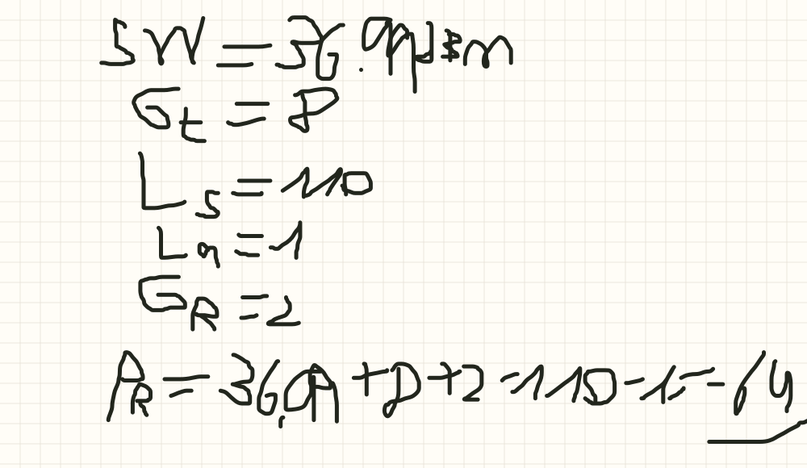
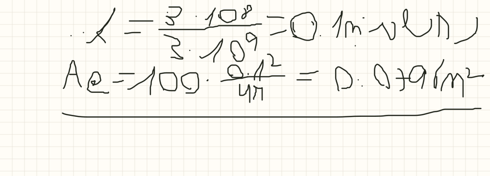

# מחברת השרטוטים והפתרונות

מה שכתבתי ושרטטתי במחברת שליד השיעורים, שיעור אחר שיעור. השרטוטים בתיקייה scratch/.

## M0.1 · שיעור 2 · דציבלים ומשוואת הקשר הבסיסית (2026-11-07)

### דף 1

לא הבנתי איך טעיתי איך עושים את ההמרה בין W לdBm. כבר פעמיים אני נופל בכך.

אוקיי השטח האפקטיבי שווה ל-0.0796 מטר בריבוע

> **בדיקת הפתרון:** **1. מה נכון:** למעשה הכל נכון. ההמרה $5\,\text{W}\approx 36.99\,\text{dBm}$ נכונה, סכום התקציב $P_R=36.99+8+2-110-1\approx-64\,\text{dBm}$ נכון, וגם $\lambda=0.1\,\text{m}$ ו-$A_e=100\cdot0.1^2/(4\pi)\approx0.0796\,\text{m}^2$ נכונים.
> 
> **2. טעות ראשונה:** אין טעות בהמרה בין W ל-dBm, למרות שכתבת שנפלת בה. אם הבודק סימן לך טעות, כדאי לוודא שבנתוני השאלה ההספק אכן $5\,\text{W}$ ולא $5\,\text{mW}$ או ערך אחר.
> 
> **3. כלל ההמרה לזכירה:**
> $P_{dBm}=10\log_{10}\!\left(\frac{P}{1\,\text{mW}}\right)$, כלומר קודם ממירים למיליוואט ($5\,\text{W}=5000\,\text{mW}$), ואז מחשבים לוגריתם.
> דרך קיצור: $P_{dBm}=P_{dBW}+30$.
> 
> הערה לחלק השני: בנוסחה $A_e=G\lambda^2/(4\pi)$ חייבים להציב הגבר **ליניארי** (100) ולא בדציבלים (20 dBi). הצבת נכון.
> 
> **בדיקת סדר גודל:**
> - **ההמרה:** $10\log_{10}5\approx7\,\text{dBW}$, ועוד 30 נותן $\approx37\,\text{dBm}$. ✓
> - **השטח האפקטיבי:** הגבר של 20 dBi בתדר 3 GHz מתאים לאנטנה ששטחה בסדר גודל של $\lambda^2\cdot8\approx0.08\,\text{m}^2$, כלומר ריבוע של כ-28 ס"מ. זה גודל סביר לצלחת קטנה. ✓
