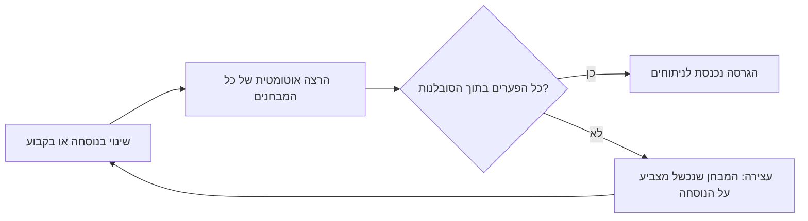

# M0.1 · שיעור 3: קשרים מעשיים: שדה חשמלי ב-µV/m, המכ"ם כשרשרת קשרים, ויחס אות להפרעה

מכסה: 2.3 Link Issues in Practical EW Applications · 2.3.1 Power Out in the Ether Waves · 2.3.2 Sensitivity in pV/m · 2.3.4 Interfering Signals

## הלומד · שיעור · 2026-11-06

כתוב את שיעור 3 במודול M0.1: קשרים מעשיים: שדה חשמלי ב-µV/m, המכ"ם כשרשרת קשרים, ויחס אות להפרעה.

---

## המורה · claude-opus-5-5

## פרק 4: השדה באתר: מהספק בחוט לשדה חשמלי במרחב

נניח שעל השולחן מונחים שני דפי נתונים של מקלטים. באחד הרגישות היא ‎−120 dBm, ובשני ‎3 µV/m. איזה מקלט שומע אות חלש יותר? אי אפשר לענות בלי לדעת באיזה תדר עובדים, ולא מפני שמישהו השמיט נתון. שני המספרים מתארים דברים שונים. הראשון מתאר הספק בחוט שנכנס למקלט. השני מתאר את הגל עצמו, במקום שבו הוא עובר באוויר. גם בשני השיעורים הקודמים כתבנו משפטים כמו "ההספק שמגיע לאנטנה הוא ‎−90 dBm", אבל בין שתי אנטנות אין חוט. בסוף הפרק נדע לתרגם בין שני התיאורים בכל תדר, להסביר למה התרגום תלוי בתדר, ולהחליט מתי מקלט מפורט נכון יותר דרך השדה.

הפרק בנוי כך. בסעיף 4.1 נראה למה dBm "באוויר" הוא מושג פגום, ומה כן מוגדר שם: השדה החשמלי. בסעיף 4.2 נבנה את הגל האלקטרומגנטי: שני שדות ניצבים שמתנודדים יחד. בסעיף 4.3 נמצא כמה הספק עובר דרך מטר רבוע עבור שדה נתון, ומזה כמה שדה משדר יוצר במרחק נתון. בסעיף 4.4 נכיר את התחבולה שמאפשרת בכל זאת לדבר על dBm באוויר. בסעיף 4.5 נגזור ממנה את נוסחת ההמרה ואת המקדם ‎−77. בסעיף 4.6 נשתמש בה ברגישות של מערך כיווני, ובסעיף 4.7 נבדוק הכול על משדר FM.

**מה אנחנו כבר יודעים.** dBm הוא רמת הספק ביחס למיליוואט, $P(\text{dBm})=10\log(P/1\,\text{mW})$, כמו ב-(11). ההספק האפקטיבי המוקרן, ERP, הוא הספק המשדר כפול הגבר האנטנה בכיוון המקלט, ביחס לאנטנה איזוטרופית. צפיפות ההספק במרחק $d$ היא $S=\text{ERP}/4\pi d^2$, ביחידות W/m², כמו ב-(20), והיא אינה תלויה בתדר. אנטנה איזוטרופית אוספת שטח אפקטיבי של $\lambda^2/4\pi$, כמו ב-(21), כאשר $\lambda=c/f$. מכאן באה התלות של אובדן הפיזור בתדר. לגדלי שדה, כמו לחץ קול, כותבים $20\log$ ולא $10\log$, כי ההספק פרופורציוני לריבוע שלהם, לפי הכלל (13): $z=y^a\Rightarrow z(\text{dB})=a\cdot y(\text{dB})$. ולבסוף, מאז שיעור 2 אנחנו יודעים שאנטנה גדולה מתנהגת "פשוט" רק מעבר למרחק השדה הרחוק, $2D^2/\lambda$.

### 4.1 הפגם הלוגי: הספק מוגדר רק בחוט

**השאלה.** [[B01:37]] בשיעור 2 חישבנו את $P_R$ ב-dBm בכניסת המקלט. אבל לעיתים קרובות אומרים גם "האות במטרה הוא ‎−20 dBm", כלומר מצמידים dBm לנקודה באוויר. כדי לבדוק אם למשפט כזה יש מובן, נברר קודם מה בדיוק מגדיר הספק.

**מה מוגדר בחוט.** כדי להגדיר הספק חשמלי צריך שלושה מושגים, ולפניהם שתי יחידות מהמכניקה. **ניוטון** (N) הוא יחידת הכוח: הכוח שמגדיל את המהירות של מסה של 1 kg ב-1 m/s בכל שנייה. **ג'אול** (J) הוא יחידת האנרגיה: האנרגיה שמושקעת כשכוח של ניוטון אחד דוחף גוף לאורך מטר אחד. לכן J = N·m, ווואט הוא ג'אול לשנייה. **מטען חשמלי** הוא תכונה של אלקטרונים ופרוטונים: מטענים שווי סימן דוחים זה את זה, ומטענים בסימנים הפוכים מושכים. יחידת המטען היא **קולון** (C), השווה למטען של כ-$6.24\cdot10^{18}$ אלקטרונים. **מתח** בין שתי נקודות, ביחידות וולט, הוא האנרגיה שמטען מקבל כשהוא עובר ביניהן, ליחידת מטען: 1 V הוא ג'אול אחד לכל קולון. **זרם**, ביחידות אמפר, הוא כמות המטען שעוברת בשנייה: 1 A הוא קולון אחד בשנייה. לכן ההספק בחוט הוא מכפלה של מתח בזרם: אנרגיה לכל מטען כפול מטענים בשנייה נותן אנרגיה בשנייה, כלומר וואט. ההגדרה הזאת צריכה שני הדקים שביניהם מודדים מתח, ומוליך שמוביל את הזרם. בכבל, במגבר ובכניסת המקלט יש את שניהם, ולכן dBm מוגדר שם היטב.

**מה יש באוויר.** בנקודה שבין אנטנת השידור לאנטנת הקליטה אין הדקים ואין מוליך, ולכן אין בין מה למדוד מתח ואין זרם. מה שכן קיים שם הוא נטייה לפעול בכוח: אם נניח מטען בנקודה, הוא ירגיש כוח. לגודל שמוגדר בכל נקודה במרחב קוראים **שדה**. מפת טמפרטורות היא שדה של מספרים, ומפת רוחות היא שדה של חצים, כי לכל נקודה יש גם עוצמה וגם כיוון. גודל שיש לו גם עוצמה וגם כיוון, כמו רוח או כוח, נקרא **וקטור**. מציירים אותו כחץ: האורך הוא העוצמה, והכיוון הוא כיוון החץ. בכתב מסמנים וקטור בחץ מעל האות, למשל $\vec F$. את העוצמה לבדה מסמנים $|\vec F|$, או באות בלי חץ.

```definition
@title: שדה חשמלי
@mark: summary
השדה החשמלי $\vec E$ בנקודה הוא הכוח $\vec F$ שפועל על מטען בוחן קטן $q$ שמונח בנקודה, מחולק במטען:
$$\vec E=\frac{\vec F}{q}$$
ההגדרה תקפה כשהמטען $q$ קטן מספיק כדי לא להזיז את המטענים שיוצרים את השדה. היחידה היא N/C. מכיוון ש-J = N·m, מתקיים N = J/m, ולכן N/C = J/(C·m) = V/m. בקשר רדיו משתמשים ב-µV/m.
```

**איך ההגדרה בנויה.** החלוקה ב-$q$ הופכת את הכוח לתכונה של הנקודה, ולא של המטען שהנחנו בה: מטען כפול ירגיש כוח כפול, והמנה לא תשתנה. הדרישה שהמטען יהיה קטן נועדה לכך שהמדידה לא תשנה את מה שמודדים. היחידה V/m מראה את הקשר למתח: שדה של 1 V/m אחיד לאורך מטר אחד יוצר מתח של וולט אחד בין שני הקצוות. בזכות זה אנטנה פועלת: מוליך שמונח בשדה מקבל מתח בין קצותיו, ומהמתח הזה מתחיל ההספק בחוט.

**דוגמה.** שדה של 1 µV/m אומר שמוט באורך מטר, מונח לאורך השדה, יקבל בקירוב גס מתח של מיקרו-וולט אחד בין קצותיו. זהו המתח שמקלט רגיש צריך לגלות.

**רמת שדה ב-dB.** שדות בקשרים משתרעים ממאות וולט למטר ליד משדר רב עוצמה עד שברירי µV/m בקצה הטווח. לכן גם אותם מבטאים בדציבלים, ביחס לעוגן של 1 µV/m, ביחידה שנקראת dBµV/m.

**ביקורת עצמית שהמקור מודה בה.** [[B01:37]] ספר המקור של הקורס, EW 101 של דייוויד אדמי (EW 101: A First Course in Electronic Warfare), מודה בעצמו שנוסחאות הקשר שבהן הוא משתמש כוללות פגם לוגי חמור. אלה גם הנוסחאות שלנו, ורוב העוסקים בלוחמה אלקטרונית ברמת המערכת משתמשים בהן. הן נותנות את הספק האות "באתר", כלומר בין שתי האנטנות, ב-dBm. אבל dBm הוא רק הייצוג הלוגריתמי של מיליוואטים, והספק מוגדר רק בחוט או במעגל. בדרך בין האנטנות, התיאור המדויק הוא עוצמת השדה החשמלי ב-µV/m. ועדיין אדמי מוכן להגן על המוסכמה מול מי שמחשיב קפדנות לעניין דתי, ויש לכך סיבה: היא שומרת על שרשרת הקשר כחיבור של שורות ב-dB ביחידה אחת, והתשובה בכניסת המקלט יוצאת נכונה. המחיר הוא שמספר ב-dBm באמצע הדרך מקבל מובן רק אם מסכימים איזו אנטנה הייתה אוספת אותו. זה הנושא של סעיף 4.4.

[[B01:38]] באיור 4.1 כדאי לעקוב אחרי שלושת האזורים לאורך הקשר, משמאל לימין.

```figure
B01:38:0
איור 4.1: הספק ב-dBm בחוט של המשדר, עוצמת שדה ב-µV/m במרחב, והספק ב-dBm בחוט של המקלט (במקור: EW 101, איור 2.4).
```

האיור מראה ששתי האנטנות הן הממירים בין שני התיאורים. אנטנת השידור הופכת הספק בחוט לשדה במרחב, ואנטנת הקליטה הופכת שדה בחזרה להספק בחוט. ביניהן אין "הספק ב-dBm" שמישהו יכול למדוד בלי להכניס אנטנה.

```mcq
איזה מהגדלים הבאים **אינו** מוגדר היטב בנקודה באוויר באמצע הדרך בין אנטנת שידור לאנטנת קליטה, כל עוד לא מוסיפים הנחה על אנטנה?
- [ ] עוצמת השדה החשמלי ב-µV/m :: השדה מוגדר בכל נקודה במרחב, ככוח ליחידת מטען. זה בדיוק התיאור המדויק באוויר.
- [ ] צפיפות ההספק ב-W/m² :: צפיפות ההספק מ-(20) מוגדרת ליחידת שטח, ואינה צריכה אנטנה או חוט.
- [x] הספק האות ב-dBm :: הספק מוגדר בחוט, כמתח כפול זרם. כדי לתת לו ערך באוויר צריך לקבוע איזו אנטנה הייתה אוספת אותו.
- [ ] רמת השדה ב-dBµV/m :: זו רק עוצמת השדה בסולם לוגריתמי, ולכן היא מוגדרת בדיוק כמו µV/m.
```

**מה הרווחנו.** בנקודה באוויר הגודל המדויק הוא השדה החשמלי, ואפשר לבטא אותו ב-dB ביחס ל-1 µV/m. אבל השדה של גל רדיו אינו עומד במקום. הוא משתנה מיליוני פעמים בשנייה ונע במהירות האור, ולכן השאלה הבאה היא מה בדיוק נע בין שתי האנטנות.

### 4.2 הגל האלקטרומגנטי: שני שדות ניצבים שמתנודדים

**השאלה.** [[B02:932]] הגדרנו את השדה החשמלי כגודל בנקודה. אבל אנטנת השידור יוצרת שדה שמשתנה בזמן ומתקדם במרחב. כדי להבין מה נע, צריך להכיר עוד שדה אחד, ואת הקשר בין השניים.

**מטען בתנועה.** מטען שעומד במקום יוצר רק שדה חשמלי. מטענים שזורמים, כלומר זרם, יוצרים גם **שדה מגנטי** $\vec B$. זה השדה שמסיט מחט של מצפן ליד חוט חשמלי, והוא פועל בכוח על מטענים נעים. היחידה שלו היא טסלה (T). באנטנת שידור, המשדר דוחף זרם הלוך וחזור במוליך בתדר $f$. שדה חשמלי שמשתנה יוצר שדה מגנטי, ושדה מגנטי שמשתנה יוצר שדה חשמלי. לכן שני השדות מזינים זה את זה, מתנתקים מהאנטנה וממשיכים לנוע לבד. את הקשר הזה ניסח ג'יימס קלרק מקסוול ב-1865, והיינריך הרץ הדגים את הגלים בניסוי ב-1887 [[ודאות: גבוהה]].

**פאזה.** כל אחד משני השדות מתנודד: הוא עולה לשיא, יורד דרך אפס לשיא שלילי וחוזר חלילה. **הפאזה** היא השלב של התנודה שבו נמצא השדה ברגע נתון. כשהשדה משתנה כמו $\sin(2\pi ft)$, הפאזה היא הזווית $2\pi ft$ שבתוך הסינוס. שתי תנודות באותה פאזה מגיעות לאפס ולשיא באותם רגעים. בפאזות שונות, אחת מקדימה את השנייה.

```definition
@title: גל אלקטרומגנטי במרחב חופשי
@mark: summary
גל אלקטרומגנטי במרחב חופשי, רחוק מהמקור, מורכב משדה חשמלי $\vec E$ ומשדה מגנטי $\vec B$ שמקיימים את התנאים הבאים:
- $\vec E\perp\vec B$, ושניהם ניצבים לכיוון ההתקדמות. זהו גל רוחבי.
- שני השדות מתנודדים יחד, באותה פאזה.
- הגל מתקדם במהירות האור $c$.
- בכל נקודה ובכל רגע $|\vec E|/|\vec B|=c$.

התנאים מתקיימים בריק, ובקירוב טוב באוויר, בתחום השדה הרחוק של האנטנה.
```

**איך ההגדרה בנויה.** הניצבות לכיוון ההתקדמות מבדילה בין גל אלקטרומגנטי לגל קול. בקול, האוויר נדחס ומתרחב לאורך כיוון ההתקדמות, ולכן הוא גל אורכי. כאן השדות נעים לרוחב. הכיוון שבו $\vec E$ מתנודד, ניצב לכיוון ההתקדמות, נקרא **הקיטוב** של הגל. אנטנת קליטה שמכוונת בכיוון אחר קולטת פחות, כי רק רכיב השדה שלאורכה מניע בה מטענים. היחס $c$ מקשר בין יחידות שונות: V/m חלקי T נותן m/s. היחס הזה אינו מקרי, כי מאותן משוואות של מקסוול יוצאת גם מהירות הגל.

בסצנה הבאה הגל מתקדם לאורך הציר האופקי. כדאי להסתכל על שני החצים בנקודה אחת: הם מתאפסים ומגיעים לשיא באותו רגע, ותמיד ניצבים זה לזה ולכיוון ההתקדמות.

```scene3d
{"title": "גל אלקטרומגנטי: E ו-B ניצבים זה לזה ולכיוון ההתקדמות",
 "caption": "הגל מתקדם בכיוון החץ הארוך. השדה החשמלי מתנודד אנכית והשדה המגנטי אופקית, באותה פאזה. האורכים אינם בקנה מידה: B ביחידות טסלה קטן פי c מ-E.",
 "axes": true,
 "params": [{"id": "w", "label": "קצב התנודה (להמחשה)", "min": 0.5, "max": 4, "value": 1.5}],
 "view": {"cam": [6, -13, 6], "target": [6, 0, 0]},
 "objects": [
  {"type": "curve", "x": "s", "y": "0", "z": "sin(2*pi*s/4 - w*t)", "s": [0, 12], "label": "השדה החשמלי E", "info": "מתנודד במישור האנכי; כיוונו הוא הקיטוב של הגל"},
  {"type": "curve", "x": "s", "y": "-0.7*sin(2*pi*s/4 - w*t)", "z": "0", "s": [0, 12], "label": "השדה המגנטי B", "info": "ניצב ל-E ולכיוון ההתקדמות, באותה פאזה; גודלו E/c"},
  {"type": "vector", "from": [3, 0, 0], "to": [3, 0, "sin(2*pi*3/4 - w*t)"], "label": "E בנקודה אחת"},
  {"type": "vector", "from": [3, 0, 0], "to": [3, "-0.7*sin(2*pi*3/4 - w*t)", 0], "label": "B באותה נקודה"},
  {"type": "vector", "from": [0, 0, 0], "to": [13, 0, 0], "label": "כיוון ההתקדמות", "info": "ניצב גם ל-E וגם ל-B"}
 ],
 "tour": [
  {"cam": [6, -13, 1], "target": [6, 0, 0], "text": "מהצד רואים את E: גל סינוסי שחוזר על עצמו כל אורך גל"},
  {"cam": [-8, 0, 0.5], "target": [6, 0, 0], "text": "מול הגל שני החצים יוצרים צלב: E אנכי ו-B אופקי, תמיד ניצבים"}
 ]}
```

הסצנה מראה שהגל אינו חומר שזורם. בכל נקודה רק עוצמת השדות משתנה, והתבנית כולה זזה במהירות $c$.

**למה מספיק לתאר את E.** אם ידוע $\vec E$ וידוע כיוון ההתקדמות, אפשר לקבוע את $\vec B$: הכיוון שלו הוא הכיוון הניצב לשניהם, והגודל שלו הוא $|\vec E|/c$. לכן מתארים גל רדיו כמעט תמיד בשדה החשמלי בלבד. יש לכך גם סיבה מעשית. לשדה של 1 mV/m מתאים שדה מגנטי של $10^{-3}/(3\cdot10^8)=3.33\cdot10^{-12}$ T, מספר זעיר ולא נוח. לעומת זאת, מוליך פשוט מגיב ישירות ל-$\vec E$.

**תנודה סינוסית.** אנטנה שמוזנת בתדר אחד יוצרת שדה שמשתנה בזמן כמו סינוס: $E(t)=E_p\sin(2\pi f t)$. כאן $E_p$ הוא ערך השיא, ו-$f$ הוא התדר בהרץ, כלומר מספר התנודות בשנייה. הזמן של תנודה אחת, המחזור, הוא $1/f$. בזמן הזה הגל מתקדם מרחק של אורך גל אחד, $\lambda=c/f$. **דוגמה:** ב-100 MHz המחזור הוא $1/10^8=10^{-8}$ s, כלומר 10 ns, ואורך הגל הוא $3\cdot10^8/10^8=3$ m.

**ערך אפקטיבי.** השדה מחליף סימן פעמיים בכל מחזור, ולכן הממוצע שלו אפס, ואפס אינו אומר דבר על עוצמת הגל. ההספק, לעומת זאת, תלוי ב-$E^2$, שתמיד חיובי. לכן מגדירים ערך אחד שמייצג את הגל דרך הממוצע של הריבוע.

```definition
@title: ערך אפקטיבי (RMS) של שדה מתנודד
@mark: summary
עבור שדה $E(t)$ שחוזר על עצמו במחזור, הערך האפקטיבי הוא שורש הממוצע של הריבוע על פני מחזור שלם:
$$E_{\text{eff}}=\sqrt{\overline{E^2(t)}}$$
עבור תנודה סינוסית עם שיא $E_p$:
$$E_{\text{eff}}=\frac{E_p}{\sqrt2}\tag{30}$$
התוצאה (30) תקפה רק לצורה סינוסית.
```

**איך ההגדרה בנויה.** הקו מעל $E^2$ מציין ממוצע על מחזור שלם. העלאה בריבוע מבטלת את הסימן, והשורש מחזיר את התוצאה ליחידות V/m. כך שדה קבוע של $E_{\text{eff}}$ היה נושא בדיוק אותו הספק ממוצע. את (30) נגזור בשלושה צעדים. הצעד הראשון: לכל זווית $\sin^2+\cos^2=1$, ולכן גם הממוצעים של שני האיברים מסתכמים ל-1. הצעד השני: הקוסינוס הוא אותו סינוס מוזז ברבע מחזור. במחזור שלם שניהם עוברים בדיוק באותם ערכים, ולכן הממוצעים שלהם שווים, וכל אחד מהם הוא $\tfrac12$. הצעד השלישי: $\overline{E^2}=E_p^2\cdot\tfrac12$, ומשורש מקבלים $E_p/\sqrt2$. ב-dB זה הפרש של $20\log\sqrt2=3.01$ dB. **מוסכמה:** כל ערך שדה בקורס הוא ערך אפקטיבי.

**שגיאה נפוצה: שיא במקום אפקטיבי.** מכשיר מדידה או דף נתונים יכולים לתת את ערך השיא, ומי שמציב אותו בנוסחת הספק בלי לבדוק מקבל הספק כפול, כלומר שגיאה של 3.01 dB. השגיאה הזאת אינה בולטת, כי היא נבלעת בתקציב קשר של עשרות dB. כדי לתפוס אותה, שואלים על כל מספר שדה "RMS או שיא?". אם המספר גבוה פי $\sqrt2\approx1.41$ מהצפוי, כנראה זה השיא.

**איפה התמונה תקפה.** התמונה של שני שדות ניצבים ביחס $c$ נכונה רק רחוק מהאנטנה. קרוב אליה, חלק מהאנרגיה נאגר בשדות ומתחלף עם האנטנה בכל מחזור, במקום להתרחק. שם היחס $E/B$ שונה מ-$c$, ושני השדות אינם באותה פאזה. בפועל הגל נראה "נקי" מעבר לכמה אורכי גל, כלומר מעבר לעשרה מטרים בערך ב-100 MHz. באנטנה גדולה צריך בנוסף להתרחק מעבר ל-$2D^2/\lambda$ משיעור 2: לצלחת של 3 m ב-10 GHz זה $2\cdot3^2/0.03=600$ m.

```mcq
גל רדיו מתקדם מצפון לדרום, והשדה החשמלי שלו מתנודד אנכית, למעלה ולמטה. באיזה כיוון מתנודד השדה המגנטי שלו?
- [ ] אנכית, כמו השדה החשמלי :: שני השדות מתנודדים באותה פאזה, אבל לא באותו כיוון. הם תמיד ניצבים זה לזה.
- [ ] צפון–דרום, לאורך ההתקדמות :: זו התנהגות של גל אורכי כמו קול. גל אלקטרומגנטי הוא רוחבי, ושני השדות שלו ניצבים לכיוון ההתקדמות.
- [x] מזרח–מערב, אופקית :: זה הכיוון היחיד שניצב גם לשדה החשמלי האנכי וגם לכיוון ההתקדמות.
- [ ] אין לו כיוון קבוע, כי הוא קטן פי c :: הגודל הקטן נובע רק מהיחידות (טסלה מול V/m). הכיוון נקבע לגמרי לפי E ולפי כיוון ההתקדמות.
```

**מה הרווחנו.** בין שתי האנטנות נע גל של שדה חשמלי ושדה מגנטי. הם ניצבים, ביחס $c$, ומתוארים בערך האפקטיבי של $E$. עדיין חסר הקשר בין התמונה הזאת לבין ה-W/m² של (20): כמה הספק נושא שדה של מיקרו-וולט אחד למטר?

### 4.3 וקטור פוינטינג ועכבת המרחב החופשי

**השאלה.** [[B02:932]] נוסחה (20) נותנת צפיפות הספק ב-W/m² מתוך ה-ERP והמרחק. סעיף 4.1 הראה שהגודל המדויק באוויר הוא $E$. כדי לחבר בין השניים צריך לדעת כמה וואטים עוברים דרך מטר רבוע עבור שדה $E$ נתון.

**וקטור פוינטינג.** ג'ון הנרי פוינטינג הראה ב-1884 שאת זרימת האנרגיה בשדה אלקטרומגנטי אפשר לתאר בווקטור אחד שבנוי משני השדות [[ודאות: גבוהה]]. לשם כך צריך שני כלים. הראשון הוא **הקבוע המגנטי** $\mu_0$, שקובע כמה שדה מגנטי יוצר זרם נתון. ערכו $4\pi\cdot10^{-7}$ H/m, נכון לתשע ספרות בקירוב. **הנרי** (H) הוא יחידת ההשראות, והוא שווה ל-V·s/A. לכן H/m = V·s/(A·m), וזו היחידה שבה נשתמש בבדיקת היחידות שבהמשך. מאז הגדרת היחידות של 2019 הערך הזה נמדד ואינו מוגדר במדויק [[ודאות: גבוהה]]. השני הוא **המכפלה הווקטורית** $\vec a\times\vec b$ של שני וקטורים: וקטור שניצב לשניהם, שגודלו $|\vec a||\vec b|\sin\theta$, כאשר $\theta$ היא הזווית ביניהם. כיוונו נקבע בכלל יד ימין: אם מקפלים את אצבעות יד ימין מ-$\vec a$ אל $\vec b$, האגודל מצביע לכיוון המכפלה. כששני הווקטורים ניצבים, $\sin\theta=1$, והגודל הוא פשוט $|\vec a||\vec b|$.

```definition
@title: וקטור פוינטינג
@mark: summary
עבור שדות $\vec E$ ו-$\vec B$ בנקודה:
$$\vec{\mathbf S}=\frac{\vec E\times\vec B}{\mu_0}\tag{31}$$
הכיוון של $\vec{\mathbf S}$ הוא כיוון זרימת האנרגיה. הגודל שלו, $s(t)=|\vec{\mathbf S}|$, הוא ההספק שעובר ברגע $t$ דרך שטח של מטר רבוע שניצב לכיוון הזה, ביחידות W/m². הממוצע שלו על מחזור, $S=\overline{s(t)}$, הוא צפיפות ההספק של (20).
```

**איך ההגדרה בנויה.** המכפלה הווקטורית מצביעה בניצב גם ל-$\vec E$ וגם ל-$\vec B$, ולכן היא נותנת מעצמה את כיוון ההתקדמות של הגל. החלוקה ב-$\mu_0$ מביאה את היחידות ל-W/m². טסלה שווה ל-V·s/m², ו-$\mu_0$ נמדד ב-V·s/(A·m). לכן היחידות של $EB/\mu_0$ הן $(\text{V/m})\cdot(\text{V·s/m}^2)\,/\,(\text{V·s/(A·m)})=\text{V·A/m}^2$, ו-V·A הוא וואט. מכאן ואילך נבחין בין שני סימנים. באות קטנה, $s(t)$, נסמן את הגודל הרגעי של וקטור פוינטינג, שמתנודד יחד עם השדות. את האות הגדולה $S$ נשמור רק לממוצע שלו על מחזור, כלומר לצפיפות ההספק של (20).

בציור הבא מוצגים שלושת הווקטורים בנקודה אחת של הגל, ומשטח של מטר רבוע שהזרימה עוברת דרכו.

```svg
@caption: השדה החשמלי והשדה המגנטי ניצבים זה לזה ושוכבים במישור המשטח. וקטור פוינטינג ניצב לשניהם ועובר דרך המשטח; גודלו הוא ההספק שעובר דרך מטר רבוע.
<svg viewBox="0 0 420 260" xmlns="http://www.w3.org/2000/svg">
  <defs>
    <marker id="ah" viewBox="0 0 10 10" refX="9" refY="5" markerWidth="7" markerHeight="7" orient="auto">
      <path d="M0,0 L10,5 L0,10 z" fill="currentColor"/>
    </marker>
  </defs>
  <polygon points="160,205 160,85 230,50 230,170" fill="none" stroke="currentColor" stroke-width="1.5" stroke-dasharray="5,3"/>
  <text x="236" y="190" font-size="13" fill="currentColor">1 m²</text>
  <line x1="195" y1="128" x2="195" y2="28" stroke="currentColor" stroke-width="2.5" marker-end="url(#ah)"/>
  <text x="203" y="32" font-size="14" fill="currentColor">E (V/m)</text>
  <line x1="195" y1="128" x2="120" y2="165" stroke="currentColor" stroke-width="2.5" marker-end="url(#ah)"/>
  <text x="60" y="185" font-size="14" fill="currentColor">B (T)</text>
  <line x1="195" y1="128" x2="380" y2="128" stroke="currentColor" stroke-width="3" marker-end="url(#ah)"/>
  <text x="300" y="118" font-size="14" fill="currentColor">S (W/m²)</text>
  <text x="290" y="150" font-size="12" fill="currentColor">כיוון ההתקדמות</text>
  <circle cx="195" cy="128" r="3" fill="currentColor"/>
</svg>
```

הציור מראה שההספק "עובר דרך" המשטח רק ברכיב שניצב אליו. משטח שמוטה ביחס לגל קולט פחות, ולכן ההגדרה מדברת על שטח ניצב.

**עכבת המרחב החופשי.** **אוהם** הוא יחידת ההתנגדות, כלומר היחס בין מתח לזרם: 1 V על התנגדות של 1 Ω מניע זרם של 1 A. גם לגל יש יחס כזה. מגדירים $\vec H=\vec B/\mu_0$, שגם לו קוראים "שדה מגנטי" ומודדים אותו ב-A/m. היחס $|\vec E|/|\vec H|$ נמדד אז ב-(V/m)/(A/m), כלומר באוהם. ביחס הזה, $|\vec E|/|\vec B|=c$ הופך ל-$|\vec E|/|\vec H|=\mu_0c$:

```definition
@title: עכבת המרחב החופשי
@mark: summary
$$Z_0=\frac{|\vec E|}{|\vec H|}=\mu_0c\tag{32}$$
עבור גל במרחב חופשי, בתחום השדה הרחוק. עם $c=299{,}792{,}458$ m/s מקבלים $Z_0=376.73\ \Omega$. עם $c=3\cdot10^8$ m/s מקבלים בדיוק $Z_0=4\pi\cdot10^{-7}\cdot3\cdot10^8=120\pi=376.99\ \Omega$.
```

**איך ההגדרה בנויה.** היחידות של $\mu_0c$ הן H/m כפול m/s, כלומר H/s. מאחר ש-H = V·s/A, מתקיים H/s = V/A, וזה בדיוק אוהם. העכבה אינה נגד שמחמם משהו. היא היחס שבו הריק "מחלק" את הגל בין שדה חשמלי לשדה מגנטי, כמו שהתנגדות בחוט קובעת את היחס בין מתח לזרם. ההפרש בין 376.73 ל-376.99 הוא $10\log(376.99/376.73)=0.003$ dB, זניח בכל קשר. לכן בשיעור הזה נשתמש ב-$c=3\cdot10^8$ וב-$Z_0=120\pi$, כמו ב-(23) ובנוסחאות של EW 101, ספר המקור שהזכרנו בסעיף 4.1.

**גזירה: כמה הספק נושא שדה.** [[2.5: מקור]] עכשיו אפשר לענות על השאלה של הסעיף. נצא מהגודל של וקטור פוינטינג ונציב בו את תכונות הגל, צעד אחר צעד.

$$s(t)=\frac{|\vec E(t)|\,|\vec B(t)|}{\mu_0}$$
כאן לקחנו את הגודל של (31) ברגע אחד. מותר לכתוב מכפלה פשוטה של הגדלים, כי בגל רוחבי השדות ניצבים ו-$\sin90^\circ=1$.

$$|\vec B(t)|=\frac{|\vec E(t)|}{c}$$
זו תכונת הגל מסעיף 4.2. היא נכונה בכל רגע, בריק ובשדה הרחוק.

$$s(t)=\frac{E^2(t)}{\mu_0c}=\frac{E^2(t)}{Z_0}$$
הצבנו את $|\vec B(t)|$ בשורה הראשונה, כתבנו $E(t)$ במקום $|\vec E(t)|$, וזיהינו במכנה את $Z_0=\mu_0c$ מ-(32). זה עדיין גודל רגעי.

$$S=\overline{s(t)}=\frac{\overline{E^2(t)}}{Z_0}=\frac{E_{\text{eff}}^2}{Z_0}$$
כאן, ורק כאן, לקחנו ממוצע על מחזור. $Z_0$ קבוע, ולכן הוא יוצא מהממוצע. הממוצע של $E^2$ הוא $E_{\text{eff}}^2$ לפי הגדרת הערך האפקטיבי, ובתנודה סינוסית זה $E_p^2/2$ לפי (30). כך מקבלים את צפיפות ההספק הממוצעת, בדיוק הגודל של (20). הנחה אחת נכנסה בכל צעד. בצעד הראשון: השדות ניצבים, כלומר גל רוחבי. בצעד השני: היחס הוא $c$, כלומר ריק ושדה רחוק. ובערך של $Z_0$: ריק. זו המחצית הראשונה של ההמרה מ-µV/m ל-dBm. המחצית השנייה, איסוף צפיפות ההספק בשטח של אנטנה דמיונית, תבוא בסעיף 4.5.

```formula
@title: צפיפות ההספק של גל לפי השדה החשמלי
@mark: summary
$$S=\frac{E^2}{Z_0}\tag{33}$$
$S$ היא צפיפות ההספק הממוצעת (W/m²), $E$ הוא השדה החשמלי האפקטיבי (V/m), ו-$Z_0=120\pi\ \Omega$ היא עכבת המרחב החופשי. הנוסחה תקפה לגל במרחב חופשי בתחום השדה הרחוק. אם $E$ נתון כערך שיא, $S=E_p^2/2Z_0$.
```

כל אחד מהגורמים משפיע כך. $E$ מופיע בריבוע, ולכן שדה כפול נושא הספק פי 4, כלומר 6.02 dB. $Z_0$ במכנה: באותו שדה, עכבה גבוהה יותר אומרת הספק נמוך יותר, כי לאותו $E$ מתאים שדה מגנטי חלש יותר. **דוגמה:** שדה של 1 µV/m נושא $(10^{-6})^2/376.99=2.65\cdot10^{-15}$ W/m², כלומר ‎−145.76 dBW/m². ההספק הזעיר הזה הוא כל מה שמקלט רגיש צריך לאסוף.

**רמת שדה ב-dB.** עכשיו יש בידינו את שני המרכיבים שחסרו בסעיף 4.1 כדי להגדיר את ה-dBµV/m. הראשון הוא הערך האפקטיבי (30), שאותו מציבים במקום שדה מתנודד. השני הוא הקשר (33) בין השדה לצפיפות ההספק.

```definition
@title: רמת שדה ב-dBµV/m
@mark: summary
$$E(\text{dB}\mu\text{V/m})=20\log\frac{E}{1\,\mu\text{V/m}}$$
$E$ הוא השדה החשמלי האפקטיבי לפי (30). המקדם 20 נובע מ-(33): צפיפות ההספק פרופורציונית ל-$E^2$, ולכן הפרש של dB אחד ברמת השדה שווה להפרש של dB אחד בצפיפות ההספק.
```

**איך ההגדרה בנויה.** המנה $E/1\,\mu\text{V/m}$ חסרת יחידות, ולכן מותר לקחת ממנה לוגריתם. המקדם 20 הוא הכלל (13) שהופעל על (33): ההספק הוא ריבוע השדה, ולכן כל dB של שדה נספר פעמיים, כמו ברמת לחץ קול. **דוגמה:** שדה של 1 mV/m גדול פי 1000 מהעוגן, ולכן רמתו $20\log1000=60$ dBµV/m. מכיוון ש-1 µV/m נושא ‎−145.76 dBW/m², צפיפות ההספק ב-dBW/m² שווה פשוט לרמת השדה ב-dBµV/m פחות 145.76. לכן 1 mV/m נושא ‎−85.76 dBW/m².

**השדה של משדר במרחק נתון.** השאלה המעשית הבאה היא כמה שדה יוצר משדר בעל ERP נתון במרחק $d$. יש לנו שני ביטויים לאותה צפיפות הספק: אחד דרך המשדר ואחד דרך השדה. נשווה ביניהם.

$$\frac{E^2}{Z_0}=\frac{\text{ERP}}{4\pi d^2}$$
באגף שמאל (33), ובאגף ימין (20). שניהם צפיפות ההספק באותה נקודה.

$$E^2=\frac{Z_0\,\text{ERP}}{4\pi d^2}$$
הכפלנו את שני האגפים ב-$Z_0$.

$$E^2=\frac{120\pi\,\text{ERP}}{4\pi d^2}=\frac{30\,\text{ERP}}{d^2}$$
הצבנו $Z_0=120\pi$. ה-$\pi$ מצטמצם, ו-120 חלקי 4 הוא 30.

$$E=\frac{\sqrt{30\,\text{ERP}}}{d}$$
הוצאנו שורש. מותר, כי כל הגדלים חיוביים.

```formula
@title: השדה של משדר במרחק d
@mark: summary
$$E=\frac{\sqrt{30\,\text{ERP}}}{d}\tag{34}$$
$E$ הוא השדה האפקטיבי (V/m), ERP הוא ההספק האפקטיבי המוקרן ביחס לאנטנה איזוטרופית (W), ו-$d$ הוא המרחק (m). הנוסחה תקפה במרחב חופשי, בקו ראייה, בשדה הרחוק, וכשאין החזרות מהקרקע.
```

כל אחד מהגורמים משפיע כך. ERP נמצא מתחת לשורש, ולכן הכפלת ההספק מגדילה את השדה רק פי $\sqrt2$. ברמת השדה זה 3.01 dB ($20\log\sqrt2$), בדיוק אותם 3.01 dB של הכפלת ההספק. $d$ במכנה בלי ריבוע: השדה יורד כמו $1/d$, ולכן כל הכפלה של המרחק פי 10 מורידה $20\log10=20$ dB, בדיוק כמו ירידת ההספק לפי $1/d^2$. בנוסחה אין תדר, ממש כמו ב-(20). המספר 30 נשען על ERP ביחס לאנטנה איזוטרופית. מקורות שמודדים את ה-ERP ביחס ל**דיפול** כותבים נוסחה אחרת. דיפול הוא אנטנה ישרה משני מוטות שאורכה הכולל חצי אורך גל, וההגבר שלה בכיוון הטוב ביותר הוא 2.15 dBi. המקורות האלה כותבים $\sqrt{49.2\,\text{ERP}_d}/d\approx7\sqrt{\text{ERP}_d}/d$. לכן, לפני שמציבים מספר, צריך לבדוק לאיזו אנטנת ייחוס הוא מתייחס. **דוגמה:** משדר בעל ERP של 1 W יוצר במרחק 1 km שדה של $\sqrt{30}/1000=5.48$ mV/m.

**איפה (33) ו-(34) נשברות.** [[2.5: גבולות]] בגזירה נכנסו שתי הנחות: שדה רחוק וריק. כל אחת מהן יכולה להישבר. בשדה הקרוב היחס $E/B$ אינו $c$, והשדות אינם באותה פאזה. לכן מדידה של $E$ לבדה, דרך (33), נותנת הספק שגוי. בתחום הזה צריך למדוד את $E$ ואת $H$ בנפרד, או לחשב את השדות המלאים של האנטנה. התנאי הוא כמה אורכי גל, ובאנטנה גדולה גם $2D^2/\lambda$, כמו בסעיף 4.2. בחומר, במקום ריק, העכבה משתנה. בחומר שאינו מגנטי $Z=Z_0/\sqrt{\varepsilon_r}$, כאשר $\varepsilon_r$ הוא [[מונח: מקדם דיאלקטרי יחסי | פי כמה חומר מחליש שדה חשמלי לעומת ריק; באוויר כמעט 1]]. בחומר עם $\varepsilon_r=4$, למשל פלסטיק של כיפת אנטנה, העכבה היא $376.73/2=188.37\ \Omega$. שם אותו שדה $E$ נושא הספק כפול, כלומר 3.01 dB יותר. באוויר $\varepsilon_r\approx1.0006$, ולכן ההבדל מריק זניח [[ודאות: גבוהה]]. כשיש החזרה מהקרקע, (34) נשברת מסיבה אחרת, ובמקומה נכנס **מודל שני המסלולים**. המקלט קולט גל ישיר וגם גל שהוחזר מהקרקע. השדות של שני הגלים מתחברים כווקטורים לפי הפאזה, והפאזה נקבעת לפי הפרש אורכי הדרכים. לכן השדה יכול לגדול עד פי 2 או להתבטל.

```numeric
@answer: 1.061e-8
@unit: W/m²
@tol: 3%
מקלט מודד שדה חשמלי אפקטיבי של 2 mV/m מגל במרחב חופשי, רחוק מהמשדר. מהי צפיפות ההספק של הגל ב-W/m²? השתמשו ב-$Z_0=120\pi\approx376.99\ \Omega$.
---
1. ממירים ל-V/m: $E=2\cdot10^{-3}$ V/m.
2. מעלים בריבוע: $E^2=4\cdot10^{-6}$ V²/m².
3. מחלקים בעכבה לפי (33): $S=4\cdot10^{-6}/376.99=1.061\cdot10^{-8}$ W/m².
אין חלוקה ב-2, כי הנתון הוא ערך אפקטיבי.
- wrong: 5.31e-6 :: חילקתם את E ב-Z0 בלי להעלות בריבוע. ההספק פרופורציוני לריבוע השדה.
- wrong: 5.31e-9 :: התייחסתם לנתון כאל ערך שיא וחילקתם ב-2. הנתון הוא אפקטיבי, ולכן (33) חלה בלי תיקון.
```

**מה הרווחנו.** עכשיו אפשר לעבור בין µV/m ל-W/m² בלי לדעת את התדר, ולחשב איזה שדה משדר יוצר במרחק נתון. שני הגדלים האלה מוגדרים היטב באוויר. כדי להגיע ל-dBm צריך שטח שיאסוף את צפיפות ההספק ויוביל אותה לחוט. כאן נכנסת התחבולה של האנטנה הדמיונית, ועמה גם התדר.

### 4.4 התחבולה: אנטנה דמיונית בהגבר יחידה

**השאלה.** [[B01:38]] לפי (33) אפשר לחשב מהשדה את צפיפות ההספק $S$ ב-W/m². אבל dBm הוא הספק בחוט, ובין שתי האנטנות אין חוט. כדי להפוך W/m² לוואטים צריך שטח שיאסוף את הזרימה ויוביל אותה למעגל. הגל עצמו לא קובע שטח כזה, ולכן בוחרים אותו במוסכמה, פעם אחת ולכל הקשרים.

**התחבולה.** הפתרון הוא תחבולה גלויה. בנקודה שמעניינת אותנו מציבים אנטנה דמיונית ואידיאלית בהגבר יחידה. את עוצמת האות בנקודה, ב-dBm, מגדירים כהספק שהיה מופיע במוצא של האנטנה הזאת. אנטנה בהגבר יחידה היא האנטנה האיזוטרופית, ולכן היא אוספת שטח של $\lambda^2/4\pi$, כמו ב-(21).

```definition
@title: אנטנה דמיונית וההספק "באתר"
@mark: summary
בנקודה שבה צפיפות ההספק היא $S$ מציבים אנטנה דמיונית שמקיימת ארבעה תנאים: הגבר יחידה בכל כיוון (איזוטרופית), בלי הפסדים ומותאמת למקלט, קיטוב תואם לקיטוב הגל, והיא לא משנה את השדה. ההספק באתר הוא ההספק שהיה יוצא ממנה:
$$P=S\,\frac{\lambda^2}{4\pi}\tag{35}$$
$P$ בוואט, $S$ ב-W/m², ו-$\lambda=c/f$ במטרים. ההגדרה תקפה בשדה הרחוק של המשדר.
```

**איך ההגדרה בנויה.** ב-(35) יש שני גורמים שמגיעים ממקורות שונים. $S$ שייך לגל, והוא לא תלוי בתדר. $\lambda^2/4\pi$ שייך לאנטנה שהסכמנו עליה, וזה המקום היחיד שבו התדר נכנס. אנטנה **מותאמת** למקלט פירושה שעכבת הכניסה של המקלט, כלומר היחס בין המתח לזרם בהדקיו (באוהם, כמו בסעיף 4.3), שווה לעכבה של האנטנה. במצב כזה כל ההספק שהאנטנה אוספת עובר למקלט, ושום חלק ממנו אינו מוחזר אל האנטנה. כל אחד מהתנאים מסלק הפסד אפשרי. אנטנה אמיתית עם הפסדים, או עם קיטוב שלא מתאים לגל, אוספת פחות. לכן $P$ הוא הספק שאנטנה איזוטרופית מושלמת הייתה מקבלת, ולא יותר מזה. התנאי שהאנטנה לא משנה את השדה ממלא כאן את התפקיד של מטען הבוחן הקטן בהגדרת $\vec E$: המדידה לא משנה את מה שנמדד.

**דוגמה.** שדה של 1 µV/m נושא $S=2.65\cdot10^{-15}$ W/m², כפי שחישבנו בסעיף 4.3. ב-100 MHz שטח האנטנה הדמיונית הוא 0.716 m², וההספק באתר הוא ‎−117.21 dBm. ב-1 GHz השטח קטן ל-71.6 cm², וההספק באתר יורד ל-‎−137.21 dBm. הגל זהה בשני המקרים, ובכל זאת יש ביניהם הפרש של 20 dB.

באיור 4.2 כדאי לחפש את האנטנה הדמיונית בשתי נקודות לאורך הקשר.

```figure
B01:38:1
איור 4.2: אות מוקרן מתואר לפי מה שהיה מקבל מקלט אידיאלי עם אנטנה כלל-כיוונית: ERP ליד אנטנת השידור, ו-P_A ליד אנטנת הקליטה (במקור: EW 101, איור 2.5).
```

האיור משאיר את השדה ב-µV/m במרחב שבין האנטנות, כמו באיור 4.1. ההבדל הוא שהוא מצרף לשתי נקודות קצה קריאה ב-dBm של אנטנה דמיונית. הקריאה האחת צמודה למשדר, והשנייה צמודה למקלט.

**ERP כקריאה ליד המשדר.** לפי המוסכמה, ה-ERP הוא מה שהאנטנה הדמיונית הייתה מוציאה אילו עמדה על הקו בין שתי האנטנות, כמעט נוגעת באנטנת השידור, ובהתעלמות מהשדה הקרוב. אפשר לראות למה זה עובד בנוסחאות. אובדן הפיזור (22), $L_s=(4\pi d/\lambda)^2$, שווה בדיוק 1, כלומר 0 dB, כאשר $d=\lambda/4\pi$. במרחק הזה $P=\text{ERP}$. ב-100 MHz המרחק הוא 0.239 m, עמוק בתוך השדה הקרוב. לכן זה מקום בחשבון, לא נקודה שאפשר למדוד בה.

**הקריאה ליד המקלט.** כשמזיזים את אותה אנטנה דמיונית עד שהיא כמעט נוגעת באנטנת הקליטה, מקבלים את הגודל שבו משתמשים יותר מכל גודל אחר בניתוח קשרים.

```definition
@title: ההספק באתר ליד אנטנת הקליטה, P_A
@mark: summary
$P_A$ הוא ההספק באתר לפי (35) בנקודה שצמודה לאנטנת הקליטה, על הקו שמגיע מהמשדר:
$$P_A=\text{ERP}-L_s-L_a$$
כל האיברים ב-dB. ההספק בכניסת המקלט הוא $P_R=P_A+G_R$, כאשר $G_R$ הוא הגבר אנטנת הקליטה בכיוון המשדר.
```

**איך ההגדרה בנויה.** אלה שתי שורות של משוואת הקשר (19) אחרי שחתכנו אותה לשניים. $P_A$ מסכם את מה שקרה לגל לאורך הדרך, ו-$G_R$ מוסיף את מה שאנטנת הקליטה תורמת. בגלל החיתוך הזה אפשר לרשום ערך ב-dBm בכל נקודה לאורך קשר: כל ערך כזה הוא קריאה של אותה אנטנה דמיונית. **דוגמה:** בתקציב של שיעור 2 (30+10−100−2+3) מקבלים $P_A=-62$ dBm, ובכניסת המקלט ‎−59 dBm.

**אנטנה אמיתית.** אנטנה בעלת הגבר $G$ אוספת באותו מקום פי $G$ יותר מהאנטנה הדמיונית, ולכן השטח שהיא "מציגה" לגל גדול פי $G$.

```definition
@title: שטח אפקטיבי של אנטנה
@mark: summary
השטח האפקטיבי $A_e$ הוא ההספק שהאנטנה מוסרת למקלט מותאם, מחולק בצפיפות ההספק של הגל שמגיע אליה. עבור אנטנה בלי הפסדים, עם קיטוב תואם:
$$A_e=G\,\frac{\lambda^2}{4\pi}\tag{36}$$
$G$ הוא ההגבר בכיוון הגל (יחס ליניארי). עבור $G=1$ מקבלים את (21).
```

**איך ההגדרה בנויה.** לפי (36), ההגבר הוא בדיוק היחס בין השטח של האנטנה לשטח של האנטנה הדמיונית. ב-dB זו פשוט התוספת $G_R$. את הגזירה של (36) מתכונות האנטנה נראה במודול M1. **דוגמה:** צלחת של 30 dBi ב-10 GHz מציגה $1000\cdot0.03^2/4\pi=0.0716$ m², פי 1000 מ-0.716 cm² של אנטנה איזוטרופית באותו תדר. ההפרש הוא 30 dB, כלומר $P_R=P_A+30$.

**מה קובע התדר.** בגרף הבא כדאי לראות ששני הקווים מתארים את אותו גל: 1 µV/m בכל תדר. הקווים נמדדים ביחידות שונות, dBm ו-dBW/m², ולכן המרחק האנכי ביניהם ונקודת החיתוך שלהם חסרי משמעות. משווים רק את השיפועים: קו אופקי מול ירידה של 20 dB לעשור.

```chart
{"title": "אותו גל, 1 µV/m: צפיפות הספק מול הספק באתר",
 "caption": "ציר X: לוגריתם התדר ב-MHz (1 = 10 MHz, 2 = 100 MHz, 3 = 1 GHz, 4 = 10 GHz). שתי יחידות שונות על אותו ציר: משווים שיפועים בלבד, לא גבהים או נקודת חיתוך.",
 "type": "line",
 "x": {"from": 1, "to": 4, "step": 0.05, "label": "log₁₀ של התדר ב-MHz"},
 "scope": {},
 "series": [
  {"name": "הספק באתר (dBm)", "expr": "-77.21 - 20*x"},
  {"name": "צפיפות הספק (dBW/m²)", "expr": "-145.76"}
 ],
 "yLabel": "רמה (dB)"}
```

צפיפות ההספק נשארת ‎−145.76 dBW/m² בכל תדר, ואילו ההספק באתר יורד ב-20 dB בכל פעם שהתדר גדל פי 10. הירידה כולה באה מהשטח $\lambda^2/4\pi$ של האנטנה הדמיונית. לכן אין טעם להשוות ערכים ב-dBm באתר בין תדרים שונים. "האות ב-1 GHz חלש ב-20 dB מהאות ב-100 MHz" נכון רק לאנטנה איזוטרופית בכל תדר, ולא נכון לגבי הגל. פגשנו את הטענה הזאת כבר בשיעור 2, באובדן הפיזור: בחלל ריק תדר גבוה אינו דועך מהר יותר, רק האנטנה האיזוטרופית קטנה. כאן היא חוזרת בהספק באתר.

```explain
למה אותו שדה של 1 µV/m נותן ‎−117.21 dBm באתר ב-100 MHz אבל ‎−137.21 dBm ב-1 GHz? הסבירו בשני משפטים.
---
- צפיפות ההספק $S=E^2/Z_0$ זהה בשני התדרים, כי היא תלויה רק בשדה.
- ההספק באתר מוגדר דרך אנטנה דמיונית איזוטרופית, שהשטח שלה $\lambda^2/4\pi$ קטן פי 100 כשהתדר גדל פי 10.
- ההפרש של 20 dB הוא תכונה של המוסכמה, לא היחלשות של הגל.
===
השדה קובע את צפיפות ההספק, $S=E^2/Z_0$, והיא אותו מספר בשני התדרים. ההספק באתר הוא $S$ כפול השטח $\lambda^2/4\pi$ של האנטנה הדמיונית. ב-1 GHz השטח הזה קטן פי 100 מאשר ב-100 MHz, ולכן הקריאה נמוכה ב-20 dB, אף שהגל עצמו זהה.
```

**מה הרווחנו.** ההספק באתר הוא צפיפות ההספק כפול השטח של אנטנה דמיונית, $P=S\lambda^2/4\pi$. בסעיף 4.3 קשרנו את $S$ לשדה דרך $S=E^2/Z_0$. עכשיו אפשר לחבר את שני החלקים לנוסחה אחת בין µV/m ל-dBm.

### 4.5 גזירת ‎−77: מ-µV/m ל-dBm ובחזרה

**השאלה.** [[B01:39]] זוג נוסחאות פשוטות ב-dB, שמבוססות על האנטנה הדמיונית, מתרגם בין µV/m ל-dBm: $P=-77+20\log E-20\log F$, כאשר $E$ ב-µV/m ו-$F$ ב-MHz. הן נשענות על שני קשרים: $P=E^2A/Z_0$ ו-$A=Gc^2/4\pi F^2$. השאלה היא מאיפה בא המקדם ‎−77 ולמה התדר נכנס עם סימן מינוס. הדרך היא בשלושה שלבים: נוסחה בוואטים וביחידות SI, אחר כך החלפה ליחידות המעשיות, ולבסוף מעבר לדציבלים. כך כל מספר בקבוע יקבל מקור משלו.

**הנוסחה בוואטים.** נתחיל מההגדרה של ההספק באתר ונציב בה את מה שכבר ידוע.

$$P=S\,\frac{\lambda^2}{4\pi}$$
זו ההגדרה (35).

$$P=\frac{E^2}{Z_0}\cdot\frac{\lambda^2}{4\pi}$$
הצבנו את $S=E^2/Z_0$ מ-(33). זו הצורה $P=E^2A/Z_0$, עם $A=\lambda^2/4\pi$.

$$A=\frac{G\,c^2}{4\pi F^2},\qquad G=1$$
הצבנו $\lambda=c/F$ ב-(36). $F$ כאן הוא התדר בהרץ, ולאנטנה הדמיונית $G=1$.

$$P=\frac{E^2\,c^2}{4\pi\,Z_0\,F^2}$$
איחדנו את השורות. בדיקת יחידות: $(\text{V/m})^2\cdot(\text{m/s})^2/(\Omega\cdot\text{s}^{-2})=\text{V}^2/\Omega$, ו-V²/Ω הוא וואט.

**החלפת יחידות.** הנוסחה עובדת ב-V/m, Hz ו-W, אבל בשטח רושמים µV/m, MHz ו-dBm. לכן נכתוב $E=E_\mu\cdot10^{-6}$ V/m, $F=F_{\text{MHz}}\cdot10^{6}$ Hz, ו-$P_{\text{mW}}=10^3\,P$:

$$P_{\text{mW}}=10^{3}\cdot\frac{(E_\mu\cdot10^{-6})^2\,c^2}{4\pi\,Z_0\,(F_{\text{MHz}}\cdot10^{6})^2}$$

**מעבר לדציבלים.** ניקח $10\log$ משני האגפים. מכפלה הופכת לסכום לפי (3), ומנה הופכת להפרש לפי (4). כל גורם בריבוע מקבל מקדם 2 לפי (5), ולכן $10\log E_\mu^2=20\log E_\mu$:

$$P(\text{dBm})=30+20\log E_\mu-120+20\log c-10\log4\pi-10\log Z_0-20\log F_{\text{MHz}}-120$$

בשורה הזאת שני איברים משתנים, $20\log E_\mu$ ו-$-20\log F_{\text{MHz}}$, וכל השאר קבועים. הטבלה מסכמת את ששת האיברים הקבועים ואת מקורם.

```table
{"title": "פירוק המקדם ‎−77.21",
 "scope": {"c": 3e8, "Z": 376.991118},
 "columns": ["מקור האיבר", "ביטוי", "ערך (dB)"],
 "rows": [
  ["\"µV/m בריבוע ל-V/m בריבוע\"", "\"20 log 10^-6\"", "20*log10(1e-6)"],
  ["\"מהירות האור בריבוע\"", "\"20 log c\"", "20*log10(c)"],
  ["\"השטח λ²/4π\"", "\"−10 log 4π\"", "-10*log10(4*pi)"],
  ["\"MHz בריבוע ל-Hz בריבוע\"", "\"−20 log 10^6\"", "-20*log10(1e6)"],
  ["\"עכבת המרחב החופשי 120π\"", "\"−10 log Z0\"", "-10*log10(Z)"],
  ["\"וואט למיליוואט\"", "\"+10 log 10^3\"", "10*log10(1e3)"],
  ["\"סכום\"", "\"\"", "20*log10(1e-6)+20*log10(c)-10*log10(4*pi)-20*log10(1e6)-10*log10(Z)+30"]
 ]}
```

לפי הטבלה, ‎−120 + 169.54 − 10.99 − 120 − 25.76 + 30 = ‎−77.21. רק שלושה איברים באים מהפיזיקה: $c$, $4\pi$ ו-$Z_0$. שלושת האחרים הם המרות יחידות.

```formula
@title: המרה משדה להספק באתר
@mark: summary
$$P(\text{dBm})=-77.21+20\log E(\mu\text{V/m})-20\log F(\text{MHz})\tag{37}$$
$P$ הוא ההספק באתר לפי (35), $E$ הוא השדה האפקטיבי ב-µV/m, ו-$F$ הוא התדר ב-MHz. הנוסחה תקפה במרחב חופשי ובשדה הרחוק, עם $c=3\cdot10^8$ m/s ו-$Z_0=120\pi$, לאנטנה דמיונית איזוטרופית, מותאמת ובקיטוב תואם.
```

**הכיוון ההפוך.** כדי להמיר מ-dBm לשדה נבודד את $E$ מ-(37) בשלוש שורות.

$$20\log E=P+77.21+20\log F$$
העברנו את שני האיברים האחרים לאגף השני.

$$\log E=\frac{P+77.21+20\log F}{20}$$
חילקנו ב-20.

$$E=10^{(P+77.21+20\log F)/20}$$
לקחנו אנטילוג לפי (2): $\log x=y$ פירושו $x=10^y$.

```formula
@title: המרה מהספק באתר לשדה
@mark: summary
$$E(\mu\text{V/m})=10^{\,[P(\text{dBm})+77.21+20\log F(\text{MHz})]/20}\tag{38}$$
התנאים זהים לאלה של (37).
```

**שלוש גרסאות של הקבוע.** הטבלה הבאה משווה את הקבוע ‎−77 שבנוסחה המקורית לשתי גרסאות מחושבות.

```table
{"title": "המקדם לפי שלוש מוסכמות",
 "scope": {},
 "columns": ["מוסכמה", "c (m/s)", "Z0 (Ω)", "מקדם (dB)"],
 "rows": [
  ["\"מעוגל, כבמקור\"", "\"—\"", "\"—\"", "-77"],
  ["\"מוסכמת השיעור\"", "3e8", "120*pi", "-240+20*log10(3e8)-10*log10(4*pi)-10*log10(120*pi)+30"],
  ["\"ערכים מדויקים\"", "299792458", "376.73", "-240+20*log10(299792458)-10*log10(4*pi)-10*log10(376.73)+30"]
 ]}
```

בין שתי הגרסאות המחושבות יש הפרש של 0.01 dB. העיגול ל-‎−77 מוסיף 0.21 dB. זה אותו סוג של עיגול כמו 32.4 במקום 32.44 באובדן הפיזור. בשיעור הזה נשתמש ב-‎−77.21, כי הוא מתאים ל-32.44 של (23).

**מה כל חלק אומר.** [[2.5: מבנה]] כל אחד משלושת החלקים של (37) מספר משהו אחר. האיבר $+20\log E$ קיים כי ההספק פרופורציוני לריבוע השדה: שדה כפול מוסיף 6.02 dB. האיבר $-20\log F$ בא כולו מהשטח $\lambda^2\propto1/F^2$ של האנטנה הדמיונית, והגל לא תורם לו דבר, כפי שהראה הגרף בסעיף 4.4. הקבוע מכיל רק את $c$, את $4\pi$, את $Z_0$ ואת היחידות, ולא שום פרט על הקשר הספציפי. בנוסחה אין גם מרחק, כי זו המרה מקומית בנקודה אחת. את המרחק מכניסים דרך (34) או דרך (23). **דוגמה:** 10 µV/m ב-100 MHz נותנים ‎−77.21 + 20 − 40 = ‎−97.21 dBm. בכיוון ההפוך, ‎−100 dBm ב-300 MHz מתאימים לפי (38) לשדה של 21.8 µV/m.

בגרף הבא שלוש רמות שדה הן שלושה קווים מקבילים:

```chart
{"title": "ההספק באתר עבור 1, 10 ו-100 µV/m",
 "caption": "ציר X: לוגריתם התדר ב-MHz (2 = 100 MHz, 3 = 1 GHz).",
 "type": "line",
 "x": {"from": 1, "to": 4, "step": 0.05, "label": "log₁₀ של התדר ב-MHz"},
 "scope": {},
 "series": [
  {"name": "1 µV/m", "expr": "-77.21 - 20*x"},
  {"name": "10 µV/m", "expr": "-77.21 + 20 - 20*x"},
  {"name": "100 µV/m", "expr": "-77.21 + 40 - 20*x"}
 ],
 "yLabel": "הספק באתר (dBm)"}
```

כל עשור בשדה מעלה את הקו ב-20 dB, וכל עשור בתדר מוריד אותו ב-20 dB. לכן 100 µV/m ב-1 GHz ו-10 µV/m ב-100 MHz נותנים אותו ערך, ‎−97.21 dBm.

**סדר גודל.** [[2.5: סדר גודל]] אפשר לשחזר את הקבוע בראש. $4\pi Z_0=4\pi\cdot120\pi=480\pi^2$, ו-$\pi^2\approx10$, ולכן המכנה הוא בערך 4800. במונה $c^2=9\cdot10^{16}$, ו-$10\log9\cdot10^{16}=169.54$ (כי $\log9=2\log3=0.954$). מנגד, $10\log4800=36.81$ (כי $\log48=4\log2+\log3=1.681$). אחרי שמחסירים את 210 dB של היחידות (‎−120 −120 +30) מקבלים ‎−77.27, רחוק 0.06 dB בלבד מהערך המחושב. לאומדן מהיר יש עוגן פשוט עוד יותר: 1 µV/m ב-1 MHz שווה בערך ‎−77 dBm. כל עשור בשדה מוסיף 20 dB, וכל עשור בתדר מוריד 20 dB. לכן 1 mV/m ב-1 GHz נותן שוב ‎−77.2 dBm: ה-60 dB של השדה מתקזזים עם ה-60 dB של התדר.

**איפה (37) תקפה.** שלושה תנאים נכנסו לגזירה. הראשון: $E$ הוא ערך אפקטיבי, כמו ב-(30). השני: האנטנה איזוטרופית, מותאמת ובקיטוב תואם, כמו ב-(35). השלישי: ריק ושדה רחוק, שדרכם נכנס $Z_0$ ב-(33). כשמחליפים את האנטנה הדמיונית באנטנה אמיתית, מוסיפים לתוצאה את $G_R$ לפי (36) ומחסירים את הפסדי הכבל. קיטוב שלא מתאים לגל מוריד את ההספק, ולכן (37) נותנת את הגבול העליון.

**ביקורת.** [[2.5: ביקורת]] נניח שסוכן AI מתבקש להמיר 30 µV/m ב-2.4 GHz. התשובה הנכונה היא ‎−77.21 + 29.54 − 67.60 = ‎−115.27 dBm. שלוש שגיאות נפוצות נראות סבירות לגמרי במבט ראשון. אם הסוכן כותב $10\log E$, הוא מקבל ‎−130.04 dBm: השגיאה היא $10\log30=14.77$ dB. אם הוא מציב את התדר ב-GHz, הוא מקבל ‎−55.27 dBm, גבוה ב-60 dB בדיוק. אם הוא מציב ערך שיא, התוצאה גבוהה ב-3.01 dB. כדי לתפוס את שתי השגיאות הראשונות בודקים מול העוגן: שדה של µV/m בודדים, בתדרים שבין 30 MHz לכמה GHz, נותן ‎−90 עד ‎−140 dBm. תוצאה של ‎−55 dBm אומרת שהיחידות התערבבו. את השגיאה השלישית תופסים רק בשאלה אחת על כל ערך שדה: האם הוא אפקטיבי או שיא.

```verify
@title: בדיקת המקדם ‎−77.21 בשלוש דרכים בלתי תלויות
@result: ‎−77.21 מאומת; ההמרה עקבית עם אובדן הפיזור (23)
- **יחידות:** $E^2c^2/(4\pi Z_0F^2)$ יוצא V²/Ω, כלומר וואט. מצפים להספק, וזה מה שמתקבל.
- **חישוב ליניארי ישיר:** 10 µV/m ב-100 MHz. $S=(10^{-5})^2/376.99=2.65\cdot10^{-13}$ W/m², והשטח 0.716 m². מכאן $10\log(S\cdot A/1\,\text{mW})=-97.21$ dBm, בדיוק כמו ב-(37).
- **עקביות עם (23):** משדר של 1 W, ‏ERP ‏30 dBm, יוצר במרחק 1 km שדה של 5.48 mV/m, לפי הדוגמה של (34). לפי (37), ב-100 MHz זה ‎−42.44 dBm. לפי (23): $30-(32.44+0+40)=-42.44$ dBm. שתי דרכים שונות, דרך השדה ודרך אובדן הפיזור, נותנות את אותו מספר.
- **מול המקור:** [[B01:39]] נותן ‎−77, העיגול של ‎−77.21.
```

```numeric
@answer: -95.27
@unit: dBm
@tol: 0.5%
מקלט מודד שדה אפקטיבי של 50 µV/m בתדר 400 MHz. מהו ההספק באתר ב-dBm, כלומר מה הייתה מוציאה אנטנה איזוטרופית אידיאלית? השתמשו ב-(37).
---
1. $20\log50=33.98$ dB.
2. $20\log400=52.04$ dB, כשהתדר ב-MHz.
3. $P=-77.21+33.98-52.04=-95.27$ dBm.
- wrong: -112.26 :: השתמשתם ב-$10\log E$. השדה הוא גודל שההספק פרופורציוני לריבוע שלו, ולכן צריך $20\log$.
- wrong: -35.27 :: הצבתם את התדר ב-GHz (0.4). המקדם ‎−77.21 נגזר עבור MHz, והשגיאה היא 60 dB בדיוק.
```

```mcq
שלושה מהחישובים הבאים נכונים ואחד שגוי. איזה מהם שגוי?
- [ ] 100 µV/m ב-1000 MHz: $-77.21+40-60=-97.21$ dBm :: נכון: 40 dB לשדה ו-60 dB לתדר, שניהם ב-$20\log$.
- [x] 10 µV/m ב-1000 MHz: $-77.21+10\log10-20\log1000=-127.21$ dBm :: שגוי: לשדה צריך $20\log$, ולכן התוצאה הנכונה היא ‎−117.21 dBm, גבוהה ב-10 dB.
- [ ] 1 mV/m ב-100 MHz: $-77.21+60-40=-57.21$ dBm :: נכון: 1 mV/m הוא 1000 µV/m, כלומר 60 dBµV/m.
- [ ] ‎−100 dBm ב-300 MHz מתאים ל-21.8 µV/m :: נכון: לפי (38), $10^{(-100+77.21+49.54)/20}=21.8$.
```

**מה הרווחנו.** יש עכשיו המרה בשני הכיוונים, (37) ו-(38). אפשר לאמוד אותה בראש עד כמה מאיות dB, ויודעים בדיוק איזה איבר בא מאיזו הנחה. השימוש הטבעי הראשון שלה הוא מקלט שהרגישות שלו מפורטת כשדה.

### 4.6 רגישות בשדה: מערך כיווני

**השאלה.** [[B01:38]] [[B01:39]] לפעמים רגישות של מקלט מפורטת ב-µV/m ולא ב-dBm. זה קורה בעיקר כשהקשר בין האנטנות לבין המקלט הדוק ומסובך, והדוגמה הטובה ביותר היא מערכת לאיתור כיוון עם מערך אנטנות מפוזר במרחב. צריך להבין למה מפרטים כך, ואיך משווים מפרט כזה למקלט שהרגישות שלו נתונה ב-dBm.

```definition
@title: מערכת איתור כיוון ומערך מפוזר במרחב
@mark: aid
מערכת איתור כיוון ([[מונח: DF | Direction Finding: מערכת שמודדת מאיזה כיוון מגיע אות של משדר]]) קולטת את אותו גל בכמה אנטנות שמוצבות במקומות שונים. היא מסיקה את כיוון ההגעה מההבדלים בין מה שכל אנטנה קולטת: הבדלי זמן הגעה, פאזה או עוצמה.
```

**למה במערך אין כניסה אחת.** במערך כזה יש כמה אנטנות, ורשת של מתגים או מסלולי צירוף מחברת אותן למקלט. ההגבר של כל אנטנה משתנה עם התדר ועם כיוון ההגעה. לכן אין נקודה אחת שאפשר לקרוא לה "כניסת המקלט", וכדי לנקוב ברגישות ב-dBm היה צריך לבחור אנטנה אחת וכיוון אחד. השדה, לעומת זאת, מוגדר לפני כל אנטנה. מפרט ב-µV/m אומר: זה השדה שצריך להגיע לאתר כדי שהמערכת כולה, כלומר האנטנות, הכבלים, המתגים והמקלט, תעמוד בקריטריון, למשל בדיוק כיוון נדרש.

**דוגמה.** נניח מערכת DF שמפורטת לרגישות של 3 µV/m על פני 30 עד 3000 MHz [[היפותטי]], ונשווה אותה למקלט שמפורט ל-‎−120 dBm. בטבלה כדאי לעקוב אחרי המשמעות של אותו מפרט בשלושה תדרים.

```table
{"title": "מפרט של 3 µV/m מול מפרט של ‎−120 dBm",
 "scope": {"E": 3, "P": -120},
 "columns": ["תדר (MHz)", "3 µV/m כהספק באתר (dBm)", "‎−120 dBm כשדה (µV/m)"],
 "rows": [
  ["30", "-77.21+20*log10(E)-20*log10(30)", "10^((P+77.21+20*log10(30))/20)"],
  ["300", "-77.21+20*log10(E)-20*log10(300)", "10^((P+77.21+20*log10(300))/20)"],
  ["3000", "-77.21+20*log10(E)-20*log10(3000)", "10^((P+77.21+20*log10(3000))/20)"]
 ]}
```

אותו מפרט של 3 µV/m נע מ-‎−97.21 dBm ב-30 MHz עד ‎−137.21 dBm ב-3000 MHz, טווח של 40 dB. שני המקלטים שקולים בתדר שבו $-77.21+9.54-20\log F=-120$, כלומר ב-413.5 MHz. מתחת לתדר הזה מקלט ה-‎−120 dBm רגיש יותר. מעליו מערכת ה-3 µV/m רגישה יותר. העמודה השלישית מראה את אותה הכרעה ביחידות של שדה, ובה משווים כל שורה ל-3 µV/m. ב-30 MHz מקלט ה-‎−120 dBm מסתפק ב-0.22 µV/m, פחות מ-3 µV/m, ולכן הוא רגיש יותר. ב-3000 MHz הוא צריך 21.8 µV/m, פי 7 בערך, ולכן הוא פחות רגיש. זה אותו מעבר ב-413.5 MHz, הפעם בציר השדה. גם ההשוואה הזאת מניחה שמקלט ה-dBm מחובר לאנטנה של 0 dBi. אנטנה עם הגבר $G$ מורידה את הסף שלו באתר ל-$-120-G$.

**פשרה.** [[2.5: פשרה]] לכל אחת משתי צורות המפרט יש יתרון ומחיר. מפרט בשדה מאפשר לחשב טווח ישירות מהמשדר בעזרת (34), בלי לדעת דבר על האנטנות, כי כל ההפסדים וההגברים כבר בפנים. המחיר הוא שהמפרט מסתיר את התלות בתדר ואינו מראה אם הגבול נובע מהאנטנה או מהמקלט. כדי להשוות אותו למקלט שמפורט ב-dBm צריך לדעת את התדר ואת הגבר האנטנה. מפרט ב-dBm הפוך: הוא מבודד את המקלט ומאפשר להשוות מקלטים בצורה נקייה, אבל השאלה "מה המערכת תשמע בשטח" נשארת פתוחה עד שמוסיפים את האנטנה. מכאן גם שגיאה נפוצה: לדרג מקלטים לפי dBm שנמדד בתדרים שונים, או להכריז ש-‎−120 dBm "טוב יותר" מ-3 µV/m בלי לשאול באיזה תדר. התשובה מתהפכת ב-413.5 MHz.

**אופק רדיו.** כדי לדעת מה הרגישות אומרת על הכיסוי צריך עוד כלי אחד. (34) מניחה קו ראייה, אבל כדור הארץ עגול. לכן צריך לדעת עד איזה מרחק שתי אנטנות בגבהים נתונים עדיין "רואות" זו את זו.

```formula
@title: אופק רדיו
@mark: summary
$$d(\text{km})=4.12\left(\sqrt{h_1(\text{m})}+\sqrt{h_2(\text{m})}\right)$$
$d$ הוא מרחק קו הראייה המרבי בקילומטרים. $h_1$ ו-$h_2$ הם גובהי שתי האנטנות במטרים מעל קרקע חלקה. הנוסחה תקפה באטמוספרה תקנית, שבה השבירה שקולה לכדור ארץ ברדיוס של 4/3 מהרדיוס האמיתי, מעל קרקע או ים בלי תוואי, וכאשר $h\ll R$.
```

**איך הנוסחה בנויה.** מתחילים מאנטנה אחת בגובה $h$ מעל כדור ברדיוס $R_e$.

```svg
@caption: גאומטריית האופק (לא בקנה מידה). שני התורנים רואים את אותה נקודת השקה. בנקודה הזאת הרדיוס ניצב לקו הראייה, ולכן כל צד יוצר משולש ישר זווית שהיתר שלו עובר ממרכז הארץ אל ראש התורן.
<svg viewBox="0 0 420 360" xmlns="http://www.w3.org/2000/svg">
  <path d="M30,269.2 A190,190 0 0 1 390,269.2" fill="none" stroke="currentColor" stroke-width="2"/>
  <circle cx="210" cy="330" r="3" fill="currentColor"/>
  <text x="170" y="352" font-size="12" fill="currentColor">מרכז הארץ</text>
  <line x1="108.5" y1="169.3" x2="90" y2="140" stroke="currentColor" stroke-width="3"/>
  <line x1="301.9" y1="163.7" x2="315" y2="140" stroke="currentColor" stroke-width="3"/>
  <line x1="90" y1="140" x2="315" y2="140" stroke="currentColor" stroke-width="1.8"/>
  <line x1="210" y1="330" x2="210" y2="140" stroke="currentColor" stroke-width="1.5"/>
  <line x1="210" y1="330" x2="90" y2="140" stroke="currentColor" stroke-width="1.2" stroke-dasharray="5,3"/>
  <line x1="210" y1="330" x2="315" y2="140" stroke="currentColor" stroke-width="1.2" stroke-dasharray="5,3"/>
  <path d="M200,140 L200,150 L210,150" fill="none" stroke="currentColor" stroke-width="1.2"/>
  <path d="M220,140 L220,150 L210,150" fill="none" stroke="currentColor" stroke-width="1.2"/>
  <circle cx="210" cy="140" r="3" fill="currentColor"/>
  <text x="185" y="128" font-size="12" fill="currentColor">נקודת השקה</text>
  <text x="140" y="134" font-size="14" fill="currentColor">d₁</text>
  <text x="258" y="134" font-size="14" fill="currentColor">d₂</text>
  <text x="70" y="162" font-size="14" fill="currentColor">h</text>
  <text x="318" y="160" font-size="14" fill="currentColor">h₂</text>
  <text x="215" y="250" font-size="14" fill="currentColor">Rₑ</text>
  <text x="95" y="250" font-size="13" fill="currentColor">Rₑ + h</text>
  <text x="272" y="250" font-size="13" fill="currentColor">Rₑ + h₂</text>
</svg>
```

הריבועים הקטנים מסמנים זוויות ישרות. הקו מראש התורן אל האופק נוגע בכדור בנקודה אחת, ולכן הוא ניצב לרדיוס שעובר בה. במשולש השמאלי הניצבים הם $R_e$ ו-$d_1$, והיתר, ממרכז הארץ אל ראש התורן, הוא $R_e+h$. מכאן:
$$d_1=\sqrt{(R_e+h)^2-R_e^2}=\sqrt{2R_eh+h^2}$$
זה משפט פיתגורס במשולש השמאלי שבציור.

$$d_1\approx\sqrt{2R_eh}$$
השמטנו את $h^2$, כי $h\ll R_e$. גם בגובה 3000 m ההשמטה משנה את $d_1$ רק ב-0.009%.

כאן נכנס האוויר. **מקדם השבירה** $n$ של תווך הוא היחס בין מהירות האור בריק למהירות הגל בתווך, $n=c/v$. בריק $n=1$, ובאוויר ליד הקרקע $n\approx1.0003$ [[ודאות: גבוהה]]. נתבונן בחזית הגל, הקו שלאורכו השדה נמצא באותו שלב של התנודה. כשמקדם השבירה משתנה לרוחב הקרן, החלק של החזית שנמצא באזור עם $n$ גבוה, האזור הצפוף, מתקדם לאט יותר מהחלק השני. החזית מסתובבת לכן לעבר הצד האיטי, והקרן מתכופפת לכיוון התווך הצפוף. לתופעה הזאת קוראים **שבירה**. מקדם השבירה של האוויר יורד עם הגובה, כי האוויר שם דליל ויבש יותר, ולכן התווך הצפוף נמצא למטה. קרן רדיו אופקית מתכופפת לכן מעט כלפי מטה ועוקבת בחלקה אחרי עקמומיות הארץ. את התופעה מחליפים במוסכמה: קרניים ישרות מעל כדור ברדיוס אפקטיבי $R_e=kR$, עם $k=4/3$ באטמוספרה התקנית [[ודאות: גבוהה]]. עם $R=6371$ km מקבלים $R_e=8495$ km.

$$d_1(\text{m})=\sqrt{2\cdot8.495\cdot10^6\cdot h}=4122\sqrt{h}$$
כאן הצבנו את $R_e$ במטרים. ב-km עם $h$ במטרים מקבלים $4.12\sqrt h$.

בין שתי אנטנות, המשולש הימני שבציור נותן באותה דרך את $d_2$, ולכן $d=d_1+d_2$. בלי שבירה, כלומר עם $k=1$, המקדם היה 3.57. זה האופק האופטי. לכן אופק הרדיו ארוך בכ-15% מהאופק האופטי, כי $4.12/3.57=1.154$. **דוגמה:** לאנטנה בגובה 2 m האופק הוא 5.83 km, ולמטוס בגובה 3000 m הוא 225.7 km. יחד מקבלים 231.5 km.

**גבולות.** הערך $k=4/3$ הוא ממוצע. מעל ים חם, שכבות אוויר יכולות ליצור תעלה (duct), והגל מגיע הרבה מעבר לאופק. בתנאים אחרים $k$ קטן מ-1, והאופק מתקצר. הרים ובניינים חוסמים לפני האופק הגאומטרי. מעבר לאופק האות אינו נעלם בבת אחת. הוא מגיע ב**עקיפה**, כלומר בהתכופפות של הגל סביב שפת מכשול, וכאן המכשול הוא עקמומיות הארץ. ההפסד בעקיפה גדל במהירות ככל שמתרחקים מעבר לאופק, ולכן מתייחסים לאופק כגבול מעשי של הכיסוי.

**משמעות מבצעית.** [[2.5: משמעות מבצעית]] מה הרגישות הזאת אומרת על הכיסוי בפועל? מכשיר קשר של 5 W [[היפותטי]] יוצר במרחב חופשי שדה של 3 µV/m רק במרחק $\sqrt{150}/(3\cdot10^{-6})=4082$ km, לפי (34). לעומת זאת, מערכת DF מוטסת בגובה 3000 m רואה מכשיר שהאנטנה שלו בגובה 2 m רק עד האופק. לפי נוסחת האופק זה $4.12(\sqrt{3000}+\sqrt2)=231.5$ km. שם השדה בריק הוא 52.9 µV/m, כלומר 24.93 dB מעל הרגישות. לכן במרחב חופשי הרגישות אינה הגבול. את הגבול קובעים הגאומטריה, כלומר האופק, וההפסדים שנוספים מעל הריק: החזרות מהקרקע לפי מודל שני המסלולים מסעיף 4.3, תוואי שטח ודיאגרמת האנטנה. מרווח של 25 dB הוא בדיוק המקום שבו ההפסדים האלה נבלעים.

```explain
מקלט A מפורט לרגישות ‎−120 dBm עם אנטנה של 0 dBi, ומערכת B מפורטת ל-3 µV/m. איזו מהן רגישה יותר ב-100 MHz, ובמה התשובה תלויה?
---
- צריך להמיר את שני המפרטים לאותה יחידה באותו תדר: 3 µV/m ב-100 MHz הם ‎−107.67 dBm באתר.
- לכן A רגיש יותר ב-100 MHz, בכ-12.33 dB.
- התשובה תלויה בתדר (שוויון ב-413.5 MHz) ובהגבר האנטנה של A.
===
ב-100 MHz שדה של 3 µV/m שווה ל-‎−77.21+9.54−40=‎−107.67 dBm באתר. לכן מקלט A, שמסתפק ב-‎−120 dBm, רגיש יותר ב-12.33 dB. ההשוואה תלויה בתדר, כי מעל 413.5 MHz היא מתהפכת. היא תלויה גם בהגבר האנטנה של A, שמזיז את הסף שלו באתר.
```

```domain
@field: spectrum
@title: תאימות אלקטרומגנטית: מגבלות פליטה בשדה, לא ב-dBm
גם רגולציה של פליטות מפרטת שדה ולא הספק, ומאותה סיבה. מכשיר אלקטרוני שאינו משדר, כמו מחשב או ספק כוח, מקרין דרך כבלים ומעגלים, ואין לו "מוצא אנטנה" שאפשר למדוד בו dBm. לכן הרשות האמריקנית לתקשורת (FCC) קובעת לציוד ביתי (Class B) מגבלה של 500 µV/m במרחק 3 m מעל 960 MHz, כלומר 53.98 dBµV/m [[ודאות: בינונית]]. ההקבלה ל-DF ישירה: שם השדה הוא הסף שמתחתיו המערכת אינה שומעת, וכאן הוא התקרה שמעליה אסור לפלוט, ובשני המקרים המפרט כולל את מה שמשמש בפועל כאנטנה. לפי (34), המגבלה שקולה ל-ERP של $(500\cdot10^{-6}\cdot3)^2/30=7.5\cdot10^{-8}$ W, כלומר ‎−41.25 dBm. לפי (37), ב-1575.42 MHz היא נותנת במרחק 3 m הספק באתר של ‎−87.18 dBm. זה בערך 41.3 dB מעל אות ה-GPS (‎−128.5 dBm משיעור 1). ההשוואה גסה, כי המגבלה נמדדת בתחום תדרים מוגבל סביב התדר הנמדד, ובפס GPS יש הגנות נוספות. ההבדל בין התחומים: ב-DF השדה הוא נתון שהמערכת צריכה לגלות, ואילו בתאימות הוא מגבלה על מקור שמפריע. זו הצורה הראשונה של יחס אות להפרעה שנפגוש בפרק הבא.
```

**מה הרווחנו.** רגישות בשדה היא מפרט של המערכת כולה, ו-(37) מתרגמת אותה ל-dBm באתר בכל תדר. כך אפשר להשוות אותה ביושר למפרט ב-dBm. נשאר לבדוק את ההמרה מול שדה של משדר, ולראות אם שתי הדרכים שבנינו, (34) ו-(23) יחד עם (38), נותנות אותה תשובה.

### 4.7 מקרה בוחן: השדה של משדר FM

**השאלה.** יש לנו שתי דרכים לחשב את השדה של משדר במרחק נתון. הדרך הראשונה ישירה, דרך (34). השנייה עוברת דרך ההספק באתר: אובדן הפיזור (23), ואחר כך המרה בעזרת (38). אם שתיהן נכונות, הן חייבות להסכים. בנוסף נבדוק מה המספרים אומרים על המרחק שבו תחנה עדיין נשמעת.

```definition
@title: קו שירות
@mark: aid
קו שירות של משדר הוא הקו שעליו השדה יורד לרמה שנקבעה מראש, למשל 1 mV/m (60 dBµV/m) לשידורי FM. בתוך הקו, ההנחה היא שהקליטה טובה.
```

ניקח משדר FM [[היפותטי]] בעל ERP של 50 kW ב-100 MHz, על תורן בגובה 300 m, ומקלט בגובה 10 m. במרחק 1 km הוא יוצר לפי (34) שדה של 121.76 dBµV/m. בגרף הבא כדאי למצוא היכן הקו של השדה בריק חוצה את קו ה-60 dBµV/m, ולהשוות את המרחק הזה לאופק, שנמצא ב-84.4 km (‏$\log_{10}$ שווה 1.93).

```chart
{"title": "שדה של משדר FM בעל ERP של 50 kW במרחב חופשי",
 "caption": "ציר X: לוגריתם המרחק ב-km (1 = 10 km, 2 = 100 km, 3 = 1000 km). האופק לתורן של 300 m ולמקלט בגובה 10 m: 1.93 (84.4 km).",
 "type": "line",
 "x": {"from": 0, "to": 3.2, "step": 0.05, "label": "log₁₀ של המרחק ב-km"},
 "scope": {},
 "series": [
  {"name": "שדה בריק (dBµV/m)", "expr": "121.76 - 20*x"},
  {"name": "קו שירות 1 mV/m", "expr": "60"}
 ],
 "yLabel": "שדה (dBµV/m)"}
```

בריק, השדה יורד ל-1 mV/m רק אחרי 1225 km. האופק נמצא כבר ב-84.4 km. לכן במרחב חופשי הרגישות כמעט לעולם אינה מה שמגביל את הקליטה.

```casestudy
@title: משדר FM: השדה ב-30 km בשתי דרכים, וקו השירות האמיתי
**השאלה.** משדר FM בעל ERP של 50 kW (‏76.99 dBm) משדר ב-100 MHz מתורן בגובה 300 m [[היפותטי]]. מה השדה במרחק 30 km? האם שתי דרכי החישוב מסכימות? ועד איזה מרחק התחנה נשמעת?

**הדרך הראשונה, דרך (34).** $\sqrt{30\cdot50{,}000}=1224.74$ V, ובמרחק 30,000 m מקבלים 40.82 mV/m, כלומר 92.22 dBµV/m.

**הדרך השנייה, דרך ההספק באתר.** לפי (23), אובדן הפיזור הוא $32.44+29.54+40=101.98$ dB. לכן $P_A=76.99-101.98=-24.99$ dBm. לפי (38), $E=10^{(-24.99+77.21+40)/20}$ µV/m, כלומר 40.82 mV/m. שתי הדרכים מסכימות עד הספרה האחרונה, וזה לא מקרי: גם (34) וגם (37) נגזרו מאותם $c=3\cdot10^8$ ו-$Z_0=120\pi$.

**מאיפה בא פער.** מי שממיר בחזרה עם ‎−77 המעוגל מקבל 39.84 mV/m, נמוך ב-0.21 dB, כלומר ב-2.4% בשדה. כשממשיכים מהמספר הזה ומחפשים את המרחק שבו השדה יורד ל-1 mV/m, מקבלים 1195 km במקום 1225 km. השגיאה קטנה, אבל היא מראה כלל: באותה שרשרת משתמשים בקבועים מאותה מוסכמה, כלומר 32.44 עם ‎−77.21, או 32.4 עם ‎−77.

**הבדיקה מול העולם.** התשובה של 1225 km אינה הגיונית לתחנת FM, ושתי הנחות נשברות כאן. הראשונה היא קו הראייה: לפי נוסחת האופק של סעיף 4.6, האופק בין תורן של 300 m למקלט בגובה 10 m הוא $4.12(\sqrt{300}+\sqrt{10})=84.4$ km. השנייה היא שאין קרקע. נתון מפורסם שנמדד בלי קשר לנוסחה (34) מראה את הפער. ה-FCC מסווג תחנות FM לסוגים לפי הספק וגובה, ולכל סוג קובע **קו מוגן**: קו שבתוכו אסור לתחנות אחרות להפריע לתחנה. הסיווג הזה שייך לתחנות שידור, ואין לו קשר ל-Class B של ציוד ביתי בסעיף 4.6. את השדה בפועל ה-FCC מחשב לפי עקומות התפשטות אמפיריות, כלומר עקומות שנבנו ממדידות שדה רבות ולא מנוסחה. עקומות מסוג F(50,50) נותנות את השדה שהשדה בפועל עובר ב-50% מהמקומות שבמרחק נתון, במשך 50% מהזמן. תחנה מסוג B בארצות הברית, עם ERP של 50 kW וגובה אנטנה ממוצע של 150 m, מגיעה לפי עקומות F(50,50) לקו המוגן שלה, 54 dBµV/m (‏0.5 mV/m), במרחק 52 km [[ודאות: בינונית]]. זה המרחק שכללי ה-FCC קובעים כמרחק הייחוס לסוג הזה. שימו לב שהקו המוגן של סוג B נמוך ב-6 dB מקו השירות של 1 mV/m שהגדרנו למעלה. בריק, במרחק 52 km, (34) נותנת 87.44 dBµV/m, כלומר 33.44 dB יותר. האופק לתורן של 150 m ולמקלט בגובה 9 m הוא $4.12(\sqrt{150}+\sqrt9)=62.8$ km, ולכן ה-52 km נמצאים בתוך קו הראייה. ההפרש של כ-33 dB כולו החזרה מהקרקע ותוואי שטח.

**מסקנות.** (34) ו-(37) נותנות את השדה הנכון בנקודה שבה מתקיימים קו ראייה ומרחב חופשי, למשל במטוס שגבוה מעל הקרקע. לגבי מקלט נמוך הן נותנות גבול עליון. את קו השירות קובעים האופק והקרקע, ולא אובדן הפיזור. **ידוע:** הנוסחאות והחישובים. **מוערך:** המשדר של 30 km היפותטי, והערכים של סוג B מוצגים כפי שהם מוכרים מכללי ה-FCC, בוודאות בינונית.
```

**מקלט שיושב על מטרה.** לאותו חישוב יש קריאה נוספת. מטוס שנמצא במרחק 30 km מהמשדר, גבוה מעל הקרקע ובקו ראייה, ונושא מקלט אידיאלי עם אנטנה איזוטרופית, היה קורא בדיוק ‎−24.99 dBm. זה ההספק באתר על המטרה: מה שמגיע אליה ממשדר, ומה שהיא יכולה להחזיר. בפרק הבא הגודל הזה יקבל את השם $P_1$, התחנה הראשונה בדרך של הד מכ"ם.

```numeric
@answer: 8.66
@unit: mV/m
@tol: 1%
משדר בעל ERP של 1 kW (ביחס לאנטנה איזוטרופית). מהו השדה האפקטיבי במרחב חופשי במרחק 20 km?
---
1. לפי (34): $E=\sqrt{30\cdot\text{ERP}}/d$, עם ERP בוואט ו-$d$ במטרים.
2. $\sqrt{30\cdot1000}=173.2$ V.
3. $E=173.2/20{,}000=8.66\cdot10^{-3}$ V/m, כלומר 8.66 mV/m.
- wrong: 8660 :: הצבתם את המרחק בקילומטרים (20) במקום במטרים.
- wrong: 1500 :: שכחתם להוציא שורש. השדה פרופורציוני לשורש ההספק.
```

```mcq
מה קובע את עכבת המרחב החופשי $Z_0$?
- [ ] התדר של הגל: בתדר גבוה העכבה גדלה :: $Z_0=\mu_0c$ אינה תלויה בתדר. התלות של ההספק באתר בתדר באה מהאנטנה הדמיונית, לא מהעכבה.
- [ ] העכבה של הכבל, 50 Ω :: 50 Ω היא עכבה של כבלים ומעגלים. היחס $E/H$ בגל במרחב חופשי הוא כ-377 Ω.
- [x] המכפלה $\mu_0c$, בערך $120\pi\approx377\ \Omega$ :: נכון: זה היחס $|\vec E|/|\vec H|$ בגל במרחב חופשי, בשדה הרחוק, לפי (32).
- [ ] ההספק של המשדר: משדר חזק יוצר עכבה נמוכה :: העכבה היא תכונה של התווך, ולא של המקור. הגדלת ההספק מגדילה את $E$ ואת $H$ באותו יחס.
```

```numeric
@answer: -80.22
@unit: dBm
@tol: 0.5%
מכשיר מדידה מציג את ערך השיא של שדה סינוסי ב-100 MHz: 100 µV/m. מהו ההספק באתר ב-dBm?
---
1. ממירים לערך אפקטיבי לפי (30): $100/\sqrt2=70.71$ µV/m.
2. לפי (37): $-77.21+20\log70.71-20\log100=-77.21+36.99-40=-80.22$ dBm.
- wrong: -77.21 :: הצבתם את ערך השיא כאילו היה אפקטיבי. התוצאה גבוהה ב-3.01 dB.
```

```explain
גם ה-ERP וגם $P_A$ מתוארים כקריאה של אותה אנטנה דמיונית. מה ההבדל ביניהם, ומה מוסיף את ההפרש בין $P_A$ לבין $P_R$?
---
- ה-ERP הוא קריאה של האנטנה הדמיונית כשהיא צמודה למשדר, ו-$P_A$ הוא קריאה שלה כשהיא צמודה לאנטנת הקליטה.
- ביניהם מפרידים אובדן הפיזור וההנחתה: $P_A=\text{ERP}-L_s-L_a$.
- $P_R=P_A+G_R$: אנטנה אמיתית אוספת פי $G_R$ יותר, כי השטח האפקטיבי שלה הוא $G_R\lambda^2/4\pi$.
===
שני הגדלים הם קריאות של אנטנה איזוטרופית אידיאלית בשני קצות הדרך: ה-ERP ליד המשדר ו-$P_A$ ליד המקלט, וביניהם רק $L_s$ ו-$L_a$. אנטנת הקליטה האמיתית שונה מהדמיונית בשטח האפקטיבי שלה, $G_R\lambda^2/4\pi$. לכן $P_R$ גבוה מ-$P_A$ בדיוק ב-$G_R$ dB, לפני הפסדי הכבל.
```

בפרק הזה עברנו מהספק בחוט לשדה במרחב, ובחזרה. במרחב מוגדרים היטב השדה $E$ וצפיפות ההספק $S=E^2/Z_0$, ושניהם אינם תלויים בתדר. ההספק "באתר" ב-dBm הוא קריאה של אנטנה דמיונית איזוטרופית, $P=S\lambda^2/4\pi$, ומשם בא האיבר $-20\log F$ של (37). השדה של משדר ב-FM יצא זהה בשתי דרכים, וקו השירות האמיתי הראה שהאופק והקרקע, ולא אובדן הפיזור, קובעים את הכיסוי. עם הקריאות האלה אפשר להציב מקלט דמיוני על מטרה ולשאול כמה ממה שהגיע אליה היא מחזירה. מכ"ם בנוי בדיוק מהשאלה הזאת: שני קשרים חד-כיווניים, ועצם באמצע שהופך הספק שנקלט להספק שמוקרן מחדש.

## פרק 5: המכ"ם כשרשרת קשרים, יחס אות להפרעה ויחס אות לרעש

מכ"ם משדר מגה-וואט, ובדוגמה שנבנה בפרק הזה ההד שחוזר אליו חלש ב-153.43 dB מההספק שיצא. באמצע הדרך יש נקודה שבה המטרה מקרינה בחזרה הרבה יותר ממה שמקלט דמיוני עליה קלט. נשאל איך זה מתיישב עם שימור אנרגיה, ואיפה בדרך נעלם כמעט כל ההספק. בסוף הפרק נדע לחשב את ההספק בכל נקודה בדרך הלוך ושוב. נדע להסביר מאיפה בא כל קבוע במשוואת המכ"ם ב-dB, לקבוע מי גובר כששני אותות מגיעים לאותו מקלט, ולהחליט מתי עדיף קשר חד-כיווני על פני הד.

מפת הפרק: בסעיף 5.1 נפרק את משוואת המכ"ם לתחנות לאורך הדרך. בסעיף 5.2 נתאר את המטרה כאנטנה ונגזור את מקדם ההחזרה שלה. בסעיף 5.3 נחבר את התחנות למשוואה אחת ונבדוק אותה מול הצורה הליניארית. בסעיף 5.4 נכתוב את משוואת ההפרעה ואת יחס האות להפרעה. בסעיף 5.5 נוסיף את הרעש ונשווה בין מכ"ם שמגלה הד לבין מטוס שמשדר את מיקומו בעצמו.

**מה אנחנו כבר יודעים.** משוואת הקשר (19), $P_R=P_T+G_T-L_s-L_a+G_R$, מתארת קשר חד-כיווני אחד. אובדן הפיזור לפי (23) הוא $L_s=32.44+20\log d_{km}+20\log f_{MHz}$. ה-ERP הוא הספק המשדר כפול הגבר האנטנה, ביחס לאנטנה איזוטרופית. ההספק "באתר" הוא $P=S\lambda^2/4\pi$ לפי (35), כלומר מה שהייתה מוציאה אנטנה דמיונית בהגבר יחידה. $P_A$ הוא אותה קריאה ליד אנטנת הקליטה, ו-$P_R=P_A+G_R$. אנטנה בהגבר $G$ מציגה לגל שטח אפקטיבי $A_e=G\lambda^2/4\pi$ לפי (36). שטח החזרה מכ"ם נמדד ב-dBsm. את משוואת המכ"ם עצמה עוד לא גזרנו. בפרק הזה נבנה אותה לראשונה, ומהגזירה בסעיף 5.3 ייצאו גם הקבוע $(4\pi)^3$ וגם 12.04 dB, המחיר שההד משלם על כל הכפלת טווח.

### 5.1 פירוק משוואת המכ"ם לשרשרת קשרים

**השאלה.** [[B01:39]] בסוף הפרק הקודם הצבנו מקלט דמיוני על מטרה וקראנו בו ערך ב-dBm. המכ"ם מוסיף לשאלה הזאת חצי שני: כמה ממה שהגיע למטרה חוזר לאנטנה שלו. כדי לענות נרשום את ההספק בכל נקודה לאורך הדרך הלוך ושוב, ולא רק בסופה.

**למה מפרקים.** משוואת המכ"ם נכתבת בדרך כלל כביטוי אחד, שמודד כמה טוב המכ"ם עושה את עבודתו. בלוחמה אלקטרונית שואלים דווקא על נקודות באמצע הדרך. כמה הספק של המכ"ם מגיע למטוס שהוא המטרה? כמה הספק צריך משבש לייצר כדי להשתוות להד שחוזר למקלט המכ"ם, או לעבור אותו ביחס קבוע? לכן נוח לכתוב את משוואת המכ"ם כשרשרת של קשרים חד-כיווניים, ולחשב הכול ב-dB וב-dBm. כך כל אחת מהשאלות האלה הופכת לקריאה בתחנה אחת של השרשרת.

[[B01:40]] באיור 5.1 כדאי לעקוב אחרי ההספק מהמשדר אל המטרה ובחזרה, ולשים לב שכל חץ מסומן בשם של תחנה.

```figure
B01:40:0
איור 5.1: משוואת המכ"ם כסדרה של קשרים: ההספק עובר מהמשדר אל המטרה, משם להספק שהמטרה מחזירה, ובחזרה אל אנטנת המכ"ם ואל המקלט (במקור: EW 101, איור 2.6).
```

האיור מראה שני קשרים שמשתמשים באותה אנטנה ובאותו מרחק, ועצם אחד ביניהם. לכן התחנות מוגדרות לגבי מכ"ם שמשדר וקולט באותו מקום, כלומר [[מונח: מכ"ם חד-אתרי | מכ"ם שמשדר וקולט באותה אנטנה ובאותו מקום; נקרא גם מונוסטטי]].

**אלומה ואונות צד.** ההגדרה הבאה מניחה שהמטרה נמצאת "במרכז האלומה", ולכן צריך לדעת מהי אלומה. ההגבר של אנטנה כיוונית שונה בכל כיוון. אם משרטטים מהאנטנה בכל כיוון קטע שאורכו מייצג את ההגבר באותו כיוון, מקבלים את **דיאגרמת הקרינה** של האנטנה.

```svg
@caption: דיאגרמת קרינה של אנטנה כיוונית (שרטוט איכותי). המרחק מהמרכז בכל כיוון מייצג את ההגבר באותו כיוון. האלומה הראשית מכוונת ימינה, ואונות הצד והאונה האחורית קטנות ממנה בהרבה.
<svg viewBox="0 0 420 240" xmlns="http://www.w3.org/2000/svg">
  <line x1="20" y1="120" x2="400" y2="120" stroke="currentColor" stroke-width="0.8" stroke-dasharray="4,3"/>
  <path d="M110,120 Q240,78 370,120 Q240,162 110,120 Z" fill="currentColor" fill-opacity="0.2" stroke="currentColor" stroke-width="2"/>
  <path d="M110,120 Q125.6,94.4 155,88.4 Q139.4,114 110,120 Z" fill="currentColor" fill-opacity="0.2" stroke="currentColor" stroke-width="1.5"/>
  <path d="M110,120 Q125.6,145.6 155,151.6 Q139.4,126 110,120 Z" fill="currentColor" fill-opacity="0.2" stroke="currentColor" stroke-width="1.5"/>
  <path d="M110,120 Q108.3,98.1 123.7,82.4 Q125.3,104.3 110,120 Z" fill="currentColor" fill-opacity="0.2" stroke="currentColor" stroke-width="1.5"/>
  <path d="M110,120 Q108.3,141.9 123.7,157.6 Q125.3,135.7 110,120 Z" fill="currentColor" fill-opacity="0.2" stroke="currentColor" stroke-width="1.5"/>
  <path d="M110,120 Q92,111 75,120 Q92,129 110,120 Z" fill="currentColor" fill-opacity="0.2" stroke="currentColor" stroke-width="1.5"/>
  <circle cx="110" cy="120" r="3" fill="currentColor"/>
  <text x="215" y="90" font-size="13" fill="currentColor">אלומה ראשית (הגבר G)</text>
  <text x="130" y="66" font-size="12" fill="currentColor">אונות צד</text>
  <text x="130" y="184" font-size="12" fill="currentColor">אונות צד</text>
  <text x="15" y="106" font-size="12" fill="currentColor">אונה אחורית</text>
  <text x="95" y="140" font-size="11" fill="currentColor">אנטנה</text>
</svg>
```

בדיאגרמה בולט כיוון אחד שבו ההגבר מרבי. הכיוון הזה, יחד עם תחום הכיוונים הצר שסביבו, הוא **האלומה הראשית**, או בקיצור האלומה, ו-$G$ של המכ"ם הוא ההגבר במרכזה. סביבה יש **אונות צד**: כיוונים משניים שבהם ההגבר עולה שוב, אבל נשאר נמוך מהאלומה הראשית, בדרך כלל בעשרות dB. "מטרה במרכז האלומה" פירושו שהמכ"ם מכוון אליה בדיוק, ולכן היא מקבלת את מלוא $G$, גם בדרך הלוך וגם בדרך חזור.

```definition
@title: תחנות השרשרת של מכ"ם חד-אתרי
@mark: summary
מכ"ם מזין הספק $P_T$ לאנטנה שהגברה $G$ בכיוון המטרה. המטרה נמצאת במרחק $D$. ההספקים נמדדים ב-dBm וההגברים ב-dB.
- $\text{ERP}=P_T+G$: ההספק האפקטיבי המוקרן בכיוון המטרה.
- $P_1$: ההספק באתר לפי (35) בנקודה שבה נמצאת המטרה:
$$P_1=\text{ERP}-L_s(D)\tag{39}$$
- $P_2$: ה-ERP של המטרה בכיוון המכ"ם.
- $P_A$: ההספק באתר צמוד לאנטנת המכ"ם, בסוף הקשר החוזר.
- $P_R=P_A+G$: ההספק בכניסת מקלט המכ"ם.

ההנחות: אותה אנטנה משדרת וקולטת, המטרה במרכז האלומה, יש קו ראייה, האוויר צלול ($L_a=0$), וכל אחד מהשניים נמצא בשדה הרחוק של השני.
```

**איך ההגדרה בנויה.** אלה שני קשרים חד-כיווניים לפי (19), שנפגשים במטרה. הקשר הראשון מסתיים ב-$P_1$, כלומר בקריאה של אנטנה דמיונית על המטרה. הקשר השני מתחיל ב-$P_2$, שהוא ERP, בדיוק כמו בתחילת כל קשר. $G$ מופיע פעמיים כי אותה אנטנה משדרת וקולטת, ו-$L_s$ מופיע פעמיים כי המרחק זהה בשני הכיוונים. רק המעבר מ-$P_1$ ל-$P_2$ חדש, כי הוא מתרחש בתוך המטרה, ו-(19) אינה מתארת אותו. כשהאוויר בולע, מוסיפים $L_a$ לכל אחד משני הקשרים.

**דוגמה.** מכ"ם [[היפותטי]] מזין 90 dBm, כלומר 1 MW, לאנטנה של 30 dB, ב-10 GHz, ומטרה נמצאת במרחק 10 km. ה-ERP הוא 120 dBm. אובדן הפיזור לפי (23) הוא $32.44+20+80=132.44$ dB. לכן $P_1=-12.44$ dBm. זו אותה קריאה כמו ‎−24.99 dBm במטוס שליד משדר ה-FM, אבל כאן היא מגיעה ממכ"ם.

בתרשים הבא כל חץ הוא פעולה אחת ב-dB, וכל תיבה היא תחנה:


לפי התרשים, השרשרת סימטרית סביב המטרה: הגבר ואובדן בדרך הלוך, ואובדן והגבר בדרך חזור. חסר רק החץ שבאמצע.

```mcq
מטוס שהוא המטרה של המכ"ם נושא מקלט התרעה עם אנטנה איזוטרופית אידיאלית. איזו תחנה בשרשרת מתארת את ההספק שהמקלט הזה קורא?
- [ ] $P_2$ :: $P_2$ הוא ה-ERP שהמטרה מקרינה בחזרה לכיוון המכ"ם, ולא מה שנקלט עליה.
- [x] $P_1$ :: $P_1$ הוא ההספק באתר בנקודת המטרה, כלומר בדיוק הקריאה של אנטנה איזוטרופית אידיאלית שנמצאת שם.
- [ ] $P_A$ :: $P_A$ נמצא בצד של המכ"ם, בסוף הקשר החוזר.
- [ ] $P_R$ :: $P_R$ כולל את הגבר אנטנת המכ"ם, והוא ההספק בכניסת מקלט המכ"ם.
```

**מה הרווחנו.** ארבעה מחמשת החיצים הם כלים שכבר בנינו: הגבר אנטנה ואובדן פיזור. עכשיו צריך לתאר במספר אחד מה המטרה עושה עם ההספק שמגיע אליה.

### 5.2 מקדם ההחזרה: המטרה כאנטנה

**השאלה.** [[B01:40]] את $P_1$ כבר חישבנו. כדי להגיע ל-$P_2$ צריך לדעת מה קורה בתוך המטרה. למטרה אין חוט ואין מוצא אנטנה. הגל משרה זרמים על המעטפת שלה, והזרמים מקרינים מחדש לכל הכיוונים, בעוצמה שונה בכל כיוון. לכן צריך גודל אחד שאומר כמה המטרה מקרינה דווקא לכיוון המכ"ם.

**הרעיון.** נשווה את המטרה לעצם דמיוני ופשוט שמחזיר את אותו הד. עצם כזה אוסף את כל ההספק שנופל על שטח מסוים, ומקרין אותו מחדש באופן שווה לכל הכיוונים. השטח שבו צריך העצם הדמיוני כדי להחזיר את אותו הד הוא מספר אחד, שמאפיין את המטרה.

**גל מישורי.** ההגדרה הבאה מניחה שהגל שפוגע במטרה הוא גל מישורי. **חזית גל**, שהכרנו בסעיף 4.6 כשהסברנו שבירה, היא המשטח שעליו השדה נמצא באותו שלב של התנודה. גל שיוצא מאנטנה מתפשט בכדורים שהולכים וגדלים, ולכן החזיתות שלו מעוקלות. **גל מישורי** הוא גל שהחזיתות שלו שטוחות לאורך כל רוחב המטרה. רחוק מספיק מהמקור, הקטע של הכדור שמכסה את המטרה כמעט שטוח, וזה בדיוק תנאי השדה הרחוק משיעור 2: המרחק בין המכ"ם למטרה צריך לעבור את $2L^2/\lambda$, כאשר $L$ הוא הממד הגדול מבין המטרה ואנטנת המכ"ם. $L$ הוא גודל פיזי במטרים, ואינו הטווח $D$ של סעיף 5.1. את הגל המישורי עצמו נגזור ממשוואות מקסוול במודול M0.2.

```definition
@title: שטח החזרה מכ"ם (RCS)
@mark: summary
מטרה מוארת בגל שצפיפות ההספק שלו ליד המטרה היא $S_i$. במרחק $R$ מהמטרה, בכיוון המכ"ם, צפיפות ההספק של הגל שהמטרה מפזרת היא $S_s$. שטח ההחזרה מוגדר כך:
$$\sigma=\lim_{R\to\infty}4\pi R^2\,\frac{S_s}{S_i}\tag{40}$$
$\sigma$ נמדד ב-m². הוא מוגדר לגל מישורי שפוגע במטרה, בזווית מבט, בתדר ובקיטוב נתונים. לכן לאותה מטרה יש ערכים רבים של $\sigma$.
```

**איך ההגדרה בנויה.** הביטוי $4\pi R^2S_s$ הפוך ל-(20): זה ההספק שמקור איזוטרופי היה צריך להקרין כדי ליצור צפיפות $S_s$ במרחק $R$. לכן זה ה-ERP של המטרה בכיוון המכ"ם, $P_2=S_i\sigma$. החלוקה ב-$S_i$ הופכת את $\sigma$ לתכונה של המטרה, ולא של עוצמת ההארה, כמו החלוקה ב-$q$ בהגדרת השדה החשמלי. הגבול $R\to\infty$ מבטל את התלות במרחק, כי $S_s$ יורדת כמו $1/R^2$. ל-$\sigma$ אין קשר הכרחי לשטח הפיזי של המטרה. לוח שטוח שמוצב מול המכ"ם מחזיר הרבה יותר מהשטח שלו, ואותו לוח במצב מוטה מחזיר כמעט כלום.


**דוגמה.** כדור מתכת שהרדיוס שלו $a$ גדול בהרבה מאורך הגל מפזר באופן כמעט שווה לכל הכיוונים, ולכן $\sigma=\pi a^2$, כלומר שטח החתך הגאומטרי שלו [[ודאות: גבוהה]]. לכדור עם $\sigma=1$ m² יש רדיוס של 0.564 m. מאותה סיבה, כדורים משמשים לכיול מכ"מים: ההחזרה שלהם אינה תלויה בזווית המבט.

**גזירה: היחס בין $P_2$ ל-$P_1$.** [[2.5: מקור]] שני הגדלים מבוטאים באותה צפיפות $S_i$, ולכן אפשר לחלק ביניהם, ו-$S_i$ יצטמצם. נעבור צעד אחר צעד.

$$P_1=S_i\,\frac{\lambda^2}{4\pi}$$
זו ההגדרה (35): אנטנה דמיונית איזוטרופית שמונחת במקום המטרה. כאן נכנסת הנחה ראשונה: המטרה נמצאת בשדה הרחוק של המכ"ם, כך שהגל שמגיע אליה מישורי.

$$P_2=S_i\,\sigma$$
זו ההגדרה (40). כאן נכנסת הנחה שנייה: $\sigma$ נמדד בזווית שבה המכ"ם רואה את המטרה, והמכ"ם קולט מאותו כיוון שממנו שידר.

$$\frac{P_2}{P_1}=\frac{S_i\,\sigma}{S_i\,\lambda^2/4\pi}=\frac{4\pi\sigma}{\lambda^2}$$
חילקנו את השורה השנייה בראשונה. $S_i$ מצטמצם, ולכן היחס אינו תלוי בעוצמת המכ"ם ולא במרחק.

```definition
@title: הגבר ההחזרה של מטרה
@mark: summary
$$G_\sigma=\frac{P_2}{P_1}=\frac{4\pi\sigma}{\lambda^2}\tag{41}$$
$G_\sigma$ הוא יחס ליניארי, $\sigma$ נמדד ב-m² ו-$\lambda$ במטרים. ההגדרה תקפה כשהגל שמגיע למטרה מישורי, ו-$\sigma$ נמדד בזווית שבה המכ"ם רואה אותה.
```

**איך ההגדרה בנויה.** נשווה ל-(36): $A_e=G\lambda^2/4\pi$, כלומר $G=4\pi A_e/\lambda^2$. לפי ההשוואה, המטרה מתנהגת כמו אנטנה שהשטח האפקטיבי שלה הוא $\sigma$. היא קולטת דרך השטח הזה ומקרינה בחזרה בהגבר המתאים לו. $\lambda^2$ במכנה אומר שאותו $\sigma$ "שווה" יותר אנטנות איזוטרופיות בתדר גבוה. $G_\sigma=1$ כאשר $\sigma=\lambda^2/4\pi$, כלומר כשהמטרה מחזירה בדיוק כמו אנטנה איזוטרופית. **דוגמה:** מטרה עם $\sigma=10$ m² ב-10 GHz. אנטנה איזוטרופית מציגה שם 0.716 cm², ולכן $G_\sigma=51.45$ dB. במכ"ם של סעיף 5.1 מקבלים $P_2=-12.44+51.45=+39.01$ dBm.

**מעבר ליחידות מעשיות.** בשרשרת אנחנו מציבים $\sigma$ ב-m² ותדר $F$ ב-MHz, ולכן נכתוב את $10\log G_\sigma$ בגדלים האלה.

$$10\log G_\sigma=10\log4\pi+10\log\sigma-20\log\lambda$$
לקחנו $10\log$ של (41). המכפלה הפכה לסכום, והמנה להפרש. $\lambda$ בריבוע מקבל מקדם 20 לפי (5).

$$-20\log\lambda=-20\log\frac{c}{F\cdot10^6}=20\log F+120-20\log c$$
הצבנו $\lambda=c/F$, כאשר $F$ ב-MHz הופך להרץ דרך הכפל ב-$10^6$. המינוס הפך את המנה.

$$10\log G_\sigma=10.99+10\log\sigma+20\log F+120-169.54$$
הצבנו $10\log4\pi=10.99$ ו-$20\log(3\cdot10^8)=169.54$. כל האיברים הקבועים מסתכמים ל-‎−38.55.

```formula
@title: מקדם ההחזרה של מטרה ב-dB
@mark: summary
$$P_2=P_1-38.55+10\log\sigma+20\log F\tag{42}$$
$P_1$ ו-$P_2$ ב-dBm, $\sigma$ ב-m², ו-$F$ ב-MHz. הקבוע מניח $c=3\cdot10^8$ m/s. התנאים זהים לאלה של (41).
```

לכל איבר יש מקור. $10\log\sigma$ מופיע כי $\sigma$ הוא שטח, ולכן ההספק פרופורציוני לו: מטרה גדולה פי 10 מוסיפה 10 dB. $+20\log F$ בא מ-$\lambda^2$: באותו $\sigma$, תדר גבוה פי 10 נותן הגבר החזרה גבוה ב-20 dB. הקבוע מכיל רק את $4\pi$, את $c$ ואת המעבר מ-MHz להרץ.

בגרף הבא כדאי לראות כמה dB "מוסיפה" מטרה של 1 m² בתדרים שונים:

```chart
{"title": "הגבר ההחזרה של מטרה עם σ = 1 m²",
 "caption": "ציר X: לוגריתם התדר ב-MHz (2 = 100 MHz, 3 = 1 GHz, 4 = 10 GHz).",
 "type": "line",
 "x": {"from": 2, "to": 4.5, "step": 0.05, "label": "log₁₀ של התדר ב-MHz"},
 "scope": {},
 "series": [{"name": "10 log G_σ (dB)", "expr": "-38.55 + 20*x"}],
 "yLabel": "הגבר החזרה (dB)"}
```

ב-100 MHz מטרה של 1 m² מחזירה רק 1.45 dB יותר מאנטנה איזוטרופית. ב-2.8 GHz, תדר אופייני למכ"ם מעקב אווירי, היא מחזירה 30.39 dB יותר, וב-10 GHz היא מחזירה 41.45 dB יותר.

שלוש מוסכמות אפשריות לקבוע מוצגות בטבלה:

```table
{"title": "הקבוע של מקדם ההחזרה לפי שלוש מוסכמות",
 "scope": {},
 "columns": ["מוסכמה", "c (m/s)", "קבוע (dB)"],
 "rows": [
  ["\"מעוגל, כבמקור\"", "\"—\"", "-39"],
  ["\"מוסכמת השיעור\"", "3e8", "10*log10(4*pi)+120-20*log10(3e8)"],
  ["\"c מדויק\"", "299792458", "10*log10(4*pi)+120-20*log10(299792458)"]
 ]}
```

בין שתי הגרסאות המחושבות יש הפרש של 0.01 dB. העיגול ל-‎−39 מוריד את התוצאה ב-0.45 dB. זה הכיוון ההפוך לזה של 32 במקום 32.44, שמעלה את התוצאה ב-0.44 dB בכל קשר. לכן ב-103, כלומר 32+32+39, העיגולים מתקזזים רק בחלקם: $2\cdot0.44-0.45=+0.43$ dB. נשתמש ב-‎−38.55, שמתאים ל-32.44 ול-‎−77.21.

**בדיקה: האם $P_2>P_1$ מפר את שימור האנרגיה?** בדוגמה $P_2$ גבוה ב-51.45 dB מ-$P_1$, וזה נראה כאילו המטרה מגבירה את האות. היא לא מגבירה אותו. $P_1$ הוא קריאה של אנטנה איזוטרופית זעירה, של 0.716 cm², ואילו המטרה "אוספת" על פני 10 m². בנוסף, $P_2$ הוא ERP, כלומר הספק אפקטיבי בכיוון אחד ולא הספק אמיתי. כך גם המכ"ם, שמזין 90 dBm, מקרין ERP של 120 dBm. ההספק האמיתי שהמטרה מפזרת לכל הכיוונים יחד אינו עולה על ההספק שנפל עליה. שגיאה נפוצה אחרת היא לכתוב $20\log\sigma$, כאילו $\sigma$ גודל שדה. $\sigma$ הוא שטח, וההספק פרופורציוני לשטח, ולכן $10\log$. עם $20\log$, מטרה של 10 m² מקבלת 10 dB עודפים.

```numeric
@answer: 38.44
@unit: dB
@tol: 0.5%
מטרה עם $\sigma=2$ m² מוארת במכ"ם בתדר 5000 MHz. בכמה dB גבוה $P_2$ מ-$P_1$? השתמשו בקבוע ‎−38.55.
---
1. לפי (42): $P_2-P_1=-38.55+10\log\sigma+20\log F$.
2. $10\log2=3.01$ dB.
3. $20\log5000=73.98$ dB, כשהתדר ב-MHz.
4. $P_2-P_1=-38.55+3.01+73.98=38.44$ dB.
- wrong: 41.45 :: השתמשתם ב-$20\log\sigma$. $\sigma$ הוא שטח, וההספק פרופורציוני לו, ולכן $10\log$.
- wrong: -21.56 :: הצבתם את התדר ב-GHz (5). הקבוע ‎−38.55 נגזר עבור MHz, והשגיאה היא 60 dB.
```

**מה הרווחנו.** המעבר מ-$P_1$ ל-$P_2$ הוא הגבר של אנטנה ששטחה $\sigma$, ושורה אחת ב-dB. כל החיצים בשרשרת ידועים עכשיו, ונשאר לחבר אותם ולבדוק את התוצאה.

### 5.3 המשוואה המלאה: 103 ו-40logD, ובדיקה בשתי דרכים

**השאלה.** [[B01:40]] נרצה לדעת כמה הספק מגיע בסוף למקלט המכ"ם, אילו גדלים שולטים בו, ואיך מוודאים שחישוב ארוך כזה נכון. לשם כך נצרף את חמש התחנות לביטוי אחד, ונשווה אותו לצורה הליניארית של משוואת המכ"ם.

**חיבור השורות.** נלך מהסוף להתחלה, ונציב בכל צעד את התחנה הקודמת.

$$P_R=P_A+G$$
זו התחנה האחרונה: אותה אנטנה, עם אותו הגבר, קולטת את ההד.

$$P_A=P_2-32.44-20\log D-20\log F$$
זה הקשר החוזר לפי (23). המרחק והתדר זהים לאלה שבדרך הלוך. $D$ ב-km ו-$F$ ב-MHz.

$$P_2=P_1-38.55+10\log\sigma+20\log F$$
זה מקדם ההחזרה (42).

$$P_1=P_T+G-32.44-20\log D-20\log F$$
זו (39), עם ERP ו-$L_s$ לפי (23).

$$P_R=P_T+G-32.44-20\log D-20\log F-38.55+10\log\sigma+20\log F-32.44-20\log D-20\log F+G$$
הצבנו את שלוש השורות בזו אחר זו. עכשיו נאסוף איברים דומים. $G$ מופיע פעמיים. שלושת הקבועים מסתכמים ל-$-32.44-38.55-32.44=-103.43$. $20\log D$ מופיע פעמיים. מ-$20\log F$ יש שני איברים שליליים ואחד חיובי, ולכן נשאר אחד שלילי.

```formula
@title: משוואת המכ"ם כשרשרת קשרים, ב-dB
@mark: summary
$$P_R=P_T+2G-103.43-40\log D-20\log F+10\log\sigma\tag{43}$$
$P_R$ ו-$P_T$ ב-dBm, $G$ הוא הגבר האלומה הראשית ב-dB, $D$ הוא המרחק למטרה ב-km, $F$ התדר ב-MHz, ו-$\sigma$ ב-m². הנוסחה תקפה למכ"ם חד-אתרי, כשהמטרה במרכז האלומה, בקו ראייה ובאוויר צלול. כשהאוויר בולע, מחסירים $2L_a$.
```

```definition
@title: הקבוע 103.43
@mark: aid
$103.43=2\cdot32.44+38.55$: שני אובדני פיזור ומקדם החזרה אחד, עם $c=3\cdot10^8$, לגבי km, MHz, m² ו-dBm. עם הקבועים המעוגלים 32, 32 ו-39 מקבלים 103.
```

כל אחד מהגורמים ב-(43) משפיע כך. $P_T$ ו-$\sigma$ נכנסים כל אחד ב-$10\log$, ולכן הכפלה של כל אחד מהם מוסיפה 3.01 dB. $G$ נכנס פעמיים, כי האנטנה משדרת וגם קולטת, ולכן 3 dB נוספים של הגבר מוסיפים 6 dB להד. $D$ נכנס ב-$40\log$: הד עובר את המרחק פעמיים, ובכל פעם צפיפות ההספק יורדת כמו $1/D^2$. כל אחד מהגדלים יכול לגדול ללא הגבלה, אבל ההנחות של התחנות, ובעיקר השדה הרחוק וקו הראייה, מגבילות את התחום שבו התוצאה נכונה. **דוגמה:** במכ"ם של סעיף 5.1, $P_A=39.01-132.44=-93.43$ dBm ו-$P_R=-63.43$ dBm. לפי (43) מקבלים אותו ערך: $90+60-103.43-40-80+10=-63.43$ dBm.

**מה שולט בתוצאה.** [[2.5: מבנה]] הגורם שקובע את התוצאה הוא המרחק. הוא נכנס ב-40 dB לכל עשור, יותר מכל גורם אחר. לכן הכפלת הטווח עולה 12.04 dB, והמכ"ם צריך הספק פי 16 כדי לפצות עליה. ההספק שמגיע למטרה, לעומת זאת, יורד רק ב-20 dB לעשור, ולכן הכפלת המרחק עולה לו 6.02 dB. התדר נכנס ב-$-20\log F$, אבל רק כשמחזיקים את $G$ ואת $\sigma$ קבועים. זו נקודה שנחזור אליה בגבולות התחום. בגרף הבא כדאי להשוות את השיפוע של שני הקווים:

```chart
{"title": "ההספק על המטרה (P1) וההספק בכניסת מקלט המכ\"ם (P_R)",
 "caption": "מכ\"ם היפותטי: 90 dBm, 30 dB, 10 GHz, σ = 10 m². ציר X: לוגריתם המרחק ב-km (0 = 1 km, 1 = 10 km, 2 = 100 km).",
 "type": "line",
 "x": {"from": 0, "to": 2, "step": 0.05, "label": "log₁₀ של המרחק ב-km"},
 "scope": {},
 "series": [
  {"name": "P1 (dBm), ‎−20 dB לעשור", "expr": "7.56 - 20*x"},
  {"name": "P_R (dBm), ‎−40 dB לעשור", "expr": "-23.43 - 40*x"}
 ],
 "yLabel": "הספק (dBm)"}
```

הפער בין שני הקווים גדל ב-20 dB בכל עשור של מרחק. ב-10 km מקלט איזוטרופי על המטרה קולט ‎−12.44 dBm, ומקלט המכ"ם, למרות ההגבר של 30 dB, קולט ‎−63.43 dBm, כלומר פער של 50.99 dB. ככל שהמרחק גדל, מי שמאזין לקשר החד-כיווני מרוויח עוד יותר.

**הצורה הליניארית.** דרך בדיקה עצמאית היא לכפול את אותה שרשרת ביחסים ליניאריים, בלי dB. לפי (22), הקשר החד-כיווני מכפיל את ההספק ב-$(\lambda/4\pi R)^2$. כאן $R$ הוא אותו מרחק כמו $D$, אבל במטרים.

$$P_1=P_TG\left(\frac{\lambda}{4\pi R}\right)^2$$
ERP כפול ההיפוך של אובדן הפיזור.

$$P_A=P_1\cdot\frac{4\pi\sigma}{\lambda^2}\cdot\left(\frac{\lambda}{4\pi R}\right)^2$$
הגבר ההחזרה (41) ואחריו אובדן פיזור נוסף.

$$P_R=P_AG=\frac{P_TG^2\sigma\,\lambda^4\,4\pi}{\lambda^2\,(4\pi)^4R^4}$$
כפלנו ב-$G$ וצירפנו את כל הגורמים. נספור עכשיו את החזקות: $\lambda^4/\lambda^2=\lambda^2$, ו-$4\pi/(4\pi)^4=1/(4\pi)^3$.

```formula
@title: משוואת המכ"ם הליניארית
@mark: summary
$$P_R=\frac{P_TG^2\lambda^2\sigma}{(4\pi)^3R^4}\tag{44}$$
$P_T$ ו-$P_R$ בוואט, $G$ יחס ליניארי, $\lambda$ ו-$R$ במטרים, ו-$\sigma$ ב-m². התנאים זהים לאלה של (43).
```

הגורם $\lambda^2$ מופיע במונה כי שני אובדני פיזור תורמים $\lambda^4$, והגבר ההחזרה מחלק ב-$\lambda^2$. הגורם $(4\pi)^3$, שהוא 32.98 dB, מסכם את גורמי ה-$4\pi$ של השרשרת. כל אחד משני אובדני הפיזור תורם $(4\pi)^2$, ואחד מארבעת הגורמים מצטמצם עם ה-$4\pi$ שבמונה של הגבר ההחזרה. $R^4$ הוא ה-$40\log D$ של (43). בדיקת יחידות: $\text{W}\cdot\text{m}^2\cdot\text{m}^2/\text{m}^4=\text{W}$.

**בדיקה נומרית וסובלנות.** נחשב את $P_R$ בארבע דרכים. כדי לדעת איזה פער מקובל, צריך קודם להגדיר כמה פער צפוי מעיגול של קבוע.

```definition
@title: סובלנות עיגול
@mark: aid
מחליפים קבוע מדויק $K$ בקבוע מעוגל $\tilde K$ בנוסחה שבה הקבועים מתחברים ב-dB. כל תוצאה זזה אז בדיוק ב-$K-\tilde K$, בלי קשר לשאר הפרמטרים. אם יש כמה קבועים מעוגלים, ההזזות שלהם מתחברות. פער שקטן מהסובלנות הזאת הוא הסכמה. פער גדול ממנה מעיד על שגיאה בנוסחה.
```

```table
{"title": "P_R של המכ\"ם ההיפותטי (10 km, 10 GHz, σ = 10 m²) בארבע דרכים",
 "scope": {"chain": -63.43},
 "columns": ["דרך החישוב", "P_R (dBm)", "פער מהשרשרת (dB)"],
 "rows": [
  ["\"שרשרת עם 103.43\"", "90+60-103.43-40-80+10", "0"],
  ["\"ליניארית, c = 3e8\"", "10*log10(1e6*1e6*0.03^2*10/((4*pi)^3*1e16))+30", "10*log10(1e6*1e6*0.03^2*10/((4*pi)^3*1e16))+30-chain"],
  ["\"ליניארית, c מדויק\"", "10*log10(1e6*1e6*(299792458/1e10)^2*10/((4*pi)^3*1e16))+30", "10*log10(1e6*1e6*(299792458/1e10)^2*10/((4*pi)^3*1e16))+30-chain"],
  ["\"שרשרת עם 103 מעוגל\"", "90+60-103-40-80+10", "90+60-103-40-80+10-chain"]
 ]}
```

השרשרת והמשוואה הליניארית מסכימות עד 0.01 dB. הפער הקטן הזה בא מכך ש-32.44 הוא עצמו מעוגל. עם $c$ מדויק התוצאה זזה ב-0.006 dB. עם 103 התוצאה גבוהה ב-0.43 dB, בדיוק הסובלנות של העיגול. לכן זו הסכמה, ולא שגיאה.

```verify
@title: בדיקת משוואת המכ"ם בשרשרת
@result: (43) ו-(44) מסכימות עד 0.01 dB; 103 נמצא בתוך סובלנות העיגול
- **יחידות:** ב-(44) מקבלים $\text{W}\cdot\text{m}^2\cdot\text{m}^2/\text{m}^4=\text{W}$. מצפים להספק, וזה מה שיוצא.
- **מקרה גבול:** כאשר $\sigma=\lambda^2/4\pi$ (0.716 cm² ב-10 GHz), (41) נותנת $G_\sigma=1$, ולכן $P_2=P_1$. המטרה מתנהגת כמו אנטנה איזוטרופית שמשדרת בחזרה את מה שקלטה, כפי שמצפים.
- **פתרון בלתי תלוי:** המשוואה הליניארית נותנת ‎−63.43 dBm, כמו השרשרת, ועם $c$ מדויק ‎−63.44 dBm.
- **מול המקור:** [[B01:40]] כותב 103, כלומר 32+32+39. זה נותן ‎−63.00 dBm, פער של 0.43 dB, בדיוק סכום העיגולים.
- **חוק הגידול:** הכפלת $D$ ב-(43) מורידה $40\log2=12.04$ dB, כמו ב-$R^4$ של (44).
```

**גבולות.** [[2.5: גבולות]] נוסחה (43) נשענת על כך שהגבר האנטנה $G$ קבוע כשמשנים את התדר. כשהשטח הפיזי של האנטנה קבוע, ההנחה הזאת נשברת, כי לפי (36) $G=4\pi A_e/\lambda^2$ גדל כמו $F^2$. במקרה כזה $2G$ מוסיף $40\log F$, ובסך הכול $P_R$ גדל כמו $+20\log F$ במקום לרדת. למשל, מעבר מ-3 ל-10 GHz עם אותה צלחת מוסיף להד 10.46 dB, ואילו עם אותו הגבר הוא מוריד אותו 10.46 dB. גם $\sigma$ אינו בהכרח קבוע: לוח שטוח מחזיר יותר בתדר גבוה. לכן "תלות המכ"ם בתדר" מוגדרת רק אחרי שאומרים מה מחזיקים קבוע. גבול אחר הוא השדה הרחוק של המטרה עצמה: למטרה באורך $L=10$ m ב-10 GHz, $2L^2/\lambda$ הוא 6.67 km. כמו בסעיף 5.2, $L$ הוא ממד המטרה ולא הטווח $D$. במרחק קצר מזה $\sigma$ אינו מספר קבוע, וצריך לחשב את הפיזור מהמטרה ישירות. כשהאוויר בולע, מחסירים $2L_a$, כמו ה-16 dB ב-50 GHz שראינו בשיעור 2.

**סדר גודל.** [[2.5: סדר גודל]] את הקבועים אפשר לשחזר בראש. $10\log4\pi\approx11$, ו-$20\log(3\cdot10^8)=169.54$, ולכן מקדם ההחזרה הוא $11+120-169.5\approx-38.5$. שני אובדני פיזור הם בערך 65, ולכן הקבוע הוא בערך 103.5. בדוגמה, $90+60-103-40-80+10=-63$ dBm, רחוק 0.43 dB מהערך המדויק ‎−63.43. כלומר החישוב בראש נמצא בתוך 10% בהספק. כדאי לזכור גם עוגן: מכ"ם של מגה-וואט עם אנטנה של 30 dB, ב-10 GHz ובמרחק 10 km, מקבל ממטרה של 10 m² הד של בערך ‎−63 dBm. כל שינוי מהעוגן הזה מתורגם ישירות לשורה של dB.

**ביקורת.** [[2.5: ביקורת]] נניח שמהנדס, או סוכן AI, טוען: "כשמכפילים את הטווח, המכ"ם מפסיד 6 dB, ולכן צריך הספק כפול כדי לשמור על אותו הד". הבדיקה היא לשאול כמה פעמים ההד עובר את המרחק. לפי (43), $40\log2=12.04$ dB, כלומר הספק פי 16. ה-6 dB נכונים רק לקשר חד-כיווני, למשל ל-$P_1$ על המטרה, כפי שהראה הגרף. הטענה הנכונה: הכפלת הטווח מורידה את ההד ב-12.04 dB, ואת מה שמגיע למטרה ב-6.02 dB.

```numeric
@answer: -90.93
@unit: dBm
@tol: 0.5%
מכ"ם מזין 80 dBm לאנטנה של 35 dB בתדר 3000 MHz. המטרה עם $\sigma=1$ m² נמצאת במרחק 50 km, והאוויר צלול. מהו $P_R$? השתמשו ב-(43) עם הקבוע 103.43.
---
1. $2G=70$ dB.
2. $40\log50=67.96$ dB.
3. $20\log3000=69.54$ dB.
4. $10\log1=0$.
5. $P_R=80+70-103.43-67.96-69.54+0=-90.93$ dBm.
- wrong: -125.93 :: לקחתם את $G$ פעם אחת. אותה אנטנה משדרת וגם קולטת, ולכן $2G$.
- wrong: -56.95 :: השתמשתם ב-$20\log D$. ההד עובר את המרחק פעמיים, ולכן $40\log D$.
```

```explain
למה, כשהשטח הפיזי של אנטנת המכ"ם קבוע ו-$\sigma$ קבוע, ההספק שחוזר למקלט גדל עם התדר, אף ש-(43) כוללת את האיבר $-20\log F$?
---
- באנטנה עם שטח קבוע ההגבר גדל כמו $F^2$, כי $G=4\pi A_e/\lambda^2$.
- $G$ מופיע ב-(43) פעמיים, ולכן הוא מוסיף $+40\log F$.
- בסך הכול $-20\log F+40\log F=+20\log F$.
===
האיבר $-20\log F$ מניח שההגבר קבוע. באנטנה עם שטח קבוע ההגבר הוא $4\pi A_e/\lambda^2$, ולכן הוא גדל כמו $F^2$. מכיוון שאותה אנטנה משדרת וקולטת, ההגבר נכנס פעמיים ומוסיף $40\log F$. לכן ההד גדל כמו $+20\log F$.
```

**מה הרווחנו.** משוואת המכ"ם היא עכשיו חמש שורות של dB, וכל קבוע בה הגיע מגזירה. היא נבדקה מול הצורה הליניארית, וידוע איזה פער מקובל מעיגול. ההבדל בין הד שיורד כמו $D^{-4}$ לבין קשר חד-כיווני שיורד כמו $D^{-2}$ הוא מה שקובע מי גובר כשאות שני, ממקור אחר, מגיע לאותו מקלט.

### 5.4 משוואת ההפרעה ויחס אות להפרעה

**השאלה.** [[B01:41]] עד כאן היה בכל קשר משדר אחד ומקלט אחד. בפועל מגיעים לפעמים לאותו מקלט שני אותות באותו תדר, ומסנן התדר של המקלט לא יכול להפריד ביניהם. כדי לדעת מי מהם גובר מחשבים שני קשרים חד-כיווניים לפי (19), אחד לכל משדר, ומחסרים את התוצאות.

**רוחב פס.** את המילים "שני אותות באותו תדר" צריך לדייק, כי מקלט אינו מקשיב לתדר בודד. מסנן בכניסה שלו מעביר תחום של תדרים סביב התדר שאליו כוון, וחוסם את מה שמחוצה לו. תחום צר משאיר בחוץ יותר אותות זרים, אבל הוא חייב להשאיר מקום לאות עצמו: אות שנמשך זמן $\tau$ תופס בערך $1/\tau$ הרץ. את הקשר בין משך האות לרוחב הספקטרום שלו נבנה במודול M0.3.

```definition
@title: רוחב פס
@mark: summary
רוחב הפס $B$ של מקלט הוא רוחב תחום התדרים שהמקלט מעביר סביב התדר שאליו כוון, בהרץ. אותות ורעש מחוץ לתחום הזה נחסמים.
```

מעכשיו "באותו תדר" פירושו: בתוך רוחב הפס של המקלט. גם מגבלת הפליטה של ה-FCC מסעיף 4.6 מוגדרת כך: היא נמדדת ברוחב פס של 1 MHz.

```definition
@title: אות רצוי ואות מפריע
@mark: aid
כששני אותות באותו תדר מגיעים לאותה אנטנה, האות שהמקלט נועד לקלוט הוא **האות הרצוי**, והשני הוא **האות המפריע**. $P_s$ הוא ההספק של האות הרצוי בכניסת המקלט, ו-$P_i$ הוא ההספק של האות המפריע באותה נקודה. שניהם ב-dBm. האות $s$ בכתב התחתי אינו קשור לצפיפות ההספק $S$.
```

```definition
@title: יחס אות להפרעה
@mark: summary
$$\text{SIR}=10\log\frac{P_s}{P_i}=P_s(\text{dBm})-P_i(\text{dBm})\tag{45}$$
שני ההספקים נמדדים באותה נקודה, בכניסת המקלט, ובתוך רוחב הפס של המקלט.
```

**איך ההגדרה בנויה.** SIR הוא יחס בין שני הספקים, ולכן הוא נמדד ב-dB ולא צריך רמת ייחוס מוחלטת. כשהערך חיובי, האות הרצוי חזק יותר. כל מקלט צריך SIR מינימלי כדי לפעול. המספר תלוי בסוג האות, כלומר בדרך שבה המידע מוטבע בגל, ובקריטריון שקובע מה נחשב פעולה תקינה. **דוגמה:** אות רצוי של ‎−80 dBm ואות מפריע של ‎−90 dBm נותנים SIR של 10 dB.

**גזירה.** כדי לראות ממה SIR בנוי, נכתוב את שני הקשרים ונחסר.

$$P_s=\text{ERP}_s-32.44-20\log D_s-20\log F+G_R$$
זה קשר האות הרצוי, לפי (19) עם אובדן הפיזור (23). $D_s$ הוא המרחק למשדר הרצוי ב-km.

$$P_i=\text{ERP}_i-32.44-20\log D_i-20\log F+G_R$$
זה קשר האות המפריע, באותו תדר $F$ ועם אותו הגבר קליטה $G_R$. $D_i$ הוא המרחק למשדר המפריע.

$$P_s-P_i=\text{ERP}_s-\text{ERP}_i-20\log D_s+20\log D_i$$
חיסרנו את השורה השנייה מהראשונה. הקבוע 32.44, האיבר $20\log F$ וההגבר $G_R$ מופיעים בשתי השורות, ולכן מתבטלים.

```formula
@title: משוואת ההפרעה
@mark: summary
$$P_s-P_i=\text{ERP}_s-\text{ERP}_i-20\log D_s+20\log D_i\tag{46}$$
ההספקים ב-dB או ב-dBm, ושני המרחקים באותה יחידה. הנוסחה תקפה כששני האותות באותו תדר, שני הקשרים בקו ראייה ובמרחב חופשי, ואנטנת הקליטה מציגה לשניהם אותו הגבר.
```

**משמעות כל איבר.** כל dB שנוסף ל-$\text{ERP}_s$ מוסיף dB אחד ל-SIR, וכל dB שנוסף ל-$\text{ERP}_i$ מוריד dB אחד. המרחקים נכנסים כיחס $D_i/D_s$ ב-$20\log$, כי כל קשר יורד כמו $1/D^2$. הכפלת המרחק למקור ההפרעה מוסיפה לכן 6.02 dB. הקבוע 32.44 התבטל, ולכן לא משנה אם המרחקים במטרים או בקילומטרים, ובלבד ששניהם באותה יחידה. גם התדר התבטל, אבל רק כי הנחנו ששני האותות באותו תדר.

באיור 5.2 כדאי לראות ששני המשדרים מגיעים לאותה אנטנה בשני קשרים נפרדים.

```figure
B01:41:0
איור 5.2: את האותות המפריעים אפשר לתאר כקשרים מכל משדר אל המקלט (במקור: EW 101, איור 2.7).
```

לפי האיור אין "קשר הפרעה" מיוחד. יש שני קשרים רגילים שנפגשים באנטנה, וההכרעה ביניהם היא חיסור ב-dB.

**דוגמה.** משדר רצוי של 40 dBm נמצא במרחק 20 km. משדר מפריע של 50 dBm נמצא במרחק 80 km. לפי (46), $40-50-26.02+38.06=+2.04$ dB. היתרון של 10 dB למשדר המפריע מתקזז ביחס המרחקים, שהוא פי 4, כלומר 12.04 dB. כשה-ERP של שני המשדרים שווה, ‏SIR של 10 dB דורש $D_i/D_s=10^{10/20}=3.16$.

**ההנחה של הגבר שווה.** משוואה (46) מניחה שאנטנת הקליטה רואה את שני המשדרים באותו הגבר. אנטנה כיוונית שמכוונת למשדר הרצוי קולטת את המפריע דרך אונת צד, וזו נמוכה מהאלומה הראשית בעשרות dB. לכן יש להוסיף ל-(46) את $G_{R,s}-G_{R,i}$. מי שמשמיט את התיקון הזה מעריך את הסכנה בחסר או ביתר בעשרות dB. בדוגמה שלמעלה, אם המפריע נכנס דרך אונת צד שנמוכה ב-30 dB מהאלומה הראשית, ה-SIR עולה מ-2.04 ל-32.04 dB.

**מכוון או לא מכוון.** משוואה (46) חלה באותה צורה על הפרעה לא מכוונת, כמו תחנה רחוקה באותו ערוץ, ועל שיבוש מכוון. המקלט מקבל הספק ולא כוונות. המשבש יכול לשלוט רק באיברים של (46): להגדיל את $\text{ERP}_i$, להתקרב כדי להקטין את $D_i$, או להיכנס לאנטנה בהגבר גבוה יותר.

**הד מול מקור שנמצא על המטרה.** כשהאות הרצוי הוא הד מכ"ם, התמונה משתנה. נניח שהמקור המפריע נמצא על המטרה עצמה, למשל מכשיר קשר או משבש שהמטרה נושאת. הוא נמצא אז במרחק $D$ ובמרכז האלומה. נרצה לדעת מי גובר בכל מרחק.

$$P_s=P_T+2G-103.43-40\log D-20\log F+10\log\sigma$$
האות הרצוי הוא ההד לפי (43).

$$P_i=\text{ERP}_i-32.44-20\log D-20\log F+G$$
האות המפריע עובר קשר חד-כיווני אחד, לפי (19) ו-(23), ונקלט באלומה הראשית בהגבר $G$.

$$P_s-P_i=P_T+G-\text{ERP}_i-103.43+32.44-20\log D+10\log\sigma$$
חיסרנו. גורם $G$ אחד, וגם $20\log F$, מתבטלים. מ-$40\log D$ נשאר $20\log D$.

$$-103.43+32.44=-70.99$$
איחדנו את הקבועים.

```formula
@title: הד מכ"ם מול מקור שנמצא על המטרה
@mark: summary
$$\text{SIR}=P_T+G-\text{ERP}_i-70.99+10\log\sigma-20\log D\tag{47}$$
$P_T$ ו-$\text{ERP}_i$ ב-dBm, $G$ ב-dB, $\sigma$ ב-m² ו-$D$ ב-km. הנוסחה תקפה למכ"ם חד-אתרי, כשהמקור באלומה הראשית ובטווח המטרה, באותו תדר, ורק לחלק מהספק המקור שנכנס לרוחב הפס של המקלט.
```

**משמעות כל איבר.** הקבוע ‎−70.99 הוא $-10\log4\pi-60$: הגורם $4\pi$ בא מהגבר ההחזרה, ו-60 dB ממירים $D^2$ מקמ"ר למטר רבוע. התדר לא נשאר בנוסחה. ההד יורד כמו $D^{-4}$, והאות מהמקור יורד כמו $D^{-2}$, ולכן ה-SIR יורד ב-$20\log D$. מכאן שההד מנצח רק במרחק קצר. **דוגמה:** במכ"ם של סעיף 5.1 (‏90 dBm, ‏30 dB, ‏$\sigma=10$ m²), מול מקור של 10 W, כלומר 40 dBm, מקבלים במרחק 10 km ‏$90+30-40-70.99+10-20=-0.99$ dB. החישוב הליניארי $P_TG\sigma/(4\pi R^2\,\text{ERP}_i)$ נותן גם הוא ‎−0.99 dB. ההד והמקור שווים כש-$20\log D=19.01$, כלומר ב-8.92 km.

**נקודת השוויון.** המרחק שבו ה-SIR עובר את הסף שהמקלט דורש הוא [[מונח: מרחק פריצה | המרחק שמתחתיו הד המטרה גובר על אות שיבוש שהמטרה עצמה משדרת, ולכן המכ"ם "פורץ" את השיבוש]]. בדוגמה, כשהסף הוא 0 dB, מרחק הפריצה הוא 8.92 km. כל 6 dB של יתרון למשבש מקצרים אותו פי 2. את המרחק הזה, ואת השפעת רוחב הפס של המשבש, נלמד לעומק במודול M4.7. בסימולטור כדאי לראות שקו ההד וקו המקור נחתכים, ושנקודת החיתוך זזה כשמשנים את הספק המקור. כדי שהמסך יתאים לדוגמה צריך לדעת את יחידות המחוונים. pt הוא הספק המכ"ם ב-kW, כך ש-1000 הם 1 MW, כלומר 90 dBm. gt הוא הגבר אנטנת המכ"ם ב-dB, f הוא התדר ב-GHz, שלפי (47) אינו משנה את נקודת השוויון, ו-rcs הוא $\sigma$ ב-m². pj הוא הספק המקור בוואט, כך ש-10 W הם 40 dBm. gj הוא הגבר האנטנה של המקור ב-dBi, ולכן $\text{ERP}_i=p_j+g_j$ ב-dBm. השאירו את gj על 0 כדי לשחזר את נקודת השוויון של 8.92 km. בפרק הזה משנים רק את pj ואת rcs. שלושת המחוונים האחרים שייכים למודול M4.7: bj ו-br הם רוחבי הפס של המקור ושל המקלט ב-MHz, ו-sjreq הוא הסף הנדרש של SIR ב-dB. השאירו את bj ו-br שווים, כדי שכל הספק המקור ייפול בתוך רוחב הפס של המקלט, כפי ש-(47) מניחה. את sjreq השאירו על 0 dB, ואז נקודת הפריצה היא נקודת השוויון בין ההד למקור.

```sim
{"id": "jamming_burnthrough", "title": "הד (R⁻⁴) מול מקור שנמצא על המטרה (R⁻²)", "params": {"pt": 1000, "gt": 30, "f": 10, "rcs": 10, "pj": 10, "gj": 0, "bj": 2, "br": 2, "sjreq": 0}}
```

הסימולטור מראה שהקווים יורדים בשיפועים שונים, 40 ו-20 dB לעשור. הספק מקור גדול פי 10 מקצר את נקודת השוויון פי $\sqrt{10}=3.16$.

```numeric
@answer: 5.06
@unit: dB
@tol: 1%
משדר רצוי בעל ERP של 47 dBm נמצא במרחק 15 km ממקלט. משדר מפריע באותו תדר, בעל ERP של 60 dBm, נמצא במרחק 120 km. אנטנת הקליטה כלל-כיוונית. מהו $P_s-P_i$?
---
1. לפי (46): $P_s-P_i=\text{ERP}_s-\text{ERP}_i-20\log D_s+20\log D_i$.
2. $47-60=-13$ dB.
3. $20\log(120/15)=20\log8=18.06$ dB.
4. $P_s-P_i=-13+18.06=5.06$ dB.
- wrong: -3.97 :: השתמשתם ב-$10\log$ למרחקים. ההספק בכל קשר יורד כמו $1/D^2$, ולכן $20\log$.
- wrong: -31.06 :: הפכתם את סימני המרחקים. מרחק גדול יותר למפריע משפר את ה-SIR.
```

```mcq
במקלט שמקבל אות רצוי ואות מפריע, מה משנה את ה-SIR יותר, הכפלת המרחק למשדר המפריע או הכפלת ה-ERP שלו?
- [ ] הכפלת ה-ERP, כי ההספק נכנס ישירות למשוואה :: ההספק נכנס ב-$10\log$, ולכן הכפלתו משנה רק 3.01 dB.
- [x] הכפלת המרחק: ‎+6.02 dB, לעומת ‎−3.01 dB להכפלת ה-ERP :: המרחק נכנס ב-$20\log$, כי הספק בקשר חד-כיווני יורד כמו $1/D^2$.
- [ ] שתיהן משנות 3 dB, בכיוונים הפוכים :: למרחק לא מתאים $10\log$. צפיפות ההספק תלויה בריבוע המרחק.
- [ ] הכפלת המרחק, ב-12.04 dB :: ‏12.04 dB מתאים להד שעובר את המרחק פעמיים. האות המפריע עובר אותו פעם אחת.
```

**מה הרווחנו.** משוואה (46) קובעת מי גובר בין שני אותות, ומשוואה (47) קובעת מתי הד גובר על מקור שנמצא על המטרה. נשאלת השאלה מה קורה כשאין מקור מפריע בכלל. גם אז יש למקלט גבול תחתון, הרעש שהוא עצמו מייצר.

### 5.5 יחס אות לרעש ובחירת אמצעי מעקב: מכ"ם ראשוני מול ADS-B

**השאלה.** ההד של מכ"ם מעקב אווירי ממטוס קטן במרחק 60 מייל ימי הוא כ-‎−97 dBm, כפי שנחשב במקרה הבוחן בהמשך. המספר הזה לבדו לא אומר אם המטרה התגלתה. צריך להשוות אותו לרעש שהמקלט מוסיף מעצמו, כלומר להחליף ב-(45) את $P_i$ ברעש. אחר כך נשאל אם קשר חד-כיווני מהמטוס עדיף על פני הד.

**פולס ורוחב הפס שלו.** מכ"ם אינו משדר ברציפות. הוא שולח **פולס**, כלומר התפרצות שידור קצרה, מאזין להדים שחוזרים ממנה, ואז שולח את הפולס הבא. הוא חוזר על כך מאות עד אלפי פעמים בשנייה. לפי סעיף 5.4, פולס שנמשך זמן $\tau$ תופס בערך $1/\tau$ הרץ, ורוחב הפס $B$ של המקלט צריך להתאים לו. רוחב פס צר מדי יקטע את הפולס, ורוחב פס רחב מדי יכניס רעש מיותר.

**דוגמה.** [[B02b:579]] פולס של 1.05 µs, אופייני למכ"ם שדה תעופה, תופס בערך $1/1.05\cdot10^{-6}=0.95$ MHz. לכן מקלט שמותאם לו צריך רוחב פס של כ-1 MHz.

**אנרגיה, טמפרטורה ותנועה אקראית.** כדי לחשב את הרעש צריך שלושה גדלים מהפיזיקה של החום. כולם מתארים את אותו דבר: אלקטרונים שבתוך מוליך חם נעים באקראי, והתנועה הזאת יוצרת מתח אקראי בהדקי המוליך.

```definition
@title: ג'אול, קלווין וקבוע בולצמן
@mark: aid
- **ג'אול (J)** הוא יחידת האנרגיה שהגדרנו בסעיף 4.1. וואט הוא ג'אול לשנייה.
- **קלווין (K)** היא טמפרטורה שנמדדת מהאפס המוחלט: $T(\text{K})=T(^\circ\text{C})+273.15$. טמפרטורת הייחוס של הנדסת מקלטים היא $T_0=290$ K, כלומר כ-17°C.
- **קבוע בולצמן** $k=1.380649\cdot10^{-23}$ J/K ממיר טמפרטורה לאנרגיה. האנרגיה של תנועה תרמית אקראית היא מסדר גודל $kT$.
```

**רעש תרמי.** ג'ון ג'ונסון מדד ב-Bell Labs בשנים 1926–1928 מתח רעש בנגדים, והראה שהוא גדל עם הטמפרטורה ועם רוחב הפס. הארי נייקוויסט הסביר את המדידה ב-1928 [[ודאות: גבוהה]]. התוצאה היא שנגד בטמפרטורה $T$ מוסר לעומס מותאם, במובן של סעיף 4.4 (עכבה שווה לזו של הנגד), הספק של $kT$ ואט בכל הרץ של רוחב פס.

```formula
@title: הספק הרעש התרמי
@mark: summary
$$N=kTB\tag{48}$$
$N$ הוא הספק הרעש הזמין (W), $k$ קבוע בולצמן (J/K), $T$ הטמפרטורה (K), ו-$B$ רוחב הפס (Hz). הנוסחה תקפה כאשר $hf\ll kT$. כאן $h=6.626\cdot10^{-34}$ J·s הוא קבוע פלנק, ו-$hf$ הוא האנרגיה של קוונטום אחד בתדר $f$, כלומר המנה הקטנה ביותר של אנרגיה שגל בתדר הזה יכול למסור או לקבל. ב-290 K מתקיים $hf=kT$ בתדר של כ-6.04 THz, ולכן שם התנאי כבר אינו מתקיים. הרחק מתחת לתדר הזה, עד כמה מאות GHz, (48) מדויקת.
```

**משמעות כל איבר.** $kT$ הוא אנרגיה, כלומר ג'אול, וכשכופלים אותו ב-$B$, שנמדד ב-1/s, מקבלים ג'אול לשנייה, כלומר וואט. רוחב פס כפול מכניס רעש כפול, ולכן רוחב פס מיותר עולה ברגישות. טמפרטורה נמוכה פי 10 מורידה את הרעש ב-10 dB. כך מקלטי החלל של שיעור 2 עבדו ב-20 K. התיקון הקוונטי כופל את (48) ב-$x/(e^x-1)$, כאשר $x=hf/kT$. ב-100 GHz התיקון הוא ‎−0.04 dB, וב-300 GHz הוא ‎−0.11 dB. ב-6.04 THz, שבו $hf=kT$, הוא כבר ‎−2.35 dB. לכן בכל תחומי הרדיו והמכ"ם של הקורס (48) מדויקת, ובתחום האינפרה-אדום חוק פלנק המלא נכנס במקומה.

**ערך הייחוס.** נחשב את $kT_0$ צעד אחר צעד, כדי לקבל את המספר שהשתמשנו בו מאז שיעור 1.

$$kT_0=1.380649\cdot10^{-23}\cdot290=4.004\cdot10^{-21}\ \text{W/Hz}$$
כפלנו את קבוע בולצמן בטמפרטורת הייחוס.

$$10\log(4.004\cdot10^{-21})=-203.98\ \text{dBW/Hz}$$
עברנו ל-dB ביחס לוואט אחד לפי (8).

$$-203.98+30=-173.98\ \text{dBm/Hz}\tag{49}$$
עברנו מ-dBW ל-dBm לפי (12). ברוחב פס של 1 MHz מוסיפים $10\log10^6=60$ dB ומקבלים ‎−113.98 dBm, כמו בשיעור 2.

**ספרת רעש.** מקלט אמיתי חם יותר מנגד אידיאלי: המגברים ושאר הרכיבים שלו מוסיפים רעש משלהם. כדי שאפשר יהיה להשוות את הרעש לאות שבכניסה, מתארים את הרעש של המקלט כאילו הוא נכנס דרך הכניסה.

```definition
@title: ספרת רעש
@mark: summary
ספרת הרעש NF של מקלט היא הפקטור, ב-dB, שבו הרעש הכולל של המקלט גבוה מהרעש $kT_0B$ של נגד אידיאלי ב-290 K, כשמתייחסים לכל הרעש כאילו נכנס דרך הכניסה:
$$N=kT_0B\cdot10^{NF/10}\quad\Rightarrow\quad N(\text{dBm})=-173.98+10\log B+NF\tag{50}$$
$B$ בהרץ. הסימון NF נבחר כדי שלא להתבלבל עם $F$, התדר.
```

**איך ההגדרה בנויה.** מקלט אידיאלי לא מוסיף רעש, ולכן ה-NF שלו הוא 0 dB. כל dB של ספרת רעש מעלה את רצפת הרעש ב-dB אחד, ובכך מוסיף dB אחד לאות שנדרש. **דוגמה:** ספרת רעש של 4 dB פירושה רעש גדול פי $10^{0.4}=2.51$ מרעש של נגד ב-290 K.

**יחס אות לרעש.** עכשיו אפשר להשוות את האות לרצפת הרעש הזאת. בדומה ל-SIR של (45), **יחס האות לרעש** (SNR) הוא היחס בין הספק האות להספק הרעש באותה נקודה, בכניסת המקלט. ב-dB זהו הפרש.

```formula
@title: יחס אות לרעש
@mark: summary
$$\text{SNR}=P_R-(-173.98+10\log B+NF)\tag{51}$$
$P_R$ ב-dBm בכניסת המקלט, $B$ בהרץ ו-NF ב-dB. הנוסחה תקפה כשהרעש התרמי של המקלט הוא ההפרעה היחידה. כשיש גם אות מפריע, מחברים את ההספקים שלו ושל הרעש לפי (14) ומחסרים את הסכום.
```

**משמעות כל איבר.** כל dB נוסף ב-$P_R$, למשל מ-$2G$ או מ-$10\log\sigma$ של (43), מוסיף dB אחד ל-SNR. כל עשור ברוחב הפס מוריד 10 dB. ה-NF מוריד את ה-SNR ישירות. מכאן גם הגדרה שקולה של ספרת הרעש, שמופיעה בדפי נתונים: היחס בין ה-SNR בכניסת המקלט, כשרעש הכניסה הוא $kT_0B$, לבין ה-SNR ביציאה שלו. משוואה (51) היא אותה (45), כשהרעש תופס את מקום המפריע. לכן כל ה-dB שבנינו בשרשרת המכ"ם מתורגמים עכשיו לשאלה אחת: האם ההד גבוה מהרעש במידה מספקת. מכ"ם אמיתי צריך SNR של כ-13 dB לפולס בודד כדי לגלות מטרה באמינות. את המקור של המספר הזה, הסתברויות הגילוי ואזעקת השווא, נלמד במודול M2.

[[B02b:570]] המכ"ם שבמקרה הבוחן הוא מכ"ם תנועה אווירית, וכדאי להכיר את המונחים שלו לפני שמחשבים. [[מונח: PSR | מכ"ם ראשוני: מכ"ם שמגלה מטוס לפי ההד שחוזר מהגוף שלו, בלי שיתוף פעולה מהמטוס]] הוא בדיוק השרשרת של סעיף 5.3. [[מונח: SSR | מכ"ם משני: תחנה ששולחת שאלה ומקבלת תשובה ממשדר-משיב שבמטוס]] בנוי משני קשרים חד-כיווניים, ולכן כל אחד מהם יורד רק כמו $R^{-2}$. בתמונת האנטנה כדאי לזהות את שתי האנטנות על אותו תורן.

```figure
B02b:571:0
אנטנת ה-ASR-9: המחזיר הגדול שייך למכ"ם הראשוני, והאנטנה המלבנית שמעליו שואלת את המשדרים-המשיבים של המטוסים.
```

לפי התמונה, שני האמצעים מסתובבים יחד: אותו מכ"ם מודד הד בגוף המטוס, ובאותו זמן מקבל תשובה מהמטוס.

```casestudy
@title: ASR-9: האם השרשרת משחזרת את טווח התכן של 60 מייל ימי?
**השאלה.** [[B02b:578]] מכ"ם שדה התעופה ASR-9 פועל בתחום 2.7–2.9 GHz ומכסה עד 60 מייל ימי. מכ"מי תנועה אווירית מתוכננים לגלות מטרות קטנות של כ-1 m² בכל נפח הכיסוי. נבדוק אם שרשרת (43) ומשוואה (51), שנבנו בלי לדעת דבר על ה-ASR-9, נותנות SNR סביר בטווח שנקבע בתכן.

**הקלטים.** [[B02b:579]] הספק השיא הוא 1.12 MW, כלומר 90.49 dBm [[ודאות: בינונית]]. במקום אחר באותו מקור (B02b) מופיע 1.2 MW. ההבדל הוא 0.30 dB, והוא אינו משנה את המסקנה. הגבר האנטנה הוא 33.5 dB, ומשך הפולס 1.05 µs. התדר 2800 MHz, והטווח 60 מייל ימי, כלומר 111.12 km. נניח $\sigma=1$ m², רוחב פס של 1 MHz ו-NF של 4 dB [[היפותטי]].

**השרשרת.** אובדן הפיזור לפי (23) הוא $32.44+40.92+68.94=142.30$ dB.
- $P_1=90.49+33.5-142.30=-18.31$ dBm. זה מה שקולט מקלט איזוטרופי על המטוס.
- $P_2=-18.31-38.55+0+68.94=+12.08$ dBm, לפי (42). הגבר ההחזרה הוא 30.39 dB.
- $P_A=12.08-142.30=-130.22$ dBm.
- $P_R=-130.22+33.5=-96.72$ dBm. משוואה (43) והחישוב הליניארי לפי (44) נותנים את אותו ערך.

**הרעש וה-SNR.** לפי (50), $N=-173.98+60+4=-109.98$ dBm. לפי (51), $\text{SNR}=-96.72+109.98=13.26$ dB.

**ההשוואה.** ה-SNR של המודל נוחת על הסף של כ-13 dB בדיוק בטווח שבו מסתיים הכיסוי שנקבע לו. כלומר, מטרה של 1 m² במרחק 60 מייל ימי היא מקרה הקצה שהמכ"ם תוכנן אליו. המודל משמיט שני גורמים שפועלים בכיוונים הפוכים. מצד אחד, הפסדים בכבלים וברכיבי המקלט עולים כמה dB. מצד שני, האנטנה המסתובבת מאירה כל מטרה במשך כמה עד עשרות פולסים. המכ"ם מצרף את ההדים שלהם יחד, וכך מקבל SNR גבוה מזה של פולס בודד. לכן אפשר לצפות להתאמה של כמה dB בלבד, ולא להתאמה מדויקת.

**מה רואה המטוס.** $P_1-P_R=-18.31+96.72=78.41$ dB. מקלט התרעה איזוטרופי על המטוס קולט את המכ"ם חזק פי $10^{7.8}$ ממה שהמכ"ם קולט מהמטוס.

**ידוע לעומת מוערך.** התדר, ההגבר, משך הפולס, הטווח והסדר של ההספק מופיעים בטבלה שבספרות. רוחב הפס, ה-NF וה-$\sigma$ הם הנחות. הסף של 13 dB מוסבר במודול M2.
```

בגרף הבא כדאי לראות איך כל עשור ב-$\sigma$ מזיז את עקומת ה-SNR של אותו מכ"ם ב-10 dB, ואיפה כל עקומה חוצה את הסף.

```chart
{"title": "ASR-9: SNR כתלות בטווח, לארבעה ערכי σ",
 "caption": "ציר X: לוגריתם הטווח ב-km (1 = 10 km, 2 = 100 km, 2.05 = 60 מייל ימי). הקו האופקי הוא סף של 13 dB.",
 "type": "line",
 "x": {"from": 1, "to": 2.5, "step": 0.02, "label": "log₁₀ של הטווח ב-km"},
 "scope": {},
 "series": [
  {"name": "σ = 10 m²", "expr": "95.10 - 40*x + 10"},
  {"name": "σ = 1 m²", "expr": "95.10 - 40*x"},
  {"name": "σ = 0.1 m²", "expr": "95.10 - 40*x - 10"},
  {"name": "σ = 0.01 m²", "expr": "95.10 - 40*x - 20"},
  {"name": "סף 13 dB", "expr": "13"}
 ],
 "yLabel": "SNR (dB)"}
```

העקומות מקבילות ויורדות ב-40 dB לעשור. מרחקי החיתוך שלהן עם הסף נמצאים ביחס $10^{1/4}=1.78$ זה לזה.

**משמעות מבצעית.** [[2.5: משמעות מבצעית]] משוואה (43) קובעת שהטווח של מכ"ם ראשוני גדל רק כמו $\sigma^{1/4}$. לכן "טווח של 60 מייל ימי" הוא מספר שתקף רק ל-$\sigma$ אחד. בסף של 13 dB הכיסוי הוא 200.6 km למטוס גדול של 10 m², ‏112.8 km למטוס קטן של 1 m², ‏63.4 km למטרה של 0.1 m², ו-35.7 km בלבד לרחפן קטן של 0.01 m². כדי לכסות את כל 111.12 km צריך $\sigma\ge0.94$ m², כלומר ‎−0.26 dBsm. כל מטרה קטנה מזה תתגלה רק מקרוב, ולשם השוואה, הכפלת הטווח לרחפן דורשת הגדלה של $P_TG^2$ פי 16.

**ADS-B: קשר חד-כיווני מהמטוס.** יש דרך עקיפה לבעיית ה-$R^{-4}$: לבקש מהמטוס לשדר בעצמו את מיקומו.

```definition
@title: ADS-B
@mark: aid
ב-[[מונח: ADS-B | Automatic Dependent Surveillance–Broadcast: מטוס שמשדר בעצמו, בלי שנשאל, את המיקום שקבע לעצמו]] המטוס קובע את מיקומו לפי GPS, ומשדר אותו בערך פעמיים בשנייה ב-1090 MHz. כל תחנת קרקע שקולטת את השידור יודעת איפה המטוס, בלי לשדר בעצמה [[ודאות: גבוהה]].
```

**חישוב הקשר.** נשתמש ב-(19) כדי לבדוק עד איזה מרחק תחנה קולטת את השידור. המשדר במטוס הוא 51 dBm [[ודאות: בינונית]], עם אנטנה של 0 dBi. אנטנת הקרקע היא של 3 dBi, והסף שלה ‎−90 dBm [[היפותטי]]. במרחק 111.12 km אובדן הפיזור לפי (23) הוא 134.11 dB, ולכן $P_R=51-134.11+3=-80.11$ dBm, מרווח של 9.89 dB. במרחק 250 מייל ימי ההספק יורד ל-‎−92.50 dBm. הסף מושג ב-347 km. לפי נוסחת האופק, האופק בין מטוס בגובה 10 km לאנטנה בגובה 20 m הוא $4.12(\sqrt{10{,}000}+\sqrt{20})=430$ km. כלומר כאן, בשונה מתחנת ה-FM, הרגישות היא שמגבילה ולא האופק.

**פשרה.** [[2.5: פשרה]] מכ"ם ראשוני משלם הרבה כדי לא להיות תלוי במטוס. הוא צריך מגה-וואט ואנטנה גדולה, ההד שלו יורד ב-12.04 dB בכל הכפלת טווח, והכיסוי שלו תלוי ב-$\sigma$ של המטרה. בתמורה הוא מגלה כל עצם שמחזיר הד, ומודד את מיקומו בעצמו. ADS-B מוותר על העצמאות הזאת. בתמורה הוא יורד רק ב-6.02 dB בכל הכפלת טווח, מגיע ל-347 km עם משדר של 125 W, ומוסר גם זיהוי וגובה. הטבלה מסכמת את ההשוואה.

```table
{"title": "מכ״ם ראשוני (ASR-9) מול ADS-B",
 "scope": {},
 "columns": ["מאפיין", "מכ״ם ראשוני", "ADS-B"],
 "rows": [
  ["\"חוק הירידה\"", "\"R⁻⁴, ‏40 dB לעשור\"", "\"R⁻², ‏20 dB לעשור\""],
  ["\"הספק בכניסת המקלט ב-111.12 km (dBm)\"", "-96.72", "-80.11"],
  ["\"טווח לסף (km)\"", "\"112.8 (σ = 1); ‏35.7 (σ = 0.01)\"", "347"],
  ["\"מה נדרש מהמטוס\"", "\"כלום\"", "\"משדר פועל ו-GPS תקין\""],
  ["\"מה נמדד\"", "\"מיקום שהמכ״ם מדד\"", "\"מיקום שהמטוס דיווח\""]
 ]}
```

לפי הטבלה, ADS-B מנצח בכל שורה כמותית, ומפסיד בשתי השורות האחרונות, אלה שקובעות במי אפשר לבטוח.

**שתי טענות שגויות.** הטענה "ADS-B מייתר את המכ"ם" שוכחת ש-ADS-B מדווח מיקום שהמטוס קבע. אם ה-GPS שלו משובש או מוטעה, או אם המשדר כבוי או משקר, הבקר רואה תמונה שגויה. מכ"ם ראשוני מודד את המיקום בלי שום תלות במטוס. הטענה "למכ"ם הזה יש טווח של 60 מייל ימי" שוכחת את $\sigma$. אותו מכ"ם מגלה רחפן קטן רק במרחק 35.7 km. הבדיקה בשני המקרים זהה: לשאול מה המספר מניח על המטרה.

```decide
@kind: trade
@title: מעקב אווירי לשדה תעופה: מכ"ם ראשוני, ADS-B או שניהם?
אתם מתכננים מעקב אווירי ברדיוס 60 מייל ימי סביב שדה תעופה. האפשרויות הן מכ"ם ראשוני דמוי ASR-9, תחנת קרקע של ADS-B, או שניהם. כתבו מה בחרתם, שני מספרים מהשיעור שתומכים בבחירה, ואת התנאי שבו הבחירה מתהפכת.
---
**הניתוח.** בתעבורה שכולה משתפת פעולה, ADS-B מספיק ועודף. ב-111.12 km ההספק שמתקבל הוא ‎−80.11 dBm, עם מרווח של 9.89 dB, והטווח מגיע ל-347 km. מכ"ם ראשוני נותן שם SNR של 13.26 dB למטרה של 1 m², כלומר הוא נמצא על הסף. השאלה המכריעה היא אם צריך לגלות כלי טיס שלא משדר. אם כן, ADS-B לא נותן עליהם כלום, ומכ"ם ראשוני מכסה את כל הרדיוס רק כאשר $\sigma\ge0.94$ m². רחפן של 0.01 m² מתגלה רק מ-35.7 km. לכן ההמלצה היא שניהם: ADS-B לזיהוי ולמעקב מדויק אחרי מטוסים משתפים, ומכ"ם ראשוני לכל מה שלא משתף פעולה ולבדיקה של הדיווחים. [[B02b:571]] זו בדיוק ההחלטה שהתקבלה בארצות הברית. מינהל התעופה תכנן להשבית מכ"מים ראשוניים בפנים הארץ ולהישען על ציוד משתף פעולה במטוסים. אחרי 11 בספטמבר 2001 נקבע שהיכולת לגלות מטרות שאינן משתפות פעולה, בעזרת מכ"ם ראשוני בלבד, חיונית, ותוכנית להארכת חיי המכ"מים יצאה לפועל.

**הטעויות הנפוצות:** להשוות "טווחים" בלי לציין $\sigma$; להתייחס למיקום ב-ADS-B כאל מדידה; להסיק מהירידה כמו $R^{-2}$ ש-ADS-B הוא "מכ"ם טוב יותר", אף שהוא אינו מגלה דבר שלא משדר.
```

```domain
@field: space
@title: מכ"ם פלנטרי מול משדר-משיב בחללית
במכ"ם פלנטרי פועלת אותה שרשרת כמו ב-ASR-9, בקנה מידה אחר. המכ"ם בגולדסטון משדר כ-450 kW, כלומר 86.53 dBm, ב-8560 MHz מצלחת של 70 m, שהגברה כ-74 dBi [[ודאות: בינונית]]. לפי (43), ההד מאסטרואיד עם $\sigma=1000$ m² [[היפותטי]] במרחק הירח, 384,400 km, הוא ‎−140.94 dBm. חללית באותו מרחק, עם אנטנה איזוטרופית, קולטת $P_1=-62.25$ dBm, כלומר 78.69 dB יותר. ההתאמה בין התחומים היא כזאת: המכ"ם הפלנטרי מקביל למכ"ם הראשוני, והמשדר-המשיב של החללית, שקולט את השידור מהקרקע ומשדר אותו בחזרה, מקביל ל-SSR ול-ADS-B. כך הוא הופך קשר אחד שיורד כמו $R^{-4}$ לשני קשרים שיורדים כמו $R^{-2}$. לכן אפשר לקבל את Voyager ממרחק של $25\cdot10^9$ km. המשדר שלה מוציא כ-23 W, כלומר 43.62 dBm, ב-8400 MHz, דרך צלחת של כ-48 dBi, והוא נקלט בצלחת של 74 dBi [[ודאות: בינונית]]. לפי (23), $L_s=32.44+207.96+78.49=318.89$ dB. לפי (19), $P_R=43.62+48-318.89+74=-153.27$ dBm. הד מכ"ם, לעומת זאת, מוגבל לגופים קרובים. ההבדל בין התחומים הוא בגורם המגביל. בחלל אין אופק ואין קרקע, והגבול הוא הרעש עצמו. מקלט של 20 K מרוויח לפי (48) ‏11.61 dB לעומת 290 K.
```

```numeric
@answer: 7.97
@unit: dB
@tol: 1%
ההספק בכניסת מקלט הוא ‎−100 dBm. רוחב הפס 2 MHz וספרת הרעש 3 dB. מהו ה-SNR?
---
1. לפי (50): $N=-173.98+10\log(2\cdot10^6)+3$.
2. $10\log(2\cdot10^6)=63.01$ dB.
3. $N=-173.98+63.01+3=-107.97$ dBm.
4. לפי (51): $\text{SNR}=-100+107.97=7.97$ dB.
- wrong: 70.98 :: השמטתם את $10\log B$. ‏‎−173.98 הוא רעש בהרץ אחד, וצריך לכפול ברוחב הפס.
- wrong: 10.97 :: השמטתם את ספרת הרעש. המקלט מוסיף רעש משלו, והוא מעלה את רצפת הרעש ב-3 dB.
```

```numeric
@answer: -12.29
@unit: dBm
@tol: 0.5%
מכ"ם מזין 90.49 dBm לאנטנה של 33.5 dB בתדר 2800 MHz. מה ההספק באתר על מטוס במרחק 55.56 km (30 מייל ימי), כלומר $P_1$?
---
1. לפי (23): $L_s=32.44+20\log55.56+20\log2800=32.44+34.90+68.94=136.28$ dB.
2. לפי (39): $P_1=90.49+33.5-136.28=-12.29$ dBm.
3. בדיקה: במרחק הכפול, 111.12 km, ‏$P_1=-18.31$ dBm, כלומר 6.02 dB פחות, כמו שמצפים מקשר חד-כיווני.
- wrong: -47.18 :: השתמשתם ב-$40\log D$. ‏$P_1$ הוא קשר חד-כיווני, ולכן $20\log D$.
- wrong: 21.21 :: הוספתם את הגבר האנטנה פעמיים. ההגבר הכפול שייך להד, כלומר ל-$P_R$, ולא ל-$P_1$.
```

```mcq
מכ"ם מגלה מטרה. המטרה מתרחקת לטווח כפול. בכמה משתנה ההד שבכניסת מקלט המכ"ם?
- [ ] ‎−6.02 dB :: זו הירידה בקשר חד-כיווני, למשל ב-$P_1$. ההד עובר את המרחק פעמיים.
- [ ] ‎−3.01 dB :: זו הכפלה של הספק, ולא של מרחק. המרחק נכנס בחזקה רביעית.
- [x] ‎−12.04 dB :: לפי (43), ‏$40\log2=12.04$ dB, כי בכל אחד מהכיוונים צפיפות ההספק יורדת כמו $1/D^2$.
- [ ] ‎−24.08 dB :: זו ספירה כפולה. ‏$40\log D$ כבר כולל את שני הכיוונים.
```

```numeric
@answer: -12.04
@unit: dB
@tol: 1%
תחנת קרקע מקבלת ב-1090 MHz שידורי ADS-B משני מטוסים בעלי משדרים שווים, ושני השידורים חופפים בזמן. המטוס הרצוי נמצא במרחק 200 km, והמטוס המפריע במרחק 50 km. אנטנת הקרקע כלל-כיוונית. מהו ה-SIR?
---
1. לפי (46), כש-ERP שווים: $\text{SIR}=-20\log D_s+20\log D_i$.
2. $20\log(50/200)=20\log0.25=-12.04$ dB.
- wrong: 12.04 :: הפכתם את הסימן. המטוס הקרוב הוא המפריע, ולכן האות הרצוי חלש יותר.
- wrong: -6.02 :: השתמשתם ב-$10\log$ למרחקים. בקשר חד-כיווני ההספק יורד כמו $1/D^2$.
```

```explain
במכ"ם של ASR-9, ‏$P_2=+12.08$ dBm, ואילו $P_1=-18.31$ dBm. הסבירו בשניים עד שלושה משפטים למה זה אינו מפר את חוק שימור האנרגיה.
---
- $P_1$ הוא קריאה של אנטנה איזוטרופית דמיונית ששטחה $\lambda^2/4\pi$ (כ-9 cm² ב-2.8 GHz), ואילו המטרה אוספת על פני $\sigma$.
- $P_2$ הוא ERP, כלומר הספק אפקטיבי בכיוון אחד, ולא ההספק הכולל שהמטרה מפזרת.
- ההספק הכולל שהמטרה מפזרת לכל הכיוונים אינו עולה על ההספק שפוגע בה.
===
$P_1$ הוא מה שהייתה קולטת אנטנה איזוטרופית זעירה, ששטחה $\lambda^2/4\pi$ קטן בהרבה מ-$\sigma=1$ m², ולכן המטרה עצמה אוספת הרבה יותר. $P_2$ אינו הספק אמיתי. הוא ה-ERP בכיוון המכ"ם, כמו ה-ERP של אנטנה מכוונת שגבוה מההספק שמזין אותה. ההספק הכולל שהמטרה מפזרת לכל הכיוונים יחד לא עולה על ההספק שנפל עליה.
```

בפרק הזה בנינו את משוואת המכ"ם מחמש תחנות. התחנות הן ERP, ‏$P_1$ על המטרה, $P_2$ שהמטרה מחזירה, $P_A$ ליד האנטנה, ו-$P_R$ במקלט. המעבר היחיד שאינו קשר חד-כיווני רגיל הוא הגבר ההחזרה של מטרה, $4\pi\sigma/\lambda^2$. מכאן הקבוע 103.43, והחזקה $40\log D$, שנבדקה מול הצורה הליניארית. אחר כך הצבנו מול ההד שני מתחרים: אות מפריע, לפי משוואה (46) ונקודת השוויון של (47), ורעש המקלט, לפי (48)–(51). ה-ASR-9 הראה שהשרשרת מגיעה לסף בדיוק בטווח שנקבע בתכן, ושהכיסוי שלו מוגדר רק יחד עם $\sigma$. ההבדל בין $R^{-4}$ ל-$R^{-2}$ הכריע בין מכ"ם ראשוני ל-ADS-B. כל השרשראות האלה הניחו גל שמתקדם בקו ישר במרחב ריק. מה שקורה לגל ליד הקרקע, כשהוא מוחזר, נשבר ומקוטב, נובע ממשוואות השדה עצמן.

## נספח א: ספריית חישוב בדוקה ובדיקה רציפה

**הבעיה.** בפרק 4 החזרה מ-dBm לשדה עם ‎−77 המעוגל נתנה במקרה הבוחן של FM ‏39.84 mV/m במקום 40.82. בפרק 5 הקבוע 103 הזיז את ההד ב-0.43 dB. אלה פערים מוכרים וקטנים. השגיאות המסוכנות שקטות יותר: ערך שיא במקום ערך אפקטיבי מוסיף 3.01 dB, ו-$20\log\sigma$ מוסיף 10 dB למטרה של 10 m². בניתוח שמחבר עשרות שורות של dB, אף אחת מהשגיאות האלה לא בולטת לעין. הפתרון הוא לממש כל נוסחה פעם אחת ולבדוק אותה מול מספרים ידועים.

```definition
@title: ספריית חישוב בדוקה
@mark: aid
ספריית חישוב בדוקה היא אוסף פונקציות שבו כל נוסחה של הקורס ממומשת פעם אחת בלבד, במוסכמה אחת ($c=3\cdot10^8$, ‏$Z_0=120\pi$), והיחידות כתובות בשם הפונקציה, למשל אובדן פיזור ב-km וב-MHz. לכל פונקציה יש לפחות מבחן אחד מול דוגמה מספרית מספר, ומבחן אחד מול דרך חישוב בלתי תלויה. פער שקטן מסובלנות העיגול עובר. פער גדול ממנה נכשל.
```

**איך מחשבים סובלנות.** משתמשים בסובלנות העיגול שהוגדרה בסעיף 5.3, ומוסיפים לה חצי יחידה של הספרה האחרונה בכל מספר מעוגל בספר. למשל, בדוגמת הטווח האפקטיבי של שיעור 2 כתוב 32.4 במקום 32.44. ההבדל הזה תורם 0.05 dB לסובלנות, והתוצאה המעוגלת 191 km תורמת עוד 0.02 dB. בטבלה הבאה כדאי להשוות בכל שורה את הפער לסובלנות.

```table
{"title": "מבחני הספרייה מול דוגמאות מהספרים ומול דרכים בלתי תלויות",
 "scope": {},
 "columns": ["פונקציה", "דוגמה", "צפוי", "מחושב", "פער (dB)", "סובלנות (dB)"],
 "rows": [
  ["\"טווח אפקטיבי (27), km\"", "\"EW 101, סעיף 2.2.4\"", "191", "10^((40+10+3+65-32.44-40)/20)", "20*log10(191/10^((40+10+3+65-32.44-40)/20))", "0.05+20*log10(191/190.5)"],
  ["\"מקדם השדה (37)\"", "\"EW 101, סעיף 2.3.2\"", "-77", "-240+20*log10(3e8)-10*log10(4*pi)-10*log10(120*pi)+30", "abs(-77-(-240+20*log10(3e8)-10*log10(4*pi)-10*log10(120*pi)+30))", "0.5"],
  ["\"מקדם ההחזרה (42)\"", "\"EW 101, סעיף 2.3.3\"", "-39", "10*log10(4*pi)+120-20*log10(3e8)", "abs(-39-(10*log10(4*pi)+120-20*log10(3e8)))", "0.5"],
  ["\"קבוע המכ״ם (43)\"", "\"EW 101, סעיף 2.3.3\"", "103", "2*32.44-(10*log10(4*pi)+120-20*log10(3e8))", "abs(103-(2*32.44-(10*log10(4*pi)+120-20*log10(3e8))))", "1.5"],
  ["\"רעש תרמי (49), dBm/Hz\"", "\"ערך הייחוס המקובל\"", "-174", "10*log10(1.380649e-23*290)+30", "abs(-174-(10*log10(1.380649e-23*290)+30))", "0.5"],
  ["\"אובדן פיזור (23), GPS\"", "\"GPS L1, שיעור 1\"", "182.5", "32.44+20*log10(20200)+20*log10(1575.42)", "abs(182.5-(32.44+20*log10(20200)+20*log10(1575.42)))", "0.05"],
  ["\"שרשרת (43) מול (44)\"", "\"דרך בלתי תלויה\"", "-63.43", "10*log10(1e6*1e6*0.03^2*10/((4*pi)^3*1e16))+30", "abs(-63.43-(10*log10(1e6*1e6*0.03^2*10/((4*pi)^3*1e16))+30))", "0.05"],
  ["\"שדה (34) מול (23) ו-(38)\"", "\"FM, ‏30 km\"", "40.82", "sqrt(30*50000)/30000*1000", "abs(20*log10(sqrt(30*50000)/30000*1e6/10^((10*log10(5e7)-(32.44+20*log10(30)+40)+77.21+40)/20)))", "0.05"],
  ["\"גרסה שבורה: 20logσ\"", "\"מבחן שלילי\"", "-63.43", "90+60-103.43-40-80+20", "abs(-63.43-(90+60-103.43-40-80+20))", "0.05"]
 ]}
```

כל השורות עוברות חוץ מהאחרונה, וזו כוונת המבחן השלילי: גרסה שבה כתוב $20\log\sigma$ נותנת ‎−53.43 dBm, ופער של 10 dB רחוק מאוד מהסובלנות. מבחן שלילי מוכיח שהמבחנים באמת מסוגלים לתפוס שגיאה. שורת ה-GPS היא דוגמה זמנית: כשנגיע למודול M5, הדוגמאות המספריות מתוך Kaplan GPS ייכנסו לספרייה כמבחנים נוספים.

```definition
@title: בדיקה רציפה
@mark: aid
בדיקה רציפה היא נוהל שבו כל שינוי בספרייה, למשל בנוסחה, בקבוע או במוסכמה, מריץ אוטומטית את כל המבחנים. השינוי נכנס לשימוש בניתוחים רק כשכל הפערים נמצאים בתוך הסובלנות.
```

בתרשים כדאי לעקוב אחרי הלולאה שנפתחת כשמבחן נכשל.



התרשים מראה ששגיאה נעצרת במקום שבו נוצרה, לפני שהיא מגיעה לניתוח שנשען עליה. זה גם עונה בחלקו על שאלה אחרת: האם סוכן AI שממיר יחידות בזמן אמת יכול להחליף ספרייה בדוקה? סוכן כזה מחליף את היד שמחשבת, אבל לא את הסרגל שבודק אותה. טבלת המבחנים היא הסרגל שמולו אפשר לבדוק גם את התשובות של הסוכן.

```keep
- שדה חשמלי: $\vec E=\vec F/q$ (V/m); מטען בוחן קטן שאינו משנה את השדה.
- רמת שדה: $E(\text{dB}\mu\text{V/m})=20\log(E/1\,\mu\text{V/m})$; ‏$E$ אפקטיבי; ‏$20\log$ כי $S\propto E^2$, ולכן dB של שדה הוא dB של צפיפות הספק; ‏$S(\text{dBW/m}^2)=E(\text{dB}\mu\text{V/m})-145.76$.
- גל במרחב חופשי: $\vec E\perp\vec B$, ושניהם ניצבים לכיוון ההתקדמות; באותה פאזה; $|\vec E|/|\vec B|=c$; בשדה הרחוק.
- ערך אפקטיבי: $E_{\text{eff}}=\sqrt{\overline{E^2}}=E_p/\sqrt2$ (3.01 dB); לתנודה סינוסית.
- וקטור פוינטינג: $\vec{\mathbf S}=\vec E\times\vec B/\mu_0$; הגודל הרגעי $s(t)$ (W/m²), והממוצע שלו על מחזור $S=\overline{s(t)}$ הוא צפיפות ההספק.
- עכבת המרחב החופשי: $Z_0=|\vec E|/|\vec H|=\mu_0c\approx120\pi=377\ \Omega$; בריק ובשדה הרחוק.
- צפיפות הספק לפי שדה: $S=E^2/Z_0$; ‏$E$ אפקטיבי, בריק ובשדה הרחוק.
- שדה של משדר: $E=\sqrt{30\,\text{ERP}}/d$ (V/m, W, m); ‏ERP ביחס לאיזוטרופית, בקו ראייה, בלי החזרות מהקרקע.
- התאמה: עכבת הכניסה של המקלט שווה לעכבת האנטנה, וכל ההספק שנאסף עובר למקלט בלי החזרה.
- הספק באתר: $P=S\lambda^2/4\pi$; אנטנה דמיונית איזוטרופית, מותאמת ובקיטוב תואם.
- הספק ליד אנטנת הקליטה: $P_A=\text{ERP}-L_s-L_a$, ‏$P_R=P_A+G_R$.
- שטח אפקטיבי: $A_e=G\lambda^2/4\pi$; אנטנה בלי הפסדים ובקיטוב תואם.
- משדה להספק: $P(\text{dBm})=-77.21+20\log E(\mu\text{V/m})-20\log F(\text{MHz})$; ‏$c=3\cdot10^8$, ‏$Z_0=120\pi$.
- מהספק לשדה: $E(\mu\text{V/m})=10^{[P+77.21+20\log F]/20}$; אותם תנאים.
- אופק רדיו: $d(\text{km})=4.12(\sqrt{h_1(\text{m})}+\sqrt{h_2(\text{m})})$; רדיוס אפקטיבי 4/3, אטמוספרה תקנית, קרקע חלקה.
- תחנות שרשרת המכ"ם: $\text{ERP}=P_T+G$, ‏$P_1=\text{ERP}-L_s(D)$, ‏$P_2$, ‏$P_A$, ‏$P_R=P_A+G$; מכ"ם חד-אתרי, מטרה במרכז האלומה.
- שטח החזרה מכ"ם: $\sigma=\lim_{R\to\infty}4\pi R^2S_s/S_i$ (m²); תלוי בזווית, בתדר ובקיטוב; גל מישורי כשהטווח עולה על $2L^2/\lambda$ ($L$ ממד, לא הטווח $D$).
- הגבר ההחזרה: $G_\sigma=P_2/P_1=4\pi\sigma/\lambda^2$; גל מישורי שפוגע במטרה.
- מקדם ההחזרה ב-dB: $P_2=P_1-38.55+10\log\sigma+20\log F(\text{MHz})$.
- משוואת המכ"ם ב-dB: $P_R=P_T+2G-103.43-40\log D(\text{km})-20\log F(\text{MHz})+10\log\sigma$; קו ראייה, אוויר צלול.
- משוואת המכ"ם הליניארית: $P_R=P_TG^2\lambda^2\sigma/((4\pi)^3R^4)$.
- יחס אות להפרעה: $\text{SIR}=P_s-P_i$ (dB), בכניסת המקלט ובתוך רוחב הפס שלו.
- משוואת ההפרעה: $P_s-P_i=\text{ERP}_s-\text{ERP}_i-20\log D_s+20\log D_i$; אותו תדר ואותו הגבר קליטה.
- הד מול מקור על המטרה: $\text{SIR}=P_T+G-\text{ERP}_i-70.99+10\log\sigma-20\log D(\text{km})$; המקור באלומה הראשית.
- רוחב פס $B$: רוחב תחום התדרים שהמקלט מעביר (Hz).
- רעש תרמי: $N=kTB$; ‏$kT_0=-173.98$ dBm/Hz ב-290 K; תקף כש-$hf\ll kT$ (‏$hf=kT$ ב-6.04 THz; מדויק עד כמה מאות GHz).
- ספרת רעש: $N(\text{dBm})=-173.98+10\log B+NF$.
- יחס אות לרעש: $\text{SNR}=P_R-(-173.98+10\log B+NF)$; כשהרעש התרמי הוא ההפרעה היחידה.
```
בהמשך, במודול M0.2 «גלים ופיזיקה אלקטרומגנטית», נגזור את הגל המישורי ממשוואות מקסוול ונוכיח מהן את $E/B=c$ ואת $Z_0=377\ \Omega$. שם נלמד גם קיטוב, החזרה ושבירה, ואת תחילת ההתנהגות של הגל ליד הקרקע במודל שני המסלולים.
