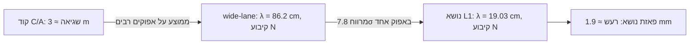

# M0.2 · שיעור 1: הגל הנע: אורך גל, תדר ופאזה, ומעבר בין תחום הזמן לתחום התדר

מכסה: 1.3 The Physics of EM Waves · 1.3.1 Wavelength, Frequency, and Phase · The Parameters of a Wave · Traveling Waves · Frequency  vs. Time Domain

## הלומד · שיעור · 2026-11-16

כתוב את שיעור 1 במודול M0.2: הגל הנע: אורך גל, תדר ופאזה, ומעבר בין תחום הזמן לתחום התדר.

---

## המורה · claude-opus-5-5

## פרק 1: הגל הנע

מכ"ם הפולסים שפגשנו ב-M0.1 מודד זמן. הוא שולח פרץ קצר של אנרגיה, מחכה להד וממיר את ההשהיה לטווח. כשאמרנו "פרץ של אנרגיה" דילגנו על שאלה: מה בדיוק עובר בין האנטנה למטרה? עובר שם גל, כלומר שדה חשמלי שמתנדנד מיליארדי פעמים בשנייה ובאותו זמן נע במהירות האור. בפרק הזה נבנה ביטוי אחד שמתאר את הגל הזה. נראה איך אורך הגל, התדר והמהירות קשורים זה לזה, ונגלה שאורך הגל קובע כמה גדולה צריכה להיות אנטנה כדי לדעת מאיזה כיוון הגיע ההד. לא נגזור כאן למה השדה מתנהג כגל, כי זה עניין של משוואות מקסוול. גם את המתמטיקה של הספקטרום (פורייה, M0.3) לא נבנה כאן, ונשתמש בה כאינטואיציה בלבד.

מערכת העוגן שלנו היא מכ"ם הפולסים של איור 1-1, והיא תלווה כל צעד בפרק. קודם נשאל מה מגיע למקלט שלה מלבד ההד. אחר כך נשאל מה התדר ומה אורך הגל שלה, ואיזה פס תדרים מתאים לה אם היא צריכה להיכנס לאף של מטוס. בסוף נראה שבדיוק השאלה הזאת הכריעה את מלחמת המכ"ם המוטס ב-1940.

**מה אנחנו כבר יודעים.** מהירות האור בריק היא $c=3\cdot10^8$ m/s. הטווח למטרה מתקבל מזמן ההלוך-חזור, $R=c\Delta T/2$. במשוואת המכ"ם ובמשוואת הקשר של M0.1 הופיע אורך הגל $\lambda$ בשני מקומות: באובדן הפיזור $(4\pi d/\lambda)^2$ ובשטח האפקטיבי $\lambda^2/4\pi$. שם לא הסברנו מהו. אנחנו יודעים לחשב ב-dB ולחבר הספקים. מבית הספר אנחנו מכירים סינוס, קוסינוס ומעגל. את השדה החשמלי $\mathbf E$ אנחנו מכירים כווקטור: כוח ליחידת מטען, ביחידות V/m.

### 1.1 חזרה: מכ"ם עם פולס, ומה עוד מגיע למקלט

[[B02:42]] ב-M0.1 נתנו למקלט של המכ"ם תפקיד אחד: למדוד מתי חזר ההד. אבל המקלט לא שומע רק את ההד. כדי להבין מה עוד נכנס אליו, נעקוב אחרי האות בשרשרת השלמה של המכ"ם, מהמשדר ועד תוצאת המדידה.

```figure
B02:42:0
איור 1-1: הרכיבים העיקריים בתהליך השידור והקליטה של מכ"ם.
```

האיור מראה שני מסלולים שעוברים דרך אנטנה אחת. במסלול השידור המשדר מייצר פולס חזק, והוא עובר דרך [[מונח: מתג שידור-קליטה (T/R switch) | מתג שמחבר את האנטנה למשדר בזמן השידור ולמקלט בזמן ההאזנה, ומגן על המקלט מהפולס החזק]] אל האנטנה, ומשם אל המטרה. במסלול הקליטה ההד חוזר לאותה אנטנה. הוא עובר שוב דרך מתג השידור-קליטה ודרך [[מונח: מגן המקלט (limiter) | רכיב שמגביל אותות חזקים, כמו דליפה מהמשדר או משבש קרוב, כדי שלא יגיעו ל-LNA ויהרסו אותו]] אל [[מונח: מגבר רעש נמוך (LNA) | המגבר הראשון במקלט; מתוכנן להוסיף כמה שפחות רעש משלו, כי הרעש שלו מוגבר יחד עם האות בכל השלבים שאחריו]], ומשם אל [[מונח: מערבל ומתנד מקומי | המערבל מכפיל את האות בגל של מתנד מקומי ומוריד אותו לתדר ביניים (IF) נמוך, כלומר לתנודה איטית בהרבה, שקל יותר להגביר ולסנן]]. אחרי המערבל באים מגבר תדר הביניים, [[מונח: הגלאי | רכיב שמוציא מאות תדר הביניים המתנודד את המעטפת שלו, כלומר את עוצמת ההד לאורך הזמן, ומשמיט את התנודה עצמה]], הממיר הספרתי (A/D) והמעבד. המעבד מוציא את מה שהמערכת באמת צריכה: האם יש מטרה, ובאיזה טווח. את הטווח הוא מחשב מהקשר שכבר מוכר לנו:

$$R=\frac{c\,\Delta T}{2}\tag{49}$$

החלוקה ב-2 קיימת כי הגל עובר את המרחק פעמיים, הלוך וחזור. במכ"ם ההשהיות קצרות מאוד, ולכן מודדים אותן במיקרו-שניות, $1\ \mu\text{s}=10^{-6}$ s, ובננו-שניות, $1\ \text{ns}=10^{-9}$ s. השהיה של 1 µs מתאימה ל-150 m של טווח, ודיוק תזמון של 1 ns מתאים ל-0.15 m.

האנטנה לא בוחרת מה לקלוט. כל גל בתדר המתאים שמגיע אליה נכנס למקלט, ורק חלק ממה שנכנס הוא ההד שלנו. לכן ההד מגיע תמיד יחד עם הפרעה, והמשימה המרכזית של מעבד האותות היא להחליט אם יש מטרה למרות ההפרעה. כדי לטפל בהפרעה צריך קודם לדעת מאיפה היא באה, ולכן מסווגים אותה לפי מקורה. לסיווג יש תפקיד גם בהמשך הפרק. ב-1.6 נראה שאחד מסוגי ההפרעה, ההד מהקרקע, קבע ב-1940 אם מכ"ם מוטס עובד בכלל, ושאורך הגל קבע כמה ממנו נכנס למקלט.

```definition
@title: ארבעה סוגי הפרעה במקלט
@mark: summary
האות שמגיע למקלט הוא סכום של ההד הרצוי $s(t)$ ושל הפרעה. ההפרעה מתחלקת לארבעה סוגים לפי מקורה ולפי הכוונה שמאחוריה:
- **רעש** (noise): תנודה אקראית שנוצרת ברכיבי המקלט עצמו או מגיעה מהסביבה הטבעית. אין לה מקור מכוון, והיא קיימת תמיד.
- **החזרי סביבה** (clutter): הדים של גל המכ"ם עצמו מעצמים שאינם המטרה המבוקשת.
- **הפרעה לא מכוונת** (EMI, electromagnetic interference): גלים ממקורות אחרים מעשה ידי אדם, שלא נועדו לפגוע במכ"ם.
- **שיבוש** (jamming): גלים שמשודרים בכוונה כדי לפגוע בגילוי, בצורת רעש או בצורת מטרות כוזבות, ממערכת [[מונח: אמצעי נגד אלקטרוניים (ECM) | ציוד לוחמה אלקטרונית שמשדר אותות כדי להסתיר מטרה ממכ"ם או להטעות אותו]].
הסיווג נקבע לפי המקור והכוונה, לא לפי צורת האות.
```

הסיווג נקבע לפי המקור ולא לפי הצורה, כי שתי הפרעות יכולות להיראות זהות ובכל זאת לדרוש טיפול שונה. שיבוש רעש נראה במקלט כמו הרעש שנוצר ברכיבי המקלט עצמו (רעש תרמי, שמקורו בתנועה אקראית של אלקטרונים ברכיבים), ומטרה כוזבת נראית כמו הד אמיתי. רעש ממצתים של מנוע או מהמברשות של מנוע חשמלי הוא EMI: יש לו מקור מעשה ידי אדם, אבל אין מאחוריו כוונה. ההבדל המעשי הוא שאת ה-EMI אפשר לסנן או לסלק במקור, ואילו משבש מסתגל כדי לעקוף כל סינון קבוע.

**מה נע בתוך הפולס.** ב-M0.1 התייחסנו לפולס כאל "גוש" אנרגיה בעל משך. אם נגדיל את התמונה, נראה בתוכו תנודה: השדה החשמלי עולה ויורד שוב ושוב, וכל עלייה וירידה שלמה היא מחזור אחד. "10 GHz" פירושו עשרה מיליארד מחזורים בשנייה (את התדר ואת המחזור נגדיר במדויק ב-1.3), ולכן פולס של 1 µs מכיל עשרת אלפים מחזורים שלמים. מדידת הטווח של (49) משתמשת רק במעטפת, כלומר בהשהיה של הגוש כולו, ומתעלמת מהתנודה שבתוכו. כדי להבין מה התנודה הזאת יכולה לתת, צריך קודם לתאר אותה. יש כאן גם הנחה שנכנסה בשקט: ב-(49) הצבנו את מהירות האור בריק, כאילו הגל נע באוויר באותה מהירות. נבדוק את ההנחה הזאת ב-1.3, עם המספר שמכריע אותה.

```mcq
מכ"ם קרקעי מוצב ליד כביש. כשמשאיות חולפות, מופיעים על המסך פסים של רעש שמקורם במצתים של המנועים. לאיזה סוג הפרעה זה שייך?
- [ ] רעש :: רעש במובן שהגדרנו נוצר ברכיבי המקלט או בסביבה הטבעית. כאן יש מקור מעשה ידי אדם.
- [ ] החזרי סביבה :: החזרי סביבה הם הדים של הגל של המכ"ם עצמו. המצתים משדרים בעצמם ואינם מחזירים את הגל של המכ"ם.
- [x] הפרעה לא מכוונת (EMI) :: המקור מעשה ידי אדם, ואין כוונה לפגוע במכ"ם. זו בדיוק ההגדרה.
- [ ] שיבוש :: שיבוש דורש כוונה. צורה דמוית רעש אינה הופכת הפרעה לשיבוש, כי הסיווג נקבע לפי המקור והכוונה.
```

```mcq
ההד ממטרה מגיע למקלט 30.5 µs אחרי שהפולס שודר. מה הטווח למטרה?
- [ ] 9.15 km :: זה $c\Delta T$, הדרך הכוללת הלוך וחזור. צריך לחלק ב-2.
- [x] 4.58 km :: לפי $R=c\Delta T/2$: ‏$3\cdot10^8\cdot30.5\cdot10^{-6}/2=4575$ m, כלומר כ-4.58 km. כל 1 µs שווה 150 m.
- [ ] 30.5 km :: כנראה הנחת 1 km לכל 1 µs. הערך הנכון הוא 150 m לכל µs.
- [ ] 2.29 km :: חילקת ב-2 פעמיים.
```

### 1.2 תמונה רגעית של גל: משרעת, אורך גל ורדיאן

[[B10:13]] כדי לתאר את התנודה שבתוך הפולס, נתחיל מהמקרה הפשוט ביותר: נקפיא את הזמן ונצלם את הגל. כך נוכל לשאול אילו מספרים מספיקים כדי לתאר את הצורה הקפואה. אחר כך, ב-1.3, נחזיר את התנועה.

```figure
B10:13:0
איור 1-2 (Naval Weapons): גל ים. האנרגיה שלו באה מעבודה שעשו הרוח וכוח הכובד על המים הרחק מהחוף.
```

גל הים מראה את ההבחנה הראשונה, וכדאי להחזיק בה לאורך כל הקורס. בול עץ שצף על המים עולה ויורד כשהגל עובר תחתיו, אבל אינו מפליג עם הגל לחוף. מה שנע הוא ההפרעה, כלומר צורת פני המים, ולא המים עצמם. גל הוא לכן הפרעה בגודל פיזיקלי כלשהו שמשתנה במרחב. **התפשטות** (propagation) היא תנועה של ההפרעה, כשהיא שומרת על צורתה או משנה אותה לאט. המידע שהגל נושא טמון בגדלים שמתארים אותו. בגל ים הגודל המופרע הוא גובה פני המים. בגל קול הוא הלחץ. בגל אלקטרומגנטי הוא השדה החשמלי והשדה המגנטי.

[[B10:14]] ההפרעה הפשוטה ביותר היא מחזורית, כלומר חוזרת על עצמה במרווחים קבועים במרחב. הצורה המחזורית החלקה ביותר היא סינוס.

```figure
B10:14:0
איור 1-3 (Naval Weapons): גל הסינוס y=0.5·sin(2πx). ערך ההפרעה כפונקציה של המרחק, עם משרעת 0.5 ואורך גל של יחידה אחת.
```

```figure
B10:15:0
איור 1-4 (Naval Weapons): חלקי גל הסינוס: המשרעת A ואורך הגל λ.
```

בשני האיורים הגל חוזר על עצמו כל יחידה אחת על הציר האופקי, ונע בין $+0.5$ ל-$-0.5$ סביב האפס. כדי לתאר אותו מספיקים שני מספרים: האורך שאחריו הצורה חוזרת, וגודל הסטייה מהממוצע. נגדיר אותם בכלליות, לכל הפרעה מחזורית.

```definition
@title: הפרעה מחזורית: אורך גל, משרעת וערך שיא לשיא
@mark: summary
תהי $y(x)$ הפרעה שתלויה במקום $x$, ונניח שהיא מחזורית: קיים מספר חיובי $\lambda$ כך ש-$y(x+\lambda)=y(x)$ לכל $x$.
- **אורך הגל** $\lambda$ הוא המספר החיובי הקטן ביותר שמקיים את התנאי, כלומר המרחק בין שתי נקודות עוקבות שבהן הצורה חוזרת על עצמה (שיא לשיא, או אפס יורד לאפס יורד).
- **המשרעת** $A$ היא הסטייה המרבית של $y$ מהערך הממוצע שלה לאורך מחזור.
- **הערך שיא לשיא** הוא ההפרש בין הערך המרבי לערך המזערי של $y$.
אם ההפרעה סימטרית סביב הממוצע (כמו סינוס), הערך שיא לשיא שווה ל-$2A$. אחרת אין בין השניים קשר קבוע.
```

כל חלק בהגדרה עונה על כשל אפשרי. הדרישה ל"מספר הקטן ביותר" נחוצה, כי אם $\lambda$ מקיים את התנאי, גם $2\lambda$ ו-$3\lambda$ מקיימים אותו. בלי הדרישה הזאת לגל לא היה אורך גל אחד. ההגדרה גם מודדת את המשרעת מהממוצע ולא מהאפס, כי אצל גלים רבים הממוצע אינו אפס. גל ים, למשל, מתנדנד סביב פני הים השקטים, ולא סביב קרקעית הים. היחידות של המשרעת הן היחידות של הגודל המופרע: מטרים בגל ים, פסקל בגל קול (יחידת לחץ, כלומר כוח ליחידת שטח), V/m בשדה חשמלי. באיור 1-4 המשרעת היא 0.5 והערך שיא לשיא הוא 1. מי שמודד את הגל על מסך של מכשיר מדידה רואה קודם כול את הערך שיא לשיא, וטעות נפוצה היא לרשום אותו כמשרעת. כדי לתרגם את הטעות ל-dB צריך עובדה אחת על גלים, ואותה נקבל כאן כנתונה: ההספק שגל נושא פרופורציוני לריבוע המשרעת $A$ של השדה שלו, $P\propto A^2$. העובדה נובעת מהאנרגיה שהשדה החשמלי והשדה המגנטי נושאים יחד, ולכן היא מתבססת רק עם משוואות מקסוול, שאותן לא נגזור בשיעור הזה. ב-1.4 נבנה עליה חישוב שלם. כשמשרעות השדה של שני גלים הן $E_1$ ו-$E_2$, נובע ממנה איך מודדים את היחס ביניהן ב-dB:

$$10\log\frac{P_1}{P_2}=10\log\left(\frac{E_1}{E_2}\right)^2=20\log\frac{E_1}{E_2}$$

יחס הספקים נמדד ב-$10\log$. אותו יחס, כשכותבים אותו כיחס שדות, נמדד ב-$20\log$. משרעת כפולה היא לכן פי ארבעה בהספק, והטעות שווה ל-$10\log4=20\log2=6$ dB.

**מעגל, זווית ורדיאן.** הסינוס אינו פונקציה של מרחק אלא של זווית. לכן, כדי לכתוב את הגל של איור 1-3 בנוסחה, צריך לתרגם מרחק לזווית. התרגום בא מהמעגל: נקודה שמסתובבת במעגל ברדיוס $A$ נמצאת בגובה $A\sin\theta$, וכשהיא משלימה סיבוב שלם, הגובה שלה משלים מחזור שלם. בשרטוט שלהלן כדאי לעקוב אחרי הקו המקווקו, שמעביר את הגובה של הנקודה במעגל אל הגרף.

```svg
@caption: נקודה במעגל ברדיוס A בזווית θ=60°, והגובה שלה A·sinθ שמועבר אל הגרף. סיבוב שלם של 2π רדיאנים מתאים לאורך גל אחד λ.
<svg viewBox="0 0 600 250" xmlns="http://www.w3.org/2000/svg" font-size="13" fill="none" stroke="currentColor">
  <line x1="20" y1="120" x2="200" y2="120" stroke-width="0.8"/>
  <line x1="110" y1="30" x2="110" y2="210" stroke-width="0.8"/>
  <circle cx="110" cy="120" r="80" stroke-width="1.5"/>
  <line x1="110" y1="120" x2="150" y2="50.72" stroke-width="1.8"/>
  <circle cx="150" cy="50.72" r="4" fill="currentColor"/>
  <path d="M 135 120 A 25 25 0 0 0 122.5 98.35" stroke-width="1.2"/>
  <text x="138" y="108" fill="currentColor" stroke="none">θ</text>
  <text x="122" y="80" fill="currentColor" stroke="none">A</text>
  <line x1="150" y1="50.72" x2="283.33" y2="50.72" stroke-dasharray="5 4" stroke-width="1"/>
  <line x1="230" y1="120" x2="570" y2="120" stroke-width="0.8"/>
  <polyline stroke-width="1.8" points="230,120 243.33,99.3 256.67,80 270,63.43 283.33,50.72 296.67,42.73 310,40 323.33,42.73 336.67,50.72 350,63.43 363.33,80 376.67,99.3 390,120 403.33,140.7 416.67,160 430,176.57 443.33,189.28 456.67,197.27 470,200 483.33,197.27 496.67,189.28 510,176.57 523.33,160 536.67,140.7 550,120"/>
  <circle cx="283.33" cy="50.72" r="4" fill="currentColor"/>
  <line x1="310" y1="116" x2="310" y2="124"/><text x="300" y="138" fill="currentColor" stroke="none">π/2</text>
  <line x1="390" y1="116" x2="390" y2="124"/><text x="385" y="138" fill="currentColor" stroke="none">π</text>
  <line x1="470" y1="116" x2="470" y2="124"/><text x="458" y="112" fill="currentColor" stroke="none">3π/2</text>
  <line x1="550" y1="116" x2="550" y2="124"/><text x="545" y="112" fill="currentColor" stroke="none">2π</text>
  <line x1="230" y1="228" x2="550" y2="228" stroke-width="1"/>
  <line x1="230" y1="222" x2="230" y2="234"/><line x1="550" y1="222" x2="550" y2="234"/>
  <text x="335" y="246" fill="currentColor" stroke="none">מחזור אחד: λ במרחב ↔ 2π בזווית</text>
  <text x="40" y="240" fill="currentColor" stroke="none">גובה הנקודה = A·sinθ</text>
</svg>
```

השרטוט מראה שמחזור אחד של הגל הוא סיבוב אחד במעגל. לכן הדרך הטבעית למדוד את ההתקדמות לאורך המחזור היא זווית. יחידת הזווית שמתאימה לזה ביותר אינה המעלה, שהיא חלוקה שרירותית של המעגל ל-360. היחידה המתאימה מוגדרת מהמעגל עצמו.

```definition
@title: רדיאן
@mark: summary
במעגל ברדיוס $r$, זווית מרכזית שנשענת על קשת באורך $s$ היא, ברדיאנים,
$$\theta=\frac{s}{r}$$
הרדיאן הוא יחס בין שני אורכים, ולכן גודל חסר יחידות. סיבוב שלם נשען על קשת שאורכה היקף המעגל, $s=2\pi r$, ולכן הוא שווה ל-$2\pi$ רדיאנים, כלומר $360^\circ$. ההמרה היא $\theta[\text{rad}]=\theta[^\circ]\cdot\pi/180$.
```

ההגדרה דרך יחס אורכים היא הסיבה שהרדיאן נוח בפיזיקה. זווית של רדיאן אחד היא הזווית שבה הקשת שווה לרדיוס. לכן רדיאן אחד שווה ל-$180^\circ/\pi=57.30^\circ$. עכשיו אפשר לכתוב את הגל הקפוא בנוסחה. המרחק $x$ חלקי $\lambda$ סופר כמה אורכי גל עברנו. הכפלה ב-$2\pi$ ממירה את הספירה הזאת לרדיאנים.

```definition
@title: גל סינוסי בתמונה רגעית
@mark: summary
הפרעה סינוסית במקום $x$, עם משרעת $A$ ואורך גל $\lambda$, שמתנדנדת סביב ממוצע אפס ומתחילה מאפס עולה ב-$x=0$:
$$y(x)=A\sin\!\left(\frac{2\pi x}{\lambda}\right)\tag{50}$$
הארגומנט $2\pi x/\lambda$ נמדד ברדיאנים. הנוסחה מתארת רגע קפוא אחד, ומניחה צורה סינוסית טהורה עם משרעת קבועה בכל המרחב.
```

הנוסחה עונה על הבדיקה הבסיסית. כש-$x$ גדל ב-$\lambda$, הארגומנט גדל ב-$2\pi$ והסינוס חוזר לערכו, כמו שדורשת הגדרת אורך הגל. הגרף של איור 1-3 מקיים $A=0.5$ ו-$\lambda=1$, ולכן לפי (50) הוא $0.5\sin(2\pi x)$. כדאי להשוות אותו ל-$\sin(x)$, שבו המקדם חסר: הפונקציה הזאת מתנדנדת במשרעת 1 וחוזרת על עצמה רק כל $2\pi$ יחידות. בלי המקדם $2\pi/\lambda$, אורך הגל "תקוע" על $2\pi$ יחידות. המקדם הוא מה שמאפשר לנוסחה אחת לתאר כל אורך גל.

[[B10:17]] ההמרה בין היחידות דורשת זהירות, כי קיצור דרך מוכר מכניס שגיאה שגדולה מהדיוק שנדרוש בהמשך. בהמרה לא מדויקת מעגלים לעתים את 57.30° לרדיאן ל"בערך 60° אם ממהרים". הקיצור הזה גדול מהערך הנכון ב-4.72%. בפרק 2 נמדוד הפרשי פאזה ונתרגם אותם לזוויות הגעה ולמרחקים. שם שגיאה שיטתית של כ-5% גדולה מכל מה שמכשיר מדידה סביר מוסיף. מותר להשתמש ב-60° כדי לבדוק סדר גודל בראש, אבל לא כדי לחשב.

את אורך הגל של מכ"ם העוגן שלנו עדיין אי אפשר לחשב: התמונה הקפואה אינה יודעת דבר על תדר או על מהירות. כדי לקשר בין אורך הגל ובין התדר ש"כתוב על המכ"ם", צריך להחזיר לגל את התנועה.

```mcq
מודדים מתח של גל סינוסי על מסך של מכשיר מדידה. הקו העליון של הגל נמצא ב-$+0.5$ V והקו התחתון ב-$-0.5$ V. מה המשרעת?
- [ ] 1 V :: זה הערך שיא לשיא. המשרעת נמדדת מהממוצע (אפס) ולא מהשיא התחתון.
- [x] 0.5 V :: הסטייה המרבית מהממוצע היא 0.5 V. בגל סימטרי, הערך שיא לשיא שווה לפעמיים המשרעת.
- [ ] 0.25 V :: חילקת ב-2 פעם אחת יותר מדי. 0.5 V כבר נמדד מהממוצע.
- [ ] אי אפשר לדעת בלי אורך הגל :: המשרעת ואורך הגל הם פרמטרים בלתי תלויים, כל אחד נקרא מציר אחר.
```

```numeric
@answer: 0.873
@unit: rad
@tol: 1%
שני גלים זהים מוזזים זה מזה ב-$50^\circ$. כמה זה ברדיאנים?
---
ממירים לפי ההגדרה: $\theta[\text{rad}]=\theta[^\circ]\cdot\pi/180=50\cdot\pi/180=0.873$ rad. בדיקה בראש: רדיאן הוא כ-57°, ולכן 50° הם קצת פחות מרדיאן אחד.
- wrong: 0.833 :: חילקת ב-60 במקום ב-57.30, כלומר השתמשת בקיצור "60° לרדיאן" שטועה בכ-5%.
- wrong: 2864.8 :: הכפלת ב-57.30 במקום לחלק. כך ממירים מרדיאנים למעלות, לא להפך.
```

### 1.3 הגל נע: T0, f, k, ω ו-v=λf

[[B10:18]] התמונה הקפואה של (50) מתחילה לנוע. כדי לתאר אותה צריך ביטוי אחד שמכיל גם את המקום וגם את הזמן. יש שתי דרכים להסתכל על גל שנע. אפשר לצלם אותו ברגע אחד ולראות צורה במרחב, כמו ב-1.2. אפשר גם לעמוד בנקודה אחת ולרשום איך ההפרעה בה משתנה בזמן, כמו בול העץ על הים. במבט השני אנחנו רואים סינוס בזמן, שחוזר כל פרק זמן קבוע. כדי לאחד את שני המבטים נגדיר קודם את הגודל שמתאים בזמן לאורך הגל.

[[B02:43]] הנה שני המבטים זה לצד זה. בשני האיורים הציר האנכי הוא אותה משרעת. ההבדל הוא רק במה שנמצא על הציר האופקי.

```figure
B02:43:1
איור 1-5 (POMR): אורך הגל. השדה כפונקציה של המקום ברגע קבוע.
```

```figure
B02:44:0
איור 1-6 (POMR): המחזור. השדה כפונקציה של הזמן בנקודה קבועה.
```

באיור 1-5 הזמן קבוע והמקום משתנה, והמרחק בין שני שיאים עוקבים הוא אורך הגל. באיור 1-6 המקום קבוע והזמן משתנה, והזמן בין שני שיאים עוקבים הוא המחזור. אותו גל נותן שני סינוסים. אחד נמדד במטרים, השני בשניות.

```definition
@title: מחזור ותדר
@mark: summary
תהי $y(t)$ הפרעה בנקודה קבועה, מחזורית בזמן: קיים $T_0>0$ כך ש-$y(t+T_0)=y(t)$ לכל $t$, ו-$T_0$ הוא הקטן ביותר שמקיים זאת. $T_0$ הוא **המחזור**. **התדר** הוא מספר המחזורים בשנייה:
$$f=\frac{1}{T_0}\tag{51}$$
יחידת התדר היא הרץ: $1\ \text{Hz}$ הוא מחזור אחד בשנייה. בשימוש מקובלים $1\ \text{kHz}=10^3$ Hz, $1\ \text{MHz}=10^6$ Hz ו-$1\ \text{GHz}=10^9$ Hz. לתדרים כאלה יש מחזורים קצרים מאוד, ולכן משתמשים גם ב-$1\ \mu\text{s}=10^{-6}$ s (מיקרושנייה), ב-$1\ \text{ns}=10^{-9}$ s (ננושנייה) וב-$1\ \text{ps}=10^{-12}$ s (פיקושנייה).
```

[[2.5: מקור]] כדי לחבר את המחזור לאורך הגל, נשאל איך כותבים צורה שנעה. נניח שהצורה של (50) נעה ימינה במהירות קבועה $v$ בלי להשתנות. אחרי זמן $t$ כל נקודה בצורה התקדמה מרחק $vt$. לכן הערך שנמצא עכשיו במקום $x$ הוא הערך שהיה בהתחלה במקום $x-vt$. נציב את $x-vt$ במקום $x$ ב-(50) ונפתח את הסוגריים:

$$y(x,t)=A\sin\!\left(\frac{2\pi(x-vt)}{\lambda}\right)=A\sin\!\left(\frac{2\pi x}{\lambda}-\frac{2\pi v}{\lambda}\,t\right)$$

בנקודה קבועה $x$ האיבר הראשון קבוע, והארגומנט יורד בקצב $2\pi v/\lambda$ רדיאנים בשנייה. מחזור שלם הוא $2\pi$ רדיאנים, והוא חייב לעבור בדיוק בזמן $T_0$. מכאן נקבל את הקשר בשלוש שורות:

$$\frac{2\pi v}{\lambda}\,T_0=2\pi\quad\Longrightarrow\quad v=\frac{\lambda}{T_0}\quad\Longrightarrow\quad v=\lambda f$$

השורה הראשונה אומרת שבמחזור אחד הארגומנט יורד ב-$2\pi$. השנייה מבודדת את $v$ אחרי צמצום $2\pi$ משני הצדדים. השלישית מציבה את $1/T_0=f$ מ-(51). מה שהרווחנו: אורך הגל והתדר אינם שני פרמטרים חופשיים, כי המהירות קושרת ביניהם. בגזירה נכנסו שתי הנחות, וכדאי לרשום אותן. ההנחה הראשונה היא שהצורה אינה משתנה בתנועה, כלומר המהירות זהה לכל חלקי הגל. ההנחה השנייה היא שהתווך אחיד, כך ש-$v$ אינה תלויה במקום. ב-1.4 נראה מה קורה כשהראשונה נשברת. את השנייה נבדוק מיד אחרי (55).

נותר לכתוב את התוצאה בצורה הסטנדרטית. מגדירים קיצור לכל אחד משני המקדמים שהופיעו בארגומנט: $k=2\pi/\lambda$ הוא מספר הרדיאנים למטר, ו-$\omega=2\pi f$ הוא מספר הרדיאנים לשנייה. נהוג גם לכתוב קוסינוס במקום סינוס, ולהוסיף קבוע $\varphi$ שקובע מאיפה הגל מתחיל. קוסינוס הוא פשוט סינוס מוזז ברבע מחזור, ולכן ההחלפה אינה משנה דבר מהותי. את הגל האלקטרומגנטי מתארים בצירים של איור 1-7.

```figure
B02:43:0
איור 1-7 (POMR): השדה החשמלי E לאורך ציר y, השדה המגנטי B לאורך ציר x, והתנועה לאורך ציר z.
```

באיור מופיע לצד $\mathbf E$ גם **השדה המגנטי** $\mathbf B$. זה שדה וקטורי שני, שבגל אלקטרומגנטי מלווה תמיד את $\mathbf E$ ומתנדנד יחד איתו. שני השדות מאונכים זה לזה, וכיוון התנועה מאונך לשניהם. **כלל יד ימין** קובע לאיזה צד: כשמסובבים את אצבעות יד ימין מכיוון $\mathbf E$ אל כיוון $\mathbf B$, האגודל מצביע לכיוון התנועה. בשלב הזה של הקורס נעבוד רק עם $\mathbf E$, ונחליף שני סימונים כדי להתאים לאיור. מעכשיו המקום לאורך הכיוון שבו הגל נע ייקרא $z$ (במקום $x$ של (50)), והגודל המופרע הוא השדה $E$ (במקום $y$). הציר $y$ מציין מעכשיו רק את הכיוון שבו השדה מצביע. (52) שלהלן היא לכן אותו גל נע שגזרנו, בשמות חדשים. הארגומנט $kz-\omega t+\varphi$ של הקוסינוס נקרא **הפאזה** של הגל. הוא אומר באיזה שלב של המחזור נמצא השדה במקום $z$ ברגע $t$: פאזה 0 היא שיא, $\pi$ היא שפל, ותוספת של $2\pi$ מחזירה לאותו שלב. את הפאזה כגודל מדיד נפתח ב-2.1.

```formula
@title: הגל הנע בתדר יחיד
@mark: summary
הביטוי הזה מתאר את השדה בכל מקום ובכל רגע. ממנו נקבל גם את הקשר בין אורך הגל, התדר והמהירות, שמשמש בכל חישוב של אנטנה, טווח או פאזה בקורס.
$$E(z,t)=E_0\cos(kz-\omega t+\varphi)\tag{52}$$
$$k=\frac{2\pi}{\lambda}\ \ [\text{rad/m}],\qquad \omega=2\pi f\ \ [\text{rad/s}]\tag{53}$$
$$v=\frac{\omega}{k}=\lambda f,\qquad \text{in vacuum: } \lambda f=c\tag{54}$$
$z$ הוא המקום לאורך כיוון ההתקדמות [m], ו-$t$ הוא הזמן [s]. $E_0$ היא משרעת השיא [V/m], $k$ הוא מספר הגל, $\omega$ היא התדירות הזוויתית, ו-$\varphi$ היא הפאזה ההתחלתית [rad]. $v$, **מהירות הפאזה**, היא המהירות שבה נעה נקודה של פאזה קבועה. בריק $v=c$ לכל תדר. הביטוי תקף לגל בתדר יחיד שנע לכיוון $+z$ בתווך אחיד, עם משרעת קבועה.
```

[[2.5: מבנה]] כל הפיזיקה של (52) נמצאת בתוך הארגומנט $kz-\omega t+\varphi$, ולכל אחד משלושת האיברים יש תפקיד משלו. האיבר $kz$ סופר כמה רדיאנים של מחזור "נצברו" לאורך הדרך. כש-$\lambda$ קטן, $k$ גדל, וכל מילימטר של דרך שווה יותר רדיאנים. לכן גלים קצרים רגישים יותר להפרשי דרך זעירים, וזה הבסיס של כל פרק 2. האיבר $\omega t$ סופר רדיאנים בזמן. הסימן מינוס ביניהם קובע את כיוון התנועה. נקודה שבה הארגומנט קבוע מקיימת $kz-\omega t=\text{const}$, כלומר $z=(\omega t+\text{const})/k$, והיא מתקדמת ל-$+z$ במהירות $\omega/k$. עם סימן פלוס הגל היה נע ל-$-z$. כך מקבלים שוב את (54) בלי לחזור על הגזירה. המשרעת $E_0$ נמצאת מחוץ לקוסינוס ואינה משפיעה על המהירות או על אורך הגל. $\varphi$ שרירותית לגל בודד, כי היא תלויה רק בבחירת ראשית הצירים. נראה בפרק 2 שבין שני גלים היא נעשית הגודל החשוב ביותר.

התנועה עצמה מלמדת כאן יותר מכל תמונה, ולכן נפעיל אותה. כדאי לעקוב אחרי שני הסמנים בבת אחת. הנקודה הקבועה רק עולה ויורדת, כמו בול העץ. סמן הפסגה רץ ימינה, ובכל מחזור הוא מתקדם אורך גל אחד.

```anim
{"title":"גל נע: נקודה קבועה מול פסגה שנעה","caption":"הנקודה ב-z=1 רק מתנדנדת, וזה המבט של איור 1-6. הפסגה מתקדמת במהירות v=λf, וזה המבט של איור 1-5 כשהוא בתנועה. כשמגדילים את f, הנקודה מתנדנדת מהר יותר והפסגה רצה מהר יותר. כשמגדילים את λ, הפסגה מואצת באותו תדר.","duration":8,"view":{"x":[0,4],"y":[-1.6,1.7]},"params":[{"id":"lam","label":"אורך גל λ (m)","min":0.5,"max":2,"value":1},{"id":"f","label":"תדר f (Hz)","min":0.25,"max":1,"value":0.5}],"shapes":[{"type":"path","x":"s","y":"cos(2*pi*(s/lam - f*t))","s":[0,4]},{"type":"line","x1":"1","y1":"-1.4","x2":"1","y2":"1.4","dash":true},{"type":"circle","x":"1","y":"cos(2*pi*(1/lam - f*t))","r":"0.07","label":"נקודה קבועה z=1","accent":true},{"type":"circle","x":"mod(lam*f*t, lam) + lam","y":"1","r":"0.07","label":"פסגה"},{"type":"text","x":"2.6","y":"1.55","text":"v = λf = {round(lam*f,2)} m/s"}]}
```

האנימציה מראה ש-$v=\lambda f$ היא פשוט ספירה. בכל שנייה עוברות בנקודה הקבועה $f$ פסגות, וביניהן מרווח של $\lambda$. לכן בשנייה אחת כל פסגה מתקדמת $\lambda f$ מטרים.

[[B02:44]] [[2.5: סדר גודל]] עכשיו אפשר לענות על שאלת העוגן: מה אורך הגל של המכ"ם? הנתון שיש לנו עליו הוא התדר, $f=10$ GHz, שפגשנו ב-1.1. לפי (54), בריק $\lambda=c/f=3\cdot10^8/10^{10}=0.03$ m, כלומר 3 ס"מ. מכאן נובעים מיד מספר הגל לפי (53) והמחזור לפי (51):

$$k=\frac{2\pi}{0.03\ \text{m}}=209.4\ \text{rad/m},\qquad T_0=\frac{1}{10^{10}\ \text{Hz}}=100\ \text{ps}$$

לחישוב בראש כדאי לזכור כלל אחד. הוא מדויק ולא רק אומדן, כי $c=3\cdot10^{10}$ ס"מ לשנייה:

$$\lambda[\text{cm}]=\frac{30}{f[\text{GHz}]}:\qquad 3\ \text{GHz}\to10\ \text{cm},\quad 10\ \text{GHz}\to3\ \text{cm},\quad 35\ \text{GHz}\to8.6\ \text{mm}$$

```verify
@title: מספר הגל והמהירות של גל באורך 3 ס"מ
@result: f=10 GHz, k=209.4 rad/m, ω/k=3·10^8 m/s
- יחידות: $\omega/k$ הן $(\text{rad/s})/(\text{rad/m})=\text{m/s}$, יחידות של מהירות, כפי שצריך.
- הצבה: $\omega=2\pi\cdot10^{10}=6.283\cdot10^{10}$ rad/s, וחלוקה ב-$k=209.4$ rad/m נותנת $3\cdot10^8$ m/s, כלומר את $c$.
- מקרה גבול: הכפלת התדר ל-20 GHz מקצרת את $\lambda$ ל-1.5 ס"מ ומכפילה את $k$. המכפלה $\lambda f$ נשארת $c$.
- השוואה לכלל $\lambda[\text{cm}]=30/f[\text{GHz}]$: ‏$30/3=10$ GHz, כמו בחישוב המלא.
```

**כשהגל עובר לתווך.** עד כאן הנחנו ריק. עכשיו נשאל מה קורה בחומר, וזה גם המקום לבדוק את ההנחה של 1.1, שהגל נע באוויר במהירות $c$. בחומר הגל נע לאט יותר, ואת היחס בין המהירויות מגדירים כגודל של החומר.

```definition
@title: מקדם שבירה
@mark: summary
לתווך אחיד שבו גל בתדר נתון נע במהירות פאזה $v$, **מקדם השבירה** הוא
$$n=\frac{c}{v}$$
$n$ חסר יחידות. בריק $n=1$, ובחומרים רגילים לגלי רדיו ולאור נראה $n\ge1$. $n$ הוא תכונה של התווך בתדר נתון, ובאופן כללי משתנה עם התדר.
```

אילו מבין הפרמטרים של הגל משתנים כשהוא עובר מריק לתווך? התדר נשמר. בגבול, מספר הפסגות שמגיעות בשנייה חייב להיות שווה למספר הפסגות שיוצאות בשנייה, אחרת פסגות היו נערמות על הגבול או נעלמות בו. בשרטוט כדאי לספור פסגות משני צדי הגבול:

```svg
@caption: גל שעובר מריק (משמאל) לחומר עם מקדם שבירה n (מימין, n=1.6 בשרטוט). בכל שנייה חוצות את הגבול אותן f פסגות. בחומר הן נעות לאט יותר, v=c/n, ולכן המרווח ביניהן מתקצר מ-λ₀ ל-λ₀/n.
<svg viewBox="0 0 600 235" xmlns="http://www.w3.org/2000/svg" font-size="13" fill="none" stroke="currentColor">
  <rect x="300" y="30" width="280" height="155" fill="currentColor" fill-opacity="0.08" stroke="none"/>
  <line x1="300" y1="25" x2="300" y2="190" stroke-width="1.5"/>
  <text x="110" y="22" fill="currentColor" stroke="none">ריק (n=1)</text>
  <text x="400" y="22" fill="currentColor" stroke="none">חומר (n)</text>
  <line x1="20" y1="110" x2="580" y2="110" stroke-width="0.5" stroke-dasharray="3 4"/>
  <path d="M 20 110 q 20 -60 40 0 q 20 60 40 0 q 20 -60 40 0 q 20 60 40 0 q 20 -60 40 0 q 20 60 40 0 q 20 -60 40 0" stroke-width="1.8"/>
  <path d="M 300 110 q 12.5 60 25 0 q 12.5 -60 25 0 q 12.5 60 25 0 q 12.5 -60 25 0 q 12.5 60 25 0 q 12.5 -60 25 0 q 12.5 60 25 0 q 12.5 -60 25 0 q 12.5 60 25 0 q 12.5 -60 25 0 q 12.5 60 25 0" stroke-width="1.8"/>
  <circle cx="40" cy="80" r="3.5" fill="currentColor"/><circle cx="120" cy="80" r="3.5" fill="currentColor"/><circle cx="200" cy="80" r="3.5" fill="currentColor"/><circle cx="280" cy="80" r="3.5" fill="currentColor"/>
  <circle cx="337.5" cy="80" r="3.5" fill="currentColor"/><circle cx="387.5" cy="80" r="3.5" fill="currentColor"/><circle cx="437.5" cy="80" r="3.5" fill="currentColor"/><circle cx="487.5" cy="80" r="3.5" fill="currentColor"/><circle cx="537.5" cy="80" r="3.5" fill="currentColor"/>
  <line x1="120" y1="55" x2="200" y2="55" stroke-width="1"/><line x1="120" y1="50" x2="120" y2="60"/><line x1="200" y1="50" x2="200" y2="60"/>
  <text x="153" y="48" fill="currentColor" stroke="none">λ₀</text>
  <line x1="387.5" y1="55" x2="437.5" y2="55" stroke-width="1"/><line x1="387.5" y1="50" x2="387.5" y2="60"/><line x1="437.5" y1="50" x2="437.5" y2="60"/>
  <text x="397" y="48" fill="currentColor" stroke="none">λ₀/n</text>
  <line x1="100" y1="165" x2="180" y2="165" stroke-width="1.5"/><polyline points="172,160 180,165 172,170" stroke-width="1.5"/>
  <text x="120" y="185" fill="currentColor" stroke="none">v = c</text>
  <line x1="400" y1="165" x2="450" y2="165" stroke-width="1.5"/><polyline points="442,160 450,165 442,170" stroke-width="1.5"/>
  <text x="403" y="185" fill="currentColor" stroke="none">v = c/n</text>
  <text x="200" y="225" fill="currentColor" stroke="none">בשני הצדדים: f פסגות בשנייה</text>
</svg>
```

קצב הפסגות, $f$, זהה משני הצדדים. בחומר הפסגות נעות לאט יותר, ולכן הן צפופות יותר. נציב $v=c/n$ ב-$v=\lambda f$, ונשתמש בכך שבריק $\lambda_0 f=c$:

$$\lambda=\frac{v}{f}=\frac{c}{nf}\quad\Longrightarrow\quad \lambda=\frac{\lambda_0}{n}\tag{55}$$

כאן $\lambda_0$ הוא אורך הגל בריק באותו תדר. עכשיו אפשר לבדוק את ההנחה מ-1.1. באוויר $n\approx1.0003$, כלומר הגל נע לאט יותר מ-$c$ בשבריר של $n-1=3\cdot10^{-4}$. מכ"ם שמציב $c$ ב-(49) מחשב טווח ארוך מהאמיתי באותו שבריר. למטרה במרחק 100 km:

$$\Delta R=(n-1)R=3\cdot10^{-4}\cdot100\ \text{km}=30\ \text{m}$$

במכ"ם חיפוש עם [[מונח: תא טווח | מרווח הטווח הקטן ביותר שהמכ"ם מבחין בתוכו. לפולס באורך $\tau$ הוא $c\tau/2$, כלומר 150 m לפולס של 1 µs]] של 150 m, השגיאה קטנה מתא טווח אחד ולכן זניחה. במערכת שמודדת טווח לדיוק של סנטימטרים זו טעות גסה. מכאן ההכרעה: $n$ של האוויר נכנס לכל מערכת שהדיוק שלה טוב מכ-$3\cdot10^{-4}$ מהטווח.

ההנחה השנייה של הגזירה, שהתווך אחיד, נשברת לעתים קרובות. $n$ של האוויר יורד עם הגובה, כי האוויר נעשה דליל יותר, ומהירות הקול במים משתנה עם העומק. כש-$v$ תלויה במקום, חלקים שונים של הגל נעים במהירויות שונות, והכיוון שבו הגל מתקדם מתעקם. במכ"ם העיקום מטה את הקרן מעט אל מעבר לאופק. בסונאר, כפי שנראה מיד, ההשפעה חזקה בהרבה. גם אז $v=\lambda f$ נשאר נכון בכל נקודה, עם ה-$v$ המקומי. את העיקום עצמו נלמד בשיעור 3, עם חוק השבירה.

[[2.5: ביקורת]] הטענה "כשאור אדום נכנס לזכוכית אורך הגל שלו מתקצר, ולכן הוא נעשה כחול יותר" נשמעת סבירה. החצי הראשון שלה אפילו נכון, אבל המסקנה שגויה. הבדיקה היא שוב ספירת הפסגות בגבול, כמו בפסקה הקודמת: התדר אינו יכול להשתנות. אור אדום באורך 700 nm שנכנס לזכוכית עם $n=1.514$ מתקצר ל-462 nm, ובכל זאת הוא נשאר אדום. הסיבה היא שהצבע נקבע לפי התדר, כלומר לפי קצב התנודה שמגיע לעין. 462 nm הוא אורך הגל של אור כחול רק בריק. אורך הגל הקצר הוא עניין פנימי של הזכוכית. מי שממיר אורך גל לתדר בעזרת $c$ בתוך חומר יקבל תדר שגוי פי $n$. זו טעות שבודקים כך: האם ההמרה $f=c/\lambda$ נעשתה עם אורך הגל בריק?

**תדרים שונים, מהירויות שונות.** [[B10:18]] (55) הניחה מספר $n$ אחד, אבל בזכוכית $n$ תלוי מעט בצבע. זה מה שעושה המנסרה.

```figure
B10:18:0
איור 1-8 (Naval Weapons): מנסרה מפרקת אור לבן לצבעיו.
```

אור לבן מכיל תדרים רבים. בזכוכית הכחול נע לאט יותר מהאדום, כלומר $n$ שלו גדול יותר, והוא מתכופף יותר בכניסה לחומר. את חוק השבירה שמסביר את הכיפוף נלמד בשיעור 3. כאן חשוב רק העיקרון: המהירות תלויה בתדר.

```definition
@title: נפיצה
@mark: summary
תווך הוא **נפיץ** (dispersive) אם מהירות הפאזה בו תלויה בתדר:
$$v=v(f),\qquad\text{equivalently}\quad n=n(f)\tag{56}$$
בתווך לא נפיץ $v$ קבועה, ו-$\lambda f$ זהה לכל התדרים. ריק אינו נפיץ לגלים אלקטרומגנטיים.
```

בגזירה של (54) הנחנו שהצורה נעה בלי להשתנות. בתווך נפיץ, גל בתדר יחיד עדיין עומד בהנחה הזאת, כי יש לו מהירות אחת. אות שמורכב מכמה תדרים כבר אינו עומד בה. ב-1.4 נראה שכל אות אמיתי הוא כזה.

הקשר $v=\lambda f$ חל על כל גל, גם על גל לחץ (קול) במים. הטבלה משווה גל של 15 ס"מ בשני התווכים:

```table
{"title":"גל של 15 ס\"מ במים ובאוויר","scope":{},"columns":["תווך","מהירות v (m/s)","תדר f","אורך גל λ","שינוי של v בין נקודות לאורך המסלול"],"rows":[["\"מים (סונאר)\"","\"1500\"","\"10 kHz\"","\"15 cm\"","\"כמה אחוזים (טמפרטורה, מליחות, עומק)\""],["\"אוויר (מכ\\\"ם)\"","\"3·10^8\"","\"2 GHz\"","\"15 cm\"","\"פחות מ-3·10^-4 (n−1 יורד מ-3·10^-4 ליד הקרקע לכמעט 0 בגובה רב)\""]]}
```

בעמודה האחרונה צריך להבחין בין שני גדלים. הערך $n-1=3\cdot10^{-4}$ שחישבנו קודם הוא סטייה קבועה של $v$ מ-$c$, והוא גורם רק לשגיאת טווח. את הגל מעקם השינוי של $v$ בין נקודות שונות במסלול, וזה הגודל שהעמודה משווה. באוויר השינוי הזה קטן אפילו מ-$n-1$, כי $n-1$ עצמו נע בין כ-$3\cdot10^{-4}$ ליד הקרקע לכמעט אפס בגובה רב. במים השינוי הוא כמה אחוזים, כלומר פי מאה לפחות.

```domain
@field: marine
@title: סונאר: אותו קשר, מהירות אחרת בחמש סדרי גודל
באותו אורך גל, יחס התדרים שווה ליחס המהירויות: $c/1500=2\cdot10^5$. לכן מערכי חיישנים של סונאר ושל מכ"ם בנויים באותם ממדים יחסיים לאורך הגל, אף על פי שהתדרים שלהם רחוקים זה מזה בחמישה סדרי גודל. ההבדל המהותי נמצא בעמודה האחרונה. בים התווך רחוק מאוד מלהיות אחיד, קרני הקול מתעקמות בחדות, ונוצרים אזורי צל שבהם צוללת אינה נשמעת. נשוב לזה בשיעור על השבירה ובמודול הימי.
```

```numeric
@answer: 10
@unit: GHz
@tol: 1%
בדיקה בכיוון ההפוך: מכ"ם משדר בריק גל שאורכו 3 ס"מ. מה התדר שלו?
---
לפי (54), $f=c/\lambda$. צריך להמיר את אורך הגל למטרים: $\lambda=0.03$ m. מכאן $f=3\cdot10^8/0.03=10^{10}$ Hz, כלומר 10 GHz. בבדיקה בראש לפי הכלל $\lambda[\text{cm}]=30/f[\text{GHz}]$: $30/3=10$.
- wrong: 0.1 :: הצבת 3 במקום 0.03, כלומר ס"מ כאילו היו מטרים, וקיבלת $10^8$ Hz.
- wrong: 0.009 :: הכפלת במקום לחלק: $c\cdot\lambda=9\cdot10^6$, ואלו גם לא יחידות של תדר.
```

```mcq
אור אדום שאורך הגל שלו בריק 700 nm נכנס לזכוכית עם $n=1.514$. מה קורה לתדר ולאורך הגל בתוך הזכוכית?
- [ ] התדר יורד פי 1.514 ואורך הגל נשמר :: אם התדר היה משתנה, פסגות היו נערמות על הגבול. מה שנשמר בגבול הוא התדר.
- [x] התדר נשמר ואורך הגל מתקצר ל-462 nm :: מספר הפסגות לשנייה זהה משני הצדדים, והמהירות יורדת פי $n$. לכן $\lambda=\lambda_0/n$.
- [ ] שניהם יורדים פי $\sqrt{1.514}$ :: אין שום שורש בקשר. המהירות היא שיורדת פי $n$, וכל השינוי עובר לאורך הגל.
- [ ] שניהם נשמרים, רק המשרעת משתנה :: אם $f$ ו-$\lambda$ היו נשמרים, גם $v=\lambda f$ היה נשמר. אבל בזכוכית $v=c/n$.
```

```explain
למה המהירות של הגל $E_0\cos(kz-\omega t+\varphi)$ היא $\omega/k$? הסבר בשניים-שלושה משפטים.
---
- נקודה של פאזה קבועה מקיימת $kz-\omega t=\text{const}$.
- מכאן $z=(\omega t+\text{const})/k$, והנקודה מתקדמת $\omega/k$ מטרים בכל שנייה.
- עם $k=2\pi/\lambda$ ו-$\omega=2\pi f$ מתקבל $\omega/k=\lambda f$.
===
הגל "זז" במובן זה שערך מסוים של הארגומנט, כמו פסגה, נמצא בכל רגע במקום אחר. כשדורשים ש-$kz-\omega t$ יישאר קבוע, $z$ חייב לגדול ב-$\omega/k$ בכל שנייה, וזו מהירות הפאזה. כשמציבים את ההגדרות של $k$ ו-$\omega$, $2\pi$ מצטמצם ונשאר $\lambda f$: מספר הפסגות שעוברות בשנייה כפול המרווח ביניהן.
```

```mcq
לאיזה כיוון נע הגל $E=E_0\cos(kz+\omega t)$?
- [ ] לכיוון $+z$, כמו כל גל :: את כיוון התנועה קובע הסימן שבין $kz$ ל-$\omega t$. הכיוון אינו קבוע מראש.
- [x] לכיוון $-z$ :: פאזה קבועה דורשת $kz+\omega t=\text{const}$, כלומר $z=(\text{const}-\omega t)/k$, ו-$z$ קטן עם הזמן.
- [ ] לכיוון $+z$, כי שני האיברים בארגומנט חיוביים :: דווקא הסימן החיובי הופך את הכיוון. כדי ש-$kz+\omega t$ יישאר קבוע כש-$t$ גדל, $z$ חייב לקטון.
- [ ] אי אפשר לדעת בלי $\varphi$ :: הפאזה ההתחלתית מזיזה רק את נקודת ההתחלה ואינה משפיעה על הכיוון.
```

```mcq
שני גלים, אחד ב-1.2 GHz ואחד ב-1.6 GHz, עוברים מריק לתווך נפיץ. מה נכון לגביהם בתוך התווך?
- [ ] שני התדרים יורדים, כי הגל מאט :: התדר נשמר בגבול, כי מספר הפסגות לשנייה זהה משני הצדדים. ההאטה עוברת כולה לאורך הגל.
- [ ] אורכי הגל של שניהם מתקצרים באותו יחס :: זה נכון בתווך לא נפיץ. בתווך נפיץ $n=n(f)$, ולכל תדר מקדם שבירה משלו.
- [x] התדרים נשמרים, וכל אורך גל מתקצר לפי מקדם השבירה של התדר שלו, $\lambda=\lambda_0/n(f)$ :: התדר נשמר בגבול, ו-(55) חלה על כל תדר בנפרד עם ה-$n$ שלו. לכן גם מהירויות הפאזה של שני הגלים שונות.
- [ ] שני הגלים נעים באותה מהירות, כי שניהם גלים אלקטרומגנטיים :: באותה מהירות הם נעים רק בריק. בתווך נפיץ $v=v(f)$, לפי (56).
```

### 1.4 תחום הזמן מול תחום התדר

[[B10:19]] (52) מתארת גל בתדר יחיד שנמשך לנצח. מכ"ם העוגן שלנו משדר משהו אחר: פולס שנדלק ל-1 µs ונכבה. גם הדיבור בקשר, התמונה בקישור הלוויין והחיפוש של מכ"ם מורכבים מאותות שצורתם מסובכת. השאלה היא איך אפשר להחיל את כל מה שבנינו על גל טהור על אות כזה. התשובה היא שאות מסובך הוא מתכון של סינוסים.

אפשר לתאר גל סינוסי בשתי דרכים שקולות. בדרך הראשונה מציירים את הערך שלו בנקודה קבועה כפונקציה של הזמן, כמו באיור 1-6: זה **תחום הזמן**, וקוראים ממנו משרעת ומחזור. בדרך השנייה פשוט אומרים "משרעת כזו, בתדר כזה": זה **תחום התדר**. לסינוס בודד שני התיאורים טריוויאליים. היתרון מופיע כשהאות מסובך.

[[B10:20]] באיור הבא כדאי להשוות את מספר המחזורים בצד שמאל למיקום הקו בצד ימין.

```figure
B10:20:0
איור 1-9 (Naval Weapons): גל קוסינוס בתחום הזמן (8 מחזורים בשנייה) ובתחום התדר (רכיב יחיד ב-8 Hz).
```

בצד שמאל הגל משלים 8 מחזורים בשנייה אחת. בצד ימין אותו גל הוא קו אחד ב-8 Hz. הגובה של הקו נמדד בהספק ולא במשרעת. הקשר בין שני הגדלים חשוב כאן, ונחזור אליו מיד. המשמעות של "אות מסובך הוא מתכון" היא שכמעט כל אות מחזורי אפשר לבנות מסינוסים וקוסינוסים בתדרים שונים, כשלכל אחד משרעת משלו. רשימת המשרעות לפי התדר היא המתכון.

```definition
@title: ספקטרום וניתוח ספקטרלי
@mark: summary
יהי $y(t)$ אות שאפשר לכתוב כסכום של רכיבים סינוסיים,
$$y(t)=\sum_m A_m\cos(2\pi f_m t+\varphi_m)$$
**הספקטרום** של האות הוא התיאור שלו כפונקציה של התדר: לכל תדר $f_m$, גודל הרכיב (משרעת $A_m$, או ההספק שלו). **ניתוח ספקטרלי** הוא הפעולה ההפוכה לבנייה: מציאת הרכיבים מתוך $y(t)$. התיאור בזמן והתיאור בתדר שקולים: כל אחד מהם מאפשר לשחזר את השני, כל עוד שומרים גם את הפאזות $\varphi_m$.
```

כל חלק בהגדרה מגביל משהו. הסכום הבדיד מתאים לאות מחזורי. לאות שאינו מחזורי, כמו פולס בודד, הסכום הופך לפס רציף של תדרים, ואת זה נבנה כשנלמד את פורייה. הסייג על הפאזות חשוב: ספקטרום שמציג רק הספקים, כמו באיורים כאן, מאבד אותן. לכן מספקטרום הספק בלבד אי אפשר לשחזר את צורת האות.

הדוגמה הבאה מראה אות שנראה מסובך בזמן ופשוט בתדר.

```figure
B10:20:1
איור 1-10 (Naval Weapons): אות מורכב בתחום הזמן, ובתחום התדר שלושה קווים ב-8, 16 ו-32 Hz בגבהים 2.7, 0.3 ו-1.2.
```

[[B10:21]] מהגרף שבצד שמאל קשה לנחש ממה האות בנוי. הספקטרום שבצד ימין עונה מיד: יש בו שלושה רכיבים. החזק ביותר נמצא שוב ב-8 Hz, והשניים האחרים ב-16 Hz וב-32 Hz, כלומר בכפולות שלמות של התדר הבסיסי. רכיבים כאלה נקראים **הרמוניות** (harmonics). השאלה המעשית היא מה המשרעת של כל רכיב, כי זה המתכון. הספקטרום נותן הספקים: הקווים ב-8, ב-16 וב-32 Hz נמצאים בגובה 2.7, 0.3 ו-1.2. כדי לעבור למשרעות צריך לדעת איך הספק קשור למשרעת. ב-1.2 ראינו שההספק פרופורציוני לריבוע המשרעת. לכן יחס משרעות הוא שורש יחס ההספקים:

$$P\propto A^2\ \Longrightarrow\ \frac{A_1}{A_2}=\sqrt{\frac{P_1}{P_2}}:\qquad \frac{A_8}{A_{16}}=\sqrt{\frac{2.7}{0.3}}=3,\qquad \frac{A_8}{A_{32}}=\sqrt{\frac{2.7}{1.2}}=1.5$$

השורש מחזיר רק את גודל המשרעת. ההספק אינו מבחין בסימן: גם $+E_0$ וגם $-E_0$ נותנים אותו $E_0^2$. לכן מספקטרום הספק משחזרים רק יחסים בין גדלי המשרעות, בלי הסימנים ובלי הפאזות. יחס המשרעות של שלושת הרכיבים הוא אפוא 3:1:2. הרכיב ב-16 Hz הוא שליש מהבסיסי, והרכיב ב-32 Hz הוא שני שלישים ממנו. כדאי לבדוק את המסקנה גם בכיוון ההפוך.

```verify
@title: יחס המשרעות 3:1:2 מתוך ההספקים 2.7:0.3:1.2
@result: יחס המשרעות 3:1:2 נכון
- בכיוון ההפוך: ריבוע של 3:1:2 הוא 9:1:4, ואחרי הכפלה ב-0.3 מתקבלים בדיוק 2.7:0.3:1.2, הגבהים שבאיור.
- מקרה גבול: אם כל ההספקים היו שווים, השורשים היו שווים, והמשרעות שוות.
- ב-dB: יחס הספקים של 9 הוא 9.54 dB. אותו יחס במשרעות, $20\log 3$, נותן אותו מספר, כפי שצריך לפי כלל $20\log$ לשדה מ-1.2.
```

[[B02:44]] [[2.5: גבולות]] עכשיו אפשר לבדוק את ההנחה מ-1.3, שהמהירות אינה תלויה בתדר. פולס בודד הוא אות שאינו מחזורי, ולכן הספקטרום שלו אינו קו אחד אלא פס של תדרים סביב [[מונח: התדר הנושא | תדר התנודה שבתוך הפולס, למשל 10 GHz. הפולס הוא התנודה הזאת כשהיא נדלקת ונכבית]]. כאינטואיציה, וכפי שמראות השורות העליונות בשרטוט שבסוף הפסקה: ככל שהפולס קצר יותר, הפס רחב יותר. פולס של 1 µs תופס כ-1 MHz, ואת המתמטיקה המדויקת של זה נבנה בפורייה ב-M0.3. בריק הפס הזה אינו משנה דבר, כי כל הרכיבים נעים במהירות $c$, והפולס מגיע בצורתו המקורית. בתווך נפיץ ההנחה נשברת. כל רכיב בפס נע במהירות פאזה משלו, והפאזות היחסיות ביניהם משתנות לאורך הדרך. כתוצאה מכך הפולס נמרח (השורה התחתונה בשרטוט), והמעטפת שלו, שנושאת את האנרגיה ואת המידע, נעה במהירות שונה ממהירות הפאזה. המהירות הזאת נקראת [[מונח: מהירות חבורה | המהירות שבה נעה המעטפת של פולס, ואיתה האנרגיה והמידע; בתווך נפיץ היא שונה ממהירות הפאזה]]. המודל של (52) עם $v=\lambda f$ נשאר נכון לכל רכיב בנפרד, אבל כבר אינו מתאר את האות כולו. המקרה ההנדסי החשוב הוא [[מונח: יונוספרה | שכבה מיוננת באטמוספרה העליונה, בגובה של כ-60 עד 1000 ק"מ, שהיא תווך נפיץ לגלי רדיו]]. אות של לוויין ניווט שעובר דרכה מגיע כך שהמעטפת שלו מאחרת, והפאזה של הנושא שלו מקדימה באותו שיעור (את השוויון הזה נגזור ב-2.5, בפאזת הגל הנושא ב-GPS). מי שמתעלם מההבדל מקבל שגיאת טווח של מטרים.

```svg
@caption: למעלה: פולס קצר ופולס ארוך עם אותו תדר נושא f₀. משמאל בתחום הזמן, מימין בתחום התדר. הפולס הקצר תופס פס רחב והפולס הארוך פס צר. למטה: פולס קצר לפני תווך נפיץ ואחריו. רכיבי הפס נעים במהירויות שונות, והפולס יוצא ארוך ונמוך יותר.
<svg viewBox="0 0 600 320" xmlns="http://www.w3.org/2000/svg" font-size="12" fill="none" stroke="currentColor">
  <text x="120" y="16" fill="currentColor" stroke="none">תחום הזמן</text>
  <text x="430" y="16" fill="currentColor" stroke="none">תחום התדר</text>
  <line x1="20" y1="70" x2="300" y2="70" stroke-width="0.6"/>
  <polyline stroke-width="1.6" points="60,70 65,45 70,95 75,45 80,95 85,45 90,95 95,45 100,70"/>
  <text x="115" y="50" fill="currentColor" stroke="none">פולס קצר</text>
  <line x1="340" y1="100" x2="580" y2="100" stroke-width="1"/>
  <path d="M 370 100 Q 460 0 550 100" stroke-width="1.6"/>
  <line x1="460" y1="100" x2="460" y2="106"/><text x="455" y="120" fill="currentColor" stroke="none">f₀</text>
  <text x="530" y="58" fill="currentColor" stroke="none">פס רחב</text>
  <line x1="20" y1="170" x2="300" y2="170" stroke-width="0.6"/>
  <polyline stroke-width="1.6" points="40,170 45,150 50,190 55,150 60,190 65,150 70,190 75,150 80,190 85,150 90,190 95,150 100,190 105,150 110,190 115,150 120,190 125,150 130,190 135,150 140,190 145,150 150,190 155,150 160,190 165,150 170,190 175,150 180,190 185,150 190,190 195,150 200,170"/>
  <text x="210" y="145" fill="currentColor" stroke="none">פולס ארוך</text>
  <line x1="340" y1="200" x2="580" y2="200" stroke-width="1"/>
  <path d="M 440 200 Q 460 60 480 200" stroke-width="1.6"/>
  <line x1="460" y1="200" x2="460" y2="206"/><text x="455" y="220" fill="currentColor" stroke="none">f₀</text>
  <text x="490" y="150" fill="currentColor" stroke="none">פס צר</text>
  <text x="20" y="250" fill="currentColor" stroke="none">פולס לפני תווך נפיץ ואחריו</text>
  <line x1="20" y1="285" x2="330" y2="285" stroke-width="0.6"/>
  <polyline stroke-width="1.6" points="30,285 35,267 40,303 45,267 50,303 55,267 60,303 65,267 70,285"/>
  <rect x="110" y="265" width="80" height="40" stroke-width="1"/>
  <text x="122" y="289" fill="currentColor" stroke="none">תווך נפיץ</text>
  <polyline stroke-width="1.6" points="215,285 223,278 231,292 239,276 247,294 255,276 263,294 271,277 279,293 287,278 295,292 305,281 315,285"/>
  <text x="345" y="280" fill="currentColor" stroke="none">אחרי: ארוך ונמוך יותר.</text>
  <text x="345" y="298" fill="currentColor" stroke="none">המעטפת נעה במהירות החבורה.</text>
</svg>
```

```numeric
@answer: 1.5
@unit: (יחס)
@tol: 2%
בספקטרום הספק, הקו ב-8 Hz גבוה 2.7 והקו ב-32 Hz גבוה 1.2. מה יחס המשרעות של שני הרכיבים, $A_8/A_{32}$?
---
הספק פרופורציוני לריבוע המשרעת, ולכן יחס המשרעות הוא שורש יחס ההספקים: $\sqrt{2.7/1.2}=\sqrt{2.25}=1.5$. כלומר הרכיב ב-32 Hz הוא שני שלישים מהבסיסי.
- wrong: 2.25 :: זה יחס ההספקים. שכחת לקחת שורש כדי לעבור למשרעות.
- wrong: 0.667 :: חישבת את היחס ההפוך, $A_{32}/A_8$.
```

### 1.5 הספקטרום האלקטרומגנטי, פסים וגודל האנטנה

[[B02:45]] ב-1.4 ראינו את הספקטרום של אות אחד. עכשיו נרחיב את המבט לכל הגלים האלקטרומגנטיים. השאלה היא למה מערכות שונות בוחרות פסי תדר שונים, ולמה מכ"ם העוגן שלנו אינו יכול לעבוד בכל תדר. כל הגלים האלה מתוארים באותה (52) ונעים בריק באותה מהירות. מה שמבדיל ביניהם הוא רק אורך הגל, והוא קובע איך הגל מתנהג מול חומר ומול אנטנה.

```figure
B02:45:0
איור 1-11 (POMR): סוגי הגלים האלקטרומגנטיים לפי תדר (MHz) ואורך גל (m), מטלגרפיה ועד קרני גמא, עם פסי המכ"ם.
```

האיור הוא ציר אחד שמסומן פעמיים: בצד אחד בתדר, בצד השני באורך גל, ו-$\lambda f=c$ קושר בין שני הסימונים. תדר של 0.3 MHz מתאים לאורך גל של 1 ק"מ, 300 MHz מתאימים ל-1 m, ו-300 GHz מתאימים ל-1 מ"מ. מעל זה באים האינפרה-אדום, האור הנראה, העל-סגול, קרני הרנטגן וקרני הגמא. כל אלה הם גלים אלקטרומגנטיים, אבל ההתנהגות שלהם שונה מאוד. מכ"מים עובדים בין 3 MHz ל-300 GHz, ורובם הגדול בין כ-300 MHz ל-35 GHz.

[[B02:46]] את התחום הזה מחלקים לפסים שמסומנים באותיות, ויש שתי שיטות סימון שונות. שיטת המכ"ם משתמשת לתדרים הנמוכים בשמות של [[מונח: ITU | איגוד התקשורת הבינלאומי, הגוף שמתאם הקצאות תדרים בין המדינות]]: HF, ‏VHF ו-UHF. מעל 1 GHz היא משתמשת באותיות שנקבעו בתקופת מלחמת העולם השנייה. האותיות האלה אינן מסודרות לפי האלף-בית ואינן נגזרות מכלל כלשהו, ולכן פשוט לומדים אותן בעל פה. לשני שמות בכל זאת יש משמעות: Ku הוא הפס ש"מתחת" (under) ל-K, ו-Ka הוא הפס ש"מעל" (above) ל-K. בעמודת אורך הגל אפשר לבדוק את הכלל $\lambda[\text{cm}]=30/f[\text{GHz}]$ על הקצוות של כל פס.

```table
{"title":"פסי המכ\"ם (שיטת המכ\"ם)","scope":{"c":3e8},"columns":["פס","תחום תדרים","אורך גל","הערה"],"rows":[["\"HF\"","\"3–30 MHz\"","\"100–10 m\"","\"High Frequency\""],["\"VHF\"","\"30–300 MHz\"","\"10–1 m\"","\"Very High Frequency\""],["\"UHF\"","\"0.3–1 GHz\"","\"100–30 cm\"","\"Ultra High Frequency\""],["\"L\"","\"1–2 GHz\"","\"30–15 cm\"","\"\""],["\"S\"","\"2–4 GHz\"","\"15–7.5 cm\"","\"\""],["\"C\"","\"4–8 GHz\"","\"7.5–3.75 cm\"","\"\""],["\"X\"","\"8–12 GHz\"","\"3.75–2.5 cm\"","\"רוב מכ\\\"מי מטוסי הקרב\""],["\"Ku\"","\"12–18 GHz\"","\"2.5–1.67 cm\"","\"מתחת ל-K\""],["\"K\"","\"18–27 GHz\"","\"1.67–1.11 cm\"","\"\""],["\"Ka\"","\"27–40 GHz\"","\"11.1–7.5 mm\"","\"מעל ל-K\""],["\"V\"","\"40–75 GHz\"","\"7.5–4 mm\"","\"\""],["\"W\"","\"75–110 GHz\"","\"4–2.7 mm\"","\"\""],["\"mm\"","\"100–300 GHz\"","\"3–1 mm\"","\"גלים מילימטריים\""]]}
```

בתוך כל פס ה-ITU מקצה למכ"ם רק תחומים צרים, למשל 8.500–10.680 GHz בתוך X. מכ"ם אמיתי עובד רק בתת-תחום שקיבל עליו רישיון, ולא בכל הפס. מעל כ-16 GHz נכנס שיקול נוסף: הבליעה באוויר, שמוצגת בשרטוט הבא.

```svg
@caption: שרטוט סכמטי של ההנחתה באוויר בגובה פני הים (dB/km, בסקאלה לוגריתמית) כפונקציה של התדר. השיאים הם בליעה של אדי מים (22 ו-183 GHz) ושל חמצן (60 ו-118 GHz). ביניהם נמצאים החלונות שבהם ממקמים מכ"מים. הערכים בקירוב.
<svg viewBox="0 0 600 300" xmlns="http://www.w3.org/2000/svg" font-size="12" fill="none" stroke="currentColor">
  <line x1="60" y1="250" x2="570" y2="250" stroke-width="1"/>
  <line x1="60" y1="30" x2="60" y2="250" stroke-width="1"/>
  <line x1="60" y1="250" x2="60" y2="256"/><text x="56" y="268" fill="currentColor" stroke="none">1</text>
  <line x1="265.9" y1="250" x2="265.9" y2="256"/><text x="259" y="268" fill="currentColor" stroke="none">10</text>
  <line x1="471.8" y1="250" x2="471.8" y2="256"/><text x="462" y="268" fill="currentColor" stroke="none">100</text>
  <text x="230" y="290" fill="currentColor" stroke="none">תדר (GHz, סקאלה לוגריתמית)</text>
  <line x1="54" y1="250" x2="60" y2="250"/><text x="14" y="254" fill="currentColor" stroke="none">0.001</text>
  <line x1="54" y1="206" x2="60" y2="206"/><text x="20" y="210" fill="currentColor" stroke="none">0.01</text>
  <line x1="54" y1="162" x2="60" y2="162"/><text x="26" y="166" fill="currentColor" stroke="none">0.1</text>
  <line x1="54" y1="118" x2="60" y2="118"/><text x="40" y="122" fill="currentColor" stroke="none">1</text>
  <line x1="54" y1="74" x2="60" y2="74"/><text x="34" y="78" fill="currentColor" stroke="none">10</text>
  <line x1="54" y1="30" x2="60" y2="30"/><text x="28" y="34" fill="currentColor" stroke="none">100</text>
  <text x="66" y="24" fill="currentColor" stroke="none">dB/km</text>
  <line x1="307.9" y1="250" x2="307.9" y2="30" stroke-dasharray="4 4" stroke-width="0.8"/>
  <text x="270" y="44" fill="currentColor" stroke="none">16 GHz</text>
  <polyline stroke-width="1.8" points="60,215.8 158.2,212.8 265.9,202.5 307.9,185 336.4,148.8 357.9,168.8 377.9,166.3 400.4,141 418.3,87.2 426.1,66.3 434.6,97 446,135.5 466.2,138.1 480.3,127.8 486.6,97 491.7,120 501.9,120 516.5,104.8 525.8,53 533.7,87.2 553.7,97 570,91.5"/>
  <text x="300" y="136" fill="currentColor" stroke="none">22 (מים)</text>
  <text x="392" y="58" fill="currentColor" stroke="none">60 (חמצן)</text>
  <text x="446" y="88" fill="currentColor" stroke="none">118</text>
  <text x="488" y="44" fill="currentColor" stroke="none">183 (מים)</text>
  <text x="250" y="224" fill="currentColor" stroke="none">חלון X</text>
  <text x="358" y="188" fill="currentColor" stroke="none">חלון Ka</text>
  <text x="444" y="160" fill="currentColor" stroke="none">חלון W</text>
  <text x="494" y="142" fill="currentColor" stroke="none">140</text>
</svg>
```

בשרטוט כדאי לחפש את השיאים, שבהם האוויר בולע, ואת השקעים שביניהם. הטבלה מרכזת את מה שקוראים בו:

```table
{"title":"בליעה באוויר ובחירת פס","scope":{},"columns":["תדר","תופעה","השלכה לבחירת פס"],"rows":[["\"עד כ-16 GHz\"","\"הנחתה נמוכה ושטוחה, אלפיות עד מאיות dB/km\"","\"בפסים L עד X הבליעה כמעט אינה שיקול\""],["\"22 GHz\"","\"שיא בליעה של אדי מים, באמצע פס K\"","\"Ku ו-Ka שימושיים יותר מ-K עצמו\""],["\"כ-35 GHz\"","\"חלון בין שיא המים לשיא החמצן\"","\"פס Ka\""],["\"60 GHz\"","\"שיא בליעה של חמצן, יותר מ-10 dB/km\"","\"טווח קצר מאוד, לא מתאים לגילוי רחוק\""],["\"כ-94 GHz\"","\"חלון בין שיאי החמצן ב-60 וב-118 GHz\"","\"פס W\""],["\"118 GHz\"","\"שיא חמצן נוסף\"","\"תוחם את חלון W מלמעלה\""]]}
```

המסקנה: מעל כ-16 GHz ממקמים מכ"ם רק בחלונות, Ka סביב 35 GHz ו-W סביב 94 GHz. נחזור לשרטוט הזה בסוף הסעיף, כשנמנה מה עולה כל עלייה בתדר.

קהילת [[מונח: לוחמה אלקטרונית (EW) | שימוש בספקטרום האלקטרומגנטי כדי לגלות, להטעות או לשבש מערכות של היריב, ולהגן על מערכות שלנו]] משתמשת בשיטה אחרת. בשיטה הזאת האותיות הולכות מ-A עד M ברצף, וכל אות מכסה תחום שגדל עם התדר:

```table
{"title":"פסי ה-EW מול שיטת המכ\"ם","scope":{"c":3e8},"columns":["פס EW","תחום תדרים","אותו תחום בשיטת המכ\"ם"],"rows":[["\"A\"","\"30–250 MHz\"","\"VHF\""],["\"B\"","\"250–500 MHz\"","\"VHF/UHF\""],["\"C\"","\"500–1000 MHz\"","\"UHF\""],["\"D\"","\"1–2 GHz\"","\"L\""],["\"E\"","\"2–3 GHz\"","\"S\""],["\"F\"","\"3–4 GHz\"","\"S\""],["\"G\"","\"4–6 GHz\"","\"C\""],["\"H\"","\"6–8 GHz\"","\"C\""],["\"I\"","\"8–10 GHz\"","\"X\""],["\"J\"","\"10–20 GHz\"","\"X/Ku/K\""],["\"K\"","\"20–40 GHz\"","\"K/Ka\""],["\"L\"","\"40–60 GHz\"","\"V\""],["\"M\"","\"60–100 GHz\"","\"V/W\""]]}
```

העמודה האחרונה מראה איפה מתחיל הבלבול: אותה אות מציינת בשתי השיטות תדרים שונים לגמרי. פס C של המכ"ם הוא 4–8 GHz, ופס C של ה-EW הוא 500–1000 MHz. פס L של המכ"ם הוא 1–2 GHz, ופס L של ה-EW הוא 40–60 GHz. גם K אינו אותו פס: במכ"ם הוא 18–27 GHz וב-EW הוא 20–40 GHz. לכן כשמסמך כותב "פס C" ולא מציין שיטה, צריך לברר לאיזו טבלה הוא מתכוון.

**אורך הגל קובע את גודל האנטנה.** מכ"ם שמודד רק טווח עדיין לא יודע איפה המטרה, כי חסר לו הכיוון. את הכיוון נותנת האנטנה: היא מרכזת את הגל לאלומה צרה, וההד חוזר רק כשהאלומה מכוונת אל המטרה. מכאן שהשאלה "איזה פס מתאים למכ"ם שנכנס לאף של מטוס" היא בעצם השאלה כמה צרה יכולה להיות אלומה מאנטנה בגודל נתון. כדי לענות עליה נגדיר קודם את הגדלים.

```definition
@title: אנטנה, צמצם ורוחב אלומה
@mark: summary
**אנטנה** היא רכיב שהופך גל שמובל בכבל לגל שמתפשט בחלל, ולהפך.
**הצמצם** $D$ הוא רוחב המשטח המקרין, במישור שבו מודדים את האלומה. בצלחת עגולה זה הקוטר שלה.
**רוחב האלומה** $\theta$ נמדד בין שני הכיוונים, משני צדי כיוון השיא, שבהם ההספק המוקרן יורד לחצי מההספק בשיא ($-3$ dB). הגודל מוגדר בכל מישור לחוד, ובצלחת סימטרית הוא זהה בכל המישורים.
```

הגבול של חצי הספק נבחר כי הוא נקודה שאפשר למדוד באופן חד-משמעי על כל [[מונח: דיאגרמת קרינה | ההספק שהאנטנה מקרינה כפונקציה של הכיוון]]. מטרה שנמצאת בתוך הזווית הזאת מחזירה הד בעוצמה קרובה למרבית. מחוץ לה ההד נחלש מהר. לכן רוחב האלומה קובע עד כמה המכ"ם יכול להבחין בכיוון: שתי מטרות שנמצאות באותו טווח ורחוקות זו מזו בפחות מ-$\theta$ ייראו כהד אחד.

אורך הגל נכנס לרוחב האלומה דרך הנחה אחת ועובדה אחת. ההנחה היא שכשכמה גלים מגיעים לאותה נקודה, השדות שלהם פשוט מתחברים, והשדה בנקודה הוא הסכום שלהם. כאן נקבל את ההנחה הזאת כנתונה, ונבסס אותה ב-2.4. העובדה באה מהטריגונומטריה של בית הספר: $\sin(x+\pi)=-\sin x$, ולכן

$$\sin x+\sin(x+\pi)=0$$

שני גלים שווים, שאחד מהם מוזז בחצי מחזור, מבטלים זה את זה. הפרש דרך של חצי אורך גל הוא בדיוק הזזה כזאת, כי לפי (50) הוא מוסיף לארגומנט $2\pi\cdot\tfrac12=\pi$. עכשיו נעבור לצמצם. נניח שכל נקודה בצמצם משדרת גל באותה פאזה. נניח גם שהמטרה רחוקה מאוד ביחס ל-$D$, כך שהקרניים מכל נקודות הצמצם אליה מקבילות זו לזו. בכיוון הניצב לצמצם כל הגלים עוברים אותה דרך ומתחברים. בכיוון שנוטה בזווית $\theta$ מהניצב, הדרכים כבר אינן שוות:

```svg
@caption: צמצם ברוחב D וכיוון שנוטה בזווית θ מהניצב. עד חזית הגל המקווקוות, הקרן מהשפה התחתונה עוברת דרך נוספת של D·sinθ. כש-D·sinθ=λ, כל נקודה בחצי העליון והנקודה שנמצאת D/2 מתחתיה (העיגולים המלאים, וכך גם העיגולים הריקים) נבדלות בחצי אורך גל ומבטלות זו את זו.
<svg viewBox="0 0 600 320" xmlns="http://www.w3.org/2000/svg" font-size="13" fill="none" stroke="currentColor">
  <line x1="100" y1="110" x2="100" y2="290" stroke-width="4"/>
  <line x1="50" y1="110" x2="50" y2="290" stroke-width="1"/>
  <line x1="44" y1="110" x2="56" y2="110"/><line x1="44" y1="290" x2="56" y2="290"/>
  <text x="30" y="205" fill="currentColor" stroke="none">D</text>
  <line x1="100" y1="200" x2="320" y2="200" stroke-dasharray="3 4" stroke-width="0.8"/>
  <text x="325" y="204" fill="currentColor" stroke="none">ניצב לצמצם</text>
  <line x1="100" y1="110" x2="273.2" y2="10" stroke-width="1"/>
  <line x1="100" y1="155" x2="273.2" y2="55" stroke-width="0.8"/>
  <line x1="100" y1="200" x2="273.2" y2="100" stroke-width="1"/>
  <line x1="100" y1="245" x2="273.2" y2="145" stroke-width="0.8"/>
  <line x1="100" y1="290" x2="273.2" y2="190" stroke-width="1"/>
  <text x="280" y="20" fill="currentColor" stroke="none">כיוון בזווית θ</text>
  <line x1="100" y1="110" x2="180" y2="248.6" stroke-dasharray="6 4" stroke-width="1.2"/>
  <line x1="100" y1="290" x2="177.9" y2="245" stroke-width="3"/>
  <line x1="100" y1="200" x2="139" y2="177.5" stroke-width="3"/>
  <text x="192" y="270" fill="currentColor" stroke="none">D·sinθ = λ</text>
  <text x="106" y="181" fill="currentColor" stroke="none">λ/2</text>
  <line x1="100" y1="290" x2="170" y2="290" stroke-dasharray="3 4" stroke-width="0.8"/>
  <path d="M 140 290 A 40 40 0 0 0 134.64 270" stroke-width="1.2"/>
  <text x="146" y="287" fill="currentColor" stroke="none">θ</text>
  <circle cx="100" cy="110" r="4" fill="currentColor"/>
  <circle cx="100" cy="200" r="4" fill="currentColor"/>
  <circle cx="100" cy="155" r="4" stroke-width="1.5"/>
  <circle cx="100" cy="245" r="4" stroke-width="1.5"/>
  <path d="M 94 112 Q 70 155 94 198" stroke-dasharray="3 3"/>
  <path d="M 94 157 Q 74 200 94 243" stroke-dasharray="3 3"/>
  <text x="330" y="235" fill="currentColor" stroke="none">כל נקודה בחצי העליון</text>
  <text x="330" y="255" fill="currentColor" stroke="none">והנקודה שמתחתיה ב-D/2:</text>
  <text x="330" y="275" fill="currentColor" stroke="none">הפרש דרך λ/2 ⇒ ביטול</text>
</svg>
```

המטרה עכשיו היא למצוא את הכיוון הראשון, מצד אחד של הניצב, שבו כל הגלים מהצמצם מתבטלים יחד. כל צעד בשרשרת נשען על הצעד שלפניו:

```derivation
@title: זווית האפס הראשון של צמצם ברוחב D
@result: $\sin\theta_1=\lambda/D$, ובזוויות קטנות $\theta_1\approx\lambda/D$
1. $\Delta=D\sin\theta$ :: מהשפה העליונה מעבירים קו ניצב לקרניים (הקו המקווקו). כל הנקודות על הקו נמצאות באותו מרחק מהמטרה הרחוקה, ולכן הפרש הדרך כולו נצבר לפניו. נוצר משולש ישר-זווית שהיתר שלו $D$. הזווית בקודקוד העליון שווה ל-$\theta$, כי הצמצם ניצב לכיוון הניצב והמקווקו ניצב לקרן. הניצב שלאורך הקרן התחתונה הוא הדרך הנוספת.
2. $\Delta(s)=s\sin\theta$ :: אותו משולש, כשבמקום שתי השפות לוקחים שתי נקודות במרחק $s$ זו מזו.
3. $D\sin\theta_1=\lambda$ :: בוחרים את הזווית $\theta_1$ שבה הפרש הדרך בין שתי השפות הוא אורך גל שלם.
4. $\Delta(D/2)=\tfrac{D}{2}\sin\theta_1=\tfrac{\lambda}{2}$ :: בזווית הזאת שתי נקודות במרחק $D/2$ נבדלות בחצי אורך גל, כלומר בתוספת של $\pi$ לארגומנט.
5. $\sin x+\sin(x+\pi)=0$ :: לפי הנחת החיבור ולפי הזהות, כל זוג כזה מתבטל.
6. $\sum=0$ :: מצמידים כל נקודה בחצי העליון לבת-הזוג שלה, $D/2$ מתחתיה. ההצמדה עוברת על כל נקודה פעם אחת וכל זוג מתבטל, ולכן הסכום כולו אפס.
7. $\theta_1\approx\lambda/D$ :: בזוויות קטנות $\sin\theta\approx\theta$ ברדיאנים.
```

$\theta_1$ היא זווית האפס הראשון, והיא נמדדת מהניצב לצד אחד. רוחב האלומה הוגדר אחרת: בין שני הצדדים, ובנקודות $-3$ dB. לכן חסר צעד אחד. האפס הראשון נמצא ב-$\lambda/D$ מכל צד, ולכן הרוחב בין שני האפסים הוא $2\lambda/D$. ההספק יורד לחצי בערך באמצע הדרך בין השיא לאפס, כלומר בכ-$\lambda/2D$ מכל צד. מכאן הרוחב המלא בין שתי נקודות החצי:

$$\theta\approx\frac{\lambda}{D}\quad[\text{rad}]\tag{57}$$

"באמצע הדרך" הוא הערכה. את הסכום המלא, שממנו (57) יוצאת במדויק, נבנה ב-2.4. במונה של (57) נמצא אורך הגל: גל קצר יותר נותן אלומה צרה יותר. במכנה נמצא הצמצם: אנטנה גדולה יותר נותנת אלומה צרה יותר. שני הגדלים במטרים, והתוצאה ברדיאנים. מה שקובע כאן הוא רק היחס $D/\lambda$, כלומר כמה אורכי גל נכנסים בצמצם. הקירוב תקף כש-$D\gg\lambda$. גם אז $\lambda/D$ נותן רק את סדר הגודל. הרוחב המדויק הוא $\theta=K\lambda/D$, והמקדם $K$ תלוי בצורת הצמצם ובפיזור ההספק עליו [[ודאות: גבוהה]]. נקודות החצי באמת נמצאות קרוב לאמצע הדרך אל האפס, ולכן $K$ קרוב ל-1:

```table
{"title":"המקדם K ברוחב האלומה θ=Kλ/D (בין נקודות −3 dB)","scope":{},"columns":["צמצם","K"],"rows":[["\"קווי, הספק אחיד\"","\"0.886\""],["\"עגול, הספק אחיד\"","\"1.02\""],["\"צלחת שההספק בשוליה מוחלש\"","\"כ-1.2\""]]}
```

ההנחה השנייה של הטיעון, שהקרניים מקבילות, נשברת קרוב לאנטנה. שם הדרכים מנקודות שונות בצמצם אל המטרה כבר אינן נבדלות רק ב-$D\sin\theta$, ועוד אין אלומה מוגדרת. סדר הגודל של המרחק שממנו ההנחה מתקיימת הוא $D^2/\lambda$, כ-16 m לצלחת של 0.7 m בפס X. מטרות מכ"ם, שנמצאות במרחק קילומטרים, רחוקות הרבה מעבר לו.

בטבלה הבאה אפשר לראות איך אותו צמצם של 0.7 m, בגודל אף של מטוס קרב, מתנהג כשעוברים מפס לפס. כדאי לעקוב קודם אחרי העמודה $D/\lambda$.

```table
{"title":"פסים, אורך גל ורוחב אלומה בצמצם של 0.7 m","scope":{"c":3e8,"D":0.7},"columns":["פס","תדר מייצג (GHz)","λ (m)","D/λ","λ/D","קיימת θ עם D·sinθ=λ?","λ/D במעלות","האם זה רוחב אלומה?"],"rows":[["\"HF\"","0.01","c/0.01e9","D/(c/0.01e9)","c/0.01e9/D","\"לא\"","c/0.01e9/D*180/pi","\"לא: אין זווית ביטול\""],["\"VHF\"","0.1","c/0.1e9","D/(c/0.1e9)","c/0.1e9/D","\"לא\"","c/0.1e9/D*180/pi","\"לא: אין זווית ביטול\""],["\"UHF\"","0.5","c/0.5e9","D/(c/0.5e9)","c/0.5e9/D","\"כן (59°)\"","c/0.5e9/D*180/pi","\"לא: D≈λ, הזווית אינה קטנה\""],["\"L\"","1.3","c/1.3e9","D/(c/1.3e9)","c/1.3e9/D","\"כן\"","c/1.3e9/D*180/pi","\"בקירוב (D/λ≈3)\""],["\"S\"","3","c/3e9","D/(c/3e9)","c/3e9/D","\"כן\"","c/3e9/D*180/pi","\"כן\""],["\"C\"","5.5","c/5.5e9","D/(c/5.5e9)","c/5.5e9/D","\"כן\"","c/5.5e9/D*180/pi","\"כן\""],["\"X\"","10","c/10e9","D/(c/10e9)","c/10e9/D","\"כן\"","c/10e9/D*180/pi","\"כן\""],["\"Ku\"","15","c/15e9","D/(c/15e9)","c/15e9/D","\"כן\"","c/15e9/D*180/pi","\"כן\""],["\"Ka\"","35","c/35e9","D/(c/35e9)","c/35e9/D","\"כן\"","c/35e9/D*180/pi","\"כן\""]]}
```

בשלוש השורות העליונות (57) קורסת, ובשתי דרכים שונות. ב-HF וב-VHF הצמצם הוא שבריר של אורך גל, ו-$\lambda/D>1$. לכן אין זווית שבה $D\sin\theta=\lambda$, כי סינוס לא עולה על 1. הטיעון שממנו נגזרה (57) לא מוצא שום כיוון של ביטול, והמספרים בעמודת המעלות חסרי משמעות. ב-UHF זווית כזאת קיימת, אבל הצמצם הוא בערך אורך גל אחד. התנאי $D\gg\lambda$ לא מתקיים, הזווית רחוקה מלהיות קטנה, הקירוב $\sin\theta\approx\theta$ נכשל, והערך שהנוסחה נותנת אינו רוחב אלומה. [[2.5: ביקורת]] לכן מי שכותב "אנטנה של 0.7 m ב-500 MHz נותנת אלומה של 49°" שוכח לבדוק את התנאי $D\gg\lambda$. כשהצמצם קטן מאורך גל או קרוב אליו, אין אלומה שנקבעת לפי הצמצם. במקומה מקבלים את דיאגרמת הקרינה הרחבה של רכיב בודד. [[מונח: דיפול | אנטנה פשוטה משני מוליכים ישרים שמוזנים במרכז, בנקודה שביניהם. דיפול חצי-גל הוא דיפול שאורכו הכולל $\lambda/2$]] חצי-גל, למשל, מקרין במישור שלו אלומה ברוחב של כ-78° [[ודאות: גבוהה]].

[[2.5: פשרה]] עכשיו אפשר לענות על שאלת העוגן. באף של 0.7 m, פס L נותן אלומה של 18.9°, כלומר כמעט "פנס" ולא "זרקור". פס X נותן 2.46°, ופס Ka נותן 0.70°. אם כך, למה לא לעלות תמיד בתדר? כי עלייה בתדר עולה בשלושה מטבעות. הראשון הוא הבליעה באוויר. היא גדלה עם התדר ויש בה שיאים, ולכן מעל כ-16 GHz ממקמים את תדרי המכ"ם בשקעים שלה, כפי שראינו בשרטוט הבליעה. השני הוא גשם, שמנחית גלים קצרים הרבה יותר. השלישי הוא הקושי לייצר הספק גבוה בגלים קצרים. ב-1940 המחיר השלישי היה המכריע, כי לא הייתה [[מונח: שפופרת ריק | רכיב שבו זרם אלקטרונים בתוך מכל ריק מייצר אותות ומגביר אותם. ב-1940 זה היה המקור היחיד להספק גבוה בתדרי רדיו]] שמסוגלת לשדר הספק באורכי גל של סנטימטרים. רוב מכ"מי מטוסי הקרב בחרו בפס X, שהוא הנקודה שבה אלומה של מעלות ספורות עוד לא משלמת הרבה בהנחתה [[ודאות: גבוהה]].

```numeric
@answer: 2.46
@unit: °
@tol: 2%
מכ"ם בפס X עובד ב-10 GHz עם צלחת שקוטרה 0.7 m. מה רוחב האלומה המשוער לפי $\theta\approx\lambda/D$, במעלות?
---
אורך הגל לפי $\lambda=c/f$: ‏$3\cdot10^8/10^{10}=0.03$ m. היחס $\lambda/D=0.03/0.7=0.0429$ rad. במעלות: $0.0429\cdot180/\pi=2.46^\circ$. בדיקה של התנאי: $D/\lambda=23$, הרבה יותר מ-1, ולכן הקירוב תקף.
- wrong: 0.0429 :: זה הערך ברדיאנים. שכחת להמיר למעלות.
- wrong: 2.57 :: הכפלת ב-60 במקום ב-57.30, כלומר השתמשת בקיצור של "60° לרדיאן".
- wrong: 24.6 :: הצבת $\lambda=0.3$ m, כלומר תדר של 1 GHz במקום 10 GHz.
```

```mcq
מסמך טכני מציין "משבש בפס C" בלי לפרט. מה אפשר לדעת על התדר שלו?
- [ ] 4–8 GHz, כי זה פס C :: זה פס C רק בשיטת המכ"ם. בשיטת ה-EW אותה אות מציינת תחום אחר לגמרי.
- [ ] 500–1000 MHz, כי משבש הוא מערכת EW :: זה סביר, אבל לא ודאי. גם מסמכים על משבשים כתובים לפעמים בשיטת המכ"ם.
- [x] אי אפשר לדעת בלי לברר לאיזו טבלה המסמך מתכוון :: לפי שיטת המכ"ם התדר הוא 4–8 GHz, ולפי שיטת ה-EW הוא 500–1000 MHz. ההבדל הוא פי 8.
- [ ] 4–8 GHz בשתי השיטות, כי האותיות תואמו ביניהן :: האותיות לא תואמו. פס L, למשל, הוא 1–2 GHz במכ"ם ו-40–60 GHz ב-EW.
```

```mcq
מכפילים את התדר של מכ"ם ומשאירים את הצלחת באותו גודל (וגם אחרי ההכפלה $D\gg\lambda$). מה קורה לאורך הגל ולרוחב האלומה?
- [ ] אורך הגל מוכפל והאלומה מתרחבת :: בריק $\lambda f=c$ קבוע, ולכן כשהתדר עולה, אורך הגל יורד.
- [ ] אורך הגל קטן לחצי והאלומה לא משתנה, כי הצלחת לא השתנתה :: רוחב האלומה תלוי ביחס $\lambda/D$, ולא רק ב-$D$.
- [x] אורך הגל קטן לחצי וגם רוחב האלומה קטן לחצי :: $\lambda=c/f$ יורד פי 2, ו-$\theta\approx\lambda/D$ יורד באותו יחס.
- [ ] אורך הגל קטן פי 4 והאלומה פי 2 :: אין כאן ריבוע. $\lambda$ הפוך ל-$f$ באופן ליניארי.
```

### 1.6 מקרה בוחן: Chain Home, ‏AI Mk IV ו-AI Mk VIII

ב-1940 מטוסי הקרב הליליים הבריטיים טסו עם מכ"ם AI Mk IV, שעבד בתדר 193 MHz [[ודאות: גבוהה]]. לפי (54) אורך הגל שלו היה 1.554 m. המספר הזה לבדו עוד לא אומר אם הטייס יכול למצוא מפציץ בחושך. אבל (57) מאפשרת לשאול עליו את השאלה הנכונה: מה יקרה כשאורך גל כזה פוגש את האף של מטוס?

ההיסטוריה מסבירה למה המכ"ם המוטס נתקע דווקא כאן. מערכת Chain Home, שנבנתה בבריטניה בשנים 1936–1939 בעקבות ניסוי דבנטרי שפגשנו ב-M0.1, עבדה בפס HF, סביב 25 MHz, כלומר באורך גל של 12 m [[ודאות: גבוהה]]. בתדרים נמוכים כאלה ידעו אז לייצר הספק של מאות קילוואטים. בתדרים גבוהים יותר לא ידעו. האנטנות נתלו בין תורנים בגובה 110 m [[ודאות: גבוהה]]. עם אורך גל כזה גם תורן ענק לא נותן אלומה צרה, ולכן המערכת ויתרה על אלומה בכלל. היא "הציפה" גזרה רחבה בגל, ואת הכיוון מדדה בהשוואה בין האותות של שני דיפולים מוצלבים [[ודאות: גבוהה]]. בתחנה קרקעית זה עבד. כשרצו להכניס מכ"ם למטוס, הירידה ל-193 MHz הייתה הצעד הגבוה ביותר בתדר שהשפופרות של התקופה אפשרו. השאלה הייתה אם הצעד הזה מספיק.

**השאלה.** מטוס קרב לילי, שבקרה קרקעית הובילה אותו לקרבת מפציץ, צריך לגלות את המפציץ במרחק של כמה קילומטרים לפניו. נבדוק אם המודל שבנינו, $\lambda f=c$ (54), $\theta\approx\lambda/D$ (57) ו-$R=c\Delta T/2$ (49), שנבנה בלי לדעת דבר על המערכות האלה, מנבא את מה שקרה בפועל. בפרט: האם הוא מנבא את המגבלה הידועה של AI Mk IV, ואת השיפור שבא עם הגל הסנטימטרי.

**הקלטים.**
- AI Mk IV: ‏$f=193$ MHz [[ודאות: גבוהה]]. מקור: E. G. Bowen, *Radar Days* (1987), זיכרונותיו של מי שהוביל את פיתוח ה-AI הבריטי.
- AI Mk VIII: ‏$f\approx3.3$ GHz (‏$\lambda\approx9.1$ cm) וצלחת של 28 אינץ', כלומר 0.711 m [[ודאות: בינונית]]. את אותו צמצם נשתמש כגודל המרבי שנכנס לאף, גם עבור 193 MHz. ב-AI Mk IV השתמשו בפועל באנטנות דיפול על האף ועל הכנפיים, ולכן הצבה של 0.711 m שם היא הנחה שלנו. מקור: B. Lovell, *Echoes of War* (1992), תיאור מבפנים של פיתוח ה-AI הסנטימטרי. [[B08:122]] מפנה לספר הזה כתיאור של פיתוח המכ"ם במלחמה.
- Chain Home: ‏25 MHz, תורנים בגובה 110 m [[ודאות: גבוהה]]. מקור: B. T. Neale, "CH – the first operational radar", *GEC Journal of Research* 3 (1985). לתפקיד המערכת ב-1940 ראו גם [[B08:122]].
- גובה טיסה של מפציץ: 15,000 [[מונח: רגל (ft) | יחידת אורך בתעופה; 1 ft = 0.3048 m]], כלומר 4,572 m [[ודאות: בינונית]]. זה ערך מייצג שבחרנו, בסדר הגודל של גיחות ההפצצה הליליות של 1940–41, ולא נתון מתועד של גיחה מסוימת. המסקנה "טווח ≈ גובה" לא תלויה בערך המדויק.

**השרשרת.**
- (54): אורך הגל של AI Mk IV הוא 1.554 m, והיחס $\lambda/D$ על הצמצם של האף הוא 2.19.
- (57) קורסת: הצמצם קטן מאורך גל אחד, ולכן אין אלומה. האנטנה מקרינה לכיוונים רחבים, וגם ישר למטה, אל הקרקע.
- (49): הנקודה הקרובה ביותר בקרקע, ישר מתחת למטוס, מחזירה [[מונח: החזר קרקע | הד חזק מפני הקרקע שמגיע למקלט ומסתיר הדים חלשים יותר שמגיעים באותו זמן או אחריו]] אחרי $2\cdot4572/c=30.5$ µs.
- הקרקע אינה נקודה אחת. יש נקודות קרקע בכל טווח אלכסוני $R\ge h$, וכל אחת מהן מחזירה אחרי $2R/c$. לכן החזר הקרקע אינו הד בודד: הוא מתחיל ב-$2h/c$ וממלא את כל הזמנים שאחריו. הד של מטרה במרחק $R>h$ מגיע ב-$2R/c$, בתוך הזמנים האלה, ונבלע בהחזר החזק שמגיע ממשטח הקרקע הגדול.
- (54) ו-(57) עבור AI Mk VIII: אורך הגל הוא 9.09 cm, ‏$D/\lambda=7.8$, ועל אותה צלחת $\theta\approx0.128$ rad, כלומר 7.3°.
- (57) הפוכה, $D=\lambda/\theta$: כדי לקבל אלומה של 7.3° ב-193 MHz צריך צמצם של 12.2 m, פי 17.1 מהאף. ב-Chain Home צריך 94 m.

השרטוט מראה את הגאומטריה של שלושת השלבים הראשונים ואת ציר הזמן שנובע ממנה:

```svg
@caption: למעלה: מטוס בגובה h. ב-193 MHz אין אלומה, והאנטנה מקרינה גם אל הקרקע, שנמצאת בכל טווח אלכסוני מ-h והלאה. ב-3.3 GHz האלומה הצרה (בקו מקווקו) פונה קדימה אל המטרה. למטה: כל נקודת קרקע בטווח R מחזירה ב-2R/c, ולכן החזר הקרקע מתחיל ב-2h/c ונמשך. הד המטרה ב-2R/c, עם R>h, נופל בתוכו.
<svg viewBox="0 0 600 340" xmlns="http://www.w3.org/2000/svg" font-size="12" fill="none" stroke="currentColor">
  <text x="20" y="18" fill="currentColor" stroke="none">מבט מהצד</text>
  <line x1="20" y1="200" x2="580" y2="200" stroke-width="2"/>
  <text x="530" y="216" fill="currentColor" stroke="none">קרקע</text>
  <circle cx="80" cy="60" r="5" fill="currentColor"/>
  <text x="40" y="45" fill="currentColor" stroke="none">מטוס</text>
  <line x1="80" y1="60" x2="80" y2="200" stroke-width="1"/>
  <line x1="80" y1="60" x2="200" y2="200" stroke-width="1"/>
  <line x1="80" y1="60" x2="350" y2="200" stroke-width="1"/>
  <line x1="80" y1="60" x2="520" y2="200" stroke-width="1"/>
  <text x="85" y="140" fill="currentColor" stroke="none">h</text>
  <text x="150" y="125" fill="currentColor" stroke="none">R₁</text>
  <text x="225" y="125" fill="currentColor" stroke="none">R₂</text>
  <text x="305" y="125" fill="currentColor" stroke="none">R₃</text>
  <text x="260" y="190" fill="currentColor" stroke="none">193 MHz: מקרין לכל הכיוונים, גם אל הקרקע</text>
  <circle cx="480" cy="60" r="5" fill="currentColor"/>
  <text x="455" y="45" fill="currentColor" stroke="none">מטרה, R&gt;h</text>
  <line x1="85" y1="60" x2="474" y2="60" stroke-width="1.2"/>
  <text x="270" y="55" fill="currentColor" stroke="none">R</text>
  <line x1="85" y1="60" x2="480" y2="35" stroke-dasharray="5 4" stroke-width="1"/>
  <line x1="85" y1="60" x2="480" y2="85" stroke-dasharray="5 4" stroke-width="1"/>
  <text x="300" y="98" fill="currentColor" stroke="none">3.3 GHz: אלומה צרה, ההספק הולך קדימה</text>
  <text x="20" y="235" fill="currentColor" stroke="none">ציר זמן של ההחזרים</text>
  <line x1="60" y1="300" x2="580" y2="300" stroke-width="1.2"/>
  <polyline points="572,295 580,300 572,305" stroke-width="1.2"/>
  <text x="560" y="290" fill="currentColor" stroke="none">זמן</text>
  <line x1="60" y1="295" x2="60" y2="305"/><text x="56" y="318" fill="currentColor" stroke="none">0</text>
  <polygon points="200,300 200,255 580,285 580,300" fill="currentColor" fill-opacity="0.25" stroke-width="1"/>
  <text x="205" y="250" fill="currentColor" stroke="none">החזר קרקע: מתחיל ב-2h/c ונמשך</text>
  <line x1="460" y1="300" x2="460" y2="280" stroke-width="2.5" stroke-dasharray="3 2"/>
  <text x="400" y="236" fill="currentColor" stroke="none">הד המטרה, בתוך החזר הקרקע</text>
  <line x1="200" y1="300" x2="200" y2="306"/><text x="186" y="318" fill="currentColor" stroke="none">2h/c</text>
  <line x1="244" y1="300" x2="244" y2="306"/><text x="232" y="318" fill="currentColor" stroke="none">2R₁/c</text>
  <line x1="364" y1="300" x2="364" y2="306"/><text x="352" y="318" fill="currentColor" stroke="none">2R₂/c</text>
  <line x1="460" y1="300" x2="460" y2="306"/><text x="450" y="318" fill="currentColor" stroke="none">2R/c</text>
  <line x1="522" y1="300" x2="522" y2="306"/><text x="510" y="318" fill="currentColor" stroke="none">2R₃/c</text>
</svg>
```

הטבלה מרכזת את החישוב. כדאי להשוות בה את עמודת הצמצם לגודל של מטוס.

```table
{"title":"אורך גל, צמצם ואלומה: שלוש מערכות","scope":{"c":3e8,"th":0.127861},"columns":["מערכת","f (MHz)","λ (m)","D (m)","λ/D (rad)","θ (°)"],"rows":[["\"Chain Home (לאלומה של 7.3°)\"","25","c/25e6","c/25e6/th","th","th*180/pi"],["\"AI Mk IV, צמצם האף\"","193","c/193e6","0.711","c/193e6/0.711","\"לא תקף\""],["\"AI Mk IV (לאלומה של 7.3°)\"","193","c/193e6","c/193e6/th","th","th*180/pi"],["\"AI Mk VIII\"","3300","c/3300e6","0.711","c/3300e6/0.711","c/3300e6/0.711*180/pi"]]}
```

לפי הטבלה, אותה אלומה דורשת צמצם שגדל ביחס ישר לאורך הגל. ב-193 MHz הצמצם הנדרש גדול יותר מכל אף. ב-HF הוא בגודל של תורן.

**ההשוואה.** המודל מנבא ש-AI Mk IV יראה מטרות רק עד מרחק שווה בערך לגובה הטיסה, וזו בדיוק המגבלה המתועדת שלו: הטווח המרבי שלו היה קרוב לגובה המטוס [[ודאות: גבוהה]]. עבור AI Mk VIII המודל נותן 7.3°. עם המקדם של צמצם עגול אחיד מתקבל 7.5°. צלחת אמיתית, שההספק בשוליה מוחלש, נותנת אלומה רחבה עוד יותר, ולכן המודל מעריך את האלומה בחסר. האלומה הצרה הרחיקה את רוב ההספק מהקרקע, והמכ"ם הסנטימטרי איפשר יירוט גם בגובה נמוך [[ודאות: בינונית]]. המודל לא מתאר את האונות הצדדיות של הצלחת, שעדיין מחזירות מעט הד מהקרקע. לכן הוא אופטימי מדי לגבי הניקיון של המסך.

הנה תוצאה שלא קל לנחש: ב-AI Mk IV, ככל שהמטוס טס נמוך יותר, הוא היה עיוור יותר. בגובה של 1,000 ft, כלומר 304.8 m, החזר הקרקע מגיע כבר אחרי 2.03 µs, והמכ"ם רואה רק כ-300 m קדימה. מטוס אויב שטס נמוך היה כמעט מחוץ להישג של לוחם עם AI Mk IV, בלי שום אמצעי נגד מצדו.

**ידוע לעומת מוערך.** התדרים של Chain Home ו-AI Mk IV, גובה התורנים, והמגבלה "טווח בערך כגובה" מתועדים היטב. התדר של AI Mk VIII וקוטר הצלחת שלו ידועים בוודאות בינונית. האלומה של 7.3° היא תוצאה של המודל ולא מדידה. הצבת צמצם של 0.711 m ב-AI Mk IV היא הנחה שלנו, ומטרתה להשוות את שני התדרים באותם תנאים.

[[2.5: משמעות מבצעית]] הגודל שקובע את רוחב האלומה הוא $\lambda/D$. במטוס, $D$ קבוע לפי גודל האף, ולכן הפרמטר היחיד שאפשר להזיז הוא $\lambda$. המעבר מ-193 MHz ל-3.3 GHz מקטין את $\lambda/D$ פי 17.1, בדיוק לפי היחס בין התדרים. במילים אחרות, הצמצם עובר מפחות מאורך גל אחד (שבו אין אלומה בכלל) לכ-7.8 אורכי גל (שבהם יש אלומה). את המעבר הזה איפשר [[מונח: מגנטרון חללי | שפופרת ריק שבה אלקטרונים שמסתובבים בשדה מגנטי מעוררים חללים מתכתיים, ומייצרים הספק גבוה בגלים סנטימטריים]], שבנו רנדל ובוט בבירמינגהם בפברואר 1940 [[ודאות: גבוהה]]. מכאן הטענה השגויה שמהנדס עלול לשמוע: "המגנטרון הכריע בזכות ההספק שלו". את הטענה בודקים דרך $\lambda/D$. ההספק מאריך את הטווח, אבל בלי אלומה צרה הטווח נבלע בהחזר הקרקע, ושום תוספת הספק לא מצילה אותו. המגנטרון הכריע כי הוא נתן הספק באורך גל קצר. טענה שגויה שנייה היא "ב-193 MHz, ‏$\lambda/D=2.19$ rad, ולכן האלומה היא 125°". הבדיקה: $D<\lambda$, ולכן (57) לא חלה בכלל. הפתרון החלופי היה של Chain Home: לוותר על אלומה, להציף גזרה רחבה ולמדוד כיוון בהשוואת אותות בין אנטנות. החלופה הזאת מתאימה לתחנה קרקעית עם זמן ומקום. היא לא מתאימה ללוחם שצריך לראות רק את מה שלפניו.

```numeric
@answer: 12.1
@unit: m
@tol: 2%
כמה גדול צריך להיות צמצם שיתן ב-193 MHz אלומה של 0.128 rad, לפי $\theta\approx\lambda/D$?
---
אורך הגל לפי $\lambda=c/f$: ‏$3\cdot10^8/1.93\cdot10^8=1.554$ m. מבודדים את $D$: ‏$D=\lambda/\theta=1.554/0.128=12.1$ m. זה פי 17.1 מצמצם של 0.711 m, ולכן לא נכנס לאף של מטוס.
- wrong: 1.554 :: זה אורך הגל ולא הצמצם. שכחת לחלק ב-$\theta$.
- wrong: 0.199 :: הכפלת את $\lambda$ ב-$\theta$ במקום לחלק.
```

```explain
למה הטווח המרבי של AI Mk IV היה שווה בערך לגובה הטיסה? הסבר בשניים-שלושה משפטים.
---
- ב-193 MHz הצמצם באף קטן מאורך גל ($\lambda/D=2.19$), ולכן אין אלומה, והאנטנה מקרינה גם אל הקרקע.
- הקרקע מחזירה הד חזק, שמגיע אחרי זמן שמתאים לגובה, לפי $R=c\Delta T/2$.
- הד של מטרה רחוקה יותר מהגובה מגיע אחרי החזר הקרקע ונבלע בו.
===
אורך הגל של 1.554 m גדול מהצמצם שנכנס לאף, ולכן הקירוב $\theta\approx\lambda/D$ קורס והאנטנה מקרינה לכל הכיוונים, כולל ישר למטה. הקרקע שמתחת למטוס מחזירה הד חזק אחרי $2h/c$, למשל 30.5 µs בגובה של 4,572 m. כל מטרה שרחוקה יותר מ-$h$ מחזירה הד שמגיע מאוחר יותר ומוסתר מתחת להחזר הקרקע.
```

```mcq
לאיזה כיוון נע הגל $E=E_0\cos(kz+\omega t)$?
- [ ] לכיוון $+z$, כמו כל גל :: את כיוון התנועה קובע הסימן בין $kz$ ל-$\omega t$. הוא לא קבוע מראש.
- [x] לכיוון $-z$ :: פאזה קבועה דורשת $kz+\omega t=\text{const}$, כלומר $z=(\text{const}-\omega t)/k$, ו-$z$ קטן עם הזמן.
- [ ] הוא לא נע, זה גל עומד :: גל עומד הוא מכפלה של פונקציה של $z$ בפונקציה של $t$. כאן יש קוסינוס אחד של סכום, והוא נע.
- [ ] אי אפשר לדעת בלי $\varphi$ :: הפאזה ההתחלתית מזיזה רק את נקודת ההתחלה. היא לא משפיעה על הכיוון.
```

```mcq
מכפילים את התדר של מכ"ם ומשאירים את הצלחת באותו גודל (וגם אחרי ההכפלה $D\gg\lambda$). מה קורה לאורך הגל ולרוחב האלומה?
- [ ] אורך הגל מוכפל והאלומה מתרחבת :: בריק $\lambda f=c$ קבוע, ולכן כשהתדר עולה, אורך הגל יורד.
- [ ] אורך הגל קטן לחצי והאלומה לא משתנה, כי הצלחת לא השתנתה :: רוחב האלומה תלוי ביחס $\lambda/D$, לא רק ב-$D$.
- [x] אורך הגל קטן לחצי וגם רוחב האלומה קטן לחצי :: $\lambda=c/f$ יורד פי 2, ו-$\theta\approx\lambda/D$ יורד באותו יחס.
- [ ] אורך הגל קטן פי 4 והאלומה פי 2 :: אין כאן ריבוע. $\lambda$ הפוך ל-$f$ באופן ליניארי.
```

```mcq
ההד ממטרה מגיע למקלט 30.5 µs אחרי שהפולס שודר. מה הטווח למטרה?
- [ ] 9.15 km :: זה $c\Delta T$, הדרך הכוללת הלוך וחזור. צריך לחלק ב-2.
- [x] 4.58 km :: לפי $R=c\Delta T/2$: ‏$3\cdot10^8\cdot30.5\cdot10^{-6}/2=4575$ m, כלומר כ-4.58 km. בכל 1 µs יש 150 m.
- [ ] 30.5 km :: כנראה השתמשת ב-1 km לכל 1 µs. הנכון הוא 150 m לכל µs.
- [ ] 2.29 km :: חילקת ב-2 פעמיים.
```

```mcq
פולס קצר עובר דרך תווך נפיץ, למשל היונוספרה. מה נכון לגבי התנועה שלו?
- [ ] כל הרכיבים שלו נעים באותה מהירות, כי לפולס יש תדר נושא אחד :: לפולס יש פס של תדרים סביב הנושא, ובתווך נפיץ לכל רכיב מהירות פאזה משלו.
- [ ] התדר הנושא משתנה במעבר לתווך :: התדר נשמר בגבול בין תווכים. מה שמשתנה הוא המהירות ואורך הגל.
- [x] המעטפת, שנושאת את האנרגיה והמידע, נעה במהירות שונה ממהירות הפאזה, והפולס נמרח :: הפאזות היחסיות בין הרכיבים משתנות לאורך הדרך, ולכן צורת הפולס והמהירות שלו כבר לא נקבעות על ידי $v=\lambda f$ של תדר אחד.
- [ ] הפולס מגיע בצורתו המקורית, רק באיחור קבוע :: זה מה שקורה בריק, שבו התווך לא נפיץ.
```

בנינו בפרק הזה ביטוי אחד, $E_0\cos(kz-\omega t+\varphi)$, שמתאר גל בכל מקום ובכל רגע. ממנו גזרנו את הקשר $v=\lambda f$, ראינו שבתווך אורך הגל מתקצר פי $n$, ולמדנו לפרק אות מסובך לסינוסים. במקרה הבוחן ראינו שאורך הגל קובע, דרך $\lambda/D$, אם מכ"ם בכלל יכול להצביע לכיוון. אבל אלומה של 7.3° נותנת עדיין כיוון גס. בכל השרשרת הזאת השתמשנו בגל רק דרך אורך הגל שלו, והתעלמנו מ-$\varphi$, הגודל השלישי בתוך הארגומנט. בגל של 3 cm, מעלה אחת של פאזה מתאימה לפחות מעשירית מילימטר של דרך. אם אפשר למדוד הפרש פאזה בין שני גלים, אפשר למדוד הפרשי דרך זעירים, ומהם כיוון וטווח בדיוק ש-$\lambda/D$ לא מתקרב אליו. זה הנושא של הפרק הבא, וגם המחיר של המדידה הזאת: הפאזה חוזרת על עצמה כל $2\pi$.

```keep
- name: ארבעה סוגי הפרעה במקלט: רעש, החזרי סביבה (clutter), הפרעה לא מכוונת (EMI) ושיבוש (jamming). הסיווג נקבע לפי המקור והכוונה, לא לפי צורת האות.
- name: טווח מזמן הלוך-חזור: $R=c\Delta T/2$, כלומר 150 m לכל 1 µs.
- name: הפרעה מחזורית: אורך הגל $\lambda$ הוא המחזור המרחבי הקטן ביותר. המשרעת נמדדת מהממוצע, ובגל סימטרי הערך שיא לשיא הוא $2A$. בלבול בין השניים הוא שגיאה של 6 dB.
- name: רדיאן: $\theta=s/r$, סיבוב שלם הוא $2\pi$, ורדיאן אחד הוא $57.30^\circ$. הקיצור "60°" טועה ב-4.72% ומתאים רק לבדיקת סדר גודל.
- name: מחזור ותדר: $f=1/T_0$. אורך הגל והמחזור הם שני מבטים על אותו גל: במקום ברגע קבוע, ובזמן בנקודה קבועה.
- name: הגל הנע: $E=E_0\cos(kz-\omega t+\varphi)$, עם $k=2\pi/\lambda$ ‏[rad/m] ו-$\omega=2\pi f$ ‏[rad/s].
- name: מהירות הפאזה: $v=\omega/k=\lambda f$. בריק $\lambda f=c$, ובראש $\lambda[\text{cm}]=30/f[\text{GHz}]$ (‏3 cm ↔ 10 GHz).
- name: כיוון התנועה: סימן מינוס בין $kz$ ל-$\omega t$ מתאים לתנועה ל-$+z$, וסימן פלוס לתנועה ל-$-z$. הפאזה $\varphi$ אינה משפיעה על הכיוון.
- name: מקדם שבירה: $n=c/v$. במעבר בין תווכים התדר נשמר ו-$\lambda=\lambda_0/n$. באוויר $n\approx1.0003$, כלומר שגיאת טווח של 30 m ב-100 km.
- name: נפיצה: $v=v(f)$. בתווך נפיץ פולס, שהוא פס של תדרים, נמרח. ריק אינו נפיץ.
- name: תחום הזמן מול תחום התדר: ספקטרום הוא רשימת המשרעות (או ההספקים) לפי התדר. הרמוניות הן כפולות שלמות של התדר הבסיסי. ספקטרום הספק בלבד מאבד את הפאזות.
- name: יחס משרעות הוא שורש יחס ההספקים, למשל 2.7:0.3:1.2 בהספק נותן 3:1:2 במשרעת.
- name: פסי המכ"ם: HF 3–30 MHz, ‏VHF 30–300 MHz, ‏UHF 0.3–1 GHz, ‏L 1–2, ‏S 2–4, ‏C 4–8, ‏X 8–12, ‏Ku 12–18 ("מתחת" ל-K), ‏K 18–27, ‏Ka 27–40 ("מעל" ל-K), ‏V 40–75, ‏W 75–110, ‏mm 100–300 GHz.
- name: פסי ה-EW הם A–M ברצף, מ-A ‏(30–250 MHz) ועד M ‏(60–100 GHz). אותה אות מציינת תדרים שונים בשתי השיטות (פס C: ‏4–8 GHz במכ"ם, 500–1000 MHz ב-EW), ולכן צריך לברר באיזו טבלה מדובר.
- name: רוחב אלומה: $\theta\approx\lambda/D$ ברדיאנים, כסדר גודל, ורק כש-$D\gg\lambda$. כש-$\lambda/D>1$ אין זווית ביטול, וכש-$D\sim\lambda$ הקירוב נכשל. בשני המקרים אין אלומה שנקבעת לפי הצמצם.
```

## פרק 2: הפאזה: מדידה עדינה ועמומה

מכ"ם יודע איפה המטרה רק בדיוק ששני מנגנונים מאפשרים: האלומה נותנת את הכיוון, והשעון נותן את הטווח. בארגומנט של הגל יש גודל שלישי שעוד לא השתמשנו בו, הפאזה. בגל של 3 ס"מ מחזור שלם של פאזה מתאים ל-3 ס"מ של דרך. הטבלה משווה בין שלושת המנגנונים:

```table
{"title":"שלושה מנגנונים של דיוק במכ\"ם","scope":{},"columns":["מנגנון","מה מגביל אותו","שגיאת המיקום שנובעת מזה"],"rows":[["\"אלומה\"","\"רוחב 2.5° (λ=3 cm, צלחת D=0.7 m, לפי (57)), במרחק 10 km\"","\"כ-0.43 km לרוחב\""],["\"זמן הגעה\"","\"שגיאת תזמון של 1 ns\"","\"15 cm בטווח\""],["\"פאזה\"","\"שגיאה של 1° בגל עם λ=3 cm\"","\"פחות מ-0.1 mm בדרך\""]]}
```

לאורך כל הפרק מדובר באותו מכ"ם: ‏10 GHz, ‏$\lambda=3$ ס"מ, וצלחת ברוחב $D=0.7$ m. לפי (57) הצלחת הזאת נותנת אלומה של $\lambda/D\approx0.043$ rad, כ-2.5°. השאלה של הפרק היא מה אפשר למדוד בעזרת הפרש פאזה, ומה המחיר. התשובה תגיע בשני חלקים. הפאזה נותנת כיוון וטווח בדיוק שלא ניתן להשיג באלומה או בשעון. אבל היא חוזרת על עצמה כל $2\pi$, ולכן כל מדידה שלה עמומה עד כדי מספר שלם של מחזורים, ותמיד צריך עוד מידע כדי לדעת איזה מספר שלם נכון. לא נראה כאן איך מקלט מודד פאזה בפועל, כלומר את המעגלים שמשווים בין שני אותות. נקבל את המדידה כנתון עם שגיאה מסוימת, ונשאל מה אפשר לעשות איתה.

המכ"ם מלווה את הפרק כמערכת העוגן. הוא ישאל בכל צעד שאלה אחרת: מה המשמעות של הפאזה של ההד, מאיזה כיוון ההד הגיע, ומה הטווח המדויק שלו. אחריו יבוא מקלט GPS, שבו אותו רעיון מביא למדידת מיקום בדיוק של סנטימטרים.

**מה אנחנו כבר יודעים.** גל נע נכתב $E=E_0\cos(kz-\omega t+\varphi)$, כמו ב-(52), ו-$\varphi$ הוא הפאזה ההתחלתית. מספר הגל $k=2\pi/\lambda$ סופר רדיאנים לכל מטר, והתדר הזוויתי $\omega=2\pi f$ סופר רדיאנים לכל שנייה, כמו ב-(53). רדיאן הוא זווית, ו-$2\pi$ רדיאנים הם מחזור שלם, ‏360°. הטווח למטרה הוא $R=c\Delta T/2$ (49), כלומר 150 m לכל מיקרו-שנייה. רוחב האלומה הוא $\theta\approx\lambda/D$ (57). במקלט של המכ"ם יש מתנד מקומי, שפועל ברציפות בזמן שהפולס יוצא וחוזר.

### 2.1 הפאזה, הפאזה היחסית ומוסכמת הסימן

[[B02:44]] ב-1.3 קראנו ל-$\varphi$ "פאזה התחלתית" ולא אמרנו מה היא קובעת. נבדוק את זה עכשיו. הקוסינוס ב-(52) מקבל זווית אחת, והזווית הזאת בנויה משלושה איברים: $kz$ תלוי במקום, $\omega t$ תלוי ברגע, ו-$\varphi$ תלוי בנקודת ההתחלה שבחרנו. את הסכום כולו כדאי לראות כגודל אחד, כי הוא מה שקובע איפה הגל נמצא במחזור שלו.

```definition
@title: פאזה ופאזה יחסית
@mark: summary
לגל סינוסי $E=E_0\cos\Phi$ **הפאזה** היא הארגומנט כולו:
$$\Phi(z,t)=kz-\omega t+\varphi\tag{58}$$
יהיו שני גלים באותו תדר, $E_1=E_{0,1}\cos\Phi_1$ ו-$E_2=E_{0,2}\cos\Phi_2$, שנבדקים באותה נקודה ובאותו רגע. **הפאזה היחסית** ביניהם היא
$$\Delta\varphi=\Phi_1-\Phi_2\pmod{2\pi}\tag{59}$$
"מודולו $2\pi$" אומר ששני ערכים שההפרש ביניהם הוא כפולה שלמה של $2\pi$ מתארים אותו מצב. לכן מצמצמים את $\Delta\varphi$ לתחום של מחזור אחד, $[0,2\pi)$ או $(-\pi,\pi]$. שני הגלים נמצאים **בפאזה** אם $\Delta\varphi=0$, ו**בהיפוך פאזה** אם $\Delta\varphi=\pi$. בכל מקרה אחר הם **לא בפאזה**. ההגדרה דורשת תדר משותף: אם התדרים שונים, ההפרש $\Phi_1-\Phi_2$ כולל איבר $(\omega_1-\omega_2)t$, ואז הוא משתנה עם הזמן ואינו גודל קבוע.
```

[[B02:46]] לכל אחד מחלקי ההגדרה יש תפקיד. הפאזה $\Phi$ לבדה תלויה בבחירה של $z=0$ ושל $t=0$. נניח למשל שבחרנו את הראשית ברגע שבו $E=0$ בנקודה $z=0$. אז $\cos\varphi=0$, ולכן $\varphi=\pm\pi/2$. הסימן קובע אם השדה עולה או יורד באותו רגע. ההזזה של הראשית משנה את $\varphi$ ואינה משנה דבר בגל עצמו, ולכן $\varphi$ מלמד על השעון ועל הסרגל שלנו, לא על הגל. בפאזה היחסית הבחירה הזאת מצטמצמת. כששני הגלים נמדדים באותו סרגל ובאותו שעון, אותה הזזה מתווספת לשניהם ונעלמת בהפרש. מכאן שהפאזה היחסית היא הגודל הפיזיקלי, והפאזה הבודדת היא מוסכמה. המודולו הכרחי כי הקוסינוס חוזר כל $2\pi$: אם מזיזים גל באורך גל שלם, מתקבלת אותה תמונה בדיוק.

המכ"ם ממחיש את העיקרון. הפאזה של ההד בקלט המקלט לבדה היא מספר שרירותי. אבל המתנד המקומי באיור 1-1 המשיך לפעול מהרגע שבו הפולס יצא. לכן הפאזה של ההד ביחס למתנד היא הפרש בין שני גלים שנמדדים באותו שעון, וזה גודל בעל משמעות. מכ"ם ששומר על מתנד יציב כזה נקרא קוהרנטי. כל מה שנבנה בפרק הזה נשען על הייחוס המשותף הזה.

[[B10:15]] איך נראית פאזה יחסית? באיור הבא שני גלים, עם אותו אורך גל ואותה משרעת, שונים רק בנקודת ההתחלה.

```figure
B10:15:1
איור 1-4 (Naval Weapons): שני גלים באותו אורך גל ובאותה משרעת, עם הפרש פאזה ביניהם.
```

[[B10:16]] באיור הצורה זהה, ורק המיקום של הפסגות זז. הגל השני נמצא קדימה במחזור שלו ביחס לגל הראשון, ולכן נאמר שהוא **מקדים**. המוסכמה המקובלת קובעת שהזזה חיובית של פאזה פירושה גל מקדים, והזזה שלילית פירושה גל מאחר. בגרף שבו ציר האופקי הוא המקום, הקדמה פירושה שכל הגל זז שמאלה.

**איפה הסימן מתבלבל.** המוסכמה "חיובי = מקדים" נשמעת חד-משמעית, אבל ב-(58) אותו $\varphi$ חיובי מתנהג הפוך בשני הצירים. נקבע פעם אחת את הרגע ופעם אחת את המקום:

$$\begin{aligned}
t=0:&\quad \cos(kz+\varphi) &&\Rightarrow\ \text{פסגה ב-}\,z=-\varphi/k &&\text{(שמאלה: מקדים במרחב)}\\
z=0:&\quad \cos(\varphi-\omega t)=\cos\big(\omega(t-\varphi/\omega)\big) &&\Rightarrow\ \text{פסגה ב-}\,t=+\varphi/\omega &&\text{(מאוחר: מאחר בזמן)}
\end{aligned}$$

עם אותו $\varphi$ חיובי הגל מקדים על ציר המקום ומאחר על ציר הזמן. הסיבה היא ש-$\omega t$ נכנס לארגומנט עם סימן הפוך מזה של $kz$. אין כאן סתירה פיזיקלית. גל שנע לכיוון $+z$ ופסגה שלו נמצאת מאחור, ב-$-\varphi/k$, אכן יגיע לכל נקודה מאוחר יותר. ה"הקדמה" בגרף המרחבי היא רק דרך לקרוא את הציר.

הבלבול מחריף כי יש שתי מוסכמות כתיבה. בפיזיקה כותבים $kz-\omega t$, כמו ב-(58). בהנדסת חשמל כותבים לרוב $\omega t-kz+\varphi$, ושם $\varphi$ חיובי מקדים את הגל בזמן. מהנדס שקורא "ההד מקדים ב-30°" בדו"ח שכתוב במוסכמה אחת ומציב את המספר בנוסחה של המוסכמה השנייה מקבל הפרש של 60° בלי לשים לב. כדי לתפוס את הטעות בודקים שני דברים: באיזה סדר כתוב הארגומנט, ולאן זזה הפסגה בציר שעליו מודדים. הגודל $|\Delta\varphi|$ אינו תלוי במוסכמה. הסימן מקבל משמעות רק יחד איתה.

[[B10:17]] מכיוון שהפאזה חיה על מעגל, לכל הזזה יש שני שמות. הזזה של $-\varphi$ זהה להזזה של $360^\circ-\varphi$, כמו שאפשר להגיע לאותה נקודה על מעגל בסיבוב עם כיוון השעון או נגדו.

```figure
B10:17:0
איור 1-5 (Naval Weapons): הזזת פאזה של $-\varphi$ שקולה להזזה של $360^\circ-\varphi$.
```

באיור, שני החצים מגיעים לאותה נקודה על המעגל. זו בדיוק המשמעות של "מודולו $2\pi$" בהגדרה (59). מכשיר שמודד פאזה מחזיר תמיד ערך בתוך מחזור אחד, ואינו יכול לדעת כמה מחזורים שלמים עברו בדרך. ההשלכות של התכונה הזאת יחזרו לאורך כל הפרק.

```mcq
גל ב' מאחר אחרי גל א' ב-50°, כלומר הפאזה היחסית שלו היא $-50^\circ$. איזה תיאור שקול לזה?
- [ ] גל ב' מקדים את גל א' ב-50° :: הפכת את הסימן. "מקדים ב-50°" הוא $+50^\circ$, מצב אחר.
- [ ] גל ב' מקדים את גל א' ב-130° :: זה $180^\circ-50^\circ$. השקילות על המעגל היא ל-$360^\circ-\varphi$, לא ל-$180^\circ-\varphi$.
- [x] גל ב' מקדים את גל א' ב-310° :: $-50^\circ+360^\circ=310^\circ$, סיבוב לכיוון השני על אותו מעגל.
- [ ] גל ב' מאחר אחרי גל א' ב-310° :: מאחר ב-310° הוא $-310^\circ\equiv+50^\circ$, כלומר הקדמה של 50°.
```

```numeric
@answer: 50
@unit: °
@tol: 1%
מכשיר צבר הפרש פאזה כולל של 410° בין שני גלים. מה הפאזה היחסית בתחום $[0^\circ,360^\circ)$?
---
מצמצמים מודולו 360°: ‏$410^\circ-360^\circ=50^\circ$. המחזור השלם שהורדנו אינו משנה את מצב הגלים, ולכן הפאזה היחסית היא 50°.
- wrong: 410 :: לא צמצמת לתחום של מחזור אחד.
- wrong: 310 :: חיסרת את 50 מ-360 במקום לחסר 360 מ-410.
```

הראינו שרק הפאזה היחסית בין גלים שנמדדים באותו ייחוס היא גודל פיזיקלי. השאלה הבאה היא מה גורם לשני גלים שיצאו מאותו מקור להגיע בפאזות שונות.

### 2.2 פאזה יחסית מהפרש מסלולים: האינטרפרומטר

הפאזה של גל יחיד שרירותית, אבל אם אותו גל מגיע לשתי נקודות, ההפרש בין הפאזות בהן מתאר את הדרך. כאן מתחבר הרעיון לשאלת הכיוון של המכ"ם. אם שתי אנטנות קולטות את אותו הד והגל הגיע לאחת מהן דרך ארוכה יותר, הפרש הפאזות אומר בכמה ארוכה יותר, ומזה אפשר לחשב את הזווית. כדי לנסח את זה בדיוק צריך קודם מושג שמתאר איפה הגל נמצא כולו ברגע נתון.

```definition
@title: חזית גל
@mark: summary
**חזית גל** היא אוסף הנקודות במרחב שבהן לגל יש אותה פאזה $\Phi$ ברגע נתון. בגל מישורי $\cos(kz-\omega t+\varphi)$ הפאזה תלויה רק ב-$z$, ולכן החזיתות הן מישורים $z=\text{const}$, ניצבים לכיוון ההתקדמות. סביב מקור נקודתי החזיתות הן כדורים. כשהמרחק מהמקור גדול מאוד ביחס לאזור שבוחנים, הכדור נראה באזור הזה כמעט כמישור.
```

עכשיו נגזור את הקשר בין הפרש דרך להפרש פאזה. ניקח שתי נקודות על אותו גל, $z_1$ ו-$z_2$ לאורך כיוון ההתקדמות, ונכתוב לפי (58) את הפאזה בכל אחת מהן באותו רגע $t$:

$$\Delta\varphi=\Phi_1-\Phi_2=(kz_1-\omega t+\varphi)-(kz_2-\omega t+\varphi)=k(z_1-z_2)=\frac{2\pi}{\lambda}\,\Delta L$$

האיברים $\omega t$ ו-$\varphi$ הצטמצמו, ונשארה רק הדרך $\Delta L=z_1-z_2$. אפשר לנסח את אותה תוצאה גם בזמן. הגל עובר את $\Delta L$ בזמן $\Delta t=\Delta L/v$, ולפי (54) $kv=\omega$, ולכן $k\Delta L=kv\Delta t=\omega\Delta t$. בגזירה נכנסו שלוש הנחות. הראשונה היא תדר משותף: רק כך $\omega t$ מצטמצם, ואחרת ההפרש היה גדל בזמן. השנייה היא תווך אחד: רק כך $k$ אחד חל על כל הדרך. בתווך עם מקדם שבירה $n$, לפי (55), $k=2\pi n/\lambda_0$, והפאזה סופרת את הדרך האופטית $n\Delta L$. השלישית היא ש-$\varphi$ של המקור לא השתנה בזמן שהגל עבר את הדרך הנוספת, כלומר שהמקור יציב.

```formula
@title: פאזה יחסית מהפרש מסלולים
@mark: summary
הנוסחה ממירה הפרש דרך, או הפרש זמן הגעה, להפרש פאזה. זה הבסיס של כל מדידה שמבוססת על פאזה: כיוון, טווח ומיקום.
$$\Delta\varphi=\frac{2\pi\,\Delta L}{\lambda}=\omega\,\Delta t\tag{60}$$
$\Delta\varphi$ הוא הפרש הפאזות ברדיאנים, $\Delta L$ הוא הפרש הדרך במטרים, $\lambda$ הוא אורך הגל בתווך במטרים, ו-$\Delta t=\Delta L/v$ הוא הפרש זמני ההגעה בשניות. הנוסחה תקפה לשני גלים באותו תדר, ממקור יציב, שעוברים באותו תווך. המדידה מחזירה את $\Delta\varphi$ רק מודולו $2\pi$.
```

במבנה של (60) יש שני חלקים. היחס $\Delta L/\lambda$ סופר כמה אורכי גל יש בהפרש הדרך, והמקדם $2\pi$ ממיר את הספירה לרדיאנים. אורך הגל הוא שקובע את הרגישות. ככל ש-$\lambda$ קצר יותר, אותו הפרש דרך מסתובב בזווית פאזה גדולה יותר. אבל לספירה $\Delta L/\lambda$ יש חלק שלם וחלק שברי, ומכשיר שמודד פאזה רואה רק את החלק השברי. החלק השלם נעלם במודולו. מכאן נובעים גם הדיוק וגם העמימות שנפגוש בהמשך הסעיף.

[[B02:46]] באיור הבא שני גלים בתדר משותף מוזזים זה מזה בפאזה, כשהם נצפים כפונקציה של הזמן בנקודה קבועה.

```figure
B02:46:0
איור 1-6 (POMR): שני גלים סינוסיים באותו תדר עם הפרש פאזה $\varphi$. בציר הזמן ההזזה ביניהם היא $\varphi/\omega$ שניות.
```

ההזזה בציר הזמן היא $\Delta t=\Delta\varphi/\omega$, כלומר (60) מבודדת את $\Delta t$. באיור הפרש הפאזה הוא 50°. במכ"ם של 10 GHz שרשרת ההמרה נראית כך:

$$\Delta\varphi=50^\circ=0.873\ \text{rad}\ \;\to\;\ \Delta t=\frac{\Delta\varphi}{\omega}=\frac{0.873}{2\pi\cdot10^{10}}=13.9\ \text{ps}\ \;\to\;\ \Delta L=c\,\Delta t=4.17\ \text{mm}$$

כלומר הפרש פאזה שאפשר לראות בעין על מסך מתאר הפרש דרך של ארבעה מילימטרים.

**מהפרש דרך לזווית.** **אינטרפרומטר** הוא מערך של שתי אנטנות או יותר שקולטות את אותו גל, ומחשב את כיוון ההגעה מהפרש הפאזות ביניהן. נתחיל במקרה הפשוט: שתי אנטנות במרחק $d$ זו מזו, על קו שנקרא **בסיס** (baseline). הן קולטות את אותו הד שמגיע מכיוון שנוטה בזווית $\theta$ מהניצב לבסיס. כאן אנחנו מניחים שהמטרה רחוקה מספיק כדי שחזית הגל תהיה מישורית לאורך הבסיס, כלומר שהקרניים שמגיעות לשתי האנטנות מקבילות. נבדוק את ההנחה ב-2.4. השרטוט מראה את הגאומטריה, וכדאי לחפש בו את המשולש הישר-זווית שהיתר שלו הוא הבסיס.

```svg
@caption: אינטרפרומטר עם שתי אנטנות: חזית גל מישורית שמגיעה בזווית θ מהניצב נוגעת קודם באנטנה 2, ועד אנטנה 1 היא צריכה לעבור עוד ΔL = d sinθ.
<svg viewBox="0 0 420 250" xmlns="http://www.w3.org/2000/svg" font-size="13" fill="none" stroke="currentColor">
  <line x1="90" y1="200" x2="330" y2="200" stroke-width="2"/>
  <circle cx="120" cy="200" r="5" fill="currentColor"/>
  <circle cx="300" cy="200" r="5" fill="currentColor"/>
  <text x="120" y="222" text-anchor="middle" fill="currentColor" stroke="none">אנטנה 1</text>
  <text x="300" y="222" text-anchor="middle" fill="currentColor" stroke="none">אנטנה 2</text>
  <line x1="120" y1="236" x2="300" y2="236" stroke-width="1"/>
  <text x="210" y="248" text-anchor="middle" fill="currentColor" stroke="none">d</text>
  <line x1="101" y1="85" x2="335" y2="220" stroke-width="1.5" stroke-dasharray="6 4"/>
  <text x="80" y="80" fill="currentColor" stroke="none">חזית גל</text>
  <line x1="370" y1="79" x2="300" y2="200" stroke-width="1.2"/>
  <line x1="200" y1="61" x2="165" y2="122" stroke-width="1.2"/>
  <line x1="165" y1="122" x2="120" y2="200" stroke-width="3"/>
  <text x="105" y="160" text-anchor="end" fill="currentColor" stroke="none">ΔL = d sinθ</text>
  <line x1="300" y1="200" x2="300" y2="110" stroke-width="1" stroke-dasharray="3 3"/>
  <path d="M300,160 A40,40 0 0,1 320,165.4" stroke-width="1"/>
  <text x="314" y="150" fill="currentColor" stroke="none">θ</text>
  <text x="380" y="70" fill="currentColor" stroke="none">מהמטרה</text>
</svg>
```

בשרטוט, חזית הגל שנוגעת באנטנה 2 נמצאת עדיין במרחק $\Delta L$ מאנטנה 1. המשולש שנוצר מהבסיס $d$, מחזית הגל ומהקטע $\Delta L$ הוא ישר-זווית, והזווית שלו מול $\Delta L$ שווה ל-$\theta$, כי כל אחת משתי הצלעות שלה ניצבת לצלע המקבילה של $\theta$. לכן $\Delta L=d\sin\theta$. כשמציבים את זה ב-(60) מתקבלת המשוואה של האינטרפרומטר:

```formula
@title: אינטרפרומטר: פאזה יחסית מזווית הגעה
@mark: summary
הנוסחה ממירה את הפרש הפאזות בין שתי אנטנות לזווית ההגעה של הגל. זה הבסיס של מדידת כיוון בלי לסובב אנטנה.
$$\Delta\varphi=\frac{2\pi\,d\sin\theta}{\lambda}\tag{61}$$
$d$ הוא אורך הבסיס במטרים, $\theta$ היא זווית ההגעה מהניצב לבסיס, $\lambda$ הוא אורך הגל, ו-$\Delta\varphi$ הוא הפרש הפאזות ברדיאנים. הנוסחה תקפה לחזית גל מישורית, לשתי אנטנות זהות ולשני ערוצי קליטה עם ייחוס פאזה משותף. $\Delta\varphi$ נמדד רק מודולו $2\pi$.
```

ב-(61) הזווית מופיעה דרך $\sin\theta$, ולכן הרגישות גדולה ליד הניצב וקטנה ליד כיוון הבסיס. אורך הבסיס מופיע כיחס $d/\lambda$, כלומר כמה אורכי גל יש בין האנטנות, בדיוק כמו היחס $D/\lambda$ ב-(57). אם $d$ מוכפל, אותו שינוי בזווית מסובב את הפאזה בזווית כפולה. ההנחה של אנטנות זהות נחוצה כי (61) מייחסת את כל הפרש הפאזה לדרך. אם האנטנות או ערוצי הקליטה שונים זה מזה, למשל באורך הכבל או במגבר, כל אחד מהם מוסיף לגל פאזה משלו. ההפרש בין התוספות האלה נכנס ל-$\Delta\varphi$ כשגיאה קבועה, ובלי תיקון הוא מזיז את כל הזוויות המחושבות. לכן מודדים אותו מראש מול מקור שהכיוון שלו ידוע, פעולה שנקראת כיול, ומחסרים אותו מכל מדידה.

**כמה מדויקת הזווית?** המדידה של $\Delta\varphi$ אינה מושלמת: רעש במקלט מזיז את התוצאה מעט בכל מדידה, וצריך מספר אחד שמתאר כמה רחב הפיזור.

```definition
@title: סטיית תקן
@mark: summary
יהי $x$ גודל אקראי שערכו הממוצע $\mu$. **השונות** שלו היא הממוצע של $(x-\mu)^2$, ו**סטיית התקן** היא השורש של השונות:
$$\sigma_x=\sqrt{\overline{(x-\mu)^2}}$$
ל-$\sigma_x$ יש אותן יחידות כמו ל-$x$, והיא מודדת כמה רחוק מהממוצע $x$ נמצא בדרך כלל. בשגיאה עם התפלגות בצורת פעמון (התפלגות נורמלית), כ-68% מהערכים נמצאים בתוך $\pm\sigma$ וכ-99.7% בתוך $\pm3\sigma$.
```

הריבוע בהגדרה מבטיח ששגיאות חיוביות ושליליות לא יבטלו זו את זו, והשורש מחזיר את התוצאה ליחידות של $x$. את הספים של 68% ו-99.7% נקבל כאן כעובדה. נניח שהמקלט שלנו מודד פאזה עם $\sigma_\varphi=10^\circ$ [[היפותטי]]. עכשיו אפשר לשאול כמה שגיאה כזו מסובבת את הזווית.

```derivation
@title: שגיאת פאזה הופכת לשגיאת זווית שקטנה ביחס ל-$d/\lambda$
מבודדים את $\sin\theta$ מ-(61): $\sin\theta=\lambda\Delta\varphi/(2\pi d)$.

שגיאה קטנה $\delta\varphi$ בפאזה מזיזה את $\sin\theta$ בשיעור $\delta(\sin\theta)=\lambda\,\delta\varphi/(2\pi d)$, כי הקשר ליניארי.

עכשיו צריך לדעת כמה משתנה $\sin\theta$ כשהזווית זזה ב-$\delta\theta$ קטנה. על מעגל היחידה, $\sin\theta$ הוא הגובה של הנקודה. כשזזים לאורך המעגל בקשת $\delta\theta$, הקשת ניצבת לרדיוס, ולכן הרכיב האנכי שלה הוא $\delta\theta\cos\theta$:
$$\sin(\theta+\delta\theta)-\sin\theta\approx\cos\theta\;\delta\theta$$

משווים את שני הביטויים ל-$\delta(\sin\theta)$ ומבודדים: $\delta\theta=\lambda\,\delta\varphi/(2\pi d\cos\theta)$.

הקשר ליניארי: $\delta\theta=a\,\delta\varphi$, והמקדם $a=\lambda/(2\pi d\cos\theta)$ קבוע. נראה מההגדרה של סטיית התקן שקשר כזה עובר גם לפיזור. נניח ש-$y=ax$. אז הממוצע של $y$ הוא $a\mu$, ו-$(y-a\mu)^2=a^2(x-\mu)^2$. הממוצע של אגף ימין הוא $a^2\sigma_x^2$, ולכן $\sigma_y=|a|\,\sigma_x$. כשמציבים את זה בקשר בין $\delta\theta$ ל-$\delta\varphi$ מקבלים:
$$\sigma_\theta=\frac{\lambda\,\sigma_\varphi}{2\pi\,d\cos\theta}\tag{62}$$
גם $\sigma_\varphi$ וגם $\sigma_\theta$ נמדדות ברדיאנים.
```

ב-(62) יש שלושה גורמים. היחס $\lambda/d$ אומר שכל אורך גל נוסף בבסיס משפר את הדיוק באותו יחס. הגורם $\sigma_\varphi$ הוא איכות המקלט. הגורם $\cos\theta$ במכנה אומר שכשהגל מגיע לאורך הבסיס, $\theta\to90^\circ$, הרגישות נעלמת והשגיאה מתפוצצת, כי $\sin\theta$ שטוח ליד השיא שלו. לכן אינטרפרומטרים מכסים בפועל גזרה מוגבלת סביב הניצב. בבסיס של $\lambda/2$, ב-$\theta=30^\circ$ ועם $\sigma_\varphi=10^\circ$, מתקבל $\sigma_\theta=3.68^\circ$. זה עדיין גרוע מהאלומה של 2.5° של המכ"ם שלנו. אבל השגיאה קטנה ביחס ישר ל-$d$. בבסיס של $3\lambda$ היא כבר 0.61°, ובבסיס של $10\lambda$, שהם רק 0.3 m, היא 0.18°, כלומר טובה פי 13 מהאלומה.

**המחיר: עמימות.** הבסיס הארוך משלם על הדיוק במודולו של (59). המכשיר מחזיר $\Delta\varphi$ בתוך מחזור אחד, אבל הפרש הפאזה האמיתי יכול להיות גדול ממחזור.

```definition
@title: עמימות של מספר שלם
@mark: summary
יהי $\Delta\varphi_{\text{true}}$ הפרש הפאזה האמיתי, ו-$\Delta\varphi_{\text{m}}\in[0,2\pi)$ הערך שנמדד. אז
$$\Delta\varphi_{\text{true}}=\Delta\varphi_{\text{m}}+2\pi N$$
כאשר $N$ הוא מספר שלם שהמדידה אינה מגלה. **עמימות של מספר שלם** היא המצב שבו יותר מערך אחד של $N$ מתאים לתחום הפיזיקלי האפשרי. אז לכל $N$ מתאים פתרון אחר של הגודל המבוקש. המדידה חד-ערכית רק אם התחום האפשרי של $\Delta\varphi_{\text{true}}$ צר ממחזור אחד.
```

נחיל את ההגדרה על (61). כל $N$ נותן זווית מועמדת שמקיימת $\sin\theta_N=\lambda(\Delta\varphi_{\text{m}}+2\pi N)/(2\pi d)$. כשעוברים מ-$N$ ל-$N+1$, $\sin\theta$ גדל ב-$\lambda/d$. לפי אותו קשר בין $\delta(\sin\theta)$ ל-$\delta\theta$ מהגזירה, המרווח בין זוויות מועמדות סמוכות הוא

$$\Delta\theta_{\text{amb}}\approx\frac{\lambda}{d\cos\theta}\tag{63}$$

$\sin\theta$ נע בין $-1$ ל-$+1$, כלומר בתחום ברוחב 2, ולכן בחצי המרחב שלפני הבסיס יש כ-$2d/\lambda$ מועמדים. הגרף מראה את זה לבסיס של $3\lambda$.

```chart
{"title":"עמימות של מספר שלם: בסיס d=3λ","caption":"העקומה החלקה היא הפרש הפאזה האמיתי, 6π·sinθ. המשור הוא מה שהמכשיר מחזיר, אותו הפרש מצומצם ל-[0,2π). הקו האופקי הוא מדידה אחת, Δφm=π. הוא חותך את המשור בשש זוויות: ±9.6°, ‏±30° ו-±56.4°, וכולן מתאימות למדידה באותה מידה, בדיוק 2d/λ=6 מועמדים. שימו לב למרווחים: 20.4° בין 9.6° ל-30°, אבל 26.4° בין 30° ל-56.4°. ליד 90° המשור מתרחב כי sinθ משתטח, וזה הגורם 1/cosθ ב-(63).","type":"line","x":{"from":-90,"to":90,"step":0.25,"label":"זווית ההגעה θ (°)"},"scope":{},"series":[{"name":"Δφ אמיתי","expr":"6*pi*sin(x*pi/180)"},{"name":"Δφ נמדד (מצומצם)","expr":"mod(6*pi*sin(x*pi/180), 2*pi)"},{"name":"מדידה אחת: Δφm=π","expr":"pi+0*x"}],"yLabel":"הפרש פאזה (rad)"}
```

מכאן נובע תנאי חד: האינטרפרומטר חד-ערכי בכל חצי המרחב רק אם $d\le\lambda/2$. בבסיס של $\lambda/2$ בדיוק, (61) נותנת $\Delta\varphi=\pi\sin\theta$, שמכסה בדיוק את התחום מ-$-\pi$ עד $\pi$, מחזור אחד. בבסיס ארוך יותר המדידה מצביעה על כמה כיוונים שונים בבת אחת, וכולם מתאימים לה באותה מידה, ולכן היא לבדה אינה מכריעה. כדי לבחור ביניהם צריך מידע נוסף: הערכה גסה של הכיוון, שמספיק טובה כדי לפסול את כל המועמדים חוץ מאחד.

הטבלה מציגה את הפשרה בשלושה בסיסים, ב-$\theta=30^\circ$ ועם $\sigma_\varphi=10^\circ$. כדאי להשוות בה את עמודת הדיוק לעמודת המרווח. בעמודת חצי המרווח נשתמש כשנבדוק את השרשרת.

```table
{"title":"דיוק מול עמימות באינטרפרומטר (θ=30°, σφ=10°)","scope":{"sp":0.174533,"th":0.523599},"columns":["d/λ","σθ (°)","מרווח בין מועמדים (°)","חצי מרווח (°)","מספר מועמדים בחצי המרחב"],"rows":[["0.5","sp/(2*pi*0.5*cos(th))*180/pi","\"אין: מועמד יחיד\"","\"—\"","1"],["3","sp/(2*pi*3*cos(th))*180/pi","1/(3*cos(th))*180/pi","1/(2*3*cos(th))*180/pi","2*3"],["10","sp/(2*pi*10*cos(th))*180/pi","1/(10*cos(th))*180/pi","1/(2*10*cos(th))*180/pi","2*10"]]}
```

הדיוק משתפר ביחס ישר ל-$d$, אבל גם מספר המועמדים גדל ביחס ישר ל-$d$. הבסיס שנותן את השגיאה הקטנה ביותר הוא אותו בסיס שבו המועמדים צפופים ביותר. הקירוב (63) מניח שהמרווח קטן. כדי לבדוק אותו בבסיס של $10\lambda$, נשווה אותו לחישוב המדויק של המועמד הבא כלפי מעלה, כש-$\sin\theta$ עולה מ-0.5 ל-$0.5+\lambda/d=0.6$:
$$\frac{\lambda}{d\cos30^\circ}=6.62^\circ\ \ \text{(קירוב (63))},\qquad \arcsin0.6-30^\circ=36.87^\circ-30^\circ=6.87^\circ\ \ \text{(מדויק)}$$
ההפרש של כ-4% נובע מכך ש-$\cos\theta$ משתנה לאורך המרווח, והוא לא משנה את המסקנה: אין בסיס אחד שמשיג גם דיוק וגם חד-ערכיות. לכן מערכות לאיתור כיוון משלבות כמה בסיסים על אותה פלטפורמה, בדרך כלל שלוש עד חמש אנטנות בכל מישור [[ודאות: בינונית]].

```definition
@title: שרשרת בסיסים
@mark: summary
**שרשרת בסיסים** היא סדרה של בסיסים $d_1<d_2<\dots<d_K$ שמודדים את אותו גל. הבסיס הקצר מקיים $d_1\le\lambda/2$, ולכן הוא חד-ערכי. כל בסיס נותן הערכה של $\theta$, וההערכה שלו משמשת לבחירת המספר השלם $N$ של הבסיס הבא. הבסיס הארוך ביותר, $d_K$, קובע את הדיוק הסופי. השרשרת אמינה רק אם בכל שלב השגיאה של הבסיס הקצר קטנה בהרבה ממחצית המרווח בין המועמדים של הבסיס הבא.
```

כמה ארוך יכול להיות הבסיס הבא? הבחירה של $N$ נכונה כל עוד השגיאה של הבסיס הקודם קטנה מחצי המרווח בין המועמדים של הבסיס הבא. אם דורשים מרווח ביטחון של $3\sigma$, ומציבים את (62) ואת (63), מתקבל:

$$3\cdot\frac{\lambda\sigma_\varphi}{2\pi d_i\cos\theta}\le\frac{1}{2}\cdot\frac{\lambda}{d_{i+1}\cos\theta}\quad\Longrightarrow\quad\frac{d_{i+1}}{d_i}\le\frac{\pi}{3\sigma_\varphi}=\frac{360^\circ}{6\,\sigma_\varphi[^\circ]}\tag{64}$$

$\lambda$ ו-$\cos\theta$ הצטמצמו, ונשאר כלל שתלוי רק באיכות של מדידת הפאזה. עם $\sigma_\varphi=10^\circ$, יחס הבסיסים בין שלב לשלב חייב להיות לכל היותר 6.

כדי לבדוק שרשרת צריך לדעת גם באיזו תדירות היא טועה. הבסיס הקודם בוחר את המועמד הקרוב ביותר להערכה שלו, ולכן $N$ נבחר שגוי בדיוק כשהשגיאה של ההערכה, בערך מוחלט, גדולה מחצי המרווח. נסמן את חצי המרווח כ-$k$ סטיות תקן. אז ההסתברות לטעות היא ההסתברות שהשגיאה תחרוג מ-$k\sigma$ לאחד משני הצדדים. כאן נכנסת הנחה: שגיאת הפאזה, ולכן גם שגיאת הזווית שתלויה בה ליניארית לפי (62), מתפלגת נורמלית. בהנחה הזאת אפשר לקחת את הערכים מטבלה של ההתפלגות הנורמלית, כמו שלקחנו את 68% ואת 99.7%. אם ברעש הפאזה האמיתי יש מדי פעם שגיאות גדולות ונדירות, הזנבות עבים יותר, וההסתברויות לטעות יהיו גבוהות מאלה שבטבלה.

```table
{"title":"הזנב הדו-צדדי של ההתפלגות הנורמלית (ערכים מטבלה)","scope":{},"columns":["k: חצי המרווח ביחידות של σ","ההסתברות ש-|שגיאה| > kσ"],"rows":[["0.9","\"כ-37%\""],["1","\"כ-32% (המשלים ל-68%)\""],["3","\"0.27% (המשלים ל-99.7%)\""],["5.4","\"כ-7·10⁻⁸\""]]}
```

עכשיו נבדוק את השרשרת שבטבלת הבסיסים:

- מ-$\lambda/2$ ל-$3\lambda$ היחס הוא בדיוק 6. השגיאה של 3.68° היא בדיוק שליש מחצי המרווח, שהוא 11.0°, ולכן המרווח הוא $3\sigma$. ההסתברות לבחור $N$ שגוי היא 0.27%.
- מ-$3\lambda$ ל-$10\lambda$: השגיאה של 0.61° לעומת חצי מרווח של 3.3° נותנת מרווח של $5.4\sigma$. ההסתברות לטעות היא כ-$7\cdot10^{-8}$, כלומר זניחה.
- קפיצה ישירה מ-$\lambda/2$ ל-$10\lambda$: היחס הוא 20. השגיאה של 3.68° גדולה מחצי המרווח, 3.3°, והמרווח הוא רק $0.9\sigma$. ב-37% מהמדידות נבחר $N$ שגוי.

**הטעות שנראית כחיסכון.** טענה שגויה שמהנדס עלול לשמוע: "אפשר לוותר על האנטנה האמצעית, כי הדיוק בא מהבסיס הארוך בכל מקרה". את הטענה בודקים לפי (64): היחס 20 גדול פי יותר משלושה מהגבול 6. הנכון הוא שהבסיס הארוך קובע את הדיוק, אבל היחס בין בסיסים שכנים קובע את האמינות. החיסכון בערוץ קליטה אחד גורם לכך שבשליש מהמדידות התוצאה שגויה. השגיאה כאן אינה קטנה. היא קפיצה של מרווח שלם, 6.6°, והיא גרועה יותר מהשגיאה של הבסיס הקצר לבדו. וזה מסוכן במיוחד כי התוצאה השגויה נראית בטוחה: היא מגיעה עם $\sigma_\theta=0.184^\circ$. מדידה מדויקת מאוד שקופצת בין ערכים שההפרש ביניהם הוא בדיוק מרווח העמימות היא סימן שהשרשרת נשברה.

```verify
@title: נוסחאות השגיאה והעמימות של האינטרפרומטר
@result: (62), (63) ו-(64) עקביות זו עם זו ועם המספרים שבטבלה
- יחידות: ב-(62) $\lambda/d$ חסר יחידות ו-$\sigma_\varphi$ ברדיאנים, ולכן $\sigma_\theta$ יוצאת ברדיאנים. ב-(63) $\lambda/d$ חסר יחידות, והתוצאה ברדיאנים.
- מקרה גבול, $d=\lambda/2$: מספר המועמדים $2d/\lambda$ שווה ל-1, ו-$\Delta\varphi=\pi\sin\theta$ מכסה בדיוק מחזור אחד, בהתאם לתנאי החד-ערכיות.
- מקרה גבול, $\theta\to90^\circ$: $\cos\theta\to0$, ושתי הנוסחאות מתפוצצות. זה מתאים לכך ש-$\sin\theta$ שטוח ליד השיא שלו, ולכן שינוי בזווית כמעט לא משנה את הפאזה.
- עקביות פנימית: לפי (64) היחס 6 נותן בדיוק $3\sigma$. בטבלה, חצי המרווח בבסיס של $3\lambda$ (חצי מ-22.0°, כלומר 11.0°) חלקי השגיאה של הבסיס של $\lambda/2$ (3.68°) נותן 3, בדיוק מה שהכלל צופה.
```

```domain
@field: space
@title: אינטרפרומטריה ברדיו-אסטרונומיה: בסיס בגודל כדור הארץ
טלסקופי רדיו משתמשים ב-(61) עם בסיסים של אלפי ק"מ. טכניקה בשם VLBI מצרפת טלסקופים ביבשות שונות, וכל זוג טלסקופים הוא אינטרפרומטר אחד. במערך Event Horizon Telescope, שעובד באורך גל של 1.3 מ"מ על בסיסים של כ-10,000 ק"מ, היחס $\lambda/d$ הוא $1.3\cdot10^{-10}$ rad. אסטרונומים מבטאים זוויות זעירות כאלה בשניות קשת: שנייה קשת היא 1/3600 של מעלה, ומיקרו-שנייה קשת היא מיליונית שנייה קשת. ביחידות האלה $1.3\cdot10^{-10}$ rad הם כ-27 מיקרו-שניות קשת. זה הסדר הגודל של התמונה של סביבת החור השחור ב-M87 שפורסמה ב-2019 [[ודאות: גבוהה]]. ההקבלה ישירה: הטלסקופ מקביל לאנטנה, הבסיס הוא $d$, ו-$\Delta\varphi$ מתאר את כיוון המקור. ההבדלים מלמדים. אין כבל שמחבר בין הטלסקופים, ולכן במקום ייחוס משותף בזמן אמת כל תחנה מקליטה את האות עם חותמת זמן משעון מימן אטומי, וההשוואה נעשית במחשב אחרי הניסוי [[ודאות: גבוהה]]. מעבר לכך, האטמוספרה מעל כל תחנה מוסיפה לפאזה שלה שגיאה אקראית שגדולה ממחזור באורך גל מילימטרי, וזו בדיוק ההפרה של ההנחה "תווך אחד" מ-(60). הפתרון הוא לחבר את הפאזות סביב משולש של שלוש תחנות. בסכום הזה השגיאה של כל תחנה נכנסת פעם עם פלוס ופעם עם מינוס, ולכן מצטמצמת, ונשאר רק המידע על המקור [[ודאות: גבוהה]]. זה אותו עיקרון כמו המעבר מפאזה לפאזה יחסית ב-2.1, אבל צעד אחד הלאה.
```

```numeric
@answer: 0.184
@unit: °
@tol: 3%
באינטרפרומטר עם בסיס $d=10\lambda$, הגל מגיע בזווית $\theta=30^\circ$, וסטיית התקן של מדידת הפאזה היא $\sigma_\varphi=10^\circ$. מה סטיית התקן של הזווית, $\sigma_\theta$, במעלות? היעזר ב-$\sigma_\theta=\lambda\sigma_\varphi/(2\pi d\cos\theta)$, כשהזוויות ברדיאנים.
---
ממירים את $\sigma_\varphi$ לרדיאנים: $10\cdot\pi/180=0.1745$ rad. מציבים: $\sigma_\theta=0.1745/(2\pi\cdot10\cdot\cos30^\circ)=0.1745/54.41=0.00321$ rad. במעלות: $0.00321\cdot57.30=0.184^\circ$.
- wrong: 10.5 :: הצבת $\sigma_\varphi=10$ כאילו היה ברדיאנים, ואחר כך המרת את התוצאה למעלות.
- wrong: 0.159 :: שכחת את $\cos\theta$ במכנה.
- wrong: 3.68 :: זו התוצאה לבסיס של $\lambda/2$, לא של $10\lambda$.
```

```mcq
באיזה מקרה אינטרפרומטר עם שתי אנטנות נותן כמה כיוונים אפשריים לאותה מדידת פאזה?
- [ ] כשהזווית קרובה לניצב, כי שם הרגישות גבוהה :: הרגישות הגבוהה משפרת את הדיוק. העמימות נקבעת לפי אורך הבסיס, לא לפי הזווית.
- [x] כשהבסיס ארוך מחצי אורך גל, כי אז הפרש הפאזה האפשרי גדול ממחזור אחד :: עם $d>\lambda/2$, ‏$2\pi d\sin\theta/\lambda$ מכסה יותר מ-$2\pi$, ולכן יותר מערך אחד של $N$ מתאים למדידה.
- [ ] כש-$\sigma_\varphi$ גדולה, כי הרעש יוצר מועמדים חדשים :: הרעש מרחיב את הפיזור סביב כל מועמד, אבל מספר המועמדים נקבע לפי $2d/\lambda$.
- [ ] רק כשהבסיס קצר מ-$\lambda/2$ :: זה התנאי ההפוך: בבסיס כזה המדידה חד-ערכית.
```

```explain
למה בשרשרת עם $\sigma_\varphi=10^\circ$ אי אפשר לעבור ישירות מבסיס של $\lambda/2$ לבסיס של $10\lambda$, ולמה בסיס ביניים של $3\lambda$ פותר את הבעיה?
---
- הבסיס הקצר צריך לבחור את המספר השלם $N$ של הבסיס הארוך, ולכן השגיאה שלו צריכה להיות קטנה בהרבה מחצי המרווח בין המועמדים.
- מ-$\lambda/2$ ל-$10\lambda$: השגיאה של 3.68° גדולה מחצי המרווח של 3.3°, ולכן הבחירה שגויה בחלק גדול מהמקרים, 37%.
- היחס המרבי בין בסיסים שכנים הוא $360^\circ/(6\sigma_\varphi)=6$. דרך $3\lambda$ כל שלב עומד בכלל: $3\sigma$ בשלב הראשון ו-$5.4\sigma$ בשני.
===
הבסיס הארוך מדויק, אבל יש לו מועמדים כל כ-6.6°, ולכן צריך הערכה מוקדמת שתבחר ביניהם. ההערכה מהבסיס של $\lambda/2$ מפוזרת ב-3.68°, יותר מחצי המרווח, ולכן היא בוחרת מועמד שגוי בכ-37% מהמקרים. בסיס של $3\lambda$ קרוב מספיק לבסיס הקצר כדי שהוא יוכל לבחור את ה-$N$ שלו בביטחון של $3\sigma$, והוא כבר מדויק מספיק כדי לבחור את ה-$N$ של הבסיס של $10\lambda$ בביטחון של $5.4\sigma$.
```

הפרש הדרך בין שתי אנטנות נתן לנו את הכיוון של ההד. השאלה הבאה היא מה קורה כשהדרך שהפאזה מודדת היא הדרך של ההד עצמו, אל המטרה וחזרה.

### 2.3 טווח מתוך פאזה

כשמכ"ם קוהרנטי משווה את ההד למתנד המקומי, הפרש הדרך בין שני הגלים הוא כל הדרך של ההד, $\Delta L=2R$. לכן (60) הופכת למדידת טווח, ונשאל כמה מדויקת היא וממה היא סובלת. נציב $\Delta L=2R$ ב-(60):

$$\Delta\varphi=\frac{2\pi\cdot2R}{\lambda}=\frac{4\pi R}{\lambda},\qquad R_{\text{ua}}=\frac{\lambda}{2}\tag{65}$$

הפאזה משלימה מחזור שלם בכל פעם שהטווח גדל ב-$\lambda/2$, ולא ב-$\lambda$, כי כל מטר של טווח מוסיף שני מטרים של דרך. לכן הטווח החד-ערכי $R_{\text{ua}}$ הוא $\lambda/2$. יש כאן גם פאזה קבועה שמתווספת בהחזרה מהמטרה, שתלויה בצורת המטרה ובחומר שלה. היא מזיזה את כל המדידות של אותה מטרה באותו שיעור, ולכן היא נעלמת רק כשמשווים שתי מדידות זו לזו. במדידה בודדת היא לא נעלמת. ערכה אינו ידוע, והוא יכול להיות כל ערך בין $0$ ל-$2\pi$. לכן הפאזה של הגל הנושא אומרת בכמה הטווח השתנה בין שתי מדידות, ולא מה הטווח עצמו. נחזור לנקודה הזאת בסוף שרשרת הטונים.

כדי לתרגם שגיאת פאזה לשגיאת טווח מבודדים את הטווח מ-(65): $R=\frac{\Delta\varphi}{2\pi}\cdot\frac{\lambda}{2}$. הקשר ליניארי, ולכן, כמו בגזירה של (62), הוא חל גם על סטיות התקן:

$$\sigma_R=\frac{\sigma_\varphi}{2\pi}\cdot\frac{\lambda}{2}=R_{\text{ua}}\,\frac{\sigma_\varphi}{2\pi}=R_{\text{ua}}\,\frac{\sigma_\varphi[^\circ]}{360^\circ}$$

בביטוי האמצעי $\sigma_\varphi$ ברדיאנים, ובאחרון במעלות. כלומר שבר מסוים של מחזור פאזה מתאים לאותו שבר של הטווח החד-ערכי. ב-10 GHz ‏$R_{\text{ua}}=1.5$ ס"מ. הטבלה משווה מדידת פאזה עם שגיאה של 10° למדידה בזמן עם שגיאה של 1 ns. בעמודה האחרונה מופיעה שגיאת התזמון ששקולה לכל אחת מהן לפי (49).

```table
{"title":"טווח מתוך פאזה מול טווח מתוך זמן (10 GHz)","scope":{"c":3e8},"columns":["שיטה","שגיאת המדידה","שגיאת טווח (mm)","תזמון שקול (ps)"],"rows":[["\"פאזה של הנושא\"","\"10°\"","0.015*10/360*1000","2*(0.015*10/360)/c*1e12"],["\"זמן הגעה\"","\"1 ns\"","c*1e-9/2*1000","1000"]]}
```

10° של פאזה עדינים אפוא פי 360 מננו-שנייה. המחיר בא מאותו מודולו: הפאזה מגלה רק את השבר של המחזור האחרון, ומטרה במרחק 1 ק"מ נמצאת כ-66,667 מחזורים מהמכ"ם.

```mcq
מכ"ם קוהרנטי ב-10 GHz, ‏$\lambda=3$ ס"מ, מודד טווח מתוך הפאזה של ההד. כל כמה ס"מ של טווח הפאזה חוזרת לאותו ערך?
- [ ] 3 ס"מ, אורך גל אחד :: זה נכון לגל שעובר את הדרך פעם אחת. כאן כל ס"מ של טווח מוסיף שני ס"מ של דרך.
- [x] 1.5 ס"מ, חצי אורך גל :: לפי $\Delta\varphi=4\pi R/\lambda$ מחזור שלם מתקבל כש-$R$ גדל ב-$\lambda/2$, כי ההד עובר את הטווח הלוך וחזור.
- [ ] 6 ס"מ, שני אורכי גל :: כפלת את הדרך במקום לחלק את הטווח. דרך כפולה מקצרת את מחזור הטווח.
- [ ] 150 m, כמו תא טווח של 1 µs :: זה הגבול של מדידה בזמן, ואין לו קשר למחזוריות של הפאזה.
```

**טון: אורך גל לבחירתנו.** כדי לקבל טווח חד-ערכי ארוך יותר צריך "גל" עם אורך גל ארוך יותר, בלי לוותר על הגל הנושא שהאנטנה צריכה. את זה מאפשר שינוי איטי של הגל הנושא.

```definition
@title: אפנון, מעטפת וטון
@mark: aid
**אפנון** הוא שינוי של פרמטר של גל נושא, למשל המשרעת שלו, לפי אות איטי יותר. באפנון משרעת כותבים את האות כ-$A(t)\cos\omega t$, כאשר המשרעת $A(t)$ משתנה לאט בהרבה מ-$\cos\omega t$. **המעטפת** היא העקומה $A(t)$, שעוברת דרך הפסגות של הגל הנושא ו"עוטפת" אותן. **טון** הוא אפנון סינוסי בתדר $f_m\ll f$:
$$A(t)=A_0\big(1+m\cos2\pi f_mt\big),\qquad 0<m\le1$$
$m$ נקרא עומק האפנון.
```

המעטפת נוצרת במשדר והיא תבנית של גובה הפסגות של הנושא. כל פסגה נעה במהירות $c$, ולכן גם התבנית נעה איתן במהירות $c$. תבנית שחוזרת על עצמה כל $1/f_m$ שניות ונעה במהירות $c$ חוזרת במרחב כל $c/f_m$ מטרים. זה אורך הגל של המעטפת, בדיוק כמו ש-$\lambda=c/f$ הוא אורך הגל של הנושא. בגרף כדאי לראות שהנושא מבצע מחזור בכל יחידה, ושהמעטפת החלקה חוזרת רק כל עשר יחידות.

```chart
{"title":"גל נושא מאופנן בטון איטי, תמונה במרחב ברגע אחד","caption":"ציר אופקי: מקום, ביחידות של אורך הגל של הנושא λ. הנושא משלים מחזור בכל יחידה, והמעטפת (שתי העקומות החלקות) חוזרת כל 10 יחידות, כלומר אורך הגל שלה c/f_m=10λ. כאן f_m=f/10 כדי שיהיה אפשר לראות את שני הגלים. בטון אמיתי היחס הוא מאות ומעלה. מדידת טווח בטון משווה את מקום השיא של המעטפת, ולא פסגה בודדת של הנושא.","type":"line","x":{"from":0,"to":20,"step":0.02,"label":"מקום z (ביחידות של λ של הנושא)"},"scope":{},"series":[{"name":"גל מאופנן A·cos","expr":"(1+0.6*cos(2*pi*x/10))*cos(2*pi*x)"},{"name":"מעטפת A","expr":"1+0.6*cos(2*pi*x/10)"},{"name":"−A","expr":"-(1+0.6*cos(2*pi*x/10))"}],"yLabel":"שדה (יחסי)"}
```

המעטפת מתנהגת כמו גל לכל דבר. לכן (65) חלה עליה, כשאורך הגל שלה, $c/f_m$, מחליף את $\lambda$. כשמשווים את הפאזה של המעטפת שחזרה לפאזה של המעטפת שיצאה, מקבלים טווח עם מחזוריות של

$$R_{\text{ua}}=\frac{c}{2f_m}\tag{66}$$

טון בתדר נמוך נותן טווח חד-ערכי ארוך ודיוק גס. טון בתדר גבוה נותן את ההפך. זו אותה פשרה כמו בבסיסים של האינטרפרומטר, ולכן גם הפתרון זהה.

```definition
@title: שרשרת טונים
@mark: aid
**שרשרת טונים** היא סדרה של טונים בתדרים עולים שמשדרים בזה אחר זה או יחד. הטון הנמוך ביותר נותן טווח חד-ערכי שמכסה את כל התחום. כל טון קובע את מספר המחזורים השלמים של הטון שאחריו, והטון הגבוה ביותר קובע את הדיוק.
```

כלל השרשרת (64) עובר כמו שהוא, כי הוא תלוי רק ב-$\sigma_\varphi$. נניח $\sigma_\varphi=1^\circ$ [[היפותטי]]. ערך קטן כזה מתאים לטון יציב שאפשר לצבור אותו זמן רב. למה צבירה ארוכה מקטינה את שגיאת הפאזה נראה בהמשך הקורס. אז היחס המרבי בין טונים שכנים הוא $360/6=60$. שגיאת הטווח של כל טון מחושבת באותו קשר, $\sigma_R=R_{\text{ua}}\sigma_\varphi/360^\circ$, כש-$R_{\text{ua}}=c/(2f_m)$ לפי (66). בטבלה כדאי לבדוק את העמודה האחרונה, שבה המרווח לשלב הבא נמדד ביחידות של סטיית התקן.

```table
{"title":"שרשרת טונים: טווח חד-ערכי, דיוק ומרווח לשלב הבא (σφ=1°)","scope":{"c":3e8},"columns":["טון","R_ua (m)","σR (m)","חצי R_ua של השלב הבא / σR"],"rows":[["\"150 kHz\"","c/(2*150e3)","c/(2*150e3)/360","(c/(2*1.5e6)/2)/(c/(2*150e3)/360)"],["\"1.5 MHz\"","c/(2*1.5e6)","c/(2*1.5e6)/360","(c/(2*15e6)/2)/(c/(2*1.5e6)/360)"],["\"15 MHz\"","c/(2*15e6)","c/(2*15e6)/360","(0.015/2)/(c/(2*15e6)/360)"],["\"נושא 10 GHz\"","0.015","0.015/360","\"—\""]]}
```

העמודה האחרונה בטבלה מכריעה. בשלבים שבהם היחס בין טונים שכנים הוא 10, המרווח גדול בהרבה מ-$3\sigma$. לכן השרשרת מ-150 kHz עד 15 MHz אמינה, והדיוק שלה הוא הדיוק של הטון העליון. בצעד מ-15 MHz לגל הנושא היחס הוא 667, הרבה מעל הגבול 60, והמרווח קטן מסטיית תקן אחת, ולכן השרשרת נשברת שם. טונים לבדם מגיעים אפוא לסנטימטרים.

אפשר היה להוסיף טונים ביניים עד הגל הנושא. אבל במטרת מכ"ם גם שרשרת מושלמת לא תיתן טווח מוחלט ברמת המילימטרים, בגלל פאזת ההחזרה שפגשנו אחרי (65). היא תלויה בצורת המטרה ובחומר שלה, וערכה אינו ידוע, ולכן היא מוסיפה לפאזה של הנושא שגיאה לא ידועה שיכולה להגיע למחזור שלם, כלומר לטווח החד-ערכי כולו של הנושא. על הטונים היא כמעט לא משפיעה. המעטפת רואה רק את ההשהיה של ההחזרה, וההשהיה הזאת זניחה ביחס לאורך הגל של המעטפת, שהוא עשרות מטרים ומעלה. לכן במטרת מכ"ם הפאזה של הנושא מודדת רק שינוי בטווח: תזוזה יחסית בין שתי מדידות, או קצב שינוי, כלומר דופלר, שנגיע אליו מיד. בשני המקרים פאזת ההחזרה קבועה ומצטמצמת בהפרש.

היוצא מן הכלל הוא מחזיר שהפאזה שלו ידועה מראש. כך עובדים מכשירי מדידת מרחק של מודדים. הם מכוונים אל מנסרה מחזירה שתכונותיה ידועות, ומשתמשים בטון עדין סביב 15 MHz ובטונים גסים לצידו, בדיוק לפי העיקרון של השרשרת [[ודאות: בינונית]].

**כשהפאזה זזה בזמן.** עד כאן הנחנו שהמטרה עומדת. נשאל עכשיו מה קורה לפאזה של ההד כשהטווח משתנה. נסמן ב-$v_r=-dR/dt$ את המהירות הרדיאלית. המינוס בוחר בסימן של התקרבות: כשהמטרה מתקרבת $R$ קטן, ‏$dR/dt<0$, ולכן $v_r>0$. אם הקצב קבוע, מתקבל $R=R_0-v_rt$, וזו הצורה שבה נשתמש בגזירה. לפי (65), כל שינוי של $\lambda/2$ בטווח מסובב את הפאזה של ההד מחזור שלם. לכן טווח שמשתנה בקצב קבוע מסובב את הפאזה בקצב קבוע, ופאזה שמסתובבת בקצב קבוע היא תדר. נראה את זה בחישוב.

לפני החישוב מחליפים מוסכמה. ההד נמדד במקלט, כלומר בנקודה קבועה, ולכן מכאן והלאה נכתוב כל אות בנקודה קבועה בצורה ההנדסית שהוזכרה ב-2.1, $\cos(\omega t+\varphi)$. בצורה הזאת $\varphi$ חיובי מקדים בזמן. ‏

```derivation
@title: מטווח שמשתנה להזזת תדר
ההד שמגיע למקלט ברגע $t$ יצא מהמשדר ברגע $t-2R/c$. במוסכמה ההנדסית הוא נכתב:
$$\cos\Big(\omega\big(t-\tfrac{2R}{c}\big)\Big)=\cos\Big(\omega t-\frac{4\pi R}{\lambda}\Big)$$
המעבר נובע מכך ש-$\omega\cdot2R/c=2\pi f\cdot2R/c=4\pi R/\lambda$. כלומר ההשהיה נותנת פאזה $-4\pi R/\lambda$, וזו הפאזה שהמכ"ם מודד ב-(65).

למטרה שמתקרבת, $R=R_0-v_rt$. את השינוי של $R$ בזמן שהגל בדרך מזניחים, כי $v_r\ll c$. מציבים:
$$\cos\Big(\omega t+\frac{4\pi v_r}{\lambda}\,t-\frac{4\pi R_0}{\lambda}\Big)$$
האיבר האחרון קבוע, והאיבר האמצעי גדל בקצב קבוע. כלומר התקרבות מגדילה את הפאזה.

מקבצים את האיברים שמוכפלים ב-$t$, עם $\omega=2\pi f$:
$$\cos\Big(2\pi\big(f+\tfrac{2v_r}{\lambda}\big)t+\text{const}\Big)$$
זה גל בתדר $f+f_D$, כאשר
$$f_D=\frac{2v_r}{\lambda}\tag{67}$$
```

התדר עולה כשהמטרה מתקרבת. מטרה שמתקרבת במהירות 300 m/s למכ"ם של 10 GHz מזיזה את התדר ב-20 kHz. זה הזזה של שתי מיליוניות מהתדר הנושא, אבל במונחי פאזה זה סיבוב של 20,000 מחזורים בשנייה, ואותו אפשר למדוד בקלות. זה העיקרון של מכ"ם הדופלר, ואת המערכות שבנויות עליו נלמד בהמשך הקורס.

```numeric
@answer: 10
@unit: m
@tol: 1%
מכשיר מדידת מרחק מאפנן את הגל הנושא בטון של 15 MHz ומשווה את הפאזה של המעטפת שחזרה לזו שיצאה. מה הטווח החד-ערכי, כלומר כל כמה מטרים של טווח הפאזה של הטון חוזרת לאותו ערך? ($c=3\cdot10^8$ m/s)
---
אורך הגל של המעטפת הוא $c/f_m=3\cdot10^8/1.5\cdot10^7=20$ m. ההד עובר את הטווח הלוך וחזור, ולכן הפאזה חוזרת כל חצי אורך גל: $R_{\text{ua}}=c/(2f_m)=10$ m.
- wrong: 20 :: זה אורך הגל של המעטפת. שכחת שההד עובר את הטווח פעמיים.
- wrong: 5 :: חילקת ב-2 פעמיים.
```

ראינו שפאזה נותנת טווח שעדין פי מאות ממדידה בזמן, שהעמימות שלה נפתרת בשרשרת טונים, ושכשהיא מסתובבת בזמן היא מודדת מהירות. בכל המקרים האלה השווינו שני גלים שמגיעים בנפרד. השאלה הבאה היא מה קורה כששני גלים בפאזות שונות נפגשים באותה נקודה ומתחברים לגל אחד.

### 2.4 סופרפוזיציה: מסלול כפול וצמצם

עד כאן השווינו שני גלים שנמדדים כל אחד בנפרד: שתי אנטנות, או הד מול מתנד. אבל במכ"ם שמביט על מטרה נמוכה מעל הים, אותה אנטנה קולטת שני הדים בבת אחת. אחד מגיע ישירות מהמטרה, והשני מגיע אחרי החזרה מפני המים. המסלול השני ארוך יותר, ולכן לפי (60) הוא מגיע בפאזה אחרת. המקלט לא רואה שני גלים. הוא רואה את הסכום שלהם, ונשאל כמה גדול הסכום הזה.

[[B02:46]] **עקרון הסופרפוזיציה** (superposition) קובע שכאשר כמה גלים באותו תדר נמצאים באותו מקום ובאותו זמן, הגל שמתקבל הוא הסכום שלהם, והסכום תלוי גם במשרעות וגם בפאזות. אפשר לחבר שני קוסינוסים בעזרת זהויות טריגונומטריות, אבל זו דרך מייגעת והיא מסתירה את הגאומטריה. דרך פשוטה יותר נשענת על עובדה מבית הספר: $A\cos\Phi$ הוא ההיטל על ציר $x$ של חץ באורך $A$ שנוטה בזווית $\Phi$. כשהזווית גדלה בקצב קבוע, החץ מסתובב, וההיטל שלו מצייר קוסינוס. כמו בדופלר ב-2.3, גם כאן נכתוב את האות בנקודה קבועה בצורה ההנדסית $\omega t+\varphi$, שבה $\varphi$ חיובי מקדים בזמן (ראו 2.1).

```definition
@title: פאזור
@mark: summary
יהי גל $a(t)=A\cos(\omega t+\varphi)$ עם $A\ge0$. **הפאזור** שלו הוא חץ במישור באורך $A$, שיוצא מהראשית ונוטה בזווית $\omega t+\varphi$ מציר $x$. החץ מסתובב נגד כיוון השעון במהירות זוויתית $\omega$, והערך הרגעי $a(t)$ הוא ההיטל שלו על ציר $x$. לשני גלים באותו $\omega$, הפאזור של הסכום הוא הסכום הווקטורי של הפאזורים. ההגדרה הזאת תקפה רק לגלים באותו תדר.
```

לכל חלק בהגדרה יש תפקיד. האורך נושא את המשרעת, והזווית נושאת את הפאזה. ההיטל מחזיר את הגל עצמו. הסכום הווקטורי עובד כי ההיטל של סכום חצים שווה לסכום ההיטלים שלהם. התנאי של תדר משותף הוא לב העניין. אם שני החצים מסתובבים באותה מהירות, המשולש שהם יוצרים מסתובב כגוף קשיח, ולכן חץ הסכום מסתובב גם הוא במהירות $\omega$ ואורכו קבוע. אם התדרים שונים, הזווית בין החצים משתנה בזמן, וגם אורך הסכום משתנה. בשפת המספרים המרוכבים, שנבנה בהמשך הקורס, הפאזור הוא מספר מרוכב, והסכום הווקטורי של החצים הופך לסכום של מספרים מרוכבים. לצרכים שלנו כאן מספיק החץ.

אבל הסכום הזה יציב רק אם הפרש הפאזה בין המקורות לא נודד בזמן המדידה. לכן צריך להבחין בין שני סוגי מקורות.

```definition
@title: מקורות קוהרנטיים ולא קוהרנטיים
@mark: summary
שני גלים באותו תדר הם **קוהרנטיים** בפרק זמן $\tau$ אם הפרש הפאזה $\Delta\varphi$ ביניהם קבוע לאורך $\tau$. הם **לא קוהרנטיים** אם $\Delta\varphi$ משתנה באקראי בתוך $\tau$ ומכסה את כל הערכים שבין $0$ ל-$2\pi$ באותה מידה. ההבחנה תלויה בזמן המדידה: אותם שני מקורות יכולים להיות קוהרנטיים במדידה קצרה ולא קוהרנטיים במדידה ארוכה.
```

עכשיו אפשר לחשב את הסכום. התוצאה של סכום כזה של גלים קוהרנטיים נקראת **התאבכות** (interference). משרעת הסכום תלויה בהפרש הפאזה, ולכן היא יכולה להיות גדולה מכל אחד מהגלים או קטנה מכל אחד מהם. נשים את הפאזור של הגל הראשון על ציר $x$, ואת הפאזור של הגל השני בקצה שלו, בזווית $\Delta\varphi$ ממנו. נחפש את האורך ואת הזווית של הסכום. שני החצים וחץ הסכום יוצרים משולש, ובשרטוט כדאי למצוא את הזווית שמול חץ הסכום.

```svg
@caption: שני פאזורים שמחוברים ראש לזנב. A1 על ציר x, ‏A2 בזווית Δφ מההמשך של A1, והסכום A סוגר את המשולש. הזווית הפנימית מול A היא 180°−Δφ. הרכיבים של A הם A1+A2 cosΔφ לאורך x ו-A2 sinΔφ לאורך y. בשרטוט Δφ=60°.
<svg viewBox="0 0 400 240" xmlns="http://www.w3.org/2000/svg" font-size="13" fill="none" stroke="currentColor">
  <line x1="40" y1="180" x2="220" y2="180" stroke-width="2.5"/>
  <path d="M210,175 L220,180 L210,185" stroke-width="2"/>
  <text x="130" y="172" text-anchor="middle" fill="currentColor" stroke="none">A1</text>
  <line x1="220" y1="180" x2="300" y2="180" stroke-width="1" stroke-dasharray="5 4"/>
  <line x1="220" y1="180" x2="280" y2="76" stroke-width="2.5"/>
  <path d="M279.3,87.2 L280,76 L270.7,82.2" stroke-width="2"/>
  <text x="262" y="112" fill="currentColor" stroke="none">A2</text>
  <line x1="40" y1="180" x2="280" y2="76" stroke-width="3"/>
  <path d="M272.8,84.6 L280,76 L268.8,75.4" stroke-width="2"/>
  <text x="150" y="118" text-anchor="middle" fill="currentColor" stroke="none">A</text>
  <path d="M250,180 A30,30 0 0,0 235,154" stroke-width="1"/>
  <text x="256" y="168" fill="currentColor" stroke="none">Δφ</text>
  <path d="M198,180 A22,22 0 0,1 231,161" stroke-width="1"/>
  <text x="212" y="150" text-anchor="end" fill="currentColor" stroke="none">180°−Δφ</text>
  <line x1="280" y1="76" x2="280" y2="180" stroke-width="1" stroke-dasharray="3 3"/>
  <text x="288" y="132" fill="currentColor" stroke="none">A2 sinΔφ</text>
  <line x1="40" y1="205" x2="280" y2="205" stroke-width="1"/>
  <line x1="40" y1="199" x2="40" y2="211" stroke-width="1"/>
  <line x1="280" y1="199" x2="280" y2="211" stroke-width="1"/>
  <text x="160" y="224" text-anchor="middle" fill="currentColor" stroke="none">A1 + A2 cosΔφ</text>
</svg>
```

הזווית בין A2 להמשך של A1 היא $\Delta\varphi$. הזווית הפנימית בקודקוד שבו החצים נפגשים משלימה אותה ל-180°, ולכן היא $180^\circ-\Delta\varphi$, והיא נמצאת מול חץ הסכום. לפי חוק הקוסינוסים:

$$A^2=A_1^2+A_2^2-2A_1A_2\cos(180^\circ-\Delta\varphi)=A_1^2+A_2^2+2A_1A_2\cos\Delta\varphi$$

המעבר השני נובע מכך ש-$\cos(180^\circ-x)=-\cos x$. את הזווית של הסכום מקבלים מהרכיבים שלו, שמסומנים בשרטוט: הרכיב בכיוון $x$ הוא $A_1+A_2\cos\Delta\varphi$, והרכיב בכיוון $y$ הוא $A_2\sin\Delta\varphi$. המשמעות היא שאפשר לחשב את כל התוצאה של התאבכות משני מספרים בלבד: יחס המשרעות והפרש הפאזה.

```formula
@title: סכום של שני גלים באותו תדר
@mark: summary
הנוסחה נותנת את המשרעת ואת הפאזה של הגל שמתקבל כששני גלים קוהרנטיים נפגשים בנקודה אחת. דרכה מסלול כפול הופך להגברה או לדעיכה.
$$A=\sqrt{A_1^2+A_2^2+2A_1A_2\cos\Delta\varphi}\tag{68}$$
$$\tan\psi=\frac{A_2\sin\Delta\varphi}{A_1+A_2\cos\Delta\varphi}\tag{69}$$
$A_1$ ו-$A_2$ הן משרעות הגלים, ביחידות של הגל (למשל V/m). $\Delta\varphi$ הוא הפרש הפאזה ביניהם, כמו ב-(60). $A$ היא משרעת הסכום, ו-$\psi$ היא הפאזה של הסכום ביחס לגל הראשון. הנוסחה תקפה לשני גלים באותו תדר, עם $\Delta\varphi$ קבוע לאורך זמן המדידה, כלומר גלים קוהרנטיים.
```

ב-(68) רק האיבר $2A_1A_2\cos\Delta\varphi$ תלוי בפאזה, ולכן הוא שקובע את כל ההתאבכות. כשהוא חיובי הסכום גדל, וכשהוא שלילי הסכום קטן. גודלו המרבי הוא $2A_1A_2$, ולכן ההשפעה הכי חזקה כשהמשרעות שוות. ב-(69) הפאזה של הסכום נשארת קרובה לפאזה של הגל החזק. הגל החלש רק מטה אותה מעט. נחזור ל-(69) כשנמדוד פאזה בנוכחות החזר.

באנימציה הבאה כדאי להזיז את $\Delta\varphi$ ולראות איך חץ הסכום מתארך ומתקצר, בזמן ששלושת החצים ממשיכים להסתובב יחד.

```anim
{"title":"שני פאזורים באותו תדר וסכומם","caption":"שני החצים מסתובבים באותה מהירות, ולכן המשולש שלהם מסתובב כגוף אחד. חץ הסכום (מודגש) שומר על אורך קבוע. הקו המקווקו מראה את ההיטל שלו על ציר x, כלומר את ערך השדה ברגע זה. הזיזו את Δφ ואת A2.","duration":6,"view":{"x":[-2.6,2.6],"y":[-2.6,2.6]},"params":[{"id":"dp","label":"הפרש פאזה Δφ (°)","min":0,"max":360,"value":60},{"id":"a2","label":"משרעת הגל השני A2 (A1=1)","min":0,"max":1,"value":1}],"shapes":[{"type":"path","x":"sqrt(1+a2^2+2*a2*cos(dp*pi/180))*cos(s)","y":"sqrt(1+a2^2+2*a2*cos(dp*pi/180))*sin(s)","s":[0,6.2832],"dash":true},{"type":"line","x1":"-2.6","y1":"0","x2":"2.6","y2":"0"},{"type":"arrow","x1":"0","y1":"0","x2":"cos(2*pi*t/6)","y2":"sin(2*pi*t/6)","label":"גל 1"},{"type":"arrow","x1":"cos(2*pi*t/6)","y1":"sin(2*pi*t/6)","x2":"cos(2*pi*t/6)+a2*cos(2*pi*t/6+dp*pi/180)","y2":"sin(2*pi*t/6)+a2*sin(2*pi*t/6+dp*pi/180)","label":"גל 2"},{"type":"arrow","x1":"0","y1":"0","x2":"cos(2*pi*t/6)+a2*cos(2*pi*t/6+dp*pi/180)","y2":"sin(2*pi*t/6)+a2*sin(2*pi*t/6+dp*pi/180)","label":"סכום","accent":true},{"type":"line","x1":"cos(2*pi*t/6)+a2*cos(2*pi*t/6+dp*pi/180)","y1":"sin(2*pi*t/6)+a2*sin(2*pi*t/6+dp*pi/180)","x2":"cos(2*pi*t/6)+a2*cos(2*pi*t/6+dp*pi/180)","y2":"0","dash":true},{"type":"text","x":"-1.6","y":"2.3","text":"A = {round(sqrt(1+a2^2+2*a2*cos(dp*pi/180)),2)}"}]}
```

האנימציה מראה למה הסכום הוא גל באותו תדר: חץ הסכום מסתובב באותה מהירות, ורק האורך שלו תלוי ב-$\Delta\varphi$. כש-$\Delta\varphi=180^\circ$ ו-$A_2=1$, החץ השני מחזיר את הקצה בדיוק לראשית.

**שני מקרי הקצה.** התאבכות היא הדרך שבה הפאזה היחסית הופכת להבדל במשרעת, ולכן בשני הקצוות של $\cos\Delta\varphi$ יש לה שמות.

```definition
@title: התאבכות בונה והתאבכות הורסת
@mark: summary
התאבכות היא **בונה** כש-$\cos\Delta\varphi>0$, ואז $A>\sqrt{A_1^2+A_2^2}$. המקרה הקיצוני, $\Delta\varphi=2\pi m$ עם $m$ שלם, נותן $A=A_1+A_2$. היא **הורסת** כש-$\cos\Delta\varphi<0$. המקרה הקיצוני, $\Delta\varphi=\pi+2\pi m$, נותן $A=|A_1-A_2|$, וביטול מלא מתקבל רק כש-$A_1=A_2$.
```

כש-$A_1=A_2$, אפשר לפשט את (68) בעזרת זהות של חצי זווית. מ-$\cos2a=2\cos^2a-1$, עם $a=x/2$, מתקבל $1+\cos x=2\cos^2(x/2)$, ולכן:

$$A=A_1\sqrt{2(1+\cos\Delta\varphi)}=A_1\sqrt{4\cos^2(\Delta\varphi/2)}=2A_1\left|\cos\frac{\Delta\varphi}{2}\right|$$

בגרף הבא כדאי להשוות את עומק השקע בשתי העקומות הקוהרנטיות לקו הישר של המקרה הלא קוהרנטי.

```chart
{"title":"משרעת הסכום מול הפרש הפאזה (A1=1)","caption":"שני גלים שווים נעים בין 2 לאפס. כשהגל השני חלש פי 2, הסכום נע בין 1.5 ל-0.5. הקו המקווקו הוא המשרעת האפקטיבית של שני מקורות לא קוהרנטיים: √2, בלי תלות בפאזה.","type":"line","x":{"from":0,"to":360,"step":2,"label":"Δφ (°)"},"scope":{},"series":[{"name":"A1=A2=1","expr":"2*abs(cos(x*pi/360))"},{"name":"A1=1, A2=0.5","expr":"sqrt(1.25+cos(x*pi/180))"},{"name":"לא קוהרנטי, A1=A2=1","expr":"sqrt(2)+0*x"}],"yLabel":"משרעת הסכום A"}
```

העקומה של הגלים השווים יורדת עד אפס, והעקומה של 1 ו-0.5 אף פעם לא מגיעה לאפס. הטבלה נותנת את אותם ערכים ב-dB, ביחס לגל הראשון לבדו. משרעת היא גודל של שדה, ולכן הדציבלים שלה מחושבים ב-$20\log$.

```table
{"title":"התאבכות ב-dB ביחס לגל 1 לבדו","scope":{"r":0.0174533},"columns":["Δφ (°)","A1=A2=1 (dB)","A1=1, A2=0.5 (dB)"],"rows":[["0","20*log10(2)","20*log10(sqrt(1.25+cos(0)))"],["90","20*log10(2*cos(45*r))","20*log10(sqrt(1.25+cos(90*r)))"],["120","20*log10(2*cos(60*r))","20*log10(sqrt(1.25+cos(120*r)))"],["180","\"ביטול מלא\"","20*log10(sqrt(1.25+cos(180*r)))"]]}
```

לפי הטבלה, שני גלים שווים בפאזה נותנים 6.02+ dB, ומכאן נובעת טעות נפוצה. **משבש** (jammer) הוא משדר ששולח רעש בתדר המכ"ם כדי להסתיר את ההד. מי שמתבקש לחשב את ההספק משני משבשים זהים ומחבר את המשרעות מקבל 6+ dB. זו טעות: לכל משבש יש מתנד משלו, ושני משדרים נפרדים לא חולקים מתנד, ולכן הפרש הפאזה ביניהם נודד באקראי. כשמחשבים ממוצע של $A^2$ לפי (68) על פני כל הערכים של $\Delta\varphi$, הממוצע של $\cos\Delta\varphi$ הוא אפס, ונשאר $A_1^2+A_2^2$. כלומר במקורות לא קוהרנטיים מחברים הספקים, בפעולה ⊕ מ-M0.1, והתוצאה לשני משבשים זהים היא 3.01+ dB. הטעות ההפוכה מסוכנת לא פחות: מי שמחבר הספקים של הד ישיר והד מוחזר מסתיר שקעים שבהם ההד נעלם כמעט לגמרי. הבדיקה היא שאלה אחת: האם לשני הגלים יש ייחוס פאזה משותף לאורך זמן המדידה? אם כן, מחברים משרעות. אם לא, מחברים הספקים.

```verify
@title: נוסחת הסכום (68)
@result: (68) עקבית עם מקרי הקצה, עם חיבור הספקים ועם שימור אנרגיה בממוצע
- מקרה גבול $A_2=0$: מתקבל $A=A_1$, והפאזה לפי (69) היא $\psi=0$. גל אחד לא משתנה.
- מקרה גבול $\Delta\varphi=0$ ו-$\Delta\varphi=180^\circ$: מתקבלים $A_1+A_2$ ו-$|A_1-A_2|$, כלומר חיבור וחיסור של חצים מקבילים.
- ממוצע על כל ערכי $\Delta\varphi$: הממוצע של $A^2$ הוא $A_1^2+A_2^2$, כלומר חיבור הספקים. התאבכות מחלקת מחדש את האנרגיה במרחב ואינה יוצרת אנרגיה.
- יחידות: כל האיברים מתחת לשורש הם ריבוע של משרעת, ולכן $A$ יוצאת ביחידות של משרעת.
```

**מסלול כפול.** עכשיו אפשר לחזור להד שמגיע מעל הים. כשגל פוגע במשטח, חלק ממנו מוחזר. **מקדם ההחזרה** $\Gamma$ של המשטח הוא היחס בין הגל המוחזר לגל הפוגע, ויש לו שני חלקים: גודל $|\Gamma|$ בין 0 ל-1, שהוא היחס בין המשרעות, והזזת פאזה שההחזרה מוסיפה. בשפת הפאזורים, ההחזרה מקצרת את החץ פי $|\Gamma|$ ומסובבת אותו בזווית הזאת. $\Gamma=-1$ פירושו גודל 1 והזזה של 180°: החץ שומר על אורכו ומתהפך, כי $-\cos\Phi=\cos(\Phi+\pi)$.

```definition
@title: ריבוי מסלולים
@mark: summary
**ריבוי מסלולים** (multipath) הוא מצב שבו גל ממקור אחד מגיע למקלט בכמה מסלולים באורכים שונים. הרכיבים קוהרנטיים זה עם זה כי מקורם משותף, ולכן הם מתחברים לפי (68). במוסכמה ההנדסית שאימצנו, הרכיב המוחזר עובר דרך ארוכה יותר ב-$\Delta L$, ולכן לפי (60) הוא מאחר אחרי הישיר ב-$2\pi\Delta L/\lambda$. כלומר הפאזה היחסית שלו היא $-2\pi\Delta L/\lambda$, ועוד הפאזה שההחזרה עצמה מוסיפה. ב-(68), ולכן גם במקדם התבנית $F$ שנגזור, נכנס רק $\cos\Delta\varphi$, והסימן לא משנה שם. אבל ב-(69) הסימן הופך את $\psi$, ולכן צריך לשמור עליו. היחס בין המשרעות נקבע לפי מקדם ההחזרה של המשטח.
```

כשהמטרה זזה, הפרש הדרך $\Delta L$ משתנה, וכל שינוי של $\lambda$ בו מעביר את הסכום מחזור שלם של התאבכות. לכן בגזרת הכיסוי יש שכבות של חיזוק ושקעים, והמטרה מופיעה ונעלמת לסירוגין. ים שמחזיר חצי מהמשרעת נותן לפי הטבלה טווח שבין 3.52+ dB ל-6.02− dB בכל כיוון של הדרך, וההד עובר את הדרך הזאת פעמיים. אם המשטח מחוספס ומשתנה, ההחזר אינו קוהרנטי, ואז מחברים הספקים והשקעים מיטשטשים. כדי לדעת איפה בדיוק נמצאים השקעים צריך לחשב את $\Delta L$ מתוך הגאומטריה.

**הגאומטריה של מסלול כפול מעל משטח חלק.** נניח שהאנטנה נמצאת בגובה $h_a$ מעל משטח שטוח וחלק, והמטרה נמצאת בגובה $h_t$ ובמרחק אופקי $R$. ההחזרה מקיימת שוויון זוויות: הקרן פוגעת במשטח ועוזבת אותו באותה זווית. לכן אפשר להשתמש בשיטת הדמות. משקפים את האנטנה דרך המשטח לנקודה בעומק $h_a$ מתחתיו, כמו במראה. כל נקודה על המשטח רחוקה מהאנטנה ומהדמות באותה מידה, ולכן אורך המסלול המוחזר שווה לאורך הקו הישר מהדמות אל המטרה. קו ישר הוא בדיוק המסלול שמקיים שוויון זוויות. בשרטוט כדאי לחפש שני משולשים ישרי-זווית שהיתרים שלהם הם $L_d$ ו-$L_r$. לשניהם אותו ניצב אופקי $R$, והניצבים האנכיים שלהם הם $h_t-h_a$ ו-$h_t+h_a$.

```svg
@caption: שיטת הדמות: המסלול המוחזר (אנטנה, נקודת החזרה, מטרה) ארוך בדיוק כמו הקו הישר מהדמות שבעומק h_a אל המטרה. שתי הזוויות α במשטח שוות. L_r ארוך מ-L_d, וההפרש גדל עם שני הגבהים (לא בקנה מידה).
<svg viewBox="0 0 460 265" xmlns="http://www.w3.org/2000/svg" font-size="13" fill="none" stroke="currentColor">
  <line x1="10" y1="150" x2="450" y2="150" stroke-width="2"/>
  <text x="445" y="168" text-anchor="end" fill="currentColor" stroke="none">פני הים</text>
  <circle cx="60" cy="90" r="5" fill="currentColor"/>
  <text x="60" y="78" text-anchor="middle" fill="currentColor" stroke="none">אנטנה</text>
  <circle cx="60" cy="210" r="5" stroke-width="1.5"/>
  <text x="60" y="232" text-anchor="middle" fill="currentColor" stroke="none">דמות</text>
  <circle cx="400" cy="60" r="5" fill="currentColor"/>
  <text x="400" y="47" text-anchor="middle" fill="currentColor" stroke="none">מטרה</text>
  <line x1="60" y1="90" x2="400" y2="60" stroke-width="1.5"/>
  <text x="230" y="66" text-anchor="middle" fill="currentColor" stroke="none">L_d</text>
  <line x1="60" y1="90" x2="196" y2="150" stroke-width="1.5"/>
  <line x1="196" y1="150" x2="400" y2="60" stroke-width="1.5"/>
  <line x1="60" y1="210" x2="196" y2="150" stroke-width="1.2" stroke-dasharray="6 4"/>
  <text x="140" y="200" fill="currentColor" stroke="none">L_r</text>
  <path d="M176,150 A20,20 0 0,1 177.7,141.9" stroke-width="1"/>
  <path d="M216,150 A20,20 0 0,0 214.3,141.9" stroke-width="1"/>
  <text x="166" y="140" fill="currentColor" stroke="none">α</text>
  <text x="220" y="140" fill="currentColor" stroke="none">α</text>
  <line x1="38" y1="150" x2="38" y2="90" stroke-width="1"/>
  <text x="33" y="125" text-anchor="end" fill="currentColor" stroke="none">h_a</text>
  <line x1="38" y1="150" x2="38" y2="210" stroke-width="1" stroke-dasharray="3 3"/>
  <text x="33" y="185" text-anchor="end" fill="currentColor" stroke="none">h_a</text>
  <line x1="425" y1="150" x2="425" y2="60" stroke-width="1"/>
  <text x="430" y="110" fill="currentColor" stroke="none">h_t</text>
  <line x1="60" y1="245" x2="400" y2="245" stroke-width="1"/>
  <text x="230" y="260" text-anchor="middle" fill="currentColor" stroke="none">R</text>
</svg>
```

עכשיו נחשב את $\Delta L$, ומתוכו את משרעת הסכום ביחס לקרן הישירה לבדה.

```derivation
@title: מהגאומטריה של המראה להפרש דרך ולמקדם התבנית $F$
לפי פיתגורס בשני המשולשים:
$$L_d=\sqrt{R^2+(h_t-h_a)^2},\qquad L_r=\sqrt{R^2+(h_t+h_a)^2}$$

כדי לחסר שני שורשים שכמעט שווים צריך קירוב שהופך כל אחד מהם לסכום. מוציאים את $R$ מהשורש, $\sqrt{R^2+x^2}=R\sqrt{1+x^2/R^2}$, ומשתמשים בכך שעבור $y$ קטן $\sqrt{1+y}\approx1+y/2$. הסיבה: $(1+y/2)^2=1+y+y^2/4$, והאיבר $y^2/4$ זניח. עם $y=x^2/R^2$:
$$\sqrt{R^2+x^2}\approx R+\frac{x^2}{2R},\qquad x\ll R$$
בדוגמה שבהמשך, עם $x=h_t+h_a=22.25$ m ו-$R=3$ ק"מ, הקירוב נותן 8.2510 ס"מ מעבר ל-$R$, והחישוב המדויק נותן 8.2509 ס"מ.

כשמציבים את הקירוב בשני האורכים, $R$ מצטמצם:
$$\Delta L=L_r-L_d\approx\frac{(h_t+h_a)^2-(h_t-h_a)^2}{2R}=\frac{2h_ah_t}{R}$$

בהחזרה בזווית שטוחה מעל ים חלק $\Gamma\approx-1$: הגודל קרוב ל-1 והזזת הפאזה קרובה ל-$180^\circ$. זה מתקיים הכי טוב כשהשדה החשמלי $E$ מתנודד במקביל לפני הים. הכיוון שבו $E$ מתנודד נקרא **קיטוב**, והמקרה הזה נקרא קיטוב אופקי [[ודאות: בינונית]]. לכן הפרש הפאזה הכולל של הרכיב המוחזר ביחס לישיר מורכב מהאיחור לפי (60) ומההיפוך בהחזרה:
$$\Delta\varphi=-\frac{2\pi\Delta L}{\lambda}+\pi$$

מציבים ב-(68) עם $A_1=A_2=1$, כלומר, לפי זהות חצי הזווית, $A=2|\cos(\Delta\varphi/2)|$, ומשתמשים ב-$\cos(\pi/2-x)=\sin x$:
$$F=2\left|\cos\Big(\frac{\pi}{2}-\frac{\pi\Delta L}{\lambda}\Big)\right|=2\left|\sin\frac{\pi\Delta L}{\lambda}\right|$$
```

כשמציבים $\Delta L=2h_ah_t/R$ מתקבלת (70). השקעים נמצאים במקומות שבהם הפרש הדרך הוא מספר שלם של אורכי גל. שם שתי הקרניים היו מגיעות בפאזה, אבל ההיפוך של 180° בהחזרה הופך את ההתאמה לביטול.

```formula
@title: מסלול כפול מעל משטח חלק: הפרש דרך ומקדם התבנית
@mark: summary
הנוסחה נותנת את הפרש הדרך בין הקרן הישירה לקרן שמוחזרת מהמשטח, ואת המשרעת של הסכום ביחס לקרן הישירה לבדה, בכיוון אחד של הדרך.
$$\Delta L\approx\frac{2h_ah_t}{R},\qquad F=\left|2\sin\frac{2\pi h_ah_t}{\lambda R}\right|\tag{70}$$
$h_a$ ו-$h_t$ הם גובה האנטנה וגובה המטרה במטרים, $R$ הוא המרחק האופקי במטרים, ו-$\lambda$ הוא אורך הגל. $F$ נע בין 0, בשקע, ל-2, בשיא. השקעים מתקבלים כש-$\Delta L=m\lambda$ עם $m$ שלם, כלומר כש-$h_t=m\lambda R/(2h_a)$. הנוסחה תקפה כש-$h_a,h_t\ll R$, למשטח חלק עם מקדם החזרה $-1$, וכל עוד המשטח נראה שטוח, כלומר כש-$R$ קטן בהרבה מאופק המכ"ם, המרחק שבו קרן מהאנטנה משיקה לכדור הארץ (נחשב אותו אחרי הדוגמה שלהלן). במכ"ם ההד עובר את הדרך פעמיים, ולכן משרעת ההד מוכפלת ב-$F^2$ והספק ההד ב-$F^4$.
```

ניקח דוגמה: מכ"ם ב-10 GHz, ‏$\lambda=3$ ס"מ, על תורן בגובה 20 m, ומטרה במרחק 3 ק"מ. אחרי הדוגמה נבדוק שהמרחק הזה קצר מספיק כדי שהמשטח ייראה שטוח. השקעים חוזרים במרווחים קבועים של גובה מטרה. אם מודדים בזווית הגובה $\varepsilon\approx h_t/R$, הם חוזרים גם במרווחים קבועים של זווית:
$$\Delta h_t=\frac{\lambda R}{2h_a}=\frac{0.03\cdot3000}{40}=2.25\ \text{m},\qquad \Delta\varepsilon=\frac{\lambda}{2h_a}=0.75\ \text{mrad}=0.043^\circ$$
תחום של חיזוק בין שני שקעים סמוכים נקרא **אונה**. האלומה של המכ"ם שלנו, כ-2.5° לפי (57), כלומר 43 mrad, מתפרקת אפוא כשהיא נוגעת בים לכ-57 אונות צרות, כי $43/0.75\approx57$. הטבלה עוברת על האונה הראשונה. עבור המטרה בגובה 2.25 m גם החישוב המדויק נותן $L_r-L_d=0.0300$ m, אורך גל אחד בדיוק, ולכן היא בשקע.

```table
{"title":"מסלול כפול: h_a=20 m, R=3 km, λ=3 cm","scope":{"ha":20,"R":3e3,"l":0.03},"columns":["גובה המטרה h_t (m)","ΔL (cm)","F","בכיוון אחד, 20log F (dB)","בהד, 40log F (dB)"],"rows":[["0.15","2*ha*0.15/R*100","2*abs(sin(pi*2*ha*0.15/R/l))","20*log10(2*abs(sin(pi*2*ha*0.15/R/l)))","40*log10(2*abs(sin(pi*2*ha*0.15/R/l)))"],["1.125","2*ha*1.125/R*100","2*abs(sin(pi*2*ha*1.125/R/l))","20*log10(2*abs(sin(pi*2*ha*1.125/R/l)))","40*log10(2*abs(sin(pi*2*ha*1.125/R/l)))"],["2.25","2*ha*2.25/R*100","0","\"שקע\"","\"שקע\""]]}
```

גם צמוד למשטח יש שקע. כש-$h_t\to0$ גם $\Delta L\to0$ ו-$F\to0$, כי שתי הקרניים כמעט שוות באורכן וההיפוך של 180° מבטל אותן. מטרה שטה נמוך נמצאת אפוא בתחתית האונה הראשונה, וההד שלה נחלש פעמיים, פעם בכל כיוון של הדרך. זו הסיבה הפיזיקלית לכך שמטרות שטסות צמוד לים קשות לגילוי.

לתנאי "משטח שטוח" יש גבול. **אופק המכ"ם** הוא המרחק שבו קרן מהאנטנה משיקה לפני כדור הארץ. מעבר לו המשטח מסתיר מטרות נמוכות. בשרטוט כדאי למצוא את הזווית הישרה בנקודת ההשקה: משיק למעגל ניצב לרדיוס שעובר בנקודת ההשקה.

```svg
@caption: אופק המכ"ם: הקרן מראש התורן משיקה לכדור הארץ, והרדיוס לנקודת ההשקה ניצב לה. במשולש הישר-זווית הניצבים הם R_E ו-d, והיתר הוא R_E+h_a, מהמרכז עד ראש התורן (לא בקנה מידה).
<svg viewBox="0 0 460 270" xmlns="http://www.w3.org/2000/svg" font-size="13" fill="none" stroke="currentColor">
  <circle cx="230" cy="240" r="150" stroke-width="2"/>
  <circle cx="230" cy="240" r="4" fill="currentColor"/>
  <text x="240" y="258" fill="currentColor" stroke="none">מרכז כדור הארץ</text>
  <line x1="230" y1="240" x2="230" y2="50" stroke-width="1" stroke-dasharray="4 3"/>
  <line x1="230" y1="90" x2="230" y2="50" stroke-width="4"/>
  <text x="222" y="74" text-anchor="end" fill="currentColor" stroke="none">h_a</text>
  <text x="222" y="170" text-anchor="end" fill="currentColor" stroke="none">R_E + h_a</text>
  <line x1="230" y1="240" x2="322.1" y2="121.6" stroke-width="1.2"/>
  <text x="286" y="190" fill="currentColor" stroke="none">R_E</text>
  <line x1="230" y1="50" x2="322.1" y2="121.6" stroke-width="1.8"/>
  <line x1="322.1" y1="121.6" x2="385.2" y2="170.7" stroke-width="1.2" stroke-dasharray="6 4"/>
  <text x="282" y="78" fill="currentColor" stroke="none">d</text>
  <path d="M316.0,129.5 L308.1,123.4 L314.2,115.5" stroke-width="1"/>
  <circle cx="322.1" cy="121.6" r="3.5" fill="currentColor"/>
  <text x="332" y="114" fill="currentColor" stroke="none">נקודת השקה</text>
  <text x="390" y="186" fill="currentColor" stroke="none">קרן משיקה</text>
</svg>
```

הניצבים הם הרדיוס $R_E$ והקרן המשיקה $d$, והיתר הוא $R_E+h_a$. לפי פיתגורס $d^2=(R_E+h_a)^2-R_E^2=2R_Eh_a+h_a^2\approx2R_Eh_a$, כי $h_a\ll R_E$. הקרן של המכ"ם מתעקמת מעט כלפי מטה באטמוספרה. את זה מתארים בהחלפת $R_E$ ברדיוס אפקטיבי של $\tfrac43R_E$, ובעיקום עצמו נטפל בהמשך הקורס.
$$d\approx\sqrt{2\cdot\tfrac43R_E\,h_a}=\sqrt{2\cdot\tfrac43\cdot6.371\cdot10^6\cdot20}\approx18.4\ \text{km}$$

**בדיקת הדוגמה.** בדוגמה $R/d=3/18.4\approx0.16$. כמה מקצרת העקמומיות את $\Delta L$? הרעיון הוא להחליף את פני הים, ליד נקודת ההחזרה, במישור שמשיק להם שם, ולהפעיל את (70) מעל המישור הזה. בשרטוט כדאי לראות שהגבהים מעל המישור המשיק נמוכים מהגבהים מעל הים, ושההפרש גדל עם המרחק מנקודת ההחזרה.

```svg
@caption: עקמומיות: ליד נקודת ההחזרה מחליפים את פני הים במישור שמשיק להם שם. הגובה של האנטנה מעל המישור, h_a', נמוך מ-h_a בירידה s_a²/(2a_e). הגובה של המטרה, h_t', נמוך מ-h_t בירידה (R−s_a)²/(2a_e), שהיא קטנה בהרבה, כי המטרה קרובה יותר לנקודת ההחזרה. שתי הזוויות של הקרן במישור שוות (לא בקנה מידה).
<svg viewBox="0 0 460 245" xmlns="http://www.w3.org/2000/svg" font-size="13" fill="none" stroke="currentColor">
  <path d="M40,154.4 A1000,1000 0 0,1 440,129.85" stroke-width="2"/>
  <text x="440" y="152" text-anchor="end" fill="currentColor" stroke="none">פני הים (רדיוס a_e)</text>
  <line x1="30" y1="120" x2="450" y2="120" stroke-width="1.2" stroke-dasharray="6 4"/>
  <text x="200" y="114" text-anchor="middle" fill="currentColor" stroke="none">מישור משיק</text>
  <circle cx="300" cy="120" r="4" fill="currentColor"/>
  <text x="300" y="142" text-anchor="middle" fill="currentColor" stroke="none">נקודת החזרה</text>
  <circle cx="60" cy="50" r="5" fill="currentColor"/>
  <text x="60" y="38" text-anchor="middle" fill="currentColor" stroke="none">אנטנה</text>
  <circle cx="420" cy="85" r="5" fill="currentColor"/>
  <text x="420" y="73" text-anchor="middle" fill="currentColor" stroke="none">מטרה</text>
  <line x1="60" y1="50" x2="300" y2="120" stroke-width="1.5"/>
  <line x1="300" y1="120" x2="420" y2="85" stroke-width="1.5"/>
  <line x1="60" y1="55" x2="60" y2="120" stroke-width="1"/>
  <text x="52" y="90" text-anchor="end" fill="currentColor" stroke="none">h_a'</text>
  <line x1="60" y1="120" x2="60" y2="149.2" stroke-width="3.5"/>
  <text x="68" y="142" fill="currentColor" stroke="none">s_a²/(2a_e)</text>
  <line x1="420" y1="90" x2="420" y2="120" stroke-width="1"/>
  <text x="428" y="106" fill="currentColor" stroke="none">h_t'</text>
  <line x1="420" y1="120" x2="420" y2="127.2" stroke-width="3.5"/>
  <line x1="60" y1="212" x2="300" y2="212" stroke-width="1"/>
  <line x1="60" y1="206" x2="60" y2="218" stroke-width="1"/>
  <line x1="300" y1="206" x2="300" y2="218" stroke-width="1"/>
  <line x1="300" y1="212" x2="420" y2="212" stroke-width="1"/>
  <line x1="420" y1="206" x2="420" y2="218" stroke-width="1"/>
  <text x="180" y="232" text-anchor="middle" fill="currentColor" stroke="none">s_a</text>
  <text x="360" y="232" text-anchor="middle" fill="currentColor" stroke="none">R − s_a</text>
</svg>
```

```derivation
@title: עקמומיות: גבהים מעל המישור המשיק והקיצור של $\Delta L$
נסמן את הרדיוס האפקטיבי $a_e=\tfrac43R_E=8.49\cdot10^6$ m. מעל המישור המשיק בנקודת ההחזרה המשטח שטוח, ולכן (70) חלה שם, אבל עם גבהים שנמדדים מהמישור.

נקודה על המישור המשיק, במרחק $s$ מנקודת ההשקה, רחוקה ממרכז כדור הארץ $\sqrt{a_e^2+s^2}$. לפי קירוב השורש, $\sqrt{a^2+s^2}\approx a+s^2/(2a)$, היא נמצאת $s^2/(2a_e)$ מעל פני הים. זו הירידה של הים מתחת למישור, ולכן:
$$h_a'=h_a-\frac{s_a^2}{2a_e},\qquad h_t'=h_t-\frac{(R-s_a)^2}{2a_e}$$

נשאר למצוא את $s_a$. לפי שיטת הדמות, הקרן יורדת מהאנטנה ועולה אל המטרה באותה זווית $\alpha$. שני המשולשים הישרי-זווית שמשני צידי נקודת ההחזרה דומים, ולכן $\tan\alpha=h_a/s_a=h_t/(R-s_a)$:
$$h_a(R-s_a)=h_t\,s_a\quad\Longrightarrow\quad s_a=\frac{Rh_a}{h_a+h_t}$$
בהערכה גסה מציבים כאן את הגבהים מעל הים. הירידות מזיזות את $s_a$ רק מעט.

מציבים את הגבהים האפקטיביים ב-(70), ‏$\Delta L\approx2h_a'h_t'/R$, ומקבלים את הקיצור היחסי:
$$1-\frac{h_a'h_t'}{h_ah_t}$$
ב-3 ק"מ, עם $h_t=2.25$ m: ‏$s_a=2.70$ km, ‏$h_a'=19.57$ m ו-$h_t'=2.245$ m, והקיצור הוא 2.4%.
```

הטבלה מסכמת את ההערכה הגסה לשני מרחקים, למטרה שנמצאת בשקע הראשון של המודל השטוח:

```table
{"title":"קיצור ΔL בגלל עקמומיות (h_a=20 m, רדיוס אפקטיבי 4/3·R_E, הערכה גסה)","scope":{},"columns":["R","h_t בשקע הראשון","s_a","ירידת האנטנה","ירידת המטרה","קיצור ΔL"],"rows":[["\"3 km (R/d≈0.16)\"","\"2.25 m\"","\"2.70 km\"","\"0.43 m\"","\"0.005 m\"","\"כ-2%\""],["\"10 km (R/d≈0.54)\"","\"7.5 m\"","\"7.27 km\"","\"3.11 m\"","\"0.44 m\"","\"כ-20%\""]]}
```

ב-3 ק"מ הקיצור הוא כ-2%, ו-(70) מתארת היטב את מקום השקעים. ב-10 ק"מ, יותר ממחצית הדרך לאופק, הקיצור הוא כ-20%. המטרה בגובה 7.5 m, שהמודל השטוח שם בשקע, מקבלת שם $\Delta L\approx0.8\lambda$ ולכן $F\approx1.2$ במקום 0. ככל שמתקרבים לאופק הקיצור גדל, ו-(70) מפסיקה להיות מדויקת.

```numeric
@answer: 2.25
@unit: m
@tol: 2%
מכ"ם עם $\lambda=3$ ס"מ מותקן בגובה $h_a=20$ m מעל ים חלק. במרחק אופקי של 3 ק"מ, כל כמה מטרים של גובה מטרה חוזר שקע של התאבכות?
---
שקע מתקבל כש-$\Delta L=2h_ah_t/R=m\lambda$. המרווח בין שקעים סמוכים הוא $\lambda R/(2h_a)=0.03\cdot3000/40=2.25$ m.
- wrong: 4.5 :: שכחת את הגורם 2 בהפרש הדרך $2h_ah_t/R$.
- wrong: 1.125 :: זה הגובה של השיא הראשון, חצי מהמרווח בין השקעים.
```

```domain
@field: networks
@title: דעיכות בקשר אלחוטי: שקע כל חצי אורך גל
בתוך בניין, אות Wi-Fi מגיע למכשיר בעשרות מסלולים: מהקירות, מהרצפה ומהרהיטים. כולם יוצאים מאותו משדר, ולכן הם קוהרנטיים ומתחברים כמו ב-(68), אבל עם הרבה פאזורים במקום שניים. ההקבלה לתמונה של הים ישירה: כל מסלול מקביל לחץ אחד, וחץ הסכום קובע את האות שהמקלט מקבל. ההבדל הוא שעם מסלולים רבים, שמגיעים מכל הכיוונים, השקעים מפוזרים במרחב במרווחים של כחצי אורך גל. ב-2.4 GHz זה 6.25 ס"מ. הזזה של מכשיר בכמה סנטימטרים יכולה להעביר אותו משיא לשקע עמוק [[ודאות: גבוהה]]. מכאן הפתרון ההנדסי: נתבים עם שתי אנטנות או יותר במרחק של כחצי אורך גל ומעלה. כששתי אנטנות רחוקות זו מזו מספיק, השקעים שלהן לא חופפים, והמקלט בוחר את החזקה או משלב את שתיהן [[ודאות: בינונית]]. ההבדל מהמכ"ם הוא שהמכ"ם רוצה כיוון חד ונאבק בהחזר, ואילו הקשר האלחוטי מקבל את ריבוי המסלולים כנתון ומנצל אותו.
```

**מסכום של שניים לצמצם.** אנטנה בעלת צמצם $D$ היא במקרה הקיצוני ריבוי מסלולים מבוקר: כל נקודה על הצמצם תורמת פאזור אחד, והאלומה היא הסכום שלהם. כאן מקבל הכלל $\theta\approx\lambda/D$, (57), את ההסבר שלו. השרטוט מראה את הרגע שבו הסכום מתאפס: כשהפרש הדרך בין שני קצות הצמצם הוא אורך גל שלם.

```svg
@caption: צמצם ברוחב D עם שמונה מקורות. גל שמגיע בזווית θ שבה D sinθ = λ מסובב את הפאזורים של המקורות סביב מעגל שלם, והמצולע שהם יוצרים נסגר: הסכום אפס (לא בקנה מידה).
<svg viewBox="0 0 460 260" xmlns="http://www.w3.org/2000/svg" font-size="13" fill="none" stroke="currentColor">
  <line x1="40" y1="200" x2="270" y2="200" stroke-width="2"/>
  <circle cx="50" cy="200" r="4" fill="currentColor"/>
  <circle cx="80" cy="200" r="4" fill="currentColor"/>
  <circle cx="110" cy="200" r="4" fill="currentColor"/>
  <circle cx="140" cy="200" r="4" fill="currentColor"/>
  <circle cx="170" cy="200" r="4" fill="currentColor"/>
  <circle cx="200" cy="200" r="4" fill="currentColor"/>
  <circle cx="230" cy="200" r="4" fill="currentColor"/>
  <circle cx="260" cy="200" r="4" fill="currentColor"/>
  <line x1="50" y1="225" x2="260" y2="225" stroke-width="1"/>
  <text x="155" y="243" text-anchor="middle" fill="currentColor" stroke="none">D</text>
  <line x1="260" y1="200" x2="53" y2="125" stroke-width="1.5" stroke-dasharray="6 4"/>
  <text x="40" y="115" fill="currentColor" stroke="none">חזית גל</text>
  <line x1="301" y1="87" x2="260" y2="200" stroke-width="1.2"/>
  <line x1="91" y1="87" x2="75" y2="132" stroke-width="1.2"/>
  <line x1="75" y1="132" x2="50" y2="200" stroke-width="3"/>
  <text x="95" y="170" fill="currentColor" stroke="none">D sinθ = λ</text>
  <text x="300" y="75" fill="currentColor" stroke="none">מהמטרה</text>
  <line x1="420" y1="130" x2="405.4" y2="94.6" stroke-width="2"/>
  <line x1="405.4" y1="94.6" x2="370" y2="80" stroke-width="2"/>
  <line x1="370" y1="80" x2="334.6" y2="94.6" stroke-width="2"/>
  <line x1="334.6" y1="94.6" x2="320" y2="130" stroke-width="2"/>
  <line x1="320" y1="130" x2="334.6" y2="165.4" stroke-width="2"/>
  <line x1="334.6" y1="165.4" x2="370" y2="180" stroke-width="2"/>
  <line x1="370" y1="180" x2="405.4" y2="165.4" stroke-width="2"/>
  <line x1="405.4" y1="165.4" x2="420" y2="130" stroke-width="2"/>
  <circle cx="420" cy="130" r="4" fill="currentColor"/>
  <text x="370" y="210" text-anchor="middle" fill="currentColor" stroke="none">8 פאזורים, כל אחד מסובב ב-45°</text>
  <text x="370" y="228" text-anchor="middle" fill="currentColor" stroke="none">המצולע נסגר: הסכום אפס</text>
</svg>
```

בשרטוט כל מקור על הצמצם מוסיף פאזור, וכל אחד מסובב ביחס לשכנו בזווית קבועה, כי הפרש הדרך גדל בצעדים שווים. כשהסיבוב הכולל הוא מחזור, המצולע נסגר. נגזור מזה את צורת האלומה כולה.

```derivation
@title: מסכום של מקורות רבים לאלומה: האפס הראשון ב-$\sin\theta=\lambda/D$ והרוחב $0.886\lambda/D$
נחלק את הצמצם ל-$N$ מקורות שווים במרווחים של $D/N$, כל אחד עם משרעת 1. בזווית $\theta$, הפרש הדרך בין מקורות שכנים הוא $(D/N)\sin\theta$, ולכן לפי (60) כל פאזור מסובב ביחס לקודמו ב-$\delta=2\pi(D/N)\sin\theta/\lambda$.

כשמחברים את החצים בזה אחר זה, כל אחד מוטה ב-$\delta$ ביחס לקודמו, והם יוצרים קשת של מצולע. הסיבוב הכולל לאורך הקשת הוא:
$$\psi_D=N\delta=\frac{2\pi D\sin\theta}{\lambda}$$

כש-$N$ גדול, המצולע הופך לקשת של מעגל. אורך הקשת הוא $N$, וזווית הקשת היא $\psi_D$, ולכן הרדיוס שלה הוא $r=N/\psi_D$, כי אורך קשת שווה לרדיוס כפול הזווית ברדיאנים.

הסכום הוא המיתר שמחבר את תחילת הקשת לסופה. במשולש שווה-שוקיים עם שוקיים $r$ וזווית ראש $\psi_D$, המיתר הוא $2r\sin(\psi_D/2)$:
$$A(\theta)=\frac{2N}{\psi_D}\sin\frac{\psi_D}{2}=N\,\frac{\sin u}{u},\qquad u=\frac{\psi_D}{2}=\frac{\pi D\sin\theta}{\lambda}$$

בכיוון הניצב $u=0$, וכל החצים בקו אחד: $A=N$. זה השיא של האלומה. הסכום מתאפס לראשונה כש-$u=\pi$, כלומר כשהקשת נסגרת למעגל שלם: $D\sin\theta=\lambda$.

את רוחב האלומה מודדים בין שתי הנקודות שבהן ההספק יורד לחצי מהשיא. חצי הספק הוא ‎−3 dB, כי $10\log0.5=-3.01$, ולכן הרוחב הזה נקרא רוחב האלומה ב-3 dB ומסומן $\theta_3$. ההספק פרופורציוני לריבוע המשרעת, ולכן חצי ההספק מתקבל כשהמשרעת יורדת ל-$1/\sqrt2$ מהשיא, כלומר כש-$\sin u/u=0.7071$. הפתרון הוא $u=1.3916$. מכאן $D\sin\theta/\lambda=1.3916/\pi$, והרוחב המלא בין שתי נקודות חצי ההספק, בזוויות קטנות, הוא
$$\theta_{3}\approx\frac{2\cdot1.3916}{\pi}\cdot\frac{\lambda}{D}=0.886\,\frac{\lambda}{D}\tag{71}$$
```

הגזירה מסבירה את הכלל $\theta\approx\lambda/D$ שהשתמשנו בו בפרק 1. לצלחת שלנו (71) נותנת $\theta_3\approx0.886\cdot0.03/0.7=0.038$ rad, כ-2.2°. הכלל הגס (57) נתן 2.5° כי הוא מעגל את הגורם 0.886 ל-1. האלומה צרה כי מחוץ לה הפאזורים מתפזרים סביב המעגל ומבטלים זה את זה, ובתוכה הם מסתדרים בקו. הגורם 0.886 שייך לצמצם שבו כל הנקודות מקבלות אותה משרעת. צמצם אחר מתקבל כשמחלישים את השוליים, ואז הרוחב משתנה.

[[B02:46]] **בדיקת ההנחה המישורית.** ב-2.2 הנחנו שחזית הגל לאורך הבסיס מישורית. נשאל עכשיו מאיזה מרחק ההנחה הזאת מותרת. חזית שמגיעה ממקור במרחק $R$ היא כדור. בקצה של צמצם ברוחב $D$ היא חורגת מהמישור שעובר במרכזו בשיעור:

$$R-\sqrt{R^2-(D/2)^2}\approx\frac{(D/2)^2}{2R}=\frac{D^2}{8R}$$

זה אותו קירוב ששימש במסלול הכפול, $\sqrt{1+y}\approx1+y/2$, הפעם עם $y=-(D/2)^2/R^2$ שלילי. אם דורשים שהחריגה תהיה לכל היותר $\lambda/16$, כלומר שגיאת פאזה של 22.5°, מקבלים את מרחק השדה הרחוק:

$$R_{\text{ff}}=\frac{2D^2}{\lambda}\tag{72}$$

הצלחת של המכ"ם שלנו, 0.7 m ב-10 GHz, צריכה 32.7 m. הבסיס של $10\lambda$ מ-2.2, כלומר 0.3 m, צריך 6 m. מטרה שנמצאת במרחק קילומטרים רחוקה מספיק, ולכן ההנחה של 2.2 עומדת. היא נשברת במדידות במרחק קצר, למשל בבדיקה של אנטנה על משטח ניסויים. שם החזית הכדורית מוסיפה שגיאת פאזה שתלויה במקום, ומשבשת את דיאגרמת הקרינה הנמדדת. דיאגרמת הקרינה היא העוצמה של האנטנה כפונקציה של הכיוון, כלומר העקומה $A(\theta)$ מהגזירה של (71), שרוחב האונה הראשית שלה הוא $\theta_3$.

```numeric
@answer: 3.01
@unit: dB
@tol: 2%
שני גלים קוהרנטיים, כל אחד במשרעת $A_1=A_2=1$, נפגשים בהפרש פאזה של $90^\circ$. בכמה dB משרעת הסכום גדולה ממשרעת גל אחד לבדו?
---
לפי $A=\sqrt{A_1^2+A_2^2+2A_1A_2\cos\Delta\varphi}$, עם $\cos90^\circ=0$, מתקבל $A=\sqrt2=1.414$. ביחס של שדות משתמשים ב-$20\log$: $20\log\sqrt2=3.01$ dB.
- wrong: 6.02 :: חיברת את המשרעות כאילו הגלים בפאזה.
- wrong: 1.51 :: השתמשת ב-$10\log$ על יחס של משרעות.
```

```mcq
הד ישיר במשרעת 1 והד מוחזר מהים במשרעת 0.5 מגיעים קוהרנטיים בהפרש פאזה של $180^\circ$. מה המשרעת של הסכום ביחס להד הישיר לבדו?
- [ ] ביטול מלא: הסכום אפס :: ביטול מלא מתקבל רק כשהמשרעות שוות.
- [x] ‏0.5, כלומר ‎−6.02 dB :: בפאזה הפוכה מחסרים משרעות: $1-0.5=0.5$, ו-$20\log0.5=-6.02$ dB.
- [ ] ‏0.866, כלומר ‎−1.25 dB :: זו התוצאה ב-$120^\circ$, לא ב-$180^\circ$.
- [ ] ‏$\sqrt{1.25}$, כלומר ‎+0.97 dB :: זה חיבור הספקים, שמתאים למקורות לא קוהרנטיים. כאן ההדים קוהרנטיים.
```

סופרפוזיציה נתנה לנו את הפאזור, את ההבחנה בין חיבור משרעות לחיבור הספקים, את השקעים של מסלול כפול ואת רוחב האלומה של צמצם. מערכת שבה כל אלה פוגשים את העמימות של 2.2 ו-2.3 בבת אחת היא מקלט GPS.

### 2.5 מקרה בוחן: פאזת הגל הנושא ב-GPS

מקלט GPS פשוט מודד מרחק ללוויין בדיוק של כ-3 m, ומודד ממוקצע מגיע לסנטימטר עם אותם לוויינים. מגיע אליו אותו גל, ולכן ההבדל הוא באופן שבו המקלט משתמש בו. הלוויין נמצא בגובה 20,200 ק"מ, ומרחק כזה מכיל כ-$1.06\cdot10^8$ אורכי גל של האות. המספר הזה לבדו לא אומר איך מגיעים לסנטימטר. הוא רק מראה כמה מחזורים שלמים צריך לספור בלי לטעות באף אחד.

המקלט מודד ללוויין את זמן ההגעה של האות, אבל השעון שלו לא מסונכרן לשעון של הלוויין. לכן המרחק שמתקבל כולל שגיאה משותפת לכל הלוויינים, והוא נקרא [[מונח: פסאודו-טווח | טווח ללוויין מזמן הגעת האות לפי שעון המקלט, כולל שגיאת שעון משותפת שנפתרת מלוויין נוסף]]. כדי למדוד את זמן ההגעה, הלוויין מאפנן את הגל הנושא ב-[[מונח: קוד C/A | רצף בינארי ידוע שחוזר כל מילישנייה; המקלט מזהה אותו ומודד את ההזזה שלו בזמן]]. כל סיבית ברצף נקראת [[מונח: צ'יפ | סיבית אחת של קוד ההתפשטות; אורכו בזמן כפול c הוא "אורך הגל" של מדידת הקוד]]. מכאן יש לאות שני סרגלים: הקוד, עם "אורך גל" של צ'יפ אחד, והגל הנושא, עם אורך הגל שלו.

**השאלה.** במדידות מקצועיות מגיעים למפרט מפורסם של כ-1 cm ועוד 1 ppm בכיוון האופקי [[ודאות: גבוהה]]. כאן ppm פירושו $10^{-6}$ מהמרחק לתחנת הייחוס, כלומר 1 mm לכל 1 km. השיטה נקראת [[מונח: RTK | Real-Time Kinematic: מדידה בפאזת הנושא ביחס לתחנת ייחוס במיקום ידוע, שמבטלת שגיאות משותפות לשתיהן]]. נבדוק אם כלל השרשרת (64), שנבנה לאינטרפרומטר בלי קשר ל-GPS, מסביר איך מגיעים לדיוק הזה ומה הוא עולה.

**הקלטים.** כל הגלים בטבלה נגזרים מתדר בסיס אחד של 1.023 MHz. הגל הנושא L1 הוא 1540 פעמים התדר הזה, והגל הנושא L2 הוא 1200 פעמים [[ודאות: גבוהה]]. אורכי הגל מחושבים עם הערך המדויק $c=299{,}792{,}458$ m/s, כי בדיוק של מילימטרים הקירוב $3\cdot10^8$ כבר מזיז את התוצאה.

```table
{"title":"הסרגלים של אות GPS","scope":{"c":299792458},"columns":["אות","תדר (MHz)","אורך גל (m)","שגיאת מדידה טיפוסית: 1% מאורך הגל (m)"],"rows":[["\"קוד C/A (צ'יפ)\"","1.023","c/1.023e6","0.01*c/1.023e6"],["\"נושא L1\"","1575.42","c/1575.42e6","0.01*c/1575.42e6"],["\"נושא L2\"","1227.60","c/1227.6e6","0.01*c/1227.6e6"]]}
```

[[2.5: סדר גודל]] אפשר להעריך את שתי השגיאות בראש. מקלט טוב עוקב אחרי אות בדיוק של כאחוז ממחזור אחד [[ודאות: בינונית]]. אחוז מצ'יפ של כ-300 m נותן כ-3 m, וזה דיוק הקוד. אחוז מאורך גל של כ-20 ס"מ נותן כ-2 מ"מ, וזה דיוק הנושא. החישוב בטבלה נותן 2.93 m ו-1.9 mm. היחס ביניהם הוא 1540, בדיוק היחס בין התדרים, כי אותו אחוז נלקח משני סרגלים.

**השרשרת.** הנושא מדויק פי 1540, אבל עמום לפי (59): הוא אומר איפה אנחנו בתוך מחזור של 19.03 ס"מ, ולא כמה מחזורים יש מעל $10^8$. זו בדיוק בעיית האינטרפרומטר מ-2.2, והפתרון הוא שרשרת. הקפיצה הישירה מהקוד לנושא נכשלת: שגיאה של 3 m לעומת חצי מחזור של 9.5 ס"מ היא הקפיצה מ-$\lambda/2$ ל-$10\lambda$, אבל גרועה בהרבה. צריך שלב ביניים, כמו הבסיס של $3\lambda$ או הטון האמצעי ב-2.3. את השלב הזה נותן הצירוף של שני הגלים הנושאים.

כאן נסגרת ההנחה של 2.4, שלפיה שני הגלים באותו תדר. נשאל מה קורה להפרש הפאזה בין שני גלים בתדרים שונים, $f_1$ ו-$f_2$. לפי (58), לכל אחד מהם יש פאזה $k_iz-\omega_it$, ולכן ההפרש הוא:

$$\Phi_1-\Phi_2=(k_1-k_2)z-(\omega_1-\omega_2)t$$

הביטוי הזה הוא בעצמו פאזה של גל: תדר הזווית שלו הוא $\omega_1-\omega_2$, ומספר הגל שלו הוא $k_1-k_2=2\pi(f_1-f_2)/c$. בזמן, ההפרש מסתובב בקצב $f_1-f_2$, ולכן הסכום של שני הגלים לפי (68) עולה ויורד בקצב הזה. זו **פעימה**. במרחב, אורך הגל של ההפרש הוא:

$$\lambda_{\text{WL}}=\frac{c}{f_1-f_2}\tag{72}$$

[[B05:433]] הצירוף הזה נקרא [[מונח: wide-lane | צירוף של פאזות L1 ו-L2 שמתנהג כגל עם אורך הגל של הפעימה ביניהם, 86.2 ס"מ]], ואורך הגל שלו ב-GPS הוא 86.2 ס"מ. אפשר לחשוב עליו כמו על הטון של 2.3: מעטפת עם אורך גל ארוך שנבנית מגלים קצרים. כל מה שהמקלט עושה הוא לחסר את מספר המחזורים שנמדד ב-L2 מזה שנמדד ב-L1. השרשרת המלאה נראית כך:



השלב הראשון הוא הקשה. לפי כלל $3\sigma$ של (64), השגיאה של הקוד צריכה להיות לכל היותר שישית מאורך הגל של השלב הבא. עבור ה-wide-lane זה 0.144 m, ואילו הקוד נותן 3 m. לכן מחשבים ממוצע על פני כמה [[מונח: אפוק | רגע מדידה אחד של המקלט, למשל פעם בשנייה]]. אם השגיאות של האפוקים בלתי תלויות זו בזו, השונויות שלהן מתחברות. לכן לשונות של סכום של $M$ שגיאות יש ערך $M\sigma^2$, ולממוצע יש $\sigma^2/M$. כלומר הממוצע מקטין את סטיית התקן פי $\sqrt M$. ההנחה שהשגיאות בלתי תלויות היא ההנחה החזקה ביותר בשרשרת, ונבחן אותה ב-2.6.

[[B23:167]] כדי לרדת מ-3 m ל-0.2 m, הסף המקובל, שהוא בערך רבע אורך גל של wide-lane, צריך $(3/0.2)^2=225$ אפוקים בלתי תלויים. הכלל שלנו מחמיר יותר. בסף של 0.2 m חצי המחזור, 0.431 m, הוא רק $2.15\sigma$, וההסתברות לבחור $N$ שגוי היא 3.1%. כדי לעמוד ב-$3\sigma$, כלומר ב-0.144 m, צריך 436 אפוקים. ההבדל בין הסף המקובל לסף שלנו הוא החלטה הנדסית: כמה פעמים מוכנים לקבל פתרון שגוי, תמורת קיבוע מהיר פי שניים. בפועל מקלטים בודקים את הפתרון אחרי שהוא נקבע, ודוחים פתרון שלא מתאים לשאר הלוויינים [[ודאות: בינונית]].

השלב השני קל. אם כל גל נושא נמדד בשגיאה של 1% ממחזור, השגיאה של צירוף ה-wide-lane היא $\sqrt2\cdot1\%$ ממחזור של 86.2 ס"מ, כלומר 1.22 ס"מ. חצי מחזור של L1 הוא 9.5 ס"מ, ולכן המרווח הוא $7.8\sigma$ ואפוק אחד מספיק. היחס בין השלבים הוא 4.53, הרבה מתחת לגבול. אחרי שני השלבים נשאר רק רעש הנושא, 1.9 מ"מ.

**ההשוואה.** המודל נותן רעש של מילימטרים, והמפרט המפורסם הוא סנטימטר ועוד ppm. הפער לא בא מהשרשרת. הוא בא ממה שהמודל משאיר בחוץ, וכל אחד מהגורמים האלה מגדיל את השגיאה. הראשון הוא השכבות של האטמוספרה, שמוסיפות לפאזה הבדלים שגדלים עם המרחק בין המקלט לתחנה. מכאן ה-ppm: בבסיס של 20 ק"מ המפרט נותן 3 ס"מ. השני הוא ריבוי מסלולים, והשלישי הוא אי-ודאות במיקום המרכז החשמלי של האנטנה. ה-RTK עצמו מנצל את הרעיון של 2.1: תחנת הייחוס רואה את אותן שגיאות של שעון לוויין ושל אטמוספרה, וכשמחסרים את המדידות של שתי התחנות, השגיאות האלה מצטמצמות, כמו הבחירה השרירותית של $\varphi$.

[[2.5: משמעות מבצעית]] יש כאן תוצאה שלא הייתם מנחשים. המקלט יודע בכמה מילימטרים הוא זז הרבה לפני שהוא יודע איפה הוא נמצא. השינוי בפאזה בין אפוקים לא תלוי ב-$N$, ולכן הוא מדויק מהרגע הראשון. רק המיקום המוחלט מחכה לקיבוע. לכן כלי טיס או רחפן יכולים להשתמש בפאזה למדידת מהירות מדויקת לפני שהקיבוע הושלם. ושני פרמטרים קובעים את מערכת כולה: אורך הגל של ה-wide-lane ושגיאת הקוד. מספר האפוקים גדל לפי הריבוע של היחס ביניהם. מקלט עם שגיאת קוד של 1.5 m במקום 3 m יקבע את ה-$N$ פי ארבעה מהר יותר.

**ידוע לעומת מוערך.** התדרים, אורכי הגל, אורך הצ'יפ והיחס 1540 ידועים בדיוק מתכנון המערכת. מפרט ה-RTK מפורסם, וכמוהו מספר האפוקים לפי הסף המקובל. הכלל של 1% ממחזור הוא כלל אצבע [[ודאות: בינונית]]. המודל שלנו גם מניח שגיאות קוד בלתי תלויות בין אפוקים, ולכן המספרים 225 ו-436 הם גבול תחתון.

```numeric
@answer: 19.03
@unit: cm
@tol: 1%
הגל הנושא L1 של GPS הוא בתדר 1575.42 MHz. מה אורך הגל שלו בס"מ? ($c=299{,}792{,}458$ m/s)
---
לפי $\lambda=c/f$: $\lambda=299{,}792{,}458/1.57542\cdot10^9=0.19029$ m, כלומר 19.03 cm.
- wrong: 190.3 :: זה אורך הגל במילימטרים (190.3 מ"מ), לא בס"מ.
- wrong: 0.1903 :: זה הערך במטרים, לא בס"מ.
```

```explain
למה מקלט GPS צריך אפוקים רבים כדי לקבוע את המספר השלם של ה-wide-lane, אבל אפוק אחד מספיק לו כדי לעבור מה-wide-lane ל-L1?
---
- כדי לבחור $N$ נכון, השגיאה של השלב הקודם צריכה להיות קטנה בהרבה מחצי אורך הגל של השלב הבא.
- שגיאת הקוד, כ-3 m, גדולה בהרבה מחצי ה-wide-lane, 0.431 m. ממוצע של $M$ אפוקים בלתי תלויים מקטין אותה פי $\sqrt M$, ולכן צריך מאות אפוקים.
- שגיאת ה-wide-lane, כ-1.22 ס"מ, קטנה פי 7.8 מחצי אורך הגל של L1, 9.5 ס"מ, ולכן אפוק אחד מספיק.
===
הקיבוע דורש ששגיאת השלב הקודם תהיה קטנה מחצי המחזור של השלב הבא, עם מרווח ביטחון. הקוד מפספס את התנאי הזה בפער גדול, ולכן צריך לחשב ממוצע: הממוצע של $M$ אפוקים בלתי תלויים מקטין את השגיאה רק פי $\sqrt M$, וזה מצריך כ-225 עד 436 אפוקים. ה-wide-lane כבר מדויק לסנטימטר, ולכן בשלב השני המרווח הוא $7.8\sigma$ כבר במדידה אחת.
```

ראינו שהשרשרת קוד, wide-lane ונושא מסבירה איך מגיעים ממטרים למילימטרים, אבל בתנאי שהשגיאות בין האפוקים בלתי תלויות. נשאל עכשיו מה קורה כשההנחה הזאת, וגם רציפות המדידה עצמה, נשברות.

### 2.6 גבולות מדידת הפאזה

החישוב של 225 אפוקים הניח שהשגיאה באפוק אחד לא אומרת דבר על השגיאה בבא אחריו. אבל השגיאה הגדולה בקוד היא ריבוי מסלולים, כמו ב-2.4. הפרש הדרך בין האות הישיר לאות שמוחזר מבניין משתנה רק כשהלוויין זז בשמיים, וזה קורה לאט. לכן השגיאה בשנייה הזאת כמעט זהה לשגיאה בשנייה הבאה, וממוצע של שתיהן לא משפר דבר.

```definition
@title: זמן מתאם
@mark: aid
**זמן המתאם** $\tau_c$ של שגיאה אקראית שמשתנה בזמן הוא פרק הזמן שאחריו הערך שלה כמעט אינו תלוי בערך ההתחלתי. מדידות שהמרחק ביניהן קצר מ-$\tau_c$ נושאות בעיקר את אותה שגיאה. מדידות שהמרחק ביניהן ארוך מ-$\tau_c$ הן כמעט בלתי תלויות. לכן בזמן $T$ יש בערך $T/\tau_c$ מדידות בלתי תלויות, בלי קשר לקצב הדגימה.
```

המשמעות היא שמה שקובע את זמן הקיבוע הוא $\tau_c$, ולא קצב האפוקים. אם זמן המתאם של ריבוי המסלולים הוא 60 s [[ודאות: נמוכה]], 225 דגימות בלתי תלויות דורשות 3.75 שעות לזוג לוויינים אחד. טענה כזו נשמעת לעתים: "המקלט דוגם פעם בשנייה, ולכן הקיבוע לוקח 225 שניות". את הטענה בודקים לפי זמן המתאם: אם השגיאה של אפוקים סמוכים כמעט זהה, הם נחשבים כדגימה אחת. מקלטים עוקפים את הבעיה מכיוון אחר: במקום לחכות לדגימות בזמן, הם משלבים לוויינים ותדרים רבים בבת אחת. לכל לוויין יש ריבוי מסלולים משלו, ולכן השגיאות שלהם כמעט בלתי תלויות. עם עשרה לוויינים ושלושה תדרים, מקלטי RTK מודרניים קובעים את $N$ בתוך שניות עד דקות [[ודאות: בינונית]].

גם הפאזה של הנושא עצמה סובלת מריבוי מסלולים, אבל הרבה פחות. לפי (69), החזר במשרעת יחסית $\alpha$ מוסיף פאזור שמסתובב סביב קצה הפאזור הישיר. הזווית המרבית מתקבלת כשהקו מהראשית משיק למעגל הקטן, ולכן $\sin\psi_{\max}=\alpha$. החזר במשרעת חצי מסובב את הפאזה בעד 30°, שהם 1.59 ס"מ ב-L1. גם בהחזר שווה למשרעת הישירה השגיאה לא עוברת רבע אורך גל, 4.76 ס"מ. בקוד, לעומת זאת, אותו החזר מזיז את התוצאה במטרים [[ודאות: בינונית]].

**קפיצת מחזור.** כל זה מניח עוד דבר: שהמקלט סופר את המחזורים ברציפות מרגע הקיבוע. במהלך 1.06·10⁸ המחזורים, הספירה ממשיכה בזמן שהלוויין זז, והמקלט עוקב אחרי כל שינוי.

```definition
@title: קפיצת מחזור
@mark: aid
**קפיצת מחזור** (cycle slip) היא אירוע שבו מקלט שעוקב אחרי הפאזה מאבד את האות לרגע, למשל בגלל חסימה או אות חלש, וכשהוא חוזר המספר השלם $N$ שבספירה שלו זז במספר שלם לא ידוע של מחזורים. החלק השברי של הפאזה נשאר נכון, ולכן הקפיצה בטווח היא כפולה שלמה של אורך הגל.
```

קפיצה של מחזור אחד ב-L1 מזיזה את הטווח ב-19.03 ס"מ. זו שגיאה קטנה מכדי לראות אותה בקוד, אבל גדולה פי מאה מרעש הפאזה. לכן מקלט מזהה קפיצות בהשוואה בין L1 ל-L2: קפיצה באחד מהם בלבד משנה את ה-wide-lane בצורה שאינה מתאימה לשום תנועה פיזיקלית. אחרי קפיצה צריך לקבוע את $N$ מחדש, לפחות ללוויין שקפץ. מקלט ברכב שעובר מתחת לגשרים מאבד את הקיבוע שוב ושוב.

**זמן מול פאזה.** אפשר עכשיו לסכם מתי לסמוך על פאזה. הטבלה משווה בין שתי הדרכים למדוד טווח בכל אחד מהממדים שנגענו בהם בפרק.

```table
{"title":"מדידה בזמן מול מדידה בפאזה","scope":{},"columns":["ממד","זמן (פולס או קוד)","פאזה (גל נושא)"],"rows":[["\"דיוק טיפוסי\"","\"מטרים: 2.93 m ב-GPS\"","\"מילימטרים: 1.9 mm ב-L1\""],["\"עמימות\"","\"אין, או מחזור ארוך (כל הקוד)\"","\"כל אורך גל: N לא ידוע\""],["\"ריבוי מסלולים\"","\"שגיאה של מטרים\"","\"עד רבע אורך גל: 4.76 cm ב-L1\""],["\"הפסקה באות\"","\"המדידה חוזרת מיד\"","\"קפיצת מחזור, צריך לקבוע N מחדש\""],["\"זמן עד תוצאה\"","\"מדידה אחת\"","\"קיבוע: שניות עד שעות, לפי זמן המתאם\""]]}
```

הטבלה מראה שאין כאן שיטה עדיפה. הזמן עמיד ומיידי, והפאזה מדויקת אבל שבירה. מערכות טובות משתמשות בזמן כדי לפתור את העמימות של הפאזה, ובפאזה כדי להחליק את הרעש של הזמן, כמו בשרשרת של GPS.

```explain
למה ריבוי מסלולים מאריך את זמן הקיבוע של מקלט GPS, גם כשהוא דוגם את הקוד פעם בשנייה?
---
- הקיבוע דורש ממוצע של מדידות קוד בלתי תלויות, והשגיאה יורדת פי $\sqrt M$ רק אם השגיאות בלתי תלויות.
- ריבוי מסלולים משתנה רק כשהגאומטריה משתנה, כלומר לאט, ולכן השגיאה שלו מתואמת לאורך זמן המתאם.
- מספר הדגימות הבלתי תלויות הוא בערך $T/\tau_c$, ולא מספר האפוקים. עם $\tau_c$ של דקה, 225 דגימות לוקחות שעות.
===
ממוצע מקטין שגיאה רק כשהשגיאות בין המדידות בלתי תלויות. שגיאת ריבוי המסלולים משתנה לאט, יחד עם תנועת הלוויין, ולכן אפוקים שבתוך זמן המתאם נושאים כמעט אותה שגיאה ונחשבים כמדידה אחת. מספר הדגימות הבלתי תלויות הוא הזמן חלקי זמן המתאם, ולכן הקיבוע מתארך. הפתרון הוא להשתמש בלוויינים ובתדרים רבים, כי לכל אחד מהם ריבוי מסלולים משלו.
```

```mcq
אינטרפרומטר עם בסיס של $d=\lambda/2$ מודד הפרש פאזה. מה נכון לגביו?
- [x] המדידה חד-ערכית בכל חצי המרחב, אבל הדיוק בזווית מוגבל :: עם $d=\lambda/2$, ‏$\Delta\varphi=\pi\sin\theta$ מכסה מחזור אחד בדיוק. הדיוק נמוך כי $\sigma_\theta$ פרופורציונית ל-$\lambda/d$.
- [ ] המדידה מדויקת מאוד אבל עמומה :: זה תיאור של בסיס ארוך, לא של $\lambda/2$.
- [ ] המדידה חד-ערכית רק ליד הניצב :: בבסיס של $\lambda/2$ היא חד-ערכית בכל חצי המרחב.
- [ ] הדיוק לא תלוי בזווית ההגעה :: יש גורם $\cos\theta$ במכנה של $\sigma_\theta$, ולכן הדיוק נהרס ליד כיוון הבסיס.
```

```mcq
שני משבשים זהים, לא מסונכרנים, משדרים לעבר אותו מקלט. כמה גדל ההספק הממוצע במקלט ביחס למשבש אחד?
- [ ] ‏6.02 dB, כי המשרעות מתחברות :: חיבור משרעות מתאים רק למקורות קוהרנטיים עם $\Delta\varphi=0$.
- [ ] משתנה בין ביטול מלא ל-6.02 dB, לפי המיקום :: זה נכון לשני מקורות קוהרנטיים, למשל מסלול כפול. כאן הפאזה נודדת והשקעים מתמצעים.
- [x] ‏3.01 dB, כי ההספקים מתחברים :: הפרש הפאזה בין משדרים נפרדים נודד באקראי, הממוצע של $\cos\Delta\varphi$ הוא אפס, ונשאר חיבור הספקים.
- [ ] אפס, כי האותות מבטלים זה את זה בממוצע :: הממוצע של השדה הוא אפס, אבל הממוצע של ההספק הוא סכום ההספקים.
```

```mcq
מכ"ם קוהרנטי ב-10 GHz עובר ממדידת טווח לפי זמן הגעה בתזמון של 1 ns למדידה בפאזה עם שגיאה של 10°. מה מתקבל?
- [ ] דיוק טוב פי 10 בערך, ללא מחיר :: הדיוק משתפר פי מאות, ויש מחיר: עמימות.
- [x] דיוק של כ-0.42 מ"מ במקום 0.15 m, אבל עמום כל 1.5 ס"מ :: לפי $\Delta\varphi=4\pi R/\lambda$ מחזור אחד הוא $\lambda/2=1.5$ ס"מ, ו-10° ממנו הם 0.42 מ"מ.
- [ ] דיוק של כ-0.42 מ"מ, עמום כל 3 ס"מ :: ההד עובר את הטווח פעמיים, ולכן מחזור הטווח הוא $\lambda/2$ ולא $\lambda$.
- [ ] דיוק זהה, כי פאזה וזמן הם אותה מדידה :: $\Delta\varphi=\omega\Delta t$ קושר ביניהן, אבל מדידת פאזה מגיעה לשבר קטן של מחזור, ותזמון לא מגיע לזה.
```

```mcq
מקלט GPS שקבע את $N$ ב-L1 מדווח פתאום על קפיצה של 19 ס"מ בטווח ללוויין אחד, בלי שינוי במדידת הקוד. מה ההסבר הסביר ביותר?
- [ ] ריבוי מסלולים שהשתנה פתאום :: ריבוי מסלולים מזיז את פאזת הנושא בעד רבע אורך גל, כ-4.76 ס"מ, ובאופן הדרגתי.
- [ ] הלוויין זז 19 ס"מ בשנייה אחת :: תנועת הלוויין נכנסת לפאזה ברציפות, ולא כקפיצה של אורך גל שלם.
- [ ] שגיאת שעון של המקלט :: שגיאת שעון משותפת לכל הלוויינים, ולא ללוויין אחד.
- [x] קפיצת מחזור: אובדן רגעי של האות הזיז את $N$ במחזור אחד :: 19 ס"מ הם אורך גל אחד של L1. החלק השברי נשאר נכון ורק הספירה השלמה זזה.
```

הפרק בנה את הפאזה ממוסכמה של שעון וסרגל לגודל הכי עדין שאפשר למדוד בגל. הפרש פאזה נותן כיוון באינטרפרומטר, טווח במכ"ם, מהירות דרך קצב השינוי ומיקום ב-GPS. בכל המקרים האלה אותה עובדה קובעת את הגבול: הפאזה ידועה רק בתוך מחזור. לכן הפתרון בכל המקרים הוא שרשרת של סרגלים ארוכים וקצרים, ויחס בין שלבים סמוכים שנקבע לפי איכות המדידה. הסופרפוזיציה הראתה שאותה פאזה קובעת גם איך גלים מתחברים, ומכאן הגיעו השקעים של מסלול כפול ורוחב האלומה של צמצם. בכל זה השתמשנו בגל כביטוי מתמטי נתון, בלי לשאול למה שדה חשמלי ומגנטי נעים יחד במהירות $c$.

```keep
- גל נע: $E=E_0\cos(kz-\omega t+\varphi)$, גל מישורי שנע לכיוון $+z$ בתווך אחיד.
- מספר גל ותדר זוויתי: $k=2\pi/\lambda$, ‏$\omega=2\pi f$.
- מחזור ותדר: $f=1/T_0$, כש-$T_0$ הוא הזמן בין שתי נקודות מתאימות בגל. בנקודה קבועה במרחב הוא המקביל של $\lambda$ בציר הזמן.
- מהירות פאזה: $v=\omega/k=\lambda f$. בריק $\lambda f=c$, ובדיוק של מילימטרים משתמשים בערך המדויק $c=299{,}792{,}458$ m/s. בתווך $\lambda=\lambda_0/n$, והתדר לא משתנה.
- תחום הזמן ותחום התדר: שני תיאורים שקולים של אותו אות. גל סינוס הוא קו ספקטרלי אחד, גל מחזורי הוא סכום של הרמוניות, וההספק היחסי הוא ריבוע המשרעת היחסית.
- חזית גל: אוסף הנקודות עם פאזה שווה ברגע נתון. היא מישורית במרחק $R\ge2D^2/\lambda$ מהמקור.
- פאזה יחסית מהפרש מסלולים: $\Delta\varphi=2\pi\Delta L/\lambda=\omega\Delta t$. תקף לאותו תדר, למקור יציב ולתווך אחד. ידועה רק מודולו $2\pi$.
- טווח מזמן הלוך-חזור של פולס: $R=c\Delta T/2$. מחלקים ב-2 כי הפולס עובר את הטווח פעמיים. תזמון של 1 ns נותן 0.15 m.
- טווח מפאזה: $\Delta\varphi=4\pi R/\lambda$. ההד עובר את הטווח פעמיים, ולכן הטווח עמום כל $\lambda/2$ ולא כל $\lambda$. ב-10 GHz העמימות היא כל 1.5 ס"מ, ושגיאה של 10° בפאזה נותנת 0.42 מ"מ.
- אינטרפרומטר: $\Delta\varphi=2\pi d\sin\theta/\lambda$, לחזית מישורית ולייחוס פאזה משותף. חד-ערכי רק כש-$d\le\lambda/2$.
- סטיית תקן: $\sigma_x=\sqrt{\overline{(x-\mu)^2}}$. בהתפלגות נורמלית 68% מהערכים בתוך $\pm\sigma$ ו-99.7% בתוך $\pm3\sigma$.
- עמימות של מספר שלם: $\Delta\varphi_{\text{true}}=\Delta\varphi_m+2\pi N$, כש-$N$ שלם ולא נמדד.
- שרשרת בסיסים: $d_1\le\lambda/2$, וכל שלב בוחר את $N$ של השלב הבא. השרשרת אמינה כש-$d_{i+1}/d_i\le\pi/(3\sigma_\varphi)$, כלומר כששגיאת השלב היא לכל היותר $\lambda_{\text{next}}/6$.
- אורך גל של פעימה (הפרש תדרים): $\lambda_{\text{WL}}=c/(f_1-f_2)$ (72). ב-GPS הוא 86.2 ס"מ, שלב הביניים בשרשרת קוד → wide-lane → נושא.
- מיצוע: ממוצע של $M$ מדידות עם שגיאות בלתי תלויות מקטין את $\sigma$ פי $\sqrt M$. מספר הדגימות הבלתי תלויות בזמן $T$ הוא כ-$T/\tau_c$, ולא מספר האפוקים.
- קפיצת מחזור: אובדן רגעי של מעקב הפאזה מזיז את $N$ במספר שלם לא ידוע של מחזורים. הקפיצה בטווח היא כפולה של $\lambda$, ואחריה צריך לקבוע את $N$ מחדש.
- ריבוי מסלולים בפאזת נושא: השגיאה חסומה, $\sin\psi_{\max}=\alpha$, ולכל היותר רבע אורך גל (4.76 ס"מ ב-L1).
- זמן מול פאזה: מדידה בזמן עמידה ומיידית, אבל ברמת מטרים. מדידה בפאזה מדויקת למילימטרים, אבל עמומה ושבירה.
- פאזור: חץ באורך $A$ בזווית $\omega t+\varphi$, והגל הוא ההיטל שלו. מחברים פאזורים רק כשהם באותו תדר.
- קוהרנטיות: הפרש פאזה קבוע לאורך זמן המדידה ⇒ מחברים משרעות. הפרש פאזה שמשתנה באקראי ⇒ מחברים הספקים (⊕).
- סכום של שני גלים והתאבכות: $A=\sqrt{A_1^2+A_2^2+2A_1A_2\cos\Delta\varphi}$. התאבכות בונה נותנת $A_1+A_2$ ב-$\Delta\varphi=0$, והתאבכות הורסת נותנת $|A_1-A_2|$ ב-$\pi$. תקף למקורות קוהרנטיים.
- ריבוי מסלולים: רכיבים קוהרנטיים ממקור אחד שמגיעים במסלולים שונים. הם מתחברים לפי (68), עם $\Delta\varphi=2\pi\Delta L/\lambda$ ועם פאזת ההחזרה.
- אלומה מסכום מקורות: $A(\theta)=N\sin u/u$, ‏$u=\pi D\sin\theta/\lambda$. האפס הראשון ב-$\sin\theta=\lambda/D$, ו-$\theta_3\approx0.886\lambda/D$ לצמצם אחיד.
```
השיעור הבא יגזור את הגל עצמו ממשוואות מקסוול: נראה למה $\mu_0\varepsilon_0=1/c^2$ קובע את מהירות האור, מה עכבת החלל $Z_0$, ואיך וקטור פוינטינג הופך שדה לעוצמה.

