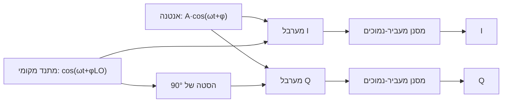
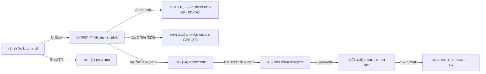

# M0.2 · שיעור 1: הגל הנע: אורך גל, תדר ופאזה, ומעבר בין תחום הזמן לתחום התדר

מכסה: 1.3 The Physics of EM Waves · 1.3.1 Wavelength, Frequency, and Phase · The Parameters of a Wave · Traveling Waves · Frequency  vs. Time Domain

## הלומד · שיעור · 2026-11-22

כתוב את שיעור 1 במודול M0.2: הגל הנע: אורך גל, תדר ופאזה, ומעבר בין תחום הזמן לתחום התדר.

---

## המורה · claude-opus-5-5

## פרק 1: הגל הנע

מכ"ם שולח פולס קצר של גל רדיו, ומקבל אחרי זמן מה הד חלש. מתוך ההד הזה הוא יודע כמה רחוקה המטרה, ובהמשך גם באיזה כיוון היא נמצאת ובאיזו מהירות היא נעה. כדי להבין איך זה אפשרי צריך לשאול קודם מה בדיוק עובר מהאנטנה אל המטרה וחזרה. התשובה היא גל אלקטרומגנטי (electromagnetic wave), כלומר תנודה של שדה חשמלי שנעה במרחב. בפרק הזה נבנה את השפה שמתארת אותו: אורך גל, מחזור, תדר, וביטוי אחד שמחבר את המרחב ואת הזמן. בסופו נדע לחשב לכל גל את אורך הגל שלו, להבין מה התווך עושה לו ולשייך אותו לפס תדרים. הפרק לא יגזור את הגל ממשוואות מקסוול. נניח שהגל קיים ונלמד לתאר אותו, וההוכחה שהשדות אכן מתנהגים כך תבוא בשיעור הבא.

מערכת העוגן של הפרק היא מכ"ם פולס שעובד ב-10 GHz עם צלחת בקוטר 0.7 m. "10 GHz" הוא תדר: התדר הוא קצב התנודה של הגל, כלומר כמה פעמים בשנייה הוא חוזר על עצמו, ו-GHz הוא מיליארד פעמים בשנייה. ההגדרה המדויקת תבוא בסעיף 1.6. מערכת העוגן תלווה כל צעד: בתחילה נשאל איך היא מודדת מרחק, אחר כך מה צורת הגל שהיא משדרת וכמה פעמים בשנייה השדה בצלחת מתהפך, ולבסוף איך הגל שלה נע ומה קורה לו בדרך.

**מה אנחנו כבר יודעים.** במודול M0.1 ראינו שהמכ"ם מקבל הד חלש מאוד, ושההד מתחרה ברעש התרמי $N=kTB$. ראינו שהספק פרופורציונלי לריבוע המשרעת, ולכן יחס הספקים נכתב $10\log$ ויחס משרעות נכתב $20\log$. ראינו גם שהמקלט חש שדה חשמלי $E$, ושצפיפות ההספק היא $S=E^2/Z_0$. מהתיכון נזדקק לסינוס ולקוסינוס, ובסעיף 1.7 גם לנגזרת.

### 1.1 המכ"ם מודד זמן: השרשרת והלוך-חזור

[[B02:42]] מכ"ם לא מודד מרחק ישירות. הוא מודד זמן, ומתרגם אותו למרחק בעזרת מהירות ידועה. כדי לראות איפה בדיוק נמדד הזמן הזה, נעקוב אחרי האות לאורך השרשרת. באיור שלהלן כדאי לעקוב אחרי שלושה מקטעים: המשדר שולח, האות פוגע במטרה וחוזר, והמקלט מעבד את ההד עד שמתקבל מספר.

```figure
B02:42:0
שרשרת השידור והקליטה של מכ"ם: משדר, מתג שידור-קליטה, אנטנה, מטרה, ובחזרה דרך מגן המקלט, מגבר רעש נמוך, מערבל, מגבר ביניים, גלאי וממיר אנלוגי-ספרתי אל המעבד.
```

שתי נקודות זמן קובעות את המדידה. הראשונה היא הרגע שבו המשדר שולח פולס אל האנטנה דרך מתג שידור-קליטה (T/R switch). המתג מחבר את האנטנה האחת פעם למשדר ופעם למקלט. בזמן השידור הוא מנתק את המקלט, כי פולס של קילוואטים היה שורף אותו. השנייה היא הרגע שבו ההד חוזר דרך אותה אנטנה ואותו מתג אל המקלט. המקלט מגביר את ההד ומעביר אותו לתנודה איטית יותר, שקל יותר לסנן ולהגביר. בלשון המקצוע זו "הורדה לתדר נמוך", כלומר לקצב תנודה נמוך יותר. בסוף השרשרת עומד גלאי (detector), שמוציא מהאות את המעטפת שלו, כלומר את גובה התנודה לאורך הזמן, וזורק את התנודה עצמה. במעטפת הזו המעבד מחפש את ההד וקובע מתי הוא חזר. הטבלה מסכמת את הרכיבים שהפרק משתמש בהם, לפי הסדר שבו האות עובר דרכם:

| רכיב | תפקיד |
|---|---|
| משדר (transmitter) | יוצר פולס חזק של תנודה מהירה (הגל הנושא, סעיף 1.4) |
| מתג שידור-קליטה (T/R switch) | מחבר את האנטנה פעם למשדר ופעם למקלט |
| מגן מקלט (receiver protector) | קו הגנה שני: חוסם דליפה חזקה שעוברת את המתג |
| מגבר רעש נמוך (LNA) | מגביר את ההד החלש לפני שרכיבים אחרים מוסיפים לו רעש |
| גלאי (detector) | מוציא את המעטפת וזורק את התנודה |
| מעבד (processor) | מחפש את ההד ומודד את זמן ההגעה שלו |

שאר הרכיבים שבאיור שייכים להורדת התדר ולדגימה: המערבל והמתנד המקומי, שמורידים את ההד לתדר ביניים (IF), מגבר ה-IF והממיר האנלוגי-ספרתי (A/D). ניפגש בהם כשנבנה את המקלט בהמשך הספר.


**הלוך וחזור.** כדי להפוך את הזמן שנמדד למרחק, נשתמש בכך שהגל נע במהירות האור $c$, ושהוא עובר את המרחק פעמיים. אם $\Delta T$ הוא הזמן מרגע השידור ועד רגע ההד, הגל עבר בזמן הזה את הדרך $c\Delta T$. הדרך הזו היא המרחק אל המטרה ועוד המרחק בחזרה, כלומר $2R$. מכאן $2R=c\Delta T$.

```formula
@title: טווח מזמן הלוך-חזור
@mark: summary
מה הנוסחה מחשבת: את המרחק אל המטרה מתוך הזמן שעבר בין שידור הפולס לקליטת ההד. זה העיקרון שעליו בנוי כל מכ"ם פולס.
$$R=\frac{c\,\Delta T}{2}\tag{1}$$
$R$: הטווח אל המטרה, במטרים. $\Delta T$: זמן ההלוך-חזור, בשניות. $c$: מהירות האור, $299{,}792{,}458\ \text{m/s}$ בריק, ובקירוב $3\cdot10^{8}\ \text{m/s}$.
התחום שבו הנוסחה תקפה: הגל נע בקו ישר ובמהירות $c$, והמטרה כמעט לא זזה בזמן ההלוך-חזור.
```

ההנחה שהגל נע באוויר במהירות $c$ אינה מדויקת לגמרי. כמה היא שוגה נבדוק בסעיף 1.8. את ההנחה השנייה, שהמטרה כמעט לא זזה, אפשר לבדוק כבר עכשיו. ניקח מטוס שטס ב-300 m/s ונבדוק כמה הוא זז בשני פרקי הזמן שחשובים למדידה:

| פרק זמן | תזוזת המטוס ב-300 m/s |
|---|---|
| פולס של 1 µs | 0.3 mm |
| הלוך-חזור של 200 µs | 6 ס"מ |

שתי התזוזות זניחות לעומת ההפרדה בטווח של פולס באורך 1 µs, כ-150 m, שנגזור בסעיף 1.2. תנועת המטרה כן משנה דבר אחר, את התדר של ההד (אפקט דופלר), ובזה נעסוק בהמשך הספר.

הקירוב $3\cdot10^8$ עצמו שוגה ב-0.07% בלבד, ולכן משתמשים בו כמעט בכל עבודת מכ"ם. ממנו נובע כלל אצבע שכדאי לזכור בעל פה:
$$1\ \mu\text{s}\ \text{של הלוך-חזור}\ \leftrightarrow\ 150\ \text{m},\qquad 1\ \text{ms}\ \leftrightarrow\ 150\ \text{ק"מ}$$
ה-2 שבמכנה הוא הטעות הנפוצה בנוסחה: מי ששוכח אותו מכפיל את הטווח. לכן כדאי לבדוק כל תוצאה מול הכלל.

נבדוק את העקביות על דוגמה. מטוס טס בגובה 4,572 m, והקרן יורדת אנכית אל הקרקע שמתחתיו. ההד חוזר אחרי 30.5 µs. לפי הכלל, 30.5 כפול 150 m נותן 4,575 m, ולכן התוצאה עקבית.

```numeric
@answer: 30
@unit: ק"מ
@tol: 2%
מכ"ם קולט הד 200 µs אחרי שידור הפולס. מה הטווח אל המטרה? הניחו $c=3\cdot10^8\ \text{m/s}$.
---
לפי (1), $R=c\Delta T/2=3\cdot10^8\cdot200\cdot10^{-6}/2=30{,}000\ \text{m}$, כלומר 30 ק"מ. בדיקה בראש: 200 כפול 150 m נותן 30 ק"מ.
- wrong: 60 :: שכחתם לחלק ב-2. זה המסלול כולו, הלוך וחזור, ולא המרחק אל המטרה.
```

```mcq
מה מכ"ם פולס מודד ישירות כשהוא קובע את הטווח למטרה?
- [ ] את המרחק, בעזרת סרגל אלקטרוני בתוך המקלט :: את המרחק לא מודדים. מחשבים אותו מתוך זמן ומהירות לפי (1).
- [ ] את הספק ההד, שיורד ככל שהמטרה רחוקה יותר :: ההספק תלוי גם בגודל המטרה ובחומר שלה, ולכן הוא לא קובע מרחק.
- [x] את הזמן שעבר בין שידור הפולס לקליטת ההד :: נכון. המרחק מתקבל מהזמן לפי $R=c\Delta T/2$.
- [ ] את התדר של ההד :: התדר של ההד הוא בערך התדר ששודר, ולכן המרחק לא משפיע עליו. הקשר בין תדר לתנועת המטרה יידון בהמשך הספר.
```

### 1.2 משך הפולס: הפרדה בטווח, מחיר באנרגיה וטווח עיוור

נוסחה (1) מניחה שההד הוא רגע אחד. בפועל הפולס נמשך זמן $\tau$, וההד נמשך אותו זמן. נניח שיש שתי מטרות על אותו קו ראייה, ואחת רחוקה מהשנייה ב-$\Delta R$. ההד של הרחוקה מאחר ב-$2\Delta R/c$. כל עוד האיחור הזה קצר מ-$\tau$, שני ההדים חופפים, והמעבד רואה כתם אחד (ציר הזמן בהמשך הסעיף מראה את שני המקרים). לכן ההפרדה בטווח (range resolution) היא $\Delta R\approx c\tau/2$. בפולס של 1 µs זה 150 m, כלומר אותו כלל של 150 m למיקרו-שנייה, הפעם על משך הפולס ולא על זמן ההד. הדרך הישירה להפריד בין מטרות קרובות היא לקצר את הפולס, אבל זה עולה באנרגיה. אנרגיה היא הספק כפול זמן, ונמדדת בג'אול: $1\ \text{J}=1\ \text{W}\cdot\text{s}$. לכן האנרגיה בפולס היא $W_p=P_{\text{שיא}}\,\tau$. נסמן אותה $W_p$ ולא $E$, כי $E$ כבר שמור לשדה החשמלי. הטבלה משווה שלוש אפשרויות:

| $\tau$ | $P_{\text{שיא}}$ | $\Delta R=c\tau/2$ | $W_p$ | אנרגיה יחסית |
|---|---|---|---|---|
| 1 µs | 100 kW | 150 m | 0.1 J | 0 dB |
| 0.1 µs | 100 kW | 15 m | 0.01 J | −10 dB |
| 0.1 µs | 1 MW | 15 m | 0.1 J | 0 dB |

כדי לדעת כמה ההפסד הזה כואב, צריך לדעת מול מה ההד מתחרה. ב-M0.1 ההד התחרה ברעש התרמי $kTB$, שנקבע רק לפי הטמפרטורה ורוחב הפס. אבל כל מקלט אמיתי מוסיף לרעש הזה רעש משלו. מקדם הרעש (noise figure) $F$ הוא הגורם שבו המקלט מכפיל את הרעש התרמי, ולכן רצפת הרעש בפועל היא $kTBF$. ה-LNA קובע את $F$ במידה רבה, כי הוא מגביר את ההד לפני שהרכיבים שאחריו מוסיפים את הרעש שלהם.

פולס קצר פי 10 מפריד טוב פי 10, אבל ההד שלו חלש ב-10 dB ביחס לרצפה $kTBF$. אפשר להחזיר את האנרגיה בשתי דרכים, ולכל אחת מחיר משלה. הדרך הראשונה היא השורה האחרונה בטבלה: להגדיל את הספק השיא פי 10. זה מחייב שפופרת גדולה יותר, מתח גבוה יותר וסכנת פריצה חשמלית במוליך הגל (הצינור המתכתי שמוביל את הגל מהמשדר לאנטנה). הדרך השנייה היא לשדר פולס ארוך ולשנות במכוון את קצב התנודה לאורכו, כך שכל חלק של הפולס מסומן בקצב משלו. המקלט מזהה את החלקים לפי הקצב ומאחד אותם לפולס קצר (דחיסת פולס, pulse compression). כך מתקבלת ההפרדה של פולס קצר עם האנרגיה של פולס ארוך. איך בדיוק עושים את זה נגזור בהמשך הספר, אחרי שנכיר את תחום התדר. המחיר של הדרך הזו הוא עיבוד מורכב יותר. הבחירה תלויה בצורך: מכ"ם חיפוש, שבו תא של מאות מטרים מספיק, משתמש בפולס ארוך ומרוויח טווח. מכ"ם שצריך להבחין בין מטוסים במבנה צפוף מקצר את הפולס או דוחס אותו.

**הגבול מלמטה: טווח עיוור.** בזמן השידור מתג השידור-קליטה מחבר את האנטנה למשדר, והמקלט מנותק. הד ממטרה קרובה מ-$c\tau/2$ חוזר לפני שהפולס הסתיים, ולכן הוא הולך לאיבוד. גם אחרי סוף הפולס המתג ומגן המקלט צריכים זמן התאוששות $t_{rec}$ עד שהמקלט רגיש שוב. לכן הטווח המינימלי הוא $R_{min}\approx c(\tau+t_{rec})/2$. בפולס של 1 µs זה 150 m. עם התאוששות של 0.5 µs, למשל, מתקבלים 225 m. אין דרך "לשחזר" הד שהגיע בזמן החסימה, כי המקלט פשוט לא היה מחובר. מה שעושים הוא לתכנן סביב הבעיה: במצב של טווח קצר עוברים לפולס קצר, ומשלמים על כך באנרגיה לפי החשבון שלמעלה. ציר הזמן הבא מראה את שני הגבולות של משך הפולס זה לצד זה:

```svg
@caption: ציר זמן אחד. משמאל: הפולס המשודר וחלון החסימה (τ + t_rec) שבו המקלט מנותק. הד שמגיע בתוכו הולך לאיבוד. במרכז: שני הדים שהאיחור ביניהם, 2ΔR/c, קצר מ-τ. הם חופפים ונראים ככתם אחד. מימין: איחור ארוך מ-τ, ושני ההדים נפרדים.
<svg viewBox="0 0 620 200" xmlns="http://www.w3.org/2000/svg" fill="none" stroke="currentColor" font-size="12">
<line x1="30" y1="160" x2="600" y2="160"/>
<polygon points="600,160 590,155 590,165" fill="currentColor"/>
<text x="575" y="180" fill="currentColor" stroke="none">זמן</text>
<rect x="40" y="40" width="90" height="120" stroke-dasharray="5 4"/>
<text x="42" y="32" fill="currentColor" stroke="none">המקלט מנותק: τ + t_rec</text>
<rect x="40" y="100" width="40" height="60" fill="currentColor" fill-opacity="0.5"/>
<text x="44" y="94" fill="currentColor" stroke="none" font-size="11">שידור</text>
<rect x="85" y="130" width="40" height="30" stroke-dasharray="2 2"/>
<text x="84" y="124" fill="currentColor" stroke="none" font-size="11">הד אבד</text>
<rect x="230" y="125" width="60" height="35" fill="currentColor" fill-opacity="0.25"/>
<rect x="260" y="125" width="60" height="35" fill="currentColor" fill-opacity="0.25"/>
<text x="205" y="105" fill="currentColor" stroke="none">חופפים: 2ΔR/c &lt; τ</text>
<text x="235" y="120" fill="currentColor" stroke="none" font-size="11">כתם אחד</text>
<rect x="400" y="125" width="60" height="35" fill="currentColor" fill-opacity="0.25"/>
<rect x="500" y="125" width="60" height="35" fill="currentColor" fill-opacity="0.25"/>
<text x="420" y="105" fill="currentColor" stroke="none">נפרדים: 2ΔR/c &gt; τ</text>
<line x1="400" y1="175" x2="460" y2="175" stroke-width="2"/>
<text x="425" y="192" fill="currentColor" stroke="none">τ</text>
<line x1="400" y1="118" x2="500" y2="118" stroke-dasharray="3 2"/>
<text x="470" y="192" fill="currentColor" stroke="none">2ΔR/c בין תחילות ההדים</text>
</svg>
```

### 1.3 רכבת הפולסים: PRI, טווח חד-ערכי ומחזור עבודה

עד כאן עסקנו בפולס בודד, אבל מכ"ם פולס לא משדר פולס אחד. הוא משדר רכבת של פולסים, אחד בכל מרווח $T_{PRI}$ (pulse repetition interval), והמעבד מודד כל הד מהפולס האחרון שיצא. הד שחוזר אחרי שהפולס הבא כבר יצא נמדד מהפולס הלא נכון. לכן הטווח החד-ערכי (unambiguous range) הוא
$$R_u=\frac{c\,T_{PRI}}{2}$$
ב-$T_{PRI}=1$ ms זה 150 ק"מ. נעקוב אחרי מטרה ב-180 ק"מ, שההד שלה חוזר 1.2 ms אחרי הפולס שהאיר אותה. ציר הזמן העליון באיור מראה מה קורה:

```svg
@caption: למעלה: PRI של 1 ms. ההד ב-1.2 ms נמדד מהפולס השני, ולכן נקרא 0.2 ms, כלומר 30 ק"מ. למטה: PRI של 1.1 ms. אותו הד נקרא עכשיו 0.1 ms, כלומר 15 ק"מ. מטרה אמיתית לא הייתה זזה, ולכן ההד שקופץ הוא רוח רפאים.
<svg viewBox="0 0 620 220" xmlns="http://www.w3.org/2000/svg" fill="none" stroke="currentColor" font-size="12">
<text x="440" y="20" fill="currentColor" stroke="none">PRI = 1 ms</text>
<line x1="40" y1="80" x2="600" y2="80"/>
<rect x="38" y="40" width="5" height="40" fill="currentColor"/>
<rect x="263" y="40" width="5" height="40" fill="currentColor"/>
<rect x="488" y="40" width="5" height="40" fill="currentColor"/>
<rect x="308" y="62" width="5" height="18" fill="currentColor"/>
<text x="30" y="96" fill="currentColor" stroke="none">0</text>
<text x="255" y="96" fill="currentColor" stroke="none">1.0</text>
<text x="300" y="56" fill="currentColor" stroke="none">הד 1.2</text>
<text x="480" y="96" fill="currentColor" stroke="none">2.0 ms</text>
<line x1="268" y1="104" x2="310" y2="104" stroke-width="3"/>
<text x="250" y="120" fill="currentColor" stroke="none">נמדד 0.2 ms</text>
<text x="440" y="140" fill="currentColor" stroke="none">PRI = 1.1 ms</text>
<line x1="40" y1="185" x2="600" y2="185"/>
<rect x="38" y="145" width="5" height="40" fill="currentColor"/>
<rect x="285" y="145" width="5" height="40" fill="currentColor"/>
<rect x="533" y="145" width="5" height="40" fill="currentColor"/>
<rect x="308" y="167" width="5" height="18" fill="currentColor"/>
<text x="30" y="201" fill="currentColor" stroke="none">0</text>
<text x="270" y="201" fill="currentColor" stroke="none">1.1</text>
<text x="318" y="165" fill="currentColor" stroke="none">הד 1.2</text>
<text x="520" y="201" fill="currentColor" stroke="none">2.2 ms</text>
<line x1="290" y1="210" x2="310" y2="210" stroke-width="3"/>
<text x="320" y="214" fill="currentColor" stroke="none">נמדד 0.1 ms</text>
</svg>
```

המעבד מודד את ההד מהפולס האחרון שיצא, ולכן הוא רואה 0.2 ms, כלומר 30 ק"מ. זה הד מסיבוב קודם (second-time-around echo), והוא נראה בדיוק כמו מטרה אמיתית קרובה. הדרך לחשוף אותו היא לשנות את $T_{PRI}$, כמו בציר התחתון. מטרה אמיתית ב-30 ק"מ הייתה ממשיכה להופיע אחרי 0.2 ms, ואילו ההד הרחוק קופץ ל-0.1 ms, כלומר ל-15 ק"מ. משתי המדידות אפשר גם לשחזר את הטווח האמיתי: $0.2+1.0=0.1+1.1=1.2$ ms, כלומר 180 ק"מ.

**מחזור עבודה והספק ממוצע.** למה לא להאריך את $T_{PRI}$ פשוט עד שכל המטרות יהיו בתוך $R_u$? כי המשדר דולק רק חלק מהזמן. החלק הזה נקרא מחזור עבודה (duty cycle), והוא קובע את ההספק הממוצע, כלומר את האנרגיה שמגיעה למטרה בכל שנייה:
$$d=\frac{\tau}{T_{PRI}},\qquad P_{avg}=P_{\text{שיא}}\,d$$
הטבלה משווה שני מרווחים, באותו פולס של 1 µs ובאותו הספק שיא של 100 kW:

| $T_{PRI}$ | $R_u$ | $d$ | $P_{avg}$ | פולסים בשנייה | הספק ממוצע יחסי |
|---|---|---|---|---|---|
| 1 ms | 150 ק"מ | $10^{-3}$ | 100 W | 1,000 | 0 dB |
| 2 ms | 300 ק"מ | $5\cdot10^{-4}$ | 50 W | 500 | −3.01 dB |

הכפלת $T_{PRI}$ מכפילה את $R_u$, ומשלמים עליה בחצי מההספק הממוצע ובחצי ממספר הפולסים. מכ"ם התרעה ארוך-טווח בוחר ב-PRI ארוך ומשלם בהספק ממוצע. מכ"ם שצריך פולסים רבים בשנייה בוחר ב-PRI קצר. פולסים רבים נחוצים מכמה סיבות. הד בודד חלש מדי מול הרעש, והמקלט צובר הדים רבים מאותה מטרה כדי לגבור עליו. בנוסף, מדידת מהירות המטרה מתוך שינוי התדר של ההד דורשת דגימה צפופה. את שני הצרכים נגזור בהמשך הספר. מכ"ם כזה חי עם הדים מסיבוב קודם (רב-משמעות בטווח), ומפריד אותם בעזרת החלפת PRI, כמו בדוגמה.

### 1.4 הגל הנושא: מה נע בתוך הפולס

בשלושת הסעיפים הקודמים התייחסנו לפולס כאל קופסה שמתחילה, נמשכת $\tau$ ונגמרת. כדי לדבר על אורך גל ועל תדר צריך להסתכל לתוכה. הפולס אינו "בליטה" חלקה של אנרגיה. האיור הבא מראה פולס יוצא ופולס חוזר על ציר זמן, ובתוך כל אחד מהם רואים תנודה מהירה.

```svg
@caption: פולס משודר בזמן 0 והד שחוזר אחרי ΔT. בתוך כל פולס השדה החשמלי מתנודד, וזהו הגל הנושא. ההד חלש יותר (המשרעת מצוירת בהקטנה, לא בקנה מידה), ומשך הפולס זהה.
<svg viewBox="0 0 620 200" xmlns="http://www.w3.org/2000/svg" fill="none" stroke="currentColor" font-size="13">
<line x1="30" y1="110" x2="600" y2="110" stroke-width="1.2"/>
<polygon points="600,110 590,105 590,115" fill="currentColor"/>
<text x="560" y="135" fill="currentColor" stroke="none">זמן</text>
<path d="M60,110 L64,70 L68,150 L72,70 L76,150 L80,70 L84,150 L88,70 L92,150 L96,70 L100,150 L104,70 L108,150 L112,70 L116,150 L120,110" stroke-width="1.2"/>
<rect x="60" y="66" width="60" height="88" stroke-dasharray="4 3"/>
<text x="55" y="55" fill="currentColor" stroke="none">פולס משודר</text>
<path d="M400,110 L404,95 L408,125 L412,95 L416,125 L420,95 L424,125 L428,95 L432,125 L436,95 L440,125 L444,95 L448,125 L452,95 L456,125 L460,110" stroke-width="1.2"/>
<rect x="400" y="91" width="60" height="38" stroke-dasharray="4 3"/>
<text x="410" y="80" fill="currentColor" stroke="none">הד</text>
<line x1="60" y1="175" x2="400" y2="175"/>
<polygon points="400,175 390,170 390,180" fill="currentColor"/>
<polygon points="60,175 70,170 70,180" fill="currentColor"/>
<text x="200" y="195" fill="currentColor" stroke="none">ΔT = 2R / c</text>
<text x="130" y="60" fill="currentColor" stroke="none">← תנודת הנושא</text>
</svg>
```

התנודה שבתוך הפולס היא מה שהאנטנה משדרת בפועל, והמשדר רק מדליק אותה לזמן קצר ומכבה אותה. גם גל ים עובד כך, כפי שמראה האיור הבא: מה שנע אל החוף הוא הצורה של ההפרעה, ואילו המים עצמם רק עולים ויורדים במקום.

[[B10:13]]
```figure
B10:13:0
גל ים: הרוח וכוח הכובד מעבירים אנרגיה למים הרחק מהחוף, והצורה נעה אל החוף.
```

גל הוא הפרעה של גודל כלשהו, כמו גובה המים, לחץ האוויר או השדה החשמלי. כשהצורה של ההפרעה נעה ושומרת על עצמה, אומרים שהגל מתפשט. מידע אפשר להעביר בעזרת אחד או יותר מהפרמטרים של הגל.

```definition
@title: גל נושא
@mark: summary
גל נושא (carrier) הוא תנודה מחזורית $E(t)$ של שדה, בתדר קבוע וידוע, שהמשדר יוצר. הגל הנושא עצמו אינו מכיל מידע. מידע נכנס אליו רק כשמשנים בזמן אחד הפרמטרים שלו: את המשרעת (גובה התנודה, תוגדר ב-1.5), את התדר (קצב התנודה, ב-1.6) או את הפאזה (מיקום התזמון של התנודה, ב-2.1). שינוי כזה של פרמטר בזמן נקרא אפנון (modulation). ההגדרה מניחה שהשינוי איטי ביחס לתנודה, כלומר שבכל פרק זמן של שינוי יש מחזורים רבים של הנושא. כשההנחה הזו לא מתקיימת, אי אפשר עוד לדבר על "נושא" ועל "אפנון" כעל שני דברים נפרדים.
```

במכ"ם הפולס, המידע הוא זמן ההדלקה: המשרעת של הנושא קופצת מאפס לערך מלא וחוזרת לאפס, ושעת ההגעה של הקפיצה הזו בהד מודדת את $R$. כשאומרים שהמכ"ם שלנו "עובד ב-10 GHz", מתכוונים לקצב התנודה של הנושא. המשמעות המדויקת של המספר הזה תוגדר בסעיף 1.6. כדי לתאר את התנודה הזו בכמה מספרים, נתחיל בתמונה קפואה שלה במרחב.

### 1.5 תמונת מצב של הגל: סינוס, משרעת ואורך גל

[[B10:14]] כדי לתאר את התנודה שבתוך הפולס, נקפיא אותה רגע. ננסה לצלם את הגל ולשרטט את ערך ההפרעה כפונקציה של המרחק. בצלחת של מכ"ם העוגן, השאלה המעשית היא מה גודל האות ואיך הוא נפרש במרחב. בתמונה הבאה רואים את הצורה הפשוטה ביותר של צילום כזה.

```figure
B10:14:0
גל סינוס: ערך ההפרעה כפונקציה של המרחק, בתמונה קפואה.
```

הצורה חוזרת על עצמה במרווחים קבועים, ולכן אומרים שההפרעה מחזורית (periodic). זהו גרף הפונקציה $y=\sin x$. גל לא חייב להיות סינוסי, אבל כמעט כל צורה מעשית של גל אפשר לבנות מסכום של סינוסים, ולכן מספיק להבין סינוס אחד. את זה נראה בסעיף 3.2, תחום הזמן מול תחום התדר. ההנחה שהגל שלנו סינוסי טהור תיבדק כשנגיע לצירוף של כמה גלים. לסינוס יש שני מספרים שנראים בתמונה: הגובה שלו והאורך שאחריו הוא חוזר. האיור הבא מסמן את שניהם.

[[B10:15]]
```figure
B10:15:0
חלקי גל הסינוס: המשרעת A נמדדת מהממוצע אל השיא, ואורך הגל λ הוא המרחק שאחריו הצורה חוזרת.
```

**משרעת ואורך גל.** המשרעת (amplitude) $A$ היא הסטייה המרבית מהערך הממוצע של ההפרעה. באיור הגל מתנודד סביב $y=0$, והמשרעת היא 0.5 יחידות. המרחק מהשפל אל השיא נקרא שיא-לשיא (peak-to-peak), והוא כפול מהמשרעת: כאן יחידה אחת. הצורה זהה בגל ים, בגל קול ובשדה $E$, ורק היחידות משתנות: מטרים של גובה מים, פסקלים של לחץ או וולט למטר. ההבחנה בין משרעת לשיא-לשיא איננה טכנית. אם מתייחסים לשיא-לשיא כאילו הוא המשרעת, מכפילים אותה בטעות פי 2. ההספק פרופורציונלי לריבוע המשרעת, ולכן הטעות בהספק היא $20\log 2=6.02$ dB. 6 dB הם פי 4 בהספק. בקשר חד-כיווני ההנחתה גדלה כ-$d^2$, לפי $L_s=(4\pi d/\lambda)^2$ של M0.1, ולכן פי 4 בהספק שקול לפי 2 במרחק. בתקציב קשר כזה הטעות מספיקה כדי להכפיל את הטווח או לחצות אותו. במכ"ם ההחזר יורד כ-$d^4$, כי הגל עובר את המרחק פעמיים, ושם אותה טעות שווה פי $\sqrt2\approx1.41$ בטווח. זה פחות, אבל עדיין טעות של יותר מ-40%.

```definition
@title: אורך גל
@mark: summary
עבור הפרעה $y(x)$ שמחזורית במרחב, אורך הגל $\lambda$ הוא המרחק החיובי הקטן ביותר שמקיים $y(x+\lambda)=y(x)$ לכל $x$. ההגדרה מניחה תמונה קפואה, כלומר זמן קבוע, ומחזוריות מדויקת. בגל שהצורה שלו משתנה לאט, $\lambda$ מוגדר רק באופן מקומי.
```

המילים "הקטן ביותר" חיוניות בהגדרה. גם $2\lambda$ מקיים את השוויון, ולכן בלעדיהן אורך הגל לא היה מוגדר באופן יחיד. המילים "לכל $x$" חיוניות גם הן, כי צריך להשוות נקודות מתאימות ולא כל שתי נקודות באותו גובה. זה המקור לטעות נפוצה: בין שני אפסים סמוכים המרחק הוא רק $\lambda/2$, כי באפס אחד הגל יורד ובשני הוא עולה. אורך הגל הוא המרחק מאפס יורד לאפס היורד הבא, או משיא לשיא [[B02:43]]. האיור הבא מסמן את זה על גל אלקטרומגנטי.

```figure
B02:43:1
אורך הגל של גל אלקטרומגנטי סינוסי: המרחק מנקודה על הסינוס אל הנקודה המתאימה הבאה.
```

**למה זווית.** כדי לכתוב את הסינוס כפונקציה של המרחק, צריך להחליט מה נכנס לתוך הפונקציה. הסינוס מקבל זווית, ובכל אורך גל הוא משלים מחזור אחד, כלומר סיבוב שלם. מכאן שהארגומנט שלו צריך לגדול בסיבוב שלם לאורך מרחק $\lambda$. כדי לעבוד עם זוויות בחשבון, מודדים אותן ברדיאנים. באיור הבא רואים קשת על מעגל, ולצדה את הסינוס שנפרש ממנה.

```svg
@caption: רדיאן: הזווית θ היא אורך הקשת s חלקי הרדיוס r. סיבוב שלם הוא 2π רדיאנים. כשפורשים את הסיבוב לאורך ציר, מתקבל מחזור אחד של סינוס באורך λ.
<svg viewBox="0 0 620 220" xmlns="http://www.w3.org/2000/svg" fill="none" stroke="currentColor" font-size="13">
<circle cx="110" cy="110" r="70" stroke-width="1.2"/>
<line x1="110" y1="110" x2="180" y2="110"/>
<line x1="110" y1="110" x2="147.8" y2="51.1"/>
<path d="M180,110 A70,70 0 0 0 147.8,51.1" stroke-width="3"/>
<text x="185" y="75" fill="currentColor" stroke="none">s</text>
<text x="140" y="125" fill="currentColor" stroke="none">r</text>
<path d="M135,110 A25,25 0 0 0 123.5,89" />
<text x="132" y="100" fill="currentColor" stroke="none" font-size="11">θ</text>
<text x="60" y="210" fill="currentColor" stroke="none">θ = s / r</text>
<line x1="260" y1="110" x2="600" y2="110"/>
<path d="M270,110 C300,40 330,40 350,40 C370,40 400,40 430,110 C460,180 490,180 510,180 C530,180 560,180 590,110" stroke-width="1.2"/>
<line x1="270" y1="190" x2="590" y2="190"/>
<text x="400" y="208" fill="currentColor" stroke="none">λ  ↔  2π</text>
<text x="265" y="30" fill="currentColor" stroke="none">y = A sin(2πx/λ)</text>
</svg>
```

רדיאן מוגדר כיחס בין אורך הקשת לרדיוס, $\theta=s/r$. לכן הוא יחס בין שני אורכים ואין לו יחידות. היקף המעגל הוא $2\pi r$, ולכן סיבוב שלם הוא $2\pi$ רדיאנים, כלומר 360°. רדיאן אחד הוא 57.2958°. הקירוב "בערך 60°" שמופיע בחלק מהספרים שוגה ב-4.72%. הוא מתאים להערכה בראש, אבל לא לחישוב [[B10:17]]. כשמודדים זווית ברדיאנים, הארגומנט שגדל ב-$2\pi$ לאורך $\lambda$ הוא $2\pi x/\lambda$, והתמונה הקפואה כולה נכתבת כך:

$$y=A\sin\!\left(\frac{2\pi x}{\lambda}\right)$$

מה הביטוי הזה מאפשר: בכל נקודה $x$ אפשר לדעת את ערך ההפרעה מתוך שני מספרים בלבד, $A$ ו-$\lambda$. כשמציבים $x=\lambda$, הארגומנט הוא בדיוק $2\pi$, והגרף חזר לנקודת ההתחלה. חסר רק דבר אחד: התמונה קפואה, וגל אמיתי נע. כדי להוסיף את הזמן, נעבור מצילום של המרחק לצפייה בנקודה אחת לאורך זמן.

```mcq
מה המרחק בין שני אפסים סמוכים של גל סינוס, כלומר בין שתי נקודות סמוכות שבהן $y=0$?
- [ ] $\lambda$ :: זו הטעות הנפוצה. באפס אחד הגל עולה ובשני הוא יורד, ולכן הנקודות אינן מתאימות זו לזו.
- [x] $\lambda/2$ :: נכון. הסינוס חוצה את האפס פעמיים בכל מחזור.
- [ ] $\lambda/4$ :: זה המרחק מאפס אל השיא הסמוך.
- [ ] $2\lambda$ :: זה מרחק של שני מחזורים שלמים.
```

```numeric
@answer: 2
@unit: V
@tol: 1%
בגרף של מתח סינוסי נמדד שיא-לשיא של 4 V סביב ממוצע אפס. מהי המשרעת?
---
המשרעת היא הסטייה מהממוצע אל השיא, כלומר חצי מהשיא-לשיא: $4/2=2$ V.
- wrong: 4 :: בלבלתם בין שיא-לשיא למשרעת. הטעות הזו מוסיפה 6.02 dB להספק המחושב.
```

### 1.6 התנודה בנקודה: מחזור ותדר

[[B02:44]] בסעיף הקודם הקפאנו את הזמן ותיארנו את הגל לאורך המרחק. עכשיו נעשה את ההפך: נעמוד בנקודה אחת, למשל בפתח הצלחת של מכ"ם העוגן, ונרשום את השדה $E$ כפונקציה של הזמן. ככה בדיוק המקלט "רואה" גל, כי הוא יושב במקום אחד. באיור הבא רואים את התוצאה, וכדאי לשים לב שהיא שוב סינוס, אבל הציר האופקי שלו הוא זמן.

```figure
B02:44:0
המחזור $T_0$ של גל אלקטרומגנטי סינוסי: הזמן מנקודה על הסינוס אל הנקודה המתאימה הבאה, כשמסתכלים מנקודה קבועה.
```

האיור הקודם הראה את הצורה לאורך המרחק, והאיור הזה מראה אותה לאורך הזמן. הצורה זהה בשניהם, ורק משמעות הציר האופקי שונה. האיור הבא מראה את המעבר: נקודה קבועה על הגל, והגרף שנרשם בה.

```svg
@caption: משמאל: גל במרחב ונקודה קבועה z₀ שבה עומד המקלט. מימין: הערך של E שנרשם בנקודה הזו לאורך הזמן. המרווח בין שיאים בזמן הוא T₀.
<svg viewBox="0 0 620 200" xmlns="http://www.w3.org/2000/svg" fill="none" stroke="currentColor" font-size="13">
<line x1="20" y1="100" x2="280" y2="100"/>
<path d="M20,100 C40,40 60,40 70,40 C80,40 100,40 120,100 C140,160 160,160 170,160 C180,160 200,160 220,100 C240,40 260,40 270,40" stroke-width="1.2"/>
<line x1="120" y1="30" x2="120" y2="175" stroke-dasharray="4 3"/>
<circle cx="120" cy="100" r="5" fill="currentColor"/>
<text x="110" y="192" fill="currentColor" stroke="none">z₀</text>
<text x="240" y="120" fill="currentColor" stroke="none">z</text>
<text x="60" y="22" fill="currentColor" stroke="none">גל במרחב, ברגע מסוים</text>
<line x1="300" y1="100" x2="330" y2="100"/>
<polygon points="330,100 322,95 322,105" fill="currentColor"/>
<line x1="350" y1="100" x2="600" y2="100"/>
<path d="M350,100 C370,160 390,160 400,160 C410,160 430,160 450,100 C470,40 490,40 500,40 C510,40 530,40 550,100 C570,160 590,160 600,160" stroke-width="1.2"/>
<line x1="400" y1="180" x2="500" y2="180"/>
<text x="435" y="197" fill="currentColor" stroke="none">T₀</text>
<text x="580" y="120" fill="currentColor" stroke="none">t</text>
<text x="400" y="22" fill="currentColor" stroke="none">E(t) בנקודה z₀</text>
</svg>
```

**מחזור ותדר.** המחזור (period) הוא הזמן שעובר עד שהתנודה בנקודה חוזרת על עצמה. כשרוצים לדעת "כמה מהר" הגל מתנודד, נוח יותר לשאול כמה מחזורים עוברים בשנייה. התשובה היא ההופכי של המחזור.

```definition
@title: מחזור ותדר
@mark: summary
עבור אות $g(t)$ שמחזורי בזמן, המחזור $T_0$ הוא הזמן החיובי הקטן ביותר שמקיים $g(t+T_0)=g(t)$ לכל $t$. התדר הוא מספר המחזורים ביחידת זמן:
$$f=\frac{1}{T_0}\tag{2}$$
היחידה של התדר היא הרץ (Hz), כלומר מחזור אחד בשנייה. ההגדרה מניחה מחזוריות מדויקת בנקודה קבועה. באות שמחזוריותו משתנה לאט, התדר מוגדר רק באופן מקומי בזמן.
```

ההגדרה מקבילה בדיוק להגדרת אורך הגל, עם $t$ במקום $x$, ומה שאמרנו שם על "הקטן ביותר" ועל "לכל" נכון גם כאן. ההבדל היחיד הוא שכאן נוח להפוך את המספר: $\lambda$ נשאר "אורך של מחזור", ואילו $f$ הוא "מחזורים ליחידת זמן". מכאן גם הקידומות: מגה-הרץ (MHz) הוא $10^6$ Hz, וגיגה-הרץ (GHz) הוא $10^9$ Hz.

**זווית בזמן.** הסינוס מקבל זווית, ולכן כאן חוזרת אותה שאלה כמו במרחב: מה גדל ב-$2\pi$ בכל מחזור? בזמן $t$ עוברים $f\,t$ מחזורים, וכל מחזור הוא $2\pi$ רדיאנים. לכן הזווית בזמן $t$ היא $2\pi f\,t$. את קצב הגידול של הזווית מסמנים $\omega=2\pi f$, וקוראים לו תדר זוויתי (angular frequency). היחידות שלו הן רדיאנים לשנייה. בין $\omega$ ל-$f$ יש פי $2\pi$, כלומר יותר מפי 6. זו הטעות הנפוצה ביותר בתחום: מי שמציב $f$ במקום $\omega$ בביטוי כמו $\cos(\omega t)$ מקבל תנודה איטית פי $2\pi$ מהאמיתית. הבדיקה פשוטה: אם הגודל הוא ברדיאנים לשנייה, הוא $\omega$; אם הוא בהרץ, הוא $f$.

כמה פעמים בשנייה השדה בצלחת של מכ"ם העוגן מתהפך? ב-10 GHz המחזור הוא $T_0=1/10^{10}=100$ ps. פיקו-שנייה (ps) היא $10^{-12}$ שנייה, כלומר השדה משלים מחזור כל מאה טריליוניות של שנייה. בפולס של 1 µs יש לכן $10^{-6}/10^{-10}=10{,}000$ מחזורים של הנושא. המספר הזה מצדיק את ההנחה שבהגדרת הגל הנושא: ההדלקה והכיבוי איטיים מאוד ביחס לתנודה, ולכן מותר לדבר על נושא ועל פולס כעל שני דברים נפרדים. בפולס של מחזורים בודדים ההפרדה הזו כבר לא הייתה נכונה. עכשיו יש לנו שני מספרים: $\lambda$, שמתאר את הגל במרחב, ו-$f$, שמתאר אותו בזמן. השאלה הבאה היא מה הקשר ביניהם.

```numeric
@answer: 2
@unit: GHz
@tol: 1%
המחזור של גל הוא $T_0=0.5$ ns. מה התדר שלו?
---
לפי (2), $f=1/T_0=1/(0.5\cdot10^{-9}\ \text{s})=2\cdot10^{9}$ Hz, כלומר 2 GHz.
- wrong: 0.5 :: לא הפכתם את המחזור, אלא כתבתם אותו כאילו הוא התדר.
```

```mcq
מה התדר הזוויתי $\omega$ של גל בתדר $f=1$ GHz?
- [ ] $10^{9}$ rad/s :: זה $f$ עם יחידה שגויה. שכחתם את $2\pi$.
- [ ] $1.59\cdot10^{8}$ rad/s :: חילקתם ב-$2\pi$ במקום להכפיל.
- [x] $6.28\cdot10^{9}$ rad/s :: נכון: $\omega=2\pi f=2\pi\cdot10^9$.
- [ ] $3.14\cdot10^{9}$ rad/s :: הכפלתם ב-$\pi$ בלבד. מחזור שלם הוא $2\pi$ רדיאנים.
```

### 1.7 הגל הנע: מרחב וזמן בביטוי אחד

[[B10:18]] יש לנו שני תיאורים של אותו גל: תמונה קפואה במרחב, עם $\lambda$, ותנודה בנקודה, עם $f$. הם אינם בלתי תלויים, כי אותה צורה עוברת על פני הנקודה. מי שנע יחד עם הגל רואה תמונה קבועה, ומי שעומד במקום רואה את התמונה עוברת על פניו. לכן הקשר בין המרחב לזמן הוא מהירות. כדי לחשב לאן הגל של מכ"ם העוגן מגיע ומתי, צריך ביטוי אחד ב-$z$ וב-$t$ יחד, ואת המהירות שנובעת ממנו.

תחילה צריך גודל שמתאר את הגל במרחב באותה שפה שבה $\omega$ מתאר אותו בזמן. המספר $\omega$ אומר כמה רדיאנים מצטברים בשנייה. המקביל המרחבי שלו אומר כמה רדיאנים מצטברים במטר: לאורך $\lambda$ מצטברים $2\pi$ רדיאנים, ולכן במטר אחד מצטברים $2\pi/\lambda$. הגודל הזה נקרא מספר גל (wave number), $k=2\pi/\lambda$, והיחידות שלו הן רדיאנים למטר. אפשר לחשוב עליו כעל "תדר מרחבי". אורך הגל של מכ"ם העוגן הוא 3 ס"מ, ובהמשך הסעיף, בנוסחה (4), נראה למה. לכן $k=2\pi/0.03=209.44$ rad/m.

[[2.5: מקור]] כדי לבנות גל נע, ניקח את התמונה הקפואה ונזיז אותה. ההנחה היחידה שנכניס היא שהצורה כולה נעה במהירות קבועה $v$ ואינה משתנה בדרך. זו הנחה של תווך שאינו מעוות את הגל. היא נכנסת בשורה הראשונה של הגזירה הבאה, ונבדוק אותה בסעיף 1.8. גם הפאזה ההתחלתית $\varphi$ תופיע כבר כאן, אבל את משמעותה נבין רק בסעיף 2.1. ב-1.5 כתבנו את התמונה הקפואה $A\sin(2\pi x/\lambda)$. כאן נעשה בה שלושה שינויי כתיב, ואף אחד מהם לא משנה את הגל. קוסינוס הוא סינוס שהוזז ברבע מחזור, וההזזה נבלעת ב-$\varphi$, ולכן נכתוב $\cos$, כמקובל. את הציר נקרא $z$, ואת המשרעת של השדה נסמן $E_0$. ובמקום $2\pi/\lambda$ נכתוב $k$.

```derivation
@title: מתמונה קפואה לגל נע, ומשם $v=\omega/k=\lambda f$
התמונה הקפואה ברגע $t=0$ היא $E(z,0)=E_0\cos(kz+\varphi)$. כאן $E_0$ היא המשרעת, $k=2\pi/\lambda$, ו-$\varphi$ הוא קבוע שקובע איפה עומד השיא ברגע $0$.

אם הצורה נעה במהירות $v$ בכיוון $+z$ בלי להשתנות, הערך שנמצא בזמן $t$ בנקודה $z$ הוא הערך שהיה ברגע $0$ בנקודה $z-vt$. בזמן $t$ הצורה זזה מרחק $vt$, ולכן מה שנמצא עכשיו ב-$z$ היה קודם רחוק יותר לאחור:
$$E(z,t)=E(z-vt,\,0)=E_0\cos\big(k(z-vt)+\varphi\big)=E_0\cos(kz-kv\,t+\varphi)$$
בשורה האחרונה פתחנו סוגריים בלבד.

עכשיו נעמוד בנקודה קבועה $z$. הארגומנט יורד בקצב $kv$ רדיאנים לשנייה. בסעיף 1.6 ראינו שהזווית בזמן גדלה בקצב $\omega=2\pi f$. הסימן לא משנה את קצב התנודה, ולכן אותו גל מחייב:
$$kv=\omega\quad\Longrightarrow\quad v=\frac{\omega}{k}=\frac{2\pi f}{2\pi/\lambda}=\lambda f$$

המסקנה: $\lambda$ ו-$f$ אינם שני נתונים חופשיים. כשהמהירות ידועה, אחד מהם קובע את השני.
```

```formula
@title: הגל הנע ומהירות הפאזה
@mark: summary
הביטוי הזה מחשב את השדה החשמלי בכל מקום ובכל רגע של גל סינוסי שנע לאורך ציר $z$. הוא הכלי שבו נשתמש בכל פעם שנחשב פאזה, הפרש מסלולים או חיבור של גלים.
$$E=E_0\cos(kz-\omega t+\varphi)\tag{3}$$
$$k=\frac{2\pi}{\lambda},\qquad \omega=2\pi f,\qquad v=\frac{\omega}{k}=\lambda f\tag{4}$$
$E_0$: משרעת השיא (V/m). $k$: מספר הגל (rad/m). $\omega$: התדר הזוויתי (rad/s). $\varphi$: פאזה התחלתית (rad). $v$: מהירות הפאזה (m/s), שבריק שווה ל-$c$, ולכן $\lambda f=c$.
התחום שבו הביטוי תקף: גל סינוסי אחד, תווך אחיד שאינו בולע ואינו מעוות, והתקדמות לאורך ציר אחד.
```

[[2.5: מבנה]] בתוך הקוסינוס עומד מספר בלי יחידות, כלומר זווית. $kz$ הוא רדיאנים שהצטברו לאורך המרחק, ו-$\omega t$ הוא רדיאנים שהצטברו לאורך הזמן. כל המבנה של הגל נשען על שני קצבים: $k$ במרחב ו-$\omega$ בזמן. היחס ביניהם, $\omega/k$, הוא מהירות, וזה לא במקרה: רדיאנים לשנייה חלקי רדיאנים למטר נותן מטרים לשנייה. המשרעת $E_0$ עומדת מחוץ לקוסינוס, ולכן היא לא משפיעה על התנועה. היא קובעת רק את גודל השדה, ובעזרת $S=E^2/Z_0$ גם את ההספק. כאן צריך זהירות: $E_0$ הוא ערך שיא, ואילו ה-$E$ בנוסחה של M0.1 הוא, כמקובל, ערך אפקטיבי (RMS), ובסינוס הערך הזה קטן פי $\sqrt2$ מהשיא. לכן צפיפות ההספק הממוצעת היא $S=E_0^2/(2Z_0)$. מי שמציב את $E_0$ ישירות טועה פי 2, כלומר ב-3 dB, וזו בדיוק הטעות שמפניה הזהרנו ב-1.5. הסימן שבין $kz$ ל-$\omega t$ קובע את הכיוון. בביטוי $kz-\omega t$, כשהזמן גדל צריך להגדיל גם את $z$ כדי לשמור על אותו ערך, ולכן הגל נע לכיוון $+z$. בביטוי $kz+\omega t$ הגל נע לכיוון $-z$. בהנדסה נוהגים לכתוב $\omega t-kz$. זה אותו גל בדיוק, כי $\cos(-x)=\cos x$, אבל צריך לשים לב לכך כשעוברים בין ספרים. האנימציה הבאה מראה את התנועה: נקודה אחת רוכבת על פסגה, ונקודה אחרת קבועה במקום ועולה ויורדת.

```anim
{"title": "גל נע: רוכבים על פסגה מול עומדים במקום", "caption": "הנקודה המודגשת רוכבת על פסגה ונעה במהירות λf. הנקודה האחרת יושבת ב-z=5 ורק עולה ויורדת בתדר f. שנו את λ ואת f ובדקו שמהירות הרוכב היא המכפלה שלהם.", "duration": 10, "view": {"x": [0, 10], "y": [-2, 2.2]},
 "params": [{"id": "lam", "label": "λ (יחידות)", "min": 1, "max": 5, "value": 2.5}, {"id": "f", "label": "f (מחזורים בשנייה)", "min": 0.1, "max": 1, "value": 0.4}],
 "shapes": [
  {"type": "path", "x": "s", "y": "cos(2*pi*s/lam - 2*pi*f*t)", "s": [0, 10]},
  {"type": "circle", "x": "mod(lam*f*t, 10)", "y": "1", "r": "0.15", "accent": true, "label": "רוכב על פסגה"},
  {"type": "circle", "x": "5", "y": "cos(2*pi*5/lam - 2*pi*f*t)", "r": "0.15", "label": "נקודה קבועה"},
  {"type": "line", "x1": "5", "y1": "-1.6", "x2": "5", "y2": "1.6", "dash": true},
  {"type": "text", "x": "5", "y": "2", "text": "v = λf = {round(lam*f, 2)} יחידות לשנייה"}
 ]}
```

הנקודה שרוכבת על פסגה שומרת על ערך קבוע של הארגומנט, $kz-\omega t=\text{const}$. מכאן $z=(\omega/k)t+\text{const}$, כלומר היא נעה בדיוק במהירות $v$ של (4). לכן המהירות הזו נקראת מהירות פאזה (phase velocity): זו המהירות של נקודה עם פאזה קבועה. הנקודה הקבועה מראה את הצד השני של אותה תנועה: בכל שנייה עוברות על פניה $f$ פסגות, וכל אחת מהן רחוקה $\lambda$ מהקודמת, ולכן בשנייה אחת עובר אורך של $\lambda f$. אותו הדבר נראה בתרשים הבא, שבו שני הצירים הם מרחק וזמן, וכל קו אלכסוני מסמן מסלול של פסגה אחת.

```svg
@caption: תרשים מרחק-זמן של הגל. כל קו אלכסוני הוא מסלול של פסגה אחת (kz−ωt קבוע). חתך אופקי (t קבוע) הוא התמונה הקפואה, והמרווח בין הקווים לאורכו הוא λ. חתך אנכי (z קבוע) הוא התנודה בנקודה, והמרווח בין הקווים לאורכו הוא T₀. השיפוע הוא v = λ/T₀.
<svg viewBox="0 0 620 260" xmlns="http://www.w3.org/2000/svg" fill="none" stroke="currentColor" font-size="13">
<line x1="60" y1="230" x2="580" y2="230"/>
<polygon points="580,230 570,225 570,235" fill="currentColor"/>
<text x="585" y="235" fill="currentColor" stroke="none">z</text>
<line x1="60" y1="230" x2="60" y2="20"/>
<polygon points="60,20 55,30 65,30" fill="currentColor"/>
<text x="40" y="20" fill="currentColor" stroke="none">t</text>
<line x1="60" y1="230" x2="260" y2="30" stroke-width="1.5"/>
<line x1="160" y1="230" x2="360" y2="30" stroke-width="1.5"/>
<line x1="260" y1="230" x2="460" y2="30" stroke-width="1.5"/>
<line x1="360" y1="230" x2="560" y2="30" stroke-width="1.5"/>
<line x1="60" y1="150" x2="580" y2="150" stroke-dasharray="5 4"/>
<text x="470" y="145" fill="currentColor" stroke="none">t קבוע</text>
<line x1="240" y1="150" x2="340" y2="150" stroke-width="3"/>
<text x="280" y="168" fill="currentColor" stroke="none">λ</text>
<line x1="420" y1="230" x2="420" y2="30" stroke-dasharray="5 4"/>
<text x="425" y="45" fill="currentColor" stroke="none">z קבוע</text>
<line x1="420" y1="170" x2="420" y2="70" stroke-width="3"/>
<text x="428" y="125" fill="currentColor" stroke="none">T₀</text>
</svg>
```

התרשים מראה למה $\lambda f=v$ איננו הנחה נוספת. $\lambda$ ו-$T_0$ הם שני חתכים של אותה רשת קווים, ולכן היחס ביניהם הוא השיפוע שלה. אם משנים את המהירות, משנים את השיפוע, ו-$\lambda$ ו-$T_0$ משתנים יחד.

[[B02:43]] עד כאן השתמשנו בציר $z$ בלי להגדיר אותו בדיוק. גל אלקטרומגנטי הוא תנודה של שדה שיש לו כיוון, ולכן צריך גם מערכת צירים. האיור הבא מראה את המוסכמה: לאיזה כיוון מצביע השדה החשמלי ולאן הגל נע.

```figure
B02:43:0
כיווני השדות ווקטור המהירות: E לאורך ציר y, B לאורך ציר x, וההתקדמות לאורך ציר z.
```

השדה החשמלי מתנודד לאורך $y$, והגל נע לאורך $z$, כלומר הם ניצבים זה לזה. הביטוי (3) נותן את רכיב השדה לאורך $y$. לצד $E$ יש גם שדה שני, השדה המגנטי $B$ (הגודל שפועל על מגנטים ועל זרמים חשמליים), שמצביע לאורך $x$ וניצב לשניהם. את הסיבה לכך ואת היחס בין שני השדות נגזור בשיעור הבא, ממשוואות מקסוול. לכל המדידות של הפרק הזה מספיק $E$ לבדו.

[[2.5: סדר גודל]] כדי להעריך את הגל של מכ"ם העוגן בראש, כדאי להשתמש בכלל $\lambda[\text{ס"מ}]=30/f[\text{GHz}]$, שנובע מ-$\lambda f=c$ עם $c=3\cdot10^{10}$ ס"מ לשנייה. ב-10 GHz הכלל נותן 3 ס"מ, בדיוק אורך הגל של מכ"ם העוגן שבו השתמשנו לחישוב $k$. מכאן נובעות שתי הערכות בראש: כ-33 אורכי גל במטר, וכל אחד מהם הוא סיבוב של $2\pi$.
$$k=\frac{2\pi}{0.03}\approx6.3\cdot33\approx210\ \text{rad/m},\qquad kR\big|_{R=30\ \text{ק"מ}}\approx6\cdot10^{6}\ \text{rad}$$
הבדיקה הבאה מחשבת את שתיהן במדויק, יחד עם בדיקות נוספות של (4).

```verify
@title: בדיקה של $v=\omega/k=\lambda f$ על מכ"ם העוגן
@result: ב-10 GHz: $k=209.44$ rad/m, $\omega=6.283\cdot10^{10}$ rad/s, $v=\omega/k=3\cdot10^8$ m/s.
- יחידות: (rad/s)/(rad/m) = m/s. הרדיאנים מצטמצמים, ומתקבלת מהירות, כמו שצריך.
- בדיקה הפוכה: $c/\lambda=3\cdot10^8/0.03=10^{10}$ Hz, כלומר 10 GHz, בדיוק התדר של מכ"ם העוגן.
- חישוב ישיר: $\omega/k=6.283\cdot10^{10}/209.44=3.0\cdot10^{8}$ m/s, וגם $\lambda f=0.03\cdot10^{10}=3\cdot10^{8}$ m/s. שתי הדרכים נותנות את אותה תוצאה.
- סדר גודל של פאזה: $kR$ ב-$R=30$ ק"מ הוא $209.44\cdot3\cdot10^4\approx6.3\cdot10^6$ רדיאנים, כלומר מיליון מחזורים בערך, בהתאם ל-$R/\lambda=10^6$.
```

```domain
@field: marine
@title: אותו גל נע בסונאר: הנוסחה זהה, המהירות שונה
סונאר של ספינה משדר פולס קול ומודד את זמן ההד, בדיוק לפי (1), אבל עם מהירות הקול במים במקום $c$. הגל שלו הוא הפרעת לחץ ולא שדה חשמלי, והוא מתואר באותו ביטוי (3), עם $v=\lambda f$. ההבדל הוא במהירות: קול נע במים בכ-1,500 m/s, ואור נע בריק ב-$3\cdot10^8$ m/s. לכן סונאר ב-10 kHz מקבל אורך גל של 15 ס"מ, בערך כמו מכ"ם, בעוד שגל רדיו באותו תדר היה באורך 30 ק"מ, פי $2\cdot10^5$. בשביל מה שהגל מסוגל לעשות, כמו רוחב האלומה, ולכן ההפרדה בכיוון בין מטרות, קובע אורך הגל ולא התדר (נראה ב-1.9 שרוחב האלומה של אנטנה הוא בערך $\lambda/D$). זו הסיבה שסונאר מגיע לאלומות צרות בתדרים שבהם רדיו לא היה מגיע לשום דבר. ההבדל השני הוא שהמהירות במים משתנה עם הטמפרטורה ועם המליחות הרבה יותר מאשר מהירות האור באוויר. לכן ההנחה "המהירות ידועה וקבועה" שבירה בסונאר הרבה יותר מאשר במכ"ם. מהירות של כמה אחוזים פחות משנה את הטווח המחושב באותו אחוז.
```

השגנו ביטוי אחד שמתאר את הגל בכל מקום ובכל רגע, והראינו ש-$\lambda$ ו-$f$ קשורים דרך המהירות. במכ"ם העוגן, $k=209.44$ rad/m ו-$v=\lambda f=3\cdot10^8$ m/s. כל זה נשען על ההנחה שהמהירות קבועה, ושהיא אינה תלויה בתדר. ההנחה מתקיימת בריק, אבל כשהגל עובר לאוויר, לזכוכית או למים, צריך לבדוק מה משתנה בו ומה נשאר קבוע.

```mcq
גל מתואר בביטוי $E=E_0\cos(kz+\omega t)$, עם $k$ ו-$\omega$ חיוביים. לאיזה כיוון הוא נע?
- [ ] לכיוון $+z$, כמו כל גל בביטוי (3) :: בביטוי (3) הסימן הוא מינוס. כאן הוא פלוס, וזה משנה את הכיוון.
- [x] לכיוון $-z$ :: נכון. כדי ש-$kz+\omega t$ יישאר קבוע כשהזמן גדל, צריך להקטין את $z$.
- [ ] הוא לא נע, אלא עומד במקום :: גל עומד נוצר מסכום של שני גלים שנעים בכיוונים מנוגדים, ולא מקוסינוס אחד.
- [ ] אי אפשר לדעת בלי לדעת את $\varphi$ :: הפאזה ההתחלתית מזיזה את נקודת ההתחלה, אבל לא את כיוון התנועה.
```

```numeric
@answer: 104.7
@unit: rad/m
@tol: 1%
מה מספר הגל $k$ של גל בתדר 5 GHz בריק? הניחו $c=3\cdot10^8\ \text{m/s}$.
---
אורך הגל הוא $\lambda=c/f=3\cdot10^8/5\cdot10^9=0.06$ m. מכאן $k=2\pi/\lambda=2\pi/0.06=104.72$ rad/m. בדיקה: התדר הוא חצי מתדר מכ"ם העוגן, ולכן $k$ צריך להיות חצי מ-209.44, וזה אכן מה שקיבלנו.
- wrong: 16.7 :: חישבתם $1/\lambda$ ושכחתם את $2\pi$. זה מספר המחזורים במטר, ולא מספר הרדיאנים במטר.
```

```explain
למה הקשר $\lambda f=v$ איננו בחירה של המתכנן, אלא נובע מכך שהגל נע? הסבירו בשניים עד ארבעה משפטים.
---
- אותה צורה נעה במהירות $v$, ולכן מה שנראה במרחב חולף על פני נקודה קבועה בזמן.
- בכל מחזור $T_0$ הצורה מתקדמת אורך גל אחד $\lambda$, ולכן $v=\lambda/T_0=\lambda f$.
- כשהמהירות נקבעת על ידי התווך, המתכנן יכול לבחור רק אחד מהשניים, והשני נקבע מעצמו.
===
מי שעומד במקום אחד רואה פסגה חולפת כל $T_0$, וכל פסגה רחוקה $\lambda$ מהקודמת. לכן בזמן $T_0$ הצורה התקדמה מרחק $\lambda$, והמהירות היא $\lambda/T_0=\lambda f$. המהירות נקבעת על ידי התווך, ולכן המתכנן בוחר תדר, ואורך הגל נגזר ממנו, או להפך.
```

### 1.8 הגל בתווך: מקדם שבירה ונפיצה

עד כאן נשענו על שתי הנחות, ולא בדקנו אף אחת מהן: שהמהירות בנוסחת הטווח (1) היא $c$, ושהמהירות $v$ ב-(4) אינה תלויה בתדר. שתיהן מתקיימות בריק. אבל הגל של מכ"ם העוגן עובר באוויר, נכנס דרך כיפת מגן ופוגע במטרה מעל הים. מבחינת המכ"ם יש כאן שאלה מעשית: האם $c$ שבנוסחת הטווח נכון גם באוויר, וכמה מטרים עולה הטעות אם לא.

[[B10:18]] נתחיל במה שאינו משתנה כשהגל חוצה גבול בין שני חומרים: התדר. נניח שהתדר משתנה. אז בצד אחד של הגבול היו מגיעות $f_1$ פסגות בשנייה, ובצד השני היו יוצאות $f_2$. הפרש של פסגות היה מצטבר על הגבול כל שנייה, כלומר הגבול היה צריך לבלוע מחזורים או לייצר אותם. גבול דק שאינו אוגר אנרגיה לא יכול לעשות את זה, ולכן מספר הפסגות בשנייה זהה משני צדיו. מה שמשתנה הוא המהירות, ומכיוון ש-$v=\lambda f$ לפי (4) והתדר קבוע, אורך הגל משתנה יחד איתה. באנימציה הבאה כדאי לעקוב אחרי הגבול שב-$z=5$: הפסגות חוצות אותו באותו קצב, אבל בצד הימני הן צפופות יותר.

```anim
{"title": "גל חוצה גבול: התדר נשמר, אורך הגל מתקצר", "caption": "משמאל ריק, מימין חומר עם מקדם שבירה n. הפסגות חוצות את הגבול בקצב אחד, ולכן התדר שווה בשני הצדדים. בחומר הן נעות לאט יותר פי n, ולכן אורך הגל שם קצר פי n. שנו את n וספרו פסגות.", "duration": 8, "view": {"x": [0, 10], "y": [-2, 2.2]},
 "params": [{"id": "n", "label": "מקדם שבירה n", "min": 1, "max": 3, "value": 1.5}, {"id": "lam", "label": "λ₀ בריק (יחידות)", "min": 1, "max": 3, "value": 2}],
 "shapes": [
  {"type": "path", "x": "s", "y": "cos(2*pi*s/lam - 2*pi*0.4*t)", "s": [0, 5]},
  {"type": "path", "x": "s", "y": "cos(2*pi*(5/lam + (s-5)*n/lam) - 2*pi*0.4*t)", "s": [5, 10], "accent": true},
  {"type": "line", "x1": "5", "y1": "-1.8", "x2": "5", "y2": "1.8", "dash": true},
  {"type": "text", "x": "2.5", "y": "2", "text": "ריק: λ₀ = {round(lam, 2)}"},
  {"type": "text", "x": "7.5", "y": "2", "text": "חומר: λ = {round(lam/n, 2)}"}
 ]}
```

החלק הימני דחוס, אבל כל פסגה שנכנסת אליו יוצאת מהגבול באותו רגע שבו פסגה חדשה נכנסת משמאל. את היחס בין המהירות בריק למהירות בחומר נוח לתאר במספר אחד, שמאפיין את החומר.

```definition
@title: מקדם שבירה
@mark: summary
עבור גל שמהירות הפאזה שלו בתווך היא $v$, מקדם השבירה (refractive index) של התווך מוגדר כ-$n=c/v$, כאשר $c$ היא מהירות הגל בריק. התדר $f$ נשמר במעבר בין תווכים, ולכן אורך הגל בתווך הוא
$$n=\frac{c}{v},\qquad \lambda=\frac{\lambda_0}{n}\tag{5}$$
כאן $\lambda_0=c/f$ הוא אורך הגל בריק באותו תדר. ההגדרה מניחה תווך אחיד, כלומר $n$ זהה בכל נקודה לאורך המסלול, ומקדם $n$ שנמדד בתדר מסוים תקף רק לתדר הזה.
```

$n$ הוא יחס בין שתי מהירויות, ולכן אין לו יחידות. בתווכים רגילים $n\ge 1$, כי הגל מאט בחומר. ככל ש-$n$ גדל, הגל איטי יותר ואורך הגל קצר יותר, והתדר נשאר במקומו. ההנחה שהתווך אחיד מאפשרת להשתמש במספר אחד לכל המסלול. באטמוספרה היא נשברת, כי $n$ יורד עם הגובה, ומה שזה עושה לקרן נבדוק בשיעור 4. בינתיים (5) מאפשר לחשב את אורך הגל בכל חומר שמקדם השבירה שלו ידוע. למשל, אור נראה הוא גל אלקטרומגנטי שאורך הגל שלו בריק הוא בין 400 ל-700 ננומטר (nm, כלומר $10^{-9}$ מטר). אור אדום של 700 nm שנכנס לזכוכית עם $n=1.514$ מתקצר ל-462 nm, ובכל זאת הוא נשאר אדום, כי הצבע שהעין רואה נקבע לפי התדר.

[[2.5: ביקורת]] מכאן אפשר לתפוס טענה שגויה שחוזרת בספרים פופולריים ובתשובות של מודלי שפה: "כשאור נכנס לזכוכית, התדר שלו יורד". הבדיקה היא שאלה אחת: לאן נעלמים המחזורים החסרים? הגבול אינו יכול לבלוע מחזורים, ולכן הטענה הנכונה היא שהתדר נשמר, המהירות יורדת פי $n$, ואורך הגל מתקצר פי $n$. השיבוש בא מהסתכלות על אורך הגל בלבד ומתרגום אוטומטי של "גל קצר יותר" ל"תדר אחר".

[[B02:42]] נחזור לשאלת מכ"ם העוגן. יש שני מקורות שגיאה כשמציבים "$3\cdot10^8$" בנוסחה (1): הקירוב של $c$ עצמו, ($c=299{,}792{,}458$ m/s), והאוויר, שבו ליד הקרקע $n-1\approx3\cdot10^{-4}$ [[B10:19]]. הטבלה משווה ביניהם:

| מקור השגיאה | שגיאה יחסית | שגיאה בטווח של 100 ק"מ |
|---|---|---|
| הקירוב $c\approx3\cdot10^8$ | $6.9\cdot10^{-4}$ (0.07%) | 69 m |
| האוויר, $n-1\approx3\cdot10^{-4}$ | $3\cdot10^{-4}$ | 30 m (עיכוב הלוך-חזור של 200 ns) |

המסקנה ההנדסית מפתיעה: הקירוב לבדו שוגה יותר מכפליים מהשפעת האוויר. במכ"ם חיפוש, שבו תא הטווח הוא מאות מטרים, שתי הטעויות זניחות, ולכן בעבודת מכ"ם רגילה משתמשים ב-$3\cdot10^8$ גם באוויר. במערכת שמודדת מרחק ברמת מטרים, כמו GPS, משתמשים ב-$c$ המדויק ומתקנים גם את $n$.

[[2.5: גבולות]] ההנחה השנייה מ-1.7, ש-$v$ אינה תלויה בתדר, נשברת בכל תווך חומרי. במנסרה זה נראה לעין: אור לבן נכנס, והצבעים יוצאים בזוויות שונות. כל צבע נע בזכוכית במהירות אחרת, ולכן הוא נשבר בזווית אחרת. את חוק השבירה עצמו נגזור בשיעור 3.

```figure
B10:18:0
מנסרה מפרקת אור לבן לצבעיו: לכל תדר מהירות אחרת בזכוכית, ולכן זווית שבירה אחרת.
```

האדום, שנע מהר יותר בזכוכית, נשבר פחות, והכחול נשבר יותר. לתופעה שבה המהירות תלויה בתדר יש שם, והיא תחזור בפרק 3, כשנראה שבתווך כזה פולס ונושא נעים במהירויות שונות.

```definition
@title: נפיצה
@mark: summary
תווך נקרא נפיץ (dispersive) אם מהירות הפאזה בו תלויה בתדר, כלומר מקדם השבירה הוא פונקציה של התדר:
$$v=v(f),\qquad n=n(f)\tag{6}$$
בתווך לא נפיץ $n$ קבוע, ואז $\lambda f=v$ מתקיים באותו $v$ לכל התדרים. הריק הוא תווך לא נפיץ במדויק.
```

אותו $n(f)$ גורם גם לעדשה למקד כל צבע במרחק מעט שונה, ומתכנני עדשות חייבים לבטל את המריחה הזו בצירוף של חומרים שונים או במראות. במכ"ם העוגן הבעיה לא קיימת, כי הנפיצה של האוויר זניחה.

הקשר $f\lambda=c$ נקרא לפעמים בעצמו "יחס הנפיצה" [[B10:18]]. ליתר דיוק, יחס הנפיצה הכללי הוא הקשר בין $\omega$ ל-$k$, ו-$\omega=ck$ הוא המקרה הפרטי שבו אין נפיצה כלל. הטבלה הבאה מראה כמה $n$ משתנה בין תדר מיקרוגל לתדר אופטי, והפער בעמודות מספר את הסיפור כולו.

```table
{"title": "מקדם שבירה ואורך גל: 3 GHz מול 700 nm (ערכי n מקורבים)",
 "scope": {"l0mw": 10, "l0opt": 700},
 "columns": ["תווך", "n ב-3 GHz", "λ ב-3 GHz (ס\"מ)", "n באור אדום", "λ באור אדום (nm)"],
 "rows": [
  ["\"ריק\"", "1", "l0mw/1", "1", "l0opt/1"],
  ["\"אוויר\"", "1.0003", "round(l0mw/1.0003, 3)", "1.0003", "round(l0opt/1.0003, 1)"],
  ["\"זכוכית\"", "2.5", "round(l0mw/2.5, 2)", "1.514", "round(l0opt/1.514, 0)"],
  ["\"מים\"", "9", "round(l0mw/9, 2)", "1.33", "round(l0opt/1.33, 0)"]
 ]}
```

המים הם המקרה הקיצוני: $n\approx1.33$ באור נראה, וכ-9 ב-3 GHz [[ודאות: בינונית]]. המולקולות של המים מספיקות להסתובב יחד עם שדה מיקרוגל, ולכן הן מאטות אותו מאוד. בתדר אופטי הן איטיות מכדי לעקוב אחרי השדה. מכאן הלקח שבהגדרה: "מקדם השבירה של מים" בלי לציין תדר הוא נתון חסר. במקום זה מתברר מה נשאר מההנחות של 1.4: בריק הן מדויקות, באוויר הן קירוב טוב מאוד, ובחומרים מוצקים ונוזליים צריך לקחת את $n$ בתדר שבו עובדים.


```mcq
גל של 10 GHz עובר מאוויר לגוש פלסטיק. מה נשמר במעבר?
- [ ] אורך הגל, כי הוא תכונה של המקור :: אורך הגל תלוי במהירות בתווך, ולכן הוא מתקצר פי $n$.
- [ ] המהירות, כי כל הגלים האלקטרומגנטיים נעים ב-$c$ :: רק בריק. בחומר המהירות היא $c/n$.
- [x] התדר :: נכון. הגבול לא יכול לבלוע מחזורים או לייצר אותם, ולכן מספר הפסגות בשנייה זהה משני צדיו.
- [ ] גם התדר וגם אורך הגל :: אז גם המהירות $\lambda f$ הייתה נשמרת, וזה סותר את $n>1$.
```

```numeric
@answer: 1.11
@unit: ס"מ
@tol: 2%
מה אורך הגל של גל בתדר 3 GHz במים, אם $n\approx9$ בתדר הזה? הניחו $c=3\cdot10^8$ m/s.
---
בריק $\lambda_0=c/f=3\cdot10^8/3\cdot10^9=0.1$ m, כלומר 10 ס"מ. לפי (5), $\lambda=\lambda_0/n=10/9=1.11$ ס"מ.
- wrong: 90 :: הכפלתם ב-$n$ במקום לחלק. בחומר הגל איטי יותר, ולכן אורך הגל קצר יותר.
- wrong: 7.52 :: השתמשתם ב-$n=1.33$, שנכון רק לאור נראה. מקדם השבירה תלוי בתדר.
```

```mcq
גל של 10 GHz נכנס מאוויר לחומר עם $n=1.5$. מה התדר ומה אורך הגל בתוך החומר?
- [ ] 6.67 GHz ו-3 ס"מ :: התדר לא משתנה בגבול. רק המהירות ואורך הגל משתנים.
- [ ] 10 GHz ו-4.5 ס"מ :: הכפלתם ב-$n$. בחומר הגל איטי יותר, ולכן אורך הגל קצר יותר.
- [x] 10 GHz ו-2 ס"מ :: נכון. התדר נשמר, ולפי (5) $\lambda=\lambda_0/n=3/1.5=2$ ס"מ.
- [ ] 15 GHz ו-2 ס"מ :: המכפלה 15 GHz × 2 ס"מ נותנת שוב $c$, כלומר המהירות לא ירדה, וזה סותר את $n=1.5$. התדר נשמר בגבול.
```

### 1.9 מפת התדרים ובחירת פס

כשמכ"ם העוגן משדר בריק או באוויר, (5) מבטיח ש-$\lambda=c/f$ בקירוב מצוין. לכן אפשר לשרטט את כל הגלים האלקטרומגנטיים על ציר אחד ולקרוא עליו גם תדר וגם אורך גל. מתכנן שבוחר פס צריך את המפה הזו כדי לענות על שאלה מעשית: למה מכ"ם העוגן עובד ב-10 GHz ולא ב-1 GHz. התשובה תלויה באורך הגל ולא בתדר עצמו.

[[B02:44]] הדרך המהירה לעבור מתדר לאורך גל היא הכלל $\lambda[\text{ס"מ}]=30/f[\text{GHz}]$ מסעיף 1.7. בדוגמה של 3 ס"מ הוא נותן 10 GHz, ובכיוון ההפוך אותו כלל עובד לכל פס. האיור הבא מציג את הספקטרום כולו, מטלגרפיה ועד קרני גמא, בסולם שבו כל שנת סימון היא פי 1,000.

```figure
B02:45:0
סוגי הגלים האלקטרומגנטיים לפי תדר ואורך גל: מכ"ם תופס רצועה צרה בין גלים קצרים לגלים מילימטריים, הרחק מהאור הנראה.
```

כל הגלים באיור הם אותו גל (3), וכולם מקיימים $c=f\lambda$. מה שמשתנה לאורך הציר הוא היחס בין אורך הגל לגודל של הדברים שהגל פוגש: אנטנות, מטרות, טיפות גשם ומולקולות. מכ"מים פועלים בין 3 MHz ל-300 GHz, ורובם בין כ-300 MHz ל-35 GHz. התחום הזה מחולק לפסים שמסומנים באותיות. הטבלה הבאה מוסיפה לכל פס את אורך הגל בשני קצותיו ואת התדרים שאיגוד התקשורת הבינלאומי (ITU) מקצה בו למכ"ם.

```table
{"title": "פסי מכ"ם (טבלה 1-1) עם אורך הגל בקצות הפס",
 "scope": {"c30": 30},
 "columns": ["פס", "תחום (GHz)", "λ בקצה התחתון (ס\"מ)", "λ בקצה העליון (ס\"מ)", "הקצאות ITU למכ\"ם (דוגמאות)"],
 "rows": [
  ["\"HF\"", "\"0.003–0.03\"", "c30/0.003", "c30/0.03", "\"—\""],
  ["\"VHF\"", "\"0.03–0.3\"", "c30/0.03", "c30/0.3", "\"138–144, 216–225 MHz\""],
  ["\"UHF\"", "\"0.3–1\"", "c30/0.3", "c30/1", "\"420–450, 890–942 MHz\""],
  ["\"L\"", "\"1–2\"", "c30/1", "c30/2", "\"1.215–1.400 GHz\""],
  ["\"S\"", "\"2–4\"", "c30/2", "c30/4", "\"2.3–2.5, 2.7–3.7 GHz\""],
  ["\"C\"", "\"4–8\"", "c30/4", "c30/8", "\"5.250–5.925 GHz\""],
  ["\"X\"", "\"8–12\"", "c30/8", "c30/12", "\"8.500–10.680 GHz\""],
  ["\"Ku\"", "\"12–18\"", "c30/12", "c30/18", "\"13.4–14.0, 15.7–17.7 GHz\""],
  ["\"K\"", "\"18–27\"", "c30/18", "round(c30/27, 3)", "\"24.05–24.25, 24.65–24.75 GHz\""],
  ["\"Ka\"", "\"27–40\"", "round(c30/27, 3)", "c30/40", "\"33.4–36.0 GHz\""],
  ["\"V\"", "\"40–75\"", "c30/40", "c30/75", "\"59.0–64.0 GHz\""],
  ["\"W\"", "\"75–110\"", "c30/75", "round(c30/110, 3)", "\"76.0–81.0, 92.0–100.0 GHz\""],
  ["\"mm\"", "\"100–300\"", "c30/100", "c30/300", "\"126–142, 144–149, 231–235, 238–248 GHz\""]
 ]}
```

הטבלה מראה שהאותיות מכסות יותר מפי 1,000 באורך הגל: מ-100 m בקצה התחתון של HF ועד מילימטר אחד בקצה של הפס המילימטרי. מכ"ם אמיתי לא משתמש בפס שלם, אלא רק בתת-תחום שהרשויות הקצו לו [[B02:44]]. לאורך הגל יש תפקיד ישיר בתכן: הוא קובע את רוחב האלומה של אנטנה. אנטנה שהפתח שלה, הצמצם (aperture), ברוחב $D$, מרכזת את הקרינה לאלומה שרוחבה בערך $\lambda/D$ רדיאנים. באותו צמצם, האלומה פרופורציונלית לאורך הגל. בגרף הבא שני הצירים לוגריתמיים. הקו העליון, $\lambda=c/f$, יורד בשיפוע $-1$, כלומר הכפלת התדר פי 10 מקצרת את אורך הגל פי 10. הקו התחתון הוא $\lambda/D$ לצלחת של 0.7 m.

```chart
{"title": "אורך גל ורוחב אלומה של צלחת 0.7 m מול תדר (שני הצירים לוגריתמיים)",
 "caption": "הציר האופקי הוא log10 של התדר ב-GHz: ‎−2 הוא 10 MHz, 0 הוא 1 GHz, 1 הוא 10 GHz. הקו העליון הוא log10 של λ בס\"מ. הקו התחתון הוא log10 של λ/D במעלות לצלחת של 0.7 m, והוא בעל משמעות רק מימין ל-x≈0, כשהצמצם גדול בהרבה מאורך הגל.",
 "type": "line",
 "x": {"from": -2, "to": 2.5, "step": 0.05, "label": "log10(f / GHz)"},
 "scope": {"D": 70},
 "series": [
  {"name": "log10(λ / ס\"מ)", "expr": "log10(30) - x"},
  {"name": "log10(λ/D במעלות), D = 0.7 m", "expr": "log10((30 / 10^x) / D * 180 / pi)"}
 ],
 "yLabel": "log10"}
```

שני הקווים מקבילים, כפי שציפינו: $\lambda/D$ הוא $\lambda$ חלקי קבוע, ובסולם לוגריתמי חלוקה בקבוע היא רק הזזה אנכית. בצלחת של 0.7 m הערכים הם:

| פס ותדר | $\lambda$ | $D/\lambda$ | $\lambda/D$ | הקירוב תקף? |
|---|---|---|---|---|
| L, 1.3 GHz | 23.1 ס"מ | 3 | 18.9° | הערכה גסה בלבד |
| S, 3 GHz | 10 ס"מ | 7 | 8.2° | סביר |
| X, 10 GHz | 3 ס"מ | 23 | 2.46° | כן |
| Ka, 30 GHz | 1 ס"מ | 70 | 0.82° | כן |
| Ka, 35 GHz | 0.86 ס"מ | 82 | 0.70° | כן |

את הקירוב הזה, ואת המקדם שלפניו (בין כ-0.9 לכ-1.2, לפי האופן שבו מזינים את הצמצם), נגזור בשיעור 5. הקירוב תקף רק כש-$D\gg\lambda$, ולכן העמודה האחרונה חשובה כמו המספר עצמו. ב-L הצלחת גדולה רק פי 3 מאורך הגל: האלומה רחבה מאוד, אבל הערך שבטבלה אינו מדויק. לכן משווים "פי 10 בתדר" בין שתי שורות שבהן הצמצם גדול, 3 GHz מול 30 GHz, ואכן באותה צלחת האלומה צרה שם פי 10. זו התשובה לשאלת מכ"ם העוגן: אלומה של 2.46° ב-X מבחינה בין מטרות שבאלומה הרחבה של L היו נראות כמטרה אחת.

[[2.5: פשרה]] הרווח הזה לא בא בחינם. ככל שהתדר עולה, האלומה צרה יותר באותו צמצם, או שהאנטנה קטנה יותר באותה אלומה. אבל בתדר גבוה האוויר והגשם בולעים יותר, ולכן מעל כ-16 GHz בוחרים תדרים ב"חלונות" שבהם הבליעה באטמוספרה מינימלית [[B02:44]]. את ההנחתה עצמה נכמת בשיעור 4. בנוסף, בתדר גבוה קשה יותר להפיק הספק גבוה. לכן מכ"ם התרעה ארוך-טווח בוחר בדרך כלל ב-L או ב-S ומשלם על כך באנטנה גדולה. מכ"ם בקרת אש של מטוס בוחר ב-X, כי הצלחת שלו מוגבלת לחרטום. מערכות בטווח קצר, כמו מכ"ם רכב ב-76–81 GHz, הולכות עד W [[ודאות: גבוהה]].

[[B02:46]] לפסים יש גם בעיה של שמות. קהילת הלוחמה האלקטרונית (EW) משתמשת בשיטת אותיות אחרת, טבלה 1-2, שמסמנת את התחום שבין 30 MHz ל-100 GHz באותיות A עד M. בטבלה הבאה מופיעה השיטה כולה, עם אורך הגל בקצות כל פס ועם פס המכ"ם שחופף לו בערך.

```table
{"title": "פסי EW (טבלה 1-2) עם אורך הגל בקצות הפס",
 "scope": {"c30": 30},
 "columns": ["פס EW", "תחום (GHz)", "λ בקצה התחתון (ס\"מ)", "λ בקצה העליון (ס\"מ)", "חופף בערך לפס המכ\"ם"],
 "rows": [
  ["\"A\"", "\"0.03–0.25\"", "c30/0.03", "c30/0.25", "\"VHF\""],
  ["\"B\"", "\"0.25–0.5\"", "c30/0.25", "c30/0.5", "\"VHF עליון, UHF\""],
  ["\"C\"", "\"0.5–1\"", "c30/0.5", "c30/1", "\"UHF\""],
  ["\"D\"", "\"1–2\"", "c30/1", "c30/2", "\"L\""],
  ["\"E\"", "\"2–3\"", "c30/2", "c30/3", "\"S תחתון\""],
  ["\"F\"", "\"3–4\"", "c30/3", "c30/4", "\"S עליון\""],
  ["\"G\"", "\"4–6\"", "c30/4", "c30/6", "\"C תחתון\""],
  ["\"H\"", "\"6–8\"", "c30/6", "c30/8", "\"C עליון\""],
  ["\"I\"", "\"8–10\"", "c30/8", "c30/10", "\"X תחתון\""],
  ["\"J\"", "\"10–20\"", "c30/10", "c30/20", "\"X עליון, Ku, K תחתון\""],
  ["\"K\"", "\"20–40\"", "c30/20", "c30/40", "\"K, Ka\""],
  ["\"L\"", "\"40–60\"", "c30/40", "c30/60", "\"V\""],
  ["\"M\"", "\"60–100\"", "c30/60", "c30/100", "\"V עליון, W\""]
 ]}
```

כדאי למקם את מכ"ם העוגן על הטבלה. ב-10 GHz הוא יושב בדיוק על הגבול בין I ל-J בשיטת EW, אף שבשיטת המכ"ם הוא באמצע פס X. מכ"ם מהירות של משטרה, ב-24.1 GHz, הוא אחד המקרים הנדירים שבהם האות זהה בשתי השיטות: K. גם שני המכ"מים המוטסים שנפגוש ב-1.10 יקבלו אות בכל אחת מהשיטות. השוואה של שלוש אותיות מראה עד כמה אותה אות יכולה לתאר תחומים שונים לגמרי:

| אות | בשיטת המכ"ם (טבלה 1-1) | בשיטת EW (טבלה 1-2) |
|---|---|---|
| C | 4–8 GHz | 0.5–1 GHz |
| K | 18–27 GHz | 20–40 GHz |
| L | 1–2 GHz | 40–60 GHz |

מהנדס מכ"ם שאומר "פס C" מתכוון לאורך גל של 3.75–7.5 ס"מ. מהנדס EW שאומר "פס C" מתכוון ל-30–60 ס"מ, פי 8 בערך. זו גם ביקורת שכדאי להחיל על כל מפרט: אות פס בלי ציון השיטה היא נתון עמום. הבדיקה היא לדרוש תדר ב-GHz. ביקורת שנייה נוגעת לקירוב האלומה. מי שמציב צלחת של 0.7 m ב-500 MHz, שבו $\lambda=0.6$ m, יקבל $\lambda/D$ של כ-49° ויחשוב שזו אלומה. אבל הצמצם קטן מכדי שהקירוב יהיה תקף, והקרינה בפועל מתפזרת כמעט לכל עבר. בדיוק במצב הזה היה המכ"ם המוטס הראשון.

```mcq
מהנדס לוחמה אלקטרונית מדווח על "משדר בפס C". באיזה תחום תדרים סביר לחפש את המשדר?
- [ ] 4–8 GHz :: זו המשמעות בשיטת המכ"ם (טבלה 1-1). בפי מהנדס EW האות מתארת תחום אחר.
- [x] 0.5–1 GHz :: נכון. בשיטת EW (טבלה 1-2) האות C היא 500–1,000 MHz. כדאי לוודא את השיטה ולבקש תדר מספרי.
- [ ] 8–10 GHz :: זה הפס I בשיטת EW, או חלק מפס X בשיטת המכ"ם.
- [ ] 2–3 GHz :: זה הפס E בשיטת EW.
```

```numeric
@answer: 1.24
@unit: ס"מ
@tol: 2%
מכ"ם מהירות משטרתי עובד ב-24.1 GHz, בפס K. מה אורך הגל שלו?
---
לפי $\lambda[\text{ס"מ}]=30/f[\text{GHz}]$: $\lambda=30/24.1=1.24$ ס"מ.
- wrong: 0.804 :: הפכתם את היחס ($24.1/30$). תדר גבוה יותר נותן אורך גל קצר יותר, אבל לא באופן הזה.
- wrong: 12.4 :: טעיתם פי 10 ביחידות, כנראה בגלל המרה של ס"מ למ"מ.
```

```explain
מפרט של משבש (משדר ששולח רעש במכוון כדי לעוור מכ"ם) מציין "מכסה את פס C" ולא מוסיף דבר. למה זה נתון מסוכן, ומה צריך לבקש? הסבירו בשניים עד ארבעה משפטים.
---
- יש שתי שיטות אותיות: במכ"ם C הוא 4–8 GHz, וב-EW הוא 0.5–1 GHz.
- הפער בין שתי הפרשנויות הוא פי 8 בערך בתדר ובאורך הגל, ולכן משבש שנבחר לפי הפרשנות השגויה לא יכסה את האיום.
- צריך לבקש תחום תדרים מספרי ב-MHz או ב-GHz.
===
האות C פירושה 4–8 GHz בשיטת המכ"ם ו-0.5–1 GHz בשיטת EW. כלומר, אותו מסמך יכול לתאר שני משבשים שאין ביניהם שום חפיפה. לכן תמיד מבקשים את התחום במספרים, ואת האות מציינים רק לצדם.
```

### 1.10 מקרה בוחן: AI Mk IV מול AI Mk VIII

למה מכ"ם יירוט ב-193 MHz רואה רק עד גובה הטיסה, ומה משנה המעבר ל-3.3 GHz? הכלים של 1.8–1.9 מספיקים כדי לענות. הרקע: בלילות של חורף 1940–41 המפציצים הגרמניים תקפו את בריטניה בחסות החושך. מכ"ם קרקעי הביא מטוס יירוט לילה רק לקרבת המטרה, ומשם הוא היה צריך למצוא אותה בעצמו, במכ"ם משלו. המכ"ם הבריטי הראשון שעשה את זה ברמה מבצעית, AI Mk IV, עבד ב-193 MHz, כלומר באורך גל של 1.554 m. בתוך כשנתיים החליף אותו AI Mk VIII, שעבד ב-3.3 GHz [[ודאות: גבוהה]].

**הדרישה והמגבלה.** הדרישה המבצעית הייתה לגלות מפציץ במרחק של קילומטרים בודדים, בכל גובה, ולהוביל את הטייס עד שיראה אותו בעיניים [[ודאות: בינונית]]. Mk IV עמד בזה רק בגובה רב: הטווח המרבי שלו היה בערך כגובה הטיסה. נתון זה נמדד בטיסות, בלי קשר לנוסחה כלשהי [[ודאות: גבוהה]]. מה שנבדוק הוא אם $\lambda=c/f$ ואלומה של $\lambda/D$, שבנינו בלי לדעת דבר על המכ"מים האלה, מסבירים לבדם גם את המגבלה וגם את המעבר ל-3.3 GHz.

**הקלטים.** הם מופיעים בטבלה, ולצד כל אחד המקור שלו. המקורות ההיסטוריים אינם בספריית הקורס, ולכן כל נתון מסומן גם בציון ודאות. התדרים, וגם מגבלת הטווח של Mk IV, מתועדים אצל E. G. Bowen, ‏*Radar Days* (1987), שהוביל את פיתוח ה-AI המוקדם, ואצל Louis Brown, ‏*A Radar History of World War II* (1999) [[ודאות: גבוהה]]. הצלחת של Mk VIII הייתה בקוטר 28 אינץ', כלומר 0.711 m, והיא סרקה בתנועה ספירלית בחרטום. את הפיתוח הזה מתאר Bernard Lovell, ‏*Echoes of War* (1991), וגם Brown [[ודאות: גבוהה]]. ל-Mk IV לא הייתה צלחת בכלל. היו לו אנטנות דיפול, מוטות באורך של כחצי אורך גל, בחרטום ועל הכנפיים (Bowen) [[ודאות: גבוהה]]. בשתי שיטות האותיות של 1.9, ‏Mk IV ב-193 MHz הוא VHF במכ"ם ו-A ב-EW, ו-Mk VIII ב-3.3 GHz הוא S במכ"ם ו-F ב-EW.

```table
{"title": "AI Mk IV מול AI Mk VIII: הקלטים והשרשרת",
 "scope": {"c": 3e8, "D": 0.711},
 "columns": ["גודל", "AI Mk IV", "AI Mk VIII", "מקור"],
 "rows": [
  ["\"תדר (MHz)\"", "193", "3300", "\"Bowen 1987; Brown 1999\""],
  ["\"λ = c/f (m)\"", "round(c/193e6, 3)", "round(c/3.3e9, 4)", "\"חישוב, (4)\""],
  ["\"D/λ עם צלחת 0.711 m\"", "round(D/(c/193e6), 2)", "round(D/(c/3.3e9), 2)", "\"קוטר 28 אינץ': Lovell 1991; Brown 1999\""],
  ["\"λ/D (מעלות, K = 1)\"", "\"לא תקף (λ > D)\"", "round((c/3.3e9)/D*180/pi, 2)", "\"חישוב, 1.9\""],
  ["\"צמצם לאלומה של 7.33° (m)\"", "round((c/193e6)/((c/3.3e9)/D), 1)", "D", "\"חישוב\""],
  ["\"סוג אנטנה\"", "\"דיפולים בחרטום ובכנפיים\"", "\"צלחת בסריקה ספירלית\"", "\"Bowen 1987; Lovell 1991\""],
  ["\"טווח מרבי\"", "\"≈ גובה הטיסה\"", "\"לא מוגבל בגובה\"", "\"Bowen 1987; Brown 1999\""]
 ]}
```

**השרשרת.** החישוב נעשה בשלושה שלבים מקבילים:
- אורך הגל לפי $\lambda=c/f$: ב-Mk IV ‏1.554 m, וב-Mk VIII ‏9.09 ס"מ.
- התאמה לקירוב האלומה: אם היו מתקינים ב-Mk IV צלחת של 0.711 m, היחס $\lambda/D$ היה 2.19. הצמצם קטן מאורך הגל, ולכן הקירוב אינו תקף והאלומה רחבה כמעט כמו של דיפול בודד. ב-Mk VIII ‏$D/\lambda=7.82$, והקירוב נותן אלומה של 7.33°.
- המחיר בתדר הנמוך: כדי לקבל 7.33° ב-193 MHz צריך צמצם של 12.2 m, פי 17.1. זה מוטת הכנפיים של מטוס, ולא חרטום.

הצעד האחרון קושר את האלומה לטווח בעזרת (1). אלומה רחבה מאירה גם את הקרקע שמתחת למטוס, והקרקע מחזירה הד חזק לאין-ערוך מהד של מפציץ. החזר כזה מעצמים לא מעניינים נקרא [[מונח: clutter | החזרי מכ"ם מקרקע, ים, גשם או צמחייה, שמסתירים את המטרה]]. ההחזר הראשון מגיע מהקרקע שישר מתחת למטוס, אחרי $2h/c$. מגובה של 4,572 m, כלומר 15,000 רגל, זה 30.5 µs. אבל האלומה הרחבה מאירה קרקע גם בזוויות אלכסוניות, בטווחים $h$, ‏$1.5h$, ‏$2h$ וכן הלאה. לכן החזר הקרקע לא נגמר ברגע אחד: הוא מתחיל ב-$2h/c$ ונמשך ברציפות, וכל הד שמגיע מאוחר יותר, כלומר כל מטרה רחוקה יותר מהגובה, מתחרה בו וטובע בתוכו. בשרטוט הבא האלומה הרחבה פוגעת בקרקע ישר מתחת למטוס ובכל הטווחים שאחריו, ואילו הצרה מגיעה לקרקע רק הרחק מלפנים.

```svg
@caption: שמאל: אלומה רחבה של דיפולים (Mk IV) פוגעת בקרקע ישר מתחת למטוס ובטווחים אלכסוניים 1.5h, ‏1.8h ואילך. הד הקרקע מתחיל אחרי 2h/c ונמשך ברציפות, ומטרה בטווח R > h מוסתרת בו. ימין: אלומה של 7.33° (Mk VIII) פוגעת בקרקע רק בטווח של כ-15.7h, ומטרות שקרובות יותר נראות על רקע נקי (לא בקנה מידה).
<svg viewBox="0 0 640 230" xmlns="http://www.w3.org/2000/svg" fill="none" stroke="currentColor" font-size="13">
<line x1="10" y1="200" x2="300" y2="200" stroke-width="2"/>
<polygon points="60,60 75,55 75,65" fill="currentColor"/>
<path d="M75,60 L290,10 L290,200 L75,200 Z" stroke-dasharray="5 4"/>
<line x1="70" y1="65" x2="70" y2="200" stroke-dasharray="2 3"/>
<text x="50" y="135" fill="currentColor" stroke="none">h</text>
<line x1="70" y1="60" x2="226" y2="200" stroke-dasharray="2 3"/>
<line x1="70" y1="60" x2="280" y2="200" stroke-dasharray="2 3"/>
<circle cx="70" cy="200" r="3" fill="currentColor"/>
<circle cx="226" cy="200" r="3" fill="currentColor"/>
<circle cx="280" cy="200" r="3" fill="currentColor"/>
<text x="215" y="192" fill="currentColor" stroke="none" font-size="11">1.5h</text>
<text x="262" y="192" fill="currentColor" stroke="none" font-size="11">1.8h</text>
<circle cx="200" cy="70" r="5" fill="currentColor"/>
<text x="180" y="95" fill="currentColor" stroke="none">מטרה, R &gt; h</text>
<text x="80" y="220" fill="currentColor" stroke="none">הד קרקע רציף, מ-2h/c ואילך</text>
<text x="100" y="25" fill="currentColor" stroke="none">Mk IV: אלומה רחבה</text>
<line x1="340" y1="200" x2="630" y2="200" stroke-width="2"/>
<polygon points="350,60 365,55 365,65" fill="currentColor"/>
<path d="M365,60 L630,43 L630,77 Z" stroke-dasharray="5 4"/>
<line x1="360" y1="65" x2="360" y2="200" stroke-dasharray="2 3"/>
<text x="340" y="135" fill="currentColor" stroke="none">h</text>
<circle cx="520" cy="60" r="5" fill="currentColor"/>
<text x="490" y="40" fill="currentColor" stroke="none">מטרה</text>
<text x="420" y="25" fill="currentColor" stroke="none">Mk VIII: אלומה של 7.33°</text>
<text x="430" y="220" fill="currentColor" stroke="none">הקרקע נכנסת לאלומה רק ב-R ≈ 15.7h</text>
</svg>
```

**ההשוואה.** המודל חוזה בדיוק את המגבלה שנמדדה: טווח מרבי של Mk IV שווה בערך לגובה, ומגובה 15,000 רגל זה כ-4.6 ק"מ. ב-Mk VIII חצי האלומה הוא 3.66°, ולכן הקרקע נכנסת לאלומה הראשית רק בטווח שבו $\sin(3.66^\circ)=h/R$, כלומר ב-$R\approx15.7h$. מגובה 4,572 m זה כ-72 ק"מ, הרבה מעבר לטווח הגילוי. ואכן, לפי הדיווחים Mk VIII גילה מטרות בטווחים שאינם קשורים לגובה, וגם בגובה נמוך [[ודאות: בינונית]]. המודל משמיט שני דברים, ושניהם פועלים לאותו כיוון: הראשון הוא ההזנה, כלומר האופן שבו האנטנה הקטנה שבמוקד מאירה את הצלחת. בדרך כלל היא מחלישה את שולי הצלחת, וזה מרחיב את האלומה מעט מעבר ל-7.33°. השני הוא שאנטנה אמיתית קורנת גם בכיוונים חלשים מחוץ לאלומה הראשית. כיוונים אלה נקראים אונות צד (sidelobes), והם עדיין רואים את הקרקע ישר מתחת למטוס. מכאן נשאר ב-Mk VIII "קו גובה" חלש במקום חומה של הד [[ודאות: בינונית]].

```verify
@title: בדיקת השרשרת של Mk VIII
@result: $\lambda=9.09$ ס"מ, $\theta\approx7.33^\circ$, צמצם שקול ב-193 MHz ‏12.2 m, החזר קרקע מגובה 4,572 m אחרי 30.5 µs.
- יחידות: $\lambda/D$ הוא מטרים חלקי מטרים, כלומר רדיאנים. כפל ב-57.2958 נותן מעלות: $0.1279\cdot57.2958=7.33^\circ$.
- יחס בלתי תלוי: הצמצם השקול חייב לגדול באותו יחס כמו אורך הגל. $12.16/0.711=17.1$, וגם $1.554/0.0909=17.1$.
- מקרה גבול: במכ"ם העוגן (0.7 m, ‏10 GHz) קיבלנו ב-1.9 ‏2.46°. התדר גבוה פי 3 בערך מ-3.3 GHz, ולכן האלומה צרה פי 3 בערך, וזה מתאים.
- זמן לפי (1): $2\cdot4572/3\cdot10^8=30.5$ µs, ובהתאם לכלל של 150 m לכל µs, $4572/150\approx30.5$.
```

**ידוע לעומת מוערך.** ידועים התדרים, קוטר הצלחת ומגבלת הטווח של Mk IV, שנמדדה בטיסה. מוערכים רוחב האלומה המדויק של Mk VIII, שתלוי במקדם ההזנה, ומידת הפגיעה של אונות הצד.

[[2.5: משמעות מבצעית]] מה שהמודל מראה הוא שהפרמטר שהכריע הוא היחס $D/\lambda$, ולא ההספק ולא רגישות המקלט. הצמצם היה מוגבל לחרטום של מטוס דו-מנועי. לכן הדרך היחידה להצר את האלומה הייתה לקצר את אורך הגל פי 17, וזה הפך את Mk IV ממכ"ם שעובד רק בגובה למכ"ם שעובד בכל גובה. מה שאפשר את Mk VIII הוא המגנטרון החללי (cavity magnetron), שפופרת ריק שמפיקה הספק גבוה בתדרי מיקרוגל. מכאן גם הביקורת שכדאי להחיל על הטענה הנפוצה ש"המגנטרון הכריע בזכות ההספק". הבדיקה היא לשאול מה היה קורה לו Mk IV קיבל פי 10 הספק. הד הקרקע היה מתחזק פי 10 בדיוק כמו הד המטרה, והמטרה הייתה ממשיכה לטבוע בו. את מה שהמגנטרון החללי באמת סיפק פיתחו ג'ון רנדל והארי בוט בבירמינגהם, שהפעילו אותו לראשונה בפברואר 1940: הספק שימושי באורך גל של כ-10 ס"מ, משהו ששפופרות רגילות לא הצליחו לייצר [[ודאות: גבוהה]]. ההספק היה תנאי הכרחי, אבל אורך הגל הוא שהכריע. לשם השוואה, Chain Home, רשת ההתרעה הקרקעית, עבדה בכ-25 MHz עם תורנים של 110 m [[ודאות: גבוהה]]. על הקרקע אפשר היה לבנות צמצם ענק, ובמטוס לא.

```explain
למה הטווח המרבי של AI Mk IV היה מוגבל בערך לגובה הטיסה? הסבירו בשניים עד ארבעה משפטים.
---
- ב-193 MHz אורך הגל הוא 1.554 m, גדול מכל אנטנה שנכנסת למטוס, ולכן האלומה רחבה ומאירה את הקרקע שמתחת למטוס.
- הד הקרקע חזק בהרבה מהד המטרה ומגיע אחרי $2h/c$.
- כל מטרה בטווח שגדול מהגובה מגיעה אחרי הד הקרקע ומוסתרת בו.
===
אורך הגל של 1.554 m גדול מהצמצם האפשרי במטוס, ולכן האלומה רחבה מאוד ופוגעת בקרקע ישר מתחת למטוס. הקרקע מחזירה הד חזק אחרי $2h/c$, ומכל רגע אחר כך המקלט מוצף. מכאן שמטרה מגולה רק אם הטווח אליה קטן מהגובה.
```

```numeric
@answer: 9.8
@unit: ס"מ
@tol: 2%
המגנטרון של רנדל ובוט פעל בכ-3.06 GHz. מה אורך הגל שלו באוויר? הניחו $c=3\cdot10^8$ m/s.
---
לפי $\lambda[\text{ס"מ}]=30/f[\text{GHz}]$: $\lambda=30/3.06=9.80$ ס"מ. מכאן הכינוי "מכ"ם 10 ס"מ".
- wrong: 0.98 :: טעיתם פי 10 בהמרת היחידות.
```

```numeric
@answer: 20
@unit: µs
@tol: 2%
מטוס עם מכ"ם בעל אלומה רחבה טס בגובה 3,000 m. אחרי כמה זמן מהשידור מגיע הד הקרקע שמתחת למטוס? הניחו $c=3\cdot10^8$ m/s.
---
לפי (1) ההד חוזר אחרי $\Delta T=2R/c$, ו-$R=h$: $\Delta T=2\cdot3000/3\cdot10^8=2\cdot10^{-5}$ s, כלומר 20 µs. בדיקה לפי 150 m לכל µs: $3000/150=20$.
- wrong: 10 :: חישבתם רק את הדרך למטה ושכחתם שההד חוזר. הזמן הוא הלוך ושוב.
```


הפרק הזה התחיל בפולס שמודד זמן והסתיים בהחלטת תכן שהכריעה מלחמה לילית. בדרך בנינו את הגל הנע (3) ואת שני הקצבים שלו, $k$ ו-$\omega$. ראינו שהתווך משנה את המהירות ואת אורך הגל, אבל לא את התדר. ולמדנו לקרוא את מפת הפסים דרך היחס $D/\lambda$. דבר אחד בביטוי (3) נשאר בלי שימוש: הפאזה $\varphi$, הקבוע שנראה שרירותי לגמרי. כששני גלים מגיעים לשתי אנטנות, ההפרש בין הפאזות שלהם הוא מדידה פיזיקלית מדויקת ביותר, וממנה מתחיל הפרק הבא.

```keep
- name: טווח מזמן הלוך-חזור $R=c\Delta T/2$ והכלל של 150 m לכל µs (ו-150 ק"מ לכל ms)
- name: שרשרת המכ"ם כפי שהפרק משתמש בה: משדר, מתג שידור-קליטה, מגן מקלט, מגבר רעש נמוך, גלאי (מוציא מעטפת) ומעבד (מודד זמן הגעה)
- name: מקדם רעש $F$: רצפת הרעש בפועל היא $kTBF$, וה-LNA קובע את $F$ במידה רבה
- name: הפרדה בטווח $\approx c\tau/2$ (‏1 µs נותן 150 m) ומחיר האנרגיה של פולס קצר (פולס קצר פי 10 מפסיד 10 dB באותו הספק שיא); דחיסת פולס כפתרון
- name: טווח מינימלי $\approx c(\tau+t_{rec})/2$ בגלל חסימת המקלט בזמן השידור וזמן ההתאוששות של המתג
- name: טווח חד-ערכי $R_u=c\,T_{PRI}/2$, הד מסיבוב קודם שנקרא כטווח קצר, וזיהוי שלו בעזרת שינוי $T_{PRI}$; מחזור עבודה $\tau/T_{PRI}$ והספק ממוצע
- name: גל נושא: האפנון איטי ביחס לתנודה (‏10,000 מחזורים בפולס של 1 µs ב-10 GHz)
- name: משרעת מול שיא-לשיא: ההבדל בהספק הוא 6.02 dB (פי 2 בטווח בקשר חד-כיווני, פי 1.41 במכ"ם)
- name: אורך גל ומחזור: המרחק או הזמן החיובי הקטן ביותר בין נקודות מתאימות; בין אפסים סמוכים יש $\lambda/2$
- name: רדיאן $\theta=s/r$, סיבוב שלם הוא $2\pi$, ורדיאן אחד הוא 57.2958°
- name: $f=1/T_0$, ‏$\omega=2\pi f$, ‏$k=2\pi/\lambda$
- name: הגל הנע $E=E_0\cos(kz-\omega t+\varphi)$: כיוון ההתקדמות לפי הסימן, ומהירות הפאזה $v=\omega/k=\lambda f$; צפיפות הספק ממוצעת $E_0^2/(2Z_0)$
- name: מערכת הצירים: E לאורך y, ‏B לאורך x, התקדמות לאורך z
- name: $\lambda f=c$ והכלל $\lambda[\text{ס"מ}]=30/f[\text{GHz}]$
- name: מקדם שבירה $n=c/v$: התדר נשמר במעבר בין תווכים, ו-$\lambda=\lambda_0/n$
- name: נפיצה $n(f)$; מים: $n\approx9$ במיקרוגל לעומת 1.33 באור נראה
- name: פסי מכ"ם (טבלה 1-1) עם הקצאות ITU, וחלונות אטמוספריים מעל כ-16 GHz
- name: פסי EW (טבלה 1-2, ‏A עד M, ‏30 MHz עד 100 GHz): אותה אות מתארת תחומים שונים, ולכן מבקשים תדר מספרי
- name: רוחב אלומה $\approx\lambda/D$, תקף רק כש-$D\gg\lambda$; אונות צד והזנה
```

## פרק 2: הפאזה ככלי מדידה

בביטוי של הגל הנע (3) נשאר קבוע אחד בלי פירוש: הפאזה ההתחלתית $\varphi$. לגל בודד אין לה שום משמעות, כי היא תלויה רק ברגע ובמקום שבחרנו לקרוא להם אפס. ובכל זאת, המדידות המדויקות ביותר שמכ"ם, מערכת לוחמה אלקטרונית או מקלט GPS יכולים לבצע הן מדידות פאזה: זווית בשבריר מעלה, ומרחק ברמת מילימטר. בפרק הזה נראה איך גודל שאין לו משמעות הופך לכלי מדידה. נגדיר פאזה יחסית, נראה שהפרש מסלול הופך להפרש פאזה, ונבנה ממנו מד-זווית משני אלמנטים. אחר כך נשלם על הדיוק במחיר שאין ממנו מנוס, העמימות של מחזור שלם, ונראה איך פותרים אותה. איך המקלט מודד פאזה בפועל, במערבל ובשני ערוצים, נראה בקצרה ב-2.1. את הפירוט המלא נלמד בדגימה הריבועית של M0.3. גם מה קורה כששני גלים מתחברים בנקודה אחת יחכה לפרק הבא. מערכת העוגן היא אינטרפרומטר בעל שני ערוצים ב-10 GHz, כלומר ב-λ=3 ס"מ, שעומד ליד מכ"ם העוגן ומודד את כיוון ההגעה של אות. האינטרפרומטר בנוי משתי אנטנות במרחק $d$ זו מזו. גל שמגיע מהצד פוגע באחת מהן מוקדם יותר, והסימן של הפרש הפאזה ביניהן אומר מאיזה צד הוא הגיע. בסוף הפרק אותו היגיון יעבור לטווח, במקלט GPS.

**מה אנחנו כבר יודעים.** הגל הנע הוא $E=E_0\cos(kz-\omega t+\varphi)$ (3), עם $k=2\pi/\lambda$ ו-$\omega=2\pi f$. בריק $\lambda f=c$, והערך המדויק של $c$ חשוב רק כשמודדים ברמת מטרים ומטה (1.5). זווית נמדדת ברדיאנים, ורדיאן אחד הוא 57.2958° (1.2). מכ"ם הופך זמן לטווח לפי $R=c\Delta T/2$ (1), ואלומה של צמצם $D$ רחבה בערך $\lambda/D$ (1.6).

### 2.1 פאזה ופאזה יחסית

[[B10:15]] שני הערוצים של האינטרפרומטר קולטים את אותו גל, באותו תדר ובאותה משרעת. אם הם שונים במשהו, ההבדל חייב להיות בפאזה, ולכן אנחנו צריכים לדעת מתי לפאזה יש משמעות פיזיקלית. האיור הבא מציג שני גלים בעלי אותו אורך גל ואותה משרעת, שנבדלים רק בנקודת ההתחלה שלהם.

```figure
B10:15:1
שני גלים באותו אורך גל ובאותה משרעת, מוסטים זה מזה: ההבדל ביניהם הוא הפאזה.
```

כל אחד מהגלים באיור לבדו נראה בדיוק כמו השני, אם רק מזיזים את ראשית הציר. לכן לפאזה של גל בודד אין משמעות, ורק להפרש בין שני גלים יש משמעות פיזיקלית [[B10:16]]. [[B02:44]] לפי אותו היגיון, $\varphi$ ב-(3) תלוי בתנאים ההתחלתיים: בערך של השדה בנקודה ובזמן שבחרנו לקרוא להם $z=0$ ו-$t=0$. כדי לנסח את זה במדויק צריך להבחין בין כל הארגומנט של הקוסינוס לבין הקבוע שבתוכו.

```definition
@title: פאזה כוללת ופאזה יחסית
@mark: summary
הפאזה הכוללת (phase) של גל נע היא כל הארגומנט של הקוסינוס ב-$E=E_0\cos\Phi$:
$$\Phi(z,t)=kz-\omega t+\varphi\tag{7}$$
$\varphi$ הוא הפאזה ההתחלתית, הערך של $\Phi$ ב-$z=0$, $t=0$. הפאזה היחסית (relative phase) של שני גלים באותו תדר, באותה נקודה ובאותו רגע, היא
$$\Delta\varphi=\Phi_1-\Phi_2\pmod{2\pi}$$
היא מוגדרת רק עד כדי כפולה שלמה של $2\pi$, ובעלת משמעות רק כששני הגלים נמדדים ביחס לאותה ראשית של מרחב וזמן.
```

כל חלק בהגדרה עושה עבודה. כשמזיזים את הראשית, $\varphi$ משתנה, ולכן הוא לבדו אינו פיזיקלי. בהפרש, לעומת זאת, $\Phi_1-\Phi_2=(k_1-k_2)z-(\omega_1-\omega_2)t+(\varphi_1-\varphi_2)$. כשהתדרים שווים שני האיברים הראשונים מתבטלים, ונשאר קבוע שלא תלוי בבחירת הראשית. אם מורידים את דרישת התדר המשותף, ההפרש זוחל בקצב $\omega_1-\omega_2$ ואין לו ערך אחד. המודולו בא מכך שהקוסינוס חוזר על עצמו כל $2\pi$: אין שום מדידה של השדה שמבחינה בין $\Delta\varphi$ לבין $\Delta\varphi+2\pi$. בגלל המודולו הזה תיוולד העמימות שתעסיק אותנו ב-2.4. [[B02:46]] דוגמה לפאזה התחלתית: אם בחרנו ראשית שבה $E=0$ ב-$z=t=0$, אז $\cos\varphi=0$, ולכן $\varphi=\pm\pi/2$.

[[B02:46]] באינטרפרומטר צופים בשני הגלים כפונקציה של הזמן, בנקודה קבועה. במצב כזה הפרש פאזה נראה כהיסט בזמן, כמו באיור הבא.

```figure
B02:46:0
שני גלים באותו תדר, בהפרש פאזה φ, כפי שנראים בנקודה קבועה: האחד מוסט מהשני ב-φ/ω שניות.
```

בנקודה קבועה $\Phi=\text{const}-\omega t$, ולכן הפרש פאזה $\Delta\varphi$ שקול להיסט בזמן $\Delta t=\Delta\varphi/\omega$. ב-50° וב-10 GHz זה 13.9 ps. הסדר גודל הזה מסביר מה קשה בפאזה: שני ערוצים שמבקשים להשוות פאזה בדיוק של מעלות צריכים לשמור על תזמון זהה ברמת פיקו-שניות. ויש דרישה נוספת: ההפרש צריך להישאר קבוע לאורך זמן המדידה. אם אחד הערוצים "רועד" בפאזה, הממוצע נמרח ואין מה למדוד. לתכונה הזו יש שם.

```definition
@title: קוהרנטיות
@mark: summary
שני אותות $s_1(t)$ ו-$s_2(t)$ באותו תדר נקראים קוהרנטיים (coherent) בפרק זמן $T$ אם הפאזה היחסית שלהם, $\Delta\varphi(t)=\Phi_1(t)-\Phi_2(t)\pmod{2\pi}$, קבועה לאורך כל $T$. התנאי מתייחס לפרק זמן: שני אותות יכולים להיות קוהרנטיים במיקרו-שנייה ולא קוהרנטיים בשנייה.
```

ההגדרה תלויה בפרק הזמן, כי שני מתנדים "באותו תדר" אף פעם אינם זהים לחלוטין, וההפרש ביניהם צובר פאזה לאט. לכן כל מדידת פאזה מניחה ששני הגלים באותו תדר וקוהרנטיים לאורך המדידה. את ההנחה הזו נבדוק שוב בפרק 3, כשנחבר גלים.

**איך המקלט מודד את ההפרש.** מאות של 10 GHz אי אפשר "להסתכל" ולקרוא פאזה, כי הוא מחליף סימן עשרים מיליארד פעמים בשנייה. לכן המקלט משווה אותו לייחוס: גל באותו תדר שהוא מייצר בעצמו, במתנד מקומי (1.1). את ההשוואה עושה מערבל (mixer), רכיב שמוציא את המכפלה של שני האותות שנכנסים אליו. כל ערוץ קליטה מתפצל לשני ענפים. בענף I (in-phase, "בפאזה") האות מעורבל עם המתנד כמו שהוא. בענף Q (quadrature, "בניצב") המתנד מוסט קודם ב-90°:



המטרה היא לחלץ מהשרשרת את $\Delta\varphi$ בין שני ערוצים, בלי שהפאזה השרירותית של המתנד תישאר בתוצאה. לשם כך צריך עוד רכיב אחד: מסנן מעביר-נמוכים (low-pass filter), שמעביר שינויים איטיים וחוסם תנודות מהירות.

```derivation
@title: מדידת הפרש פאזה ב-I/Q
המערבל העליון כופל את האות $A_i\cos(\omega t+\varphi_i)$ במתנד $\cos(\omega t+\varphi_{LO})$. לפי הזהות $\cos a\cos b=\tfrac12[\cos(a-b)+\cos(a+b)]$:
$$A_i\cos(\omega t+\varphi_i)\cos(\omega t+\varphi_{LO})=\underbrace{\tfrac{A_i}{2}\cos(\varphi_i-\varphi_{LO})}_{\text{איטי}}+\underbrace{\tfrac{A_i}{2}\cos(2\omega t+\varphi_i+\varphi_{LO})}_{\text{תדר כפול, 20 GHz}}$$
האיבר הראשון לא תלוי ב-$t$, ומשתנה רק אם פאזת האות משתנה. השני מתנודד ב-20 GHz, והמסנן מסלק אותו.

במערבל התחתון המתנד מוסט ב-90°, כלומר $\cos(\omega t+\varphi_{LO}+90^\circ)=-\sin(\omega t+\varphi_{LO})$. נציב $a=\omega t+\varphi_i$ ו-$b=\omega t+\varphi_{LO}$ בזהות $-\cos a\sin b=\tfrac12[\sin(a-b)-\sin(a+b)]$:
$$-A_i\cos(\omega t+\varphi_i)\sin(\omega t+\varphi_{LO})=\underbrace{\tfrac{A_i}{2}\sin(\varphi_i-\varphi_{LO})}_{\text{איטי}}-\underbrace{\tfrac{A_i}{2}\sin(2\omega t+\varphi_i+\varphi_{LO})}_{\text{תדר כפול, 20 GHz}}$$
גם כאן המסנן מסלק את האיבר המהיר. אחרי המסננים:
$$I_i=\tfrac{A_i}{2}\cos(\varphi_i-\varphi_{LO}),\qquad Q_i=\tfrac{A_i}{2}\sin(\varphi_i-\varphi_{LO})$$

בשני המספרים עדיין יושבת $\varphi_{LO}$. נסמן $\alpha_i=\varphi_i-\varphi_{LO}$. אז $\alpha_1-\alpha_2=\varphi_1-\varphi_2=\Delta\varphi$, ולפי זהויות הקוסינוס והסינוס של הפרש זוויות:
$$I\equiv I_1I_2+Q_1Q_2=\tfrac{A_1A_2}{4}\cos(\alpha_1-\alpha_2)=A\cos\Delta\varphi,\qquad Q\equiv Q_1I_2-I_1Q_2=\tfrac{A_1A_2}{4}\sin(\alpha_1-\alpha_2)=A\sin\Delta\varphi$$
כאן $A=A_1A_2/4$.
```

פאזת המתנד התבטלה רק מפני שזו אותה $\varphi_{LO}$ בשני הערוצים, כמו $\varphi$ של גל בודד שאין לה משמעות לבדה. לכן המתנד חייב להיות משותף לשני הערוצים וקוהרנטי לאורך כל המדידה. את הזווית מחלצים בפונקציה $\operatorname{atan2}(Q,I)$, שמחזירה את הזווית שהקוסינוס שלה פרופורציונלי ל-$I$ והסינוס שלה פרופורציונלי ל-$Q$. בניגוד ל-$\operatorname{atan}(Q/I)$, היא בודקת את הסימנים של שניהם כדי לבחור רביע, ולכן מחזירה ערך בכל התחום $(-180^\circ,180^\circ]$.

**למה שני ענפים.** הקוסינוס הוא פונקציה זוגית, ולכן הפרש של $+90^\circ$ והפרש של $-90^\circ$ נותנים שניהם $I=0$. ענף $I$ לבדו לא מבחין ביניהם, ובאינטרפרומטר זה ההבדל בין משדר מימין למשדר משמאל. בנוסף, $I$ לבדו מערבב משרעת עם פאזה: $I=0.5A$ יכול להיות 60° במשרעת מלאה, או 0° במחצית המשרעת. $Q$ נותן את הקואורדינטה השנייה ($+A$ מול $-A$ בדוגמה), ואז הנקודה $(I,Q)$ יושבת על מעגל ברדיוס $A$ בזווית $\Delta\varphi$.

**המחיר: איזון הענפים.** כל ערוץ צריך שני מערבלים ושני ממירים אנלוגיים-ספרתיים (ADC, הרכיב שהופך מתח לרצף של מספרים), ושני הענפים חייבים להיות זהים. נסמן ב-$g$ את היחס בין הגבר המשרעת של ענף $Q$ להגבר של ענף $I$. אם $Q$ מגביר ב-1 dB יותר, אז לפי כלל ה-20log למשרעות (M0.1) $g=10^{1/20}$. המקלט רואה אז את $(A\cos\Delta\varphi,\,gA\sin\Delta\varphi)$: המעגל נמתח לאליפסה, והפאזה הנמדדת היא $\operatorname{atan}(g\tan\Delta\varphi)$ במקום $\Delta\varphi$.

```chart
{"title": "המעגל של (I,Q) מול האליפסה באי-איזון של 1 dB",
 "caption": "המעגל: ענפים מאוזנים. האליפסה: ענף Q מגביר פי 1.122. על הצירים הנקודה לא זזה בזווית. בין הצירים היא נדחפת לכיוון ציר Q, והשגיאה מגיעה ל-3.3° ליד 45°.",
 "type": "line",
 "x": {"from": -1, "to": 1, "step": 0.005, "label": "I / A"},
 "scope": {"g": 1.122},
 "series": [
  {"name": "מאוזן (חצי עליון)", "expr": "sqrt(1 - x^2)"},
  {"name": "מאוזן (חצי תחתון)", "expr": "-sqrt(1 - x^2)"},
  {"name": "1 dB (חצי עליון)", "expr": "g*sqrt(1 - x^2)"},
  {"name": "1 dB (חצי תחתון)", "expr": "-g*sqrt(1 - x^2)"}
 ],
 "yLabel": "Q / A"}
```

על הצירים (0°, ±90°, 180°) השגיאה היא אפס, כי שם אחת הקואורדינטות מתאפסת. בין הצירים היא מגיעה למקסימום, ואת המקסימום הזה מוצאים בגזירה:

```derivation
@title: השגיאה המרבית של אי-איזון הענפים
נגדיר את השגיאה כפונקציה של ההפרש האמיתי: $e(\Delta\varphi)=\operatorname{atan}(g\tan\Delta\varphi)-\Delta\varphi$. כדי לגזור אותה צריך שתי נגזרות:
$$\frac{d}{dx}\operatorname{atan}x=\frac{1}{1+x^2},\qquad \frac{d}{dx}\tan x=1+\tan^2x$$
נסמן $t=\tan\Delta\varphi$. לפי כלל השרשרת, עם $x=g\,t$:
$$e'(\Delta\varphi)=\frac{1}{1+g^2t^2}\cdot g(1+t^2)-1$$
במקסימום $e'=0$:
$$g+gt^2=1+g^2t^2\ \Rightarrow\ g-1=g\,t^2(g-1)\ \Rightarrow\ \tan\Delta\varphi=\frac{1}{\sqrt g}$$
(חילקנו ב-$g-1$, שאינו אפס כשיש אי-איזון.) בנקודה הזו $g\tan\Delta\varphi=\sqrt g$, ולכן:
$$g=10^{1/20}=1.122,\qquad e_{\max}=\operatorname{atan}\sqrt g-\operatorname{atan}\tfrac{1}{\sqrt g}=46.65^\circ-43.35^\circ=3.3^\circ\quad(\text{ב-}\Delta\varphi\approx43^\circ)$$
```

כדי לדעת אם 3.3° זה הרבה, נקבע מספר עבודה שילווה אותנו לאורך הפרק: תקציב של 10° לשגיאה בהפרש $\Delta\varphi$ בין שני הערוצים [[היפותטי]]. התקציב מוגדר על ההפרש כי זה הגודל ש-(10) ו-(11) יצרכו בהמשך. אם לשני הערוצים יש שגיאות שוות ובלתי תלויות, אז לפי RSS (M0.1) כל ערוץ רשאי לתרום $10^\circ/\sqrt2\approx7.1^\circ$. מכאן והלאה $\delta\varphi$ פירושו תמיד השגיאה בהפרש. אי-איזון של 1 dB לבדו אוכל שליש מהתקציב הזה. בגלל זה מקלטים מודרניים מסיטים קודם את האות לתדר ביניים, תדר נמוך יותר שאליו מעבירים את האות לפני הדגימה. שם הם דוגמים אותו ב-ADC אחד, ומחשבים את $I$ ואת $Q$ ספרתית, בענפים זהים מעצם הגדרתם (M0.3).

[[B10:16]] כשמודדים הפרש, צריך גם להסכים על הסימן, ומה שנחשב "חיובי" תלוי בסדר האיברים בארגומנט. ב-(3), במוסכמת הפיזיקה $kz-\omega t$, הגל נע לכיוון $+z$, והשיא שלו נמצא היכן שהארגומנט מתאפס. במוסכמת ההנדסה כותבים $\omega t-kz$. הטבלה משווה בין השתיים:

| מוסכמה | מיקום השיא ברגע $t$ | הגעת השיא ל-$z=0$ | משמעות $\varphi>0$ |
|---|---|---|---|
| פיזיקה, $\cos(kz-\omega t+\varphi)$ (3) | $z=(\omega t-\varphi)/k$ | $t=\varphi/\omega$ | פיגור: מאחור במרחב, מאוחר בזמן |
| הנדסה, $\cos(\omega t-kz+\varphi)$ | $z=(\omega t+\varphi)/k$ | $t=-\varphi/\omega$ | הקדמה: לפנים במרחב, מוקדם בזמן |

השרטוט הבא מציג את השורה הראשונה.

```svg
@caption: מוסכמת הפיזיקה. למעלה: תמונת מצב ברגע t=0. הגל עם φ>0 (מקווקו) מוזז ב-φ/k לכיוון ‎−z, כלומר מאחורי גל הייחוס ביחס לכיוון ההתקדמות. למטה: אותם שני גלים כפי שנראים בנקודה z=0 לאורך הזמן. השיא של הגל המקווקו מגיע מאוחר יותר, ב-t=φ/ω.
<svg viewBox="0 0 560 300" xmlns="http://www.w3.org/2000/svg" fill="none" stroke="currentColor" font-size="13">
<line x1="30" y1="70" x2="380" y2="70" stroke-dasharray="2 3"/>
<path d="M80,40 C110,40 110,100 140,100 S170,40 200,40 S230,100 260,100 S290,40 320,40" stroke-width="2"/>
<path d="M50,40 C80,40 80,100 110,100 S140,40 170,40 S200,100 230,100 S260,40 290,40 S320,100 350,100" stroke-dasharray="6 4"/>
<line x1="200" y1="25" x2="200" y2="115" stroke-dasharray="2 2"/>
<line x1="170" y1="25" x2="170" y2="115" stroke-dasharray="2 2"/>
<path d="M200,20 L172,20"/><path d="M178,16 L172,20 L178,24"/>
<text x="150" y="14" fill="currentColor" stroke="none">φ/k</text>
<path d="M400,70 L470,70" stroke-width="2"/><path d="M462,64 L470,70 L462,76"/>
<text x="400" y="60" fill="currentColor" stroke="none">התקדמות +z</text>
<text x="400" y="100" fill="currentColor" stroke="none">תמונת מצב, t=0</text>
<line x1="30" y1="220" x2="380" y2="220" stroke-dasharray="2 3"/>
<path d="M80,190 C110,190 110,250 140,250 S170,190 200,190 S230,250 260,250 S290,190 320,190" stroke-width="2"/>
<path d="M110,190 C140,190 140,250 170,250 S200,190 230,190 S260,250 290,250 S320,190 350,190" stroke-dasharray="6 4"/>
<line x1="200" y1="175" x2="200" y2="265" stroke-dasharray="2 2"/>
<line x1="230" y1="175" x2="230" y2="265" stroke-dasharray="2 2"/>
<path d="M200,170 L228,170"/><path d="M222,166 L228,170 L222,174"/>
<text x="196" y="164" fill="currentColor" stroke="none">φ/ω</text>
<path d="M400,220 L470,220" stroke-width="2"/><path d="M462,214 L470,220 L462,226"/>
<text x="400" y="210" fill="currentColor" stroke="none">זמן t</text>
<text x="400" y="250" fill="currentColor" stroke="none">בנקודה z=0</text>
<text x="40" y="290" fill="currentColor" stroke="none">קו מלא: φ=0   מקווקו: φ&gt;0</text>
</svg>
```

שתי הקריאות מסכימות זו עם זו. במוסכמת הפיזיקה $\varphi>0$ מזיז את תמונת המצב לכיוון $-z$, ולכן הגל מגיע לכל נקודה מאוחר יותר. הכלל המקובל "**הסטת פאזה חיובית מתאימה לגל מקדים**", כלומר לגל שנמצא רחוק יותר במחזור, שייך למוסכמת ההנדסה, ושם הוא נכון. לכן כל מסמך שמדווח על סימן של פאזה צריך לציין גם את המוסכמה שלו. סוכן AI שמעתיק נוסחה מספר פיזיקה לקוד הנדסי ומשאיר את הסימן, יקבל כיוון הגעה הפוך, מימין במקום משמאל. הבדיקה היא להזיז אנטנה ידועה ולראות לאיזה צד זזה הזווית המחושבת.

[[B10:17]] הפאזה היא זווית על מעגל, ולכן לכל הסטה יש שני תיאורים שקולים, כמו שמראה האיור הבא.

```figure
B10:17:0
הסטה שלילית של φ שקולה להסטה חיובית של 360°−φ: שתי דרכים לנוע על אותו מעגל.
```

סיבוב של $-\varphi$ נגד הכיוון מגיע לאותה נקודה כמו סיבוב של $360^\circ-\varphi$ בכיוון. לכן ‎−90° שקול ל-270°, ו-410° שקול ל-50°. יחידת המדידה יכולה להיות מעלות או רדיאנים (1.2). תוכנה שמקבלת 410° ולא מצמצמת אותו לתחום $[0^\circ,360^\circ)$ עלולה להשוות אותו ל-50° ולהכריז על הפרש של 360°, כלומר על "שינוי" שאינו קיים. מכאן הכלל: כל פאזה מצמצמים מודולו 360° לפני שמשווים. עכשיו, כשאנחנו יודעים מהי פאזה יחסית, נותר לברר מה יוצר אותה בין שני גלים שיצאו מאותו מקור.

```mcq
הפרש פאזה של ‎−90° בין שני ערוצים שקול לאיזה ערך?
- [ ] 90° :: זה ההפרש בכיוון ההפוך. הסימן קובע מי מקדים ומי מאחר.
- [x] 270° :: נכון. לפי $-\varphi\equiv360^\circ-\varphi$, ‏‎−90° ו-270° הם אותה נקודה על המעגל.
- [ ] 180° :: זו מחצית מחזור. ‎−90° הוא רבע מחזור לאחור.
- [ ] ‎−270° :: זה שקול ל-90°, לא ל-‎−90°.
```

```numeric
@answer: 250
@unit: ps
@tol: 2%
שני אותות של 1 GHz נמדדים באותה נקודה, בהפרש פאזה של 90°. מהו ההיסט ביניהם בזמן?
---
ההיסט בזמן הוא $\Delta t=\Delta\varphi/\omega$. ‏90° הם רבע מחזור, והמחזור ב-1 GHz הוא $T_0=1/f=1$ ns. לכן $\Delta t=T_0/4=0.25$ ns, כלומר 250 ps. אותו דבר בדרך השנייה: $(\pi/2)/(2\pi\cdot10^9)=2.5\cdot10^{-10}$ s.
- wrong: 1000 :: לקחתם מחזור שלם. 90° הם רבע מחזור.
- wrong: 14.3 :: חילקתם 90 ב-$2\pi$ בלי להמיר מעלות לרדיאנים ובלי לחלק ב-$\omega$ כראוי.
```

### 2.2 הפרש מסלול הופך לפאזה

לשני הגלים שמגיעים לאינטרפרומטר יש מקור אחד, ולכן אותו תדר ואותה פאזה ביציאה. ההבדל היחיד ביניהם הוא הדרך שכל אחד עבר. [[B02:46]] שני גלים שיצאו יחד מפסיקים להיות בפאזה אם הם עוברים מסלולים באורכים שונים. בשרטוט הבא, הגל שעובר בדרך הארוכה מגיע מאוחר יותר, ולכן מאחר במחזור.

```svg
@caption: שני גלים יוצאים מאותו מקור באותה פאזה. הדרך העליונה ארוכה ב-ΔL, ולכן בנקודת הקליטה הגל העליון מאחר ב-2πΔL/λ. בשרטוט ΔL הוא רבע אורך גל, כלומר 90°.
<svg viewBox="0 0 640 220" xmlns="http://www.w3.org/2000/svg" fill="none" stroke="currentColor" font-size="13">
<circle cx="40" cy="110" r="8" fill="currentColor"/>
<text x="20" y="140" fill="currentColor" stroke="none">מקור</text>
<path d="M48,105 L200,40 L420,40 L560,105" stroke-dasharray="6 4"/>
<path d="M48,115 L560,115" stroke-dasharray="6 4"/>
<rect x="560" y="95" width="20" height="30"/>
<text x="585" y="150" fill="currentColor" stroke="none">קליטה</text>
<text x="250" y="30" fill="currentColor" stroke="none">דרך 1: L₁ = L₂ + ΔL</text>
<text x="250" y="135" fill="currentColor" stroke="none">דרך 2: L₂</text>
<path d="M420,190 q15,-30 30,0 t30,0 t30,0 t30,0" stroke-width="2"/>
<path d="M412.5,190 q15,30 30,0 t30,0 t30,0 t30,0" stroke-width="1" stroke-dasharray="2 2"/>
<text x="360" y="215" fill="currentColor" stroke="none">בנקודת הקליטה: היסט של רבע מחזור = 90°</text>
</svg>
```

כדי לדעת כמה פאזה יוצר הפרש מסלול, נכתוב את (7) לכל גל בנקודת הקליטה. באותו רגע $t$, הגל הראשון עבר $L_1$ והשני $L_2$, ולשניהם אותם $k$, $\omega$ ו-$\varphi$:

$$\Phi_1-\Phi_2=(kL_1-\omega t+\varphi)-(kL_2-\omega t+\varphi)=k(L_1-L_2)=\frac{2\pi}{\lambda}\Delta L$$

האיברים $\omega t$ ו-$\varphi$ התבטלו, כי הם משותפים לשני הגלים, ונשאר רק הפרש הדרכים כפול מספר הגל. אפשר לקרוא את אותו הפרש גם כזמן. הדרך הנוספת נעברת במהירות $v$ בזמן $\Delta t=\Delta L/v$, ולכן $k\Delta L=kv\,\Delta t=\omega\Delta t$, לפי $v=\omega/k$ (4).

```formula
@title: פאזה יחסית מהפרש מסלול
@mark: summary
הנוסחה מתרגמת הפרש באורך הדרך, או בזמן ההגעה, להפרש פאזה. זה הבסיס לכל מדידת זווית או מרחק בפאזה:
$$\Delta\varphi=\frac{2\pi\,\Delta L}{\lambda}=\omega\,\Delta t\pmod{2\pi}\tag{8}$$
$\Delta L$ הפרש אורכי הדרך (m), $\lambda$ אורך הגל בתווך שבו עוברת הדרך (m), $\Delta t$ הפרש זמני ההגעה (s), $\omega=2\pi f$ (rad/s). תקף לשני גלים באותו תדר שיצאו באותה פאזה, כש-$\lambda$ ידוע ויציב לאורך הדרך.
```

הנוסחה סופרת את הפרש הדרכים ביחידות של אורך גל וכופלת ב-$2\pi$. בסוף כל אורך גל שלם של הפרש מסלול הפאזה חוזרת לאפס. $\Delta L$ מופיע במונה, ולכן פאזה גדלה ליניארית עם הפרש הדרך. $\lambda$ מופיע במכנה, ולכן ככל שהגל קצר יותר, אותו הפרש דרך יוצר יותר פאזה. ב-10 GHz, ‏50° מתאימים ל-4.17 מ"מ, והפרש של 1 ס"מ יוצר 120°. הנוסחה דורשת ש-$\lambda$ יהיה ידוע: אם הדרך עוברת בתווך עם $n\neq1$, יש להציב $\lambda=\lambda_0/n$ (5). את ההנחה ש-$\lambda$ יציב נבדוק ב-2.5, כשהדרך תהיה ארוכה פי מאה מיליון מאורך הגל. בגרף הבא רואים מה המודולו עושה לנוסחה.

```chart
{"title": "פאזה נמדדת מול הפרש מסלול ב-10 GHz (λ = 3 ס\"מ)",
 "caption": "הקו הישר הוא 2πΔL/λ במעלות. מה שהמקלט רואה הוא שן המשור: הפאזה מודולו 360°, שחוזרת לאפס כל 3 ס\"מ.",
 "type": "line",
 "x": {"from": 0, "to": 10, "step": 0.02, "label": "ΔL (ס\"מ)"},
 "scope": {"lam": 3},
 "series": [
  {"name": "2πΔL/λ (מעלות)", "expr": "360*x/lam"},
  {"name": "נמדד: מודולו 360°", "expr": "mod(360*x/lam, 360)"}
 ],
 "yLabel": "פאזה (מעלות)"}
```

שן המשור מראה את שני הצדדים של מדידת פאזה. בתוך אורך גל אחד היא רגישה מאוד: כל מילימטר משנה אותה ב-12°. אבל כשההפרש עובר אורך גל שלם, הפאזה חוזרת לאותו ערך, ולכן היא לבדה אינה יודעת כמה אורכי גל שלמים יש בהפרש.

**ההד הקוהרנטי.** מכ"ם העוגן יכול להחיל את (8) על ההד שלו, בתנאי שיש לו ייחוס פאזה. הייחוס הוא המתנד המקומי: מתנד יציב שממנו נגזר גם האות המשודר וגם האות שאליו משווים את ההד במקלט (1.1). אם המתנד יציב לאורך זמן ההלוך-חזור, השידור וההד קוהרנטיים, ואז הפרש המסלול הוא הדרך כולה: $\Delta L=2R$, כי הגל עובר את הטווח פעמיים. לפי (8) הפאזה של ההד ביחס לשידור היא $\Phi=2\pi\cdot2R/\lambda=4\pi R/\lambda$, מודולו $2\pi$. המקלט מודד אותה במנגנון ה-$I/Q$ של 2.1: ההד מעורבל מול אותו מתנד מקומי, ו-$\operatorname{atan2}(Q,I)$ נותן את $4\pi R/\lambda$ מודולו $2\pi$. טעות נפוצה היא לכתוב $2\pi R/\lambda$ ולשכוח את החזרה. מי שעושה זאת מעריך כל שינוי טווח פי 2 מהערך האמיתי. הבדיקה הפשוטה: הזזה של המטרה ב-$\lambda/2$ חייבת לסובב את פאזת ההד מחזור שלם, כי הדרך הלוך-חזור התארכה ב-$\lambda$.

כמה רגישה פאזת ההד? 10° הם $1/36$ מחזור. הדרך היא $2R$, ולכן 10° נוצרים משינוי טווח של $\lambda/72$. נשווה את זה למדידת הזמן של (1) באותו מכ"ם:
$$\text{פאזה:}\ \ \delta R=\frac{\lambda}{72}=0.42\ \text{מ"מ לכל }10^\circ,\qquad \text{זמן:}\ \ \delta R=\frac{c\,\delta T}{2}=150\ \text{m לכל }1\ \mu\text{s}$$
בזמן, המכ"ם מודד את הטווח המוחלט בדיוק של מטרים. בפאזה הוא מודד את השינוי בטווח בדיוק של שבריר מילימטר. ומה קורה אם המטרה זזה חצי אורך גל, 1.5 ס"מ? הפאזה מסתובבת בדיוק 360° וחוזרת לאותו ערך, והמכ"ם לא מבחין בין התזוזה הזו לבין מטרה שלא זזה. לכן מדידת פאזה טובה למעקב רציף אחרי שינוי, ולא לזיהוי קפיצה. כשעוקבים ברציפות אחרי מטרה נעה, רואים את הפאזה מסתובבת בקצב קבוע. גוזרים את $4\pi R/\lambda$ לפי הזמן, עם $dR/dt=u$, ומציבים $u=300$ m/s:
$$\frac{d\Phi}{dt}=\frac{4\pi u}{\lambda}=1.257\cdot10^5\ \text{rad/s},\qquad f=\frac{1}{2\pi}\frac{d\Phi}{dt}=\frac{2u}{\lambda}=20\ \text{kHz}$$
בשינוי התדר הזה, שנקרא דופלר, נשתמש במודול המכ"ם (M2).

```numeric
@answer: 120
@unit: מעלות
@tol: 2%
שני גלים של 10 GHz יוצאים יחד מאותו מקור. אחד מהם עובר דרך ארוכה ב-1 ס"מ. מה הפרש הפאזה ביניהם בנקודת הקליטה?
---
$\lambda=30/10=3$ ס"מ. לפי (8): $\Delta\varphi=360^\circ\cdot\Delta L/\lambda=360\cdot1/3=120^\circ$.
- wrong: 240 :: הכפלתם את הדרך, כאילו מדובר בהד הלוך-חזור. כאן כל גל עובר את דרכו פעם אחת.
- wrong: 2.09 :: זו התשובה ברדיאנים ($2\pi/3$). השאלה מבקשת מעלות.
```

```explain
למה מדידת הפאזה של הד מגלה שינויי טווח של שבריר מילימטר, אבל אינה יכולה לבדה לקבוע את הטווח עצמו? הסבירו בשניים עד ארבעה משפטים.
---
- הפאזה גדלה ב-$4\pi R/\lambda$, ולכן שינוי קטן מאוד בטווח משנה אותה הרבה.
- הפאזה נמדדת רק מודולו $2\pi$, כלומר בתוך מחזור אחד.
- כל שינוי טווח של $\lambda/2$ מחזיר את הפאזה לאותו ערך, ולכן מספר המחזורים השלמים אינו ידוע.
===
הפאזה של ההד היא $4\pi R/\lambda$, ולכן ב-3 ס"מ כל 0.42 מ"מ מזיזים אותה ב-10°. אבל המקלט רואה רק את השארית מודולו 360°: טווחים שנבדלים בכפולה של $\lambda/2$ נותנים אותה פאזה. לכן הפאזה מודדת את השינוי ביחס למצב ידוע, ואת הטווח המוחלט צריך להשיג בדרך אחרת, למשל במדידת זמן.
```

```mcq
מכ"ם קוהרנטי ב-10 GHz עוקב אחרי פאזת ההד של מטרה. המטרה מתרחקת ב-7.5 מ"מ. בכמה משתנה פאזת ההד?
- [ ] 90° :: זה החישוב בדרך אחת, $2\pi\Delta R/\lambda$. ההד עובר את התוספת פעמיים, הלוך וחזור.
- [x] 180° :: נכון. פאזת ההד היא $4\pi R/\lambda$, ולכן $\Delta\Phi=4\pi\cdot0.0075/0.03=\pi$.
- [ ] 360° :: זה היה נכון לתזוזה של חצי אורך גל, 1.5 ס"מ.
- [ ] 45° :: חילקתם במקום להכפיל בגורם ההלוך-חזור.
```

### 2.3 אינטרפרומטר: זווית מפאזה ושגיאתה

עד כאן מקור אחד ומקלט אחד. עכשיו נהפוך את התמונה: מקור רחוק אחד ושני אלמנטים קולטים, במרחק $d$ זה מזה. המרחק הזה נקרא בסיס (baseline). השאלה המעשית של מערכת העוגן היא כיוון ההגעה: מאיזו זווית מגיע אות של משדר, ובאיזה דיוק אפשר לקבוע אותה בבסיס של $\lambda/2$, כלומר 1.5 ס"מ. התשובה עוברת דרך (8), כי שני האלמנטים מקבלים את אותו גל במסלולים באורכים שונים מעט.

כדי לראות את ההפרש הזה צריך לדעת איך נראה הגל כשהוא מגיע. נקרא חזית גל (wavefront) למשטח שבו הפאזה של הגל שווה בכל נקודה, כמו רכס של גל ים. ממקור נקודתי החזיתות הן כדורים. אבל הרחק מהמקור, על פני בסיס קטן, הכדור נראה מישורי, והקרניים שמגיעות לשני האלמנטים מקבילות. זו ההנחה של הסעיף: חזית גל מישורית. נבדוק אותה במספרים בסוף הסעיף. בשרטוט הבא חזית מישורית מגיעה בזווית $\theta$ מהניצב לבסיס.

```svg
@caption: חזית גל מישורית מגיעה בזווית θ מהניצב לבסיס. החזית נוגעת באלמנט הימני, ועד האלמנט השמאלי נשארת לגל דרך נוספת של d·sinθ.
<svg viewBox="0 0 560 300" xmlns="http://www.w3.org/2000/svg" fill="none" stroke="currentColor" font-size="13">
<line x1="140" y1="250" x2="420" y2="250" stroke-width="2"/>
<rect x="132" y="250" width="16" height="16" fill="currentColor"/>
<rect x="412" y="250" width="16" height="16" fill="currentColor"/>
<text x="120" y="290" fill="currentColor" stroke="none">אלמנט 1</text>
<text x="400" y="290" fill="currentColor" stroke="none">אלמנט 2</text>
<text x="270" y="270" fill="currentColor" stroke="none">d</text>
<line x1="420" y1="250" x2="300" y2="42" stroke-dasharray="6 4"/>
<line x1="140" y1="250" x2="20" y2="42" stroke-dasharray="6 4"/>
<line x1="420" y1="250" x2="140" y2="88" stroke-width="2"/>
<text x="250" y="150" fill="currentColor" stroke="none">חזית גל</text>
<line x1="140" y1="88" x2="140" y2="250" stroke-width="1" stroke-dasharray="2 2"/>
<path d="M140,250 L140,88" stroke-width="3"/>
<text x="60" y="175" fill="currentColor" stroke="none">d·sinθ</text>
<line x1="420" y1="250" x2="420" y2="120" stroke-dasharray="2 3"/>
<path d="M420,200 A50,50 0 0 0 395,207" />
<text x="395" y="190" fill="currentColor" stroke="none">θ</text>
<text x="310" y="60" fill="currentColor" stroke="none">כיוון ההגעה</text>
</svg>
```

הדרך הנוספת היא הצלע שמול הזווית במשולש ישר-זווית שהיתר שלו הוא הבסיס. לכן $\Delta L=d\sin\theta$. נציב ב-(8) ונקבל את משוואת האינטרפרומטר:

```formula
@title: משוואת האינטרפרומטר
@mark: summary
הנוסחה קושרת את הפרש הפאזה בין שני אלמנטים לכיוון ההגעה, וממנה מחלצים את הזווית מתוך מדידת פאזה:
$$\Delta\varphi=\frac{2\pi d\sin\theta}{\lambda}\pmod{2\pi}\tag{9}$$
$d$ הבסיס (m), $\theta$ זווית ההגעה מהניצב לבסיס, $\lambda$ אורך הגל (m). תקף כשחזית הגל מישורית מעל הבסיס, ושני הערוצים מעבירים את האות באותו עיכוב.
```

היחס $d/\lambda$ הוא אורך הבסיס במדידה של אורכי גל, ולכן אותה אנטנה פיזית "ארוכה" יותר בתדר גבוה. $\sin\theta$ אומר שהפרש הפאזה הגדול ביותר מתקבל כשהגל מגיע לאורך הבסיס ($\theta=\pm90^\circ$), ואפס כשהגל מגיע מהניצב. בבסיס של $\lambda/2$ וב-30°: $\Delta\varphi=2\pi\cdot\tfrac12\cdot\tfrac12=\pi/2$, כלומר 90°. האנימציה הבאה מסובבת את כיוון ההגעה ומציגה את הפאזה הנמדדת כחץ על מעגל. כדאי להגדיל את הבסיס ולראות מה קורה לחץ.

```anim
{"title": "כיוון הגעה ופאזה נמדדת באינטרפרומטר",
 "caption": "חזית הגל מסתובבת בין −74° ל-+74°. החץ במעגל הוא Δφ = 2πd·sinθ/λ. בבסיס של λ/2 החץ סורק פחות ממחזור אחד, ובבסיס גדול הוא מסתובב כמה פעמים: אותו כיוון חץ מתאים לכמה זוויות.",
 "duration": 8,
 "view": {"x": [-10, 10], "y": [-6, 6]},
 "params": [{"id": "d", "label": "בסיס d (באורכי גל)", "min": 0.25, "max": 5, "value": 0.5}],
 "shapes": [
  {"type": "line", "x1": "-2", "y1": "-4", "x2": "2", "y2": "-4"},
  {"type": "circle", "x": "-2", "y": "-4", "r": "0.3", "label": "1"},
  {"type": "circle", "x": "2", "y": "-4", "r": "0.3", "label": "2"},
  {"type": "path", "x": "5*sin(1.3*sin(2*pi*t/8)) + s*cos(1.3*sin(2*pi*t/8))", "y": "-4 + 5*cos(1.3*sin(2*pi*t/8)) - s*sin(1.3*sin(2*pi*t/8))", "s": [-4, 4]},
  {"type": "arrow", "x1": "8*sin(1.3*sin(2*pi*t/8))", "y1": "-4 + 8*cos(1.3*sin(2*pi*t/8))", "x2": "6*sin(1.3*sin(2*pi*t/8))", "y2": "-4 + 6*cos(1.3*sin(2*pi*t/8))"},
  {"type": "path", "x": "7 + 1.5*cos(s)", "y": "3 + 1.5*sin(s)", "s": [0, 6.3]},
  {"type": "arrow", "x1": "7", "y1": "3", "x2": "7 + 1.5*cos(2*pi*d*sin(1.3*sin(2*pi*t/8)))", "y2": "3 + 1.5*sin(2*pi*d*sin(1.3*sin(2*pi*t/8)))", "accent": true},
  {"type": "text", "x": "-6", "y": "5", "text": "θ = {round(1.3*sin(2*pi*t/8)*180/pi)}°"},
  {"type": "text", "x": "7", "y": "5.2", "text": "Δφ = {round(mod(360*d*sin(1.3*sin(2*pi*t/8)), 360))}°"}
 ]}
```

**השגיאה.** המקלט אף פעם לא מודד את $\Delta\varphi$ בדיוק. רעש, אי-התאמה בין הערוצים והחזרות מעצמים סמוכים מוסיפים לה שגיאה אקראית. אם חוזרים על המדידה פעמים רבות באותם תנאים, התוצאות מתפזרות סביב הממוצע שלהן. סטיית התקן (standard deviation) $\sigma$ מודדת את הפיזור הזה: היא שורש הממוצע של ריבועי הסטיות מהממוצע, $\sigma=\sqrt{\overline{(x-\bar x)^2}}$, כלומר ה-RMS של הסטייה. כשהשגיאה מתפלגת בקירוב נורמלית (עקומת פעמון), כ-68% מהמדידות נופלות בתוך $\pm\sigma$, כ-95% בתוך $\pm2\sigma$, וכ-99.7% בתוך $\pm3\sigma$. את $\delta\varphi$, השגיאה בהפרש $\Delta\varphi$ שבין שני הערוצים, נמדוד כסטיית תקן כזו. השאלה של מערכת העוגן היא כמה שגיאת זווית $\delta\theta$ נובעת מ-$\delta\varphi$ נתונה.

הדרך היא לשאול כמה משתנה הצד הימני של (9) כשהזווית משתנה מעט, ולהפוך את היחס. שגיאה קטנה בפאזה מזיזה את הזווית המחושבת כך ש-$\delta\varphi\approx\dfrac{d(\Delta\varphi)}{d\theta}\,\delta\theta$, כלומר הנגזרת היא קצב ההמרה בין זווית לפאזה. את (9) גוזרים לפי $\theta$, והנגזרת של $\sin\theta$ היא $\cos\theta$:

$$\frac{d(\Delta\varphi)}{d\theta}=\frac{2\pi d}{\lambda}\cos\theta\quad\Longrightarrow\quad\delta\theta=\frac{\delta\varphi}{\;2\pi d\cos\theta/\lambda\;}$$

כאן נכנסת הנחה אחת: השגיאה קטנה מספיק כדי ש-$\cos\theta$ לא ישתנה בתוכה, כלומר קירוב ליניארי. ההנחה מחזיקה כל עוד $\delta\theta$ קטנה במידה רבה מהמרחק של $\theta$ מ-90°. מכאן נוסחת הדיוק:

```formula
@title: שגיאת הזווית של אינטרפרומטר
@mark: summary
הנוסחה אומרת כמה שגיאת זווית נובעת משגיאת פאזה נתונה, ולכן היא קובעת את הבסיס הנדרש לכל דרישת דיוק:
$$\delta\theta=\frac{\lambda\,\delta\varphi}{2\pi d\cos\theta}\tag{10}$$
$\delta\varphi$ השגיאה בהפרש הפאזה בין שני הערוצים (סטיית תקן, ברדיאנים), $\delta\theta$ שגיאת הזווית (ברדיאנים), $d$ הבסיס, $\theta$ זווית ההגעה. תקף כש-$\delta\theta$ קטנה, רחוק מ-$\theta=\pm90^\circ$, ובתחום שבו הזווית נקבעה בלי עמימות.
```

בנוסחה שלושה גורמים מתחלפים, ולכל אחד בעלים אחר. $\delta\varphi$ שייך לאלקטרוניקה: יחס האות לרעש והתאמת הערוצים. $d/\lambda$ שייך לגאומטריה: כמה אורכי גל נכנסים בבסיס. הגורם $1/\cos\theta$ אומר שהדיוק הטוב ביותר מתקבל בניצב לבסיס. הדומיננטי בהם הוא $d/\lambda$, כי רק אותו אפשר להזיז בסדרי גודל, וזה מזכיר את $\lambda/D$ של האלומה ב-1.6: בשני המקרים הממד הפיזי נמדד באורכי גל. המספרים מראים את זה. בתקציב של 10° לשגיאת ההפרש $\Delta\varphi$, שהנחנו ב-2.1 [[היפותטי]], ב-λ=3 ס"מ וב-30°:

$$d=\lambda/2:\ \delta\theta=3.68^\circ,\qquad d=10\lambda\ (0.3\text{ m}):\ \delta\theta=0.184^\circ$$

זו התשובה לשאלת העוגן: בסיס של חצי אורך גל נותן דיוק של כמעט 4°, כמו האלומה של מכ"ם בינוני. בסיס ארוך פי 20 משפר את הדיוק פי 20 בדיוק, כי $d$ נמצא במכנה.

הגורם $1/\cos\theta$ מסביר טעות שחוזרת בתכנון: לצטט את הדיוק בניצב כדיוק של המערכת כולה. ב-80°, באותו בסיס של $\lambda/2$, השגיאה כבר 18.33°, פי חמישה בערך מאשר ב-30°. ב-90° הנוסחה "מתפוצצת", כי שם $\sin\theta$ שטוח ושינוי בזווית כמעט לא משנה את הפאזה. לכן אינטרפרומטר אמיתי מכסה רק כ-±45° עד ±60° מהניצב, וכדי לכסות את כל המעגל מתקינים כמה בסיסים בכיוונים שונים [[ודאות: בינונית]]. הנוסחה הניחה שני דברים שעוד לא בדקנו: חזית מישורית, ושני ערוצים עם אותו עיכוב. לפני שנשאל כמה ארוך יכול להיות הבסיס, צריך לדעת עד איפה הנוסחה עצמה תקפה.

**גבולות ההנחות.** נתחיל בחזית המישורית. בפועל החזית היא כדור שמרכזו במקור, במרחק $R$. השאלה היא כמה הדרך האמיתית לאלמנט השני שונה מ-$d\sin\theta$, ומאיזה מרחק ההבדל מתחיל לקלקל את המדידה. בשרטוט הבא החזית המעוגלת "מאחרת" בקצה הבסיס.

```svg
@caption: חזית גל כדורית ממקור במרחק R (קו מלא) מול הקירוב המישורי (קו מקווקו). בקצה הבסיס החזית האמיתית מתעקמת לאחור, ושגיאת המסלול שם היא בערך d²cos²θ/2R. ההפרש מוגדל בשרטוט.
<svg viewBox="0 0 560 240" xmlns="http://www.w3.org/2000/svg" fill="none" stroke="currentColor" font-size="13">
<line x1="120" y1="200" x2="440" y2="200" stroke-width="2"/>
<rect x="112" y="200" width="16" height="16" fill="currentColor"/>
<rect x="432" y="200" width="16" height="16" fill="currentColor"/>
<text x="270" y="228" fill="currentColor" stroke="none">d</text>
<line x1="80" y1="170" x2="480" y2="170" stroke-dasharray="6 4"/>
<text x="485" y="165" fill="currentColor" stroke="none">מישורי</text>
<path d="M80,120 Q280,200 480,120" stroke-width="2"/>
<text x="485" y="120" fill="currentColor" stroke="none">כדורי</text>
<line x1="120" y1="170" x2="120" y2="150" stroke-width="3"/>
<text x="20" y="160" fill="currentColor" stroke="none">d²cos²θ/2R</text>
<line x1="280" y1="40" x2="280" y2="160" stroke-dasharray="2 3"/>
<text x="290" y="60" fill="currentColor" stroke="none">אל המקור, במרחק R</text>
</svg>
```

```derivation
@title: שגיאת המסלול של הקירוב המישורי
נשים את האלמנט הראשון בראשית ואת המקור במרחק $R$ ממנו, בזווית $\theta$ מהניצב. האלמנט השני נמצא במרחק $d$ לאורך הבסיס.

לפי משפט הקוסינוסים, המרחק המדויק מהמקור לאלמנט השני הוא
$$R_2=\sqrt{R^2+d^2-2Rd\sin\theta}=R\sqrt{1-\frac{2d\sin\theta}{R}+\frac{d^2}{R^2}}$$
(הזווית בין הקו אל המקור לבין הבסיס היא $90^\circ-\theta$, והקוסינוס שלה הוא $\sin\theta$.)

כש-$d\ll R$ מפתחים את השורש עד סדר שני, לפי $\sqrt{1+x}\approx1+x/2-x^2/8$, עם $x=-2d\sin\theta/R+d^2/R^2$. בסדר שני ב-$d/R$ נשארים $x/2$ ו-$-x^2/8\approx-\tfrac18\cdot4d^2\sin^2\theta/R^2$:
$$R_2\approx R-d\sin\theta+\frac{d^2}{2R}-\frac{d^2\sin^2\theta}{2R}=R-d\sin\theta+\frac{d^2\cos^2\theta}{2R}$$

האיבר $-d\sin\theta$ הוא הקירוב המישורי. האיבר האחרון הוא השגיאה שלו, והיא דועכת כמו $1/R$.
```

התוצאה $d^2\cos^2\theta/2R$ קובעת מתי ההנחה מחזיקה. שני מקרים ב-30° מראים את התחום:

$$d=0.3\text{ m},\ R=10\text{ km}:\ 3.4\ \mu\text{m}\ (0.04^\circ),\qquad d=10\text{ m},\ R=1\text{ km}:\ 3.75\text{ ס"מ}>\lambda$$

במקרה הראשון השגיאה זניחה לעומת תקציב הפאזה של 10°. במקרה השני השגיאה גדולה מאורך גל שלם, והפאזה הנמדדת כבר לא אומרת דבר על הזווית לפי (9). כאן ההנחה נשברת, ובמקומה צריך להשתמש בנוסחה המדויקת לדרך, עם $R_2$. בנוסחה הזו מופיעים גם $R$ וגם $\theta$, ולכן מערכת עם בסיס ארוך ומקור קרוב מקבלת מהפאזה מידע גם על הטווח. התחום שבו קירוב החזית המישורית מחזיק נקרא שדה רחוק (far field). לאנטנות מקובל כלל אצבע לגבול שלו, ובעזרת שגיאת המסלול שפיתחנו אפשר לבדוק כמה שגיאה הוא מתיר. נשווה אותו לתנאי שאינטרפרומטר צריך, שגיאה של מעלה אחת לכל היותר, כלומר $\lambda/360$ של מסלול:
$$\text{כלל האצבע: }R=\frac{2d^2}{\lambda}\ \Rightarrow\ \frac{d^2\cos^2\theta}{2R}=\frac{\lambda\cos^2\theta}{4}\ \ (90^\circ\cos^2\theta),\qquad \text{תנאי 1°: }\frac{d^2\cos^2\theta}{2R}\le\frac{\lambda}{360}\ \Rightarrow\ R\ge\frac{180\,d^2\cos^2\theta}{\lambda}$$
שגיאת הפאזה שכלל האצבע מתיר לא תלויה בבסיס. ב-λ=3 ס"מ וב-30°:

| תנאי | $R$ מזערי, $d=0.3$ m | $R$ מזערי, $d=10$ m | שגיאת פאזה |
|---|---|---|---|
| כלל האצבע, $2d^2/\lambda$ | 6 m | 6.67 ק"מ | 67.5° |
| שגיאה של 1° לכל היותר | 405 m | 450 ק"מ | 1° |

כלל האצבע לא מספיק לדיוק של מעלה: המרחק שהוא נותן קצר פי 67.5 מהנדרש. לכן עדיף לחשב את שגיאת המסלול ישירות ולא לסמוך על הכלל.

ההנחה השנייה של (9) היא ששני הערוצים מעבירים את האות באותו עיכוב. נניח שבין האלמנט למודד הפאזה, בכבל או במגבר, ערוץ אחד מעכב את האות ב-$\Delta\tau$ יותר מהשני. לפי (8) זה מוסיף שגיאת פאזה קבועה $\delta\varphi=2\pi f\,\Delta\tau$. ב-10 GHz, הפרש לא מכויל של 2.78 ps בלבד מוסיף 10°, כל תקציב הפאזה שהנחנו ב-2.1. 2.78 ps הם פחות ממילימטר של כבל. השגיאה גדלה עם $f$, ולכן כיול בתדר אחד לא מתקן תדר אחר. בגלל זה מערכות כאלה מזריקות אות ייחוס ידוע לכל הערוצים ומודדות את הפרש הפאזה בכל תדר עבודה [[ודאות: בינונית]].

```domain
@field: marine
@title: אינטרפרומטר מתחת למים: סונאר בעל אלומה מפוצלת
סונאר מדידה של ספינה (מכשיר ששולח פולס קול וקולט את ההד) קובע את הכיוון של דג או של עצם על הקרקעית באותה משוואה (9). המתמר שלו מחולק לחלקים, ומשווים את פאזת ההד בין החלקים [[ודאות: בינונית]]. ההקבלה מלאה: הבסיס הוא המרחק בין מרכזי החלקים, $\lambda$ הוא אורך הגל של הקול, ו-(10) קובע את הדיוק. ההבדל הוא בגודל ובתווך. מהירות הקול במים היא כ-1,500 m/s, ולכן ב-10 kHz אורך הגל הוא 15 ס"מ, כמו גל רדיו בתדר גבוה פי 2·10⁵ (1.5). המשמעות היא שאת הפאזה אפשר לדגום ישירות, בלי להמיר תדר. אבל מהירות הקול תלויה בטמפרטורה ובמליחות, ולכן $\lambda$ פחות יציב, והקרניים מתעקמות בין שכבות מים. שתי ההנחות של (8), אורך גל ידוע וחזית מישורית, שבירות שם יותר מאשר באוויר. את התווך הימי נלמד במודול הימי (M10).
```

```numeric
@answer: 180
@unit: מעלות
@tol: 2%
באינטרפרומטר הבסיס שווה לאורך גל אחד ($d=\lambda$). אות מגיע בזווית של 30° מהניצב. מה הפרש הפאזה בין הערוצים?
---
לפי (9): $\Delta\varphi=360^\circ\cdot(d/\lambda)\sin\theta=360\cdot1\cdot0.5=180^\circ$.
- wrong: 90 :: זה הערך לבסיס של $\lambda/2$. כאן הבסיס כפול.
- wrong: 311.8 :: השתמשתם ב-$\cos30^\circ$ במקום ב-$\sin30^\circ$. הזווית נמדדת מהניצב לבסיס, ולכן הפרש הדרך הוא $d\sin\theta$.
```

```mcq
מכפילים את הבסיס של אינטרפרומטר פי 2, ושאר הנתונים (תדר, זווית, שגיאת פאזה) נשארים כמו שהם. מה קורה לשגיאת הזווית?
- [ ] גדלה פי 2, כי יש יותר פאזה למדוד :: הפאזה הנמדדת אכן גדלה, אבל אותה שגיאת פאזה מתחלקת על טווח פאזה גדול יותר, ולכן מתאימה לזווית קטנה יותר.
- [x] קטנה לחצי :: נכון. ב-(10) $d$ נמצא במכנה, ולכן $\delta\theta\propto1/d$.
- [ ] קטנה פי 4 :: אין ריבוע ב-(10). התלות ב-$d$ ליניארית.
- [ ] לא משתנה, כי היא תלויה רק בשגיאת הפאזה :: היא תלויה בשגיאת הפאזה וגם בקצב ההמרה בין זווית לפאזה, $2\pi d\cos\theta/\lambda$.
```

```numeric
@answer: 0.32
@unit: מעלות
@tol: 3%
לאינטרפרומטר בסיס של $3\lambda$ ושגיאת פאזה של 6° בכל מדידה. האות מגיע בניצב לבסיס ($\theta=0$). מה שגיאת הזווית?
---
לפי (10), $\delta\theta=\lambda\,\delta\varphi/(2\pi d\cos\theta)$. ‏$\lambda$ מתבטל: $\delta\theta=\delta\varphi/(2\pi\cdot3\cdot1)$. כשמציבים $\delta\varphi$ במעלות, גם $\delta\theta$ יוצא במעלות: $6/(6\pi)=1/\pi=0.32^\circ$.
- wrong: 2 :: שכחתם את $2\pi$ במכנה ($6/3$).
- wrong: 0.0056 :: המרתם את התוצאה לרדיאנים בלי להחזיר למעלות.
```

### 2.4 עמימות ושני בסיסים

בסעיף הקודם קיבלנו הבטחה מפתה: בסיס של 10λ נותן 0.184°. אבל הפאזה נמדדת רק מודולו $2\pi$ (7), ו-(9) מכיל $\sin\theta$ שכפול ב-$2\pi d/\lambda$. השאלה של מערכת העוגן היא איזה בסיס נותן דיוק של 0.2° בלי לטעות בכיוון. בגרף הבא שני הבסיסים מוצגים זה לצד זה.

```chart
{"title": "פאזה נמדדת מול זווית הגעה: בסיס λ/2 מול בסיס 10λ",
 "caption": "הפאזה מוצגת בתחום ‎−180° עד ‎+180°. בבסיס λ/2 העקומה עולה פעם אחת על פני כל התחום, ולכל פאזה יש זווית אחת. בבסיס 10λ העקומה נכרכת 20 פעמים, ולכל פאזה מתאימות 20 זוויות.",
 "type": "line",
 "x": {"from": -90, "to": 90, "step": 0.1, "label": "θ (מעלות)"},
 "scope": {},
 "series": [
  {"name": "d = λ/2", "expr": "mod(180*sin(x*pi/180) + 180, 360) - 180"},
  {"name": "d = 10λ", "expr": "mod(3600*sin(x*pi/180) + 180, 360) - 180"}
 ],
 "yLabel": "Δφ נמדד (מעלות)"}
```

בבסיס של $\lambda/2$, ‏$2\pi d\sin\theta/\lambda=\pi\sin\theta$ נע בין $-\pi$ ל-$+\pi$ כשהזווית נעה בין ‎−90° ל-‎+90°. העקומה לא נכרכת, ולכן הבסיס חד-ערכי. זה התנאי הכללי: אינטרפרומטר חד-ערכי על כל חצי המרחב אם $d\le\lambda/2$. בבסיס של 10λ אותה פאזה חוזרת בכל פעם ש-$\sin\theta$ משתנה ב-$\lambda/d=0.1$, ועל פני כל התחום של $\sin\theta$, מ-‎−1 עד 1, יש 20 זוויות כאלה. המערכת מודדת בדיוק של 0.184°, אבל אינה יודעת לאיזה מבין 20 הכיוונים הדיוק הזה שייך. אם המשדר נמצא ב-30°, הפתרון הבא באותה פאזה הוא ב-$\sin\theta=0.6$, כלומר 36.87°, רחוק 6.87°. במקרה כזה טעות בעמימות אינה שגיאה קטנה אלא הצבעה על כיוון שגוי. מכאן שהטענה "בסיס ארוך יותר תמיד טוב יותר" נכונה רק למחצה: הוא משפר את הדיוק בתוך הענף, ומחריף את הסיכון לבחור ענף שגוי.

**שני בסיסים.** הפתרון הוא לשלב את שני הבסיסים: הבסיס הקצר בוחר את הענף, והבסיס הארוך מדייק בתוכו. השאלה ההנדסית היא כמה ארוך יכול להיות הבסיס הארוך יחסית לקצר, לפני שהבסיס הקצר כבר לא מצליח לבחור בבטחה. הפיתוח הבא קצר, ובהמשך נשתמש רק בתוצאה שלו, (11).

```derivation
@title: היחס המרבי בין בסיס ארוך לבסיס קצר
נעבוד במשתנה $u=\sin\theta$, כי ב-(9) הפאזה ליניארית בו: $\Delta\varphi=2\pi d\,u/\lambda$.

ענפי העמימות של הבסיס הארוך $d_L$ רחוקים זה מזה ב-$\Delta u=\lambda/d_L$, כי בכל צעד כזה הפאזה גדלה ב-$2\pi$ בדיוק.

הבסיס הקצר $d_S$ מודד את $u$ בשגיאה (סטיית תקן) $\sigma_u=\lambda\,\delta\varphi/(2\pi d_S)$. זו (10) כשכותבים אותה ב-$u$ במקום ב-$\theta$, ולכן אין בה $\cos\theta$.

הבחירה בענף נכונה אם ההערכה של הבסיס הקצר נופלת קרוב יותר לענף הנכון מאשר לשכן שלו, כלומר אם השגיאה קטנה מחצי המרווח. כדי שזה יקרה כמעט תמיד, דורשים שגם שגיאה של שלוש סטיות תקן תישאר בתוך חצי המרווח:
$$3\,\frac{\lambda\,\delta\varphi}{2\pi d_S}\le\frac{1}{2}\,\frac{\lambda}{d_L}$$

$\lambda$ מופיע בשני הצדדים ומתבטל. מעבירים אגפים ומקבלים:
$$\frac{d_L}{d_S}\le\frac{2\pi}{2\cdot3\,\delta\varphi}=\frac{\pi}{3\,\delta\varphi}$$
כאשר $\delta\varphi$ ברדיאנים.
```

```formula
@title: יחס בסיסים לפתרון עמימות
@mark: summary
הנוסחה קובעת עד כמה אפשר להאריך את הבסיס בשלב אחד, כך שהבסיס הקצר עדיין יבחר נכון את ענף העמימות של הארוך:
$$\frac{d_L}{d_S}\le\frac{\pi}{3\,\delta\varphi}\tag{11}$$
$d_L$, $d_S$ הבסיס הארוך והבסיס הקצר, $\delta\varphi$ השגיאה בהפרש הפאזה $\Delta\varphi$ של כל בסיס (רדיאנים, סטיית תקן). הגורם 3 הוא מרווח ביטחון של שלוש סטיות תקן, והוא בחירה הנדסית. תקף לשגיאות בלתי תלויות וכמעט נורמליות, כשלשני הבסיסים אותה שגיאת פאזה.
```

הגורם 3 נבחר לפי עקומת הפעמון. רק כ-0.27% מהמדידות חורגות מ-$\pm3\sigma$, ולכן כשהיחס נמצא בדיוק על הגבול של (11), הבסיס הקצר בוחר ענף שגוי, לאחד משני השכנים, בערך פעם ב-370 מדידות. אם רק צד אחד מסוכן, השיעור הוא 0.135%. הגורם $\pi$ הוא חצי מחזור: הבסיס הקצר צריך רק להבחין בין שכנים. $\delta\varphi$ במכנה אומר שערוץ רועש מצמצם את הצעד המותר. ב-10° היחס המרבי הוא 6, וב-5° הוא 12. התוצאה מפתיעה: אין דרך להגיע מבסיס של $\lambda/2$ לבסיס של 10λ בקפיצה אחת, כי זה יחס של 20. בשגיאה של 10° צריך שלב ביניים, למשל $\lambda/2\to3\lambda\to10\lambda$, עם יחסים של 6 ו-3.33. לחלופין אפשר לשפר את שגיאת הפאזה ל-5°. היחס המרבי עולה אז ל-12, שעדיין קטן מ-20, ולכן גם כאן צריך שני שלבים. אבל אותם שני שלבים מגיעים רחוק יותר: $\lambda/2\to6\lambda\to72\lambda$ נותן בסיס ארוך פי 7 בערך מ-10λ, ולכן גם דיוק טוב פי 7.

לשלושה בסיסים לא צריך שישה אלמנטים. מציבים ארבעה, במיקומים 0, $\lambda/2$, $3\lambda$ ו-$10\lambda$, ומודדים כל אחד משלושת הבסיסים מהאלמנט שב-0, שמשותף לכולם. הטבלה מסכמת מה כל תצורה נותנת ומה היא עולה, בשגיאת פאזה של 10° וב-30°.

```table
{"title": "בסיס קצר, בסיס ארוך, ושניהם (λ = 3 ס\"מ, δφ = 10°, θ = 30°)",
 "scope": {"lam": 0.03, "dphi": 10*pi/180, "th": 30*pi/180},
 "columns": ["תצורה", "דיוק δθ (מעלות)", "ענפי עמימות", "עלות"],
 "rows": [
  ["\"בסיס λ/2 בלבד\"", "round(lam*dphi/(2*pi*(lam/2)*cos(th))*180/pi, 2)", "1", "\"2 ערוצים; דיוק גרוע\""],
  ["\"בסיס 10λ בלבד\"", "round(lam*dphi/(2*pi*(10*lam)*cos(th))*180/pi, 3)", "20", "\"2 ערוצים; כיוון שגוי אפשרי\""],
  ["\"λ/2 + 3λ + 10λ\"", "round(lam*dphi/(2*pi*(10*lam)*cos(th))*180/pi, 3)", "1", "\"4 ערוצים, כיול של כולם\""]
 ]}
```

השורה האחרונה מראה את המחיר: דיוק של הבסיס הארוך עם חד-ערכיות של הקצר, אבל במספר כפול של ערוצי קליטה. כל ערוץ כזה צריך מקלט קוהרנטי משלו, עם מערבלי $I/Q$ (2.1), וכיול פאזה בכל תדר עבודה. בסוף 2.3 ראינו כמה רגיש הכיול הזה: פחות ממילימטר של כבל שווה 10°.

**החלופה: השוואת משרעות.** כל התצורות בטבלה הן אינטרפרומטרים. כשהדיוק פחות חשוב, מתכננים בוחרים לעתים קרובות לוותר על הפאזה לגמרי. מציבים שתי אנטנות רחבות-אלומה שהכיוונים שלהן מוטים זה מזה (squint), ומשווים את עוצמת האות בשתיהן. נסמן ב-$\theta_B$ את רוחב האלומה בין נקודות חצי-ההספק, שבהן ההגבר נמוך ב-3 dB מהשיא. נסמן ב-$\theta_s$ את זווית ההטיה של כל אלומה מהציר המשותף: אחת מכוונת ל-$+\theta_s$, והשנייה ל-$-\theta_s$. נניח אלומה גאוסית, שבה ההגבר בדציבלים יורד כמו $-12(\theta/\theta_B)^2$ מהשיא. בבדיקה, ב-$\theta=\theta_B/2$ זה נותן בדיוק ‎−3 dB. ההפרש בין שתי האלומות הוא
$$G_1-G_2=-\frac{12}{\theta_B^2}\Big[(\theta-\theta_s)^2-(\theta+\theta_s)^2\Big]=-\frac{12}{\theta_B^2}\big(-4\theta\theta_s\big)=\frac{48\,\theta\,\theta_s}{\theta_B^2}$$
האיברים $\theta^2$ ו-$\theta_s^2$ מופיעים בשני הריבועים ומתבטלים, ולכן ההפרש בדציבלים ליניארי בזווית. המקלט מודד את ההפרש ומתרגם אותו חזרה לזווית:

```formula
@title: הפרש העוצמות בהשוואת משרעות
@mark: summary
הנוסחה ממירה את הפרש ההגבר הנמדד בין שתי אלומות מוטות לזווית ההגעה, ולכן היא קובעת גם כמה זווית עולה כל dB של אי-התאמה:
$$G_1-G_2=\frac{48\,\theta\,\theta_s}{\theta_B^2}$$
$G_1-G_2$ בדציבלים. $\theta$ זווית ההגעה מהציר המשותף, $\theta_s$ זווית ההטיה של כל אלומה, $\theta_B$ רוחב האלומה בחצי הספק, כולן במעלות. תקף לאלומה גאוסית ובתוך הגזרה שבין האלומות, $|\theta|\le\theta_s$.
```

$\theta_s$ נמצא במונה: ככל שהאלומות מוטות יותר זו מזו, אותה זווית יוצרת הפרש גדול יותר, והשיפוע תלול יותר. $\theta_B^2$ נמצא במכנה: אלומה רחבה משתנה לאט עם הזווית, ולכן השיפוע מתמתן ואותה אי-התאמה בדציבלים עולה יותר מעלות. מחוץ לגזרה שתי האלומות כבר חלשות, הפרבולה הגאוסית לא מתארת את השוליים שלהן, והקשר הליניארי לא אמין. בגרף רואים את זה עבור $\theta_B=70^\circ$ ו-$\theta_s=35^\circ$:

```chart
{"title": "שתי אלומות מוטות והפרש העוצמות ביניהן (θB = 70°, θs = ±35°)",
 "caption": "כל אלומה היא פרבולה בדציבלים סביב הכיוון שלה. ההפרש ביניהן הוא קו ישר בשיפוע 0.343 dB/°, ולכן כל ערך של הפרש מתאים לזווית אחת.",
 "type": "line",
 "x": {"from": -60, "to": 60, "step": 0.5, "label": "θ (מעלות)"},
 "scope": {"tb": 70, "ts": 35},
 "series": [
  {"name": "אלומה 1 (dB)", "expr": "-12*((x - ts)/tb)^2"},
  {"name": "אלומה 2 (dB)", "expr": "-12*((x + ts)/tb)^2"},
  {"name": "הפרש G1−G2 (dB)", "expr": "48*x*ts/tb^2"}
 ],
 "yLabel": "dB"}
```

בדוגמה הזו:
$$\text{שיפוע}=\frac{48\cdot35}{70^2}=0.343\ \text{dB/°},\qquad \theta=+10^\circ\ \Rightarrow\ G_1-G_2=3.43\ \text{dB}$$
מקור השגיאה כאן הוא אי-התאמת הגבר בין הערוצים, לאורך כל השרשרת של אנטנה, מגבר וגלאי. המקלט קורא אי-התאמה כזו כהפרש עוצמות מזויף, ולכן היא מזיזה את הזווית בכמות שווה לאי-ההתאמה חלקי השיפוע. הטבלה שבהמשך מרכזת את ההסטה ב-1 dB, שכיח בפס רחב, וב-2 dB, לכל תצורה. כשהאלומות לא אידיאליות וצורתן משתנה עם התדר, הדיוק המעשי נע בין מעלות ספורות ליותר מ-10° [[ודאות: בינונית]]. בתמורה מקבלים שלושה דברים. אין עמימות כלל, כי היחס חד-ערכי בתוך הגזרה. אין צורך בקוהרנטיות בין הערוצים, ומספיק גלאי עוצמה בכל ערוץ. ואין כיול פאזה לכל תדר, ולכן ערוץ אחד מכסה פס רחב, למשל 2–18 GHz.

כדי לכסות 360° בארבע אנטנות, צריך להציב אותן במרווח של 90°, כלומר $\theta_s=45^\circ$ בכל זוג סמוך. בחירת $\theta_B$ היא פשרה בין השיפוע לבין ההפסד בנקודת החצייה $\theta=0$, שבה ההגבר של כל אלומה הוא $-12(\theta_s/\theta_B)^2$:

| תצורה | שיפוע $48\theta_s/\theta_B^2$ (dB/°) | הפסד בנקודת החצייה | הסטת הזווית לכל 1 dB אי-התאמה | הסטה ב-2 dB אי-התאמה |
|---|---|---|---|---|
| $\theta_B=70^\circ$, $\theta_s=35^\circ$ (הדוגמה) | 0.343 | ‎−3 dB | 2.9° | 5.8° |
| $\theta_B=70^\circ$, $\theta_s=45^\circ$ | 0.44 | ‎−5 dB | 2.3° | 4.5° |
| $\theta_B=90^\circ$, $\theta_s=45^\circ$ | 0.267 | ‎−3 dB | 3.75° | 7.5° |

עם אלומות של 70° השיפוע תלול יותר, אבל בנקודת החצייה כל אלומה כבר נמצאת 5 dB מתחת לשיא, ושם האות החלש מתקרב לרעש. לכן מערכות של ארבע אנטנות משתמשות באלומות של כ-90°, ומשלמות 3.75° על כל dB של אי-התאמה. גרסה של ערוץ אחד היא אלומה מסתובבת: מקלט יחיד, ושיא העוצמה מגלה את הכיוון. המחיר שלה הוא זמן, כי המשדר חייב לשדר ברגע שהאלומה עוברת עליו.

לכל צד יש מחיר. האינטרפרומטר משלם בערוצים קוהרנטיים, בכיול פאזה בכל תדר ובפתרון עמימות, ומקבל עשירית מעלה. השוואת המשרעות משלמת בדיוק של מעלות, ומקבלת מקלט זול, רחב-סרט וחד-ערכי. מקלט התרעת מכ"ם (RWR, radar warning receiver) במטוס קרב אומר לטייס מאיזה כיוון מכ"ם מאיר אותו. הוא צריך לומר "איום מאחור-שמאל" על פני כל הפס ובמשקל קטן, ודיוק של מעלות מספיק לזה. לכן הוא בוחר בהשוואת משרעות.

הצורך ההפוך מופיע במערכת תמיכה אלקטרונית (ESM, electronic support measures), שקולטת בסבילות את השידורים של משדרים זרים ומאתרת אותם. כדי לקבוע איפה נמצא משדר קרקעי, היא מודדת את הכיוון אליו משני מקומות שונים וחותכת את שני קווי הכיוון. זו טריאנגולציה. בגלל השגיאה, כל קו כיוון הוא בעצם טריז ברוחב $\pm\delta\theta$, ושני הטריזים נחתכים באזור שרוחבו בערך $R\,\delta\theta$, המרחק כפול השגיאה ברדיאנים:

```svg
@caption: טריאנגולציה. מכל תחנה יוצא קו כיוון אל המשדר (מקווקו), ובגלל שגיאת הזווית הוא טריז של ±δθ. שני הטריזים נחתכים באזור המוצלל, שרוחבו בערך R·δθ. הטריזים מוגדלים בשרטוט.
<svg viewBox="0 0 560 300" xmlns="http://www.w3.org/2000/svg" fill="none" stroke="currentColor" font-size="13">
<rect x="72" y="252" width="16" height="16" fill="currentColor"/>
<rect x="472" y="252" width="16" height="16" fill="currentColor"/>
<text x="55" y="290" fill="currentColor" stroke="none">תחנה 1</text>
<text x="455" y="290" fill="currentColor" stroke="none">תחנה 2</text>
<line x1="80" y1="260" x2="308" y2="32" stroke-dasharray="6 4"/>
<line x1="480" y1="260" x2="252" y2="32" stroke-dasharray="6 4"/>
<line x1="80" y1="260" x2="322" y2="46"/>
<line x1="80" y1="260" x2="294" y2="18"/>
<line x1="480" y1="260" x2="266" y2="18"/>
<line x1="480" y1="260" x2="238" y2="46"/>
<polygon points="280,46 294,60 280,74 266,60" fill="currentColor" fill-opacity="0.35" stroke="none"/>
<circle cx="280" cy="60" r="3" fill="currentColor"/>
<text x="300" y="90" fill="currentColor" stroke="none">אזור החיתוך: רוחב ≈ R·δθ</text>
<text x="110" y="215" fill="currentColor" stroke="none">±δθ</text>
<text x="420" y="215" fill="currentColor" stroke="none">±δθ</text>
<text x="160" y="150" fill="currentColor" stroke="none">R</text>
<text x="255" y="12" fill="currentColor" stroke="none">משדר</text>
</svg>
```

במרחק 50 ק"מ:
$$\delta\theta=5^\circ:\ \approx4.4\text{ ק"מ},\qquad \delta\theta=0.2^\circ:\ \approx175\text{ m}$$
לכן ESM בוחרת באינטרפרומטר [[ודאות: בינונית]].


```domain
@field: space
@title: עמימות בבסיס של אלפי קילומטרים: ניווט חלליות בהפרשי פאזה
כדי לקבוע את הכיוון של חללית רחוקה, רשת התקשורת לחלל העמוק של נאס"א (DSN) קולטת את האות שלה בשתי תחנות ביבשות שונות ומשווה את זמני ההגעה. זה אינטרפרומטר שהבסיס שלו הוא אלפי קילומטרים [[ודאות: גבוהה]]. ההקבלה היא ל-(9) ול-(11): הבסיס הארוך נותן דיוק זוויתי של ננו-רדיאנים, והעמימות עצומה [[ודאות: בינונית]]. ההבדל הוא בדרך שבה פותרים אותה. אי אפשר לבנות בסיס קצר בין יבשות, ולכן החללית משדרת כמה צלילים בתדרים מרוחקים זה מזה, ומשווים את הפאזה ביניהם [[ודאות: בינונית]]. לפי (8), הפרש הפאזות בין שני תדרים שרחוקים זה מזה ב-$\Delta f$ מתנהג כמו גל באורך $c/\Delta f$, ארוך בהרבה מאורך הגל של כל אחד מהם (את הפיתוח נראה ב-2.5). כך הבסיס הקצר מוחלף ב"אורך גל ארוך" שמתקצר בצעדים, עם אותו כלל יחס כמו (11). את גאומטריית המסלולים והקשר לחלל עמוק נלמד במודול החלל (M13).
```

```explain
למה אינטרפרומטר מדויק אינו יכול להסתפק בבסיס ארוך אחד? הסבירו בשניים עד ארבעה משפטים.
---
- בסיס ארוך מקטין את שגיאת הזווית לפי (10), כי $d$ במכנה.
- אבל הפאזה נמדדת רק מודולו $2\pi$, ובסיס שגדול מ-$\lambda/2$ נותן אותה פאזה לכמה זוויות (ענפי עמימות).
- צריך בסיס קצר וחד-ערכי (או שרשרת בסיסים בצעדים לפי $\pi/3\delta\varphi$) כדי לבחור את הענף הנכון.
===
בסיס ארוך מדויק בתוך הענף, אבל ב-10λ, למשל, יש 20 זוויות שנותנות אותה פאזה, וטעות בענף מצביעה על כיוון שגוי לגמרי. בסיס קצר של $\lambda/2$ חד-ערכי ובוחר את הענף, והבסיס הארוך מדייק בתוכו. אם היחס ביניהם גדול מ-$\pi/(3\delta\varphi)$, צריך בסיסי ביניים.
```

```numeric
@answer: 12
@unit: 
@tol: 2%
לאינטרפרומטר שגיאה של 5° בהפרש הפאזה $\Delta\varphi$ של כל בסיס. לפי כלל שלוש סטיות התקן, מה היחס המרבי בין הבסיס הארוך לבסיס הקצר?
---
לפי (11), $d_L/d_S\le\pi/(3\delta\varphi)$. ‏$\delta\varphi=5^\circ=0.0873$ rad, ולכן $\pi/(3\cdot0.0873)=12$. בדיקה: ב-10° היחס היה 6, ושגיאה קטנה פי 2 מכפילה אותו.
- wrong: 36 :: שכחתם את הגורם 3 של מרווח הביטחון: $\pi/0.0873=36$.
- wrong: 0.21 :: הצבתם 5 במעלות ולא המרתם לרדיאנים: $\pi/(3\cdot5)=0.21$.
- wrong: 6 :: זה היחס לשגיאה של 10°.
```

### 2.5 מקרה בוחן: פאזת הנושא ב-GPS

עד כאן האינטרפרומטר מדד זווית. מקלט GPS מודד טווח, המרחק מלוויין שנמצא בגובה של כ-20,200 ק"מ. הנושא הראשי של GPS, ‏L1, הוא גל ב-1575.42 MHz, ואורך הגל שלו 19.03 ס"מ.

**השאלה.** באיזה דיוק יכול מקלט למדוד את הטווח מפאזת הנושא L1, לעומת מדידה בקוד, ומה צריך לפתור כדי שהמדידה בפאזה תיתן טווח מוחלט ולא רק שינוי בטווח?

האות האזרחי ב-L1 מאפשר שתי מדידות טווח. הראשונה היא מדידת זמן, כמו (1) של המכ"ם, ולשם כך צריך על הגל סימן שאפשר לתזמן. הסימן הזה הוא קוד: רצף מוכר של ערכים +1 ו-‎−1. כדי שהקוד ייסע עם הגל, הלוויין מאפנן אותו על הנושא, כלומר משנה את הנושא לפי הקוד. כל ‎−1 הופך את סימן הנושא, כלומר מסיט את הפאזה שלו ב-180°, וכל +1 משאיר אותו כמו שהוא. כל ערך כזה בקוד נקרא שבב (chip), ומשך השבב הוא יחידת הזמן שבה המקלט מתזמן את הקוד. בקוד האזרחי, C/A, משודרים 1.023 מיליון שבבים בשנייה [[ודאות: גבוהה]]. המקלט מכפיל במהירות האור את הפרש הזמנים בין רגע השידור הרשום בקוד לבין רגע הקליטה לפי השעון שלו. התוצאה נקראת פסאודו-טווח, "כמו טווח", כי שעון המקלט אינו מסונכרן עם שעון הלוויין.

```definition
@title: פסאודו-טווח
@mark: summary
פסאודו-טווח (pseudorange) הוא זמן ההתפשטות הנמדד כפול מהירות האור בריק:
$$\rho=c\,(t_{rcv}-t_{sat})\tag{12}$$
$t_{sat}$ זמן השידור לפי שעון הלוויין (רשום באות), $t_{rcv}$ זמן הקליטה לפי שעון המקלט. $\rho$ שונה מהמרחק הגאומטרי $r$ בהיסט בין השעונים כפול $c$, ובעיכובים בתווך. ההגדרה מניחה שהאות נע ב-$c$; תיקון התווך בא בנפרד.
```

ההגדרה בנויה על (1) של המכ"ם, אבל בדרך אחת ובלי חזרה, ולכן אין בה חלוקה ב-2. היא דורשת את $c$ המדויק, 299,792,458 m/s (1.5): כאן כל מטר נחשב. הבעיה של שעון המקלט, היסט אחד משותף לכל הלוויינים, נשארת למודול הניווט (M5). המדידה השנייה היא פאזת הנושא עצמו, לפי (8). המקלט עוקב אחרי הפאזה של הנושא, וסופר את המחזורים השלמים שעברו מרגע הנעילה. אבל את המספר השלם של המחזורים בדרך כולה, בדיוק כמו בהד של 2.2, הוא אינו יודע:

```formula
@title: טווח מפאזת הנושא
@mark: summary
הנוסחה מתארת מה מודד מקלט שעוקב אחרי פאזת הנושא: את הטווח, ועוד מספר שלם ולא ידוע של אורכי גל:
$$\rho_\phi=\lambda\,\frac{\Phi_{meas}}{2\pi}=r+\lambda N+\dots\tag{13}$$
$\Phi_{meas}$ הפאזה הנמדדת והמצטברת (רדיאנים) מרגע הנעילה, $r$ המרחק הגאומטרי, $\lambda$ אורך הגל של הנושא, $N$ מספר שלם של מחזורים שאינו ידוע (עמימות של מחזור שלם), והנקודות מייצגות את היסט השעונים ואת עיכובי התווך. $N$ קבוע כל עוד המקלט נעול. אובדן נעילה, אפילו לרגע, משנה את $N$ לערך חדש ולא ידוע.
```

$N$ הוא בדיוק ענף העמימות של 2.4, רק בטווח במקום בזווית: (13) קובע את $r$ בדיוק של שבריר מחזור, אבל לא אומר לאיזה מבין אינספור הענפים, שמרוחקים $\lambda$ זה מזה, הוא שייך. המבחן של המודל: האם הגאומטריה של (8), שנבנתה בלי לדעת דבר על GPS, חוזה את היחס בין דיוק הנושא לדיוק הקוד שנמדד במקלטים אמיתיים?

**הקלטים.** התדרים וקצב השבבים לקוחים ממסמך הממשק הציבורי של אות GPS, ‏IS-GPS-200, וגובה המסלול מהתיאור הרשמי של הקונסטלציה. L2 הוא נושא שני של אותו לוויין. נזדקק לו בסוף הסעיף, כשנבנה מדרגת ביניים לפתרון העמימות. ההנחה היחידה של המודל היא שהמקלט מודד כל אחת משתי המדידות בדיוק של 1% מהמחזור שלה. זו הנחה גסה שנבדוק בהשוואה.

| קלט | ערך | ודאות |
|---|---|---|
| תדר הנושא L1 | 1575.42 MHz | [[ודאות: גבוהה]] |
| קצב השבבים של C/A | 1.023 MHz | [[ודאות: גבוהה]] |
| תדר הנושא L2 | 1227.6 MHz | [[ודאות: גבוהה]] |
| גובה המסלול (הטווח המזערי, ללוויין בזנית; ליד האופק כ-26,000 ק"מ) | 20,200 ק"מ | [[ודאות: גבוהה]] |
| דיוק מדידה | 1% מהמחזור [[היפותטי]] | הנחת המודל |

**השרשרת.** כל שלב מחשב גודל אחד מהקודם.
- אורך הגל של הנושא לפי $\lambda=c/f$: ‏19.03 ס"מ.
- אורך השבב לפי אותה המרה, $c$ חלקי קצב השבבים: 293.05 m. היחס בינו לבין אורך הגל הוא 1540, כי שני התדרים נגזרים מאותו שעון והיחס ביניהם שלם [[ודאות: גבוהה]].
- 1% ממחזור לפי (8): בנושא 1.90 מ"מ, בקוד 2.93 m. לכן, באותה מיומנות מדידה, הנושא מדויק פי 1540.
- מספר המחזורים בדרך: $20{,}200\text{ km}/\lambda\approx1.06\cdot10^8$ ללוויין בזנית, וכ-$1.37\cdot10^8$ בטווח של 26,000 ק"מ ליד האופק. בשני המקרים $N\sim10^8$, וזה גודל העמימות.

```table
{"title": "קוד C/A מול נושא L1: אותו רעיון, שני סרגלים",
 "scope": {"c": 299792458, "fL1": 1575.42e6, "fc": 1.023e6},
 "columns": ["גודל", "קוד C/A", "נושא L1"],
 "rows": [
  ["\"אורך 'מחזור' (m)\"", "round(c/fc, 2)", "round(c/fL1, 4)"],
  ["\"1% ממחזור (m)\"", "round(0.01*c/fc, 2)", "round(0.01*c/fL1, 5)"],
  ["\"עמימות\"", "\"אחת לכל 1 ms של קוד (כ-300 ק\\\"מ); נפתרת בקלות\"", "\"מספר שלם N לא ידוע, כ-1.06·10⁸\""],
  ["\"תפקיד בהיגיון של 2.4\"", "\"בסיס קצר: גס וחד-ערכי\"", "\"בסיס ארוך: מדויק ועמום\""]
 ]}
```

הטבלה מבהירה את האנלוגיה: הקוד הוא הבסיס הקצר, והנושא הוא הבסיס הארוך. בשרטוט הבא סרגל המחזורים של הנושא מונח לאורך הטווח, וחלון השגיאה של הקוד מצמצם את המועמדים ל-$N$.

```svg
@caption: סרגל המחזורים של הנושא (כל שנת = 19.03 ס"מ). הפאזה קובעת את המיקום בתוך המחזור, אבל לא את מספר השנתות N. חלון השגיאה של הקוד (מטרים) מכיל עשרות שנתות, ולכן לבדו אינו בוחר את N.
<svg viewBox="0 0 620 170" xmlns="http://www.w3.org/2000/svg" fill="none" stroke="currentColor" font-size="13">
<line x1="20" y1="90" x2="600" y2="90" stroke-width="2"/>
<g stroke-width="1">
<line x1="40" y1="80" x2="40" y2="100"/><line x1="70" y1="80" x2="70" y2="100"/><line x1="100" y1="80" x2="100" y2="100"/><line x1="130" y1="80" x2="130" y2="100"/><line x1="160" y1="80" x2="160" y2="100"/><line x1="190" y1="80" x2="190" y2="100"/><line x1="220" y1="80" x2="220" y2="100"/><line x1="250" y1="80" x2="250" y2="100"/><line x1="280" y1="80" x2="280" y2="100"/><line x1="310" y1="80" x2="80" x2="310" y2="100"/><line x1="340" y1="80" x2="340" y2="100"/><line x1="370" y1="80" x2="370" y2="100"/><line x1="400" y1="80" x2="400" y2="100"/><line x1="430" y1="80" x2="430" y2="100"/><line x1="460" y1="80" x2="460" y2="100"/><line x1="490" y1="80" x2="490" y2="100"/><line x1="520" y1="80" x2="520" y2="100"/><line x1="550" y1="80" x2="550" y2="100"/><line x1="580" y1="80" x2="580" y2="100"/>
</g>
<text x="300" y="120" fill="currentColor" stroke="none">λ = 19.03 ס"מ בין שנתות</text>
<rect x="175" y="45" width="270" height="25" stroke-dasharray="5 3"/>
<text x="200" y="38" fill="currentColor" stroke="none">חלון השגיאה של הקוד (כמה מטרים)</text>
<line x1="325" y1="70" x2="325" y2="110" stroke-width="3"/>
<text x="300" y="150" fill="currentColor" stroke="none">הטווח האמיתי: N שנתות + שבר</text>
</svg>
```

הסרגל מראה מה כל מדידה תורמת. הפאזה ממקמת את הטווח בתוך שנת אחת בדיוק של מילימטרים. הקוד מצמצם את המועמדים ל-$N$, אבל לא לאחד. אם שגיאת הקוד היא מטר אחד, חלון של שלוש סטיות תקן לכל צד הוא ברוחב 6 m, ובתוכו נכנסות 31.5 שנתות של נושא. זו בדיוק ההפרה של (11): היחס בין "מחזור" הקוד לאורך הגל הוא 1540, ושום שגיאת פאזה ריאלית לא מתירה צעד כזה בבת אחת.

**ההשוואה.** המודל חוזה שהנושא מדויק פי 1540 מהקוד, כי הוא מניח שבשתי המדידות המקלט מגיע לאותו שבר של המחזור. במקלטים אמיתיים רעש מדידת הנושא הוא בסביבת מילימטר או שניים, והמודל קולע בזה. רעש הקוד הוא בדרך כלל עשרות סנטימטרים עד מטר. זה ערך טיפוסי מספרות מקלטי GPS, לא מהמפרט, והוא תלוי בתכן המתאם ובעוצמת האות [[ודאות: בינונית]]. בשגיאת קוד של 0.3 m היחס האמיתי הוא כ-158, ולא 1540. הפער מגיע מההנחה: המקלט עוקב אחרי הקוד במתאם שמשווה את הצורה של שבבים רבים בבת אחת, ולכן הוא מגיע לשבר קטן בהרבה מ-1% של השבב. המודל, אם כן, מעריך נכון את דיוק הנושא ומחמיר עם הקוד. את הכיוון של המסקנה הוא לא משנה: הנושא מדויק בשני סדרי גודל לפחות, ועמום.

**מה שלא הייתם מנחשים.** ההנחה הנסתרת של (13) היא ש-$\lambda$ ידוע ויציב, ההנחה שהשארנו פתוחה ב-2.2. כדי שהסרגל לא יימתח, שגיאה של 1% מהמחזור לא יכולה להצטבר לאורך כ-1.06·10⁸ מחזורים. לכן נדרש:

$$\frac{\delta\lambda}{\lambda}\le\frac{0.01}{1.06\cdot10^{8}}=9.4\cdot10^{-11}$$

שעון קוורץ רגיל רחוק מזה בכמה סדרי גודל. לכן כל לוויין GPS נושא שעונים אטומיים, ומכאן יציבות התדר שלו [[ודאות: גבוהה]]. הדרישה הזאת נולדת ישירות מ-(8): פאזה היא מרחק שנמדד באורכי גל, וסרגל של מאה מיליון שנתות צריך שנתות יציבות מאוד. השעון של המקלט פשוט יותר, והשגיאה שלו משותפת לכל הלוויינים. את הטיפול בה נלמד במודול הניווט.

**ידוע לעומת מוערך.** ידועים: התדרים, קצב השבבים, היחס השלם 1540 (מ-IS-GPS-200) וגובה המסלול. מוערכים: דיוק של 1% מהמחזור, שהוא הנחה של המודל; ורעש הקוד של המקלטים בפועל, שתלוי בתכן המקלט. לפי ההשוואה, ההנחה מדויקת לנושא ואופטימית מדי לגבי חולשת הקוד.

**מה זה אומר למערכת.** הפרמטר שמזיז את התוצאה הוא $\lambda$: בסרגל קצר יותר הדיוק טוב יותר, אבל העמימות קשה יותר. מכאן הפתרון ההנדסי: משלבים שני תדרים, וההפרש ביניהם ממלא את תפקיד הבסיס הקצר. לפי (8), אותה דרך $\Delta L$ יוצרת בכל תדר פאזה אחרת, $\Delta\varphi_i=2\pi\Delta L\,f_i/c$. ההפרש בין שתי הפאזות הוא
$$\Delta\varphi_1-\Delta\varphi_2=\frac{2\pi\Delta L\,(f_1-f_2)}{c}=\frac{2\pi\Delta L}{c/(f_1-f_2)}$$
זו (8) בדיוק, אבל לגל "סינתטי" באורך $c/(f_1-f_2)$. ההפרש חוזר לאותו ערך רק כש-$\Delta L$ גדל באורך הזה כולו, וזה ארוך מאורך הגל של כל אחד מהתדרים. ב-GPS:
$$\lambda_{syn}=\frac{c}{f_{L1}-f_{L2}}=\frac{299{,}792{,}458}{347.82\cdot10^{6}}=86.2\ \text{ס"מ}$$
זהו "בסיס ביניים" בין שבב של 293 m לאורך גל של 19 ס"מ. כך המקלט מטפס במדרגות, כמו $\lambda/2\to3\lambda\to10\lambda$ באינטרפרומטר. מקלטי מדידה שעובדים מול תחנת ייחוס סמוכה, בשיטה שנקראת RTK, פותרים את $N$ בשניות ומגיעים לדיוק של כסנטימטר [[ודאות: בינונית]]. המחיר דומה למחיר של 2.4: עוד ערוצים, תחנת ייחוס, ואובדן נעילה שמאפס את $N$. מתחת לגשר או בין עצים המקלט מאבד את הנעילה לרגע, וחייב לפתור את $N$ מחדש.

**אובדן נעילה וקפיצת מחזור.** מה פירוש "נעול"? המקלט עוקב אחרי הנושא בלולאת נעילת פאזה (PLL, phase-locked loop), מעגל סגור שמייצר העתק של הנושא ומתקן אותו כל הזמן כך שיישאר בפאזה עם האות. הלולאה מייצרת את ההעתק בחישוב, ולכן היא יכולה לשנות את התדר שלו בכל צעד. ההעתק מעורבל עם האות הנקלט לערוצי $I$ ו-$Q$ כמו ב-2.1, והפאזה שלהם היא שגיאת המעקב. הלולאה מתקנת את תדר ההעתק כך שהשגיאה תישאר ליד אפס:


$\Phi_{meas}$ של (13) הוא פשוט הפאזה שההעתק צבר.

על הנושא מאופננת גם הודעת הניווט, 50 ביט בשנייה [[ודאות: גבוהה]], וכל החלפת ביט הופכת את סימן הנושא בדיוק כמו שבב. לכן הלולאה מחשבת את השגיאה ב-$\operatorname{atan}(Q/I)$ ולא ב-atan2: היפוך משותף של $I$ ושל $Q$ לא משנה את המנה, וכך הלולאה לא מפרשת כל ביט כקפיצה של חצי מחזור. את חצי המחזור שנשאר עמום פותרים בעזרת רצף ידוע בהודעה.

כשהאות נחסם לרגע או נחלש, שגיאת המעקב יוצאת מהתחום, והלולאה ננעלת מחדש על מחזור אחר. זו קפיצת מחזור (cycle slip): $\Phi_{meas}$ קופץ במספר שלם $k$ של מחזורים, הטווח של (13) קופץ ב-$k\lambda$, כלומר 19.03 ס"מ לכל מחזור ב-L1, ו-$N$ הופך ל-$N+k$. הפאזה נראית חלקה לפני הקפיצה ואחריה, ולכן את הקפיצה מגלים רק בהשוואה למדידה אחרת.

הבדיקה הראשונה היא מול הקוד. כל עוד המקלט נעול, $\rho_\phi-\rho$ כמעט קבוע: $\lambda N$ ועוד תרומת היונוספרה. היונוספרה היא שכבה של גז טעון בגובה מאות קילומטרים, שמעכבת את האות בשיעור שתלוי בתדר (נלמד אותה ב-3.4). העיכוב שלה משתנה רק בקצב שבו משתנים השכבה והכיוון ללוויין, כלומר לאט, ולכן הוא כמעט קבוע בין מדידות סמוכות. קפיצה פתאומית בהפרש, גדולה בהרבה מרעש הקוד, מסמנת קפיצת מחזור. הבדיקה השנייה משתמשת בשני התדרים. הפרש הטווחים מפאזת L1 ומפאזת L2 מבטל את המרחק ואת השעונים, ומשאיר את $\lambda_1N_1-\lambda_2N_2$ ואת הפרש עיכובי היונוספרה, שגם הוא משתנה לאט. לכל בדיקה יש רעש אחר ונקודה עיוורת אחרת:

| בדיקה | רעש | קפיצה של מחזור אחד ב-L1 (0.19 m) | נקודה עיוורת |
|---|---|---|---|
| קוד מול פאזה, $\rho_\phi-\rho$ | כ-0.3 m (רעש הקוד) | 0.63σ, נבלעת ברעש | קפיצות של מחזורים בודדים, אלא אם ממצעים מדידות רבות |
| צירוף L1−L2 | כ-3.1 מ"מ: RSS של 1% מכל אורך גל, $\sqrt{1.90^2+2.44^2}$ | כ-60σ, בולטת | 77 מחזורים ב-L1 יחד עם 60 ב-L2. ‏L1=154·10.23 MHz ו-L2=120·10.23 MHz, שניהם מאותו שעון, ולכן $f_{L1}/f_{L2}=154/120=77/60$. שני הטווחים זזים ב-14.65 m, והצירוף לא זז כלל |

הנקודה העיוורת של הצירוף, 14.65 m, גדולה פי 49 מרעש הקוד, ולכן הבדיקה מול הקוד תופסת בדיוק את מה שהצירוף מפספס. שתי הבדיקות משלימות זו את זו, כמו בסיס קצר ובסיס ארוך.

```chart
{"title": "קפיצה של מחזור אחד ב-L1 ב-t = 30 s, בשתי הבדיקות",
 "caption": "למעלה: ρφ−ρ. המדרגה של 19 ס\"מ נבלעת ברעש הקוד (כ-0.3 m). למטה, מוסט ב-‎−1 m לצורך התצוגה: הצירוף L1−L2. הרעש שלו הוא מילימטרים, ואותה מדרגה בולטת בבירור. לפני הקפיצה ואחריה הפאזה עצמה חלקה.",
 "type": "line",
 "x": {"from": 0, "to": 60, "step": 0.05, "label": "זמן (s)"},
 "scope": {"lam": 0.1903},
 "series": [
  {"name": "ρφ − ρ (m)", "expr": "0.3*sin(3.7*x)*cos(1.9*x) + lam*(sign(x - 30) + 1)/2"},
  {"name": "צירוף L1−L2 (m), מוסט ב-‎−1", "expr": "-1 + 0.003*sin(5.3*x) + lam*(sign(x - 30) + 1)/2"}
 ],
 "yLabel": "m"}
```

אחרי הזיהוי יש שתי דרכים להתאושש. אם הבדיקות מצביעות על ערך שלם וברור של $k$, מתקנים: מחסירים $k$ מחזורים וממשיכים כאילו לא קרה דבר. אם לא, מכריזים על $N$ חדש ולא ידוע ופותרים אותו מחדש. ב-RTK, מול תחנת ייחוס, זה לוקח שניות. מקלט בודד שמסתמך על צבירת מדידות לאורך זמן צריך עשרות דקות עד שהדיוק חוזר לסנטימטרים [[ודאות: בינונית]]. בינתיים המקלט נשאר עם דיוק הקוד, כלומר מטרים. זה מה שהמשתמש רואה כשהדיוק "קופץ" אחרי מעבר מתחת לגשר.

טענה שנשמעת לעתים קרובות היא ש"פאזת הנושא נותנת טווח מוחלט ברמת מילימטר". הבדיקה היא לכתוב את (13): הפאזה נותנת $r+\lambda N$, ו-$N$ אינו ידוע. בלי פתרון העמימות, הטווח ידוע רק מודולו 19.03 ס"מ. סימן היכר לטענה השגויה הוא דיוק מילימטרי שמוצג מיד אחרי הדלקת המקלט. נכון יותר לומר כך: פאזת הנושא מודדת **שינויים** בטווח ברמת מילימטר כל עוד המקלט נעול. היא נותנת טווח מוחלט רק אחרי שפתרו את $N$, בעזרת הקוד, תדר שני או תחנת ייחוס. ההבחנה הזאת הופכת את (8) מכלי שמודד זווית לכלי מדידה כללי: כל מדידה בפאזה היא מדויקת ועמומה, וכל מערכת שמשתמשת בה צריכה סרגל גס שבוחר את הענף.

```numeric
@answer: 2.44
@unit: מ"מ
@tol: 2%
הנושא L2 של GPS משודר בתדר 1227.6 MHz. מקלט מודד את פאזת הנושא בדיוק של 1% מהמחזור. מה הדיוק בטווח? (קחו $c=299{,}792{,}458$ m/s.)
---
אורך הגל לפי $\lambda=c/f$: ‏$299{,}792{,}458/1.2276\cdot10^9=0.2442$ m, כלומר 24.42 ס"מ. 1% ממנו הוא 2.44 מ"מ. בדיקה: התדר נמוך מ-L1, ולכן הסרגל ארוך יותר והדיוק מעט פחות טוב מ-1.90 מ"מ.
- wrong: 1.90 :: זה הערך של L1, ב-1575.42 MHz.
- wrong: 293.05 :: זה אורך השבב של הקוד, לא אורך הגל של הנושא.
```

```explain
למה מקלט GPS צריך את מדידת הקוד אם פאזת הנושא מדויקת ממנה בהרבה? הסבירו בשניים עד ארבעה משפטים.
---
- פאזת הנושא נותנת $r+\lambda N$, ו-$N$ (מספר המחזורים השלמים) אינו ידוע.
- הקוד מודד טווח בלי עמימות מעשית, אבל בשגיאה של מטרים.
- הקוד ממלא את תפקיד הבסיס הקצר: הוא בוחר את הענף (או מצמצם את המועמדים ל-$N$), והנושא מדייק בתוכו.
===
הפאזה ממקמת את הטווח בתוך אורך גל אחד של 19 ס"מ, אבל לא אומרת כמה אורכי גל שלמים יש בדרך. הקוד נותן טווח גס וחד-ערכי, ולכן הוא מצמצם את האפשרויות ל-$N$. זה אותו שילוב של בסיס קצר ובסיס ארוך באינטרפרומטר, אלא שכאן מודדים טווח ולא זווית.
```


```explain
היחס בין אורך השבב של C/A לאורך הגל של L1 הוא 1540. למה המקלט אינו יכול לפתור את $N$ בצעד אחד, ישירות מהקוד? הסבירו בשניים עד ארבעה משפטים.
---
- כדי לבחור את $N$, שגיאת הקוד צריכה להיות קטנה מחצי אורך גל של הנושא, כ-9.5 ס"מ.
- לפי ההיגיון של (11), יחס של 1540 דורש שגיאת פאזה קטנה מאוד במדידת הקוד, הרבה מעבר למה שמקלט משיג.
- לכן מוסיפים מדרגות ביניים: תדר שני (הפרש L1–L2 שקול ל-86.2 ס"מ), תחנת ייחוס, או המתנה וצבירת מדידות.
===
הקוד בוחר את הענף רק אם השגיאה שלו קטנה מחצי המרווח בין ענפים, כלומר כ-9.5 ס"מ. אבל הקוד שוגה בעשרות סנטימטרים ומעלה, ולכן בחלון השגיאה שלו יש עשרות מועמדים ל-$N$. זה כמו לקפוץ מבסיס קצר לבסיס ארוך ביחס שגדול בהרבה מ-$\pi/(3\delta\varphi)$. לכן צריך שלבי ביניים.
```

הפרק הזה הפך את הפאזה, הפרמטר שנראה שרירותי ב-(3), לכלי מדידה. הפאזה היחסית מתרגמת הפרש מסלול לזווית לפי (8), בשני ערוצים היא מודדת כיוון, ובפאזת הנושא היא מודדת טווח. בכל אחד מהשימושים חזר אותו מבנה: דיוק שנמדד באורכי גל, עמימות של מחזור שלם, וסרגל גס שבוחר את הענף. אבל לאורך כל הדרך הנחנו שבכל נקודה עובר גל אחד, באורך גל אחד, במהירות $c$. האינטרפרומטר מקבל גם החזרות מעצמים סמוכים, הפולס של המכ"ם והקוד של GPS אינם סינוס אחד, והיונוספרה נפיצה. שלוש העובדות האלה דורשות לדעת מה קורה כשגלים מתחברים, ממה בנוי אות שאינו סינוס, ולמה המעטפת והנושא נעים בתווך נפיץ במהירויות שונות.

```keep
- name: פאזה כוללת $\Phi=kz-\omega t+\varphi$ מול פאזה התחלתית ופאזה יחסית (mod 2π). הפאזה היחסית היא הגודל הפיזיקלי היחיד בין גלים באותו תדר. $-\varphi\equiv360^\circ-\varphi$, ולכן מצמצמים כל פאזה מודולו 360° לפני שמשווים
- name: הפרש פאזה כהיסט בזמן, $\Delta t=\Delta\varphi/\omega$. קוהרנטיות היא פאזה יחסית שנשארת יציבה לאורך פרק זמן נתון
- name: מדידת הפרש פאזה במערבלי I (in-phase) ו-Q (quadrature, מתנד מוסט 90°) מול מתנד מקומי משותף: $\cos a\cos b=\tfrac12[\cos(a-b)+\cos(a+b)]$, $-\cos a\sin b=\tfrac12[\sin(a-b)-\sin(a+b)]$, ומסנן מעביר-נמוכים נותנים $I_i,Q_i$. אז $I_1I_2+Q_1Q_2=A\cos\Delta\varphi$, $Q_1I_2-I_1Q_2=A\sin\Delta\varphi$, ו-$\Delta\varphi=\operatorname{atan2}(Q,I)$. צריך שני ענפים כי הקוסינוס זוגי. אי-איזון של 1 dB ($g=1.122$) נותן שגיאה של עד 3.3°, שמתקבלת ב-$\tan\Delta\varphi=1/\sqrt g$ (בערך 43°)
- name: תקציב העבודה: 10° לשגיאה בהפרש $\Delta\varphi$ בין שני ערוצים, כלומר כ-7.1° לערוץ לפי RSS. $\delta\varphi$ ב-(10) וב-(11) הוא שגיאת ההפרש
- name: מוסכמת הסימן: ב-$kz-\omega t$, ‏$\varphi>0$ הוא פיגור במרחב ובזמן. ב-$\omega t-kz$ אותו $\varphi>0$ הוא הקדמה
- name: $\Delta\varphi=2\pi\Delta L/\lambda=\omega\Delta t$ (8), ו-$4\pi R/\lambda$ להד הלוך-חזור: 0.42 מ"מ לכל 10° ב-3 ס"מ, מול 150 m לכל µs בזמן. עמימות בכל $\lambda/2$, ודופלר $f=2u/\lambda$
- name: משוואת האינטרפרומטר $\Delta\varphi=2\pi d\sin\theta/\lambda$ (9) ושגיאת הזווית $\delta\theta=\lambda\delta\varphi/(2\pi d\cos\theta)$ (10)
- name: גבולות ההנחות של (9): שגיאת המסלול של החזית המישורית היא $d^2\cos^2\theta/2R$. שדה רחוק לפי $2d^2/\lambda$ מתיר $90^\circ\cos^2\theta$, ולדיוק של מעלה צריך $R\ge180d^2\cos^2\theta/\lambda$. עיכוב בין ערוצים נותן $\delta\varphi=2\pi f\Delta\tau$ ומחייב כיול בכל תדר
- name: עמימות פאזה: האינטרפרומטר חד-ערכי כש-$d\le\lambda/2$. הענפים מרוחקים $\lambda/d$ זה מזה ב-$\sin\theta$
- name: פתרון עמימות בבסיסים מדורגים, $d_L/d_S\le\pi/(3\delta\varphi)$ (11). מרווח של 3σ נותן בחירה שגויה של ענף בכ-0.27% מהמדידות. ב-10°: ‏$\lambda/2\to3\lambda\to10\lambda$, ארבעה אלמנטים ב-0, λ/2, 3λ, 10λ עם ייחוס משותף. ב-5°: ‏$\lambda/2\to6\lambda\to72\lambda$
- name: השוואת משרעות: $G_1-G_2=48\theta\theta_s/\theta_B^2$ בדציבלים (זוויות במעלות, אלומה גאוסית, $|\theta|\le\theta_s$), ולכן השגיאה היא $\theta_B^2/(48\theta_s)$ מעלות לכל dB של אי-התאמה. פשרה בין שיפוע להפסד בנקודת החצייה. דיוק של מעלות ספורות מול עשירית מעלה באינטרפרומטר (RWR מול ESM). בטריאנגולציה שגיאת המיקום לרוחב היא $\approx R\,\delta\theta$
- name: אורך גל סינתטי: $\Delta\varphi_1-\Delta\varphi_2=2\pi\Delta L(f_1-f_2)/c$, כלומר גל באורך $c/\Delta f$. ב-GPS ‏L1−L2 נותן 86.2 ס"מ
- name: פסאודו-טווח מול פאזת נושא ב-GPS: $r+\lambda N$, העמימות השלמה $N\sim10^8$, והקוד בתפקיד הבסיס הקצר
- name: קפיצת מחזור ב-GPS: הטווח קופץ ב-$k\lambda$. מזהים אותה מול הקוד ובצירוף L1−L2 (רעש $\sqrt{1.90^2+2.44^2}\approx3.1$ מ"מ), ומתאוששים בתיקון של $k$ או בפתרון $N$ מחדש
```

## פרק 3: צירוף גלים ותווך נפיץ

עד כאן בכל נקודה עבר גל אחד. במציאות זה כמעט אף פעם לא כך. למקלט של מכ"ם העוגן מגיע ההד הישיר מהמטרה, וגם הד שפגע קודם בקרקע. הפולס עצמו אינו סינוס אחד, כי הוא מתחיל ונגמר. מקלט GPS מקבל קוד ונושא שעברו יחד דרך היונוספרה, ושם הם מגיעים בזמנים שונים. בפרק הזה נשאל שלוש שאלות. מה קורה כשגלים נפגשים בנקודה אחת? ממה בנוי אות שאינו סינוס? ובאיזו מהירות נע המידע שהאות נושא? בסוף הפרק נחשב כמה מטרים היונוספרה מזיזה את מדידת הנושא של 2.5, ולאיזה כיוון. את המתמטיקה המלאה של הפירוק לתדרים, התמרת פורייה, לא נבנה כאן.

**מה אנחנו כבר יודעים.** הפאזה היחסית בין שני גלים באותו תדר היא $\Delta\varphi=2\pi\Delta L/\lambda=\omega\Delta t$, לפי (8). היא נמדדת מודולו $2\pi$, ויש לה משמעות רק כשהיא קבועה בזמן, כלומר כשהגלים קוהרנטיים (2.1). הספק פרופורציונלי לריבוע המשרעת, ולכן פי 2 במשרעת הם 6.02 dB. הספקים של מקורות בלתי תלויים מחברים זה לזה, לפי משוואה M0.1 (14). כדי שלא יתבלבלו, בשיעור הזה נכתוב תמיד "M0.1 (14)" כשהכוונה לחיבור ההספקים. "(14)" לבדו יהיה המשוואה של השיעור הזה. בתווך שבו מקדם השבירה $n$ תלוי בתדר, כל תדר נע במהירות פאזה $v=c/n$ משלו. זו הנפיצה של 1.5.

### 3.1 סופרפוזיציה: כשגלים נפגשים

נניח שבאותה נקודה, ובאותו רגע, יש שני גלים באותו תדר. מה מודד המקלט? בפרק 2 מדדנו את הפאזה היחסית ביניהם כשהם הגיעו לשני אלמנטים נפרדים. כשהם מגיעים לאותה אנטנה, המקלט רואה רק את הסכום שלהם. השאלה המעשית היא אם הסכום הזה חזק יותר מכל אחד מהגלים או חלש ממנו. במכ"ם העוגן התשובה קובעת אם מטרה נמוכה נראית או נעלמת.

[[B02:46]] כלל הסכום הוא גם הנחה על התווך: התגובה שלו לגל אחד אינה תלויה בגל השני, וגם לא במשרעת של הגל עצמו. תווך כזה נקרא ליניארי. ריק הוא ליניארי בדיוק. באוויר ובחומרים רגילים ההנחה מחזיקה כל עוד השדה רחוק משדה פריצת האוויר. זה השדה שבו האוויר מתיינן, כלומר אלקטרונים נתלשים מהמולקולות, והאוויר מתחיל להוליך זרם (ניצוץ). הערכו כ-3 MV/m. את היחס בין השדה הזה לשדה של GPS נחשב במקרה הבוחן של היונוספרה (3.5).

```definition
@title: עקרון הסופרפוזיציה
@mark: summary
בתווך ליניארי, אם $E_1(z,t)$ ו-$E_2(z,t)$ הם כל אחד שדה אפשרי של גל, גם הסכום שלהם $E(z,t)=E_1(z,t)+E_2(z,t)$ הוא שדה אפשרי. השדה בכל נקודה ובכל רגע הוא הסכום (עם סימן) של השדות של כל הגלים שנמצאים שם. התנאי מספיק אם התכונות של התווך אינן תלויות בעוצמת השדה. כשהתנאי נשבר (תווך לא ליניארי), הסכום אינו פתרון, ונוצרים תדרים חדשים.
```

העיקרון מחבר שדות ולא הספקים. זה ההבדל המהותי מחיבור ההספקים של M0.1. כשהתדרים שווים, אפשר לקבל את הסכום מזהות סכום הקוסינוסים. נכתוב את שני הגלים במשרעת $A$ ובפאזה כוללת $\Phi$ ו-$\Phi-\Delta\varphi$:

$$A\cos\Phi+A\cos(\Phi-\Delta\varphi)=2A\cos\!\left(\frac{\Delta\varphi}{2}\right)\cos\!\left(\Phi-\frac{\Delta\varphi}{2}\right)$$

הזהות $\cos a+\cos b=2\cos\frac{a-b}{2}\cos\frac{a+b}{2}$ מפרקת את הסכום לשני גורמים. הגורם הימני הוא גל באותו תדר, שהפאזה שלו באמצע בין שני הגלים. הגורם השמאלי אינו תלוי ב-$z$ או ב-$t$, ולכן הוא המשרעת החדשה. כשהמשרעות שונות, נוח יותר לצייר כל גל כחץ מסתובב. אורך החץ הוא המשרעת, הזווית שלו היא הפאזה, והשדה הרגעי הוא ההיטל שלו על ציר אחד. חץ כזה נקרא [[מונח: פאזור | חץ שמסתובב בתדר הזוויתי ω, אורכו המשרעת וזוויתו הפאזה; ההיטל שלו על ציר הוא ערך הסינוס]]. שני חצים באותו תדר מסתובבים יחד, ולכן הזווית ביניהם קבועה, וסכום החצים נותן את המשרעת. בשרטוט הבא הזווית בין החצים היא 60°.

```svg
@caption: שני פאזורים באורך A ובזווית Δφ = 60° זה מזה. החץ השני מונח בקצה הראשון, והסכום הוא החץ המודגש מהראשית. האורך שלו הוא 2A·cos(30°) = 1.73A, כמו בנוסחה. השרטוט בקנה מידה.
<svg viewBox="0 0 360 230" xmlns="http://www.w3.org/2000/svg" fill="none" stroke="currentColor" font-size="13">
<line x1="60" y1="200" x2="210" y2="200" stroke-width="2"/>
<circle cx="210" cy="200" r="4" fill="currentColor"/>
<text x="120" y="218" fill="currentColor" stroke="none">A₁ = A, פאזה 0</text>
<line x1="210" y1="200" x2="285" y2="70" stroke-width="2"/>
<circle cx="285" cy="70" r="4" fill="currentColor"/>
<text x="255" y="150" fill="currentColor" stroke="none">A₂ = A</text>
<line x1="210" y1="200" x2="260" y2="200" stroke-dasharray="4 3"/>
<path d="M235,200 A25,25 0 0 0 222,178" />
<text x="238" y="190" fill="currentColor" stroke="none">Δφ</text>
<line x1="60" y1="200" x2="285" y2="70" stroke-width="4"/>
<text x="100" y="120" fill="currentColor" stroke="none">סכום: 2A·cos(Δφ/2)</text>
</svg>
```

סכום החצים יוצר משולש, ומשפט הקוסינוסים נותן את אורך הצלע השלישית. צריך לשים לב לזווית: הזווית של המשולש שמול $A_{tot}$ היא $180^\circ-\Delta\varphi$, ולא $\Delta\varphi$. בשרטוט היא 120° ולא 60°. מכיוון ש-$\cos(180^\circ-\Delta\varphi)=-\cos\Delta\varphi$, האיבר $-2A_1A_2\cos(180^\circ-\Delta\varphi)$ של משפט הקוסינוסים הופך ל-$+2A_1A_2\cos\Delta\varphi$. כך מתקבלת התוצאה הכללית, שתשמש אותנו גם במכ"ם וגם במערכי אנטנות. לפני שנכתוב אותה צריך עוד תנאי אחד, והוא נוגע לכיוון של השדה. השדה $E$ של גל ניצב תמיד לכיוון שבו הגל נע, אבל בתוך המישור הניצב הוא יכול להצביע לכיוונים שונים, למשל אנכי או אופקי. הכיוון הזה נקרא [[מונח: קיטוב | הכיוון שאליו מצביע השדה E של גל, במישור הניצב לכיוון ההתקדמות]] הגל. החצים בשרטוט מתחברים רק כשהשדות מצביעים לאותו כיוון. שני גלים שהשדות שלהם ניצבים זה לזה אינם מתחברים בשום פאזה.

```formula
@title: משרעת הסכום של שני גלים באותו תדר
@mark: summary
הנוסחה נותנת את המשרעת של סכום שני גלים קוהרנטיים, לפי המשרעות שלהם והפאזה היחסית ביניהם:
$$A_{tot}^2=A_1^2+A_2^2+2A_1A_2\cos\Delta\varphi,\qquad A_1=A_2=A:\ A_{tot}=2A\left|\cos\frac{\Delta\varphi}{2}\right|\tag{14}$$
$A_1$, $A_2$ המשרעות (V/m), $\Delta\varphi$ הפאזה היחסית. תקף בתווך ליניארי, לגלים באותו תדר ובאותו קיטוב, כשהפאזה היחסית קבועה לאורך זמן המדידה.
```

[[B02:46]] המבנה של (14) מתמצה באיבר $2A_1A_2\cos\Delta\varphi$. זהו איבר ההתאבכות, והוא נע בין $+2A_1A_2$ ל-$-2A_1A_2$. כשהגלים באותה פאזה הוא חיובי ומקסימלי, והמשרעות פשוט מתחברות. זו התאבכות בונה. בפאזה הפוכה, ב-180°, המשרעות מתחסרות. זו התאבכות הורסת, ובמשרעות שוות הסכום מתאפס. הטבלה מראה את הערכים לאורך הדרך, במשרעות שוות:

$$50^\circ\to1.81A,\qquad 90^\circ\to1.41A,\qquad120^\circ\to A,\qquad180^\circ\to0$$

שני הגלים של איור 1-6 מ-2.1, בהפרש של 50°, נותנים יחד 1.81A. בגרף הבא אפשר לראות את כל התחום, ולהשוות את ההספק הקוהרנטי לחיבור הספקים רגיל.

```chart
{"title": "סכום שני גלים בעלי משרעת שווה מול הפאזה היחסית",
 "caption": "משרעת הסכום ביחידות A, והספק הסכום ביחידות של הספק גל אחד. הקו האופקי ב-2 הוא חיבור הספקים לא קוהרנטי.",
 "type": "line",
 "x": {"from": 0, "to": 360, "step": 2, "label": "Δφ (מעלות)"},
 "series": [
  {"name": "משרעת הסכום (A)", "expr": "2*abs(cos(x*pi/360))"},
  {"name": "הספק הסכום (גל יחיד = 1)", "expr": "4*cos(x*pi/360)^2"},
  {"name": "חיבור הספקים (לא קוהרנטי)", "expr": "2 + 0*x"}
 ],
 "yLabel": "יחס"}
```

נמדוד את ההספק ביחידות של ההספק של גל יחיד. הטבלה מרכזת את שלושת המקרים שהגרף מראה:

```table
{"title": "שני גלים במשרעת שווה: הספק הסכום",
 "scope": {},
 "columns": ["מצב", "הספק (גל יחיד = 1)", "dB מעל גל יחיד", "שני הדים של 0 dBm"],
 "rows": [
  ["\"קוהרנטי, באותה פאזה (0°)\"", "\"4\"", "\"+6.02\"", "\"6.02 dBm\""],
  ["\"קוהרנטי, בפאזה הפוכה (180°)\"", "\"0\"", "\"מינוס אינסוף\"", "\"אין אות\""],
  ["\"ממוצע על כל הפאזות = חיבור הספקים\"", "\"2\"", "\"+3.01\"", "\"3.01 dBm\""]
 ]}
```

השורה האחרונה מראה מתי מותר לחבר הספקים. כשהפאזה היחסית משתנה באקראי במהלך המדידה, הממוצע של $\cos\Delta\varphi$ מתאפס, ו-(14) הופך ל-$A_1^2+A_2^2$. זהו חיבור ההספקים, M0.1 (14). לכן חיבור הספקים הוא מקרה פרטי של (14) של השיעור הזה, עבור מקורות לא קוהרנטיים, ולא כלל נפרד. מהנדס שמחבר שני גלים קוהרנטיים ב-dB כאילו היו הספקים טועה בשני הכיוונים, כפי שמראה העמודה האחרונה: הוא יקבל 3.01 dBm במקום 6.02, או במקום אפס. כדי לתפוס את הטעות שואלים קודם אם יש פאזה יחסית קבועה בין הגלים. אם יש, מחברים משרעות.

השרטוט הבא מראה מצב שבו יש פאזה יחסית קבועה: מכ"ם העוגן רואה מטרה נמוכה בשתי דרכים. שימו לב שההבדל היחיד בין שני ההדים הוא תוספת הדרך $\Delta L$ של ההד שפגע בקרקע, ולפי (8) היא שקובעת את $\Delta\varphi$ ב-(14).

```svg
@caption: מכ"ם העוגן ומטרה נמוכה. ההד הישיר והד שפגע בקרקע מגיעים לאותה אנטנה, כשהשני עבר דרך ארוכה יותר ב-ΔL. הגבהים מוגדלים.
<svg viewBox="0 0 560 230" xmlns="http://www.w3.org/2000/svg" fill="none" stroke="currentColor" font-size="13">
<line x1="10" y1="200" x2="550" y2="200" stroke-width="2"/>
<text x="470" y="220" fill="currentColor" stroke="none">קרקע</text>
<line x1="40" y1="200" x2="40" y2="150" stroke-width="3"/>
<text x="10" y="140" fill="currentColor" stroke="none">מכ"ם</text>
<circle cx="520" cy="60" r="6" fill="currentColor"/>
<text x="490" y="45" fill="currentColor" stroke="none">מטרה</text>
<line x1="40" y1="150" x2="520" y2="60" stroke-width="2"/>
<text x="250" y="95" fill="currentColor" stroke="none">דרך ישירה</text>
<line x1="40" y1="150" x2="166" y2="200" stroke-dasharray="6 4"/>
<line x1="166" y1="200" x2="520" y2="60" stroke-dasharray="6 4"/>
<text x="180" y="185" fill="currentColor" stroke="none">דרך דרך הקרקע: ארוכה ב-ΔL</text>
</svg>
```

במכ"ם העוגן ב-10 GHz מספיק שינוי של חצי אורך גל ב-$\Delta L$, כלומר 1.5 ס"מ, כדי להעביר את הסכום מהתאבכות בונה להורסת. כשהמטרה מתקרבת, $\Delta L$ משתנה ברציפות, וההד שלה מתחזק ונחלש לסירוגין. בזוויות מסוימות היא נעלמת מתחת לרצפת הרעש. גם ההחזרה מהקרקע עצמה יכולה להוסיף פאזה, וזה נושא של שיעור 3. כאן ההתאבכות פוגעת בנו. ב-3.2 נבחר אותה בכוונה.

 


 

```numeric
@answer: 1
@unit: A
@tol: 2%
שני גלים בעלי משרעת $A$, באותו תדר ובאותו קיטוב, נפגשים בהפרש פאזה של 120°. מה משרעת הסכום, ביחידות של $A$?
---
לפי (14) במשרעות שוות: $A_{tot}=2A|\cos(120^\circ/2)|=2A\cos60^\circ=2A\cdot0.5=A$. הסכום חזק כמו גל אחד בלבד.
- wrong: 2 :: חיברתם משרעות כאילו הגלים באותה פאזה.
- wrong: 1.41 :: זה $\sqrt2$, חיבור הספקים לא קוהרנטי, או הפרש של 90°.
```

```mcq
שני גלים באותו תדר ובאותו קיטוב, במשרעות 1 ו-0.5 (V/m), נפגשים בפאזה הפוכה (180°). מה משרעת הסכום?
- [ ] 0 :: אפס מתקבל רק במשרעות שוות. כאן הגל החזק נשאר עם עודף.
- [ ] 1.5 :: זו התאבכות בונה, בפאזה 0°.
- [x] 0.5 :: נכון. לפי (14), $A_{tot}^2=1+0.25+2\cdot0.5\cdot(-1)=0.25$, ולכן $A_{tot}=0.5$. החצים מנוגדים ומתחסרים.
- [ ] 1.12 :: זה $\sqrt{1+0.25}$, חיבור הספקים, שתקף רק לגלים לא קוהרנטיים.
```

### 3.2 מערך מופע: היגוי אלומה בהתאבכות

לפי (14), הפאזה היחסית קובעת אם גלים מתחזקים או מתבטלים. במכ"ם העוגן הגאומטריה קובעת את הפאזה הזו, והיא פוגעת בנו. אם נשלוט בפאזה של כל משדר, נוכל לבחור את הכיוון שבו כל הגלים מתחברים בונה. כל הרעיון של המערך המופע בנוי מ-(8) ומ-(14).

**היגוי.** ניקח שורה של $N$ אלמנטי שידור, כלומר אנטנות קטנות, במרחק $d$ זה מזה. נסתכל על כיוון שנוטה בזווית $\theta$ מהניצב לשורה.

```svg
@caption: שורת אלמנטים במרווח d, ואלומה שהוסטה בזווית θ₀ מהניצב. חזית הגל המשותפת נטויה. כל אלמנט רחוק ממנה ב-d·sinθ₀ יותר משכנו מימין (הקטעים המודגשים), ולכן כל אלמנט מוזן בפיגור Δφ נוסף על שכנו משמאל.
<svg viewBox="0 0 460 260" xmlns="http://www.w3.org/2000/svg" fill="none" stroke="currentColor" font-size="13">
<line x1="30" y1="200" x2="420" y2="200" stroke-dasharray="2 3"/>
<rect x="54" y="196" width="12" height="8" fill="currentColor"/>
<rect x="134" y="196" width="12" height="8" fill="currentColor"/>
<rect x="214" y="196" width="12" height="8" fill="currentColor"/>
<rect x="294" y="196" width="12" height="8" fill="currentColor"/>
<rect x="374" y="196" width="12" height="8" fill="currentColor"/>
<line x1="380" y1="200" x2="68" y2="20" stroke-width="2"/>
<text x="110" y="26" fill="currentColor" stroke="none">חזית גל</text>
<line x1="60" y1="200" x2="140" y2="61.4"/>
<line x1="140" y1="200" x2="200" y2="96.1"/>
<line x1="220" y1="200" x2="260" y2="130.7"/>
<line x1="300" y1="200" x2="320" y2="165.4" stroke-width="4"/>
<text x="326" y="186" fill="currentColor" stroke="none">d·sinθ₀</text>
<line x1="380" y1="200" x2="430" y2="113.4" stroke-width="2"/>
<text x="398" y="104" fill="currentColor" stroke="none">אל המטרה</text>
<line x1="60" y1="200" x2="60" y2="90" stroke-dasharray="5 4"/>
<text x="38" y="84" fill="currentColor" stroke="none">ניצב</text>
<path d="M60,160 A40,40 0 0 1 80,165.4"/>
<text x="66" y="150" fill="currentColor" stroke="none">θ₀</text>
<text x="56" y="222" fill="currentColor" stroke="none">0</text>
<text x="130" y="222" fill="currentColor" stroke="none">Δφ</text>
<text x="206" y="222" fill="currentColor" stroke="none">2Δφ</text>
<text x="286" y="222" fill="currentColor" stroke="none">3Δφ</text>
<text x="366" y="222" fill="currentColor" stroke="none">4Δφ</text>
<line x1="300" y1="240" x2="380" y2="240"/>
<line x1="300" y1="234" x2="300" y2="246"/>
<line x1="380" y1="234" x2="380" y2="246"/>
<text x="336" y="256" fill="currentColor" stroke="none">d</text>
</svg>
```

בכיוון הזה הגל של כל אלמנט עובר בדרך למטרה רחוקה מרחק קצר יותר ב-$d\sin\theta$ מהגל של שכנו. אלה הקטעים המודגשים בשרטוט. לפי (8), זה הפרש פאזה של $2\pi d\sin\theta/\lambda$. כשכל האלמנטים מוזנים באותה פאזה, ההתאבכות בונה רק ב-$\theta=0$. כדי לכוון לזווית אחרת נזין כל אלמנט בפאזה שמפגרת אחרי שכנו בדיוק בשיעור הזה. לשם כך מוצב לפני כל אלמנט [[מונח: מסיט פאזה | רכיב שמעכב את האות של אלמנט בזווית פאזה שנבחרה; במסיט דיגיטלי הזווית נקבעת בפקודה אלקטרונית]], רכיב שמעכב את האות שלו בזווית שנבחרה. הנוסחה הבאה נותנת את הפיגור שהופך את $\theta_0$ לכיוון האלומה:

$$\Delta\varphi_{el}=\frac{2\pi d\sin\theta_0}{\lambda}$$

אז בכיוון $\theta_0$ הפיגור בהזנה מבטל את הקיצור בדרך. כל החצים מגיעים מיושרים, והמשרעות מתחברות כמו ב-(14) עם $\Delta\varphi=0$, הפעם על פני $N$ אלמנטים. המשרעת היא $NA$, וההספק גדול פי $N^2$ מזה של גל יחיד. בכל כיוון אחר החצים מפוזרים, והסכום קטן. כך מסיטים את האלומה ל-$\theta_0$ בלי להזיז מתכת. זהו [[מונח: מערך מופע | מערך של אלמנטים שמוזנים בהפרשי פאזה נשלטים, כך שכיוון ההתאבכות הבונה, האלומה, זז אלקטרונית]].

כמה צרה האלומה? נזוז מעט מ-$\theta_0$. עכשיו הפרש הפאזה בין שכנים כבר אינו אפס. הוא $\psi=2\pi d(\sin\theta-\sin\theta_0)/\lambda$, ו-$N$ החצים יוצרים קשת. הסכום מתאפס לראשונה כשהקשת נסגרת למעגל שלם, $N\psi=2\pi$, כי אז החצים מבטלים זה את זה. לשינוי קטן, $\sin\theta$ משתנה ב-$\cos\theta_0\cdot\Delta\theta$ (נגזרת), ולכן:

$$\sin\theta-\sin\theta_0=\frac{\lambda}{Nd}\quad\Rightarrow\quad\Delta\theta\approx\frac{\lambda}{Nd\cos\theta_0}$$

המרחק הזה מהשיא לאפס הראשון ישמש לנו מדד לרוחב האלומה. האלומה צרה יותר ככל שהמערך ארוך יותר, $Nd$, ומתרחבת בהסטה גדולה, כי מהכיוון הנטוי המערך נראה מקוצר. אם ממשיכים לזוז מעבר לאפס, הקשת מתלפפת יותר ממעגל שלם ונפתחת שוב חלקית, ולכן הסכום לא נשאר אפס. בין האפסים נוצרים מקסימומים קטנים, [[מונח: אונות צד | מקסימומים משניים של עוצמת המערך מחוץ לאלומה הראשית, שדרכם נכנסים הדים והפרעות מכיוונים לא רצויים]]. בגרף של אונות הסריג בהמשך הן מופיעות כגבעות הנמוכות שבין האפסים. נציב את המספרים של מכ"ם העוגן ב-10 GHz: $d=\lambda/2=1.5$ ס"מ, $N=100$, והסטה ל-30°:

$$d\sin30^\circ=0.75\ \text{ס"מ}\ \Rightarrow\ \frac{0.75\ \text{ס"מ}}{c}=25\ \text{ps},\qquad\Delta\varphi_{el}=\pi\sin30^\circ=90^\circ,\qquad\Delta\theta=\frac{0.03}{1.5\cos30^\circ}\ \text{rad}=1.32^\circ$$

מכאן שתי מסקנות. ההיגוי מהיר: מסיט פאזה דיגיטלי משנה את הזווית שלו במיקרו-שניות, וסיבוב מכני של אנטנה לוקח שניות. גם הכשל מתון: אם אלמנט אחד מתוך 100 מת, המשרעת בכיוון האלומה יורדת רק ל-0.99 (‎−0.087 dB).

**פאזה מול זמן.** המחיר של המערך הוא מסיט פאזה לכל אלמנט, וכאן מתגלה ההבדל בין פאזה לזמן. מסיט פאזה נותן זווית מודולו $2\pi$, והזווית נכונה רק בתדר אחד, $f_0$. בתדר $f$ אחר, אותו פיגור $2\pi d\sin\theta_0 f_0/c$ מיישר את החצים בזווית שבה $f\sin\theta=f_0\sin\theta_0$, והאלומה זזה. כדי לדעת בכמה היא זזה, נגזור את התנאי $f\sin\theta=\text{const}$. שינוי קטן $df$ בתדר חייב להתקזז בשינוי $d\theta$ בזווית, כך שהמכפלה לא תשתנה:

$$\sin\theta\,df+f\cos\theta\,d\theta=0\quad\Rightarrow\quad d\theta=-\tan\theta\,\frac{df}{f}\quad\Rightarrow\quad\delta\theta\approx\tan\theta_0\cdot\frac{B}{f}$$

פולס אינו תדר יחיד. הוא תופס פס של תדרים ברוחב $B$. נראה ב-3.3 שפולס באורך $\tau$ תופס $B\approx1/\tau$, ולכן לפולס של 1 µs $B\approx1$ MHz. בשלב האחרון $df$ מתפרס על כל הפס $B$, ולכן $\delta\theta$ היא הזווית שעליה נמרחת האלומה. הסימן אומר רק שתדר גבוה יותר נוטה פחות.

בפולס של 1 MHz סביב 10 GHz, ב-30°, זה 0.0033°, זניח לגמרי. החלופה היא [[מונח: השהיה אמיתית | true time delay: קו השהיה שמעכב כל אלמנט בזמן קבוע (כאן 25 ps) ולא בזווית, ולכן מיישר את החצים בכל התדרים; יקר וגדול יותר ממסיט פאזה]]. מתי צריך אותה? כשהמריחה מגיעה לרוחב האלומה. נשווה את שני הביטויים, ונשתמש ב-$\lambda=c/f$:

$$\tan\theta\,\frac{B}{f}=\frac{\lambda}{Nd\cos\theta}\ \Rightarrow\ \sin\theta\,\frac{B}{f}=\frac{c}{fNd}\ \Rightarrow\ \frac{Nd\sin\theta}{c}=\frac1B$$

באגף שמאל עומד [[מונח: זמן מילוי הצמצם | Nd·sinθ/c: הזמן שבו חזית גל נטויה עוברת מקצה המערך לקצהו השני]]. מכאן כלל התכנון:

$$T_{fill}=\frac{Nd\sin\theta_0}{c}\ \gtrsim\ \frac1B\quad\Rightarrow\quad\text{צריך השהיה אמיתית}$$

ב-$N=100$ וב-30° זמן המילוי הוא 2.5 ns. לכן מסיטי פאזה מספיקים עד כ-400 MHz, 4% מ-10 GHz. מערך גדול יותר צריך השהיה אמיתית כבר בכמה אחוזים בודדים.

**אונות סריג.** אם מגדילים את $d$, אותו צמצם נבנה בפחות אלמנטים. אבל הפאזה נמדדת מודולו $2\pi$, ולכן החצים יכולים להתיישר שוב בכיוון אחר, בהפרש של מחזור שלם. נוצרת אלומה שנייה במלוא העוצמה, [[מונח: אונת סריג | grating lobe: אלומה נוספת, לא רצויה, בכיוון שבו הפרש הפאזה בין שכנים הוא כפולה שלמה של 2π]]. כדי לדעת עד כמה מותר להרחיק את האלמנטים, נמצא איפה האונה הזו נמצאת.

```derivation
@title: כמה רחוק מותר להציב את האלמנטים
בכיוון $\theta$, הפרש הפאזה בין שכנים אחרי הפיגור בהזנה הוא
$$\psi=\frac{2\pi d}{\lambda}(\sin\theta-\sin\theta_0)$$
החצים מיושרים כש-$\psi$ הוא כפולה שלמה של $2\pi$. האלומה הרצויה היא $\psi=0$, ב-$\theta=\theta_0$.

האונה הבאה, $\psi=\pm2\pi$, נמצאת ב-
$$|\sin\theta-\sin\theta_0|=\frac{\lambda}{d}$$

היא אמיתית רק אם יש זווית כזו, כלומר $|\sin\theta|\le1$. בצד ההפוך להסטה, $|\sin\theta-\sin\theta_0|$ מגיע עד $1+|\sin\theta_0|$. כדי שהאונה תישאר מחוץ לתחום הנראה צריך $\lambda/d\ge1+|\sin\theta_0|$:
$$d\le\frac{\lambda}{1+|\sin\theta_0|}$$
```

בהסטה של 30° הגבול הוא $0.667\lambda$, כלומר 2.0 ס"מ ב-10 GHz. בהסטה של 90° הוא יורד ל-$\lambda/2$. לכן $d=\lambda/2=1.5$ ס"מ בטוח בכל טווח ההסטה, ומערך שסורק רק ±30° יכול להרחיק את האלמנטים עד 2.0 ס"מ ולחסוך אלמנטים. בגרף הבא שני מערכים של 10 אלמנטים, שניהם מכוונים ל-30°: אחד ב-$d=\lambda/2$, בתוך הגבול, ואחד ב-$d=\lambda$, מעבר לו. לפי הגזירה, ב-$d=\lambda$ האונה הנוספת נמצאת ב-$\sin\theta=\sin30^\circ-\lambda/d=0.5-1=-0.5$, כלומר ב-$\theta=-30^\circ$. חפשו בעקומה של $d=\lambda$ שיא במלוא הגובה, 1, בזווית הזו, נוסף על האלומה הרצויה ב-+30°. בעקומה של $d=\lambda/2$ אותו חישוב נותן $\sin\theta=0.5-2=-1.5$, ואין זווית כזו. לכן שם יש אלומה אחת בלבד, ולצידה רק אונות הצד הנמוכות.

```chart
{"title": "עוצמת המערך מול הכיוון: 10 אלמנטים, היגוי ל-30°",
 "caption": "ב-d = λ/2 יש אלומה אחת ב-30° ואונות צד קטנות. ב-d = λ, מעבר לגבול 0.667λ, מופיעה אונת סריג במלוא הגובה ב-−30°.",
 "type": "line",
 "x": {"from": -90.1, "to": 89.9, "step": 0.5, "label": "θ (מעלות מהניצב)"},
 "series": [
  {"name": "d = λ/2", "expr": "abs(sin(10*pi*0.5*(sin(x*pi/180)-0.5))/(10*sin(pi*0.5*(sin(x*pi/180)-0.5))))"},
  {"name": "d = λ", "expr": "abs(sin(10*pi*1*(sin(x*pi/180)-0.5))/(10*sin(pi*1*(sin(x*pi/180)-0.5))))"}
 ],
 "yLabel": "משרעת יחסית"}
```

הטבלה מרכזת את המספרים של מכ"ם העוגן ($N=100$, $d=1.5$ ס"מ, 10 GHz) בשלוש זוויות הסטה.

```table
{"title": "מערך של 100 אלמנטים ב-10 GHz, d = 1.5 ס\"מ",
 "scope": {"lam": 0.03, "d": 0.015, "N": 100, "c": 3e8, "f": 10e9, "B": 1e6, "r": 0.0174532925199},
 "columns": ["גודל", "θ₀ = 20°", "θ₀ = 30°", "θ₀ = 60°"],
 "rows": [
  ["\"פיגור לאלמנט (מעלות)\"", "round(360*d*sin(20*r)/lam, 1)", "round(360*d*sin(30*r)/lam, 1)", "round(360*d*sin(60*r)/lam, 1)"],
  ["\"רוחב אלומה λ/(Nd·cosθ₀) (מעלות)\"", "round(lam/(N*d*cos(20*r))/r, 2)", "round(lam/(N*d*cos(30*r))/r, 2)", "round(lam/(N*d*cos(60*r))/r, 2)"],
  ["\"מריחה בפולס של 1 MHz (מעלות)\"", "round(tan(20*r)*B/f/r, 4)", "round(tan(30*r)*B/f/r, 4)", "round(tan(60*r)*B/f/r, 4)"],
  ["\"זמן מילוי Nd·sinθ₀/c (ns)\"", "round(N*d*sin(20*r)/c*1e9, 2)", "round(N*d*sin(30*r)/c*1e9, 2)", "round(N*d*sin(60*r)/c*1e9, 2)"],
  ["\"B מרבי למסיטי פאזה (MHz)\"", "round(c/(N*d*sin(20*r))/1e6, 0)", "round(c/(N*d*sin(30*r))/1e6, 0)", "round(c/(N*d*sin(60*r))/1e6, 0)"],
  ["\"גבול d לאונת סריג (ס״מ)\"", "round(100*lam/(1+sin(20*r)), 2)", "round(100*lam/(1+sin(30*r)), 2)", "round(100*lam/(1+sin(60*r)), 2)"]
 ]}
```

**קוונטיזציה.** גם למסיט הפאזה עצמו יש גבול. מסיט דיגיטלי מקבל פקודה של $n$ סיביות (ספרות בינאריות), ולכן נותן רק $2^n$ ערכים, במדרגות של $q=360^\circ/2^n$, למשל 22.5° ב-4 סיביות. הפיגור הנדרש, כמו 61.6° ל-20°, מעוגל למדרגה הקרובה. שגיאת העיגול נמצאת איפשהו בין $-q/2$ ל-$q/2$, בלי העדפה לערך מסוים. כדי לכמת שגיאה כזו משתמשים בסטיית התקן שלה, $\sigma$, כלומר השורש של ממוצע ריבועי השגיאה. היא נקראת גם RMS (root mean square). כשהשגיאה מפוזרת שווה על הקטע $[-h,h]$, ממוצע הריבוע שלה הוא $h^2/3$. כדי לראות את זה, נחליף את הפיזור הרציף ב-$m$ נקודות במרווחים שווים, $h/m,\,2h/m,\dots,h$. הצד השלילי נותן את אותם ריבועים. לפי נוסחת סכום הריבועים:

$$\frac1m\sum_{k=1}^{m}\Big(\frac{kh}{m}\Big)^2=\frac{h^2}{m^3}\cdot\frac{m(m+1)(2m+1)}{6}\ \xrightarrow{\ m\to\infty\ }\ \frac{h^2}{3}$$

עם $h=q/2$ מקבלים $\sigma^2=q^2/12$. במסיט של 4 סיביות $\sigma=22.5^\circ/\sqrt{12}=6.5^\circ=0.113$ rad.

כדי לדעת כמה השגיאה הזו עולה, צריך מדד לחוזק השיא. לשם כך נגדיר [[מונח: הגבר | כאן: ההספק בכיוון האלומה ביחס לשיא האידאלי N²A², שמתקבל כשכל החצים מיושרים; כל יישור לא מושלם מקטין אותו]]. כל חץ מוטה בזווית קטנה $\varepsilon$, בראדיאנים. לשיא תורם רק הרכיב שלו בכיוון השיא, $A\cos\varepsilon\approx A(1-\varepsilon^2/2)$, ולכן המשרעת הכוללת יורדת בממוצע ל-$NA(1-\sigma^2/2)$. ההספק הוא ריבוע המשרעת, ולכן:

$$\frac{G}{G_{ideal}}\approx\Big(1-\frac{\sigma^2}{2}\Big)^2\approx1-\sigma^2=1-0.0129\qquad(-0.056\ \text{dB})$$

ההפסד בשיא זניח, והמחיר האמיתי הוא באונות הצד. הרכיב הניצב של כל חץ, $A\sin\varepsilon\approx A\varepsilon$, אינו מתבטל. כשהשגיאות אקראיות ובלתי תלויות, הרכיבים האלה מתחברים כמו מקורות לא קוהרנטיים לפי M0.1 (14), להספק של כ-$NA^2\sigma^2$ שמתפזר לכל הכיוונים. ביחס לשיא $N^2A^2$ זו רצפת אונות צד של:

$$\frac{NA^2\sigma^2}{N^2A^2}=\frac{\sigma^2}{N}=\frac{0.0129}{100}\qquad(-39\ \text{dB})$$

כלומר, במערך של 100 אלמנטים עם מסיטים של 4 סיביות, רצפת אונות הצד נשארת כ-39 dB מתחת לשיא. כל סיבית נוספת מקטינה את המדרגה פי 2, ולכן את $\sigma^2$ ואת הרצפה פי 4, כלומר ב-6 dB.

החישוב הזה הניח שהשגיאות אקראיות, אבל הפיגור הנדרש אינו אקראי. הוא מדרגות שוות, $0,\Delta\varphi,2\Delta\varphi,\dots$, ולכן שגיאת העיגול שלו חוזרת על עצמה כל כמה אלמנטים. ב-30°, למשל, הפיגור של 90° הוא בדיוק ארבע מדרגות של 22.5°, ואין שגיאה בכלל. ב-20° הפיגור 61.6° אינו מתחלק במדרגה, והעיגול יוצר דגם שחוזר לאורך השורה. שגיאה מחזורית מתנהגת כמו מערך שני שהמרווח בו גדול, ולכן ההספק שלה מתרכז בכמה כיוונים מסוימים, כמו באונת סריג, במקום להתפזר כרצפה אחידה. אלה [[מונח: אונות קוונטיזציה | אונות צד בולטות שנוצרות כששגיאת העיגול חוזרת בדגם מחזורי לאורך המערך, במקום להתפזר באקראי]], והן יכולות לבלוט הרבה מעל הרצפה של 39 dB. כדי להיפטר מהן שוברים את המחזוריות. מוסיפים לכל אלמנט היסט פאזה קבוע ואקראי שידוע למחשב ההיגוי, וכך שגיאות העיגול חוזרות להתנהג כמו רצפה אחידה.

בכל המערך, כמו בשני גלים, הסכום של גלים באותו תדר הוא שוב גל באותו תדר. הצעד הבא הוא לחבר גלים בתדרים שונים, ושם הסכום כבר אינו סינוס.

### 3.3 תחום הזמן מול תחום התדר

הפולס של מכ"ם העוגן, באורך 1 µs, אינו סינוס אחד: הוא 10,000 מחזורים של נושא ב-10 GHz שמתחילים בבת אחת ונגמרים בבת אחת. האם יש לו תדר אחד? סינוס טהור נמשך לנצח, ולכן התשובה היא לא. כדי לתאר אות כזה צריך לחבר כמה סינוסים בתדרים שונים, לפי עקרון הסופרפוזיציה של 3.1. התשובה קובעת כמה רוחב פס המקלט צריך כדי לקבל את הפולס, וכמה רעש $N=kTB$ הוא אוסף בדרך.

[[B10:19]] אפשר לתאר אות בשתי דרכים שוות. בדרך הראשונה רושמים את ערך האות בכל רגע, כמו בצג של אוסצילוסקופ. זה התיאור בתחום הזמן. בדרך השנייה רושמים אילו תדרים נמצאים באות, ובאיזו כמות כל אחד מהם. זה התיאור בתחום התדר. סינוס בודד מתואר באופן מלא בשתי הדרכים: משרעת ומחזור, או משרעת ותדר. אות מסובך הוא סכום של סינוסים, ולכן ה"מתכון" של הסינוסים מתאר אותו בשלמות.

```definition
@title: ספקטרום
@mark: summary
הספקטרום (spectrum) של אות $s(t)$ הוא התיאור שלו בתחום התדר: לכל תדר $f$, המשרעת (או ההספק) והפאזה של הרכיב הסינוסי בתדר הזה, כך שסכום הרכיבים, לפי עקרון הסופרפוזיציה, משחזר את $s(t)$. לאות מחזורי יש רכיבים רק בתדרים בדידים; לאות שאינו מחזורי, כמו פולס, הרכיבים ממלאים פס רציף. ספקטרום הספק שומר רק את ההספק של כל רכיב ומאבד את הפאזה, ולכן אינו מספיק לשחזור הצורה בזמן.
```

[[B10:20]] בזוג הבא אותו קוסינוס מוצג בשתי הדרכים. שימו לב איך תנודה שלמה בצד שמאל הופכת לקו אחד בצד ימין.

```figure
B10:20:0
קוסינוס בתחום הזמן (8 מחזורים בשנייה) ובתחום התדר (רכיב יחיד ב-8 Hz).
```

הקוסינוס משלים 8 מחזורים בשנייה, ולכן בתחום התדר יש לו קו אחד ב-8 Hz. שתי התמונות שוות בתוכן שלהן. היתרון של תחום התדר מתגלה רק באות מסובך יותר, כמו בזוג הבא.

```figure
B10:20:1
אות שנראה מסובך בזמן, וספקטרום ההספק שלו: שלושה קווים ב-8, 16 ו-32 Hz, בהספקים 2.7, 0.3 ו-1.2.
```

[[B10:21]] בצד שמאל קשה לנחש ממה האות בנוי. בצד ימין רואים שלושה רכיבים בלבד. התדרים 16 ו-32 Hz הם כפולות שלמות של 8 Hz, ולכן הם נקראים [[מונח: הרמוניות | רכיבים בתדרים שהם כפולות שלמות של התדר היסודי; הם שקובעים את הצורה של אות מחזורי שאינו סינוס]]. הגרף מראה את ההספקים של הרכיבים: 2.7 ב-8 Hz, 0.3 ב-16 Hz ו-1.2 ב-32 Hz. כדי לשחזר את הצורה צריך משרעות. מכיוון שהספק פרופורציונלי לריבוע המשרעת, יחס המשרעות הוא השורש של יחס ההספקים:

$$\frac{A_8}{A_{16}}=\sqrt{\frac{2.7}{0.3}}=\sqrt9=3,\qquad\frac{A_8}{A_{32}}=\sqrt{\frac{2.7}{1.2}}=\sqrt{2.25}=1.5$$

לכן המשרעות של 8, 16 ו-32 Hz עומדות ביחס 3:1:2. השמטת השורש היא הטעות הנפוצה כאן: יחס הספקים של 9:1 אינו יחס משרעות של 9:1. זו אותה טעות כמו $10\log$ במקום $20\log$ לשדה. כדי לתפוס אותה בודקים יחידות: וואט מתנהג כמו וולט בריבוע. בגרף הבא בנינו את האות מחדש משלושת הרכיבים, במשרעות 3:1:2. כולם קוסינוסים שמתחילים בפאזה אפס, כי ספקטרום ההספק לא שמר את הפאזות.

```chart
{"title": "שחזור האות מהספקטרום: 8, 16 ו-32 Hz במשרעות 3:1:2",
 "caption": "הסכום (קו עבה) והרכיב היסודי ב-8 Hz לבדו. הפאזות נבחרו אפס, ולכן הצורה אינה זהה בדיוק לאיור 1-8.",
 "type": "line",
 "x": {"from": 0, "to": 0.5, "step": 0.001, "label": "זמן (שניות)"},
 "series": [
  {"name": "הסכום", "expr": "3*cos(2*pi*8*x) + cos(2*pi*16*x) + 2*cos(2*pi*32*x)"},
  {"name": "8 Hz בלבד", "expr": "3*cos(2*pi*8*x)"}
 ],
 "yLabel": "משרעת (וולט)"}
```

הסכום עדיין חוזר על עצמו כל 1/8 שנייה, כי כל ההרמוניות משלימות מספר שלם של מחזורים בזמן הזה. ההרמוניות משנות את הצורה, אבל לא את המחזור. כדי לראות מאיפה בא אות שמתחיל ונגמר, נחבר שני תדרים שאינם כפולות זה של זה, אלא קרובים מאוד זה לזה.

**הפעימה.** נחבר שני גלים בעלי משרעת שווה, בתדרים $f_1$ ו-$f_2=f_1+\Delta f$. אפשר להשתמש באותה זהות כמו ב-3.1:

$$\cos(2\pi f_1t)+\cos(2\pi f_2t)=2\cos(\pi\Delta f\,t)\cdot\cos\!\big(2\pi\bar f\,t\big),\qquad\bar f=\frac{f_1+f_2}{2}$$

הגורם הימני הוא נושא בתדר הממוצע. הגורם השמאלי משתנה לאט, והוא קובע את המשרעת שלו. זו [[מונח: מעטפת | העקומה האיטית שתוחמת את התנודות המהירות של הנושא; היא שנושאת את הצורה, ולכן את המידע]]. בעצם זו (14) עם פאזה יחסית $\Delta\varphi=2\pi\Delta f\,t$ שגדלה בזמן: הגלים עוברים לסירוגין מהתאבכות בונה להורסת. העוצמה מגיעה לשיא פעם אחת לכל מחזור של $1/\Delta f$, כי המעטפת עוברת אז בין $+2$ ל-$-2$. בגרף הבא $\Delta f=1$ MHz, ולכן השיאים מרוחקים 1 µs. כדי שהנושא ייראה, שרטטנו אותו ב-10–11 MHz ולא ב-10 GHz.

```chart
{"title": "פעימה: שני תדרים בהפרש של 1 MHz",
 "caption": "סכום של 10 MHz ו-11 MHz (קו דק) והמעטפת ±2|cos(πΔf t)| (קו עבה). שיאי העוצמה חוזרים כל 1/Δf = 1 µs.",
 "type": "line",
 "x": {"from": 0, "to": 3, "step": 0.005, "label": "זמן (µs)"},
 "series": [
  {"name": "הסכום", "expr": "cos(2*pi*10*x) + cos(2*pi*11*x)"},
  {"name": "מעטפת", "expr": "2*abs(cos(pi*x))"},
  {"name": "מעטפת (מינוס)", "expr": "-2*abs(cos(pi*x))"}
 ],
 "yLabel": "משרעת"}
```

הפעימה מראה שהפרש תדרים $\Delta f$ יוצר מבנה בזמן באורך של כ-$1/\Delta f$. הכיוון ההפוך נכון גם הוא. כדי לבנות מעטפת שנמשכת $\tau$ ואז נגמרת, כמו פולס, צריך לחבר תדרים שמתפרסים על פני פס ברוחב של כ-$1/\tau$ סביב הנושא. כשמחברים הרבה תדרים כאלה, המעטפות שלהם מתחברות בונה רק בחלון אחד, ומבטלות זו את זו בכל מקום אחר. התוצאה היא כלל אצבע שמכמת את התשובה לשאלה שפתחנו בה:

```formula
@title: רוחב הפס של פולס
@mark: summary
הכלל מעריך כמה רוחב פס תופס פולס באורך נתון, ולכן כמה רוחב פס המקלט צריך כדי לקבל אותו:
$$\Delta f\approx\frac{1}{\tau}\tag{15}$$
$\tau$ משך הפולס (s), $\Delta f$ רוחב הפס הראשי סביב הנושא (Hz). בפולס מלבני האפסים הראשונים של הספקטרום נמצאים ב-$\pm1/\tau$ סביב הנושא. זו הערכה לסדר גודל, והמקדם המדויק תלוי בצורת הפולס ובהגדרת רוחב הפס. תקף כשהפולס מכיל מחזורי נושא רבים, $f\tau\gg1$.
```

לכן הפולס של מכ"ם העוגן תופס פס של כ-1 MHz סביב 10 GHz. הנושא קובע איפה האות יושב בספקטרום, והמעטפת קובעת כמה רחב הוא. בשני הגרפים הבאים מוצג אותו פולס: בראשון בזמן, ובשני מעטפת הספקטרום שלו. בפולס מלבני המעטפת הזו היא העקומה

$$\left|\frac{\sin(\pi x)}{\pi x}\right|,\qquad x=(f-f_0)\tau$$

$f_0$ הוא תדר הנושא, ו-$x$ הוא ההפרש ממנו ביחידות של $1/\tau$. העקומה מתאפסת בכל $x$ שלם שאינו אפס, כי שם $\sin(\pi x)=0$. את הצורה עצמה נגזור ב-M0.3. בגרף השני חפשו את האפסים הראשונים, $x=\pm1$, כלומר ±1 MHz סביב הנושא.

```chart
{"title": "פולס מלבני של 1 µs בתחום הזמן",
 "caption": "המעטפת מלבנית ברוחב 1 µs. הנושא שורטט ב-10 MHz כדי שייראה; בפולס האמיתי יש בו 10,000 מחזורים.",
 "type": "line",
 "x": {"from": -1.5, "to": 1.5, "step": 0.002, "label": "זמן (µs)"},
 "series": [{"name": "פולס", "expr": "(abs(x) <= 0.5 ? 1 : 0) * cos(2*pi*10*x)"}],
 "yLabel": "משרעת"}
```

```chart
{"title": "מעטפת הספקטרום של פולס מלבני של 1 µs",
 "caption": "משרעת הרכיבים מול ההפרש מתדר הנושא. האפסים הראשונים ב-±1 MHz; צורת העקומה תיגזר ב-M0.3.",
 "type": "line",
 "x": {"from": -3.005, "to": 3, "step": 0.01, "label": "הפרש מתדר הנושא (MHz)"},
 "series": [{"name": "|משרעת יחסית|", "expr": "abs(sin(pi*x)/(pi*x))"}],
 "yLabel": "משרעת יחסית"}
```

בין שני האפסים, האונה הראשית רחבה $2/\tau$. בפולס של 0.1 µs האפסים היו זזים ל-±10 MHz. פולס קצר יותר תופס פס רחב יותר, ולכן המקלט צריך לפתוח יותר רוחב פס, ואוסף יותר רעש. מחוץ לאונה הראשית העקומה ממשיכה באונות קטנות. הראשונה מגיעה ל-0.217 מהשיא, כלומר −13.3 dB, ונחזור למספר הזה בהמשך.

**רזולוציה מול רגישות.** כאן מופיעה פשרה שתחזור במכ"ם. שתי מטרות במרחק $\Delta R$ זו מזו נותנות הדים בהפרש זמן של $2\Delta R/c$. ההדים נפרדים רק אם ההפרש גדול מ-$\tau$, ולכן הרזולוציה בטווח היא $c\tau/2$: פולס קצר מפריד מטרות קרובות. מנגד, הרגישות תלויה באנרגיה. [[מונח: הספק שיא | ההספק שהמשדר מוציא בזמן שהפולס דולק]] $P$ כפול משך הפולס נותן את [[מונח: אנרגיית הפולס | E = Pτ, האנרגיה הכוללת שהפולס נושא; היא שקובעת את יחס האות לרעש]]. המקלט מודד את ההד. נסמן ב-$P_r$ את ההספק של ההד בזמן שהוא נמשך. לפי משוואת המכ"ם של M0.1, באותו מרחק ובאותו RCS, $P_r$ פרופורציונלי להספק השיא המשודר $P$. לכן גם אנרגיית ההד $P_r\tau$ פרופורציונלית ל-$E=P\tau$. מקלט שרוחב הפס שלו מותאם לפולס, $B\approx1/\tau$ לפי (15), אוסף רעש $kTB=kT/\tau$. יחס האות לרעש, SNR, הוא הספק ההד חלקי הספק הרעש באותו פס:

$$\text{SNR}=\frac{P_r}{kTB}\approx\frac{P_r\tau}{kT}\ \propto\ \frac{E}{kT}$$

כשמקצרים את הפולס פי 10 באותו הספק שיא, האנרגיה יורדת פי 10, ובמונחי המקלט הרעש עולה פי 10. ההפסד הוא 10 dB. את הספק השיא של משדר בדרך כלל אי אפשר פשוט להגדיל פי 10, ולכן נראה שצריך לבחור בין רזולוציה לרגישות.

דרך לקבל את שתיהן היא [[מונח: דחיסת פולס | שידור פולס ארוך שהתדר שלו משתנה בתוכו, ובמקלט מסנן תואם שמכווץ אותו לרוחב של 1/B; הרזולוציה נקבעת לפי B והאנרגיה לפי τ]]. משדרים פולס ארוך שהתדר שלו נסחף בתוכו, ולכן רוחב הפס שלו נקבע לפי הסחיפה $B$ ולא לפי האורך. הדוגמה שלנו: פולס של $\tau=1$ µs שהתדר שלו נסחף על פני $B=10$ MHz. במקלט ההד עובר דרך מסנן תואם. זה מסנן שמעכב כל תדר בשיעור אחר: התדר ששודר ראשון מעוכב הכי הרבה, וכך כל הרכיבים מגיעים למוצא יחד. השרטוט מראה את שלושת השלבים.

```svg
@caption: דחיסת פולס. משמאל: הפולס המשודר, שהתדר שלו עולה לאורך τ, ומתחתיו התדר מול הזמן. באמצע: המסנן התואם, שמעכב תדר נמוך (ששודר ראשון) בכ-τ ותדר גבוה בכ-0. מימין: כל התדרים יוצאים יחד, וההד מתכווץ לרוחב של כ-1/B, עם אונות צד קטנות. השרטוט אינו בקנה מידה.
<svg viewBox="0 0 640 235" xmlns="http://www.w3.org/2000/svg" fill="none" stroke="currentColor" font-size="12">
<path d="M20,35 C33.2,35 33.2,85 46.4,85 C56.1,85 56.1,35 65.7,35 C73.8,35 73.8,85 81.8,85 C88.8,85 88.8,35 95.8,35 C102.1,35 102.1,85 108.4,85 C114.2,85 114.2,35 120,35 C125.4,35 125.4,85 130.7,85 C135.8,85 135.8,35 140.8,35 C145.6,35 145.6,85 150.3,85 C154.8,85 154.8,35 159.3,35 C163.6,35 163.6,85 167.9,85 C172.1,85 172.1,35 176.2,35 C180.2,35 180.2,85 184.1,85 C187.9,85 187.9,35 191.7,35 C195.4,35 195.4,85 199.1,85 C202.7,85 202.7,35 206.3,35 C209.8,35 209.8,85 213.2,85 C216.6,85 216.6,35 220,35"/>
<text x="60" y="20" fill="currentColor" stroke="none">פולס משודר, משך τ</text>
<line x1="20" y1="200" x2="225" y2="200"/>
<line x1="20" y1="200" x2="20" y2="120"/>
<line x1="20" y1="190" x2="220" y2="135" stroke-width="2"/>
<text x="228" y="204" fill="currentColor" stroke="none">t</text>
<text x="24" y="118" fill="currentColor" stroke="none">f</text>
<text x="140" y="130" fill="currentColor" stroke="none">אחרון: f₀+B/2</text>
<text x="20" y="218" fill="currentColor" stroke="none">ראשון: f₀−B/2</text>
<line x1="232" y1="110" x2="262" y2="110"/>
<polygon points="262,105 270,110 262,115" fill="currentColor"/>
<rect x="272" y="40" width="150" height="175"/>
<text x="310" y="58" fill="currentColor" stroke="none">מסנן תואם</text>
<line x1="285" y1="185" x2="410" y2="185"/>
<line x1="285" y1="185" x2="285" y2="75"/>
<line x1="290" y1="85" x2="400" y2="178" stroke-width="2"/>
<text x="290" y="72" fill="currentColor" stroke="none">עיכוב</text>
<text x="378" y="203" fill="currentColor" stroke="none">תדר</text>
<text x="300" y="128" fill="currentColor" stroke="none">נמוך: ≈τ</text>
<text x="345" y="172" fill="currentColor" stroke="none">גבוה: ≈0</text>
<line x1="424" y1="110" x2="452" y2="110"/>
<polygon points="452,105 460,110 452,115" fill="currentColor"/>
<path d="M465,110 L505,110 Q510,104 515,110 Q520,116 523,110 L530,30 L537,110 Q540,116 545,110 Q550,104 555,110 L605,110" stroke-width="2"/>
<text x="548" y="45" fill="currentColor" stroke="none">מוצא דחוס</text>
<line x1="523" y1="124" x2="537" y2="124"/>
<text x="518" y="140" fill="currentColor" stroke="none">≈1/B</text>
<text x="558" y="98" fill="currentColor" stroke="none">אונות צד</text>
<line x1="465" y1="200" x2="610" y2="200"/>
<line x1="530" y1="150" x2="530" y2="198" stroke-width="2"/>
<text x="470" y="220" fill="currentColor" stroke="none">כל התדרים יוצאים יחד</text>
</svg>
```

ההד מתכווץ לרוחב של כ-$1/B=0.1$ µs ושומר את כל האנרגיה של הפולס הארוך. לכן הרזולוציה נקבעת עכשיו לפי הרוחב הדחוס, בדיוק כמו ב-$c\tau/2$ עם $\tau$ שהוחלף ב-$1/B$:

$$\Delta R=\frac{c}{2B}=\frac{3\cdot10^8}{2\cdot10^7}=15\ \text{m}$$

יחס הדחיסה, $B\tau=10^7\cdot10^{-6}=10$, אומר פי כמה ההד התכווץ. האנרגיה של ההד, $P_r\tau$, נדחסת לרוחב $1/B$, ולכן הספק השיא שלו במוצא המסנן גדל באותו יחס, ל-$P_rB\tau$. מול הרעש $kTB$ של הפס הרחב:

$$\text{SNR}=\frac{P_rB\tau}{kTB}=\frac{P_r\tau}{kT}$$

זה בדיוק ה-SNR של הפולס הארוך. הדחיסה מחזירה את 10 ה-dB שהפס הרחב גבה ברעש. הטבלה משווה את שלוש האפשרויות ב-290 K.

```table
{"title": "שלושה פולסים באותו הספק שיא",
 "scope": {},
 "columns": ["גודל", "פולס 1 µs", "פולס 0.1 µs", "1 µs דחוס, B = 10 MHz"],
 "rows": [
  ["\"רזולוציה בטווח (m)\"", "150", "15", "15"],
  ["\"רוחב פס (MHz)\"", "1", "10", "10"],
  ["\"רעש kTB (dBm)\"", "-114", "-104", "-104"],
  ["\"אנרגיה יחסית\"", "1", "0.1", "1"],
  ["\"SNR יחסי (dB)\"", "0", "-10", "0"]
 ]}
```

לדחיסה יש מחיר. בסחיפה ליניארית ההד הדחוס הוא בזמן אותה עקומה $\sin(\pi x)/(\pi x)$ שראינו במעטפת הספקטרום של הפולס המלבני, הפעם עם $x=tB$. הסיבה בקצרה: הספקטרום של הפולס הנסחף שטוח בערך לאורך הפס $B$, והמסנן התואם מיישר את הפאזות של כל הרכיבים. פס מלבני של תדרים מיושרים נותן בזמן את אותה צורה שמלבן בזמן נתן בתדר, כשהתפקידים של זמן ותדר מתחלפים. את זה נראה ב-M0.3 יחד עם צורת הספקטרום. לכן הוא מוקף אונות צד בטווח ב-−13.3 dB. הן יכולות להסתיר מטרה חלשה ליד מטרה חזקה. כדי להנמיך אותן משתמשים בשקלול, כלומר מחלישים בכוונה את קצוות הספקטרום, ובתמורה השיא מתרחב מעט. בנוסף, המקלט צריך לבצע את המסנן התואם על כל רוחב הפס $B$. לכן פולס קצר זול יותר כשיש מספיק הספק שיא, ודחיסה כדאית כשהמשדר מוגבל בהספק השיא שלו.

עכשיו ברור שלפולס, וגם לקוד של GPS, אין תדר אחד. יש להם נושא ומעטפת. בריק כל התדרים נעים ב-$c$, ולכן הנושא והמעטפת נעים יחד. אבל בתווך נפיץ, כמו היונוספרה, כל תדר נע במהירות פאזה אחרת. נשאל אם כך באיזו מהירות נעה המעטפת.

```numeric
@answer: 2
@unit: 
@tol: 2%
בספקטרום ההספק של אות יש שני קווים, והיחס בין ההספקים שלהם הוא 4:1. מה היחס בין המשרעות שלהם?
---
הספק פרופורציונלי לריבוע המשרעת, ולכן יחס המשרעות הוא שורש יחס ההספקים: $\sqrt4=2$, כלומר 2:1.
- wrong: 4 :: שכחתם את השורש: זה יחס ההספקים, לא יחס המשרעות.
- wrong: 16 :: העליתם בריבוע במקום להוציא שורש.
```

```mcq
לאות מחזורי יש תדר יסודי של 8 Hz. איזה מהתדרים הבאים יכול להיות הרמוניה שלו?
- [ ] 12 Hz :: זו פי 1.5, לא כפולה שלמה. רכיב כזה היה משנה את מחזור האות.
- [x] 24 Hz :: נכון. 24 = 3·8, ולכן הרכיב משלים בדיוק שלושה מחזורים בכל מחזור של היסודי.
- [ ] 4 Hz :: זה חצי מהיסודי. אם היה באות רכיב כזה, המחזור היה מתארך ל-1/4 שנייה.
- [ ] 10 Hz :: זה אינו כפולה שלמה של 8.
```

### 3.4 מעטפת ונושא: מהירות חבורה

המידע של אות נמצא במעטפת. הקוד של GPS, למשל, הוא שינוי בצורה ולא בתדר הנושא. לכן השאלה מה נע במהירות $v=\omega/k$ של (4) חשובה: הצורה של הגל או הנושא בלבד? בפעימה של 3.3 התשובה גלויה. נכתוב אותה במרחב ובזמן יחד, עם שני גלים נעים שהתדרים הזוויתיים שלהם $\omega\pm\Delta\omega$ ומספרי הגל שלהם $k\pm\Delta k$:

$$\cos\big((k+\Delta k)z-(\omega+\Delta\omega)t\big)+\cos\big((k-\Delta k)z-(\omega-\Delta\omega)t\big)=2\cos(\Delta k\,z-\Delta\omega\,t)\cdot\cos(kz-\omega t)$$

זו שוב זהות סכום הקוסינוסים: חצי הסכום של הארגומנטים נותן את הנושא, וחצי ההפרש נותן את המעטפת. הנושא $\cos(kz-\omega t)$ נע ב-$\omega/k$, מהירות הפאזה. המעטפת $\cos(\Delta k\,z-\Delta\omega\,t)$ היא גל נע בפני עצמו, אבל עם $\Delta\omega$ ו-$\Delta k$. לכן היא נעה ב-$\Delta\omega/\Delta k$. בתווך נפיץ היחס בין $\omega$ ל-$k$ משתנה עם התדר, ולכן שתי המהירויות שונות. באנימציה הבאה עקבו אחרי שתי הנקודות: אחת רוכבת על פסגה של הנושא, והשנייה על פסגת המעטפת. שני מחוונים קובעים את מהירות הפאזה ואת מהירות החבורה. נסו גם להשוות ביניהן.

```anim
{"title": "מעטפת ונושא במהירויות שונות",
 "caption": "הנקודה על פסגת הנושא נעה במהירות הפאזה, והנקודה על פסגת המעטפת נעה במהירות החבורה. שנו את היחס ביניהן; כשהן שוות, התווך אינו נפיץ.",
 "duration": 15.708,
 "view": {"x": [-10, 10], "y": [-3, 3.5]},
 "params": [
  {"id": "vp", "label": "מהירות פאזה v", "min": 0.5, "max": 3, "value": 2},
  {"id": "vg", "label": "מהירות חבורה v_g", "min": 0.5, "max": 3, "value": 1}
 ],
 "shapes": [
  {"type": "path", "x": "s", "y": "2*cos(0.4*(s - vg*t))*cos(4*(s - vp*t))", "s": [-10, 10]},
  {"type": "path", "x": "s", "y": "2*cos(0.4*(s - vg*t))", "s": [-10, 10], "dash": true},
  {"type": "path", "x": "s", "y": "-2*cos(0.4*(s - vg*t))", "s": [-10, 10], "dash": true},
  {"type": "circle", "x": "mod(vg*t + 7.854, 15.708) - 7.854", "y": "2", "r": "0.25", "label": "פסגת המעטפת", "accent": true},
  {"type": "circle", "x": "mod(vp*t + 7.854, 15.708) - 7.854", "y": "2*cos(0.4*((mod(vp*t + 7.854, 15.708) - 7.854) - vg*t))", "r": "0.2", "label": "פסגת הנושא"},
  {"type": "text", "x": "0", "y": "3.1", "text": "v = {vp}, v_g = {vg}"}
 ]}
```

כשמהירות הפאזה גבוהה ממהירות החבורה, הפסגות של הנושא נולדות בזנב המעטפת, חוצות אותה ונעלמות בחזית שלה. הצורה עצמה מתקדמת לאט יותר. כשמקטינים את ההפרש בין התדרים, היחס $\Delta\omega/\Delta k$ שואף לנגזרת:

```definition
@title: מהירות חבורה
@mark: summary
לגל שבו התדר הזוויתי קשור למספר הגל בפונקציה $\omega(k)$, מהירות החבורה (group velocity) היא
$$v_g=\frac{d\omega}{dk}\tag{16}$$
והיא המהירות שבה נעה מעטפת של חבורת גלים, שהתדרים שלה צרים סביב $\omega$. ההגדרה מניחה שרוחב הפס של החבורה קטן מספיק כדי ש-$\omega(k)$ יהיה כמעט ליניארי בתוכו. כשהעקמומיות של $\omega(k)$ בתוך הפס אינה זניחה, המעטפת גם נמרחת בדרך, ולמהירות אחת אין משמעות מדויקת.
```

ההגדרה בנויה כנגזרת, ולא כיחס $\omega/k$, כי המעטפת נוצרת מההפרשים בין רכיבים שכנים, ולא מהערך של כל רכיב בנפרד. בריק $\omega=ck$ לכל תדר, ולכן $v_g=d\omega/dk=c=\omega/k$. שתי המהירויות זהות, והמעטפת והנושא נעים יחד, כמו באנימציה כששני המחוונים שווים. הן נפרדות רק כשהתווך נפיץ. את הנפיצה תיארנו ב-1.5 במקדם שבירה $n(f)$, ולכן נוח לכתוב גם את מהירות החבורה בעזרתו.

כדי לתרגם את (16) למקדם שבירה, נכתוב את מספר הגל בתווך. לפי $\lambda=\lambda_0/n$ מ-(5), $k=2\pi/\lambda=2\pi f n/c$. נגזור לפי $f$, בכלל המכפלה, כי גם $n$ תלוי ב-$f$:

$$\frac{dk}{df}=\frac{2\pi}{c}\left(n+f\frac{dn}{df}\right),\qquad v_g=\frac{d\omega}{dk}=\frac{2\pi\,df}{dk}=\frac{c}{n+f\,dn/df}$$

המעבר השני משתמש ב-$\omega=2\pi f$, ולכן $d\omega=2\pi\,df$. התוצאה נראית כמו $v=c/n$, אבל עם מקדם אחר במכנה. המקדם הזה הוא שקובע מתי מגיעה המעטפת:

```formula
@title: מקדם שבירה של חבורה
@mark: summary
הנוסחה נותנת את מקדם השבירה שבו נעה מעטפת האות, ולכן גם הקוד, הפולס והמידע, מתוך מקדם השבירה הרגיל ותלותו בתדר:
$$n_g=n+f\,\frac{dn}{df},\qquad v_g=\frac{c}{n_g}\tag{17}$$
$n$ מקדם השבירה (של הפאזה) בתדר $f$, $dn/df$ השיפוע שלו (1/Hz). תקף לחבורה צרת פס בתווך שבו $n(f)$ חלק בתוך הפס, כמו (16).
```

האיבר $f\,dn/df$ הוא כל ההבדל. כש-$n$ גדל עם התדר, כמו בזכוכית באור נראה, $n_g>n$, והמעטפת מאחרת אחרי פסגות הנושא. כש-$n$ קטן עם התדר, $n_g<n$, והיא מקדימה אותן. אם $v$ עולה על $c$ זו שאלה אחרת. היא תלויה בערך של $n$, ולא בשיפוע שלו. כש-$n<1$, $v=c/n$ עולה על $c$. כך יהיה ביונוספרה, ושם $n$ דווקא גדל עם התדר, ולכן $n_g>n$ (נגזור את $n_p=1-a/f^2$ במקרה הבוחן של 3.5). מהנדס שאומר ש"המידע נע במהירות הפאזה" יגיע אז למסקנה שאות עוקף את מהירות האור. הבדיקה פשוטה: לנושא טהור אין התחלה ואין סוף, ולכן אין בו מידע. מה שנושא מידע הוא שינוי בצורה, והשינוי נע ב-$v_g$. ביונוספרה, כפי שנראה במקרה הבוחן של 3.5, $v_g$ קטנה מ-$c$ גם כש-$v$ גדולה ממנה. זה עונה על השאלה איזה חלק של אות GPS מגיע מוקדם. אם נדע את $n(f)$ ביונוספרה, נדע את התשובה.

```mcq
גל עובר בריק. מה היחס בין מהירות החבורה $v_g$ למהירות הפאזה $v$?
- [ ] גדול מ-1 :: זה אפשרי רק בתווך שבו $n$ קטן עם התדר ($dn/df<0$). בריק אין נפיצה.
- [ ] קטן מ-1 :: זה המצב בתווך שבו $n$ גדל עם התדר, לא בריק.
- [x] 1 :: נכון. בריק $\omega=ck$ לכל תדר, ולכן $d\omega/dk=\omega/k=c$. בלשון (17): $dn/df=0$, ולכן $n_g=n=1$.
- [ ] תלוי בתדר :: בריק אין נפיצה: כל התדרים נעים ב-$c$.
```

```explain
למה השיפוע $dn/df$, ולא הערך של $n$ עצמו, קובע אם המעטפת מקדימה את פסגות הנושא או מאחרת אחריהן? הסבירו בשניים עד ארבעה משפטים.
---
- המעטפת נוצרת מההפרש בין רכיבים בתדרים שכנים, ולכן המהירות שלה תלויה בשינוי של $k$ עם התדר (נגזרת), ולא בערך שלו.
- לפי (17), $n_g-n=f\,dn/df$: אם השיפוע אפס, שתי המהירויות שוות, יהיה $n$ אשר יהיה.
- שיפוע חיובי נותן $n_g>n$ (המעטפת מאחרת); שיפוע שלילי נותן $n_g<n$ (המעטפת מקדימה).
===
המעטפת היא תוצאה של התאבכות בין רכיבים בתדרים קרובים, ולכן היא נעה לפי ההפרשים ביניהם, כלומר לפי הנגזרת $d\omega/dk$. תווך עם $n$ גבוה אבל קבוע מאט את כל הרכיבים באותה מידה, והמעטפת נשארת צמודה לנושא. רק כש-$n$ משתנה עם התדר, האיבר $f\,dn/df$ ב-(17) מפריד ביניהם, והסימן שלו קובע מי מקדים.
```

### 3.5 מקרה בוחן: היונוספרה של GPS

ב-2.5 ראינו שמקלט GPS מודד את הטווח פעמיים: בקוד, שהוא מעטפת, ובפאזת הנושא, לפי (13). שתי המדידות עוברות דרך אותה שכבה. בגובה של כמאות קילומטרים, קרינת השמש מפרקת אטומים, ונוצרת [[מונח: יונוספרה | שכבה באטמוספרה העליונה, בגובה של כ-60 עד 1,000 ק"מ, שבה קרינת השמש יוצרת אלקטרונים חופשיים]]. פאזת הנושא מודדת את הטווח כ-1.06·10⁸ מחזורים של L1, בדיוק של כ-1% ממחזור, כלומר 1.90 מ"מ, כפי שחישבנו ב-2.5. לכן כל הטיה של מטרים מהיונוספרה גדולה פי אלפים מהדיוק הזה. השאלה היא כמה מטרים היונוספרה מוסיפה לכל מדידה, ובאיזה סימן.

**השאלה.** האלקטרונים החופשיים הופכים את היונוספרה לתווך נפיץ. המודל המקובל למקדם השבירה של הפאזה הוא

$$n_p=1-\frac{a}{f^2},\qquad a=40.3\,N_e$$

$N_e$ הוא צפיפות האלקטרונים (אלקטרונים ל-m³). הקבוע 40.3 (ביחידות m³/s²) בא מתנועת האלקטרון בשדה, ואפשר לגזור אותו בכמה שורות. הגזירה משתמשת בארבעה קשרים מהפיזיקה, שנקבל כאן כנתונים:

- חוק ניוטון, $F=ma$: כוח $F$ על גוף במסה $m$ נותן לו תאוצה $a$, שהיא הנגזרת השנייה של המקום, $\ddot x$. מטען $q$ בשדה $E$ מרגיש כוח $qE$. לאלקטרון $q=-e$, כאשר $e\approx1.60\cdot10^{-19}$ C, והמסה שלו $m_e\approx9.11\cdot10^{-31}$ kg.
- קיטוב החומר $P$ (polarization density). זה לא קיטוב הגל של 3.1, שהוא כיוון השדה. כשמטען $q$ בחומר זז ב-$x$ ממקום המנוחה שלו, הוא יוצר "מומנט דיפול" $qx$. הקיטוב הוא סכום המומנטים האלה ביחידת נפח.
- $P=\varepsilon_0(\varepsilon_r-1)E$: הקבוע $\varepsilon_0=8.85\cdot10^{-12}$ F/m שייך לריק. $\varepsilon_r$, המקדם הדיאלקטרי היחסי, מודד כמה חזק החומר מתקטב בשדה. בריק $\varepsilon_r=1$ ו-$P=0$.
- $n=\sqrt{\varepsilon_r}$ בחומר שאינו מגנטי. זה הקשר בין תגובת החומר לשדה לבין מקדם השבירה של 1.5.

ההצדקה של שני הקשרים האחרונים באה ממשוואות מקסוול, שלא נפתח כאן. כל השאר הוא אלגברה ונגזרת.

```derivation
@title: מאיפה בא $n_p=1-40.3N_e/f^2$
אלקטרון חופשי בשדה $E_0\cos\omega t$ מרגיש כוח $-eE$. לפי ניוטון $m_e\ddot x=-eE_0\cos\omega t$, ולכן הוא מתנדנד בהעתק
$$x=\frac{eE_0}{m_e\omega^2}\cos\omega t$$
ההעתק בפאזה עם השדה, אבל הוא מזיז מטען שלילי. זו התנגדות של מסה, ולא קפיץ, כי אין כוח מחזיר שקושר את האלקטרון לאטום.

$N_e$ אלקטרונים ביחידת נפח יוצרים קיטוב חומר $P=-N_eex=-\dfrac{N_ee^2}{m_e\omega^2}E$. מ-$P=\varepsilon_0(\varepsilon_r-1)E$:
$$\varepsilon_r=1-\frac{N_ee^2}{\varepsilon_0m_e\omega^2}=1-\frac{f_p^2}{f^2},\qquad f_p=\frac{1}{2\pi}\sqrt{\frac{N_ee^2}{\varepsilon_0m_e}}$$

$n=\sqrt{\varepsilon_r}$. כש-$f\gg f_p$, $\sqrt{1-x}\approx1-x/2$:
$$n_p\approx1-\frac{N_ee^2}{8\pi^2\varepsilon_0m_ef^2}=1-\frac{40.3\,N_e}{f^2}$$
```

הצבת הקבועים נותנת $e^2/(8\pi^2\varepsilon_0m_e)=40.3$ m³/s² [[ודאות: גבוהה]]. הסימן השלילי בא מכך שהאלקטרון מגיב לשדה כמסה חופשית, ולכן קיטוב החומר מנוגד לשדה ו-$n<1$. בזכוכית האלקטרונים קשורים, ומתחת לתדר התהודה שלהם קיטוב החומר בכיוון השדה ו-$n>1$. התדר $f_p=8.98\sqrt{N_e}$ Hz נקרא [[מונח: תדר פלזמה | התדר שמתחתיו ε_r שלילי וגל אינו מתפשט בפלזמה אלא מוחזר; 8.98√N_e Hz]]. בשיא היונוספרה, $N_e\approx10^{12}$ m⁻³ [[ודאות: בינונית]], ולכן $f_p\approx9$ MHz. התדר L1 גבוה ממנו פי כ-175, ושם $n_p-1=-1.6\cdot10^{-5}$ בלבד. לכן הקירוב $f\gg f_p$ מצוין. המודל משמיט את ההתנגשויות של האלקטרונים ואת השדה המגנטי של כדור הארץ. האיברים שהשמטנו הם שמופיעים כסדרים גבוהים ב-$1/f$. נבדוק מה המודל, יחד עם (17), חוזה לגבי הקוד ולגבי הנושא, ונשווה לתופעה שנמדדת במקלטים אמיתיים.

**השרשרת.** קודם נחשב את מקדם החבורה, אחר כך את העיכוב לאורך הדרך, ואז את הסטייה בין הקוד לנושא.

```derivation
@title: ביונוספרה הקוד מאחר והנושא מקדים באותו שיעור
נגזור את $n_p=1-a/f^2$ לפי $f$, כשהקבוע $a$ אינו תלוי בתדר:
$$\frac{dn_p}{df}=\frac{2a}{f^3}$$

נציב ב-(17), $n_g=n_p+f\,dn_p/df$:
$$n_g=1-\frac{a}{f^2}+f\cdot\frac{2a}{f^3}=1+\frac{a}{f^2}$$

לכן $n_g-1=-(n_p-1)$: הסטייה של מקדם החבורה מ-1 שווה בגודל והפוכה בסימן לסטייה של מקדם הפאזה.

זמן המעבר במסלול שבו $n$ משתנה הוא $\int dl/v=\frac1c\int n\,dl$. העודף שלו, כשמבטאים אותו כמרחק, הוא $\int(n-1)\,dl$. לכן עודף הדרך של הקוד הוא $+\frac{40.3}{f^2}\int N_e\,dl$, ועודף הדרך של הנושא הוא אותו מספר עם סימן מינוס.
```

השורה האחרונה של הגזירה סוגרת הנחה שהשארנו פתוחה ב-1.5, שהתווך אחיד. כשהוא אינו אחיד, נכנס רק האינטגרל של צפיפות האלקטרונים לאורך קו הראייה. המבנה המפורט של השכבה אינו משנה את התוצאה. לאינטגרל הזה יש שם, [[מונח: TEC | Total Electron Content: מספר האלקטרונים בעמוד ששטח החתך שלו 1 m², לאורך קו הראייה מהלוויין למקלט]], ויחידה מקובלת, TECU, שהיא 10¹⁶ אלקטרונים ל-m². כך מתקבל העיכוב:

$$I=\frac{40.3\cdot\text{TEC}}{f^2}\qquad(\text{הקוד: }+I,\ \text{הנושא: }-I)$$

**הקלטים.** התדרים L1 ו-L2 מ-2.5 [[ודאות: גבוהה]]. ערך TEC של 50 TECU אופייני ליום עם פעילות שמש בינונית, והוא יכול לנוע בין כמה TECU בלילה ליותר מ-100 בשיא [[ודאות: בינונית]]. הטבלה מחשבת את העיכוב בשני התדרים.

```table
{"title": "עיכוב יונוספרי ב-TEC = 50 TECU",
 "scope": {"TEC": 50e16, "f1": 1575.42e6, "f2": 1227.6e6},
 "columns": ["גודל", "L1", "L2"],
 "rows": [
  ["\"תדר (MHz)\"", "f1/1e6", "f2/1e6"],
  ["\"עיכוב הקוד, +I (m)\"", "round(40.3*TEC/f1^2, 2)", "round(40.3*TEC/f2^2, 2)"],
  ["\"קידום הנושא, −I (m)\"", "round(-40.3*TEC/f1^2, 2)", "round(-40.3*TEC/f2^2, 2)"],
  ["\"סטיית קוד-נושא, 2I (m)\"", "round(2*40.3*TEC/f1^2, 2)", "round(2*40.3*TEC/f2^2, 2)"],
  ["\"מטרים לכל TECU\"", "round(40.3*1e16/f1^2, 3)", "round(40.3*1e16/f2^2, 3)"]
 ]}
```

ב-L1 הקוד מגיע מאוחר ב-8.12 m, והנושא מוקדם באותו שיעור. ההפרש בין שתי המדידות, שאמורות למדוד את אותו טווח, הוא 16.24 m. העיכוב ב-L2 גדול פי $(f_{L1}/f_{L2})^2=1.647$, כלומר 13.37 m. בגרף הבא רואים איך העיכוב יורד עם התדר.

```chart
{"title": "עיכוב יונוספרי מול תדר (TEC = 50 TECU)",
 "caption": "I = 40.3·TEC/f². ב-L1 ‏8.12 m, ב-L2 ‏13.37 m, וב-10 GHz רק 0.20 m.",
 "type": "line",
 "x": {"from": 0.5, "to": 12, "step": 0.05, "label": "תדר (GHz)"},
 "series": [{"name": "עיכוב (m)", "expr": "40.3*50e16/(x*1e9)^2"}],
 "yLabel": "עיכוב (m)"}
```

לפני ההשוואה נוודא שהמודל עקבי בעצמו.

```verify
@title: בדיקות לעיכוב היונוספרי
@result: הנוסחה $I=40.3\,\text{TEC}/f^2$ עוברת בדיקת יחידות, מקרה גבול, סימטריה ויחס בין תדרים
- יחידות: $40.3$ ב-m³/s², כפול TEC ב-1/m², חלקי $f^2$ ב-1/s², נותן מטרים, כמו שעיכוב בדרך צריך להיות.
- מקרה גבול: כש-$f\to\infty$ העיכוב שואף לאפס. גל בתדר גבוה מאוד אינו מרגיש באלקטרונים, ו-10 GHz אכן נותן רק 0.20 m.
- סימטריה: מ-(17) קיבלנו $n_g-1=-(n_p-1)$, ולכן קידום הנושא ועיכוב הקוד שווים בדיוק בגודלם (8.12 m ב-L1, בשני הכיוונים).
- יחס תדרים: היחס בין L2 ל-L1 צריך להיות $(1575.42/1227.6)^2=1.647$, והטבלה נותנת $13.37/8.12=1.647$.
```

**ההשוואה.** שלוש תופעות נמדדות במקלטים, באופן שאינו תלוי במודל שלנו. הראשונה: במקלטים נמדד עיכוב יונוספרי בכיוון האנך בסדר גודל של מטר בלילה ועד יותר מעשרה מטרים ביום פעיל [[ודאות: בינונית]]. המודל ב-50 TECU נותן 8.12 m, בתוך התחום. זו השוואה חלשה. המודל אינו חוזה את TEC אלא רק מתרגם אותו למטרים, ולכן הוא מתאים לכל ערך בתחום. בנוסף, TEC בטבלה נמדד לאורך קו הראייה, ואילו המדידות הן בכיוון האנך. ללוויין נמוך הדרך ביונוספרה ארוכה יותר, והעיכוב גדל עד פי שלושה בערך [[ודאות: בינונית]]. השנייה: ההפרש בין מדידת הקוד למדידת הנושא אינו קבוע. הוא נסחף כש-TEC משתנה במהלך היום. התופעה נקראת [[מונח: סטיית קוד-נושא | code-carrier divergence: הסחיפה בזמן של ההפרש בין טווח הקוד לטווח הנושא, שנגרמת משינוי ב-TEC]], ומערכות נחיתה מבוססות GPS מנטרות אותה במפורש [[ודאות: גבוהה]]. המודל חוזה שהיא נסחפת בקצב כפול מקצב השינוי של העיכוב, כי השינוי מופיע ב-$+I$ וב-$-I$. השלישית: מקלטים דו-תדריים מבטלים את רוב העיכוב בצירוף של שני התדרים, ונשארת שארית של פחות מאחוז אחד [[ודאות: בינונית]]. את הצירוף נבנה בהמשך, בפסקה "מה זה אומר למערכת". הוא מבטל את העיכוב רק אם העיכוב תלוי בדיוק ב-$1/f^2$, ולכן ההצלחה שלו היא בדיקה של המודל. המודל משמיט איברים מסדר גבוה יותר ב-$1/f$ ואת העיקום של הקרן. הם קטנים בכמה סדרי גודל מ-$I$, ולכן ההשמטה בטוחה ברמת המטרים.

ההשלכה שלא מנחשים היא שהקוד של L1 ופאזת הנושא של L1 מתרחקים זה מזה ב-16.24 m. זה קורה לשתי מדידות של אותו לוויין, באותה אנטנה ובאותו רגע. לכן מקלט שמשלב את שתי המדידות, למשל כשהוא מחליק את הקוד בעזרת הנושא, לא יכול להניח שהן מודדות את אותו דבר. נראה את המחיר הזה בהחלקה בנושא בהמשך.

**הליניאריות.** כאן אפשר לסגור את הנחת הליניאריות שפתחנו ב-3.1. מפרט GPS ‏(IS-GPS-200) קובע הספק קליטה מינימלי של −158.5 dBW לאות C/A ב-L1 [[ודאות: גבוהה]]. היחידה dBW היא dB ביחס ל-1 W, כלומר dBm פחות 30. לכן ההספק הוא $1.41\cdot10^{-16}$ W. המפרט מגדיר אותו לאנטנת ייחוס מסוימת. כאן נתייחס אליו כאילו נקלט באנטנה איזוטרופית, וזה משנה את התוצאה רק בכמה dB. אנטנה איזוטרופית אוספת מצפיפות הספק $S$ הספק של $S\cdot\lambda^2/4\pi$. את השטח האפקטיבי הזה נקבל כנתון. זה אותו גורם שיצר את $(\lambda/4\pi d)^2$ במשוואת הקשר של M0.1. ב-L1, $\lambda=0.190$ m:

$$S=\frac{P}{\lambda^2/4\pi}=\frac{1.41\cdot10^{-16}}{2.89\cdot10^{-3}}\approx4.9\cdot10^{-14}\ \text{W/m}^2,\qquad E=\sqrt{S\,Z_0}=\sqrt{4.9\cdot10^{-14}\cdot377}\approx4.3\ \mu\text{V/m}$$

זה נמוך פי $7\cdot10^{11}$ משדה הפריצה של האוויר. האלקטרונים מגיבים לשדה כזה ליניארית לחלוטין, וכל הקוד והנושא מתחברים לפי עקרון הסופרפוזיציה.

**ידוע לעומת מוערך.** ידועים: התדרים, הקבוע 40.3 והתלות ב-$1/f^2$. מוערך: ערך ה-TEC, שמשתנה לפי השעה, העונה, קו הרוחב ופעילות השמש, ולכן כל מטר בטבלה משתנה איתו ביחס ישר.

**מה זה אומר למערכת.** [[2.5: משמעות מבצעית]] מכיוון ש-$I$ תלוי ב-$1/f^2$, מקלט שמודד שני תדרים יכול לחשב את העיכוב מהנתונים שלו עצמו. ההפרש בין שני קודי הטווח הוא $I_{L2}-I_{L1}=0.647\,I_{L1}$. ב-TEC של 50 TECU זה 5.25 m, ומכאן $I_{L1}=8.12$ m, בלי שום מודל של השכבה. בפועל המקלט אינו מחשב את $I$ בנפרד. הוא בונה צירוף של שני הקודים שבו העיכוב מתבטל. נסמן ב-$R$ את הטווח הגאומטרי האמיתי מהלוויין למקלט, ונכתוב את שני קודי הטווח כ-$\rho_1=R+I_1$ ו-$\rho_2=R+(f_1/f_2)^2I_1$. נבחר מקדמים שסכומם 1 (כדי ש-$R$ יישמר) ושמאפסים את $I$:

$$\rho_{IF}=\frac{f_1^2\rho_1-f_2^2\rho_2}{f_1^2-f_2^2}\approx2.546\,\rho_1-1.546\,\rho_2$$

הצירוף נקרא ionosphere-free. הבדיקה: $2.546-1.546\cdot1.647=0$. המחיר משולם ברעש. הרעש של שני הקודים אינו מתואם, ולכן הוא מתחבר בהספק, והצירוף מגביר אותו פי $\sqrt{2.546^2+1.546^2}=2.98$. קוד עם רעש של 0.3 m בכל תדר נותן 0.89 m בצירוף. המחיר השני הוא בחומרה: שרשרת RF שנייה (מסנן, מגבר, ממיר וממיר A/D ב-L2) ומחצית נוספת של ערוצי העקיבה, כמעט פי 2 בחזית של המקלט.

**החלופות.** מקלט חד-תדרי חייב להעריך את TEC ממודל ששולח הלוויין, ומודל כזה מתקן רק כמחצית מהעיכוב [[ודאות: בינונית]]. מצד שני, הוא אינו מוסיף רעש. ב-50 TECU נשארים כ-4 m של שגיאה, לעומת 0.89 m של רעש ובלי הטיה בצירוף הדו-תדרי. לכן הפרמטר שמכריע את הדיוק של מקלט חד-תדרי הוא TEC, וכל TECU שלא מתוקן עולה 0.162 m ב-L1. יש עוד שתי דרכים. ב-SBAS רשת תחנות קרקע מודדת את היונוספרה מעל אזור שלם, ולוויין גאוסטציונרי משדר מפה של התיקונים. במערכת קרקעית מקומית (תיקון דיפרנציאלי, GBAS) תחנת ייחוס במיקום ידוע, קרובה למשתמש, מודדת את השגיאה המשותפת ומשדרת אותה. שתיהן מתקנות את רוב העיכוב גם למקלט חד-תדרי, אבל הן תלויות בתשתית ובכיסוי שלה, והתיקון נחלש עם המרחק מהתחנה ובסערה יונוספרית שיוצרת שיפועים חדים [[ודאות: בינונית]]. ההחלטה נגזרת מהצורך. מקלט צרכני זול מסתפק במודל. תעופה בתחום הכיסוי משתמשת ב-SBAS. נחיתה מדויקת ליד שדה משתמשת ב-GBAS. מדידות גאודטיות ומערכות צבאיות, שאינן יכולות לסמוך על תשתית חיצונית, משלמות על התדר השני. מכאן גם הסיבה לכך שהאותות הצבאיים של GPS שודרו מההתחלה בשני התדרים, ושמקלטים אזרחיים מודרניים עוברים לשני תדרים בעזרת אותות אזרחיים חדשים [[ודאות: גבוהה]].

**החלקה בנושא.** הקוד רועש ואינו דו-משמעי. הנושא שקט מאוד אבל דו-משמעי. נסמן ב-$\rho_\phi$ את הטווח שנמדד מפאזת הנושא, במטרים: מספר המחזורים כפול $\lambda$. הדו-משמעות היא קבוע לא ידוע ב-$\rho_\phi$, אבל השינוי שלו בין שני צעדים מדויק. מסנן החלקה של הקוד בעזרת הנושא (Hatch filter) לוקח מכל אחד את מה שטוב בו. בכל צעד $T$ (למשל 1 s), הוא מקדם את ההערכה הקודמת בשינוי שנמדד בפאזת הנושא, וממצע את התוצאה עם מדידת הקוד החדשה. למסנן יש שני פרמטרים, ונסמן אותם בסימנים חדשים כדי שלא יתבלבלו עם אורך הפולס $\tau$ ומספר האלמנטים $N$ של 3.2 ו-3.3. $M$ הוא מספר הצעדים שעליהם המסנן ממצע, ו-$\tau_s=MT$ הוא קבוע הזמן שלו:

$$\hat\rho_k=\frac1M\rho_k+\frac{M-1}{M}\Big(\hat\rho_{k-1}+(\rho_{\phi,k}-\rho_{\phi,k-1})\Big)$$

כמה רעש נשאר? רעש הקוד הוא רעש לבן, כלומר בלתי תלוי מצעד לצעד. אם פותחים את הנוסחה צעד אחר צעד, ההערכה היא ממוצע משוקלל של כל מדידות הקוד שהיו: האחרונה במשקל $1/M$, הקודמת במשקל $\frac1M(1-\frac1M)$, וכן הלאה בטור הנדסי. ברעש בלתי תלוי ההספקים מתחברים (RSS), ולכן סטיית התקן מוכפלת בשורש של סכום ריבועי המשקלים:

$$\sqrt{\frac{1}{M^2}\sum_{j\ge0}\Big(1-\frac1M\Big)^{2j}}=\sqrt{\frac{1/M^2}{1-(1-1/M)^2}}=\sqrt{\frac{1}{2M-1}}\approx\frac{1}{\sqrt{2M}}$$

ב-$\tau_s=100$ s ($M=100$) הגורם הוא 0.071, וקוד עם רעש של 0.5 m יורד ל-3.5 ס"מ.

**המחיר היונוספרי.** כאן היונוספרה גובה מחיר. השינוי בנושא כולל $-\Delta I$, והשינוי בקוד כולל $+\Delta I$, ולכן בכל צעד ההערכה המקודמת מתרחקת מהקוד. המשקל $1/M$ מושך אותה חזרה, וההטיה מתייצבת כשהשניים מתאזנים.

```derivation
@title: ההטיה של מסנן ההחלקה כש-TEC משתנה
נסמן ב-$e_k$ את ההפרש בין ההערכה המוחלקת לבין טווח הקוד בלי רעש, $R_k+I_k$. בצעד אחד הנושא משתנה ב-$\Delta R-\Delta I$, והקוד ב-$\Delta R+\Delta I$, כלומר הקידום בנושא מפגר ב-$2\Delta I$. הצבה בנוסחת המסנן נותנת
$$e_k=\Big(1-\frac1M\Big)\big(e_{k-1}-2\Delta I\big)$$

בשיווי משקל $e_k=e_{k-1}=e$:
$$e=\Big(1-\frac1M\Big)(e-2\Delta I)\ \Rightarrow\ \frac{e}{M}=-\Big(1-\frac1M\Big)2\Delta I\ \Rightarrow\ e=-(M-1)\,2\Delta I$$

עם $\Delta I=T\,dI/dt$, $M\gg1$ ו-$MT=\tau_s$:
$$|e|\approx2\tau_s\,\frac{dI}{dt}$$
ההתקרבות לשיווי המשקל היא בגורם $1-1/M$ בכל צעד, כלומר בקבוע זמן $\tau_s$.
```

```chart
{"title": "הטיית מסנן ההחלקה בהפרעה יונוספרית (τ_s = 100 s, dI/dt = 1 ס\"מ/s)",
 "caption": "ההפרש בין הטווח המוחלק לטווח הקוד בלי רעש. המסנן מאותחל לקוד הגולמי ב-t = 0, וההטיה מתקרבת ל-2τ_s·dI/dt = 2 m בקבוע זמן τ_s. קפיצת מחזור ב-t = 350 s מאפסת את המסנן, וההטיה נבנית מחדש. הקו ב-0.5 m הוא רעש הקוד הגולמי.",
 "type": "line",
 "x": {"from": 0, "to": 600, "step": 2, "label": "זמן (s)"},
 "series": [
  {"name": "|הטיה| (m)", "expr": "x < 350 ? 2*(1-exp(-x/100)) : 2*(1-exp(-(x-350)/100))"},
  {"name": "רעש הקוד הגולמי (m)", "expr": "0.5 + 0*x"}
 ],
 "yLabel": "m"}
```

בהפרעה יונוספרית חזקה, עם $dI/dt=1$ ס"מ/s ו-$\tau_s=100$ s, ההטיה היא 2 m. ההטיה הזו גדולה בערך פי 4 מהרעש שהמסנן חסך, ובהפרעה כזו החלקה ארוכה גרועה יותר מהקוד הגולמי. הטבלה בסוף הסעיף מציגה את המספרים זה מול זה. לכן אסור להחליק בלי סוף. ההטיה גדלה ביחס ישר ל-$\tau_s$, והרעש קטן רק כמו $1/\sqrt{\tau_s}$. מסיבה זו קבוע הזמן במערכות נחיתה מוגבל, בדרך כלל ל-100 s.

כשל אופייני של המסנן הוא קפיצת מחזור. המקלט מאבד לרגע את הנעילה על הנושא, ופאזת הנושא קופצת במספר שלם של אורכי גל (19 ס"מ ב-L1). המקלט מזהה את זה כקפיצה פתאומית ב-$\rho-\rho_\phi$. אז הוא מאתחל את המסנן לקוד הגולמי, והרעש המלא חוזר לכ-$\tau_s$ שניות, עד שהמסנן מתכנס שוב. בגרף זה קורה ב-t = 350 s.

במקלט דו-תדרי אפשר להחליק את $\rho_{IF}$ בנושא ionosphere-free. בצירוף הזה אין סטייה יונוספרית, ולכן היא אינה מגבילה את $\tau_s$. הרעש של הצירוף יורד באותו גורם החלקה. הטבלה מרכזת את האפשרויות ב-L1 ב-50 TECU.

```table
{"title": "שגיאת טווח ב-L1 ב-50 TECU: השוואת השיטות",
 "scope": {},
 "columns": ["שיטה", "שגיאה אופיינית", "מקור השגיאה"],
 "rows": [
  ["\"קוד חד-תדרי עם מודל הלוויין\"", "\"כ-4 m\"", "\"הטיה: מחצית העיכוב לא מתוקנת\""],
  ["\"צירוף ionosphere-free\"", "\"0.89 m\"", "\"רעש בלבד, בלי הטיה\""],
  ["\"קוד גולמי ב-L1\"", "\"0.5 m\"", "\"רעש\""],
  ["\"קוד מוחלק, τ_s = 100 s, יונוספרה שקטה\"", "\"3.5 ס״מ\"", "\"רעש\""],
  ["\"אותו מסנן, dI/dt = 1 ס״מ/s\"", "\"2 m\"", "\"הטיה 2τ_s·dI/dt\""],
  ["\"ionosphere-free מוחלק\"", "\"כ-6 ס״מ\"", "\"רעש בלבד\""]
 ]}
```

הטענה ש"היונוספרה מאטה את כל האות" היא חצי אמת: היא מאטה את המעטפת, ומקדימה את הנושא באותו שיעור. כדי לתפוס את הטעות בודקים את סימן ה-$\Delta$ בין $\rho$ ל-$\rho_\phi$. אם שניהם גדלים יחד, משהו בניתוח שגוי.

**הערת אגב: החזרה ב-HF.** תדר הפלזמה מסביר גם שימוש הפוך ביונוספרה. גל HF שפוגע בשכבה אנכית, בתדר נמוך מ-$f_p\approx9$ MHz, מוחזר לקרקע. בפגיעה אלכסונית מוחזרים גם תדרים גבוהים יותר, כי גל שנכנס בזווית $\theta$ מהאנך צריך רק להתכופף חזרה, ולא לעצור. לפי חוק השבירה בשכבות, שנקבל כאן כנתון, הגל חוזר כש-$n$ יורד ל-$\sin\theta$. כלומר $1-f_p^2/f^2=\sin^2\theta$, ומכאן $f_{max}=f_p/\cos\theta=f_p\sec\theta$. על זה בנויים תקשורת ומכ"ם מעבר לאופק ב-HF, שלא נפתח כאן.

```numeric
@answer: 13.37
@unit: m
@tol: 2%
ב-L1 (1575.42 MHz) העיכוב היונוספרי של הקוד הוא 8.12 m. מה העיכוב של הקוד ב-L2 (1227.6 MHz), באותו TEC?
---
העיכוב פרופורציונלי ל-$1/f^2$, ולכן $I_{L2}=I_{L1}\cdot(f_{L1}/f_{L2})^2=8.12\cdot(1575.42/1227.6)^2=8.12\cdot1.647=13.37$ m. התדר נמוך יותר, ולכן העיכוב גדול יותר.
- wrong: 10.42 :: השתמשתם ב-$1/f$ במקום $1/f^2$ ($8.12\cdot1.283$).
- wrong: 4.93 :: הפכתם את היחס: התדר הנמוך מקבל עיכוב גדול יותר, לא קטן יותר.
```

```mcq
ביונוספרה, לאן זזה מדידת הטווח מפאזת הנושא, לעומת המרחק הגאומטרי האמיתי?
- [ ] נשארת במקום, כי הנושא אינו מושפע :: הנושא מושפע באותו גודל כמו הקוד, רק בסימן ההפוך.
- [ ] מתארכת, כמו מדידת הקוד :: זה נכון לקוד, שנע ב-$v_g<c$. לנושא $n_p<1$.
- [x] מתקצרת: הנושא "מוקדם" :: נכון. $n_p=1-a/f^2<1$, ולכן עודף הדרך $\int(n_p-1)dl$ שלילי, ב-8.12 m ב-L1 ב-50 TECU.
- [ ] תלוי בכיוון הלוויין :: הכיוון משנה את גודל TEC, אבל לא את הסימן.
```

```keep
- name: עקרון הסופרפוזיציה ותנאי הליניאריות שלו
- name: קיטוב הגל: כיוון השדה E במישור הניצב להתקדמות; שדות ניצבים אינם מתחברים
- name: משרעת הסכום של שני גלים קוהרנטיים (14), התאבכות בונה והורסת, פאזורים
- name: חיבור הספקים כמקרה הלא קוהרנטי של (14): ‎+6.02 dB מול ‎+3.01 dB
- name: היגוי אלומה במערך מופע בעזרת מסיט פאזה לכל אלמנט: Δφ=2πd·sinθ₀/λ, רוחב אלומה λ/(Nd·cosθ₀) ואונות צד; תנאי אונת סריג d≤λ/(1+|sinθ₀|)
- name: קוונטיזציה של מסיט פאזה: מדרגה 360°/2ⁿ, σ=q/√12, הפסד הגבר 1−σ², רצפת אונות צד σ²/N ו-6 dB לסיבית; אונות קוונטיזציה משגיאה מחזורית ושבירתן בהיסט אקראי
- name: מסיט פאזה מול השהיה אמיתית: מריחה tanθ₀·B/f, זמן מילוי הצמצם Nd·sinθ/c מול 1/B
- name: תחום הזמן מול תחום התדר, ספקטרום, הרמוניות, יחס משרעות כשורש יחס ההספקים
- name: פעימה ומעטפת; רוחב הפס של פולס Δf≈1/τ (15), מעטפת |sin(πx)/(πx)| עם x=(f−f₀)τ ואונה ראשונה ב-−13.3 dB
- name: רזולוציה cτ/2 מול SNR=P_r/kTB≈E/kT (הספק ההד פרופורציונלי להספק השיא המשודר)
- name: דחיסת פולס: רזולוציה c/(2B), יחס דחיסה Bτ, הספק שיא דחוס P_r·Bτ שמחזיר SNR=P_rτ/kT, אונות צד בטווח ומסנן תואם
- name: מהירות חבורה v_g=dω/dk (16) ומקדם שבירה של חבורה n_g=n+f·dn/df (17)
- name: גזירת n_p=1−40.3N_e/f² מתנועת אלקטרון חופשי (קיטוב החומר), תדר פלזמה f_p=8.98√N_e, החזרה אלכסונית ב-HF עד f_p·secθ
- name: עיכוב יונוספרי I=40.3·TEC/f², הקוד מאחר והנושא מקדים באותו שיעור, סטיית קוד-נושא
- name: שדה GPS בקליטה: −158.5 dBW, S=P/(λ²/4π), E=√(S·Z₀)≈4.3 µV/m, ליניאריות מלאה
- name: צירוף ionosphere-free ‏2.546ρ₁−1.546ρ₂ והגברת הרעש פי 2.98, מול מודל חד-תדרי, SBAS ו-GBAS
- name: החלקת קוד בנושא (Hatch), M צעדים וקבוע זמן τ_s=MT: הנחתת רעש לבן √(1/(2M−1)), הטיה 2τ_s·dI/dt, הגבלת קבוע הזמן ואיתחול בקפיצת מחזור
```

### 3.5 סט מסכם: מכ"ם 10 GHz עם אינטרפרומטר

נעבור על הכלים של השיעור עם מכ"ם העוגן ב-10 GHz, שמקבל את ההדים בשני ערוצי אינטרפרומטר. אותה אנטנה עוקבת גם אחרי לוויין, דרך היונוספרה.



כל צומת בתרשים הוא כלי מהשיעור, והמספר שבסוגריים הוא מספר המשוואה. על כל חץ כתובה הנוסחה שעוברת בו מכלי לכלי, ו"ש1" עד "ש5" מסמנים את השאלות שבהמשך. מהגל הנע יוצא ענף קצר אל הטווח, וענף ארוך שעובר דרך הפאזה היחסית ומתפצל לשלושה שימושים: הזווית, העמימות והסופרפוזיציה. מהסופרפוזיציה ממשיכה שרשרת אחת עד היונוספרה. לענף העמימות אין שאלה כאן, כי התרגיל המסכם שבסוף השיעור (תכן האינטרפרומטר) עוסק בו לאורך כל השלבים: ענפי עמימות, בסיס קצר מול בסיס ארוך וכלל היחס (11).

```numeric
@answer: 10
@unit: ק"מ
@tol: 2%
ההד של מטרה מגיע למכ"ם העוגן 66.7 µs אחרי השידור. מה הטווח למטרה? (קחו $c=3\cdot10^8$ m/s.)
---
לפי (1), $R=c\Delta T/2=3\cdot10^8\cdot66.7\cdot10^{-6}/2=10{,}005$ m, כלומר כ-10 ק"מ. החלוקה ב-2 היא בגלל הדרך הלוך וחזור.
- wrong: 20 :: שכחתם לחלק ב-2.
```

```numeric
@answer: 0.90
@unit: מעלות
@tol: 3%
לאינטרפרומטר בסיס של $2\lambda$ ושגיאה של 8° בהפרש הפאזה הנמדד בין שני הערוצים. האות מגיע ב-45° מהניצב לבסיס. מה שגיאת הזווית?
---
(10) ליניארית ב-$\delta\varphi$, ולכן אם מציבים את $\delta\varphi$ במעלות, גם $\delta\theta$ יוצאת במעלות. אין צורך להמיר את 8° לרדיאנים ואחר כך להמיר את התוצאה בחזרה. לפי (10), $\delta\theta=\lambda\,\delta\varphi/(2\pi d\cos\theta)=8^\circ/(2\pi\cdot2\cdot\cos45^\circ)=8/(4\pi\cdot0.707)=0.90^\circ$.
- wrong: 0.64 :: שכחתם את $\cos\theta$: זו השגיאה בניצב, ובזווית של 45° היא גדולה פי 1.41.
- wrong: 5.66 :: שכחתם את $2\pi$: ‏$8/(2\cdot0.707)=5.66^\circ$.
- wrong: 1.27 :: הכפלתם ב-$\sqrt2$, כאילו 8° הן השגיאה של כל ערוץ לחוד. כאן 8° כבר הן השגיאה של הפרש הפאזה, וזה מה ש-(10) צריכה.
```

```mcq
ההד הישיר מהמטרה וההד שפגע בקרקע מגיעים למכ"ם במשרעות שוות ובפאזה הפוכה. מה משרעת ההד שהמקלט מקבל?
- [ ] פי $\sqrt2$ מהד יחיד :: זה חיבור הספקים, שמתאים רק לגלים לא קוהרנטיים.
- [ ] פי 2 מהד יחיד :: זו התאבכות בונה, בפאזה 0°.
- [x] אפס :: נכון. כאן חלה נוסחת הסכום הקוהרנטי של משרעות מ-3.1, $A_{tot}^2=A_1^2+A_2^2+2A_1A_2\cos\Delta\varphi$, ולא חיבור ההספקים של גלים לא קוהרנטיים (M0.1, משוואה (14)). במשרעות שוות היא נותנת $2A|\cos(\Delta\varphi/2)|$. בפאזה הפוכה, $\Delta\varphi=180^\circ$, והמשרעת היא $2A|\cos90^\circ|=0$. לכן בגיאומטריה שבה הפרש המסלולים נותן פאזה הפוכה, המטרה נעלמת.
- [ ] כמו הד יחיד :: זה המצב בהפרש פאזה של 120°.
```

```numeric
@answer: 0.20
@unit: m
@tol: 3%
ב-1575.42 MHz העיכוב היונוספרי של הקוד הוא 8.12 m. מה עיכוב המעטפת של אות ב-10 GHz שעובר באותו מסלול, באותו TEC?
---
העיכוב פרופורציונלי ל-$1/f^2$: $8.12\cdot(1575.42/10{,}000)^2=8.12\cdot0.0248=0.20$ m.
- wrong: 1.28 :: השתמשתם ב-$1/f$ במקום ב-$1/f^2$.
```

```explain
פולס עובר בתווך נפיץ שבו $n<1$ ו-$n$ עולה עם התדר, כמו היונוספרה. מה נע מהר יותר: מעטפת הפולס או הפסגות של הנושא? ומה קורה לאורך הדרך לפסגה שיצאה במרכז הפולס? הסבירו בשניים עד ארבעה משפטים.
---
- הפסגה של הנושא נעה ב-$v=c/n$, והמעטפת ב-$v_g=c/n_g$, לפי (17).
- ביונוספרה $dn/df>0$, ולכן $n_g=n+f\,dn/df>1>n$, כלומר $v>c>v_g$: הפסגה מהירה יותר.
- פסגה שיצאה במרכז הפולס מתקדמת לאורך הזמן לעבר חזית הפולס. בדרך ארוכה היא יוצאת מהפולס ונעלמת, ופסגות חדשות שנולדות בזנב תופסות את מקומה. המעטפת, שנושאת את המידע, נעה לאט מ-$c$.
===
ביונוספרה $n_p=1-a/f^2$ קטן מ-1, ו-(17) נותן $n_g=1+a/f^2$, גדול מ-1. לכן הפסגות של הנושא נעות מהר יותר מ-$c$, והמעטפת לאט יותר. פסגה שיצאה במרכז הפולס מתקדמת בתוכו לעבר החזית. ההקדמה שלה ביחס למעטפת גדלה עם המרחק. בדרך קצרה היא מגיעה ליעד מעט לפני מרכז המעטפת. ככל שהדרך ארוכה יותר, היא מתקרבת יותר לחזית, עד שהיא יוצאת מהפולס ונעלמת, והפסגות שאחריה תופסות את מקומה. מה שנע לאט מ-$c$ הוא הצורה, ואיתה המידע.
```

```keep
- טווח מזמן ההד: $R=c\Delta T/2$. ‏$\Delta T$ הוא זמן ההלוך-חזור, ולכן החלוקה ב-2; ‏$c\approx3\cdot10^8$ m/s באוויר.
- הגל הנע: $E=E_0\cos(kz-\omega t+\varphi)$, עם $k=2\pi/\lambda$ (rad/m) ו-$\omega=2\pi f$ (rad/s). הפאזה היא כל הארגומנט $kz-\omega t+\varphi$; ‏$\varphi$ היא הפאזה ההתחלתית, שרירותית לגל יחיד.
- תדר, מחזור ואורך גל: $f=1/T$, ‏$\lambda f=c$; בתווך $v=c/n$ (מהירות הפאזה).
- פאזה יחסית: $\Delta\varphi=2\pi\Delta L/\lambda$ מהפרש דרכים; שני גלים באותו תדר עם הפרש פאזה $\varphi$ מוסטים בזמן ב-$\varphi/\omega$.
- מוסכמת סימן: פאזה חיובית = גל מקדים, שלילית = גל מאחר; ‏$-\varphi\equiv360^\circ-\varphi$; ‏1 rad ≈ 57.3°.
- אינטרפרומטר: $\sin\theta=\lambda\Delta\varphi/(2\pi d)$; שגיאת זווית $\delta\theta=\lambda\,\delta\varphi/(2\pi d\cos\theta)$, כאשר $\delta\varphi$ היא שגיאת הפרש הפאזה (בשגיאות ערוץ בלתי תלויות ושוות, פי $\sqrt2$ משגיאת ערוץ). השגיאה גדלה בקצה השדה; חד-ערכיות בכל הזוויות כש-$d\le\lambda/2$, ובשדה ±$\theta_{max}$ שבו אין קליטה מבחוץ, כש-$d\le\lambda/(2\sin\theta_{max})$.
- משרעת סכום של שני גלים קוהרנטיים: $A_{tot}^2=A_1^2+A_2^2+2A_1A_2\cos\Delta\varphi$; במשרעות שוות $2A|\cos(\Delta\varphi/2)|$. תווך ליניארי, אותו תדר וקיטוב, $\Delta\varphi$ קבוע; כשהפאזה אקראית, חיבור הספקים.
- ספקטרום: תיאור אות לפי המשרעת והפאזה של כל רכיב סינוסי. יחס משרעות = שורש יחס ההספקים.
- רוחב הפס של פולס: $\Delta f\approx1/\tau$ סביב הנושא. הערכה לסדר גודל, כש-$f\tau\gg1$.
- מהירות חבורה: $v_g=d\omega/dk$. חבורה צרת פס; בריק $v_g=v=c$.
- מקדם חבורה: $n_g=n+f\,dn/df$, ‏$v_g=c/n_g$. ביונוספרה ($n_p=1-a/f^2$): הקוד מאחר ב-$+40.3\,\text{TEC}/f^2$, והנושא מקדים באותו שיעור.
- פסאודו-טווח וטווח מפאזת הנושא: $\rho=c(t_{rcv}-t_{sat})$; ‏$\rho_\phi=r+\lambda N+\dots$, ‏$N$ שלם ולא ידוע, קבוע כל עוד המקלט נעול.
- יחס בסיסים לפתרון עמימות: $d_L/d_S\le\pi/(3\delta\varphi)$. שלוש סטיות תקן, שגיאות בלתי תלויות.
```
בשיעור הבא נגזור ממשוואות מקסוול את הגל המישורי שהשתמשנו בו לאורך כל השיעור: נראה למה הוא נע ב-$c=1/\sqrt{\mu_0\varepsilon_0}$, מהי עכבת החלל $Z_0$, ואיך וקטור פוינטינג נותן את העוצמה שהגל נושא.

```case
@title: תכן אינטרפרומטר לכיוון הגעה בפס 8–12 GHz לניטור ספקטרום
@id: M0.2-1-case
@stages: 1,2,3,4,5,6,7,8
@roles: 1=בעל הדרישה; 5=מהנדס בחברה שבחרה אחרת; 6=צוות אדום; *=מהנדס בכיר
צוות ניטור ספקטרום צריך לדעת מאיזה כיוון מגיעים פולטים בפס X, בין 8 ל-12 GHz. הדרישה שהגיעה לצוות: דיוק של 1° RMS בכל שדה הראייה של ±45° מהניצב, ב"שני ערוצים קוהרנטיים או יותר". המערכת קולטת בלבד, ואינה משדרת. האלמנטים שעל התורן רחבי אלומה וקולטים את כל חצי המרחב, ±90° מהניצב, בלי סינון מרחבי. לכן פולט שנמצא מחוץ לשדה, למשל ב-70°, נקלט גם הוא, ואם הבסיס עמום הוא מתקפל לכיוון שגוי בתוך ±45°.

נתונים שכבר חושבו:
- אורך הגל בפס הוא בין 3.75 ס"מ (8 GHz) ל-2.5 ס"מ (12 GHz).
- בסיס חד-ערכי בכל הפס ובכל חצי המרחב (±90°), כפי שהאלמנטים קולטים: $\lambda_{min}/2=1.25$ ס"מ.
- שגיאה של 10° RMS בהפרש הפאזה בין ערוצים (הפאזה היחסית, ולא הפאזה של כל ערוץ לחוד) היא הנחת העבודה הנוכחית של הצוות [[היפותטי]]. בשגיאה הזאת, הבסיס שנדרש לדיוק של 1° ב-8 GHz הוא 5.97 ס"מ בניצב ו-8.44 ס"מ ב-45°.
- בסיס של 8.44 ס"מ הוא 2.25λ ב-8 GHz ו-3.38λ ב-12 GHz. ב-12 GHz יש לו 6.75 ענפי עמימות על פני ±90° (4.77 בתוך ±45°).
- גבול השדה הרחוק לפי $2d^2/\lambda$, לבסיס 8.44 ס"מ ב-12 GHz: ‏0.57 m. במרחק קטן מזה, חזית הגל שמגיעה לשני האלמנטים כבר אינה מישורית. אז הנחת הגל המישורי, שעליה נשען (10), נשברת, והקשר $\sin\theta=\lambda\Delta\varphi/(2\pi d)$ כבר אינו מדויק.
- בסיס של λ/2 בדיוק, בשגיאה של 10°, נותן לפי (10) ‏$10^\circ/(\pi\cos\theta)$: ‏3.18° בניצב ו-4.50° בקצה השדה (45°), בכל תדר. הבסיס החד-ערכי של 1.25 ס"מ הוא רק λ/3 ב-8 GHz, ושם הוא נותן 6.75° ב-45°.

אילוצים: התקנה על תורן קיים, תקציב ערוצי קליטה מוגבל (כל ערוץ הוא מקלט שלם עם כיול), ותחזוקה בשטח בידי טכנאים ולא מהנדסי RF.
---
@@ stage 1
ask: מהי השאלה האמיתית שהמערכת צריכה לענות עליה? כתבו את הדרישות, ולכל אחת בעלים בשם, נימוק ושיטת אימות. איזו דרישה מהניסוח שקיבלתם הייתם מוחקים או משנים לפני שמתכננים משהו, ומה במפורש אינו יעד?
anchors:
- "שני ערוצים קוהרנטיים או יותר" הוא פתרון ולא דרישה. שני ערוצים הם בסיס יחיד, והוא נכשל באחת הדרישות: בסיס של 1.25 ס"מ נותן 6.75° ב-8 GHz וב-45° (נכשל בדיוק), ובסיס של 8.44 ס"מ עמום (נכשל בחד-ערכיות). גם שלושה ערוצים, כלומר שני בסיסים, אינם מספיקים בשגיאה של 10°: היחס ביניהם הוא 6.75, מעל 6 של כלל (11).
- דרישת 1° RMS אינה אומרת דבר על טעויות ענף: אחת ל-100 מדידות כיוון שגוי ב-20° עשויה לעמוד בדרישה ה"ממוצעת" ולהרוס את המשימה.
- דיוק של 1° ב-45° קשה פי 1.41 מבניצב, בגלל $\cos\theta$ ב-(10).
- לפי (9), הפאזה תלויה ב-$\lambda$, ולכן המערכת צריכה לדעת את התדר של כל פולס. זו דרישה נגזרת שלא נכתבה.
expert:
המהנדסים הטובים מתחילים בשאלה מה עושים עם הכיוון. אם הכיוון משמש להצלבת קווי כיוון ממספר אתרים, טעות ענף גרועה בהרבה מ-1.5° של שגיאה רגילה: היא מזיזה את נקודת המפגש בקילומטרים. לכן הם מפצלים את הדרישה לשניים: דיוק RMS בתוך הענף, והסתברות לטעות ענף (למשל פחות מ-10⁻³ למדידה) [[ודאות: בינונית]]. את "שני ערוצים או יותר" הם מוחקים, כי זה פתרון שנכנס לדרישה. כך הצוות נשאר חופשי לבחור שלושה בסיסים, או לשפר את שגיאת הפאזה ל-5°. נאס"א דורשת לכל דרישה בעלים, נימוק ושיטת אימות כדי שאפשר יהיה לשאול את הבעלים אם ±45° הוא צורך אמיתי, ולא רק הרגל (מקור: NASA Systems Engineering Handbook, SP-2016-6105). בתעשייה המסורתית מקבלים את מסמך הדרישות כפי שהוא, ומגלים בבדיקות הקבלה שה-RMS עומד בדרישה אבל המפה מלאה בכיוונים שגויים [[ודאות: בינונית]]. הפיצול קובע את כל השלבים הבאים: דרישת טעות הענף היא שמכתיבה את כלל היחס (11).
rubric:
- [!] מפצל את הדרישה לדיוק בתוך הענף ולהסתברות לטעות ענף, וקובע ערך מספרי לשנייה
- [ ] מוחק או משכתב את "שני ערוצים קוהרנטיים או יותר" כפתרון שנכנס לדרישה
- [ ] מזהה שדרישת הדיוק קשה ביותר בקצה השדה (45°) ובתדר הנמוך (λ הארוך)
- [ ] מוסיף דרישה נגזרת לידיעת התדר של כל פולס, או מסביר למה אינה נחוצה
- [ ] מציין לפחות יעד אחד שאינו יעד (למשל טווח, זווית הגבהה, זיהוי הפולט)
guide:
- נסחו את השאלה התפעולית שבשבילה צריך כיוון, ולא רק את המספר
- לכל דרישה: בעלים בשם, נימוק ושיטת אימות (ניסוי, בדיקה, אנליזה, הדגמה)
- בדקו אם יש בניסוח פתרון שהתחפש לדרישה
- שאלו מה קורה בקצה השדה ובקצה הפס
- כתבו מה המערכת במפורש אינה עושה
example:
השאלה האמיתית היא הצלבה: כמה אתרים מודדים כיוון, ומחשבים מיקום של פולט. מכאן שתי דרישות. D1: דיוק בתוך הענף של 1° RMS ב-±45° ובכל 8–12 GHz. בעלת הדרישה: מיכל ר., מנהלת המשימה [[היפותטי]]. אימות: ניסוי בחדר אל-הד. D2: הסתברות לטעות ענף קטנה מ-10⁻³ למדידה, באותו תחום. בעלים: אותה מנהלת. אימות: אנליזה (כלל שלוש סטיות תקן) וניסוי עם הרבה מדידות. D3, נגזרת: מדידת תדר לכל פולס בדיוק של 0.1%, שתורמת 0.057° ב-45°. בעלים: יואב ש., מהנדס המערכת [[היפותטי]]. אימות: אנליזה. את "שני ערוצים או יותר" אני מוחק, כי מספר הערוצים ייקבע מ-D1 ו-D2. לא יעדים: טווח, זווית הגבהה, זיהוי הפולט. את ±45° אשאל את הבעלים אם אפשר להסתפק בו בשני תורנים, אבל לא אמחק אותו בינתיים. ביטחון: 75%.
@@ stage 2
ask: על בסיס הדרישות שכתבתם, מה הגבול הפיזיקלי של הדיוק? כתבו אותו כמינימום של כמה גבולות בעלי שם, אמרו איזה מהם מגביל עכשיו ואיפה הוא מתחלף, ובנו ספר פערים: כל פער, שמו וגודלו.
anchors:
- לפי (10), $\delta\theta=\lambda\delta\varphi/(2\pi d\cos\theta)$: הבסיס מקטין את השגיאה בלי גבול, אבל העמימות (11) מגבילה כמה אפשר להאריך אותו בכל שלב.
- תקציב פאזה של 10° ב-RSS: אם כיול שיורי הוא 5°, נשארים לרעש 8.66°.
- 10° ב-12 GHz = 2.31 ps הפרש עיכוב; 5° = 1.16 ps. זה פחות ממילימטר של כבל.
- שגיאת תדר יחסית $\delta f/f$ מוסיפה $\tan\theta\cdot\delta f/f$: ב-45°, 1% עולה 0.57°, ו-0.1% עולה 0.057°.
- שדה רחוק: 0.57 m לפי $2d^2/\lambda$. במבצע הפולטים במרחק קילומטרים, ולכן זה לא מגביל במבצע, אבל כן בחדר הבדיקה.
expert:
הגבול הוא המינימום של ארבעה: רעש הפאזה (תלוי ב-SNR של הפולס), כיול שיורי בין ערוצים, ידיעת התדר, והגאומטריה (שדה רחוק והחזרות מהמבנה). צוות מוביל מתחיל בספר פערים ולא בבחירת בסיס. כל מקור שגיאה מקבל שורה בפאזה, וה-RSS שלהן צריך להישאר מתחת ל-10° [[ודאות: בינונית]]. ב-12 GHz המגביל הוא הכיול: 2.31 ps אוכלים את כל התקציב, ושינוי טמפרטורה בכבל מזיז עיכוב בסדר גודל כזה [[ודאות: בינונית]]. ב-8 GHz הכיול קל יותר, אבל $\lambda$ הארוך מחייב את הבסיס הארוך ביותר. בתעשייה המסורתית מחלקים את השגיאה בין ספקי הרכיבים "בשווה", ומגלים בסוף שהכבל הוא שהכריע [[ודאות: בינונית]]. הספר הזה קובע את הארכיטקטורה. כלל (11) נשען על שגיאת הפאזה הכוללת, כלומר ה-RSS של הכיול והרעש יחד. בתקציב של השלב הזה, 5° כיול שיורי ו-8.66° רעש, הסך הוא עדיין $\sqrt{5^2+8.66^2}=10^\circ$, והיחס נשאר 6. רק אם שגיאת הפאזה הכוללת יורדת ל-5°, למשל 3° כיול ו-4° רעש, כלל היחס עולה ל-12 ונחסך בסיס.
rubric:
- [!] מזהה שהמגביל מתחלף לאורך הפס: בתדר הגבוה הכיול (ps), ובתדר הנמוך אורך הבסיס הנדרש
- [ ] בונה ספר פערים בפאזה עם RSS, ולא מחבר שגיאות ליניארית
- [ ] מתרגם את דרישת הכיול לפיקו-שניות ולאורך כבל
- [ ] מכמת את תרומת שגיאת התדר דרך $\tan\theta\cdot\delta f/f$
- [ ] בודק את תנאי השדה הרחוק ומבחין בין מבצע לחדר בדיקה
guide:
- כתבו כל מקור שגיאה בפאזה ובאותה יחידה
- בדקו את כל הפינות: 8 ו-12 GHz, 0° ו-45°
- בדקו אם אותו מגביל מחזיק בכל פינה
- אל תשכחו את הגאומטריה ואת התדר עצמו
example:
ספר הפערים ב-45° (תקציב RSS של 10°): כיול שיורי 5° (1.16 ps ב-12 GHz), רעש 8.66° ב-SNR המינימלי שאגדיר, ושגיאת תדר של 0.1%, שתורמת 0.057° ישירות לזווית. ב-12 GHz המגביל הוא הכיול: אם הכיול מחזיק רק 10°, כלומר 2.31 ps, לא נשאר מקום לרעש. ב-8 GHz המגביל הוא אורך הבסיס: 8.44 ס"מ, פי 6.75 מהבסיס החד-ערכי, מעבר ליחס 6 של כלל (11). לכן הקושי מתחלף לאורך הפס, ושני הקצוות צריכים פתרון שונה. השדה הרחוק, 0.57 m, אינו מגביל במבצע, אבל מכתיב מרחק מינימלי בחדר הבדיקה. נוסף על כך אשאיר שורה פתוחה להחזרות מהתורן, שאינה ידועה עד ההתקנה. ביטחון: 70%.
@@ stage 3
ask: לפי ספר הפערים שבניתם, איזו ארכיטקטורה הייתם בוחרים? השוו לפחות שלוש חלופות אמיתיות, כולל שימוש במערכת קיימת או אי-עשייה, מול קריטריון ברור. כתבו את הממשקים ואת השיקולים של אבטחה ותחזוקה.
anchors:
- שלושה בסיסים בשרשרת: 1.25 → 3.25 → 8.44 ס"מ, יחסים של 2.6 בכל שלב, ארבעה אלמנטים.
- שני בסיסים בשגיאת פאזה כוללת של 5°: הבסיס הארוך הנדרש מתקצר ל-4.22 ס"מ (יחס 3.38, מתחת ל-12), ומספיקים שלושה אלמנטים. אבל 5° הם כל התקציב, כיול ורעש יחד (1.16 ps ב-12 GHz). לכן הכיול צריך להיות הרבה מתחת ל-5°, בערך 3° (כ-0.7 ps ב-12 GHz), וגם הרעש צריך לרדת לכ-4°, כלומר SNR מינימלי גבוה יותר.
- בסיס קצר בלבד: ב-45° וב-8 GHz, בשגיאה של 10°, הדיוק הוא 6.75°: נכשל ב-D1.
- בסיס ארוך בלבד: 6.75 ענפים על פני ±90° ב-12 GHz (4.77 בתוך ±45°): נכשל ב-D2.
- חלופה שמשנה את ההנחה: אלמנט או מסנן מרחבי שדוחה פולטים מחוץ ל-±45°. אז הבסיס החד-ערכי הוא $\lambda/(2\sin45^\circ)=1.77$ ס"מ ב-12 GHz, היחס ל-8.44 ס"מ יורד ל-4.77, מתחת ל-6, ושני בסיסים (שלושה אלמנטים) מספיקים. המחיר: הדחייה צריכה להיות גדולה מהפער בין הפולט החזק ביותר מחוץ לשדה לבין סף הגילוי, כלומר עשרות dB, ואלמנט רחב פס ב-8–12 GHz כמעט אינו יורד בהגבר בין 45° ל-50°. כל פולט שהדחייה מפספסת מדווח בכיוון שגוי ונקי.
- כל ערוץ נוסף הוא מקלט שלם עם נתיב כיול, ולכן עוד נקודת כשל ועוד עבודת תחזוקה.
expert:
הבחירה האמיתית היא בין "עוד ערוץ" לבין "כיול טוב יותר": שתי דרכים לעמוד באותו כלל יחס (11). צוותים מובילים מעדיפים לרוב לשלם בחומרה כשהכיול תלוי בסביבה שאינם שולטים בה, כמו טמפרטורה בתורן [[ודאות: בינונית]]. הממשקים הקריטיים הם הפצת מתנד מקומי משותף לכל הערוצים (בלעדיו אין פאזה יחסית, 2.1), הזרקת אות ייחוס לכל ערוץ, וחותמת זמן ותדר לכל פולס. באבטחה: מערכת קליטה בלבד עדיין יכולה להיות מוטעית, למשל מפולט שמשדר בכוונה בתדר שבו הכיול חלש. בתחזוקה: טכנאי שמחליף כבל משנה עיכוב, ולכן הכיול צריך להיות אוטומטי ולא נוהל. חברות כמו Anduril בונות מערכות חישה כחומרה גנרית ותוכנה שמתעדכנת, כך שהכיול הופך לפונקציה של תוכנה ולא לביקור טכנאי [[ודאות: נמוכה]]. הבחירה כאן קובעת את האלגוריתם בשלב הבא: שרשרת בסיסים מאפשרת פתרון עמימות בשלבים, ומערך לא אחיד מחייב חיפוש משותף.
rubric:
- [!] מכריע במפורש בין "עוד ערוץ" לבין "כיול הדוק יותר", עם המספר שמכריע (יחס 6.75 מול 6 ו-12)
- [ ] שוקל שימוש במערכת קיימת או אי-עשייה, ולא רק תכנים חדשים
- [ ] מגדיר מתנד מקומי משותף והזרקת ייחוס כממשקים מחייבים
- [ ] מתייחס לתחזוקה בשטח: מה קורה לכיול כשמחליפים כבל
- [ ] בחלופה שבחר: האם היא ניתנת להגנה, ומה המחיר שלה בערוצים או בכיול
guide:
- שימו את החלופות בטבלה מול D1, D2 ומספר הערוצים
- כללו חלופה של שימוש במה שקיים
- כתבו את הממשקים בין החלקים: מתנד, כיול, תדר, זמן
- שאלו מי מתחזק את זה בשטח ומה הוא יכול לקלקל
example:
אני בוחר שלושה בסיסים בשרשרת, 1.25, 3.25 ו-8.44 ס"מ, בארבעה אלמנטים. היחס בכל שלב הוא 2.6, הרבה מתחת ל-6, ולכן הארכיטקטורה עומדת ב-D2 גם אם הכיול יתדרדר ל-10° ב-12 GHz. שקלתי לדחות פולטים שמחוץ ל-±45° בתבנית האלמנט. אז הבסיס החד-ערכי הוא 1.77 ס"מ, היחס 4.77, ושלושה אלמנטים מספיקים. דחיתי את זה כי אנטנה רחבת פס לא תדחה עשרות dB כבר ב-50°. אם הייתה לנו אנטנה כזאת, הייתי חוזר לשקול את החלופה. החלופה של שני בסיסים בשגיאה כוללת של 5° חוסכת ערוץ, אבל מחייבת כיול של כ-3° (כ-0.7 ps ב-12 GHz) בתורן חשוף, וגם SNR מינימלי גבוה יותר כדי שהרעש ירד לכ-4°. אני לא סומך על זה בלי נתוני טמפרטורה. בסיס קצר לבד (6.75°) ובסיס ארוך לבד (6.75 ענפים) נכשלים. מערכת קיימת: אבדוק מערכת ESM מסחרית, אבל רובן מכוונות לכיסוי של 360° ולא לדיוק של 1° בפס צר. ממשקים: מתנד משותף, מחולל ייחוס מוזרק לכל ערוץ לפני ה-LNA, ומדידת תדר לכל פולס. תחזוקה: כיול עצמי אוטומטי בכל הדלקה ובכל שינוי טמפרטורה של 5°. ביטחון: 65%.
@@ stage 4
ask: באילו שיטות ובאיזה אלגוריתם תפתרו את העמימות ותתקנו את הכיול בארכיטקטורה שבחרתם? כתבו קריטריונים מחייבים ומשפרים, את הסיכון של כל חלופה, ואם אי-הוודאות העיקרית יכולה להפוך את הדירוג.
anchors:
- פתרון עמימות בשלבים: כל שלב בוחר ענף לפי הקודם; טעות בשלב מוקדם מתפשטת לכל השלבים הבאים.
- חיפוש משותף על כל הבסיסים (בדיקת כל הזוויות המועמדות מול כל הפאזות יחד) עמיד יותר לרעש, אבל כבד יותר בחישוב.
- הפאזה תלויה ב-λ: שגיאה של 1% בתדר עולה 0.57° ב-45°, ומזיזה גם את מיקום ענפי העמימות.
- כיול בתדר אחד אינו מתקן תדר אחר, כי $\delta\varphi=2\pi f\Delta\tau$ גדל עם התדר.
expert:
החלופה הפשוטה, פתרון בשלבים, עובדת כל עוד כל יחס בשרשרת מתחת ל-$\pi/(3\delta\varphi)$. החולשה שלה היא שהיא אינה משתמשת בכל המידע בבת אחת. חיפוש משותף בודק כל זווית אפשרית מול כל הפאזות שנמדדו יחד, ובוחר את המתאימה ביותר. כשהשגיאות נורמליות, זהו האומד הטוב ביותר [[ודאות: בינונית]]. צוותים מובילים מריצים את שתי השיטות בסימולציה, עם שגיאות כיול ריאליות, וסופרים טעויות ענף, במקום להסתפק בכלל אצבע [[ודאות: בינונית]]. בכיול: מזריקים טון ידוע במספר תדרים בפס, ומודדים את העיכוב $\Delta\tau$ ולא את הפאזה, כי העיכוב הוא שנשאר קבוע בין תדרים. אי-הוודאות שיכולה להפוך את הדירוג היא החזרות מהתורן: הן תלויות בזווית ולא בתדר בלבד, ואז כיול בהזרקה לא יראה אותן.
rubric:
- [!] מזהה שהחזרות מהמבנה תלויות בזווית ואינן נראות בכיול בהזרקה, ומתכנן להן כיול בזווית או טבלת תיקון
- [ ] משווה פתרון בשלבים לחיפוש משותף, עם הסיכון של כל אחד
- [ ] מכייל עיכוב ולא פאזה בתדר אחד, ומסביר למה
- [ ] מגדיר את תחום התקפות של כל שיטה (יחס בסיסים, SNR מינימלי)
guide:
- כתבו את הקריטריונים המחייבים (D1, D2) ואת המשפרים (חישוב, השהיה)
- לכל שיטה: איפה היא נשברת
- בדקו אילו מקורות שגיאה כל שיטת כיול מכסה
- בדקו אם יש אי-ודאות אחת שיכולה להפוך את הבחירה
example:
עמימות: חיפוש משותף על שלושת הבסיסים. לכל פולס אבדוק את כל ענפי הבסיס הארוך (6.75 על פני ±90° ב-12 GHz, כי האלמנטים קולטים את כל חצי המרחב) מול הפאזות של שלושת הבסיסים, ואבחר את המתאים ביותר. פתרון בשלבים יישאר כגיבוי וכבדיקה: אם שתי השיטות אינן מסכימות, הפולס יסומן כחשוד ולא ידווח. מחייב: D2 בסימולציה של 10⁵ פולסים, עם כיול שיורי של 5° ועם רעש. משפר: זמן חישוב קצר מזמן בין פולסים. כיול: הזרקת טון בכל 500 MHz לאורך הפס, ושערוך $\Delta\tau$ בכל ערוץ. תדר: מדידה לכל פולס בדיוק של 0.1%, שתורמת 0.057°. הסיכון שיכול להפוך את הדירוג: החזרות מהתורן. אם הן גדולות, אצטרך טבלת תיקון לפי זווית ותדר שתימדד אחרי ההתקנה. ביטחון: 60%.
@@ stage 5
ask: לפי הבחירות שעשיתם, האם מישהו כבר עושה את זה? מי, באילו חברות ומדינות, ואיך? למה חלק מהם בחרו אחרת, ומה צוואר הבקבוק בתחום היום?
anchors:
- מערכות ESM ימיות ומוטסות משתמשות באינטרפרומטרים רב-בסיסיים לכיוון מדויק, בדיוק של מעלה או פחות [[ודאות: בינונית]].
- מקלטי התרעה מכ"מית (RWR) רבים מודדים כיוון בהשוואת משרעות בין אנטנות, בדיוק של כ-10° ומעלה, כי הם צריכים כיסוי של 360° בזול [[ודאות: בינונית]].
- המגמה: דגימה ישירה של RF בממירים מהירים, וכיול ועיבוד בתוכנה [[ודאות: בינונית]].
- יצרנים פעילים בתחום: Elbit, Rafael ו-IAI בישראל, ובחו"ל Thales, L3Harris, Leonardo ו-Hensoldt [[ודאות: בינונית]].
expert:
כתפקיד המהנדס מהחברה שבחרה אחרת: אנחנו בונים מקלטי התרעה בהשוואת משרעות, ומקבלים 10° עם אנטנה אחת בכל רבע. בשבילנו כיסוי של 360°, זמן תגובה ומחיר חשובים יותר מדיוק. אינטרפרומטר של 1° בשדה של ±45° הוא בחירה של מערכת ניטור והצלבה, לא של מערכת התרעה [[ודאות: בינונית]]. מערכות ESM מדויקות עושות מה שבחרתם, מערך רב-בסיסי, ומשלמות בכיול ובמשקל [[ודאות: בינונית]]. צוואר הבקבוק היום אינו הפיזיקה של (10), אלא הכיול לאחר ההתקנה וההחזרות מהפלטפורמה [[ודאות: בינונית]]. המגמה של דגימה ישירה מעבירה את הכיול מחומרה לתוכנה, ומאפשרת למדוד את הפאזה בכל תדר בלי מערבלים נפרדים [[ודאות: בינונית]]. הידע הזה עלוי במצב הידע שלנו עד 2025, ועלול לא להיות עדכני. ההבדל בין צוות מוביל לתעשייה המסורתית אינו בנוסחה. הוא בשאלה אם הכיול נעשה בתוכנה מתוך מדידה רציפה, או בנוהל שנתי. הבחירה של מי שבנה כבר מערכת דומה משפיעה על שלב השבירה: מה שנכשל אצלו צפוי להיכשל גם אצלכם.
rubric:
- [!] מבחין בין מערכות התרעה (השוואת משרעות, 360°, כ-10°) לבין מערכות ניטור (אינטרפרומטר, כ-1°), ומסביר למה הדרישה שלו שייכת לסוג השני
- [ ] מזהה שצוואר הבקבוק הנוכחי הוא כיול לאחר ההתקנה וההחזרות מהפלטפורמה, ולא הנוסחה
- [ ] מציין את המגמה של דגימה ישירה וכיול בתוכנה, עם תווית ודאות
- [ ] בודק אם אפשר לקנות מערכת קיימת שעומדת ב-D1 ו-D2, ומנמק למה כן או לא
guide:
- חלקו את המערכות הקיימות לפי המשימה שלהן, ולא לפי הטכנולוגיה
- לכל סוג: מה הוא מקריב ולמה
- כתבו מה צוואר הבקבוק היום, ולא רק מי היצרנים
- סמנו ודאות לכל טענה, וציינו שהידע עלול לא להיות עדכני
example:
יש שתי משפחות. מקלטי התרעה מודדים כיוון בהשוואת משרעות בין ארבע אנטנות ומקבלים כ-10°, כי הם צריכים 360° בזול ומהר [[ודאות: בינונית]]. מערכות ESM לניטור ולהצלבה משתמשות באינטרפרומטרים רב-בסיסיים ומגיעות למעלה או פחות [[ודאות: בינונית]]. הדרישה שלנו, 1° בשדה של ±45° לצורך הצלבה, שייכת למשפחה השנייה. לכן הבחירה שלי בשלושה בסיסים ניתנת להגנה, ואינה המצאה מחדש. מה שאני לוקח מהניסיון שלהם: הבעיה הקשה היא ההחזרות מהתורן והכיול אחרי ההתקנה, ולא (10) [[ודאות: בינונית]]. בדקתי רכישה של מערכת מסחרית: רוב המערכות שאני מכיר מכוונות לכיסוי רחב, ואין לי נתון שמראה עמידה ב-D2 של טעות ענף מתחת ל-10⁻³ בקצה השדה [[ודאות: נמוכה]]. לכן אבקש מהספקים נתוני טעות ענף ולא רק RMS, לפני שאחליט לבנות. ביטחון: 60%.
@@ stage 6
ask: נניח שעברה שנה מההתקנה והמערכת נכשלה: מפעילי ההצלבה הפסיקו לסמוך על הכיוונים שלה. כתבו קודם, לבד, לפחות שלוש סיבות לכישלון, לפי הארכיטקטורה והאלגוריתם שבחרתם. אחר כך חזקו את התוכנית מול הסיבה שהצוות האדום יוסיף.
anchors:
- שני פולסים מכיוונים שונים שחופפים בזמן מתחברים בסופרפוזיציה (14), והמערכת מודדת את הפאזה של הסכום. בערוץ יחיד, פולס מפריע ביחס משרעות $r$ מסיט את הפאזה בעד $\arcsin r$: ‏30° כשהוא חלש פי 2, ו-5.74° כשהוא חלש ב-20 dB (פי 10 במשרעת). אבל הפולס המפריע מגיע מכיוון אחר, ולכן הפאזה היחסית שלו שונה בכל ערוץ, ושתי ההסטות יכולות להיות בסימנים הפוכים. מכאן שהפרש הפאזה של האינטרפרומטר זז בעד $2\arcsin r$: ‏60° ביחס של פי 2, ו-11.5° ב-−20 dB.
- בשרשרת שנבחרה (יחס 2.6) המרווח לטעות ענף בבסיס הקצר הוא $180^\circ/2.6\approx69^\circ$. חפיפה של 2:1 מזיזה את הפרש הפאזה בעד 60°, כלומר מתקרבת לסף טעות הענף או חוצה אותו (יחד עם הרעש), ובכל מקרה עולה בהרבה על תקציב הדיוק של 10°. גם ב-−20 dB, ‏11.5° לבדן כבר חורגות מהתקציב.
- עיכוב בכבל משתנה עם הטמפרטורה, ו-2.31 ps אוכלים את כל התקציב ב-12 GHz.
- טכנאי שמחליף כבל או מחבר משנה עיכוב, והכיול שנמדד קודם כבר לא נכון.
- החזרות מהתורן תלויות בזווית ובתדר, וההזרקה לא רואה אותן.
expert:
כצוות אדום: הסיבה שרוב המתכננים מחמיצים היא חפיפה של פולסים. האינטרפרומטר מניח שבכל רגע מגיע גל אחד. בסביבה צפופה מגיעים שניים, והסכום שלהם, לפי (14), הוא פאזור שהכיוון שלו אינו הכיוון של אף אחד מהם. כשהפולס השני חלש פי 2 במשרעת, הפאזה בכל ערוץ זזה בעד 30°, ובגלל שההסטות בשני הערוצים יכולות להיות הפוכות, הפרש הפאזה זז בעד 60°. זה קרוב למרווח של 69° בשרשרת שלכם, והחיפוש המשותף עלול לבחור ענף שגוי בביטחון מלא. השגיאה לא נראית רועשת. היא נראית נקייה ושגויה, ולכן היא הורגת את האמון של המפעילים. צוותים מובילים מתכננים לזה מבחן עקביות: אם הפאזות של שלושת הבסיסים אינן מתיישבות עם אף זווית אחת בתוך שלוש סטיות תקן, הפולס נפסל ולא מדווח [[ודאות: בינונית]]. ה-pre-mortem של Klein בנוי כך שכל אחד כותב לבד לפני הדיון, כדי שהקול הבכיר לא ייבלע את הסיבות של האחרים (מקור: Gary Klein, "Performing a Project Premortem", Harvard Business Review, 2007). בתעשייה המסורתית בודקים מול פולט יחיד בחדר אל-הד, ומגלים את החפיפה רק בשטח [[ודאות: בינונית]]. החיזוק כאן קובע את הניסוי בשלב הבא: צריך לבדוק גם שני פולטים בו-זמנית.
rubric:
- [!] מזהה (לבד או אחרי הצוות האדום) שפולסים חופפים מתחברים בסופרפוזיציה ויוצרים טעות ענף "נקייה", ומוסיף מבחן עקביות שפוסל פולסים כאלה
- [ ] כותב לפחות שלוש סיבות כישלון משלו לפני שהוא רואה את סיבות הצוות האדום
- [ ] מכמת לפחות סיבה אחת בפאזה (למשל 2.31 ps ב-12 GHz, או עד 60° בהפרש הפאזה מפולס חלש פי 2)
- [ ] כולל סיבה אנושית או תחזוקתית (החלפת כבל, נוהל כיול שלא בוצע)
- [ ] מחזק את התוכנית בשינוי קונקרטי שאפשר לבדוק, ולא בהצהרה ("נכייל טוב יותר")
guide:
- כתבו את הסיבות לפני שאתם קוראים כל רמז, ותחשבו על השנה הראשונה בשטח
- פרטו את ההנחות שמודל המדידה נשען עליהן, ובדקו אילו מהן סביבה צפופה שוברת
- כמתו כל סיבה בפאזה או בהסתברות
- לכל סיבה: איזה שינוי בתכן מונע אותה, ואיך תדעו שהוא עובד
example:
שלוש הסיבות שלי. (1) סחיפה תרמית: ההבדל בעיכוב בין שני כבלים בתורן משתנה בין יום ללילה, ו-2.31 ps אוכלים את כל התקציב ב-12 GHz. חיזוק: הזרקת ייחוס בכל דקה ובכל שינוי של 5°, ולא רק בהדלקה. (2) תחזוקה: טכנאי מחליף כבל והמערכת ממשיכה לפי הכיול הישן. חיזוק: אחרי כל פתיחה של מחבר המערכת חוסמת את הדיווח עד שעוברת כיול עצמי. (3) החזרות מהתורן בזוויות מסוימות. חיזוק: טבלת תיקון שנמדדת אחרי ההתקנה עם פולט נייד. מה שהצוות האדום הוסיף, ולא חשבתי עליו: פולסים חופפים. פולס חלש פי 2 מזיז את הפאזה של כל ערוץ בעד 30°, ואת הפרש הפאזה בעד 60°, קרוב למרווח של 69° בשרשרת שלי. חיזוק: מבחן עקביות בין שלושת הבסיסים, ואם אין זווית אחת שמתאימה לכולם בתוך 3σ, הפולס נפסל. המחיר: חלק מהפולסים בסביבה צפופה לא יקבלו כיוון. אני מעדיף זה על פני כיוון שגוי. ביטחון: 65%.
@@ stage 7
ask: לפי הדרישות שכתבתם בשלב 1 והחיזוקים מהשלב הקודם, איזה ניסוי תתכננו? לכל דרישה כתבו את שיטת האימות (ניסוי, בדיקה, אנליזה, הדגמה), את התנאים, ואיזו תוצאה הייתה הורגת את התכן.
anchors:
- בחדר אל-הד צריך מרחק של לפחות 0.57 m בין הפולט למערך, לפי $2d^2/\lambda$ לבסיס של 8.44 ס"מ ב-12 GHz. מתחת לזה, שגיאת הקרניים המקבילות נכנסת למדידה.
- כדי להראות הסתברות לטעות ענף מתחת ל-10⁻³ בלי טעות אחת, צריך כ-3,000 מדידות לפי "כלל השלוש" (גבול עליון של 95% הוא 3/N).
- הפינות הקשות: 8 GHz ב-±45° (בסיס ארוך, 1.00° בדיוק בשגיאה של 10°) ו-12 GHz (כיול).
- ניסוי של שני פולטים חופפים ביחסי משרעת של פי 2 ופי 10 (−20 dB) בודק את מבחן העקביות.
expert:
צוות מוביל מתכנן את הניסוי כך שיוכל להיכשל [[ודאות: בינונית]]. לכן הוא בודק קודם את הפינות ולא את מרכז הפס. ב-8 GHz וב-45°, הבסיס של 8.44 ס"מ נותן 1.00° בשגיאת פאזה של 10°, כלומר אפס מרווח. אם הרעש בפועל גבוה מהמתוכנן, זה המקום שבו זה יתגלה. את D1 מאמתים בניסוי בחדר אל-הד, במרחק של יותר מ-0.57 m ובעדיפות כמה מטרים. את D2 מאמתים באנליזה ובניסוי יחד: הסימולציה מראה את כלל היחס, וניסוי של כ-3,000 פולסים בלי טעות ענף אחת מראה שההסתברות מתחת ל-10⁻³ ברמת ביטחון של 95%. התוצאה שהורגת את התכן: טעות ענף שחוזרת בזווית מסוימת אחרי ההתקנה על התורן. משמעותה שההחזרות מהמבנה גדולות מכדי שטבלת תיקון תטפל בהן, ושיש להזיז את המערך [[ודאות: בינונית]]. בתעשייה המסורתית מריצים את בדיקות הקבלה רק בחדר אל-הד, ומקבלים מערכת שעוברת בחדר ונכשלת על התורן [[ודאות: בינונית]]. ב-SpaceX נוהגים לבדוק חומרה מוקדם ובתנאים אמיתיים ולקבל כישלונות כמידע, וזה הרף לשאוף אליו [[ודאות: בינונית]].
rubric:
- [!] מתכנן ניסוי שני על התורן, אחרי ההתקנה, עם פולט נייד בכמה זוויות, ומגדיר מראש שטעות ענף חוזרת בזווית מסוימת הורגת את התכן
- [ ] בודק את הפינות (8 GHz ב-45°, 12 GHz) ולא רק את מרכז הפס
- [ ] מחשב את מספר המדידות הנדרש לאימות D2 (סדר גודל של אלפים)
- [ ] מקיים את תנאי השדה הרחוק בחדר הבדיקה (יותר מ-0.57 m)
- [ ] כולל ניסוי של פולסים חופפים לבדיקת מבחן העקביות
guide:
- קשרו כל ניסוי לדרישה אחת משלב 1
- בחרו את התנאים שבהם התכן הכי צפוי להיכשל
- חשבו כמה מדידות צריך כדי לטעון הסתברות קטנה
- כתבו מראש מה התוצאה שמחזירה אתכם לשולחן התכנון
example:
D1: ניסוי בחדר אל-הד, פולט במרחק של 3 m, יותר מפי 5 מ-0.57 m. סריקה של כל 5° בין −45° ל-+45° ב-8, 10 ו-12 GHz. ב-8 GHz וב-45° החישוב נותן בדיוק 1.00°, ולכן זו הנקודה הראשונה שאבדוק. D2: אנליזה בסימולציה של 10⁵ פולסים, ואחריה ניסוי של 3,000 פולסים בפינות. טעות ענף אחת אינה הורגת את התכן אבל מחייבת חקירה. D3 (תדר): אנליזה מול מדידה בחדר. מבחן העקביות: שני פולטים חופפים ביחסי משרעת של פי 2 ושל פי 10, ולבדוק שהפולסים נפסלים ולא מדווחים בכיוון שגוי. ניסוי שני, על התורן: פולט נייד במרחק של כמה מאות מטרים, ב-12 זוויות. תוצאה שהורגת את התכן: טעות ענף שחוזרת באותה זווית אחרי שטבלת התיקון כבר הופעלה. ביטחון: 70%.
@@ stage 8
ask: אחרי כל מה שעשיתם, מה הייתם עושים אחרת? הציעו רעיון אחד משלכם, ובדקו: האם הוא מוחק דרישה, רכיב או שלב לפני שהוא מייעל משהו?
anchors:
- חלוקת השדה לשני פנים של ±22.5° כל אחד: $\cos22.5^\circ=0.924$ במקום $\cos45^\circ=0.707$, ולכן הבסיס הנדרש ב-8 GHz יורד ל-6.46 ס"מ, ביחס של 5.17 לבסיס החד-ערכי, מתחת ל-6. שני בסיסים לכל פן מספיקים, אבל זה שישה אלמנטים במקום ארבעה.
- מחיקה של ±45° אם הצלבה משני תורנים מכסה את הקצוות: הקושי של $\cos\theta$ נעלם, ואיתו הבסיס השלישי.
- הורדת שגיאת הפאזה הכוללת (כיול ורעש ב-RSS) ל-5° מכפילה את כלל היחס ל-12 וחוסכת בסיס. אבל זה מחייב כיול של כ-3° (כ-0.7 ps ב-12 GHz) ורעש של כ-4°, כלומר SNR מינימלי גבוה יותר.
expert:
הרעיונות הטובים כאן מוחקים לפני שהם מייעלים. הקשה ביותר בכל התכן הוא הקצה של ±45°, שבו $\cos\theta$ מגדיל את השגיאה פי 1.41. אם שני תורנים רואים את אותו אזור מכיוונים שונים, כל פולט נמצא קרוב לניצב של לפחות אחד מהם. אז אפשר לדרוש 1° רק בתוך ±30°, ולמחוק את הבסיס השלישי. זו מחיקה של דרישה, והיא זולה יותר מכל כיול. רעיון של חלוקה לשני פנים מייעל ולא מוחק: הוא מוריד את יחס הבסיסים ל-5.17, אבל מוסיף שני אלמנטים. ההבדל בין צוות מוביל לממוצע הוא שהמוביל שואל קודם "האם הדרישה נחוצה" ורק אחר כך "איך עומדים בה". זה העיקרון הראשון ב"אלגוריתם" שמיוחס לאילון מאסק ב-SpaceX: לחלוק על הדרישה, למחוק, ורק אז לפשט ולייעל [[ודאות: בינונית]]. הרעיון שלכם נשמר במחסן הרעיונות, ואפשר לחזור אליו כשהקורס יגיע למערכות EW, שבהן הצלבה מכמה אתרים היא הכלי המרכזי.
rubric:
- [!] הרעיון מוחק דרישה, רכיב או שלב לפני שהוא מייעל, או מסביר במפורש למה אין מה למחוק
- [ ] מכמת את הרווח והמחיר של הרעיון (בסיס, ערוצים, כיול)
- [ ] בודק שהרעיון אינו שובר דרישה אחרת (D2, כיסוי, תחזוקה)
- [ ] מציין מי צריך לאשר את השינוי (בעל הדרישה מהשלב הראשון)
guide:
- התחילו מהדרישה או מהרכיב היקרים ביותר בתכן שלכם
- שאלו אם אפשר למחוק אותם ולא רק להקטין אותם
- חשבו מה הרווח ומה המחיר במספרים
- כתבו את מי צריך לשכנע
example:
הייתי מוחק את הדרישה ל-1° בקצוות של ±45°. הקושי כולו נובע מ-$\cos45^\circ$: בגללו הבסיס הארוך עולה ל-8.44 ס"מ, היחס עובר את 6, ונדרש בסיס שלישי. אם יש שני תורנים במרחק סביר זה מזה, כל פולט באזור נמצא בתוך ±30° של לפחות אחד מהם. אציע לבעלת הדרישה את 1° בתוך ±30° ו-2° בקצוות. ההצלבה נשענת על התורן שרואה את הפולט קרוב לניצב, ולכן כמעט אינה מפסידה. אם היא מסכימה, שני בסיסים מספיקים, ונחסך ערוץ שלם עם הכיול שלו. שקלתי לחלק לשני פנים של ±22.5°. זה מוריד את היחס ל-5.17, אבל מוסיף שני אלמנטים, ולכן זה ייעול ולא מחיקה. דחיתי את זה. ביטחון: 55%, כי זה תלוי בגאומטריה של האתרים.
@@ debrief
decisions:
- פיצול הדרישה לדיוק בתוך הענף ולהסתברות לטעות ענף, ומחיקת "שני ערוצים או יותר" כפתרון שהתחפש לדרישה
- זיהוי שהמגביל מתחלף לאורך הפס: כיול בפיקו-שניות ב-12 GHz, אורך בסיס ב-8 GHz וב-45°
- הכרעה מפורשת בין ערוץ נוסף לבין כיול הדוק יותר, לפי כלל היחס (6.75 מול 6 ו-12)
- התמודדות עם פולסים חופפים (סופרפוזיציה) במבחן עקביות שפוסל ולא מדווח
- החזרות מהתורן כאי-ודאות שהכיול בהזרקה לא רואה: טבלת תיקון וניסוי אחרי ההתקנה
- שאלה אם צריך את ±45° בכלל, לפני שמוסיפים בסיס שלישי
```

