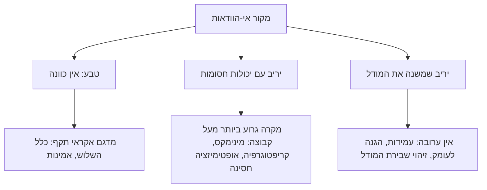

===== user | words=10 =====
אוקיי שיעור מרתק. 
שמת נקודות במחברת השיעור אשמח להתייחסות שלך.

===== assistant | words=1705 =====
שתי הנקודות שכתבת נוגעות בדיוק במקום שבו עצרנו בשיעור. כשניסחנו את כלל השלוש, $p\lesssim 3/n$ (14), הוספנו הסתייגות אחת: הוא תקף רק תחת ההתפלגות שממנה נלקחו הבדיקות. אתה מושך את ההסתייגות הזאת עד הסוף, וברובו של הדבר אתה צודק. בכמה מקומות הטיעון חזק ממה שמגיע לו, ושם כדאי לחדד אותו לפני שהוא נכנס למאמר. בסוף אפרט מה שמרתי במחברת.

## 1. למה בדיקה אקראית מתמוטטת מול יריב, ובמספרים

כדאי לראות במדויק מה הערובה הסטטיסטית אומרת. אחרי $n$ בדיקות אקראיות נקיות, כלל השלוש חוסם את **המידה** (measure) של קבוצת הכשל: כמה מסת הסתברות יש לה תחת התפלגות הבדיקה. הוא לא אומר כלום על **קיומה** של קבוצת כשל.

ניקח מספרים [[היפותטי]]. במערכת יש קבוצת קלטים שבהם היא נכשלת, ומידתה תחת התפלגות הבדיקה היא $10^{-9}$. הרצנו $10^6$ בדיקות אקראיות. ההסתברות שכולן יחמיצו את הקבוצה היא $(1-10^{-9})^{10^6}=0.999$. כמעט בוודאות נצא עם תעודה נקייה, וכלל השלוש יגיד "$p\lesssim 3\times10^{-6}$". הטענה הזאת **נכונה**: המידה האמיתית קטנה ממנה פי 3000. אבל ברגע שהיריב יודע איפה הקבוצה, הוא שולח קלט מתוכה, וההסתברות לכשל קופצת ל-1.

[[2.5: ביקורת]] זה בדיוק מה שקרה ב-FDIV. חמש כניסות חסרות מתוך 1066 יוצרות קבוצת כשל שמידתה תחת קלטים אקראיים זעירה, ובכל זאת אפשר לבנות קלט שנופל עליה בכוונה. מכאן הניסוח המדויק לנקודה שלך: **יריב לא משנה את הסיכוי של אירוע. הוא משנה את ההתפלגות.** כל ערובה שנגזרה תחת ההתפלגות הישנה לא מחזיקה עוד, גם אם החשבון שהוביל אליה היה מושלם.

```think
אם כך, האם בדיקה אקראית חסרת ערך במערכת שיש מולה יריב?
---
לא. היא מאבדת ערך רק לגבי הרכיבים שהיריב שולט בהם. יש שלושה מקרים שבהם היא עדיין תקפה. הראשון: כשלים שמקורם בטבע, כמו בלאי, רעש חיישנים, מזג אוויר ושגיאות של המפעיל שלך. השני: חיפוש נקודות חולשה לפני שהיריב מוצא אותן, כמו fuzzing או משחקי מלחמה אקראיים. שם הבדיקה לא מוכיחה כלום, אבל היא מוצאת. השלישי: כש"אקראי" מוחלף ב"מכוון": red team הוא בדיקה שההתפלגות שלה נבחרה בידי יריב מדומה. הערך הסטטיסטי נעלם, וערך הגילוי עולה. מה שבאמת נשבר הוא המשפט "בדקנו $n$ ולכן הסיכון קטן מ-$3/n$". הבדיקה עצמה לא נשברת.
```

## 2. "בעייתית מיסודה"? שלושה משטרים ולא אחד

כאן הייתי מחדד את הטיעון שלך. כתבת, ובצדק, שהיריב "יוצר קלטים חדשים, תחת האמצעים המוגבלים שיש לו". המילים "אמצעים מוגבלים" הן בדיוק הפתח למסגרת שבה **אפשר** לטעון משהו קפדני. במתמטיקה ובהנדסה יש תחום שלם שעוסק בזה, והוא לא הסתברות מעל קלטים. הוא **המקרה הגרוע ביותר מעל קבוצת יכולות**.



התרשים מחליף את המשפט "כל התבססות כזו בעייתית" בשאלה מדויקת יותר: **באיזה משטר נמצא הרכיב שאני מנתח?** הטעות שאתה מתאר היא שימוש בכלים של המשטר הראשון על בעיה מהמשטר השני או השלישי.

[[2.5: מבנה משותף]] המשטר השני נראה מצוין בפרק של בויד על תכנות לינארי חסין [[E06:171]]. ניקח מגבלה לינארית $a^Tx\le b$, שבה $x$ הוא ההחלטה שלנו (למשל הקצאת משאבים) ו-$a$ הוא וקטור של פרמטרים לא ידועים. אפשר לדרוש שהמגבלה תתקיים בשתי דרכים שונות לגמרי מבחינה פילוסופית:

```formula
@title: אותה מגבלה, שתי השקפות על אי-הוודאות
**חסינה (יריב חסום):** $a$ יכול להיות כל נקודה באליפסואיד $\{\bar a+Pu \mid \|u\|_2\le 1\}$, והמגבלה צריכה להתקיים לכל אחת מהן:
$$\bar a^T x+\|P^T x\|_2\le b \tag{1}$$
**הסתברותית (טבע):** $a$ אקראי, גאוסי, עם ממוצע $\bar a$ ושונות $\Sigma$, והמגבלה צריכה להתקיים בהסתברות של לפחות $\eta$:
$$\bar a^T x+\Phi^{-1}(\eta)\,\|\Sigma^{1/2}x\|_2\le b \tag{2}$$
$\bar a$ הוא הערך הנומינלי. $P$ ו-$\Sigma^{1/2}$ קובעים את גודל אי-הוודאות ואת כיוונה. $\Phi^{-1}(\eta)$ הוא מקדם שולי הביטחון של ההתפלגות הנורמלית. נבנה אותה בצומת ההסתברות, ולעת עתה מספיקים הערכים: 1.645 עבור 95%, 2.326 עבור 99%, 3.09 עבור 99.9%.
```

הצורה של (1) ושל (2) זהה: ערך נומינלי ועוד שולי ביטחון. ההבדל הוא רק במקדם [[E06:172]]. מכאן מסקנה עמוקה למאמר: **ערובה הסתברותית ברמה $\eta$ שקולה לערובה של מקרה גרוע ביותר מעל אליפסואיד ברדיוס $\Phi^{-1}(\eta)$.** בדקתי ב-compute: דרישה לכשל אחד במיליארד ($10^{-9}$) מתאימה לרדיוס של כ-6.0 סטיות תקן. בשתי הגישות הערובה תלויה **בהנחה**. בגישה הסטטיסטית ההנחה היא התפלגות, ובגישה החסינה היא קבוצה. יריב שוחה מחוץ לקבוצה שהנחת שובר את (1) בדיוק כפי שיריב שמשנה התפלגות שובר את (2). כלומר המעבר למקרה הגרוע ביותר לא מבטל את הבעיה שלך. הוא **מזיז אותה** מ"איזה מדגם לקחנו" אל "איזו קבוצת יכולות הנחנו". זה הפער הראשון מתוך השלושה שמנינו בשיעור, פער המפרט.

```domain
@field: computing
@title: קריפטוגרפיה: התחום שבו "יריב עם אמצעים חסומים" הוא ההגדרה עצמה
בקריפטוגרפיה מודרנית לא אומרים "ניסינו מיליון התקפות ואף אחת לא הצליחה". אומרים "כל יריב שזמן הריצה שלו פולינומי מצליח לכל היותר בהסתברות זניחה, בהנחה שבעיה מסוימת קשה". זו הוכחה מעל **כל** האסטרטגיות בקבוצת יכולות, וזה בדיוק המשטר השני. והיא נשברת בדיוק במקום שאתה צופה: התקפות ערוץ צד, כמו מדידת זמן ריצה (קוצ'ר, 1996) או Spectre (2018) [[ודאות: גבוהה]], לא שברו את המתמטיקה. הן יצאו ממודל היריב: היריב קיבל ערוץ מידע שהמודל לא כלל. זה המשטר השלישי, וזה הפער השני מהשיעור, פער המודל.
```

```domain
@field: control
@title: בקרה חסינה: ההפרעה הגרועה ביותר עם אנרגיה חסומה
בצומת הבקרה נפגוש את $H_\infty$. במקום להניח שההפרעה היא רעש לבן, מניחים שהיא אות **כלשהו** שהאנרגיה שלו חסומה, ומתכננים בקר שמבטיח ביצועים מול הגרוע שבהם. זה משחק סכום אפס בין המתכנן לטבע העוין, והתשובה היא מינימקס. השאלה ההנדסית המעשית תמיד חוזרת לאותה נקודה: כמה גדול לבחור את החסם. חסם גדול נותן בקר שמרני ואיטי. חסם קטן נותן בקר מהיר שנשבר מול ההפרעה האמיתית.
```

**יכולות מול כוונות.** כאן נמצא, לדעתי, הלב של התשובה לשאלה אם טיעון על המבנה "מוגדר" במלחמה. חלק ממנו מוגדר מצוין, וזה החלק שנשען על פיזיקה. אופק מכ"ם, $4.12(\sqrt{h_r}+\sqrt{h_t})$ ק"מ, אחד המודלים שנפגוש בהמשך הקורס, מגביל כל יריב, יהיו כוונותיו אשר יהיו. כך גם עומס $g$ מרבי של טיל, טווח שנקבע במשוואת הרקטה ומהירות האור. טיעון על יכולות שחסום בפיזיקה קרוב מאוד להוכחה. טיעון על כוונות, כלומר על מה היריב *יבחר* לעשות מתוך מה שהוא יכול, הוא המקום שבו המדגם קורס. לכן הייתי מנסח את הטענה כך: **הניתוח נהיה בעייתי מיסודו בדיוק במידה שבה הוא נשען על כוונות במקום על יכולות.**

## 3. שלוש טענות במאמר שכדאי לחדד

[[2.5: ביקורת]] **(א) הנחה שגויה לא הופכת את המסקנה לשגויה.** כתבת: "אם ההנחה על המבנה לא נכונה, כל מסקנה על המבנה שגויה". מבחינה לוגית זה לא נכון. מהנחה שקרית אפשר לגזור גם מסקנות אמיתיות. המסקנה לא נהיית שגויה. היא נהיית **לא מבוססת**: אין לה עוגן, והיא יכולה להיות נכונה במקרה. בוויכוח זה ההבדל בין טענה שקל להפריך ("הנה מסקנה שהתבררה נכונה, אז טעית") לבין טענה שאי-אפשר להפריך ("גם אם צדקתם, צדקתם במקרה, ולא תדעו מתי זה ייגמר").

**(ב) "תמיד אפשר למצוא חמור מהחמור ביותר".** זה נכון באופן טריוויאלי. מרחב התרחישים לא חסום, וזה בעצם שובך היונים בגרסה הפוכה: אין כיסוי סופי למרחב אינסופי. דווקא בגלל שהטענה נכונה תמיד, אי-אפשר לפעול לפיה. אם המקרה הגרוע ביותר לא חסום, ההגנה מפניו עולה אינסוף. בהנדסה עונים על כך בשני שלבים. הראשון הוא **איום ייחוס** (design basis threat): בוחרים במפורש קבוצה ומתכננים מולה בקפדנות, כמו ב-(1). השני: מה שמעבר לקבוצה מקבל **הגנה לעומק**, כלומר כשל מדורג במקום כשל קטסטרופלי. פוקושימה דאייצ'י היא הדוגמה הקלאסית. הסוללה תוכננה מול צונאמי של כ-5.7 מ', והגל ב-2011 הגיע לכ-13 עד 15 מ', פי 2.3 עד 2.6 מאיום הייחוס [[ודאות: בינונית]] (הנתונים המדויקים תלויים במקור ובנקודת המדידה). הכשל המכריע לא היה עצם החריגה מהתכן. הוא היה שגנרטורי החירום עמדו במקום נמוך, וכל שכבות ההגנה נפלו יחד ממנגנון אחד [[ודאות: גבוהה]]. הלקח למאמר: "מקרה גרוע ביותר" הוא **החלטה** ולא תגלית, והשאלה הנכונה היא איך המערכת נכשלת כשחורגים ממנו.

**(ג) מילים עמומות.** כאן אתה נוגע בבעיה שקהילת המודיעין עצמה תיעדה. שרמן קנט מה-CIA פרסם ב-1964 את "Words of Estimative Probability" [[ודאות: גבוהה]]. הוא מספר שם שהביטוי "serious possibility" בהערכה לאומית מ-1951 על יוגוסלביה פורש בידי קוראים שונים בטווח של בערך 20% עד 80% [[ודאות: בינונית]]. ביחסי סיכויים זה טווח של פי 16 ($0.25$ מול $4$). למילה כזו כמעט אין תוכן מידעי. כיום מחייב התקן האמריקאי ICD 203 סולם קבוע [[ודאות: בינונית]], ולצבא הבריטי יש סולם דומה:

```table
{"title": "סולם ההסתברויות של ICD 203 (לפי זיכרוני, ודאות בינונית)", "scope": {}, "columns": ["ביטוי", "מ- (%)", "עד (%)", "רוחב (נקודות אחוז)"], "rows": [["\"almost no chance\"", "1", "5", "5-1"], ["\"very unlikely\"", "5", "20", "20-5"], ["\"unlikely\"", "20", "45", "45-20"], ["\"roughly even chance\"", "45", "55", "55-45"], ["\"likely\"", "55", "80", "80-55"], ["\"very likely\"", "80", "95", "95-80"], ["\"almost certain\"", "95", "99", "99-95"]]}
```

[[2.5: פשרה]] המחיר האמיתי של עמימות הוא לא אי-דיוק. המחיר הוא שאי-אפשר **להפריך** את ההערכה. מי שכתב "ייתכן" צדק בכל תוצאה, ולכן אי-אפשר לכייל אותו, ולכן הארגון לא לומד. עבודתו של טטלוק (Expert Political Judgment, 2005, ואחריה פרויקט Good Judgment) הראתה שתחזיות מספריות שנמדדות לאורך זמן, למשל בציון Brier, אפשר לשפר, ושיש מנבאים שמכוילים הרבה יותר טוב מאחרים [[ודאות: בינונית]]. מה שמחייב סייג במאמר: מספרים לא מתקנים טעות במבנה. אם הקונספציה שגויה, תקבל "85%" מדויק להפליא על שאלה שגויה. מספרים עושים דבר אחר, צנוע יותר וחשוב יותר: הם הופכים טעות במבנה **לניתנת לזיהוי**, כי ההערכות המכוילות מתחילות לטעות באופן שיטתי.

## 4. 1973 בתור נפטון הפוך

```casestudy
@title: הקונספציה כטיעון על המבנה, והאזהרות כשאריות
המבנה: ההערכה שמצרים לא תפתח במלחמה עד שתהיה לה יכולת לתקוף בעומק את שדות התעופה של חיל האוויר (מפציצים ארוכי טווח וטילי קרקע-קרקע), ושסוריה לא תצא למלחמה בלי מצרים [[ודאות: גבוהה]]. זה טיעון על המבנה בדיוק כפי שתיארת: הנחה על פונקציית ההחלטה של היריב, שממנה גוזרים מסקנה על כל מקרה.

השבר: מצרים שינתה את המבנה ולא פעלה בתוכו. היא בחרה במטרה מוגבלת, צליחה ואחיזה בגדה המזרחית, תחת מטריית טילי קרקע-אוויר, ולכן לא נזקקה ליכולת שההנחה דרשה [[ודאות: גבוהה]]. זה המשטר השלישי: היריב לא בחר נקודה בקבוצה שהנחנו. הוא שינה את הקבוצה.

הקשר לשיעור: בסיפור נפטון ראינו שאותה שארית, סטייה במסלול אורנוס, יכולה לסמן "גוף חדש בתוך המודל" או "המודל שגוי". לה-ורייה צדק עם נפטון, ואחר כך טעה עם וולקן, כשניסה להסביר את סטיית מרקורי בתוך המודל הניוטוני, והפתרון היה תורת היחסות. ב-1973 האזהרות, ההתרגעויות והתרגילים הוסברו בתוך הקונספציה ("תרגיל", "הפגנת כוח"). ועדת אגרנט עסקה בדיוק בכשל הזה [[ודאות: גבוהה]]. השאלה המבנית שעולה מכאן: **איזה מנגנון בארגון מבחין בין שארית שמתיישבת עם המודל לבין שארית שמפילה אותו?** במדע זה תפקידן של תחזיות שאפשר להפריך. בהנדסה, בצומת ההסקה, נראה שזה מבחן של עקביות השאריות, כמו בדיקת חדשנות (innovation) במסנן קלמן.
```

[[2.5: מבנה משותף]] יש כאן מבנה שיחזור בקורס פעמים רבות: מערכת שמנטרת את השאריות של עצמה כדי לזהות שהמודל שלה נשבר. במסנן קלמן נבדוק שהחדשנות נראית כרעש לבן, ואם לא, המודל שגוי. בלמידה עמוקה נעסוק בזיהוי הסטת התפלגות (distribution shift). שתי הנקודות שלך במחברת מצביעות בעצם על שאלה אחת: מה עושים כשאין הוכחה, המדגם לא מייצג, והיריב משנה את המבנה. התשובה ההנדסית היא לא "אין מה לעשות". היא שלושה דברים: לחסום מה שהפיזיקה חוסמת, לתכנן מול איום ייחוס מוצהר, ולבנות מנגנון שמזהה מהר שהמודל נשבר.

## מה שמרתי במחברת

- **ברעיון למאמר שלך** הוספתי נקודה שמרכזת את החידודים: ההבחנה בין מסקנה "לא מבוססת" למסקנה "שגויה", שלושת המשטרים, איום ייחוס וההגנה לעומק (עם המספרים של פוקושימה), קנט ו-ICD 203, ו-1973 כמקרה של שאריות שהוסברו בתוך המודל.
- **בנקודה להעמקה שלך** הוספתי את המסגרת הפורמלית: הצמד (1) ו-(2) מבויד, שבו ההבדל הוא הנחת קבוצה מול הנחת התפלגות, ומשם הפניה לקריפטוגרפיה, ל-$H_\infty$ ולמינימקס. בכולם נעסוק בצמתים בהמשך.
- **שאלה חדשה לראיון**: אילו שאריות מנטרים כדי לזהות שהקונספציה נשברה, מי מוסמך להכריז על כך, ומה הסף. אם תראיין מישהו מעולם האנליזה המבצעית, זו השאלה שתבדיל בין תשובה מנוסחת היטב לבין תשובה שאפשר ללמוד ממנה.

והערה אחרונה: החמישה תרגילים מסוף השיעור עדיין מחכים לך. התרגיל "בדקנו טריליון" נוגע ישירות בנקודה הראשונה שלך, וכדאי לפתור אותו עכשיו, כשהמשטרים טריים. אחריו נמשיך לשיעור 2, שנפתח בסוללת הפטריוט בדהראן.

===== user | words=569 =====
זו נקודה משמעויתת ולא מודברת
מחיר האמיתי של עמימות הוא לא אי-דיוק. המחיר הוא שאי-אפשר להפריך את ההערכה. מי שכתב "ייתכן" צדק בכל תוצאה, ולכן אי-אפשר לכייל אותו, ולכן הארגון לא לומד. עבודתו של טטלוק (Expert Political Judgment, 2005, ואחריה פרויקט Good Judgment) הראתה שתחזיות מספריות שנמדדות לאורך זמן, למשל בציון Brier, אפשר לשפר, ושיש מנבאים שמכוילים הרבה יותר טוב מאחרים ודאות בינונית. מה שמחייב סייג במאמר: מספרים לא מתקנים טעות במבנה. אם הקונספציה שגויה, תקבל "85%" מדויק להפליא על שאלה שגויה.
בנוסף, כמו שריד רשם לגבי החמור ביותר כל אחד מעריך את המילים האלו אחרת איך שאחד מעריך 40 אחוז unlikely הוא לא איך שאחר מעריך. ואם יש תלות בין האנילסטים אז בכלל כי הם נופלים בכשלים דומים. 

לגבי השאלה האחת אני לא מסכים. זה המבנה של הרעיון שלי:
השרשרת

0. שני לחצים מנוגדים, דרך מילים עמומות. לחץ אחד מעלה: הרצון שלא יהיה מחדל. אצל רביד זה מנגנון ה"קונטרה", ובמילים זה "להגן על הכול". לחץ שני מוריד: המפריכים, שגוזמים תרחישים כ"שאיפתיים" או "לא ריאליים". שני הלחצים פועלים דרך אותן מילים ("ריאלי", "החמור ביותר", "מינימלי"), וכל צד ממלא אותן בתוכן אחר. "המינימום שלי אינו המינימום שלך" מופיע אפילו בתוך מסמך תורה אחד: ב-FM 6-0 היחס 3:1 הוא "מינימום היסטורי", אבל לא נאמר יחס של מה. תחת החוק הריבועי היחס הזה שקול למגן קטלני פי 9, ותחת הליניארי פי 3.

1. המילה לא קובעת גבול, משני הכיוונים. לפי עקרון הסובלנות של רייט, תמיד מותר להוסיף עוד קצת ותמיד מותר לגזום, ולכן אין גבול שהמילה מעדיפה. כל גבול הוא קביעה. יש לכך גם ערוץ מתמטי: תרחיש רב-ממדי מוכרע דרך סכום משוקלל, והמשקלות הם שיפוט ולא נתון. בקורסק טנק אחד הוגדר שקול ל-20 לוחמים, ובדוגמה ההיפותטית ההכרעה מתהפכת כשמשקל משגר נגד טנקים עובר את 47.5.

2. נורמה לא מוגדרת, ולכן גם H לא מוגדרת. קבוצת ההשערות היא H = Φ(D, G). הגבול שלה נקבע בזמן העצירה τ של תהליך ארגוני, כלומר לפי תקציב, מעמד ועייפות, ולא לפי הנתונים. לכן B, "החמור ביותר", הוא ערך בזמן עצירה ולא גבול של סדרה.

3. כל שאלה על H אינה מוגדרת. לפי הסופר-הערכה של פיין, אירוע שנופל בתחום שהחידודים חלוקים עליו הופך את "ההערכה הייתה בחסר" לאמת תחת חידוד אחד ולשקר תחת אחר. לטענה אין ערך אמת.

4. התשובה אינה מוגדרת ורגישה לכל סטייה קטנה. על פני החידודים הסטייה אינה חסומה, מאפס עד אינסוף. ניפוח (רביד) ושקיעה (7 באוקטובר) הם שני ביטויים של אותו חוסר הגדרה. גם ההחלטה עצמה לא נקבעת:

בהגנת מטרות יש שלוש הגדרות פורמליות ל"גרוע ביותר" (בייסיאנית, מחיר מרבי, פרים-ריד), והן נותנות לוחות ירי שונים. לוח אחד שורד ב-0.95 מול תוקף אחד וב-0.087 מול חמישה.
במודל של רביד, ההכרעה בין הגנה קרובה לרחוקה מתהפכת לפי האופק, ולפי השאלה אם תקיפת ההגנה עצמה נכללת.
במודל איכות מול כמות, בלי שום אי-ודאות, "איכות עדיפה" נכונה לפי מדד אחד ושגויה לפי אחר.

5. באי-ודאות סטייה קטנה קיימת תמיד, ולכן הסיכון הוא בלי מכנה. בתוך המסגרת, הסיכון של תוכנית שמכסה את "החמור ביותר" הוא אפס בהגדרה, וזו טאוטולוגיה. מחוץ לה:

$$\Pi = q\,p + r\,(1-p)$$

כאן q היא ההגנה בתוך H, p הסיכוי שהמציאות בתוך H, ו-r ההגנה מחוצה לה. תחום הזיהוי של Π הוא הקטע [0,1] כולו. "ערוכים לחמור ביותר" היא טענה על q בלבד, וכשהיא מוצגת כטענה על Π היא מניחה בשתיקה p = 1.

השכבה הנלווית (סטטיסטית)

זה מה שקורה אחרי שבכל זאת נבחר גבול:

ראיות מחוץ ל-H נבלעות בהשערה הקרובה ביותר בתוכה, והביטחון בה עולה (Berk). כך קרה עם "חומת יריחו", ועם המשגרים המדומים בציד הסקאדים.
גבול שקפא אינו אומד עקבי, וכיוון הטעות שלו אינו מזוהה.
מקורות עם הטיה משותפת משאירים רצפת חריגה κ שאינה דועכת עם מספרם, ויריב מסתגל מעלה את החריגה ל-1.
שנים של שקט מאשרות רק את המסגרת (כלל השלושה).
חסם עליון אי אפשר לעגן מנתונים בלבד (Bahadur-Savage, Donoho).

===== assistant | words=1205 =====
אתה צודק, ואני מקבל את התיקון. הביקורת שלי (א) תקפה ניסוח חלש יותר מזה שאתה טוען. אני כתבתי שהנחה שגויה לא הופכת את המסקנה לשגויה אלא ל"לא מבוססת". הטענה שלך אחרת: למסקנה אין בכלל ערך אמת. בין שתי הטענות יש הבדל של סוג:

- **מסקנה לא מבוססת:** יש לה ערך אמת, אבל אנחנו לא יודעים אותו. זו בעיה של ידיעה (אפיסטמית).
- **מסקנה בלי ערך אמת:** אין עובדה שהיא אמורה לתפוס. זו בעיה של משמעות (סמנטית).

השרשרת שלך (0–5) פועלת ברובד השני, והשכבה הסטטיסטית פועלת ברובד הראשון. כלומר המבנה של הרעיון כבר מכיל את שני הסוגים, ובסדר הנכון: קודם שואלים אם יש בכלל ערך אמת, ורק אחרי שגבול נקבע שואלים אם אפשר לאמוד אותו. ההערה שלי ישבה בשכבה הנלווית, והצגתי אותה כאילו היא תשובה לשרשרת.

מכאן גם התשובה לנקודה על המילים העמומות. מספרים מכוילים סוגרים את הפער בשלב 3: אם ההערכה הייתה "35% שיקרה אירוע X", ו-X מוגדר בחדות, אז אחרי שהדבר קרה לטענה כבר יש ערך אמת. הם לא נוגעים ב-p שבשלב 5. אלה שני כשלים שונים, ולכל אחד מהם תרופה משלו.

## מה בדקתי, ומה מחזיק

[[2.5: סדר גודל]] החשבון של FM 6-0 נכון. לפי החוק הריבועי של לנצ'סטר, עוצמה פרופורציונלית ל-$\alpha N^2$, ולכן יחס כוחות של 3:1 מתקזז כשהמגן קטלני ממנו פי $3^2=9$. לפי החוק הלינארי מספיק פי 3. "מינימום היסטורי" בלי ציון חוק ההתשה הוא אכן מספר בלי יחידות. שם הטבלה, "historical minimum planning ratios", ויחס 3:1 מול הגנה מוכנה מופיעים במסמכי התורה האמריקאיים [[ודאות: בינונית]]. את מספר העמוד לא בדקתי.

השימוש שלך במקורות הסטטיסטיים מדויק:
- **ברק (Berk, 1966):** במודל שגוי ההתפלגות הפוסטריורית מתרכזת בהשערה הקרובה ביותר במובן KL בתוך המודל, ולא באמת [[ודאות: גבוהה]]. בדיוק מכאן מגיע "הביטחון עולה".
- **בהדור-סאבאג' (1956) ודונוהו (1988):** במשפחה לא-פרמטרית אי-אפשר לבנות רווח סמך לא טריוויאלי לממוצע, ולפונקציונלים רבים יש חסם תחתון מהנתונים אבל לא חסם עליון [[ודאות: גבוהה]].

אלה בדיוק המשפטים הנכונים לטענה "חסם עליון אי-אפשר לעגן מנתונים בלבד".

את הדוגמאות של קורסק (טנק = 20 לוחמים, היפוך ב-47.5) ואת המספרים שאתה מייחס לרביד לא יכולתי לאמת, כי הם מגיעים מהמודלים שלך ומהמקורות שלך. דבר אחד בכל זאת בדקתי:

[[2.5: ביקורת]] אם הלוח שורד ב-0.95 מול תוקף אחד, והיירוטים בלתי תלויים, אז מול חמישה הוא היה שורד ב-$0.95^5=0.774$, ולא ב-0.087. הנפילה ל-0.087 לא יכולה לבוא מהסתברויות. היא באה מספירה: נגמרים המיירטים, או שהלוח מקצה אותם לפי הנחה של תוקף בודד. כדאי לכתוב את זה במאמר במפורש, כי זה מחזק את הטענה שלך. ההבדל בין הגדרות ה"גרוע ביותר" אינו עניין של ניואנס. הוא מכריע אם המערכת נמצאת במשטר של הסתברות או במשטר של רוויה.

## שלושה מקומות שבהם השרשרת יכולה להיות חדה יותר

**(1) רייט ופיין מושכים לכיוונים שונים.** עקרון הסובלנות של רייט אומר שאין גבול, ומכאן נובע פרדוקס הערימה (sorites). הסופר-הערכה של פיין נוצרה כתשובה לפרדוקס הזה. היא שומרת את האינטואיציה של הסובלנות, אבל המשפט "קיים גבול חד" יוצא אצלה **אמת-על**, כי בכל חידוד יש גבול כלשהו. רק לגבי אף גבול מסוים לא נכון לומר שהוא הגבול. אם תצטט את שניהם בלי לומר זאת, פילוסוף יתפוס את זה. הניסוח הבטוח הוא "קיים גבול, אבל שום עובדה לא קובעת איפה". זה בעצם מחזק את שלב 2: הגבול נקבע בזמן העצירה τ, כי שום דבר אחר לא קובע אותו.

**(2) "מאפס עד אינסוף" זה יותר מדי.** אם התקציב סופי, גם ההחלטה חסומה. הניסוח המדויק: הסטייה גדולה ככל שמרחב ההחלטות מתיר, והיא לא דועכת כשהשינוי בחידוד קטן. בשפה מתמטית זו **בעיה שאינה מוצגת היטב (ill-posed) במובן של הדמר**. לפי הדמר, בעיה מוצגת היטב כשיש לה פתרון, הפתרון יחיד, והוא תלוי ברציפות בנתונים. שלב 4 שלך מפר את התנאי השלישי.

```domain
@field: signals
@title: רגולריזציה: מה עושים עם בעיה הפוכה שאינה מוצגת היטב
ראינו את זה בשיעור 1: נפטון היה בעיה הפוכה, שבה מסיקים את הסיבה מתוך השאריות. בבעיות כאלה, כשההופכי לא יציב, שינוי זעיר בנתון מזיז את התשובה כמה שרוצים. התשובה ההנדסית הקבועה היא **רגולריזציה**: מוסיפים מבחוץ הנחה שלא נלקחה מהנתונים, למשל "הפתרון חלק" או "הפתרון קטן". זה הופך את הבעיה למוגדרת, ומשלמים בהטיה. נפגוש את זה בצומת האלגברה הלינארית (טיכונוב, ריבועים פחותים מוסדרים) ובלמידה עמוקה (weight decay). איום ייחוס (design basis threat) הוא רגולריזציה מאותו סוג בדיוק: בוחרים חידוד אחד בצו. מה שההנדסה דורשת, ומה שהארגון שתיארת לא עושה, הוא להצהיר שזו רגולריזציה. כלומר לכתוב "בחרנו $H$ הזה, וזה מה שהוא מחמיץ", ולא להציג את $H$ כתגלית.
```

**(3) המסקנה "הכול לא מוגדר" נעצרת צעד אחד מוקדם מדי.** ערך אמת לא מוגדר עדיין לא אומר שאיכות ההחלטה לא מוגדרת. הדוגמה שלך עצמה מראה את זה. המשקל של משגר נגד טנקים אינו נתון, אבל **נקודת ההיפוך** 47.5 מוגדרת היטב. ההחלטה "A אם ורק אם המשקל עולה על 47.5" היא טענה שיש לה ערך אמת, תחת כל חידוד. היא גם מחליפה ויכוח על "ריאלי" בשאלה חדה שאפשר להתווכח עליה: האם מישהו מוכן לטעון שהמשקל קטן מ-47.5? זה הכיוון של שיטות ההחלטה תחת אי-ודאות עמוקה. ב-info-gap של בן-חיים מדווחים עקומת חסינות: כמה אפשר להרחיב את אופק אי-הוודאות לפני שהתוכנית נכשלת. ב-RDM של RAND מחפשים את התרחישים ששוברים את התוכנית [[ודאות: גבוהה]]. אף אחת מהשיטות לא מגדירה את "החמור ביותר". שתיהן מדווחות על **המשטח שבו ההחלטה מתהפכת**. אם תוסיף את זה, השרשרת לא תסתיים ב"אין תשובה" אלא ב"זו צורת התשובה שאפשר להגן עליה".

```think
אם שלב 3 נכון, ולטענה "ההערכה הייתה בחסר" אין ערך אמת, האם לטענה "ההחלטה מתהפכת כשהמשקל עולה על 47.5" יש ערך אמת?
---
כן. זו טענה על **פונקציה** מחידודים להחלטות, ולא על חידוד אחד. היא נכונה או לא נכונה בלי שנבחר חידוד: מחשבים את ההחלטה לכל משקל ובודקים איפה היא משתנה. הסופר-הערכה מאיימת על טענות שמניחות בשתיקה חידוד מסוים, ולא על טענות שמכמתות על כל החידודים. זה המעבר שהמאמר יכול להציע: מטענות על ערך לטענות על מבנה התלות.
```

## הרחבה ל-Π: הרוחב לא תלוי ב-q

[[2.5: מבנה]] המשוואה $\Pi=qp+r(1-p)$ טובה, ותחום הזיהוי $[0,1]$ נכון. בדקתי: המינימום מתקבל ב-$p=0,r=0$, והמקסימום ב-$p=0,r=1$. זהו בדיוק החסם של המקרה הגרוע ביותר אצל מנסקי (זיהוי חלקי, partial identification). אבל אפשר להוציא מהמשוואה יותר. נניח שמישהו מוכן להתחייב רק ל-$p\ge p_0$:

```formula
@title: תחום הזיהוי של Π כשיודעים רק חסם תחתון על p
$$\Pi\in\big[\,q\,p_0,\;\;1-p_0(1-q)\,\big],\qquad \text{width}=1-p_0 \tag{1}$$
$q$ היא ההגנה בתוך $H$, $p_0$ הוא החסם התחתון על הסיכוי שהמציאות בתוך $H$, ו-$r\in[0,1]$ לא ידוע. החסם התחתון מתקבל ב-$r=0,\ p=p_0$, והעליון ב-$r=1,\ p=p_0$.
```

רוחב התחום הוא $1-p_0$, **ו-$q$ לא מופיע בו**. בדקתי: עם $p_0=0.9$ ו-$q=0.95$ התחום הוא $[0.855,\,0.955]$. עם $q=0.5$ הוא $[0.45,\,0.55]$. ברוחב של 0.1 בשני המקרים. מכאן משפט חזק למאמר: **כל המאמץ לשפר את $q$ מזיז את התחום, ולא מצמצם את אי-הוודאות שלנו לגבי Π. רק טענה על $p$ מצמצמת אותה.** והתורה הארגונית שתיארת עוסקת כולה ב-$q$.

```chart
{"title": "תחום הזיהוי של Π כפונקציה של p0 (q = 0.95)", "caption": "הפער בין העקומות הוא אי-הוודאות לגבי Π, והוא שווה ל-1 − p0 בכל q. ב-p0 = 0 (אין שום טענה על p) התחום הוא [0,1] כולו, וזו הנקודה שלך בשלב 5.", "type": "line", "x": {"from": 0, "to": 1, "step": 0.02, "label": "p0"}, "scope": {"q": 0.95}, "series": [{"name": "חסם תחתון q·p0", "expr": "q*x"}, {"name": "חסם עליון 1 − p0(1−q)", "expr": "1 - x*(1-q)"}], "yLabel": "Π"}
```

## האנליסטים התלויים, במספר

[[2.5: מבנה משותף]] ה"רצפה κ" שלך היא נוסחה מוכרת. שונות הממוצע של $n$ מקורות עם מתאם $\rho$ ביניהם היא $\sigma^2\big(\rho+\tfrac{1-\rho}{n}\big)$, ולכן מספר המקורות האפקטיבי הוא $n_{\text{eff}}=n/(1+(n-1)\rho)$. בדקתי עם $\rho=0.3$: עשרה אנליסטים שקולים ל-2.7 בלתי תלויים, מאה אנליסטים ל-3.3, והגבול הוא $1/\rho=3.3$. כדי לאמוד בראש: מעבר ל-$1/\rho$ מקורות, כל מקור נוסף שווה כמעט אפס. זה אותו מבנה כמו אנטנות במערך עם רעש מתואם, או גנרטורי החירום של פוקושימה, שעמדו כולם באותו גובה. יש כאן גם הבדל: הנוסחה הזו מניחה טבע. אצל יריב מסתגל, כפי שכתבת, החריגה לא נעצרת ב-κ אלא עולה ל-1. זה המשטר השלישי מהתשובה הקודמת, ושם כבר אין נוסחה.

## מה הוספתי למחברת

- **ברעיון למאמר** הוספתי נקודה: שתי השכבות כשני סוגי כשל (סמנטי ואפיסטמי), הרוחב $1-p_0$ שלא תלוי ב-$q$, הדמר ואיום ייחוס כרגולריזציה, נקודת ההיפוך כפלט שאפשר להגן עליו, ו-$n_{\text{eff}}$.
- **פריט חדש להעמקה**: ארבע מסגרות להחלטה בלי גבול מוגדר (מנסקי, info-gap, RDM, עצירה אופטימלית וערך מידע), ולכל אחת השאלה אם היא באמת נותנת ערך אמת לשלב 3 או רק מחליפה את השאלה.

אם תרצה, בשלב הבא אפשר לבנות את הדוגמה של קורסק כמודל שקוף: לחשב את נקודת ההיפוך ולהציג את משטח ההחלטה בשני משקלים. כך יהיה למאמר גרף אחד שמראה את כל שלב 1.

===== user | words=16 =====
השאלה אם יש פה עיניין אמיתי או  ומהות לא טריוויאלית או שכבר נלעס ונבדק מכל כיוון

===== assistant | words=1171 =====
התשובה הקצרה: רוב הרכיבים בשרשרת כבר נלעסו, ובחלקם הוויכוח נמשך עשרות שנים. אבל יש בה גרעין שלא נראה לי שנלעס, והוא צר ממה שהשרשרת מציגה כרגע. מאמר שינסה לחדש בכל חמשת השלבים ייתפס כאיסוף של דברים ידועים. מאמר שיעמיד את הגרעין במרכז ויתייחס לכל השאר כרקע מוכר יכול לחדש באמת.

הסתייגות חשובה: אין לי גישה לרשת. מה שכתוב כאן מבוסס על הידע שלי, והוא עלול לא לכלול עבודות מהשנים האחרונות, ובייחוד את ספרות התחקירים על 7 באוקטובר. לכן "לא מכיר עבודה קודמת" אצלי הוא טענה בוודאות נמוכה. בסוף התשובה יש מונחי חיפוש לבדיקה.

## מה כבר קיים, שלב אחר שלב

| שלב בשרשרת | מה כבר קיים | הערכה |
|---|---|---|
| 0. מילים עמומות ושני לחצים | Kent ‏(1964); Friedman ו-Zeckhauser על הערכת אי-ודאות במודיעין, ו-*War and Chance* של Friedman ‏(2019), שטוען בדיוק נגד עמימות בהערכות ביטחון לאומי; Mandel ו-Barnes ‏(2014) מדדו כיול של אנליסטים בפועל; ספרות "ניפוח האיום" (Thrall ו-Cramer, 2009) | נלעס. כל לחץ בנפרד מתועד היטב |
| 3:1 ב-FM 6-0 | הוויכוח בין Mearsheimer ל-Epstein ב-*International Security* ‏(1989) עסק בדיוק בשאלה אם יש ל"כלל 3:1" תוכן בלי מודל התשה | נלעס |
| 1. משקלות (טנק = 20 לוחמים) | מדדי WEI/WUV של צבא ארה"ב וה-QJM של Dupuy, וביקורת ענפה על כך שהמשקלות הם שיפוט | נלעס |
| 2. $H$ נקבע בזמן עצירה ארגוני | חלופות שלא נהגו (Stanford, 2006) ובעיית ה"catch-all" בפילוסופיה של המדע; satisficing של Simon; Bar-Joseph ו-Kruglanski ‏(2003): צורך בסגירה קוגניטיבית ביום הכיפורים | הרעיון קיים. הניסוח כזמן עצירה כנראה חדש, אבל הוא ניסוח ולא תוצאה |
| 3. לטענה אין ערך אמת | עמימות (vagueness) בפילוסופיה, ומודיעין בספרות אחרת. **לא מוכרת לי עבודה שמחברת ביניהן באופן שיטתי** | אולי חדש (ודאות נמוכה) |
| 4. ניפוח ושקיעה כאותה תופעה | Betts ‏(1978), "למה כשלי מודיעין בלתי נמנעים", דן בפשרה בין "זאב, זאב" להפתעה | הפשרה ידועה. **ההצגה של שני הכיוונים כביטוי אחד של אי-קביעות** כנראה פחות |
| 5. $\Pi$, ו-$q$ מול $p$ | **צבי לניר, "ההפתעה הבסיסית" (1983)**: הפתעה מצבית מול הפתעה בסיסית, שחושפת שהמסגרת עצמה שגויה; Aven ו"חוזק הידע" בניתוח סיכונים; Paté-Cornell ‏(2012) על ברבורים שחורים; Manski | המושג נלעס. התוצאה ש-$1-p_0$ לא תלוי ב-$q$ פשוטה מתמטית, וחדה מספיק כדי שאולי לא נוסחה כך בקהילה הזו |
| השכבה הסטטיסטית | Berk, Bahadur-Savage, Donoho: ידועים בסטטיסטיקה | ידוע. השימוש בהם בהקשר מודיעיני נדיר |

[[2.5: ביקורת]] את לניר חייבים להכניס למאמר, ובמרכזו. ההבחנה שלו בין הפתעה מצבית להפתעה בסיסית היא, ברמת המושג, ההבחנה שלך בין $q$ ל-$p$. הוא גם ישראלי וכתב על 1973. כל קורא ישראלי מהתחום יזהה את זה, ומאמר שלא יתייחס אליו ייראה כמי שלא קרא. החדש אצלך הוא לא המושג. החדש הוא שהמשוואה מוסיפה תוצאה שאין אצל לניר: **שיפור $q$ לא מצמצם את אי-הוודאות לגבי $\Pi$**, ולכן מדדי המוכנות של ארגון מודדים כמות אחת, בעוד שהסיכון תלוי בכמות אחרת שאף אחד לא אחראי עליה.

## איפה הגרעין שאינו טריוויאלי

לדעתי יש שלושה מועמדים, וכדאי לבחור אחד כטענה הראשית ולהציג את השניים האחרים כתומכים בו.

**(1) הסימטריה, יחד עם ניבוי שאפשר להפריך.** זה החזק מבין השלושה. הספרות מטפלת בהפתעה בנפרד ובניפוח בנפרד. אתה טוען ששתיהן תוצאה של אותו גורם: גבול שלא נקבע בשום עובדה, ולכן נקבע בתהליך ארגוני. אם זה נכון, יוצא מכאן ניבוי אמפירי: **ההגדרה של "התרחיש החמור ביותר" בתוכניות ובמסמכי תורה לאורך זמן אמורה לנוע יחד עם משתנים ארגוניים** (מחזורי תקציב, האירוע האחרון, מעמד הגוף שמגדיר אותה) **יותר מאשר יחד עם מדדים של יכולת היריב**. לטענה כזו יש ערך אמת, והיא יכולה להתברר כשגויה. זה ההבדל בין פילוסופיה לבין טענה שיש בה תוכן. היא גם מתיישבת עם שלב 2: אם הגבול הוא ערך בזמן עצירה, הוא אמור להתנהג כמו זמן העצירה, ולא כמו הנתונים.

```think
איזה ממצא היה מפריך את הגרעין הזה?
---
סדרת זמן של תרחישי ייחוס שבה כל קפיצה בהגדרת "החמור ביותר" באה **אחרי** שינוי ביכולת של היריב, כמו מערכת נשק חדשה או גידול בסד"כ, ולא אחרי אירוע, שינוי תקציב או החלפת מפקד. במקרה כזה הגבול מעוגן בעובדות על היריב, ושלבים 2 ו-3 נחלשים מאוד. הניבוי ההפוך, שהקפיצות באות אחרי הפתעות ונשחקות בשנים שקטות, הוא מה שהתזה שלך צופה. כך גם רואים את הקשר לכלל השלוש: שנים של שקט "מאשרות" את המסגרת ושוחקות את הגבול.
```

**(2) המסקנה של שלב 3 לא תלויה בתורת העמימות שבוחרים.** כאן אפשר להפוך נקודת תורפה לנקודת חוזק. פילוסוף יטען שסופר-הערכה (supervaluation) היא רק תורה אחת. לפי האפיסטמיציזם של Williamson, לפרדיקט עמום **יש** גבול חד, ואנחנו פשוט לא יכולים לדעת איפה הוא. לפי תורת הדרגות, לטענה יש ערך אמת חלקי. אבל בכל שלוש התורות יוצאת אותה מסקנה מעשית: **שום עובדה שזמינה לארגון לא קובעת את הגבול**. בתורה אחת העובדה לא קיימת, בשנייה אי-אפשר לדעת אותה, ובשלישית היא מטושטשת. אם תכתוב את זה במפורש, המאמר לא יעמוד או ייפול על ויכוח בפילוסופיה של הלשון. זה גם מחליש את הניסוח "אין ערך אמת" לניסוח "אין ערך אמת שאפשר לפעול לפיו", וזה מה שאתה צריך בפועל.

**(3) חשבונאות של $q$ ו-$p$ כפרוטוקול ולא כביקורת.** "כל המודלים שגויים" (Box) הוא משפט שכולם מסכימים איתו ואף אחד לא פועל לפיו. מה שיכול להבדיל את המאמר הוא דרישה שאפשר לבדוק: כל אמירה מסוג "ערוכים לחמור ביותר" צריכה לצאת עם שלושה דברים מוצהרים: $H$, כלל העצירה שקבע אותו, ו-$r$. בנוסף צריכה לצאת התחייבות ל-$p_0$, ואם אין כזו, להצהיר במפורש שתחום $\Pi$ הוא $[0,1]$. ב-info-gap וב-RDM יש כבר מסגרות לזה, אבל הן נשארו ברובן בתכנון מים, אקלים ותשתיות. ההעברה לתכנון צבאי, יחד עם הטיעון למה דווקא שם המשטר השלישי (יריב שמשנה את $H$) הופך אותן להכרחיות, אינה טריוויאלית.

## שתי סכנות שיכולות להפוך את המאמר לטריוויאלי

[[2.5: ביקורת]] **הסכנה הראשונה: Betts כבר אמר "בלתי נמנע".** סוקר יכתוב: "המחבר מגיע מחדש למסקנה של Betts מ-1978". לכן צריך להבחין בבירור. אצל Betts הכשל הוא **עובדה**: היה אירוע, וההערכה החמיצה אותו, בגלל רעש, פוליטיקה ופסיכולוגיה. אצלך, הטענה שההערכה הייתה "בחסר" היא עצמה חלקית חסרת ערך אמת, כי היעד שמולו היא נמדדת לא מוגדר. זו טענה חזקה יותר, ובדיוק בגלל זה היא מסוכנת.

**הסכנה השנייה: "אם כך, אין אשמים".** קורא ישראלי אחרי 7 באוקטובר יקרא את שלב 3 כטיעון הגנה. זו לא רק בעיה רטורית. זו בעיה מהותית שהמאמר חייב לענות עליה, ויש לה תשובה טובה: **האחריות לא נעלמת, היא עוברת למקום אחר.** אם "האם כיסיתם את החמור ביותר" היא שאלה בלי ערך אמת, אז השאלות שיש להן ערך אמת הן: האם הצהרתם מה זה $H$, האם הצהרתם את כלל העצירה, האם מישהו היה אחראי על $r$ ועל $p$, והאם היה מנגנון שמזהה שאריות מחוץ ל-$H$ (זו השאלה לראיון שכבר שמורה במחברת). כך המאמר הופך מתירוץ לתביעה מחמירה יותר.

[[2.5: מבנה משותף]] יש כאן גם מבחן פנימי שכדאי להפעיל על השרשרת: **כל סמל פורמלי צריך להוביל לתוצאה שלא הייתה מתקבלת בלעדיו.** $\Pi$ עומד במבחן, כי הוא מוביל ל-$1-p_0$. $n_{\text{eff}}$ עומד בו, כי הוא מוביל לרצפה $1/\rho$. ברק עומד בו, כי הוא מוביל ל"הביטחון עולה דווקא כשהמודל שגוי". $\tau$ כזמן עצירה עדיין לא עומד בו. נכון לעכשיו הוא שם מתמטי לרעיון של Simon ושל Kruglanski. כדי שיעמוד במבחן הוא צריך להוביל לטענה כמו "התפלגות הגבול נקבעת בכלל העצירה ולא בנתונים", ואז הוא מתחבר ישירות לניבוי בסעיף (1). אם לא, עדיף לוותר עליו. מילה עברית פשוטה ("הגבול נקבע כשנגמר התקציב") עדיפה על אות יוונית שלא עושה כלום.

## בשורה התחתונה

רוב הרכיבים קיימים, אבל לא נמצא לך מאמר שכבר עשה את מה שהשרשרת עושה. ההערכה שלי, בוודאות בינונית: **הסינתזה עצמה, וטענה (1) כטענה המרכזית, הן תרומה אמיתית**, בתנאי שהמאמר יעשה שלושה דברים:

- יציג את לניר, Betts, Kent ו-Friedman כבסיס שהוא נשען עליו, ולא כדברים שהוא מגלה מחדש.
- ינסח ניבוי שאפשר להפריך.
- יענה על "אין אשמים" כשהאחריות עוברת, ולא נעלמת.

הבמה הטבעית ללשון כזו היא כתבי עת כמו *Intelligence and National Security* או *Journal of Strategic Studies*, ובעברית "בין הקטבים" או "מערכות" [[ודאות: בינונית]]. כדאי לבדוק מה הם פרסמו מאז 2023 לפני שמתחילים לכתוב.

הוספתי את המפה הזו כנקודה ברעיון למאמר שבמחברת: מה קיים, מה כנראה חדש, הסכנה של "אין אשמים", ומונחי החיפוש לבדיקת החדשנות (supervaluation intelligence analysis; vagueness worst-case scenario; design basis threat vagueness; imprecise probability intelligence; Lanir fundamental surprise). אם תמצא בחיפוש עבודה שמחברת עמימות פילוסופית להערכות מודיעין, תדביק אותה כאן, וכך נראה כמה מ-(2) נשאר חדש.

===== user | words=8 =====
אוקי תרשום את הסיכום שהצגת כאן רעיון להמשך.

===== assistant | words=189 =====
שמרתי את הסיכום כנקודה חדשה ברעיון למאמר שלך שבמחברת. לא פתחתי פריט חדש, כדי שהכול יישאר במקום אחד. בתשובה הקודמת כתבתי שהוספתי את המפה, אבל מתוך השיחה הזו לא יכולתי לוודא שהיא באמת נשמרה. לכן שמרתי אותה עכשיו במפורש. אם תראה כפילות בלשונית המחברת, אפשר למחוק את הגרסה הקודמת.

**מה נכנס לנקודה:**
- **מה כבר קיים, לפי שלבי השרשרת:**
  - לניר, שאותו צריך להציג במרכז המאמר.
  - Betts, Kent ו-Friedman.
  - הוויכוח על כלל 3:1.
  - Stanford ו-Simon.
  - השכבה הסטטיסטית.
- **שלושה מועמדים לגרעין החדש:**
  1. הסימטריה בין ניפוח לשקיעה, יחד עם ניבוי שאפשר להפריך. זה המועמד החזק.
  2. העמידות של שלב 3 לבחירת תורת העמימות.
  3. חשבונאות של q ו-p כפרוטוקול, כולל התוצאה שרוחב התחום הוא $1-p_0$ ואינו תלוי ב-$q$.
- **שתי סכנות ותשובה לכל אחת:**
  - הטענה "Betts כבר אמר שזה בלתי נמנע".
  - הטענה "אם כך, אין אשמים". התשובה: האחריות עוברת למקום אחר, היא לא נעלמת.
- **המבחן הפנימי לסמלים:** כל סמל צריך להוביל לתוצאה שלא הייתה מתקבלת בלעדיו. τ עדיין לא עומד במבחן הזה.
- **במות אפשריות ומונחי חיפוש לבדיקת החידוש.**

הצעד המעשי הבא הוא החיפוש. אם תמצא עבודה שמחברת את תורת העמימות להערכות מודיעין, הדבק אותה כאן ונבדוק כמה ממועמד 2 נשאר חדש. כשתרצה לחזור לחומר, חמשת התרגילים משיעור 1 עדיין מחכים. אחריהם ממשיכים לשיעור 2, שנפתח בסוללת הפטריוט בדהראן.

===== user | words=23 =====
בנוסף אפשר להסתכל על מלחמה (אולי זו נקודה חדשה) כגוף כמו החוק של ניוטון גוף ימשיך להתמיד במצבו לולא כח חיצוני המופעל עליו.

===== assistant | words=0 =====


===== user | words=71 =====
וסף אפשר להסתכל על מלחמה (אולי זו נקודה חדשה) כגוף כמו החוק של ניוטון גוף ימשיך להתמיד במצבו לולא כח חיצוני המופעל עליו. ומכאן שבמלחמה יש גוף ואז יש כוחות  (כשירות, אמל״ח נוכחיכןןנת בכירים , וכן הלאה) שיכלים לרדת לרמת האינפיטסמל הטקטי כל  והכתיבה והמוכנות הבסיסית גם שם ישנם פרמטרים לעיתים מעט אחרים שינוי גורר נשינוי ברמה הבאה ומשפיעה על שינוי במצב הגוף ובנוסף ישנה הרחבה להשפעה על ״אויב״ גוף שני.

===== assistant | words=1079 =====
כדאי להפריד כאן בין שני דברים. **המטאפורה עצמה**, מלחמה כגוף שמתמיד במצבו עד שכוח פועל עליו, לא חדשה. היא נמצאת בתיאוריה הצבאית כבר מאתיים שנה, ואלגברית לפחות מאה. מה שעשוי להיות חדש הוא **השימוש** בה בתוך השרשרת שלך. לשם כך צריך להחליט מהו הגוף שמתמיד, ואני חושב שהגוף הזה הוא לא המלחמה אלא מסגרת ההערכה $H$.

## מה כבר קיים

קלאוזביץ חשב במונחים מכניים. "חיכוך" (Friktion) ו"מרכז כובד" (Schwerpunkt) הם מונחים מהמכניקה, והוא השתמש בהם במודע [[ודאות: גבוהה]]. ביירכן (Beyerchen, 1992, "Clausewitz, Nonlinearity, and the Unpredictability of War") טען שקלאוזביץ הבין בדיוק את המקום שבו האנלוגיה הניוטונית נשברת [[ודאות: גבוהה]]. בצה"ל קראו לתר"ש של 2020 "תנופה" [[ודאות: גבוהה]], כך שגם אוצר המילים המקומי כבר מכני.

שני הרכיבים בהצעה שלך כבר נוסחו כמשוואות:

**"עד רמת האינפיניטסימל הטקטי".** לנצ'סטר (1916) כתב את ההתשה כמשוואה דיפרנציאלית. קצב האבדות של כל צד פרופורציונלי לגודל הכוח שיורה עליו: $\dot A=-\beta B,\ \dot B=-\alpha A$. זה בדיוק מה שתיארת, מצב הגוף שמשתנה ברגע אחר רגע תחת כוחות. את החוק הריבועי שמשתמע מהמשוואות כבר פגשנו בדיון על FM 6-0.

**"גוף שני".** לואיס פריי ריצ'רדסון, מטאורולוג ופציפיסט, כתב בשנות ה-30 מודל של שני גופים מצומדים למרוץ חימוש [[ודאות: גבוהה]]:

$$\dot x = a\,y - m\,x + g,\qquad \dot y = b\,x - n\,y + h \tag{1}$$

כאן $x,y$ הן רמות החימוש של שני הצדדים. $a,b$ הם מקדמי התגובה לאיום של הצד השני. $m,n$ הם "עייפות", כלומר הבלימה שהמחיר הכלכלי מטיל. $g,h$ הן טינות קבועות. אפשר לקרוא את זה כמו החוק השני: הנגזרת של המצב שווה לסכום הכוחות, ואחד הכוחות הוא הגוף השני.

**"שינוי ברמה אחת גורר שינוי ברמה הבאה".** זה הרעיון של מבצעים מבוססי השפעות (EBO): לתכנן שרשרת השפעות מהטקטי לאסטרטגי. ב-2008 הורה מאטיס לפיקוד JFCOM לנטוש את EBO, בנימוק שהשרשרת לא ניתנת לחיזוי מול אויב מסתגל [[ודאות: גבוהה]]. זה הניסוי הגדול ביותר שנעשה ברעיון שהעלית, והוא נכשל.

[[2.5: ביקורת]] אם המאמר יציג את המטאפורה כחידוש, סוקר יזהה את קלאוזביץ, לנצ'סטר וריצ'רדסון תוך שורה. אם הוא יציג אותה עם הרקע הזה, מה שנשאר לבדוק הוא איפה בדיוק היא נשברת.

## מה המשוואה מלמדת: יציבות מתוך הצימוד

[[2.5: מבנה]] במודל (1) רואים יפה דבר שלא רואים במילים. **היציבות של שני הגופים יחד לא נקבעת בתכונות של אף אחד מהם לבד**, אלא ביחס בין הבלימה לצימוד. אם מזיזים את המערכת מעט מנקודת שיווי המשקל, היא חוזרת אליה רק אם

$$m\,n > a\,b \tag{2}$$

שלד הגזירה (את הכלי נבנה בצומת הבקרה): הסטייה מנקודת שיווי המשקל מתפתחת לפי המטריצה $\begin{psmallmatrix}-m & a\\ b & -n\end{psmallmatrix}$. העקבה שלה תמיד שלילית. לכן שני הערכים העצמיים שליליים בדיוק כשהדטרמיננטה $mn-ab$ חיובית. בדקתי ב-compute עם $m=n=0.5$:
- עם $a=b=0.3$ הערכים העצמיים הם $-0.2$ ו-$-0.8$, והמערכת יציבה.
- עם $a=b=0.7$ הם $+0.2$ ו-$-1.2$. יש מצב אחד שגדל, ובתוך 10 יחידות זמן הוא מתנפח פי 7.4.

```anim
{"title": "מודל ריצ'רדסון: שני גופים מצומדים", "caption": "הזיזו את מקדם התגובה k (a = b = k), כשהבלימה m = 0.5 קבועה. כל עוד k < 0.5 המסלול חוזר לשיווי המשקל (0,0). כש-k עובר את 0.5 הוא בורח לאורך האלכסון x = y, כלומר מרוץ חימוש שמזין את עצמו. שני הצדדים זהים, ולכן היציבות נקבעת רק ביחס בין k ל-m.", "duration": 10, "view": {"x": [-0.5, 6], "y": [-0.5, 6]}, "params": [{"id": "k", "label": "מקדם תגובה k", "min": 0.1, "max": 0.9, "value": 0.3}], "shapes": [{"type": "line", "x1": "0", "y1": "0", "x2": "6", "y2": "6", "dash": true}, {"type": "path", "x": "min(6, (2*exp((k-0.5)*s) + 1.5*exp(-(k+0.5)*s))/2)", "y": "min(6, (2*exp((k-0.5)*s) - 1.5*exp(-(k+0.5)*s))/2)", "s": [0, 10]}, {"type": "circle", "x": "min(6, (2*exp((k-0.5)*t) + 1.5*exp(-(k+0.5)*t))/2)", "y": "min(6, (2*exp((k-0.5)*t) - 1.5*exp(-(k+0.5)*t))/2)", "r": "0.12", "accent": true, "label": "מצב"}, {"type": "circle", "x": "0", "y": "0", "r": "0.08", "label": "שיווי משקל"}, {"type": "text", "x": "3", "y": "5.6", "text": "mn − ab = {round(0.25 - k*k, 2)}"}]}
```

[[2.5: מבנה משותף]] זה המבנה של שני מגברים בחוג משוב חיובי, ושל אוכלוסיות טורף-טרף בקירוב לינארי. העיקרון "רווח החוג קטן מהבלימה" יחזור בצומת הבקרה כקריטריון יציבות. בשביל השרשרת שלך יש לזה משמעות ישירה: "ניפוח" (שלב 4) הוא בדיוק המצב $ab>mn$. כל צד מגיב להערכת האיום של הצד השני חזק יותר משהעלות בולמת אותו.

## איפה האנלוגיה הניוטונית נשברת

[[2.5: גבולות]] יש ארבע נקודות שבירה. כל אחת מהן היא טענה שאפשר לכתוב במאמר.

**1. הכוח החיצוני חושב.** בחוק הראשון הכוח הוא נתון: פונקציה של מצב הגוף, בלי ידיעה על הגוף. במודל (1) ה"אויב" עדיין כזה, כי $a$ קבוע. אויב אמיתי משנה את $a$ על סמך מה שהוא חוזה שתעשה. זה משחק ולא מכניקה, וזה המשטר השלישי מהתשובה הראשונה. EBO נכשל בדיוק כאן.

**2. הכוחות הפנימיים לא מתקזזים.** בגוף ניוטוני החוק השלישי מבטיח שכוחות פנימיים מתבטלים בזוגות. לכן מרכז המסה זז רק בהשפעת כוחות חיצוניים, ומכאן הזכות לדבר על "גוף" אחד. בצבא, חיכוך בין זרועות, מאבקי מעמד בין בכירים ושחיקה פנימית צורכים אנרגיה ולא מתקזזים. "הגוף" לא מוגדר היטב כמרכז מסה, ולכן גם המעבר בין הרמות שהצעת (טקטי ← מבצעי ← אסטרטגי) לא אוטומטי.

**3. המסה לא אדיטיבית.** כאן חוזרת התוצאה מסוף שיעור 1, על גבולות האדיטיביות $Q(A\cup B)=Q(A)+Q(B)$. לפי החוק הריבועי של לנצ'סטר, בדקתי ב-compute [[היפותטי]]:

| מצב | החוק הריבועי | החוק הלינארי |
|---|---|---|
| 100 מרוכזים מול 80 | אנחנו נשארים עם 60 | אנחנו נשארים עם 20 |
| שני כוחות של 50, בזה אחר זה, מול 80 | **האויב** נשאר עם 37.4 | אנחנו נשארים עם 20 |

לפי החוק הלינארי, לחלק את הכוח או לרכז אותו שקול. לפי החוק הריבועי, חלוקה הופכת ניצחון להפסד. כלומר "המסה" של הגוף תלויה בחוק האינטראקציה, ולכן שינוי אינפיניטסימלי ברמה הטקטית, כמו פיצול כוח, יכול לשנות את התוצאה ברמה הבאה באופן לא לינארי לגמרי. זה מחזק את מה שכתבת, אבל דרך מנגנון אחר: לא שרשרת חלקה אלא סף.

**4. המצב לא נצפה.** בניוטון המיקום והמהירות ידועים. כאן גם המצב שלך וגם של האויב נאמדים מתוך שאריות. זה ערפל הקרב, ובשפת הקורס זו בעיה הפוכה (נפטון), עם כל מה שאמרנו על ברק.

## לדעתי זה מה שחדש: ההתמדה של המסגרת

עכשיו ההצעה שבה המטאפורה עושה עבודה ולא רק מקשטת. ניקח את החוק הראשון לא על המלחמה אלא על **$H$, ההגדרה של "החמור ביותר"**. מסגרת ההערכה "ממשיכה להתמיד במצבה" כל עוד לא פועל עליה כוח חיצוני מספיק חזק. שאריות קטנות מוסברות בתוכה, כמו האזהרות ב-1973. היא משתנה בקפיצה רק כשמגיעה הפתעה.

זה מה שחסר ל-$\tau$ במבחן הסמלים מהתשובה הקודמת: **מנגנון**. מהמנגנון יוצא ניבוי שאפשר להפריך, והוא זהה לניבוי שהגדרנו כגרעין (1): לאורך זמן, ההגדרה של "החמור ביותר" תשתנה כפונקציית מדרגות שהקפיצות שלה מסונכרנות עם אירועים, ולא כעקומה רציפה שעוקבת אחרי יכולות היריב. "שנים של שקט" הן היעדר כוח, ולכן המסגרת נשארת במקומה, וזה בדיוק כלל השלוש מאשר את המסגרת. הסימטריה מתקבלת מעצמה. אחרי הפתעה הקפיצה מנפחת את $H$, ואחר כך שנים של שקט ותקציב שוחקות אותו עד ההפתעה הבאה.

[[2.5: ביקורת]] גם כאן יש ספרות קרובה שצריך לבדוק לפני שטוענים לחידוש: "האינרציה המבנית" של Hannan ו-Freeman בסוציולוגיה של ארגונים (1984), ו"שיווי המשקל המקוטע" של Baumgartner ו-Jones במדיניות ציבורית (1993) [[ודאות: גבוהה]] שהן קיימות, ו[[ודאות: נמוכה]] שמישהו יישם אותן על הגדרת תרחיש הייחוס במודיעין. מה שייחודי אצלך הוא החיבור לשרשרת: ההתמדה היא הסיבה שהגבול של $H$ הוא ערך בזמן עצירה ולא אומד עקבי.

```think
אם מסגרת ההערכה מתנהגת כגוף עם התמדה, מהי "המסה" שלה, ואיך היו מודדים אותה?
---
המסה היא גודל ההפרעה שנדרש כדי להזיז את המסגרת: כמה אזהרות סותרות, וכמה חזקות, נבלעות לפני שההגדרה משתנה. אפשר לאמוד אותה בדיעבד מתוך מסמכים: לספור את השאריות שהוסברו בתוך המסגרת לפני כל שינוי שלה. מסגרת "כבדה" בולעת הרבה. המדד מתקשר ישירות לשאלה לראיון שבמחברת, על מי מוסמך להכריז שהקונספציה נשברה. ככל שהסמכות הזו גבוהה וריכוזית יותר, המסה גדולה יותר.
```

## מה שמרתי

הוספתי את כל זה כנקודה חדשה ברעיון למאמר שבמחברת:
- הספרות הקיימת: קלאוזביץ, לנצ'סטר, ריצ'רדסון עם תנאי היציבות $mn>ab$, EBO ומאטיס, ביירכן ו"תנופה".
- ארבע נקודות השבירה, עם המספרים של לנצ'סטר.
- ההצעה להחיל את ההתמדה על $H$, יחד עם הניבוי שאפשר להפריך.
- שתי עבודות שצריך לבדוק לפני שטוענים לחידוש.

אם תרצה, השלב הבא יכול להיות מודל קטן: $H$ כפונקציית מדרגות תחת סף התמדה, מול יכולת יריב שגדלה ברציפות. נראה בו מתי הפער בין השניים נפתח. זה הגרף שממחיש את הניבוי.

===== user | words=16 =====
בכופלי לגרנז' אשמח להגדרה ללא הדוגמא אני רוצ הלהבין את הרעיון וקשה שזה מקושר לדוגמא ספציפית

===== assistant | words=2177 =====
## הבעיה, בלי שום מכל

יש לנו כמה משתנים, ונכתוב אותם יחד כנקודה אחת $\mathbf{x}=(x_1,\dots,x_n)$. יש פונקציה $f(\mathbf{x})$ שאנחנו רוצים להביא למקסימום או למינימום, ויש אילוץ, כלומר קשר שהמשתנים חייבים לקיים:

$$g(\mathbf{x}) = c \tag{1}$$

כאן $g$ היא פונקציה כלשהי של המשתנים ו-$c$ הוא מספר קבוע. האילוץ מגדיר את "המקום המותר": קו במישור כשיש שני משתנים, משטח במרחב כשיש שלושה, ובאופן כללי "משטח" בעל $n-1$ ממדים.

בלי אילוץ, הכלל מוכר: בנקודת קיצון הנגזרת מתאפסת, ובכמה משתנים מתאפס הגרדיאנט, $\nabla f=0$. עם אילוץ הכלל הזה לא תקף. נקודת הקיצון של $f$ לאורך המקום המותר בדרך כלל אינה נקודה שבה $f$ שטוחה. היא נקודה שבה $f$ שטוחה **בכיוונים שמותר לנו לזוז בהם**. בכיוונים האסורים $f$ יכולה להמשיך לעלות כמה שהיא רוצה, ואנחנו פשוט לא יכולים ללכת לשם. כל הרעיון של לגרנז' הוא לתרגם את המשפט הזה לנוסחה.

```refresh
@title: הגרדיאנט: הנגזרת בכל הכיוונים בבת אחת
@first: M0.1 ש3, משוואה (28) (המכל: ∇S = λ∇V)
הגרדיאנט $\nabla f=(\partial f/\partial x_1,\dots,\partial f/\partial x_n)$ הוא וקטור של הנגזרות החלקיות. כל אחת מהן היא הנגזרת הרגילה מש3 (שיפוע המיתר כש-$h\to0$) לפי משתנה אחד, כשהשאר מוחזקים קבועים. התכונה היחידה שנזדקק לה היא הקירוב הלינארי: כשזזים צעד קטן $\boldsymbol\delta$,
$$f(\mathbf{x}+\boldsymbol\delta)\approx f(\mathbf{x})+\nabla f\cdot\boldsymbol\delta .$$
כלומר השינוי ב-$f$ שווה למכפלה הסקלרית של הגרדיאנט בצעד. שתי מסקנות גאומטריות נובעות מזה: $\nabla f$ מצביע לכיוון שבו $f$ עולה הכי מהר, וצעד **מאונך** ל-$\nabla f$ לא משנה את $f$ (בסדר ראשון). לכן הגרדיאנט תמיד מאונך לקווי הגובה של הפונקציה.
```

## הרעיון, צעד אחר צעד

התוצאה הזאת תחזור לאורך כל הקורס (אופטימיזציה, מכניקה, תרמודינמיקה, בקרה, למידה), ולכן נגזור אותה במלואה. היא קצרה מאוד.

```derivation
@title: למה בנקודת הקיצון ∇f מקביל ל-∇g
**צעד 1: אילו צעדים מותרים.** נעמוד בנקודה $\mathbf{x}^*$ על המקום המותר ונזוז צעד קטן $\boldsymbol\delta$. כדי להישאר על האילוץ צריך $g(\mathbf{x}^*+\boldsymbol\delta)=c$. לפי הקירוב הלינארי $g(\mathbf{x}^*+\boldsymbol\delta)\approx c+\nabla g\cdot\boldsymbol\delta$, ולכן הצעדים המותרים (בסדר ראשון) הם בדיוק אלה שמקיימים
$$\nabla g\cdot\boldsymbol\delta=0 .$$
במילים: מותר לזוז רק **מאונך ל-$\nabla g$**, כלומר משיק למשטח האילוץ.

**צעד 2: מה פירוש "קיצון".** אם $\mathbf{x}^*$ היא מקסימום (או מינימום) לאורך האילוץ, אף צעד מותר לא משנה את $f$ בסדר ראשון. אילו היה צעד מותר $\boldsymbol\delta$ עם $\nabla f\cdot\boldsymbol\delta>0$, הצעד הזה היה מעלה את $f$ והצעד ההפוך $-\boldsymbol\delta$, שגם הוא מותר, היה מוריד אותה. במקרה כזה הנקודה אינה קיצון. לכן
$$\nabla f\cdot\boldsymbol\delta=0\quad\text{לכל } \boldsymbol\delta \text{ שמקיים } \nabla g\cdot\boldsymbol\delta=0 .$$

**צעד 3: וקטור שמאונך לכל מה שמאונך ל-$\nabla g$.** נפרק את $\nabla f$ לשני חלקים: רכיב לאורך $\nabla g$, ושארית $\mathbf{w}$ שמאונכת ל-$\nabla g$:
$$\nabla f=\lambda\nabla g+\mathbf{w},\qquad \nabla g\cdot\mathbf{w}=0 .$$
השארית $\mathbf{w}$ מאונכת ל-$\nabla g$, ולכן היא עצמה צעד מותר. לפי צעד 2: $0=\nabla f\cdot\mathbf{w}=\lambda\,\nabla g\cdot\mathbf{w}+\mathbf{w}\cdot\mathbf{w}=|\mathbf{w}|^2$. מכאן $\mathbf{w}=0$.

**צעד 4: התוצאה.**
$$\nabla f(\mathbf{x}^*)=\lambda\,\nabla g(\mathbf{x}^*)\tag{2}$$
המספר $\lambda$ הוא כופל לגרנז' (Lagrange multiplier). הוא אינו ידוע מראש: הוא נקבע יחד עם הנקודה.

**איפה נכנסו ההנחות:** בצעד 1 הנחנו ש-$f$ ו-$g$ חלקות (יש להן קירוב לינארי) וש-$\nabla g\neq0$, אחרת צעד 1 לא מגדיר שום כיוון. בצעד 2 הנחנו שהקיצון **מקומי** ושמותר לזוז לשני הכיוונים, כלומר אנחנו לא על קצה של אילוץ מסוג "לכל היותר". כל אחת מההנחות האלה תחזור למטה בסעיף הגבולות.
```

זו כל התוצאה, ובמילים פשוטות: **בנקודת הקיצון, הכיוון שבו $f$ משתנה הכי מהר הוא בדיוק הכיוון שבו אסור לזוז.** כל השיפוע של $f$ "מבוזבז" על כיוון שהאילוץ חוסם, ובכיוונים המותרים לא נשאר שיפוע.

## התמונה: שביל על הר

[[2.5: מבנה]] נחשוב על שני משתנים. $f(x,y)$ היא גובה פני השטח של הר, ו-$g(x,y)=c$ הוא שביל מסומן על המפה שאסור לצאת ממנו. השאלה היא מהי הנקודה הגבוהה ביותר **על השביל**, לא הנקודה הגבוהה ביותר בהר. על מפה טופוגרפית יש קווי גובה. בכל מקום שבו השביל **חוצה** קו גובה, אפשר להמשיך עליו ולעלות, כי בצד אחד של קו הגובה השטח גבוה יותר. לכן בנקודה הגבוהה ביותר השביל לא חוצה את קו הגובה אלא **משיק** לו. שני קווים שמשיקים זה לזה בנקודה אחת חולקים בה את אותו ניצב. הניצב לקו הגובה הוא $\nabla f$, והניצב לשביל הוא $\nabla g$, ולכן הם מקבילים. זו בדיוק משוואה (2).

```scene3d
{"title": "קיצון על שביל: קו הגובה משיק לאילוץ",
 "caption": "ההר הוא f, והמעגל על הרצפה הוא האילוץ (השביל). הנקודה הנעה מטפסת ויורדת לאורך השביל. בנקודה הגבוהה שעל השביל, קו הגובה המודגש משיק למעגל, ושני החצים (∇f ו-∇g) נמצאים על אותו ישר. הזיזו את R כדי לראות שהמשיקות נשמרת.",
 "axes": true,
 "params": [{"id": "R", "label": "רדיוס השביל √c", "min": 0.8, "max": 1.4, "value": 1}],
 "view": {"cam": [2.6, -3.0, 2.2], "target": [0, 0, 0.3]},
 "objects": [
  {"type": "surface", "z": "exp(-((x-0.6)^2+(y-0.3)^2))", "x": [-1.4, 1.4], "y": [-1.4, 1.4], "label": "ההר f(x,y)", "info": "פונקציית המטרה. הפסגה ב-(0.6, 0.3) נמצאת מחוץ לשביל, ולכן אי אפשר להגיע אליה."},
  {"type": "curve", "x": "R*cos(s)", "y": "R*sin(s)", "z": "0", "s": [0, 6.2832], "label": "האילוץ g = x² + y² = c", "info": "השביל על המפה: מותר לזוז רק עליו."},
  {"type": "curve", "x": "R*cos(s)", "y": "R*sin(s)", "z": "exp(-((R*cos(s)-0.6)^2+(R*sin(s)-0.3)^2))", "s": [0, 6.2832], "label": "הגובה לאורך השביל", "info": "זו הפונקציה שבאמת מעניינת אותנו: f כשהולכים רק על האילוץ."},
  {"type": "curve", "x": "0.6+abs(R-0.6708)*cos(s)", "y": "0.3+abs(R-0.6708)*sin(s)", "z": "0", "s": [0, 6.2832], "label": "קו גובה משיק", "info": "קו הגובה של f שנוגע בשביל בנקודה אחת בלבד, בנקודת הקיצון.", "accent": true},
  {"type": "curve", "x": "0.6+0.62*cos(s)", "y": "0.3+0.62*sin(s)", "z": "0", "s": [0, 6.2832], "label": "קו גובה נמוך יותר", "info": "חוצה את השביל פעמיים. בנקודות החיתוך אפשר להמשיך על השביל ולעלות, ולכן הן אינן קיצון."},
  {"type": "point", "at": ["0.8944*R", "0.4472*R", "exp(-(R-0.6708)^2)"], "label": "המקסימום על השביל"},
  {"type": "curve", "x": "0.8944*R", "y": "0.4472*R", "z": "s", "s": [0, 1], "label": "אנך לנקודת הקיצון"},
  {"type": "vector", "from": ["0.8944*R", "0.4472*R", 0], "to": ["0.8944*R+0.4472", "0.4472*R+0.2236", 0], "label": "∇g (ניצב לשביל)"},
  {"type": "vector", "from": ["0.8944*R", "0.4472*R", 0], "to": ["0.8944*R-0.4472", "0.4472*R-0.2236", 0], "label": "∇f (כיוון העלייה, אל הפסגה)"},
  {"type": "point", "at": ["R*cos(0.4*t)", "R*sin(0.4*t)", "exp(-((R*cos(0.4*t)-0.6)^2+(R*sin(0.4*t)-0.3)^2))"], "trail": 250, "label": "הולך על השביל"}
 ],
 "tour": [
  {"cam": [0.01, -0.4, 4.2], "target": [0, 0, 0], "text": "מבט מלמעלה, כמו מפה: המעגל הוא השביל, והקווים הסגורים הם קווי גובה. רק קו הגובה המודגש נוגע בשביל בלי לחצות אותו."},
  {"cam": [2.6, -3.0, 2.2], "target": [0, 0, 0.3], "text": "מהצד: הגובה לאורך השביל עולה ויורד. השיא שלו נמצא בדיוק מעל נקודת ההשקה."},
  {"cam": [1.9, 0.95, 1.4], "target": [0.89, 0.45, 0], "text": "מקרוב: ∇f ו-∇g על אותו ישר. אין לגרדיאנט של ההר שום רכיב לאורך השביל, ולכן אין לאן להמשיך לעלות."}
 ]}
```

הסצנה בנויה על הר מופשט, $f=e^{-[(x-0.6)^2+(y-0.3)^2]}$, ועל אילוץ מופשט, מעגל $x^2+y^2=c$. הם לא מייצגים שום דבר פיזיקלי. בחרנו אותם כי המשיקות נראית בהם בבירור. ב-$c=1$ הקיצון יוצא בנקודה $(0.894,\,0.447)$, בגובה $f^*=0.897$. שם $\nabla f=(-0.528,\,-0.264)$ ו-$\nabla g=(1.789,\,0.894)$, ושני היחסים $(\partial f/\partial x)/(\partial g/\partial x)$ ו-$(\partial f/\partial y)/(\partial g/\partial y)$ יוצאים אותו מספר, $\lambda=-0.2954$. זו משוואה (2), מחושבת ב-compute.

```think
בנקודה שבה השביל חוצה קו גובה, $\nabla f$ ו-$\nabla g$ אינם מקבילים. איזה צעד על השביל משפר שם את $f$, ובמונחי הגזירה, מה זה $\mathbf{w}$?
---
$\mathbf{w}$ הוא הרכיב של $\nabla f$ שמשיק לשביל, כלומר החלק של "כיוון העלייה" שמותר ללכת בו. כש-$\mathbf{w}\neq0$, צעד קטן לאורך השביל בכיוון $\mathbf{w}$ מעלה את $f$ בערך ב-$|\mathbf{w}|^2$ כפול גודל הצעד, וצעד בכיוון ההפוך מוריד אותה. לכן כל נקודה שבה $\mathbf{w}\neq0$ אינה קיצון, וכל שיטת לגרנז' היא הדרישה $\mathbf{w}=0$. ויש כאן גם רמז לשיטה נומרית: "לך בכיוון $\mathbf{w}$ עד שהוא מתאפס" היא ירידה בגרדיאנט מוטלת (projected gradient), שנפגוש בצומת האופטימיזציה.
```

## הלגרנז'יאן: אותו רעיון בתור מתכון

משוואה (2) היא $n$ משוואות (רכיב לכל משתנה) עם $n+1$ נעלמים, כי גם $\lambda$ לא ידוע. המשוואה החסרה היא האילוץ עצמו, (1). לגרנז' ארז את כל זה לפונקציה אחת:

$$\mathcal{L}(\mathbf{x},\lambda)=f(\mathbf{x})-\lambda\,\big(g(\mathbf{x})-c\big)\tag{3}$$

עכשיו פשוט מאפסים את כל הנגזרות החלקיות שלה, כאילו לא היה שום אילוץ:

$$\frac{\partial\mathcal{L}}{\partial x_i}=0\;\Longleftrightarrow\;\nabla f=\lambda\nabla g,\qquad \frac{\partial\mathcal{L}}{\partial \lambda}=0\;\Longleftrightarrow\;g(\mathbf{x})=c\tag{4}$$

[[2.5: מבנה]] לכן הלגרנז'יאן אינו רעיון חדש. זו דרך כתיבה שהופכת בעיה עם אילוץ לבעיה "חופשית" במשתנה אחד נוסף. יש $n+1$ משוואות ו-$n+1$ נעלמים, ובדרך כלל מספר סופי של פתרונות, שהם המועמדים. הנגזרת לפי $\lambda$ "מזכירה" את האילוץ. איבר הקנס $-\lambda(g-c)$ שווה לאפס על המקום המותר, ולכן הוא לא משנה את $f$ שם. הוא רק משנה את **השיפוע** של $\mathcal L$, בדיוק כמה שצריך כדי לבטל את הרכיב של $\nabla f$ שנחסם.

## מה λ אומר: מחיר הצל

כאן נמצא החלק שמהנדס צריך יותר מכל השאר. אפשר לחשוב ש-$\lambda$ הוא עזר טכני שזורקים בסוף, אבל יש לו משמעות מדויקת.

```derivation
@title: ‏df*/dc = λ
נסמן ב-$\mathbf{x}^*(c)$ את נקודת הקיצון כפונקציה של ערך האילוץ, ב-$f^*(c)=f(\mathbf{x}^*(c))$ את הערך האופטימלי, וב-$\lambda(c)$ את הכופל ששייך לה. נגזור לפי $c$ בכלל השרשרת:
$$\frac{df^*}{dc}=\nabla f\cdot\frac{d\mathbf{x}^*}{dc}=\lambda\,\nabla g\cdot\frac{d\mathbf{x}^*}{dc}.$$
במעבר האחרון השתמשנו במשוואה (2). מצד שני, הנקודה האופטימלית תמיד על האילוץ, כלומר $g(\mathbf{x}^*(c))=c$ לכל $c$. נגזור גם את זה: $\nabla g\cdot d\mathbf{x}^*/dc=1$. נציב ונקבל:
$$\frac{df^*}{dc}=\lambda\tag{5}$$
(ההנחה: הנקודה האופטימלית זזה בצורה חלקה עם $c$.)
```

[[2.5: מקור]] במילים: **$\lambda$ אומר בכמה ישתנה הערך הכי טוב שאפשר להשיג אם נרפה את האילוץ ביחידה אחת.** לכן קוראים לו "מחיר צל" (shadow price): זה המחיר ששווה לשלם על עוד יחידה של המשאב שמגביל אותך. ההוכחה גם מראה למה כלל השרשרת "עובד": הקיצון עצמו זז כש-$c$ משתנה, אבל התזוזה שלו לאורך האילוץ לא משנה את $f$ בסדר ראשון, כי שם $\mathbf{w}=0$. נשאר רק המחיר של הזזת האילוץ עצמו.

[[2.5: סדר גודל]] נבדוק את זה בהר מהסצנה. ב-$c=1$ קיבלנו $\lambda=-0.2954$. נגזרת נומרית מרכזית של $f^*(c)$ (מש3: הפרש מרכזי, שגיאה $\propto h^2$) נותנת $-0.29537$, זהה עד הספרה החמישית. ותחזית: הגדלה של $c$ ל-1.1 צריכה להוריד את המקסימום בערך ב-$0.1\times0.2954\approx0.030$, מ-0.8973 ל-0.8678. הערך המדויק הוא 0.8669, כלומר הקירוב הלינארי טועה ב-0.1% בלבד, אף שהזזנו את האילוץ ב-10%. הסימן השלילי מתאים לתמונה: הפסגה נמצאת **בתוך** המעגל, ולכן הרחבת השביל מרחיקה אותנו ממנה. אילו הפסגה הייתה מחוץ למעגל, $\lambda$ היה חיובי.

[[2.5: ביקורת]] יש מזה גם בדיקת ממדים שכדאי להכיר. מ-(2) או מ-(5), היחידות של $\lambda$ הן $[f]/[c]$. אם $f$ בשקלים ו-$c$ במ"ר, $\lambda$ בשקלים למ"ר. אם $f$ באנרגיה ו-$c$ במטרים, $\lambda$ הוא כוח, ונראה מיד שזה לא מקרה. כשמישהו מציג $\lambda$ "חסר ממדים" בבעיה שבה $f$ ו-$c$ ביחידות שונות, משהו בגזירה שלו שגוי.

זה מתחבר להערה שכתבת במחברת על משתנים שהניחו שהם קבועים, ושההנחה הזו התבררה כהרסנית. "המשתנה הזה קבוע" הוא בדיוק אילוץ מהצורה $g=c$, ו-$\lambda$ שלו מודד כמה המסקנה רגישה להנחה. $\lambda$ גדול אומר שהמסקנה עומדת על ההנחה הזו, ובטעות קטנה בה המסקנה זזה הרבה. $\lambda\approx0$ אומר שההנחה כמעט לא משנה. יש כאן גם נקודה לרעיון המאמר שלך על ניתוח צבאי: לשאול על כל הנחת יסוד "מה מחיר הצל שלה?" זו דרך מתמטית לסמן אילו הנחות חובה לנטר. שמרתי את זה במחברת כנקודה להעמקה.

## כמה אילוצים

עם $m$ אילוצים $g_1=c_1,\dots,g_m=c_m$ הגזירה זהה. הצעדים המותרים הם אלה שמאונכים **לכל** $\nabla g_j$, ובאותו טיעון של הפירוק, $\nabla f$ חייב להיות צירוף של הגרדיאנטים שלהם:

$$\nabla f=\sum_{j=1}^{m}\lambda_j\,\nabla g_j\tag{6}$$

לכל אילוץ יש כופל משלו, ולכל כופל יש משמעות של מחיר צל משלו, $\partial f^*/\partial c_j=\lambda_j$. בשלושה ממדים, למשל, שני אילוצים הם שני משטחים שנחתכים בעקומה. הכיוון המותר היחיד הוא המשיק לעקומה, ולכן $\nabla f$ צריך רק להיות מאונך לו, כלומר לשכב במישור שנפרש על ידי שני הגרדיאנטים.

## איפה עוד זה מופיע

```domain
@field: physics
@title: חרוז על תיל: λ הוא כוח הריסון
חרוז מחליק בלי חיכוך על תיל מכופף, בשדה כובד. האנרגיה הפוטנציאלית שלו היא $U(\mathbf{x})$, והתיל הוא אילוץ $g(\mathbf{x})=c$. בשיווי משקל סכום הכוחות על החרוז הוא אפס. כוח הכובד הוא $-\nabla U$. התיל יכול לדחוף את החרוז רק **בניצב** לעצמו, כי אין חיכוך, ולכן הכוח שלו הוא $N=\lambda\nabla g$. שיווי המשקל נותן
$$\nabla U=\lambda\nabla g,$$
וזו משוואה (2), מילה במילה. שיווי משקל יציב הוא מינימום של $U$ לאורך התיל, והכופל הוא, עד כדי $|\nabla g|$, **גודל הכוח שהתיל מפעיל**. זה גם מסביר את בדיקת הממדים: אנרגיה חלקי אורך היא כוח. מבחינה היסטורית הסדר היה הפוך. לגרנז' פיתח את הכופלים בתוך המכניקה, ב"מכניקה אנליטית" (1788) [[ודאות: גבוהה]], כדי לחשב מערכות עם ריסונים (מוטות, צירים, מסילות) בלי לפתור קודם את כוחות הריסון. את הקריאה של $\lambda$ כ"מחיר" הוסיפו הכלכלנים מאוחר יותר. ומה שמלמד כאן: כל מחיר צל הוא "כוח" שהאילוץ מפעיל כדי להחזיק אותך במקום.
```

```domain
@field: other
@title: תקציב: השקל האחרון שווה אותו דבר בכל מקום
יש לך תקציב $B$ ושני דברים לקנות בכמויות $x_1,x_2$, במחירים $p_1,p_2$. התועלת שלך היא $U(x_1,x_2)$, והאילוץ הוא $p_1x_1+p_2x_2=B$. כאן $\nabla g=(p_1,p_2)$, ומשוואה (2) נותנת
$$\frac{\partial U/\partial x_1}{p_1}=\frac{\partial U/\partial x_2}{p_2}=\lambda .$$
זה כלל שכל אחד מכיר בלי נוסחה: מחלקים תקציב נכון כשהשקל האחרון שהוצא על כל דבר נותן אותה תועלת. אם שקל על פריט 1 נותן יותר, מעבירים לשם שקל מפריט 2, וזה בדיוק הצעד המותר $\mathbf{w}$ מהגזירה. ו-$\lambda$, לפי (5), הוא כמה תועלת נוספת היה נותן עוד שקל אחד בתקציב. אותה חלוקה מופיעה בהנדסה כשמחלקים משקל בין רכיבים בחללית, הספק בין ערוצים בשידור, או שגיאה מותרת בין שלבים בשרשרת מדידה. בכל המקרים התנאי הוא "התועלת השולית לכל יחידת משאב שווה בכל מקום".
```

```fieldmap
@formula: \nabla f=\lambda\nabla g,\quad df^*/dc=\lambda
- **מכניקה** (נלמד, פיינמן I): כוחות ריסון. החרוז על התיל, מטוטלת על חוט, גלגל על מסילה.
- **אופטימיזציה** (צומת אלגברה לינארית ואופטימיזציה): הצורה הכללית עם אילוצים מסוג "לכל היותר", ו"בעיה דואלית" שבה פותרים דרך המחירים במקום דרך המשתנים.
- **תרמודינמיקה** (גשר תרמודינמיקה): כשמחפשים את המצב הכי "מעורבב" של חומר בכמות אנרגיה נתונה, הכופל של אילוץ האנרגיה מתברר כקשור לטמפרטורה. כלומר טמפרטורה היא מעין "מחיר של אנרגיה".
- **הסתברות ומידע** (צומת הסתברות, הסקה ומידע): בוחרים את ההתפלגות הכי פחות מחויבת שעדיין מתאימה לממוצע ידוע, והכופל קובע את צורתה.
- **בקרה** (צומת דינמיקה, בקרה ושערוך): כשמחפשים את הדרך הזולה ביותר להביא מערכת ליעד, יש "מחיר" לכל רגע בזמן, שמשתנה לאורך המסלול.
- **למידה עמוקה** (גשר למידה עמוקה): "תקציב" לגודל הפרמטרים של מודל הופך לקנס שמוסיפים לפונקציית השגיאה, והכופל הוא עוצמת הקנס.
```

## גבולות: מתי השיטה לא נותנת את התשובה

[[2.5: גבולות]] **מועמדים, לא תשובה.** משוואה (2) היא תנאי הכרחי בלבד. גם המינימום, גם המקסימום, וגם נקודות שאינן אף אחד מהם, מקיימים אותה. בהר שלנו, הנקודה הנמוכה ביותר על השביל, $(-0.894,\,-0.447)$, בגובה $f=0.061$, מקיימת את (2) בדיוק כמו המקסימום, עם $\lambda=-0.102$. כדי להבדיל ביניהם משווים את ערכי $f$ בין המועמדים, או בודקים את העקמומיות לאורך האילוץ (מבחן מסדר שני, שנראה בצומת האופטימיזציה).

**כש-$\nabla g=0$, השיטה מתעוורת.** הגזירה הניחה בצעד 1 ש-$\nabla g$ מגדיר כיוון. ניקח אילוץ עם "חוד": $g(x,y)=y^2-x^3=0$, ונחפש את המינימום של $f=x$. על העקומה $x^3=y^2\ge0$, ולכן המינימום הוא בראשית. אבל שם $\nabla f=(1,0)$ ו-$\nabla g=(-3x^2,\,2y)=(0,0)$, והמשוואה $(1,0)=\lambda(0,0)$ אין לה פתרון. השיטה **מפספסת** את התשובה הנכונה. לכן תמיד בודקים בנפרד נקודות שבהן גרדיאנט האילוץ מתאפס או לא מוגדר.

**אילוצים מסוג "לכל היותר".** רוב האילוצים בהנדסה הם אי-שוויונים: לחץ עד ערך מסוים, משקל עד ערך מסוים. אז יש שתי אפשרויות. אם האופטימום בפנים ולא נוגע בגבול, האילוץ לא מגביל, והכופל שלו הוא אפס: אין מחיר לדבר שלא חסר. אם האופטימום על הגבול, יש לכופל סימן מחייב, כי הרחבת הגבול יכולה רק לעזור. זה מסוכם בתנאים שנקראים [[מונח: KKT | הכללה של כופלי לגרנז' לאילוצי "לכל היותר": כופל אפס לאילוץ שלא נוגעים בו, וכופל עם סימן קבוע לאילוץ שנוגעים בו]], ונלמד אותם בצומת האופטימיזציה.

**מקומי, חלק, רציף.** הטיעון כולו הוא קירוב לינארי סביב נקודה, ולכן הוא לא אומר כלום על נקודות אחרות (קיצון גלובלי מובטח רק בבעיות "קמורות", מושג של הצומת). הוא גם לא עובד כשהמשתנים בדידים (מספר מנועים, מספר ברגים) או כש-$f$ שבורה, כמו מחיר שקופץ במדרגות.

## ביקורת: שלוש טענות שגויות שכדאי לזהות

[[2.5: ביקורת]] **"לגרנז' הופך את הבעיה לבעיית מינימום חופשית: מוצאים את המינימום של $\mathcal L$ לפי $\mathbf{x}$ ו-$\lambda$."** זה שגוי, וקל לתפוס את זה. $\mathcal L$ לינארית ב-$\lambda$ (משוואה 3), ולכן אין לה מינימום לפי $\lambda$: כשהאילוץ לא מתקיים בדיוק, אפשר להוריד את $\mathcal L$ בלי גבול. הפתרון הוא **נקודה סטציונרית** של $\mathcal L$, ובדרך כלל זו נקודת אוכף: מינימום בכיוון אחד ומקסימום בכיוון אחר. מי שמריץ על $\mathcal L$ אלגוריתם שמחפש מינימום בכל המשתנים יקבל התבדרות.

**"נאפס את $\nabla f$, ואז נבדוק אם הנקודה מקיימת את האילוץ."** זה פותר בעיה אחרת. הנקודה שבה $\nabla f=0$ היא הפסגה של כל ההר, וכמעט תמיד היא לא על השביל (בסצנה היא ב-$(0.6,0.3)$, בתוך המעגל). נשאר רק לשאול "מה עכשיו", ואין לזה תשובה בגישה הזו.

**"$\lambda$ הוא משתנה עזר. אחרי שמצאנו את $\mathbf{x}^*$, הוא לא חשוב."** בתכנון אמיתי זה לעתים קרובות המספר הכי חשוב בפתרון. הנקודה האופטימלית אומרת מה לעשות עם האילוצים שיש. מחירי הצל אומרים **על איזה אילוץ כדאי להילחם**: איזה מפרט כדאי לשחרר, על איזה משאב כדאי לשלם, ואיזו הנחה הכי מסוכנת אם היא שגויה. ובדיקה מהירה לכל $\lambda$ שמוצג לך: האם היחידות שלו הן $[f]/[c]$, והאם הסימן שלו מתאים לכיוון שבו הרחבת האילוץ אמורה להזיז את האופטימום.

לסיכום: כופלי לגרנז' הם שלושה רעיונות שעומדים כל אחד בפני עצמו, בלי שום דוגמה. **גאומטרי**: בקיצון, הגרדיאנט של המטרה ניצב למקום המותר, ולכן הוא צירוף של הגרדיאנטים של האילוצים. **טכני**: הלגרנז'יאן אורז את זה כנקודה סטציונרית של פונקציה אחת. **כלכלי-פיזיקלי**: הכופל הוא המחיר, או הכוח, שהאילוץ מפעיל, $df^*/dc=\lambda$. כשתחזור למכל מש3, תראה שהוא רק מקרה פרטי: $\lambda=2/r$ שם הוא בדיוק כמה מ"ר של פח עולה עוד מ"ק של נפח.

===== user | words=3 =====
תתייחס לפתקים שלי..

===== assistant | words=2002 =====
כתבת ארבעה פתקים בשיעור הזה. אתייחס לכל אחד לפי הסדר. בכל פתק אגיד קודם במה אני מסכים, אחר כך מה הייתי מדייק, ובסוף איזה כלי מתמטי מהשיעור הופך את האינטואיציה לשיטה. שלושה מהפתקים פיתחתי במחברת, ופירטתי בסוף מה הוספתי ואיפה.

## פתק 1: כשבונים תזה ואז מתאימים אליה את העובדות

אני מסכים עם התופעה. אבל מתמטית יש כאן שני מנגנונים שונים, ושווה להפריד ביניהם, כי לכל אחד יש תרופה אחרת.

**המנגנון הראשון: מוסיפים פרמטרים עד שהכול מתאים.** הדוגמה הקלאסית היא האסטרונומיה של תלמי, שפגשנו בשיעור הזה (טבלת המיתרים). כוכבי הלכת לא נעו במעגלים כמו שהתזה דרשה, ולכן הוסיפו להם [[מונח: אפיציקל | מעגל קטן שמרכזו נע על מעגל גדול; כך בנו תנועות מסובכות מסיבובים פשוטים]]. כשגם זה לא התאים, הוסיפו מעגל על המעגל. התוצאה כמעט לא מוכרת: בעזרת מספיק מעגלים כאלה אפשר לבנות **כל** תנועה שחוזרת על עצמה. נלמד את זה בצומת האותות כטור פורייה. המשמעות היא שמודל האפיציקלים לא היה יכול להיכשל, ולכן גם לא אמר דבר על העולם. אותו מבנה ראינו בגאומטריה של דקארט ($F(x,y)=0$): דרך כל $n$ נקודות עובר פולינום ממעלה $n-1$. אם התאמנו עקומה שיש לה פרמטרים כמספר הנקודות, לא למדנו כלום על התופעה, רק את מספר הנקודות.

**המנגנון השני: מפרשים מחדש את העובדות.** המדידה שלא מתאימה הופכת ל"רעש", ל"הטעיה" או ל"מקרה חריג". זה מה שתיארת כ"שינוי עובדתי לצורך התאמה".

הסיפור שמראה שלא קל לזהות את זה מראש הוא ההמשך של נפטון, שהופיע כבר בשיעור הראשון [[K1:14]]. לה-ורייה ראה סטייה קטנה במסלול אורנוס. הוא לא זרק את המדידות ולא שינה את חוקי ניוטון. הוא הוסיף **עצם אחד** בעל משמעות פיזיקלית, כוכב לכת לא ידוע, וחישב איפה הוא אמור להיות בשמיים. גאלה מצא אותו ב-1846, בערך במרחק מעלה אחת מהתחזית [[ודאות: גבוהה]]. כמה שנים אחר כך אותו לה-ורייה ראה סטייה במסלול מרקורי: הציר של המסלול מסתובב ב-43 שניות קשת למאה יותר ממה שמסבירים כל כוכבי הלכת האחרים, כ-7.5% מהסיבוב הכולל [[ודאות: גבוהה]]. הוא הפעיל את אותה שיטה בדיוק וחזה כוכב לכת חסר בין מרקורי לשמש, "וולקן". אבל וולקן לא קיים. הפעם המודל של ניוטון הוא שנשבר, ורק היחסות הכללית (1915) הסבירה את הסטייה. ובכל זאת, במשך שנים היו אסטרונומים שדיווחו ש"ראו" את וולקן, ולה-ורייה קיבל לפחות דיווח אחד כזה [[ודאות: בינונית]]. זו בדיוק ההשלכה שתיארת בפתק.

אז מה מבדיל בין נפטון לוולקן? לא השארית עצמה: היא נראתה אותו דבר בשני המקרים. ההבדל הוא במה שהתוספת **אסרה**. נפטון חזה דבר חדש שלא שימש לבניית ההשערה, מיקום בשמיים, והתחזית עברה את המבחן. גם וולקן חזה דבר כזה, אבל התחזית נכשלה. במקום לקבל את הכישלון, תיקנו את העובדות ("ראינו אותו"). האפיציקלים לא חזו שום דבר מעבר לנתונים שעליהם הותאמו. מכאן כלל עבודה שאפשר לבדוק: **תוספת לתזה לגיטימית רק אם היא חוזה משהו שלא שימש לבנייתה, ואומרים מראש איזו תצפית תפריך אותה.** כשאין תצפית כזו, הוספנו אפיציקל.

זה מתחבר לשתי נקודות שכבר במחברת שלך. הראשונה היא שאלת הראיון על "אילו שאריות אתם מנטרים". סיפור נפטון ווולקן מראה שהשארית לבדה לא מכריעה בין "אויב שפועל בתוך המודל" לבין "מודל שנשבר". את ההכרעה נותנת תחזית עצמאית שנבדקה. השנייה היא רעיון המאמר: שם הוספתי את נפטון מול וולקן כנקודה.

## פתק 2: לצבור מהירות בצלילה ואז להצית את המנוע

יש כאן שני חלקים, ואחד מהם צריך תיקון.

**התיקון: הציקלואידה לא נותנת אנרגיה.** הברכיסטוכרונה משיגה את **הזמן** הקצר ביותר לירידה, לא מהירות גבוהה יותר. בלי חיכוך, המהירות בתחתית היא $v=\sqrt{2gH}$ בכל מסלול. זה חוק שימור האנרגיה, אותה $y=\tfrac12ax^2$ מנוסחה (13): $mgH=\tfrac12mv^2$. מה שמרוויחים בירידה מחזירים בעלייה. הכבידה לבדה לא נותנת אנרגיה בחינם, וזה נכון בכל צורת מסלול.

**האינטואיציה עצמה נכונה, ויש לה שם.** "להפעיל את המנוע בנקודה שבה המהירות מרבית" נקרא [[מונח: אפקט אוברת | אותה דחיפה של מנוע מוסיפה יותר אנרגיה כשהיא ניתנת בזמן שהגוף כבר נע מהר]]. הגזירה קצרה. האנרגיה הקינטית לקילוגרם היא $\tfrac12v^2$. מנוע שמוסיף מהירות $\Delta v$ מעלה אותה ב-

$$\Delta E=\tfrac12(v+\Delta v)^2-\tfrac12v^2=v\,\Delta v+\tfrac12\Delta v^2 \tag{1}$$

האיבר $v\,\Delta v$ גדל עם המהירות שכבר יש. אותו דבר בניסוח של הספק: מנוע שדוחף בכוח $F$ מבצע עבודה בקצב $F\cdot v$, ולכן אותו כוח עושה יותר עבודה כשהגוף נע מהר. בתיאור הזה אין סתירה לשימור אנרגיה. האנרגיה הנוספת באה מהדלק עצמו: הדלק הובל למטה ונע במהירות גבוהה, וכשהוא נפלט אחורה הוא נשאר עם פחות אנרגיה ממה שהיה נשאר לו במהירות נמוכה.

ניקח מספרים. דחיפה של $\Delta v=1$ ק"מ לשנייה ממנוחה מוסיפה 0.5 מגה-ג'אול לקילוגרם. אותה דחיפה בחללית שכבר נעה במהירות מסלול נמוך, 7.67 ק"מ לשנייה, מוסיפה 8.17 מגה-ג'אול לקילוגרם, **פי 16.3** מאותו מנוע ומאותו דלק.

```chart
{"title": "אותה דחיפה, Δv = 1 km/s: כמה אנרגיה היא מוסיפה",
 "caption": "האנרגיה שהדחיפה מוסיפה, לפי משוואה (1), כפונקציה של המהירות שכבר יש ברגע ההצתה. ממנוחה: 0.5 MJ/kg. במהירות מסלול נמוך, 7.67 km/s: 8.17 MJ/kg. היחידות מסתדרות כי 1 km²/s² = 1 MJ/kg.",
 "type": "line",
 "x": {"from": 0, "to": 11, "step": 0.25, "label": "המהירות ברגע ההצתה (km/s)"},
 "scope": {"dv": 1},
 "series": [{"name": "ΔE = vΔv + Δv²/2", "expr": "x*dv + dv^2/2"}],
 "yLabel": "אנרגיה נוספת (MJ/kg)"}
```

ההשפעה הכי מרשימה היא ביציאה מכדור הארץ אל החלל הבין-פלנטרי. מהירות הבריחה ממסלול נמוך היא $\sqrt2$ כפול מהירות המסלול, כלומר 10.85 ק"מ לשנייה. נניח שיש לחללית 4 ק"מ לשנייה של דחיפה. אם היא מבזבזת אותם בנקודה הנמוכה, היא יוצאת לחלל ונשארת לה במרחק רב מהירות של 4.30 ק"מ לשנייה. אם היא "מטפסת" קודם החוצה (3.18 ק"מ לשנייה רק כדי להגיע לבריחה) ומבזבזת את השאר רחוק, נשארת לה מהירות של 0.82 ק"מ לשנייה. פי חמישה, מאותו דלק.

בעצם הצעת גם את הגרסה הארצית, והיא עובדת עקרונית [[היפותטי]]: גוף שצולל 100 מטר צובר 44.3 מ'/ש'. אם מוסיפים לו בתחתית 10 מ'/ש' ונותנים לו לטפס בחזרה לגובה ההתחלתי, הוא מגיע לשם במהירות 31.4 מ'/ש', ולא 10. מאותה סיבה ילד בנדנדה "דוחף" דווקא בנקודה התחתונה.

```think
אם זה עובד כל כך טוב, למה משגרים מהקרקע לא צוללים קודם, ואפילו עולים כמעט אנכית בתחילת הדרך?
---
יש שלוש סיבות, והראשונה מכריעה. (1) **אין לאן לצלול.** המשגר מתחיל בנקודה הנמוכה ביותר במהירות אפס. אוברת מנצל מהירות שכבר יש, ובשיגור עוד אין אותה. (2) **האוויר.** הגרר הוא $\tfrac12\rho v^2 C_D A$ (משוואה (18) בשיעור: היחס בין גרר למשקל בפגז 155 מ"מ היה 5.6). צפיפות האוויר בגובה 10 ק"מ היא רק כ-31% מזו שבגובה פני הים, ולכן מהירות גבוהה בגובה נמוך עולה בגרר ובחימום. המשגר עולה קודם אנכית כדי לצאת מהאוויר הצפוף, ורק אחר כך נוטה לאופק. (3) **הפסדי כבידה.** בכל שנייה שהמנוע דוחף כלפי מעלה נגד הכבידה, חלק מהדחיפה רק מחזיק את המשגר באוויר. לכן אין טעם לבזבז זמן במסלול שיורד ועולה. השורה התחתונה: אוברת שווה הרבה רק כשיש מהירות **בלי** אוויר, כלומר כשכבר נמצאים במסלול.
```

ובמסלול באמת משתמשים בזה כל הזמן. חללית שיוצאת לירח או למאדים חונה קודם במסלול נמוך ומציתה את המנוע בנקודה הנמוכה במסלול, ה-[[מונח: פריגיאה | הנקודה במסלול סביב כדור הארץ שבה הגוף הכי קרוב אליו ולכן נע הכי מהר]]. כך עשו משימות אפולו ביציאה לירח [[ודאות: גבוהה]], וכך בונים גם מסלולים ללוויינים גיאוסטציונריים [[ודאות: גבוהה]]. לכן הייתי משנה מעט את השאלה לראיון: לא "למה לא עושים את זה", אלא "איפה עושים את זה ומה מגביל". הוספתי ניסוח כזה לשאלה שלך במחברת.

## פתק 3: משתנים שהנחנו שהם קבועים

בתשובה הקודמת ענינו על הפתק הזה דרך מחיר הצל $\lambda$. כאן אוסיף שני דברים: מספר שמאפשר להשוות הנחות שונות, ותובנה למה בכלל לא רואים את הבעיה מראש.

**המספר להשוואה הוא רגישות יחסית.** $\lambda$ תלוי ביחידות, ולכן קשה להשוות בעזרתו בין הנחות. במקומו שואלים: באיזה אחוז זזה התוצאה כשהמשתנה ש"קבענו" זז באחוז אחד? התשובה היא $\lambda\cdot c/f^*$, מספר בלי יחידות. במכל משיעור 3: $\lambda=3.69$, $V=1$, $S=5.536$, ולכן הרגישות היחסית היא 0.667. זה בדיוק $\tfrac23$, כמו שהיה צריך לצאת מ-$S\propto V^{2/3}$: הגדלת הנפח ב-1% מגדילה את שטח הפח ב-0.67%. אחרי שיש מספר כזה לכל הנחה, אפשר לדרג את ההנחות.

**השיטה היא רשימת הקבועים.** עוברים על כל מה שהמודל מחזיק קבוע, אומדים בכמה הוא יכול לזוז בתחום הפעולה, ומכפילים ברגישות. בשיעור הזה עשינו את זה בלי לקרוא לזה כך:
- הכבידה $g$ משתנה ב-0.55% לאורך מסלול הפגז, וההשפעה זניחה, כך שההנחה שהיא קבועה בטוחה.
- "אין אוויר": היחס בין הגרר למשקל הוא 5.6, וההנחה קורסת. הפרבולה נותנת 69.7 ק"מ, ובפועל הטווח 20–25 ק"מ.
- בפטריוט (שיעור 2) ההנחה הסמויה הייתה ש"המערכת לא פועלת ברציפות זמן רב". אחרי 100 שעות היא נשברה: סחיפה של 0.34 שנייה ושגיאה של כ-575 מטר במיקום.

**התובנה: אי אפשר ללמוד מהנתונים רגישות למשהו שמעולם לא השתנה בהם.** אם משתנה היה קבוע בכל הניסיון שלנו, ההשפעה שלו לא מופיעה בנתונים בכלל. המודל "צודק" בכל המקרים שראינו, והוא לא יודע שהוא נשען על ההנחה. לכן הנחות כאלה לא נשברות בהדרגה. הן נשברות ביום שבו הפעולה יוצאת מהתחום שבו נבנה המודל: פגז מהיר מגלילאו, סוללה שפועלת ארבעה ימים ברצף, אויב שמשנה דפוס שהיה קבוע שנים. מה שזה אומר לניתוח: התוצאה החשובה של רשימת הקבועים היא לא אילו הנחות מסוכנות, אלא **אילו הנחות מעולם לא נבדקו**, כי הרגישות אליהן לא ידועה. זה ההמשך הטבעי של הנקודה על מחיר הצל ששמרתי במחברת בתשובה הקודמת, ולכן לא פתחתי לה פריט חדש.

## פתק 4: אם לוגריתם עובד כל כך טוב, למה לא משתמשים בו יותר בניתוח צבאי?

```refresh
@title: דציבלים: למדוד ביחסים
@first: M0.1 ש1, "60 + 60 = 63.0 dB"; ש3, $y'=c/x$
בסולם לוגריתמי סופרים **פי כמה** ולא **בכמה**. $10\log_{10}$ של יחס נותן דציבלים: פי 2 הוא 3.01 dB, פי 10 הוא 10 dB. כפל הופך לחיבור, וחזקה הופכת לכפל במספר קבוע. לכן שני רעשים של 60 dB לא נותנים 120 אלא 63.0: מכפילים את ההספק ומוסיפים 3 dB. בשיעור 3 ראינו גם למה דווקא הלוגריתם: הוא הפונקציה היחידה שבה מרחק בין שני ערכים תלוי רק ביחס ביניהם ($y'=c/x$).
```

נתחיל מהנחת השאלה, שהיא נכונה רק בחלקה. במקומות שבהם המבנה כפלי, בעולם הצבאי **כן** משתמשים בלוגריתמים, וזה מתחבר לנקודה מהשיעור: "לינאריות במשתנה הנכון". מהנדסי מכ"ם עושים את כל חשבון הטווח בדציבלים. במשוואת המכ"ם הטווח מופיע בחזקה רביעית, $R^4$, ובדציבלים זה פשוט $40\log R$, כלומר שורה בטבלה שמחברים [[ודאות: גבוהה]]. מכאן גם התשובה ל"עדיין משתמשים בכפל ובחזקות": לוגריתם הוא לא חלופה לכפל ולחזקות. הוא הקואורדינטה שבה כפל נראה כחיבור. כשהמבנה חיבורי (מספר פגזים, ימי אספקה, מרחק על מפה), אין בו שום רווח.

הדוגמה הכי טובה לשאלה שלך היא מהמלחמה עצמה. בבלצ'לי פארק, כשפיצחו את האניגמה, טיורינג מדד "משקל ראיה" ביחידה שקרא לה באן, ובעשיריות שלה, [[מונח: דציבן | עשירית של "באן": 10 כפול הלוגריתם העשרוני של היחס בין סבירות הראיה תחת השערה אחת לסבירותה תחת השערה אחרת]] [[ודאות: גבוהה]]. העיקרון פשוט, ומקומו הוא בדיוק הניתוח שמעניין אותך: איך ראיות משנות הערכה.

```derivation
@title: עדכון בייס בסולם לוגריתמי (שלד; הגזירה המלאה בצומת ההסתברות)
נסמן $H$ לתרחיש ("האויב מתכונן לתקוף") ו-$E$ לראיה. ה**סיכויים** (odds) הם היחס $P(H)/P(\text{לא }H)$: סיכוי של 1 ל-99 הוא הסתברות של 1%. מהגדרת ההסתברות המותנית יוצא
$$\frac{P(H\mid E)}{P(\text{לא }H\mid E)}=\frac{P(E\mid H)}{P(E\mid\text{לא }H)}\cdot\frac{P(H)}{P(\text{לא }H)}.$$
במילים: הסיכויים אחרי הראיה הם הסיכויים לפניה כפול **יחס הסבירות**, כלומר פי כמה הראיה צפויה יותר אם התרחיש נכון. אם לוקחים לוגריתם, הכפל הופך לחיבור:
$$\text{(סיכויים אחרי, dB)}=\text{(סיכויים לפני, dB)}+\sum_k(\text{משקל ראיה }k,\ \text{dB}).$$
ההנחה הקריטית נכנסת בסכום: הוא נכון רק אם הראיות **בלתי תלויות** בהינתן התרחיש.
```

נעשה חשבון. ההערכה הראשונית היא "לא סביר", 1 ל-99, כלומר $-19.96$ dB. מגיעים שלושה סימנים בלתי תלויים, וכל אחד מהם סביר פי 5 אם התרחיש נכון, כלומר $+6.99$ dB לכל סימן. הסכום הוא $+1.01$ dB: סיכויים של 1.26 ל-1, **הסתברות של 56%**. שימו לב לאן זה הגיע: שלושה סימנים "בינוניים" הפכו "לא סביר" ל"סביר יותר מלא". בשיחה מילולית רוב האנשים לא יגיעו לזה מעצמם.

```think
עכשיו מתברר ששלושת הסימנים הגיעו מאותו מקור, שדווח שלוש פעמים בשלושה ערוצים. מה ההסתברות הנכונה?
---
זו ראיה אחת, לא שלוש. מחברים רק $+6.99$ dB: $-19.96+6.99=-12.97$ dB, כלומר סיכויים של $5/99$ והסתברות של $5/104\approx4.8\%$, ולא 56%. בחשבון שלוש פעמים אותה ראיה, והטעות היא פי 12 בהסתברות. במודיעין זו טעות מוכרת שנקראת "דיווח מעגלי". הסולם הלוגריתמי לא יוצר אותה, אבל הוא חושף אותה: כל שורה בסכום מחייבת לשאול "האם זה באמת בלתי תלוי במה שכבר ספרתי?"
```

אז למה זה לא נפוץ? אני רואה שלוש סיבות. (1) **יחסי סבירות קשה לכמת.** אנליסט יכול לומר "הסימן הזה מחשיד", אבל "פי 5" דורש התחייבות שאפשר לבדוק ולהפריך, ובארגונים לא אוהבים להתחייב. כאן חוזר הפתק שלך על "מילים עמומות" ברעיון המאמר. (2) **אי-תלות.** הסכום שובר אותה בשקט, כמו בתרגיל. (3) **הלוגריתם דוחס.** הפרש של 10 dB נראה קטן על הנייר, אבל הוא פי 10. מי שלא רגיל לסולם לא מרגיש אותו.

ויש עוד נקודה, שהיא אולי החשובה ביותר לרעיון המאמר שלך: **כלל קרומוול**. בסולם הלוגריתמי, הסתברות אפס היא מינוס אינסוף דציבלים. שום כמות של ראיות, שהיא סכום סופי, לא מחזירה תרחיש כזה. תרחיש שקיבל הסתברות של מיליונית נמצא ב-$-60$ dB, וכדי להגיע ל-50% צריך 60 dB של ראיות, למשל שישה סימנים בלתי תלויים שכל אחד מהם סביר פי 10. כך זה מתחבר לטענה שלך ש"תמיד אפשר למצוא חמור מהחמור". ההגנה המתמטית היא לא להעריך את החמור ביותר. היא **לא לתת אפס**: להחזיק הסתברות קטנה ולא אפסית לתרחישים קיצוניים, ולנטר את הראיות עליהם. לתרחיש שקיבל אפס, המודל כבר עיוור. זה בדיוק "המודל שמסתיר שורש" מהשיעור, כשאל-ח'וארזמי השמיט את השורש $-13$ כי הוא "לא קיים".

## מה הוספתי למחברת

לא פתחתי פריטים חדשים. הוספתי נקודות לשלושה קיימים:
- **רעיון המאמר (שבירת מודלים במלחמה):** נפטון מול וולקן, אותה שארית ושתי מסקנות הפוכות, וכלל קרומוול כמענה ל"חמור מהחמור".
- **שאלת הראיון על המשגר והציקלואידה:** ניסוח מחודד סביב אפקט אוברת.
- **שאלת הראיון על לוגריתמים:** ניסוח סביב משקל ראיה בדציבנים, ושאלה על מתן הסתברות אפס לתרחיש.

ותיקון: בניסוח לשאלת המשגר נכנס לי שיבוש, "1 קמ"ש..." במקום "1 ק"מ לשנייה". הערך הנכון הוא $\Delta v=1$ ק"מ לשנייה. אני לא יכול לערוך נקודה שכבר נשמרה, ולכן כדאי לתקן אותה ידנית בלשונית המחברת (#summary).