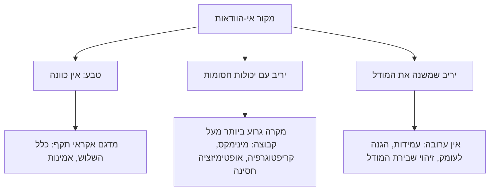

# M0.1 · שיעור 1: מהי מתמטיקה: הפשטה, הוכחה ויישום, והמספר השלם כמערכת יחסים

מכסה: 1 The Characteristic Features of Mathematics · 2 Arithmetic

## הלומד · שיעור · 2026-10-26

כתוב את שיעור 1 במודול M0.1: מהי מתמטיקה: הפשטה, הוכחה ויישום, והמספר השלם כמערכת יחסים.

---

## המורה · claude-opus-5-5

```plan
מודול M0.1 «מבט כללי על המתמטיקה»: ארבעה שיעורים, וזה הראשון בקורס כולו.
1. מהי מתמטיקה: הפשטה, הוכחה ויישום, והמספר השלם כמערכת יחסים (כאן)
2. גאומטריה, מדידה והמספר הממשי: מן השבר ועד הרצף
3. ממתמטיקה של גדלים קבועים למתמטיקה של משתנים: אלגברה, פונקציה, קואורדינטות וחשבון אינפיניטסימלי
4. המתמטיקה המודרנית: מרחבים, מבנים, פונקציה כמשתנה, יציבות וחישוב
```

## שלושת הסימנים של המתמטיקה: הפשטה מדורגת, והוכחה שאינה מדידה

```story
@title: ארבעה מיליון חלקי שלושה מיליון: באג ה-FDIV בפנטיום, 1994
באוקטובר 1994 חישב תומס נייסלי (Thomas Nicely), מתמטיקאי ממכללת לינצ'בורג, את סכום ההופכיים של זוגות הראשוניים התאומים, הוא קבוע ברון. בחישוב הופיעה סטייה שלא היה לה הסבר. הוא חיפש אותה בתוכנה, במהדר ובחישוב עצמו, ולבסוף מצא אותה במעבד: הוראת החילוק בנקודה צפה (FDIV) של מעבד הפנטיום נתנה תוצאות שגויות לזוגות מסוימים של מספרים [[ודאות: גבוהה]]. זמן קצר אחר כך הציע טים קו (Tim Coe) דוגמה שכל אחד יכול היה להקליד בגיליון אלקטרוני: 4195835/3145727. התשובה הנכונה היא 1.33382044914, והפנטיום החזיר 1.3337390689. השגיאה היחסית היא 6.1e-5, כלומר רק כארבע ספרות עשרוניות נכונות, במעבד שאמור לספק כ-19. בדיקה פשוטה עוד יותר היא לחשב x − (x/y)·y, שצריך לתת 0, ובפנטיום יצא 256.

הסיבה הייתה טבלת חיפוש. המחלק השתמש באלגוריתם SRT בבסיס 4, שמנחש בכל צעד ספרה של המנה מתוך טבלה לפי כמה ביטים עליונים של השארית החלקית ושל המחלק. מתוך 1066 כניסות בטבלה חסרו 5 [[ודאות: גבוהה]]. מי שהעביר את הטבלה לחומרה הניח שהתאים האלה אינם נגישים לעולם. ההנחה הייתה שגויה. אינטל הסכימה בסופו של דבר להחליף כל מעבד פגום, ורשמה בגלל זה הוצאה של כ-475 מיליון דולר [[ודאות: גבוהה]].
```

נתחיל מהבעיה. המחלק לא נכשל כי איש לא בדק אותו. לפי מה שידוע, הוא עבר מערך בדיקות נרחב, מיליארדי חילוקים, ואף אחד מהם לא נפל על התאים החסרים [[ודאות: בינונית]]. 5 כניסות מתוך 1066 הן 0.47% מהטבלה, אבל לא מדובר ב-0.47% מהחילוקים. כדי להגיע לתא חסר צריך שגם המחלק וגם השארית החלקית יגיעו לצירוף ביטים צר מאוד, ובחילוקים אקראיים זה נדיר מאוד. יש כאן פרדוקס: הבדיקות הצליחו כמעט תמיד, ובכל זאת לא אמרו כמעט דבר על השאלה היחידה שחשבה, "האם המחלק נכון לכל קלט".

למה זה קשה? בגלל גודל מרחב הקלטים. ביחידת הנקודה הצפה של הפנטיום יש לכל אופרנד מנטיסה (mantissa) של 64 ביט, ולכן לחילוק יש $2^{128}\approx 3.40\times10^{38}$ זוגות קלט אפשריים. גם בקצב דמיוני של $10^{10}$ בדיקות בשנייה, מעבר על כולם יימשך $1.08\times10^{21}$ שנה, כ-$7.8\times10^{10}$ פעמים גיל היקום. לכן כל מערך בדיקות אפשרי מכסה שבר אפסי של המרחב. גם $2^{32}$ בדיקות, שהן ארבעה מיליארד, מכסות רק $1.26\times10^{-29}$ ממנו. הבדיקה הנרחבת ביותר שאפשר לדמיין היא עדיין דגימה, ודגימה תמצא שגיאה רק אם השגיאה נפוצה. שגיאה שיושבת בפינה צרה של המרחב היא בדיוק השגיאה שהדגימה מחמיצה.

הרעיון שפותר את זה עתיק הרבה יותר מן המחשב, והוא נושא השיעור: **הוכחה**. הטענה "לכל זוג מנטיסות, המנה שהמחלק מחזיר שווה למנה האמיתית בדיוק הנדרש" היא משפט כללי. משפט כללי שקול ל-$2^{128}$ טענות פרטיות, ובמקרים אחרים לאינסוף טענות. אי אפשר לאמת אותו אחת-אחת. אפשר לגזור אותו מתכונות כלליות של האלגוריתם: למשל, להראות שאם השארית החלקית נמצאת בתחום מסוים בצעד מסוים, הטבלה בוחרת ספרה שמשאירה אותה בתחום גם בצעד הבא. טיעון כזה מכסה את כל הקלטים בבת אחת, וזו בדיוק הבדיקה שהייתה מגלה שהתאים ה"בלתי נגישים" נגישים. בהמשך השיעור נראה שזה לב ההבדל בין מתמטיקה למדע ניסויי. נראה גם שהבחנה בת אלפי שנים, שקולמוגורוב מדגים במשולשים, היא אותה הבחנה שאחרי 1994 הובילה את תעשיית השבבים לאימות פורמלי (פרטים בסוף השיעור).

לפני שנמשיך, הערה על מבנה השיעור. בדרך כלל, כשכלי מתמטי חוזר, אנחנו מרעננים אותו בבלוק refresh. זה השיעור הראשון בקורס, ועדיין אין כלי שנפגש קודם ויש לרענן. מכאן והלאה כל כלי ייבנה בפעם הראשונה שנזדקק לו.

### ההפשטה: לוח כפל בלי תפוחים, קו בלי חוט

[[K1:11]] נעבור לשאלה הכללית: מה מאפיין את המתמטיקה? גם מי שמכיר אותה רק מבית הספר יזהה כמה תכונות: היא מופשטת, מדויקת וקפדנית מבחינה לוגית, מסקנותיה אינן שנויות במחלוקת, ותחום היישום שלה רחב במיוחד. ההפשטה היא התכונה הבולטת. בבית הספר לומדים לוח כפל מופשט, כלומר כפל של מספר מופשט במספר מופשט, ולא "מספר הנערים כפול מספר התפוחים" או "מספר התפוחים כפול מחיר התפוח". בגאומטריה עוסקים בקו ישר ולא בחוט מתוח. הקו מתקבל מהחוט כשמשמיטים את כל התכונות פרט לאחת, ההתפשטות בכיוון אחד: החומר, העובי, המתיחות והצבע נעלמים.

[[K1:12]] באופן כללי יותר, צורה גאומטרית היא מה שנשאר מעצם ממשי אחרי שמשמיטים ממנו הכול מלבד הצורה המרחבית והממדים. המספר השלם והצורה הגאומטרית הם רק שתי ההפשטות הראשונות. אחריהן באו מספרים מרוכבים, פונקציות, אינטגרלים, דיפרנציאלים, פונקציונלים ומרחבים $n$-ממדיים ואפילו אינסוף-ממדיים. ההפשטות "נערמות זו על גבי זו" עד שנראה שאין להן עוד קשר לחיי היום-יום. הקורס כולו נועד להראות שהרושם הזה מטעה: לכל אחד מהמושגים האלה יש תוכן ממשי, גם במקור שלו וגם ביישומים שלו. כבר בשיעור הזה ראינו דוגמה: המרחב של $2^{128}$ הזוגות הוא אוסף סופי, אבל גדול כל כך שאין דרך לעבוד איתו אלא כאובייקט מופשט.

אבל הפשטה קיימת בכל מדע ובכל חשיבה. לכן היא לבדה אינה מאפיינת את המתמטיקה. מה שמייחד את ההפשטות המתמטיות הוא שלושה דברים.

[[2.5: מבנה]] הראשון: המתמטיקה עוסקת **ביחסים כמותיים ובצורות מרחביות**, ומפשיטה אותם מכל שאר התכונות של העצמים. השני: ההפשטות שלה באות **בדרגות שנבנות זו על גבי זו**, והן מגיעות רחוק הרבה יותר מההפשטות של מדעים אחרים. "חמישה תפוחים" הופך ל"חמש", "חמש" הופך ל"מספר כלשהו $n$", ו"מספר כלשהו" הופך ל"מבנה שיש בו חיבור". השלישי: המתמטיקה **נעה כמעט כולה בתחום המושגים המופשטים והיחסים ביניהם**. איש מדעי הטבע פונה לניסוי כדי לבסס את טענותיו, והמתמטיקאי משתמש רק בטיעון ובחישוב. כדאי לשים לב איך שלושת הסימנים תלויים זה בזה. בגלל שהעיסוק הוא בכמות ובצורה בלבד, אפשר להמשיך להפשיט שלב אחר שלב. בגלל שההפשטה מגיעה רחוק, המושגים מתנתקים מעצם מסוים שאפשר למדוד. ומאחר שאין עצם למדוד, נשארת רק דרך אחת לבסס טענה, והיא הטיעון. במקרה של ה-FDIV רואים את השרשרת הזאת בבירור. חילוק של שני מספרים הוא הפשטה של חלוקה ממשית. המחלק כחומרה הוא מכונה שמממשת את ההפשטה. הטענה "המכונה מממשת את החילוק לכל קלט" היא טענה על אוסף מופשט, ולכן את הנכונות שלה אי אפשר למדוד. אפשר רק להוכיח אותה.

### הוכחה מול מודל: אלף משולשים שאינם הוכחה

גם המתמטיקאים משתמשים כל הזמן במודלים, באנלוגיות פיזיקליות ובדוגמאות מוחשיות כדי לגלות משפטים ושיטות. הדוגמאות הן המקור של התורה והכלי לגילוי המשפטים שלה. אבל משפט אינו שייך למתמטיקה עד שהוכח בטיעון לוגי קפדני. גאומטר שידווח על משפט חדש ויציג כביסוס רק מודלים לא ישכנע אף מתמטיקאי שהמשפט הוכח. גם כאן ההקבלה למהנדס מדויקת. בדיקה של המחלק על קלטים נבחרים היא "הדגמה במודל". היא כלי מצוין לגילוי (נייסלי גילה את הבאג כך), ואין בה שום ערובה.

[[K1:13]] [[2.5: מקור]] הדוגמה של קולמוגורוב פשוטה וחדה. אפשר למדוד בדיוק רב את זוויות הבסיס באלף משולשים שווי-שוקיים, ובכל זאת המדידה לא תוכיח אף פעם שזוויות הבסיס במשולש שווה-שוקיים שוות. למה? יש לזה שתי סיבות, וכדאי להפריד ביניהן, כי כל אחת מראה מאיפה באה הוודאות של הוכחה. הסיבה הראשונה היא שמדידה נותנת **אי-שוויון** ולא שוויון: במכשיר שדיוקו $\varepsilon$ אפשר לקבוע רק ש-$|\alpha-\beta|<\varepsilon$, אף פעם לא ש-$\alpha=\beta$. הסיבה השנייה היא שאלף משולשים הם אלף טענות פרטיות, והמשפט מדבר על כל משולש אפשרי. להוכיח פירושו לגזור את הטענה בטיעון לוגי מן התכונות היסודיות של המושגים שמופיעים בה, וכיום, כשהגאומטריה בנויה על בסיס קפדני, התכונות האלה מנוסחות באקסיומות. נראה את שלד הטיעון למשפט עצמו (הגרסה של פפוס). נקודת המוצא היא משולש $ABC$ שבו $AB=AC$. הצעד המרכזי הוא להשוות את המשולש לעצמו כשהוא "הפוך", כלומר להשוות את $ABC$ ל-$ACB$. שתי הצלעות $AB, AC$ שוות לשתי הצלעות $AC, AB$, והזווית $A$ ביניהן משותפת. לפי משפט החפיפה צלע-זווית-צלע שני המשולשים חופפים, ולכן הזווית ב-$B$ שווה לזווית ב-$C$. ההנחה היחידה שנכנסה היא משפט החפיפה, שהוא אקסיומה או משפט קודם, ושום מדידה לא נכנסה. הטיעון חל באותה מידה על כל משולש שווה-שוקיים, ולכן הוא שקול לאינסוף מדידות מושלמות. זו בדיוק התכונה שהייתה חסרה לבדיקות של המחלק: טיעון על **כלל ההיווצרות** של העצמים (אילו שאריות חלקיות האלגוריתם יכול לייצר) ולא על עצמים בודדים.

כדאי לשים לב גם מאיפה *לא* באה הוודאות. ההוכחה נכונה ביחס לאקסיומות ולמודל, ולא ביחס לעולם. אם המודל של החומרה שעליו מוכיחים אינו החומרה שיוצרה בפועל, ההוכחה לא תציל אותנו. בשאלה הזאת, הגבולות של ההוכחה, נעסוק בהרחבה בהמשך השיעור.

מכאן הקפדנות שבה המתמטיקה מוכרת. טיעון מתמטי נבנה בזהירות כזאת שהוא חסין מערעור ומשכנע לגמרי את כל מי שמבין אותו. לא במקרה אומרים "ברור כמו שתיים ועוד שתיים הן ארבע": היחס הזה משמש בשפה עצמה כדימוי של מה שאי אפשר להפריך. ומיד אחר כך באה ההסתייגות, שהיא החשובה ביותר בעמוד: **הקפדנות של המתמטיקה אינה מוחלטת**. היא מתפתחת כל הזמן, העקרונות שלה לא קפאו פעם אחת ולתמיד, ולפעמים הם עצמם נושא למחלוקת מדעית. ההיסטוריה של הקורס תדגים את זה שוב ושוב: ה"הוכחות" של המאה ה-18 על טורים אינסופיים, שבמאה ה-19 נמצא שהן נשענות על רעיונות לא מוגדרים, וביקורת היסודות שנפגוש בשיעורים 3 ו-4. בהנדסה יש לזה מקבילה ישירה: גם הוכחה פורמלית של חומרה נכונה רק כמו המפרט שהיא מניחה.

### כמה גדול "כל הקלטים"

[[2.5: סדר גודל]] כדי שההבחנה בין בדיקה להוכחה לא תישאר עקרונית בלבד, נכמת אותה. השאלה ההנדסית היא לא "האם בדיקה ממצה אפשרית בעיקרון", כי בעולם סופי היא תמיד אפשרית בעיקרון. השאלה היא "האם היא אפשרית בזמן שעומד לרשותנו". האומדן בראש מבוסס על כלל אחד שכדאי לזכור: $2^{10}\approx10^3$. מכאן ש-$2^{32}=2^2\cdot(2^{10})^3\approx 4\times10^9$, ו-$2^{128}=2^8\cdot(2^{10})^{12}\approx 2.6\times10^{2}\cdot10^{36}\approx 3\times10^{38}$. החישוב המדויק נותן $4.29\times10^9$ ו-$3.40\times10^{38}$, כך שהאומדן הראשון סוטה בכ-7% והשני בכ-25%, כי השגיאה של $1.024^{12}$ מצטברת. אם רוצים דיוק טוב יותר בראש, מוסיפים את התיקון: $1.024^{n}\approx 1+0.024n$ עבור $n$ קטן, ו-$1.024^{12}\approx1.33$. כדאי לזכור גם שנה אחת היא $\pi\times10^7$ שניות, בדיוק של 0.5%.

```think
כמה זמן תיקח בדיקה ממצה של פונקציה עם קלט יחיד של 32 ביט (למשל שורש ריבועי ב-float), וכמה זמן תיקח בדיקה ממצה של חילוק ב-double, שבו לכל אחד משני האופרנדים יש 64 ביט? הניחו קצב נדיב: $10^9$ בדיקות בשנייה במקרה הראשון ו-$10^{10}$ במקרה השני.
---
קלט יחיד של 32 ביט: יש $2^{32}=4.29\times10^9$ קלטים. בקצב של $10^9$ בשנייה זה **4.3 שניות**. בדיקה ממצה כזאת לא רק אפשרית, היא זולה, וספריות מתמטיות אכן נבדקות כך בפונקציות float של קלט יחיד.

שני אופרנדים של 64 ביט: יש $2^{128}=3.40\times10^{38}$ זוגות. בקצב של $10^{10}$ בשנייה זה $3.40\times10^{28}$ שניות. נחלק ב-$\pi\times10^7$ שניות לשנה ונקבל בערך $10^{21}$ שנה. החישוב המדויק נותן **$1.08\times10^{21}$ שנה**, כ-$7.8\times10^{10}$ פעמים גיל היקום. היחס בין שני המרחבים הוא $2^{32}/2^{128}=1.26\times10^{-29}$. הלקח: המעבר מקלט אחד לשני קלטים, ומ-32 ל-64 ביט, מעביר אותנו ממצב שבו בדיקה מחליפה הוכחה למצב שבו היא אינה יכולה להחליף אותה. הגבול לא עובר בין "סופי" ל"אינסופי". הוא עובר בין "סופי וקטן" ל"סופי ועצום", ובצד השני של הגבול מרחב סופי מתנהג למעשה כמו אינסוף.
```

```casestudy
@title: ה-FDIV של הפנטיום: מה ידוע, מה מוערך, ומה הוא מלמד על בדיקה והוכחה
**המערכת.** יחידת הנקודה הצפה של הפנטיום הראשון (P5, 1993) חילקה באלגוריתם SRT בבסיס 4. בכל איטרציה האלגוריתם קובע ספרת מנה מהקבוצה $\{-2,-1,0,1,2\}$, כלומר שני ביטים של מנה לאיטרציה, לפי טבלה שמאונדקסת בביטים העליונים של השארית החלקית ושל המחלק. היתירות בקבוצת הספרות מאפשרת לבחור ספרה לפי ביטים עליונים בלבד, בלי חיסור מלא, וזה מה שהופך את SRT למהיר. המחיר הוא שהנכונות תלויה בכך שכל תא שהשארית יכולה להגיע אליו מכיל ספרה חוקית.

**מה ידוע** [[ודאות: גבוהה]]. בטבלה היו 1066 כניסות, ו-5 מהן הכילו 0 במקום 2, כלומר 0.47% מהטבלה. הדוגמה של קו: $4195835/3145727$. הערך הנכון הוא $1.33382044914$, והפנטיום החזיר $1.3337390689$. השגיאה היחסית היא $6.10\times10^{-5}$, ולכן רק כ-4.2 ספרות עשרוניות נכונות, בעוד ש-64 ביט של מנטיסה שווים כ-19.3 ספרות. בדיקת השארית $x-(x/y)\cdot y$ נותנת 256 במקום 0. אינטל החליטה בסוף להחליף מעבדים ורשמה הוצאה של כ-475 מיליון דולר.

**מה מוערך או שנוי במחלוקת** [[ודאות: בינונית]]. השאלה כמה פעמים משתמש רגיל ייתקל בשגיאה תלויה לגמרי בהתפלגות של הקלטים. אינטל ו-IBM פרסמו אז הערכות שונות בכמה סדרי גודל (נחזור לזה בתרגיל בסוף השיעור). גם היקף הבדיקות שהמחלק עבר לפני הייצור אינו ידוע לנו במספר מדויק. "מיליארדי חילוקים" הוא סדר גודל סביר, לא נתון מתועד.

**הניתוח.** הכשל אינו "הבדיקות לא היו מספיקות". אפשר לנסח אותו כך: הבדיקות לא יכלו להיות מספיקות. מרחב הקלטים הוא $2^{128}=3.40\times10^{38}$, וכל מערך בדיקות ריאלי מכסה ממנו שבר בסדר גודל של $10^{-29}$ ומטה. בדיקה אקראית מגלה שגיאה רק בהסתברות שפרופורציונלית לשבר הקלטים השגויים. כאן השבר זעיר, אבל הקלטים השגויים אינם אקראיים: הם מתרכזים בדפוסי ביטים מסוימים של המחלק. משתמש שהחישוב שלו פוגע שוב ושוב בדפוסים האלה ייתקל בשגיאה בשיטתיות. נייסלי, שחישב עם מספרים ראשוניים, היה אחד מהם.

**ההבחנה העקרונית.** צריך להפריד בין שני משטרים. במשטר הראשון, **בדיקה ממצה אפשרית**: לפונקציה של קלט יחיד ב-32 ביט יש $2^{32}$ קלטים, 4.3 שניות של חישוב, ובדיקה ממצה כזאת *היא* הוכחה, כי היא אימות של כל הטענות הפרטיות שהמשפט שקול להן. במשטר השני, **בדיקה ממצה בלתי אפשרית**: לחילוק של שני אופרנדים ב-64 ביט יש $2^{128}$ קלטים ו-$1.08\times10^{21}$ שנה. שם הדרך היחידה לטענה על כל הקלטים היא טיעון על המבנה: להוכיח שהשארית החלקית נשארת תמיד בתחום, ושכל תא שאפשר להגיע אליו בטבלה מלא כראוי. טיעון כזה היה מגלה את 5 התאים בתוך דקות של ניתוח, כי השאלה "אילו תאים נגישים" היא שאלה על כלל ההיווצרות של השאריות ולא על שאריות מסוימות.

**המסקנה ההנדסית.** בדיקה היא כלי לגילוי, והיא מצוינת למציאת שגיאות נפוצות. הוכחה היא כלי לשלילה, והיא היחידה שאומרת "אין שגיאה בכלל". במערכת שבה שגיאה נדירה עולה מאות מיליוני דולרים צריך את שתיהן. זו בדיוק החלוקה של קולמוגורוב: מודלים ודוגמאות כמקור לגילוי, וטיעון לוגי כמה שמכריע.
```

החלק הזה של השיעור ענה על השאלה "במה מתמטיקה שונה מדרכי ידיעה אחרות": היא מופשטת בדרגות, והיא מבססת את טענותיה בגזירה ולא במדידה. נשארה פתוחה השאלה ההפוכה, וממנה ממשיך קולמוגורוב: אם המתמטיקה מתנתקת כל כך מן העצמים, איך זה שהיא עובדת על העצמים טוב יותר מכל כלי אחר?

## רוחב היישום: מנפטון ועד הגאומטריה של לובצ'בסקי

[[K1:13]] התשובה מתחילה בתכונה השלישית שמנינו: רוחב היישום. כדאי להבחין בה בשלוש רמות, כי כל רמה מראה משהו אחר. ברמה הראשונה אנחנו משתמשים במושגים מתמטיים כמעט כל שעה, בלי לחשוב עליהם. בחשבון אנחנו מחשבים הוצאות, ובגאומטריה מחשבים שטח של דירה. הכללים פשוטים, אבל בתקופה כלשהי בעת העתיקה הם היו ההישג המתמטי המתקדם ביותר של זמנם. הפשטות שלהם היום היא תוצאה של אלפי שנים שבהן הם הפכו לטבע שני, ולא תכונה שהייתה להם תמיד.

[[K1:14]] ברמה השנייה, הטכנולוגיה המודרנית אינה אפשרית בלי מתמטיקה. כמעט אין תהליך טכני שאפשר לבצע בלי חישוב, והמתמטיקה ממלאת תפקיד מרכזי בפיתוח של ענפים טכנולוגיים חדשים. ברמה השלישית, כל מדע משתמש במתמטיקה במידה כזאת או אחרת. ה"מדעים המדויקים", כלומר מכניקה, אסטרונומיה, פיזיקה ובמידה רבה גם כימיה, מנסחים את חוקיהם בנוסחאות. לכן הדרישות שלהם השפיעו תמיד באופן ישיר ומכריע על התפתחות המתמטיקה עצמה. הזרימה הולכת בשני הכיוונים: הפיזיקה צורכת מתמטיקה, ובאותה מידה מזמינה אותה.

[[2.5: ביקורת]] באותו עמוד מופיעה אזהרה שמהנדס צריך לתלות מעל השולחן: יישום של מתמטיקה **משמעותי רק אם התופעות הממשיות כבר הפכו לנושא של תורה עמוקה**. בלי תורה כזאת, ובמיוחד כשהתופעות מורכבות כמו בביולוגיה ובחברה, קל ללכת לאיבוד ב"משחק חסר משמעות בנוסחאות". נראה דוגמה מהסיפור שנלמד מיד, דוגמה שלא נראית כמו טעות. כלל טיטיוס-בודה קובע שמרחקי כוכבי הלכת מהשמש ביחידות אסטרונומיות (AU) הם $0.4+0.3\cdot2^{n}$. הכלל התאים יפה למרקורי עד אורנוס, ולכן היה טבעי להאמין לו. עבור כוכב הלכת הבא הוא נותן $0.4+0.3\cdot2^7=38.8$ AU, ונפטון נמצא ב-30.07 AU. הכלל הוא התאמת עקומה בלי שום מנגנון פיזיקלי מאחוריה, ולכן אין סיבה שיחזיק מחוץ לטווח הנתונים שעליהם התאימו אותו. כשמודל לומד (machine learning) או נוסחה אמפירית "מנבאים" הרחק מנתוני האימון, נשאל את אותה שאלה: האם יש כאן תורה, או רק התאמה? נראה מיד שהתחזית לנפטון הצליחה אף שהשתמשה בכלל הזה, ולא בזכותו.

### נפטון: בעיה הפוכה

ב-1846 התגלה נפטון, אחד מכוכבי הלכת הרחוקים במערכת השמש, על סמך חישוב מתמטי. אדמס (Adams) ולה-ורייה (Le Verrier) ניתחו אי-סדרים בתנועת אורנוס והגיעו למסקנה שהם נגרמים ממשיכת הכבידה של כוכב לכת נוסף. לה-ורייה חישב לפי חוקי המכניקה איפה הכוכב צריך להיות, והצופה שקיבל ממנו את התוצאות ראה אותו בטלסקופ במקום שצוין.

ננסח את זה בשפה שתלווה אותנו בצומת ההסקה. ברוב החישובים בפיזיקה הבעיה היא **ישירה** (forward): נתונים הגופים והמסות, ומחשבים את התנועה. כאן הבעיה **הפוכה** (inverse problem): נתונה התנועה, ובתוכה סטייה קטנה מהצפוי, ומבקשים לשחזר מתוכה את הפרמטרים של גוף שאיש לא ראה. נביא את שלד הדרך בלבד. הגזירה המלאה היא מכניקה שמימית בהיקף של מאות עמודים, ואנחנו מדלגים עליה במודע.

נקודת המוצא היא חוק הכבידה של ניוטון ומודל של מסלול אורנוס שכולל את השמש ואת ההפרעות של צדק ושבתאי. מן המודל מחשבים את המיקום הצפוי, ומשווים אותו לתצפיות של יותר ממאה שנה. ההפרש בין התצפית לחישוב נקרא השאריות (residuals). ההנחה הראשונה נכנסת כאן: אם חוק ניוטון נכון והמודל שלם, השאריות אמורות להיות רעש מדידה בלבד. הן לא היו רעש. עד אמצע שנות ה-40 של המאה ה-19 הגיעה הסטייה לכ-2 דקות קשת [[ודאות: בינונית]], בעוד שהתצפיות היו מדויקות לכמה שניות קשת. ממרחק של כ-18 AU מכדור הארץ, 2 דקות קשת שוות כ-$1.57\times10^{6}$ ק"מ במסלול. ההנחה השנייה נכנסת בצעד הבא, והיא העיקרית: **כל הסטייה נובעת מכוכב לכת אחד, שמסלולו קרוב למעגל ונמצא במישור המילקה (ecliptic)**. מניחים כוכב כזה עם פרמטרים לא ידועים: מסה, מרחק וקו אורך במועד ייחוס. מחשבים את ההפרעה שהוא יוצר כפונקציה של הפרמטרים, ומחפשים את הפרמטרים שההפרעה המחושבת שלהם מסבירה את השאריות בצורה הטובה ביותר. זה צעד המפתח: **התאמת השאריות**. התוצאה היא כיוון בשמיים, כלומר המקום שאליו צריך לכוון טלסקופ.

[[2.5: סדר גודל]] כמה גדולה ההפרעה שמחפשים? יחס המסות בין נפטון לשמש הוא $5.15\times10^{-5}$. תאוצה בכבידה יורדת כריבוע המרחק, ולכן היחס בין התאוצה שנפטון מפעיל על אורנוס לבין התאוצה שהשמש מפעילה עליו הוא:

$$\frac{a_{\text{pert}}}{a_\odot}\approx\frac{M_N}{M_\odot}\left(\frac{r_U}{d}\right)^2 \tag{1}$$

כאן $M_N$ ו-$M_\odot$ הן המסות של נפטון והשמש, $r_U=19.19$ AU הוא מרחק אורנוס מהשמש, ו-$d$ הוא המרחק בין שני כוכבי הלכת. בהתקרבות המרבית, כששני הכוכבים באותו צד של השמש, $d=30.07-19.19=10.88$ AU. האומדן בראש: $r_U/d\approx1.76$, ובריבוע זה בערך 3.1. נכפיל ב-$5\times10^{-5}$ ונקבל כ-$1.6\times10^{-4}$. החישוב המדויק נותן $1.60\times10^{-4}$. מדובר בפחות מחלק אחד לחמשת אלפים, וזו הסיבה שהיה צורך בעשרות שנים של תצפיות כדי שההשפעה המצטברת תבלוט מעל הרעש. גם העיתוי היה בר מזל. אורנוס ונפטון חוזרים להתקרבות מרבית פעם ב-171.3 שנה (המחזור הסינודי $1/(1/84.0-1/164.8)$), וההתקרבות של 1822 נפלה בדיוק באמצע תקופת התצפיות על אורנוס, שהתגלה ב-1781.

הסצנה הבאה מראה את המבנה הזה בתלת-ממד. הסטייה עצמה זעירה, ולכן הווקטורים מוגדלים בפקטור שאפשר לשנות.

```scene3d
{"title": "נפטון מושך את אורנוס: הכוח המפריע סביב ההתקרבות של 1822",
 "caption": "החץ הוא התאוצה המפריעה שנפטון מפעיל על אורנוס ביחס לשמש, מוגדלת פי K. הסתכלו על גודלו ועל כיוונו: כמעט אפס בצד הנגדי של המסלול, ושיא חד סביב קו ההתקרבות. הגובה של הנקודה עם השובל הוא הרכיב שלו לאורך התנועה: חיובי לפני 1822 (נפטון מקדים את אורנוס ומושך אותו קדימה), שלילי אחרי.",
 "axes": false,
 "params": [
  {"id": "sp", "label": "קצב (שנים לשנייה)", "min": 1, "max": 10, "value": 4},
  {"id": "K", "label": "הגדלת הכוח K", "min": 2, "max": 20, "value": 8}
 ],
 "view": {"cam": [6, -9, 7], "target": [0, 0, 0]},
 "objects": [
  {"type": "point", "at": [0, 0, 0], "label": "השמש", "info": "במרכז. קנה מידה: יחידה אחת בסצנה = 5 AU."},
  {"type": "curve", "x": "3.838*cos(s)", "y": "3.838*sin(s)", "z": "0", "s": [0, 6.2832], "label": "מסלול אורנוס", "info": "רדיוס 19.19 AU, מחזור 84.0 שנים (מקורב כמעגל)."},
  {"type": "curve", "x": "6.014*cos(s)", "y": "6.014*sin(s)", "z": "0", "s": [0, 6.2832], "label": "מסלול נפטון", "info": "רדיוס 30.07 AU, מחזור 164.8 שנים (מקורב כמעגל)."},
  {"type": "curve", "x": "s", "y": "0", "z": "0", "s": [0, 7], "label": "קו ההתקרבות, 1822", "info": "כיוון ההתקרבות המרבית. שני כוכבי הלכת עוברים עליו בשנת 1822; המרחק ביניהם אז 10.88 AU."},
  {"type": "point", "at": ["3.838*cos(2*pi*(sp*t-42)/84)", "3.838*sin(2*pi*(sp*t-42)/84)", "0"], "label": "אורנוס", "info": "תחילת ההנפשה היא 1780; השנה היא 1780 + קצב × זמן."},
  {"type": "point", "at": ["6.014*cos(2*pi*(sp*t-42)/164.8)", "6.014*sin(2*pi*(sp*t-42)/164.8)", "0"], "label": "נפטון", "info": "הגוף הנסתר שאת מיקומו שחזרו מתוך הסטיות של אורנוס."},
  {"type": "vector",
   "from": ["3.838*cos(2*pi*(sp*t-42)/84)", "3.838*sin(2*pi*(sp*t-42)/84)", "0"],
   "to": ["3.838*cos(2*pi*(sp*t-42)/84)+K*((6.014*cos(2*pi*(sp*t-42)/164.8)-3.838*cos(2*pi*(sp*t-42)/84))/hypot(6.014*cos(2*pi*(sp*t-42)/164.8)-3.838*cos(2*pi*(sp*t-42)/84),6.014*sin(2*pi*(sp*t-42)/164.8)-3.838*sin(2*pi*(sp*t-42)/84))^3-cos(2*pi*(sp*t-42)/164.8)/36.17)",
          "3.838*sin(2*pi*(sp*t-42)/84)+K*((6.014*sin(2*pi*(sp*t-42)/164.8)-3.838*sin(2*pi*(sp*t-42)/84))/hypot(6.014*cos(2*pi*(sp*t-42)/164.8)-3.838*cos(2*pi*(sp*t-42)/84),6.014*sin(2*pi*(sp*t-42)/164.8)-3.838*sin(2*pi*(sp*t-42)/84))^3-sin(2*pi*(sp*t-42)/164.8)/36.17)",
          "0"],
   "label": "התאוצה המפריעה (מוגדלת)",
   "info": "משיכה ישירה של נפטון פחות המשיכה שלו על השמש (האיבר העקיף), כי מודדים ביחס לשמש. ביחידות של הסצנה, ליד ההתקרבות היא גדולה פי 10.6 בערך מאשר בצד הנגדי."},
  {"type": "point",
   "at": ["3.838*cos(2*pi*(sp*t-42)/84)", "3.838*sin(2*pi*(sp*t-42)/84)",
          "10*(-((6.014*cos(2*pi*(sp*t-42)/164.8)-3.838*cos(2*pi*(sp*t-42)/84))/hypot(6.014*cos(2*pi*(sp*t-42)/164.8)-3.838*cos(2*pi*(sp*t-42)/84),6.014*sin(2*pi*(sp*t-42)/164.8)-3.838*sin(2*pi*(sp*t-42)/84))^3-cos(2*pi*(sp*t-42)/164.8)/36.17)*sin(2*pi*(sp*t-42)/84)+((6.014*sin(2*pi*(sp*t-42)/164.8)-3.838*sin(2*pi*(sp*t-42)/84))/hypot(6.014*cos(2*pi*(sp*t-42)/164.8)-3.838*cos(2*pi*(sp*t-42)/84),6.014*sin(2*pi*(sp*t-42)/164.8)-3.838*sin(2*pi*(sp*t-42)/84))^3-sin(2*pi*(sp*t-42)/164.8)/36.17)*cos(2*pi*(sp*t-42)/84))"],
   "trail": 400,
   "label": "הדחיפה לאורך המסלול",
   "info": "הגובה הוא הרכיב של התאוצה המפריעה בכיוון התנועה של אורנוס. השובל מראה איך הוא עולה, מחליף סימן בדיוק ב-1822 ויורד. זו החתימה בזמן שלה-ורייה מצא בשאריות."}
 ],
 "tour": [
  {"cam": [0, -0.5, 14], "target": [0, 0, 0], "text": "מבט מלמעלה: אורנוס (הפנימי והמהיר) משיג את נפטון פעם ב-171 שנה. קו ההתקרבות מסמן את 1822."},
  {"cam": [9, -6, 4], "target": [4, 0, 0], "text": "ליד קו ההתקרבות החץ ארוך ומכוון החוצה, אל נפטון. בצד השני של המסלול הוא כמעט נעלם."},
  {"cam": [3, -10, 2], "target": [3, 0, 0.5], "text": "מן הצד: השובל עולה לפני 1822 ויורד אחריה. אורנוס הקדים את הטבלאות ואחר כך פיגר אחריהן, וזה הדפוס בזמן שהסגיר את נפטון."}
 ]
}
```

בסצנה כדאי לשים לב לשלושה דברים. הראשון הוא החדות. משום שהתאוצה יורדת כ-$1/d^2$ והמרחק משתנה בין 10.88 ל-49.26 AU, כמעט כל ההשפעה מרוכזת בכמה עשורים סביב 1822. השני הוא הכיוון. בהתקרבות עצמה החץ רדיאלי, ולכן הוא לא מאיץ ולא מאט את אורנוס לאורך המסלול. הרכיב לאורך המסלול מחליף סימן בדיוק שם: לפני ההתקרבות נפטון מקדים את אורנוס ומושך אותו קדימה, ואחריה הוא מאחוריו ומושך אותו אחורה. השלישי הוא האיבר העקיף: מן המשיכה הישירה מחסרים את המשיכה של נפטון על השמש עצמה, כי אנחנו מודדים את התנועה ביחס לשמש. לכן בצד הנגדי של המסלול החץ מצביע הפוך מנפטון. זה גורם עדין, וכל חישוב הפרעות שמחמיץ אותו טועה.

```history
@title: מי מצא את נפטון
@who: אורבן לה-ורייה (Urbain Le Verrier), ג'ון קאוץ' אדמס (John Couch Adams), יוהאן גאלה (Johann Galle) והיינריך ד'ארה (Heinrich d'Arrest)
@when: 1845–1846
אדמס, סטודנט צעיר בקיימברידג', השלים חישוב של מיקום הכוכב הנסתר ב-1845. המצפה המלכותי לא מיהר לחפש, וג'יימס צ'אליס (Challis), שחיפש בקיץ 1846 באיטיות ובשיטתיות, רשם את נפטון פעמיים בלי לזהות אותו [[ודאות: גבוהה]]. בצרפת פרסם לה-ורייה את חישובו באופן עצמאי בקיץ 1846, ושלח את המיקום החזוי לגאלה במצפה של ברלין. גאלה קיבל את המכתב ב-23 בספטמבר 1846. בעזרת ד'ארה, שהשווה למפת כוכבים חדשה, הוא מצא את הכוכב עוד באותו לילה, במרחק של כמעלה אחת מן המקום החזוי [[ודאות: גבוהה]]. מחלוקת הקדימות בין אנגליה לצרפת נמשכה שנים. הצורך שהוליד את כל זה היה הנדסי במהותו: טבלאות מיקום שאינן מסתדרות עם התצפיות, כלומר מודל ששאריותיו אינן רעש.
```

[[2.5: גבולות]] ההצלחה מסתירה שני גבולות מאלפים. הראשון: לה-ורייה ואדמס הניחו מרחק קרוב לזה של טיטיוס-בודה, כ-36 AU ויותר [[ודאות: בינונית]], ונפטון נמצא ב-30.07 AU. המסה המשוערכת הייתה גדולה מדי בהתאם. ובכל זאת הכיוון יצא נכון. הסיבה היא שהשאריות של קשת מסלול קצרה קובעות היטב *מתי* ההשפעה הייתה מרבית, ולכן גם את קו האורך, אבל קובעות רק ברפיון את הצירוף של מסה ומרחק. כוכב קרוב וקל יותר וכוכב רחוק וכבד יותר נותנים כמעט אותה חתימה. הגבול השני חמור יותר. ב-1859 החיל לה-ורייה את אותה שיטה על סטייה קטנה בהתקדמות הפריהליון של מרקורי, וחזה כוכב לכת פנימי, "וולקן". וולקן לא נמצא אף פעם. הסטייה, כ-43 שניות קשת למאה, הוסברה רק ב-1915 ביחסות הכללית [[ודאות: גבוהה]]. בפעם הזאת ההנחה ש"הסטייה כולה נובעת מכוכב אחד, במסגרת ניוטון" היא שנשברה, ומה שבא במקומה לא היה כוכב חדש אלא תורה חדשה. שארית במודל יכולה להעיד על גורם חסר *בתוך* התורה, ויכולה להעיד שהתורה עצמה אינה מספיקה. המתמטיקה לבדה לא תגיד לנו באיזה מן המקרים אנחנו נמצאים.

```think
גילוי נפטון הוא ניצחון של המתמטיקה. האם הוא הוכחה מתמטית? ואם לא, מה בדיוק הוכח, ומה אומת?
---
החלק המתמטי הוא טענה מותנית: **אם** חוק הכבידה של ניוטון נכון, **ואם** הסטייה של אורנוס נובעת מכוכב לכת אחד במסלול כמעט מעגלי במישור המילקה, **אז** הכוכב נמצא בערך בכיוון כזה וכזה. את הגרירה הזאת (בקירובים שנעשו) אפשר לבסס בחישוב ובטיעון, ואין צורך להביט בשמיים. הטענה "נפטון קיים" אינה טענה מתמטית. היא טענה על העולם, ומה שאישר אותה הוא התצפית של גאלה. התצפית בדקה את ההנחות, לא את הגרירה. וולקן מראה את ההבדל: אותה גרירה, בזהירות דומה, נתנה תחזית שגויה, כי אחת ההנחות הייתה שגויה. זו בדיוק החלוקה מתחילת השיעור: מתמטיקה מוכיחה גרירות בתוך מודל, והניסוי מכריע אם המודל מתאר את העולם. גם ההוכחה של מחלק בחומרה היא מותנית באותה דרך: היא נכונה ביחס למפרט ולמודל של המעגל.
```

```domain
@field: probability
@title: נפטון כשערוך בייסיאני
[[2.5: מבנה משותף]] את מה שעשה לה-ורייה נבנה מחדש בצומת ההסקה כשערוך פרמטרים (parameter estimation). הפרמטרים $\theta$ הם המסה, המרחק וקו האורך של הגוף הנסתר. ההתפלגות המוקדמת (prior), $p(\theta)$, מקודדת את מה שהאמינו לפני המדידה: מסלול במישור המילקה ומרחק "בערך לפי בודה". הנראות (likelihood), $p(\text{residuals}\mid\theta)$, אומרת כמה סביר לקבל את השאריות שנמדדו אילו הפרמטרים היו $\theta$, בהינתן רעש מדידה של כמה שניות קשת. כלל בייס משלב את השתיים להתפלגות פוסטריורית (posterior) על $\theta$. מה שראינו בגבולות הוא בדיוק הצורה שהפוסטריור הזה היה מקבל: צר בקו האורך ומוארך מאוד באלכסון של מסה מול מרחק, כי הנתונים מבחינים היטב בין מועדים ולא מבחינים בין "קרוב וקל" ל"רחוק וכבד". הבעיה הפוכה ורעה (ill-posed) בכיוון אחד וטובה בכיוון אחר, ולכן התחזית הצליחה גם עם prior שגוי למרחק. אותו מבנה נפגוש באיתור מקור לפי הפרשי זמני הגעה, בזיהוי פרמטרים של מערכת בקרה, ובמסנן קלמן שמעדכן מצב מתוך שאריות (innovations). שם, שארית שאינה לבנה היא בדיוק "אורנוס שלא מסתדר עם הטבלאות".
```

### גלים מן המשוואות

[[K1:15]] הדוגמה השנייה מרשימה לא פחות. מקסוול (Maxwell) הכליל את חוקי האלקטרומגנטיות שנקבעו בניסוי, ניסח אותם כמשוואות, וגזר מהן בדרכים מתמטיות בלבד שיכולים להתקיים גלים אלקטרומגנטיים, ושעליהם להתפשט במהירות האור. המהירות שיוצאת מהמשוואות היא:

$$c=\frac{1}{\sqrt{\mu_0\varepsilon_0}}=2.998\times10^{8}\ \text{m/s} \tag{2}$$

כאן $\mu_0$ היא חדירות הריק המגנטית ו-$\varepsilon_0$ היא המקדם הדיאלקטרי של הריק. שני הקבועים נמדדו בניסויים חשמליים ומגנטיים על השולחן, בלי שום קשר לאור. במדידה של ובר וקולראוש (Weber, Kohlrausch) מ-1856 היחס המתאים יצא בערך $3.1\times10^{8}$ m/s [[ודאות: בינונית]], קרוב מאוד למהירות האור שנמדדה באופטיקה. מתוך ההתאמה הזאת הציע מקסוול את התורה האלקטרומגנטית של האור. משם התחיל החיפוש אחר גלים ממקור חשמלי טהור, שהרץ (Hertz) מצא בניסוי ב-1887–1888. פופוב (Popov) ומרקוני (Marconi), במקביל ובאופן עצמאי, פיתחו באמצע שנות ה-90 אמצעים לשדר ולקלוט אותם [[ודאות: גבוהה]], וכך נולד הרדיו. כאן רואים את המחזור כולו: מתצפית (מחט מגנטית שזזה ליד זרם) להכללה, לחוק מנוסח מתמטית, לגזירה של דבר חדש, ולטכנולוגיה, שמחזירה לתורה דחף חדש. את המשוואות עצמן נגזור בצומת השדות.

### "דמיוני" שאינו דמיוני

הדוגמה השלישית מעניינת במיוחד, כי מקורה במתמטיקה עצמה ולא בצורך חיצוני. המספרים המדומים צצו באלגברה, וזמן רב לא הבינו מה משמעותם בעולם, כפי שמעיד שמם. סביב שנת 1800 ניתן להם פירוש גאומטרי, ואחריו התפתחה התורה הרחבה של פונקציות של משתנה מרוכב $x+iy$. (בטקסט הסרוק נשמטה כאן ה-$i$, ונשאר "$x+y$". נתקן את זה בבלוק erratum בהמשך השיעור.) התורה של פונקציות "מדומות" של משתנה "מדומה" התבררה כאמצעי מעשי מאוד: בעזרתה הוכחו התוצאות היסודיות של ז'וקובסקי (Joukowski) על העילוי בכנף, ובעזרתה פותרים גם בעיות של חלחול מים מתחת לסכר.

```domain
@field: aero
@title: מספרים מרוכבים, התמרה קונפורמית ועילוי
[[2.5: מבנה משותף]] למה אותה תורה פותרת גם כנף וגם סכר? כי בשתי הבעיות הגודל שמחפשים מקיים את משוואת לפלס, $\nabla^2\phi=0$. בזרימה אידאלית דו-ממדית סביב כנף, $\phi$ הוא פוטנציאל המהירות. בזרימה דרך קרקע נקבובית מתחת לסכר (חוק דארסי, Darcy), $\phi$ הוא עומד הלחץ ההידראולי. כל פונקציה אנליטית $f(x+iy)=\phi+i\psi$ נותנת, בבת אחת, פתרון של לפלס ($\phi$) ואת קווי הזרם ($\psi$). מעבר לזה, העתקה אנליטית משמרת זוויות (התמרה קונפורמית, conformal map), ומעבירה פתרון של לפלס לפתרון של לפלס. ז'וקובסקי השתמש בהעתקה $z=\zeta+c^2/\zeta$, שהופכת מעגל לצורת כנף: פותרים את הזרימה סביב גליל, שקל לפתור, ומעבירים אותה לכנף. כדי שהזרימה תעזוב את השפה האחורית החדה בצורה חלקה (תנאי קוטה, Kutta), צריך להוסיף מחזור (circulation) $\Gamma$, ומכאן משפט קוטה-ז'וקובסקי:
$$L'=\rho V\Gamma \tag{3}$$
כאן $L'$ הוא העילוי ליחידת מוטה, $\rho$ צפיפות האוויר ו-$V$ מהירות הטיסה. [[2.5: סדר גודל]] מטוס נוסעים צר-גוף בשיוט [[היפותטי]]: משקל 70 טון, מוטה $b=34$ m, $V=230$ m/s, $\rho=0.364$ kg/m³ (כ-11 ק"מ גובה). אם נניח עילוי אחיד לאורך המוטה, $W=\rho V\Gamma b$, ולכן
$$\Gamma=\frac{W}{\rho V b}\approx241\ \text{m}^2/\text{s} \tag{4}$$
אומדן בראש: $W\approx7\times10^{5}$ N, ו-$\rho Vb\approx0.36\times230\times34\approx2.8\times10^{3}$, כך שהמנה היא כ-250, קרוב לערך המחושב. המחזור הזה לא נעלם בקצות הכנף. הוא מתגלגל אל מערבולות הקצה, ונפגוש אותן בגשר האווירונאוטיקה (סצנת wing_vortex).
```

### גאומטריה "מדומה" ומרחב אינסוף-ממדי

[[K1:16]] הדוגמה הרביעית היא הגאומטריה הלא-אוקלידית. היא נולדה מניסיונות שנמשכו אלפיים שנה, מאז אוקלידס, להוכיח את אקסיומת המקבילים, כלומר מבעיה מתמטית טהורה. לובצ'בסקי (Lobachevsky), מייסד הגאומטריה החדשה, קרא לה בעצמו "גאומטריה מדומה", כי לא ראה לה משמעות בעולם, אף שהיה בטוח שמשמעות כזאת תימצא. רוב המתמטיקאים של זמנו ראו בה דבר אבסורדי. ובכל זאת הרעיונות שלו פתחו תורה של מרחבים לא-אוקלידיים רבים, ואלה נעשו הבסיס של היחסות הכללית, שהמנגנון המתמטי שלה הוא גאומטריה לא-אוקלידית של מרחב ארבע-ממדי. במכניקת הקוונטים משתמשים באופן מהותי במושגים מופשטים עוד יותר, כמו מרחב אינסוף-ממדי. מערכת הנדסית אחת עובדת היום רק משום שהיא מתקנת לפי הגאומטריה הזאת: מערכת ה-GPS. את המספרים שלה, התיקון היומי של שעוני הלוויינים והשגיאה שהייתה מצטברת בלעדיו, נחשב בשיעור 4 של המודול.

ארבע הדוגמאות מראות שיישומים נמצאים גם לתורות שנולדו בתוך המתמטיקה עצמה. זה מוסיף לתמונה מאפיין שלישי, לצד ההפשטה והקפדנות.

### ארבע השאלות

עד כאן תיארנו את הסימנים החיצוניים של המתמטיקה, ולא את מהותה. כדי להגיע למהות צריך לענות לפחות על ארבע שאלות, ונתאים כל אחת מהן לשאלה שמהנדס שואל על כל מודל:

1. **מה משקפים המושגים המופשטים?** כלומר, מהו התוכן האמיתי של המתמטיקה. (המקבילה ההנדסית: מה המודל מייצג בעולם.)
2. **למה התוצאות המופשטות משכנעות כל כך, והמושגים ההתחלתיים נראים מובנים מאליהם?** כלומר, על מה נשענת השיטה. (המקבילה: למה לסמוך על הגזירה.)
3. **למה, למרות ההפשטה, המתמטיקה ישימה בהיקף כזה ואינה משחק ריק בהפשטות?** כלומר, במה טמונה המשמעות שלה. (המקבילה: מתי המודל חל.)
4. **אילו כוחות מניעים את התפתחות המתמטיקה ומאפשרים לה לשלב הפשטה עם רוחב יישום?** (המקבילה: מאיפה באים מודלים חדשים.)

[[K1:17]] הטקסט שלנו, שנכתב בברית המועצות של שנות ה-50, נוקט כאן עמדה פילוסופית מפורשת. הוא דוחה את הטענה שהמתמטיקה נובעת "ממחשבה טהורה", וטוען שמושגיה משקפים יחסים בעולם הממשי. לא נכריע כאן בוויכוח הפילוסופי. ניקח ממנו את מה שמשמש מהנדס: מושג מתמטי נבחן גם לפי מקורו בניסיון וגם לפי הצלחתו ביישום. לפי הדרך שהטקסט מציע, כדי לענות על ארבע השאלות לא צריך להתחיל מתורות מודרניות. מספיק לבחון את היסודות של האריתמטיקה ושל הגאומטריה האלמנטרית. את זה נעשה עכשיו, ונתחיל במושג הפשוט והעתיק ביותר: המספר השלם.

[[K1:17]] נתחיל מתחילת הדרך. המספר נראה לנו היום מובן מאליו, ודווקא בגלל זה קשה לראות כמה לאט נבנה. אצל עמים שעד לא מזמן חיו בחברה פשוטה יחסית, היו לפעמים שמות רק ל"אחד", "שניים" ו"שלושה", ואחריהם בא "הרבה". אצל אחרים הספירה הגיעה רחוק יותר, אבל גם היא נגמרה ב"אין ספור". בשלב הראשון המספר לא נתפס כמשהו נפרד. הוא היה תכונה של האוסף שלא הבחינו בה בנפרד, בדומה למי שלא למד מוזיקה ושומע סימפוניה כשלם אחד, בלי להבחין במנגינה ובטונליות שמוזיקאי מפרק בקלות. ההבחנה בתכונה מסוימת של דבר היא כבר תוצאה של ניתוח.

## המספר: מן העורב אל "חמש"

### שלוש מדרגות של הפשטה

[[K1:18]] בשלב הבא המספר כבר נתפס כתכונה של אוסף, אבל עדיין לא הופרד ממנו. רואים את זה בשמות המספרים עצמם: אצל עמים מסוימים "חמש" נקרא "יד" ו"עשרים" נקרא "אדם שלם". הכוונה אינה ל"חמש" במובן מופשט. הכוונה היא ל"כמו האצבעות שביד". במקביל, היו עמים שלא היה להם מושג של "שחור", "קשה" או "עגול". כדי לומר שעצם שחור השוו אותו לעורב, וכדי לומר שיש חמישה עצמים השוו אותם ליד. לפעמים לסוגים שונים של עצמים היו מילות מספר שונות: מספרים אחד לספירת אנשים, אחר לספירת סירות, ולפעמים עד עשרה סוגים. במקרה כזה זה עוד לא מספר. זה כינוי שמחובר לסוג מסוים של עצמים. מי שמכיר עברית מכיר שארית חלשה של זה: "שלושה ילדים" לעומת "שלוש ילדות". המספר עדיין נושא איתו את מין העצם.

בהערת שוליים באותו עמוד מנוסח המהלך כולו כשלוש מדרגות, וכדאי לזכור אותן כי נחזור אליהן בכל מושג בקורס. **במדרגה הראשונה** התכונה מוגדרת בהשוואה ישירה בין עצמים: "כמו עורב", "כמו ביד". **במדרגה השנייה** מופיע שם תואר: "אבן שחורה", "חמישה עצים". **במדרגה השלישית** התכונה מופשטת מן העצמים ועומדת לעצמה: "שחוֹרוּת", או המספר המופשט "חמש". הגבולות בין המדרגות אינם חדים, אבל הכיוון ברור. ההקבלה לשפה עצמה מבהירה למה זה קשה: גם היום אנחנו אומרים בקלות "העצם הזה שחור", ורק לעיתים רחוקות מדברים על "שחורות" כשלעצמה.

### ההגדרה: התאמה חד-חד-ערכית

עכשיו אפשר להגדיר. כשם ששחורות היא התכונה המשותפת לכל העצמים בצבע של פחם, כך "חמש" הוא התכונה המשותפת לכל האוספים שיש בהם עצמים כמספר האצבעות ביד. כאן מגיעה ההבחנה החשובה: את השוויון בין שני אוספים אפשר לקבוע **בלי לספור בכלל**. מצמידים כל עצם מאוסף אחד לעצם מהאוסף השני, ובודקים אם נשאר משהו לא מוצמד. כשהאורחים מתיישבים לשולחן, המארחת לא צריכה לספור כדי לגלות ששכחה מערכת סכו"ם אחת, כי אחד האורחים יישאר בלעדיה.

[[K1:19]] מכאן ההגדרה, בניסוח שלנו: **כל מספר, כמו "שתיים" או "חמש", הוא התכונה המשותפת לכל האוספים שאפשר להתאים ביניהם התאמה חד-חד-ערכית (one-to-one correspondence), והשונה בין אוספים שאי אפשר להתאים ביניהם כך.** כדאי לשים לב שההגדרה אינה מניחה ספירה. היא מניחה רק את פעולת ההצמדה, וממנה בונה את המספר. כדי לגלות את התכונה הזאת ולתת לה שם היה צריך להשוות אוספים רבים מאוד. אינספור דורות חזרו על אותה פעולה מיליוני פעמים, וכך גילו את המספרים ואת היחסים ביניהם. כאן רואים במקרה הפשוט ביותר את מה שהשיעור טוען על המתמטיקה כולה: המושג המופשט הוא תמצית של ניסיון מעשי עצום.

להגדרה הזאת יש צד הפוך, והוא אחד הכלים החזקים במתמטיקה הבדידה. אם יש יותר אורחים ממערכות סכו"ם, יהיה אורח בלי מערכת. אם מכניסים $n+1$ יונים ל-$n$ תאים, באחד התאים יהיו לפחות שתיים. זהו **עקרון שובך היונים** (pigeonhole principle), ובמודולי הבדידה נבנה עליו הוכחות שלמות. כבר עכשיו אפשר לראות מה כוחו בהנדסה. האם יכול להיות אלגוריתם דחיסה ללא אובדן שמקצר *כל* קובץ? מספר הקבצים באורך $n$ ביטים הוא $2^n$, ומספר כל המחרוזות הקצרות מ-$n$ ביטים (כולל המחרוזת הריקה) הוא $1+2+\dots+2^{n-1}=2^n-1$. יש יותר "אורחים" מ"מערכות סכו"ם", ולכן לפחות שני קבצים יידחסו לאותה מחרוזת, והדחיסה לא תהיה הפיכה. הטיעון אינו בודק אף קובץ, ובכל זאת הוא תקף לכל אורך $n$. זו אותה תכונה של הוכחה שראינו בחלק הראשון: טענה על כל המקרים, בלי לעבור עליהם אחד-אחד.

### המספר הוא היחסים שלו

[[K1:19]] גם הפעולות על מספרים נולדו כהשתקפות של יחסים בין אוספים ממשיים. חיבור הוא איחוד של שני אוספים. חיסור, כפל וחילוק מתאימים לפעולות מוחשיות לא פחות. הכפל, כנראה, נולד במידה רבה מההרגל לספור בקבוצות שוות: בזוגות, בשלשות. רואים את זה גם בשמות המספרים: אצל כמה שבטים אינדיאנים "עשרים ושש" נאמר כ"מעל שתי עשרות אני שם שש". בתוך הספירה גילו לא רק עובדות בודדות כמו "שתיים ועוד שלוש הן חמש", אלא גם חוקים כלליים. התוצאה של חיבור אינה תלויה בסדר המחוברים (חילופיות, commutativity). תוצאת הספירה של אוסף אינה תלויה בסדר שבו סופרים אותו. לעובדה האחרונה יש ביטוי בשפה: "ראשון, שני, שלישי" (מספר סודר, ordinal) ו"אחד, שניים, שלושה" (מספר מונה, cardinal) מתאימים זה לזה. בכל אוסף סופי, המספר הסודר של האיבר האחרון שנספר שווה למספר המונה של האוסף, יהיה הסדר אשר יהיה. ברומית VIII פירושו $5+3$ ו-IX פירושו $10-1$, ובצרפתית שמונים הוא quatre-vingts, "ארבע עשרים". המספרים אינם נפרדים זה מזה. כל אחד מבוטא דרך אחרים, כבר בשמו.

[[K1:20]] מכאן הצעד הפילוסופי החשוב ביותר בפרק, ונעצור עליו. נשאל מה התכונות של המספר 6. כל מה שנוכל לומר הוא ש-$6=5+1$, ש-$6=3\cdot2$, ש-6 מחלק את 30, וכן הלאה. בכל המשפטים האלה 6 מופיע בקשר למספרים אחרים. **התכונות של מספר הן בדיוק היחסים שלו עם מספרים אחרים.** לכן נושא האריתמטיקה הוא מערכת היחסים בין המספרים, והיחסים האלה הם הדמויות המופשטות של יחסים כמותיים ממשיים בין אוספים. הערת השוליים בעמוד מכלילה את זה: הפשטה שנעקרה מהבסיס המוחשי שלה אין לה משמעות "כשלעצמה". היא קיימת רק ביחסיה עם מושגים אחרים, ובלעדיהם אין לה תוכן. התוכן של המספר המופשט נמצא בכללים, ביחסים ההדדיים שבתוך מערכת המספרים.

לרעיון הזה יש שני המשכים שנפגוש. במתמטיקה הוא מוביל להגדרה האקסיומטית של המספרים הטבעיים (פיאנו, Peano). שם "מספר" אינו מוגדר כלל. מוגדרים רק איבר ראשון ופעולת "העוקב" (successor), והכללים שהם מקיימים. כל מה שנדרש מן המספרים נגזר מהכללים בלבד, ולכן כל מערכת שמקיימת אותם "היא" המספרים הטבעיים. בהנדסת תוכנה זה המושג של **טיפוס נתונים מופשט** (abstract data type): מחסנית מוגדרת בכך ש-pop אחרי push מחזיר את מה שנדחף, ולא בכך שהיא מערך או רשימה מקושרת. מימוש שעומד בכללים נכון, ומימוש שמפר אותם שגוי, גם אם הוא "נראה כמו מחסנית". זה המבנה שהיה חסר במחלק של הפנטיום: המפרט שלו הוא כלל יחס, $q\cdot y\approx x$, ונכונות פירושה עמידה בכלל הזה לכל זוג, לא דמיון לתוצאות שנבדקו.

## הסמל: גוף נראה למושג מופשט

[[K1:20]] כשהחיים החברתיים התרחבו, היה צריך לספור אוספים גדולים יותר: עדרים, סחורות לחליפין, ימים עד מועד קבוע. היה צריך גם למסור את התוצאות לאחרים. זה דרש שמות וסמלים טובים יותר למספרים. סמלי המספרים הופיעו כנראה יחד עם הכתב עצמו, והם היו הצעד הראשון לקראת סימנים ונוסחאות מתמטיים בכלל. הצעד השני, סימנים לפעולות ואות לנעלם ($x$), בא הרבה יותר מאוחר.

[[K1:21]] לסמל יש שני תפקידים. **הראשון הוא לתת גוף למושג**. למספר, כמו לכל מושג מופשט, אין דמות ישירה, אבל המחשבה מתנסחת בשפה, ובלי שם אין מושג. אם נאמר "שבע", סביר שלא נדמיין שבעה עצמים, אלא את הסמל "7", שהוא מעין שלד מוחשי למספר המופשט. את 18273 קשה יותר לבטא בעל-פה מאשר לכתוב, ואי אפשר לדמיין אותו כאוסף עצמים. לכן הסמלים הם שאפשרו את המושג של מספרים גדולים כל כך שאי אפשר היה לגלות אותם בצפייה או בספירה. המדינה, עם המסים והצבא שלה, נזקקה למספרים כאלה. בהערת שוליים מופיעה הבחנה יפה: ילד לומד היום בקלות מושג שאנושות שלמה בנתה בקושי, בין השאר משום שהסמלים כבר מוכנים לו. הוא לומד קודם את הסימן, ורק אחר כך את משמעותו.

**התפקיד השני הוא להפוך טיעון לחישוב**. קל יותר "לחשב על הנייר" מאשר "בראש", כי הסימנים מאפשרים להחליף חלק מהטיעון בפעולה שהיא כמעט מכנית. חישוב כתוב גם נושא תוקף: הכול גלוי, הכול ניתן לבדיקה, והכול מוגדר בכללים מדויקים. דוגמאות לכך הן חיבור בעמודות ו"העברת אגף עם שינוי סימן". נשים לב כמה רחוק המשפט הזה מגיע. "פעולה כמעט מכנית לפי כללים מדויקים" היא הגדרה לא רשמית של **אלגוריתם**, והמעבר מטיעון שדורש הבנה לחישוב שמכונה יכולה לבצע הוא הבסיס של המחשב ושל מוכיחי המשפטים האוטומטיים.

### טבלה 1: עקרונות הכתיבה

[[K1:22]] [[K1:23]] בשני העמודים האלה מופיעה טבלה 1, סמלי המספרים 0 עד 10, 20, 30, 100 ו-1000 אצל עמים שונים: סלבית (קירילית וגלגוליטית), סינית (עתיקה, מסחרית ומדעית), יוונית, ערבית, גאורגית, מצרית (הירוגליפית והיראטית), רומית ומאיה. הסריקה של הטבלה כמעט בלתי קריאה כטקסט, ולכן כדאי לפתוח את העמודים דרך התגיות ולהסתכל בתמונה עצמה. מה שחשוב בה אינו צורת הסימנים. חשוב **העיקרון** שלפיו כל שיטה בונה מספר מסימנים. הטבלה שלנו מסדרת את השיטות לפי העיקרון, ומראה איך נכתב בכל אחת אותו מספר, 372, הדוגמה שבה נשתמש מיד.

```table
{"title": "ארבעה עקרונות לכתיבת מספרים: המספר 372 בכל שיטה",
 "scope": {},
 "columns": ["שיטה", "עיקרון", "בסיס", "יש אפס?", "372 נכתב כ", "מספר סימנים ל-372", "כפל בעמודות?"],
 "rows": [
  ["\"מצרית הירוגליפית\"", "\"חיבורי: סימן לכל חזקה של 10, חוזר עד 9 פעמים\"", "10", "\"לא\"", "\"3 חבלים, 7 עקבים, 2 קווים\"", "3+7+2", "\"לא\""],
  ["\"רומית\"", "\"חיבורי-חיסורי: IV = 5−1\"", "\"10 עם 5 ביניים\"", "\"לא\"", "\"CCCLXXII\"", "8", "\"לא\""],
  ["\"יוונית / קירילית\"", "\"אלפביתי: אות נפרדת לכל 1–9, 10–90, 100–900\"", "10", "\"לא\"", "\"τοβ / тов\"", "3", "\"לא (27 סמלים, ללא חזקות)\""],
  ["\"בבלית\"", "\"פוזיציוני, ספרות בנויות חיבורית\"", "60", "\"רק מאוחר, וחלקי\"", "\"6 ; 12  (6·60+12)\"", "2", "\"כן, בטבלאות\""],
  ["\"מאיה\"", "\"פוזיציוני\"", "20", "\"כן\"", "\"18 ; 12  (18·20+12)\"", "2", "\"כן\""],
  ["\"הודית-ערבית\"", "\"פוזיציוני, ספרה אחת לכל מקום\"", "10", "\"כן\"", "\"372\"", "3", "\"כן\""],
  ["\"בינארית\"", "\"פוזיציוני\"", "2", "\"כן\"", "\"101110100\"", "9", "\"כן (שער AND)\""]
 ]}
```

כדאי לקרוא את הטבלה לפי העמודה של מספר הסימנים יחד עם העמודה האחרונה. השיטות החיבוריות ארוכות (12 סימנים במצרית), אבל זו לא הבעיה העיקרית שלהן. השיטה האלפביתית היוונית קצרה בדיוק כמו שלנו, 3 סימנים, ובכל זאת אין בה כפל בעמודות. הסיבה היא שהערך של כל סימן קבוע ונמצא בו, ולא במיקומו. לכן $\tau\cdot\beta$ ("300 כפול 2") ו-$\gamma\cdot\beta$ ("3 כפול 2") הן שתי עובדות שונות שצריך לזכור בנפרד, ולוח הכפל מתנפח מ-81 עובדות ל-$27\times27$. בשתי השיטות הפוזיציוניות העתיקות, הבבלית והמאיה, רואים שהעיקרון אינו תלוי בבסיס: 372 הוא "שש שישים ושתים-עשרה" בבבל ו"שמונה-עשרה עשרים ושתים-עשרה" אצל המאיה.

```think
למה כפל ברומית קשה, גם אם נתעלם מאורך הכתיב? הרי CCCLXXII ארוך רק פי 2.7 מ-372.
---
כי בכתיב הרומי אין התאמה בין **מיקום** הסימן לבין **החזקה** שהוא מייצג. ב-372 הספרה השלישית מימין שווה תמיד מאות, ולכן כפל של ספרה בספרה (2×4) וידיעה איפה לרשום את התוצאה, כלומר הזזה לפי סכום החזקות, מספיקים לכל מספר שהוא. לוח כפל של $9\times9$ ספרות וכלל הזזה אחד מכסים אינסוף מקרים. ברומית לסימן C יש ערך קבוע בלי קשר למקומו, הסימנים V, L ו-D הם "חצאי חזקות", והחיסור (IV, XC) גורם לכך שערך הסימן תלוי בשכן שלו. לכן אין לוח כפל של ספרות, אין עמודות, ואין "נשא" שעובר ממקום למקום. ברומא כפלו בפועל על לוח חשבון (אבקוס), שהוא מכונה פוזיציונית בעמודות. הכתיב שימש רק לרישום התוצאה. כלומר, הרומאים השתמשו במבנה הפוזיציוני, ורק לא כתבו אותו.
```

## הכתיב הפוזיציוני והאפס

[[K1:24]] הסמלים "הערביים" שלנו, ובעיקר השיטה שבה אנחנו בונים מהם מספרים, הגיעו מהודו לאירופה דרך הערבים במאה העשירית, ונקלטו בה במאות שאחריה. התכונה הראשונה של השיטה היא שהיא עשרונית, וזו אינה תכונה חשובה במיוחד. אפשר היה באותה מידה להשתמש בבסיס 12 עם סימנים מיוחדים לעשר ולאחת-עשרה. התכונה החשובה באמת היא שהשיטה **פוזיציונית** (positional): לאותה ספרה יש ערך שונה לפי מקומה. ב-372 הספרה 3 מציינת מאות, ו-7 מציינת עשרות. הכתיב הזה תמציתי ופשוט, ובעיקר הופך את החישוב לקל.

```formula
@title: הכתיב הפוזיציוני בבסיס b
$$N=\sum_{k=0}^{m-1} d_k\, b^{k},\qquad d_k\in\{0,1,\dots,b-1\},\ d_{m-1}\neq0 \tag{5}$$
$$m=\lfloor \log_b N\rfloor+1 \tag{6}$$
$N$: מספר שלם חיובי. $b\ge2$: הבסיס (base, radix). $d_k$: הספרה במקום $k$, כשהספירה מתחילה ב-0 מימין. $m$: מספר הספרות. $\log_b N$ הוא החזקה שאליה צריך להעלות את $b$ כדי לקבל $N$, ו-$\lfloor\cdot\rfloor$ הוא עיגול כלפי מטה. ההצגה קיימת ויחידה לכל שלם חיובי ולכל בסיס שלם $b\ge2$. מספר הספרות גדל כמו הלוגריתם של המספר, ולא כמו המספר עצמו.
```

[[2.5: מבנה]] נסתכל איך נוסחה (5) בנויה. יש בה שני מרכיבים: אוסף סופי וקטן של סמלים, $b$ ספרות, ו**כלל משקל** אחד, $b^k$, שקובע את ערך הסמל לפי מקומו. הכמות שקובעת את התוצאה היא המעריך: כל מקום נוסף מכפיל את טווח המספרים פי $b$. לכן $m$ ספרות מכסות $b^m$ מספרים, ומספר הספרות, נוסחה (6), גדל רק לוגריתמית. כל היתרונות של השיטה נובעים מהמבנה הזה. אחד מהם בולט במיוחד: מאחר שמשקל מקום $j$ כפול משקל מקום $k$ הוא משקל מקום $j+k$ ($b^j\cdot b^k=b^{j+k}$), מספיק לדעת לכפול ספרה בספרה, ומשם המקום של התוצאה נקבע מעצמו. זה בדיוק מה שהיה חסר ברומית.

[[2.5: מקור]] מאיפה (5) ו-(6)? הגזירה קצרה, וכדאי לראות אותה צעד אחר צעד, כי חלוקה עם שארית תחזור לאורך כל הקורס.

```derivation
@title: קיום ההצגה הפוזיציונית ומספר הספרות
**צעד 1 (חילוק עם שארית).** לכל שלם $N\ge0$ ולכל בסיס $b\ge2$ יש מנה ושארית יחידות: $N=b\,q_0+d_0$, עם $0\le d_0\le b-1$. זו ההנחה היחידה, והיא נכנסת כאן: $b$ שלם וגדול מ-1, כך שהשארית תמיד אחת מ-$b$ ספרות.

**צעד 2 (חזרה).** מחלקים את המנה שוב: $q_0=b\,q_1+d_1$, ואז $q_1=b\,q_2+d_2$, וכן הלאה. מכיוון ש-$b\ge2$, כל מנה קטנה מקודמתה ($q_{k+1}\le q_k/2$), ולכן התהליך נעצר אחרי מספר סופי של צעדים, כשהמנה מגיעה ל-0.

**צעד 3 (הצבה לאחור).** נציב כל משוואה בקודמתה: $N=d_0+b(d_1+b(d_2+\dots))=\sum d_k b^k$. זו נוסחה (5). היחידות נובעת מכך שהשארית בצעד 1 יחידה: הספרה $d_0$ נקבעת ביחידות כשארית של $N$ בחלוקה ב-$b$, ובאופן דומה כל ספרה אחריה.

**צעד 4 (מספר הספרות).** למספר בן $m$ ספרות שהספרה המובילה שלו אינה 0 יש ערך מינימלי $b^{m-1}$ (אחד ואחריו אפסים) וערך מקסימלי $b^m-1$ (כל הספרות $b-1$). לכן $b^{m-1}\le N<b^m$.

**צעד 5 (לוגריתם).** הלוגריתם בבסיס $b$ שומר על סדר, ולכן $m-1\le\log_b N<m$. מכאן ש-$m-1$ הוא החלק השלם של $\log_b N$, ו-$m=\lfloor\log_b N\rfloor+1$. זו נוסחה (6).

דוגמה: $372=2\cdot186+0$, $186=2\cdot93+0$, $93=2\cdot46+1$, $46=2\cdot23+0$, $23=2\cdot11+1$, $11=2\cdot5+1$, $5=2\cdot2+1$, $2=2\cdot1+0$, $1=2\cdot0+1$. נקרא את השאריות מלמטה למעלה ונקבל $101110100$, תשע ספרות, וזה מתאים ל-$\lfloor\log_2 372\rfloor+1=8+1$.
```

[[2.5: סדר גודל]] עכשיו המספרים. מיליון, $10^6$, דורש **7 ספרות עשרוניות, 20 בינאריות, 6 בבסיס 12 ו-4 בבסיס 60**. היחס בין בינארי לעשרוני הוא היחס שכדאי לזכור:

$$\log_2 10=3.32\ \text{bits per decimal digit} \tag{7}$$

בראש מספיק לזכור ש-$2^{10}\approx10^3$, כלומר 10 ביטים על כל 3 ספרות עשרוניות, 3.33 ביט לספרה, בסטייה של 0.3%. מכאן מקבלים מיד כמה מספרים שימושיים: מילה של 64 ביט מכילה $64\times0.301=19.27$ ספרות עשרוניות, ולכן הטווח שלה הוא כ-$1.8\times10^{19}$ (בדיוק $1.84\times10^{19}$). מנטיסה של double, $2^{53}=9.007\times10^{15}$, שומרת 15 עד 16 ספרות. ובחזרה לסיפור הפתיחה: 64 ביט של מנטיסה בפנטיום הם בערך 19 ספרות, ולכן שגיאה יחסית של $6.1\times10^{-5}$ השאירה רק כ-4 מהן נכונות.

ההנפשה הבאה מראה את מנגנון הספירה עצמו. כל גלגל הוא מקום, וכשגלגל משלים סיבוב הוא מעביר "נשא" לגלגל שמשמאלו. נסו לשנות את הבסיס.

```anim
{"title": "מונה פוזיציוני בבסיס b: גלגלים, נשא, ומספר ספרות שגדל כמו log",
 "caption": "כל גלגל הוא מקום k, ומשקלו b^k. החץ מצביע על הספרה, ומתחת לגלגל רשום ערכה (ספרה גדולה מ-9 מוצגת בעשרוני, למשל 11 במקום B). הזיזו את b מ-2 ל-16 ושימו לב לשני דברים: הגלגל הימני מסתובב הכי מהר, וכל סיבוב מלא שלו מזיז את שכנו בצעד אחד (הנשא); ומספר הגלגלים בשימוש עולה במדרגות, לאט יותר ככל ש-b גדול.",
 "duration": 25,
 "view": {"x": [-11, 11], "y": [-5, 5]},
 "params": [
  {"id": "b", "label": "בסיס b", "min": 2, "max": 16, "value": 10},
  {"id": "v", "label": "קצב (ספירות לשנייה)", "min": 1, "max": 40, "value": 8}
 ],
 "shapes": [
  {"type": "text", "x": "0", "y": "4.3", "text": "N = {floor(t*v)} (בעשרוני)"},
  {"type": "text", "x": "0", "y": "3.3", "text": "בסיס {b}: ספרות בשימוש = {floor(log(max(floor(t*v),1))/log(b)+1e-9)+1},  log_b N = {round(log(max(floor(t*v),1))/log(b),2)}"},

  {"type": "circle", "x": "9", "y": "0", "r": "0.8", "accent": true, "label": "k=0"},
  {"type": "arrow", "x1": "9", "y1": "0", "x2": "9+0.7*sin(2*pi*mod(floor(t*v),b)/b)", "y2": "0.7*cos(2*pi*mod(floor(t*v),b)/b)"},
  {"type": "text", "x": "9", "y": "-1.5", "text": "{mod(floor(t*v),b)}"},

  {"type": "circle", "x": "7", "y": "0", "r": "0.8", "label": "k=1"},
  {"type": "arrow", "x1": "7", "y1": "0", "x2": "7+0.7*sin(2*pi*mod(floor(floor(t*v)/b),b)/b)", "y2": "0.7*cos(2*pi*mod(floor(floor(t*v)/b),b)/b)"},
  {"type": "text", "x": "7", "y": "-1.5", "text": "{mod(floor(floor(t*v)/b),b)}"},

  {"type": "circle", "x": "5", "y": "0", "r": "0.8", "label": "k=2"},
  {"type": "arrow", "x1": "5", "y1": "0", "x2": "5+0.7*sin(2*pi*mod(floor(floor(t*v)/b^2),b)/b)", "y2": "0.7*cos(2*pi*mod(floor(floor(t*v)/b^2),b)/b)"},
  {"type": "text", "x": "5", "y": "-1.5", "text": "{mod(floor(floor(t*v)/b^2),b)}"},

  {"type": "circle", "x": "3", "y": "0", "r": "0.8", "label": "k=3"},
  {"type": "arrow", "x1": "3", "y1": "0", "x2": "3+0.7*sin(2*pi*mod(floor(floor(t*v)/b^3),b)/b)", "y2": "0.7*cos(2*pi*mod(floor(floor(t*v)/b^3),b)/b)"},
  {"type": "text", "x": "3", "y": "-1.5", "text": "{mod(floor(floor(t*v)/b^3),b)}"},

  {"type": "circle", "x": "1", "y": "0", "r": "0.8", "label": "k=4"},
  {"type": "arrow", "x1": "1", "y1": "0", "x2": "1+0.7*sin(2*pi*mod(floor(floor(t*v)/b^4),b)/b)", "y2": "0.7*cos(2*pi*mod(floor(floor(t*v)/b^4),b)/b)"},
  {"type": "text", "x": "1", "y": "-1.5", "text": "{mod(floor(floor(t*v)/b^4),b)}"},

  {"type": "circle", "x": "-1", "y": "0", "r": "0.8", "label": "k=5"},
  {"type": "arrow", "x1": "-1", "y1": "0", "x2": "-1+0.7*sin(2*pi*mod(floor(floor(t*v)/b^5),b)/b)", "y2": "0.7*cos(2*pi*mod(floor(floor(t*v)/b^5),b)/b)"},
  {"type": "text", "x": "-1", "y": "-1.5", "text": "{mod(floor(floor(t*v)/b^5),b)}"},

  {"type": "circle", "x": "-3", "y": "0", "r": "0.8", "label": "k=6"},
  {"type": "arrow", "x1": "-3", "y1": "0", "x2": "-3+0.7*sin(2*pi*mod(floor(floor(t*v)/b^6),b)/b)", "y2": "0.7*cos(2*pi*mod(floor(floor(t*v)/b^6),b)/b)"},
  {"type": "text", "x": "-3", "y": "-1.5", "text": "{mod(floor(floor(t*v)/b^6),b)}"},

  {"type": "circle", "x": "-5", "y": "0", "r": "0.8", "label": "k=7"},
  {"type": "arrow", "x1": "-5", "y1": "0", "x2": "-5+0.7*sin(2*pi*mod(floor(floor(t*v)/b^7),b)/b)", "y2": "0.7*cos(2*pi*mod(floor(floor(t*v)/b^7),b)/b)"},
  {"type": "text", "x": "-5", "y": "-1.5", "text": "{mod(floor(floor(t*v)/b^7),b)}"},

  {"type": "circle", "x": "-7", "y": "0", "r": "0.8", "label": "k=8"},
  {"type": "arrow", "x1": "-7", "y1": "0", "x2": "-7+0.7*sin(2*pi*mod(floor(floor(t*v)/b^8),b)/b)", "y2": "0.7*cos(2*pi*mod(floor(floor(t*v)/b^8),b)/b)"},
  {"type": "text", "x": "-7", "y": "-1.5", "text": "{mod(floor(floor(t*v)/b^8),b)}"},

  {"type": "circle", "x": "-9", "y": "0", "r": "0.8", "label": "k=9"},
  {"type": "arrow", "x1": "-9", "y1": "0", "x2": "-9+0.7*sin(2*pi*mod(floor(floor(t*v)/b^9),b)/b)", "y2": "0.7*cos(2*pi*mod(floor(floor(t*v)/b^9),b)/b)"},
  {"type": "text", "x": "-9", "y": "-1.5", "text": "{mod(floor(floor(t*v)/b^9),b)}"},

  {"type": "text", "x": "0", "y": "-3.5", "text": "משקלים משמאל לימין: b^9 … b^2  b^1  b^0"}
 ]}
```

בהנפשה רואים את (6) כתנועה. בבסיס 2, עם קצב 40 ספירות לשנייה, המונה מגיע ל-1000 תוך 25 שניות ותופס את כל עשרת הגלגלים, כי 1000 דורש 10 ביטים. בבסיס 10 הוא תופס 4 גלגלים, ובבסיס 16 רק 3. מעבר לזה, הגלגלים הם בדיוק מכונת החישוב: מד המרחק במכונית, האריתמומטר המכני והמחבר הדיגיטלי מממשים כולם את אותו כלל, "כשגלגל עובר מ-$b-1$ ל-0, השכן משמאל זז בצעד". זה הנשא (carry), והוא מוביל אותנו לחומרה.

```domain
@field: computing
@title: ייצוג בינארי ושרשרת הנשא במחבר
[[2.5: מבנה משותף]] מחבר בינארי של $n$ ביטים הוא שורה של $n$ "גלגלים" בבסיס 2. כל תא, מחבר מלא (full adder), מקבל שני ביטים ונשא נכנס, ומחזיר ביט סכום, $s=a\oplus b\oplus c_{in}$, ונשא יוצא, $c_{out}=ab+c_{in}(a\oplus b)$. אם מחברים את התאים בשרשרת (ripple-carry), הנשא עלול לעבור את כל השורה. כך קורה בחיבור $0111\dots1+1$, כמו ב-999 ועוד 1. לכן זמן החיבור גדל באופן ליניארי ב-$n$: ב-64 ביט, 64 שלבי השהיה בשרשרת. המבנה הפוזיציוני מאפשר גם את הפתרון. מאחר שהנשא תלוי רק בשאלה אילו מקומות "מייצרים" נשא ($a=b=1$) ואילו "מעבירים" אותו ($a\oplus b=1$), אפשר לחשב את כל הנשאים במקביל בעץ (carry-lookahead, ובהמשך מחברי Kogge-Stone), בעומק של $\log_2 64=6$ רמות. המחבר הוא ההמשך הישיר של "חישוב על הנייר שהופך טיעון לפעולה מכנית": חיבור בעמודות, שנעשה מעגל.
```

### הכפל, וקונבולוציה

[[2.5: סדר גודל]] כמה עולה כפל? בשיטה הבית-ספרית כופלים כל ספרה של המספר האחד בכל ספרה של האחר, ולכן לשני מספרים בני $n$ ספרות דרושות $n^2$ מכפלות ספרה. עבור $n=1000$ אלה $10^6$ מכפלות. ב-1960 גילה אנטולי קרצובה (Karatsuba), סטודנט של קולמוגורוב, שאפשר להסתפק בפחות [[ודאות: גבוהה]], וקולמוגורוב עצמו שיער לפני כן ש-$n^2$ הוא הכרחי. נביא רק את השלד. נקודת המוצא היא לפצל כל מספר לשני חצאים, $x=x_1B+x_0$ ו-$y=y_1B+y_0$. הצעד המרכזי הוא הזהות

$$xy=x_1y_1B^2+\big[(x_1+x_0)(y_1+y_0)-x_1y_1-x_0y_0\big]B+x_0y_0 \tag{8}$$

שבה יש שלוש מכפלות של חצאים במקום ארבע. למשל, $12\cdot34$ עם $B=10$: $1\cdot3=3$, $2\cdot4=8$, $(1+2)(3+4)=21$, והאיבר האמצעי הוא $21-3-8=10$. התוצאה $300+100+8=408$ נכונה. כשמפעילים את הזהות באופן רקורסיבי, כל הכפלת אורך מכפילה את העבודה פי 3 במקום פי 4, ומכאן

$$T(n)\propto n^{\log_2 3}=n^{1.585} \tag{9}$$

(את האלגברה של פתרון הנסיגה דילגנו עליה). עבור $n=1000$ זה $5.69\times10^4$ לעומת $10^6$, **פער של פי 17.6**, והפער ממשיך לגדול עם $n$. אומדן בראש: $n^{1.585}=n^2/n^{0.415}$, ו-$1000^{0.415}=10^{1.245}\approx17.6$. כאן רואים שהמבנה, ולא רק הכתיב, קובע את המחיר: אותו מספר, באותו כתיב, נכפל בשתי עלויות שונות לגמרי.

```domain
@field: signals
@title: כפל מספרים הוא קונבולוציה, ואחריה נשא
[[2.5: מבנה משותף]] נכתוב את שני המספרים לפי (5) כפולינומים ב-$b$: $x=\sum_j a_jb^j$ ו-$y=\sum_k c_kb^k$. המכפלה היא
$$xy=\sum_{n}\Big(\sum_{j}a_j\,c_{n-j}\Big)b^n \tag{10}$$
המקדם של $b^n$ הוא **הקונבולוציה** (convolution) של שתי סדרות הספרות. זו בדיוק הפעולה שנפגוש בצומת האותות כתגובה של מערכת ליניארית קבועה בזמן לכניסה, כש-$a$ הוא האות ו-$c$ תגובת ההלם. דוגמה: $372\cdot45$. נכתוב את הספרות מהגבוהה לנמוכה, $[3,7,2]*[4,5]$, ונקבל $[3\cdot4,\ 7\cdot4+3\cdot5,\ 2\cdot4+7\cdot5,\ 2\cdot5]=[12,43,43,10]$. אלה עדיין לא ספרות, כי הן גדולות מ-9. עכשיו מעבירים נשא מימין: 10 נותן 0 ונשא 1, $43+1=44$ נותן 4 ונשא 4, $43+4=47$ נותן 7 ונשא 4, ו-$12+4=16$. התוצאה $16740=372\cdot45$. כפל הוא אפוא קונבולוציה ליניארית ואחריה צעד לא-ליניארי אחד, הנשא. מכאן הדרך לכפל המהיר ביותר: לפי משפט הקונבולוציה שנגזור בצומת האותות, קונבולוציה הופכת לכפל איבר-איבר במרחב התדר, ואת המעבר לתדר אפשר לחשב ב-FFT בזמן $n\log n$. זה האלגוריתם של שנהאגה ושטראסן (Schönhage–Strassen, 1971), בזמן $n\log n\log\log n$. ב-2019 הראו הארווי ופן דר הוון (Harvey, van der Hoeven) כפל בזמן $n\log n$ [[ודאות: גבוהה]]. ספריות כמו GMP מחליפות שיטה לפי אורך המספר: בית-ספרית, קרצובה ו-FFT [[ודאות: גבוהה]]. אותו מבנה מסביר למה מסנן FIR ארוך מחושב ב-FFT.
```

### האפס

[[K1:24]] בכתיב פוזיציוני צריך לסמן בדרך כלשהי מקום שאין בו כלום, אחרת לא נבחין בין שלושים ואחת לשלוש מאות ואחת. כדי להבדיל בין 31 ל-301 מציבים 0 במקום הריק. אפס בצורה ראשונית מופיע כבר בכתבי היתדות הבבליים המאוחרים, אבל ההכנסה השיטתית שלו היא הישג הודי, והיא שאפשרה כתיב פוזיציוני מלא כמו שלנו. כתב היד ההודי הראשון שבו מופיע אפס הוא מסוף המאה התשיעית, וכתוב בו 270 בדיוק כמו שאנחנו כותבים אותו היום. סביר שהאפס הוכנס בהודו עוד במאה השישית.

כאן יש תפנית שמתאימה בדיוק לטענה של §2.2. האפס נכנס כסימן עזר בכתיב, וכך גם **הפך למספר** ונכנס למערכת המספרים. לבדו הוא כלום: בסנסקריט קוראים לו "ריק". אבל ביחסיו עם מספרים אחרים יש לו תוכן ותכונות ידועות: $a+0=a$ ו-$a\cdot0=0$. אין דוגמה טובה יותר לטענה ש"המופשט קיים רק ביחסיו": מושג שאין לו שום תוכן מחוץ ליחסים, ושהוא חיוני למבנה כולו.

```erratum
@title: שגיאות OCR בסמלים הרומיים, במילה הסנסקריטית וב-x+iy
@page: K1:24
**K1:24, הספרה הרומית.** בטקסט הסרוק כתוב: "372 being written in the form CCCLXXFI". הנכון הוא **CCCLXXII**: שלוש מאות (CCC), חמישים (L), שתי עשרות (XX) ושתי יחידות (II). $300+50+20+2=372$. ה-"FI" הוא קריאה שגויה של "II".

**K1:24, שם האפס.** בטקסט הסרוק כתוב: '"empty" (punga)'. המילה הסנסקריטית היא **śūnya** (שוּנְיָה, "ריק"). הסימן ś ו-ū נקראו בטעות כ-p ו-u. מאותו שורש באה, דרך הערבית "צִפְר", המילה "zero" וגם "cipher".

**K1:15, המשתנה המרוכב** (השלמה למה שהבטחנו בחלק הקודם). כתוב: "a variable of the form x + y". הנכון הוא $x+iy$. ה-$i$ נשמטה בסריקה, ובלעדיה אין לביטוי שום דבר מרוכב.

איך בדקנו: את 372 חישבנו מחדש מן הסמלים. את śūnya ואת $x+iy$ שחזרנו מההקשר (ההגדרה של משתנה מרוכב; שם האפס בסנסקריט ידוע ומתועד היטב).
```

### מה עולה הבסיס

[[2.5: פשרה]] אם הבסיס "אינו חשוב במיוחד", למה המחשבים בחרו בבסיס 2, הבבלים בבסיס 60, והבנקים עדיין מתעקשים על עשרוני? הבסיס הוא פשרה בין כמה עלויות, וכל מערכת שוקלת אותן אחרת. העלות הראשונה היא **כלכלת הבסיס** (radix economy). נניח שהעלות של ספרה פרופורציונית למספר המצבים שהיא צריכה להבחין ביניהם, $b$. מספר הספרות, לפי (6), הוא בערך $\ln N/\ln b$, ולכן העלות הכוללת היא

$$C(b)\approx b\cdot\frac{\ln N}{\ln b}=\ln N\cdot\frac{b}{\ln b} \tag{11}$$

הגורם שתלוי בבסיס הוא $b/\ln b$. הוא שווה **2.885 בבסיס 2, 2.731 בבסיס 3, 4.343 בבסיס 10 ו-14.65 בבסיס 60**. המינימום התאורטי נמצא ב-$b=e\approx2.718$ (נראה למה בשיעור 3, כשנבנה את הנגזרת), ולכן בסיס 3 הוא הבסיס השלם האופטימלי. אבל הוא טוב מבסיס 2 רק פי 1.057, כ-5.7%. בסיס 4 שווה בדיוק לבסיס 2 (2.885), כי ספרה בבסיס 4 היא פשוט זוג ביטים. העשרוני יקר פי 1.505 מן הבינארי.

בפועל החומרה בחרה בבינארי, והסיבה היא עלות שנייה, שהמודל (11) אינו רואה: **שולי רעש** (noise margin). מעגל בינארי צריך להבחין רק בין "נמוך" ל"גבוה". בין שתי רמות במתח אספקה $V$ יש מרווח של $V$ שלם, והטרנזיסטור יכול לעבוד כמתג, רווי או קטוע, שבו רעש קטן כמעט לא משנה דבר. במעגל משולש יש שלוש רמות, והמרווח בין רמות סמוכות קטן ל-$V/2$. במעגל עשרוני הוא קטן ל-$V/9$, וצריך לייצב רמות ביניים במצב ליניארי שרגיש לטמפרטורה, לפיזור ייצור ולרעש. הבינארי מוותר על 5.7% של "כלכלה" וקונה אמינות ופשטות של מתג. בברית המועצות בנו במוסקבה מחשב משולש, "סטון" (Setun, אוניברסיטת מוסקבה, 1958, בהובלת ברוסנצוב), בכמה עשרות עותקים [[ודאות: גבוהה]], והוא לא שרד את המעבר למעגלים משולבים בינאריים. השיקול של רמות ריבוי הוא עדיין חי, אבל במקום אחר: בזיכרון פלאש (MLC, TLC, QLC) תא אחד שומר 2, 3 או 4 ביטים ב-4, 8 או 16 רמות מטען. הצפיפות עולה, ומשלמים בשולי רעש, בזמני כתיבה ובאורך חיים [[ודאות: גבוהה]]. בתקשורת, אפנון של 4, 16 או 64 רמות הוא אותה פשרה בדיוק, ונפגוש אותה בפריפריה של התקשורת.

עלות שלישית היא **השברים**. שבר $1/q$ נכתב בבסיס $b$ במספר סופי של ספרות רק אם כל הגורמים הראשוניים של $q$ מחלקים את $b$. ל-60 יש 12 מחלקים (1, 2, 3, 4, 5, 6, 10, 12, 15, 20, 30, 60), ולכן בבבל השליש, הרביע, החמישית והשישית היו שברים "עגולים". זו כנראה הסיבה לבסיס 60, והיא חיה עד היום בשעה, בדקה ובמעלה. ל-10 יש רק 4 מחלקים, ולכן השליש אינסופי. בבסיס 2 אפילו $1/10$ אינסופי, ולכן מערכות כספיות משתמשות בעשרוני: BCD (4 ביטים לכל ספרה עשרונית, יעילות של $3.32/4=83\%$), או נקודה צפה עשרונית לפי תקן IEEE 754-2008, שמעבדי IBM מממשים בחומרה מאז POWER6 [[ודאות: גבוהה]]. המחיר של $1/10$ בבינארי הוא סיפור הפתיחה של השיעור הבא.

[[2.5: גבולות]] לכתיב הפוזיציוני יש גבולות משלו. **הראשון: מספר ספרות סופי.** בגלגלים של ההנפשה אין גלגל אחד עשר, ו-1023 ועוד 1 בבסיס 2 חוזר ל-0. זו גלישה (overflow). המחשב אינו מממש את המספרים השלמים. הוא מממש חשבון מודולו $2^n$, והוא חופף לשלמים רק כל עוד לא חוצים את הגבול. ב-1996 התפרקה טיסת הבכורה של אריאן 5 כשהמרה של מספר בנקודה צפה של 64 ביט לשלם של 16 ביט גלשה במחשב הניווט [[ודאות: גבוהה]]. שנת 2000 (Y2K) הייתה גלישה של שנה שנכתבה בשתי ספרות עשרוניות. **השני: לא כל הכתיבים טובים לכל משימה.** כתיב אוּנארי, "מקל לכל יחידה", הוא בזבזני מאוד ($N$ סמלים במקום $\log N$), ובכל זאת חוזר בהנדסה במקום שבו חשובה מונוטוניות. בממיר אנלוגי-דיגיטלי מסוג flash, $2^n-1$ משווים יוצרים "קוד מדחום" (thermometer code) אונארי. בממירים דיגיטליים-אנלוגיים מדויקים הביטים העליונים ממומשים לעיתים כאוסף של מקורות זהים, ולא כמקורות במשקלים בינאריים. הסיבה היא שבמשקלים בינאריים, שגיאה קטנה במקור הגדול גורמת לקפיצה לא-מונוטונית במעבר מ-$0111\dots$ ל-$1000\dots$ [[ודאות: גבוהה]]. זה מעבר הנשא המלא של ההנפשה, בגרסה האנלוגית שלו. **השלישי** הוא הגבול של המספרים השלמים עצמם. מספר שאינו שלם דורש, באופן כללי, אינסוף ספרות, וזה הנושא של השיעור הבא.

[[2.5: ביקורת]] שתי טענות שגויות שכדאי לזהות מיד. הראשונה, שנשמעת לעיתים ממהנדסים וממודלי שפה: "מעבר מכתובות של 32 ביט ל-64 ביט מכפיל את מרחב הכתובות". לפי (5), כל ביט נוסף מכפיל את הטווח פי 2, ולכן 32 ביטים נוספים מכפילים אותו פי $2^{32}=4.29\times10^{9}$, מ-4 GiB ל-$1.84\times10^{19}$ בתים. הבדיקה המהירה היא לשאול אם הכמות שגדלה היא מספר הספרות או הטווח, כלומר לוגריתם או מספר. הטענה השנייה: "עשרוני חסכוני מבינארי, כי מיליון דורש 7 ספרות ולא 20". היא סופרת ספרות ושוכחת שכל ספרה עשרונית צריכה להבחין בין 10 מצבים. המדד הנכון הוא (11), ולפיו העשרוני יקר פי 1.505. בשתי הטעויות הכלי הוא אותו כלי: לזהות מה גדל לוגריתמית ומה גדל אקספוננציאלית, ולא לבלבל ביניהם.

[[K1:24]] הכתיב הפוזיציוני השלים את המהלך של §2.3: הסמל נתן למספר גוף, והמבנה של הסמלים הפך את החישוב למכני. אבל אחרי כל זה אנחנו עדיין עוסקים במספרים *נתונים*: 372, מיליון, $2^{128}$. הצעד הבא, שבו נולדת המתמטיקה התאורטית, הוא המעבר מן המספר הנתון אל **מספר כלשהו**, ואיתו נכנס לתמונה האינסוף.

## מן המספר הנתון אל מספר כלשהו: האינסוף והמשפט הכללי

[[K1:25]] נחזור לאריתמטיקה של העולם העתיק. הטקסטים הבבליים והמצריים העתיקים ביותר ששרדו הם מהאלף השני לפני הספירה. יש בהם בעיות חשבון עם פתרונות, וחלקן שייכות היום לאלגברה: משוואות ריבועיות ואפילו מעוקבות, וטורים. בבבל נמצאו גם טבלאות של ריבועים, של חזקות שלישיות ושל הופכיים. כנראה כבר התחיל שם עניין מתמטי שלא נבע ישירות מצורך מעשי. ובכל זאת זו עוד לא תורת מספרים. זה אוסף של פתרונות לבעיות ושל כללי חישוב, **בלי משפטים כלליים על מספרים**. כך גם לומדים חשבון בבית הספר היסודי עד היום, וכך מבין אותו רוב מי שאינו מתעניין במתמטיקה. זה לגיטימי לגמרי, אבל זו עוד לא תורה מתמטית. נשים לב לדמיון למצבו של מי שבדק את המחלק לפני 1994: גם לו היה אוסף גדול מאוד של מקרים פתורים, ולא היה לו משפט אחד.

המעבר לאריתמטיקה תאורטית היה הדרגתי, והסמלים שלמדנו בחלק הקודם היו התנאי שלו. בשבטים קדומים היו שמות למספרים עד 3, 10 או 100, ואחריהם בא "הרבה". הכתיב אפשר לסינים, לבבלים ולמצרים להגיע לעשרות אלפים ואף למיליונים, ובשלב הזה התגלה שאפשר להמשיך את סדרת המספרים בלי גבול. איננו יודעים מתי בדיוק זה הובן בבירור. גם ארכימדס (287–212 לפנה"ס) מצא לנכון להקדיש חיבור שלם, "מונה החול" (The Sand Reckoner), לשיטה שבה אפשר לתת שם למספר גדול ממספר גרגירי החול שימלאו את "כדור הכוכבים הקבועים". בחשבון שלו יצא שמספיקים פחות מ-$10^{63}$ גרגירים [[ודאות: גבוהה]]. כלומר, בזמנו עוד היה צריך להסביר בפירוט שאפשר בכלל לכתוב מספר כזה.

[[K1:26]] עד המאה השלישית לפנה"ס הבינו היוונים בבירור שני רעיונות. הראשון: אפשר להמשיך את סדרת המספרים בלי סוף. השני: אפשר לא רק לחשב עם מספרים נתונים, אלא גם לדבר על **מספר כלשהו**, ולנסח ולהוכיח עליו משפטים כלליים. זו עלייה של מדרגת הפשטה נוספת, מעל שלוש המדרגות שראינו בחלק הקודם. עברנו מ"חמישה תפוחים" ל"חמש", ועכשיו עוברים מ"חמש" ל"$n$". במקום לספור עצמים אחד-אחד מופיע תהליך בלי גבול: בונים מספר חדש מן המספר הקודם בהוספת אחת, $n\mapsto n+1$. כשהסדרה נחשבת ניתנת להמשך בלי סוף, האינסוף נכנס למתמטיקה. בפועל איננו יכולים להגיע בהוספת אחדות רחוק כרצוננו. כדי לספור עד מיליון מיליון בקצב של מספר אחד בשנייה צריך **31,688 שנה**. אבל זה לא משנה, כי מן המגבלה המעשית מפשיטים. התהליך מוגבל בפועל ואינו מוגבל בעיקרון, ומשפטים כלליים על מספרים עוסקים בסדרה שאינה מוגבלת.

```erratum
@title: "כמעט פי ארבעים": בפועל פי 32
@page: K1:26
**מה כתוב:** "a million-million, which is almost forty times the number of seconds in a thousand years".
**מה נכון:** באלף שנה יש $1000\times365.25\times86400=3.156\times10^{10}$ שניות. היחס הוא $10^{12}/3.156\times10^{10}=31.7$, כלומר בערך **פי 32**, לא "כמעט פי 40". ספירה עד $10^{12}$ בקצב של מספר אחד בשנייה נמשכת 31,688 שנה.
**איך בדקנו:** חישבנו את המנה ב-compute. כנראה שזו לא שגיאת סריקה (המילה "forty" ברורה) אלא אומדן גס של המקור או של התרגום. הטענה העקרונית לא נפגעת: מיליון מיליון רחוק מכל ספירה ממשית.
```

### משפט כללי שקול לאינסוף טענות

[[2.5: מבנה]] כאן נמצאת ההבחנה שבה פתחנו את השיעור, בצורתה הכללית ביותר. משפט כללי על תכונה $P$ של מספר כלשהו הוא ביטוי מקוצר לצירוף של אינסוף טענות פרטיות:

$$\forall n:\ P(n)\quad\equiv\quad P(1)\ \wedge\ P(2)\ \wedge\ P(3)\ \wedge\ \cdots \tag{12}$$

$\forall$ פירושו "לכל", ו-$\wedge$ פירושו "וגם". מכאן נובע מבנה הידיעה כולו. בדיקה של מקרים מאשרת מספר סופי של איברים בצירוף, וכל מספר סופי של אישורים משאיר אינסוף איברים שלא נבדקו. לכן משפט כללי **עשיר מבחינה איכותית** מכל אוסף של טענות פרטיות שאפשר לבדוק. לכן גם חייבים להוכיח אותו בטיעון כללי שיוצא מן הכלל שלפיו נבנית סדרת המספרים, $n\mapsto n+1$. הטיעון צריך להראות שהתכונה עוברת עם הכלל: אם היא מתקיימת ל-$n$, היא מתקיימת גם ל-$n+1$. זה הגרעין של **האינדוקציה המתמטית** (mathematical induction). לא נבנה אותה כאן. נבנה אותה במודולי הבדידה, ושם היא תהיה הכלי המרכזי. מה שחשוב עכשיו הוא להבין למה היא הכרחית: היא הדרך היחידה להשתמש בצעד סופי אחד כדי לכסות את הצירוף האינסופי (12). כאן מופיעה תכונה עמוקה של המתמטיקה: היא עוסקת לא רק ביחסים כמותיים נתונים, אלא **בכל היחסים הכמותיים האפשריים**, ולכן גם באינסוף.

[[2.5: מקור]] הדוגמה הקלאסית מופיעה כבר ב"יסודות" של אוקלידס (המאה השלישית לפנה"ס): **קיימים מספרים ראשוניים גדולים כרצוננו.** ראשוני הוא שלם גדול מ-1 שמתחלק בלי שארית רק ב-1 ובעצמו. נביא את שלד ההוכחה. נקודת המוצא היא רשימה סופית כלשהי של ראשוניים, $p_1,\dots,p_k$. הצעד המרכזי הוא לבנות מהם מספר חדש:

$$N=p_1p_2\cdots p_k+1 \tag{13}$$

$N$ גדול מ-1. כאן נכנסת ההנחה היחידה: **לכל שלם גדול מ-1 יש מחלק ראשוני.** (היא עצמה נובעת מכך שהמחלק הקטן ביותר של $N$ שגדול מ-1 חייב להיות ראשוני, כי אחרת היה לו מחלק קטן יותר. זה טיעון שנשען על כך שבכל קבוצה של שלמים חיוביים יש איבר קטן ביותר, והוא בן משפחה של האינדוקציה.) מן הצד השני, $N$ משאיר שארית 1 בחלוקה בכל אחד מ-$p_1,\dots,p_k$. לכן המחלק הראשוני שלו אינו ברשימה, וכל רשימה סופית של ראשוניים חסרה. הטיעון לא בודק אף מספר, ובכל זאת הוא תקף לכל רשימה. הוא מתאר כלל בנייה, בדיוק כמו טיעון הנשא בחלק הקודם.

כדאי לראות גם מה ההוכחה **לא** אומרת, כי זו טעות נפוצה גם בספרי לימוד. היא לא אומרת ש-$N$ עצמו ראשוני. $2\cdot3\cdot5\cdot7\cdot11+1=2311$ אמנם ראשוני, אבל $2\cdot3\cdot5\cdot7\cdot11\cdot13+1=30031=59\cdot509$. שני הגורמים, 59 ו-509, הם ראשוניים חדשים שלא היו ברשימה, וזה כל מה שההוכחה הבטיחה. מי שקורא את ההוכחה כ"נוסחה לייצור ראשוניים" קרא מסקנה שאינה בה. ההבדל בין "ההוכחה מראה X" לבין "ההוכחה מראה משהו שדומה ל-X" הוא בדיוק המקום שבו מפרטים מאומתים נכשלים, כפי שנראה בגבולות.

### "בדקתי ארבעים מקרים"

[[2.5: ביקורת]] נ

שאל עכשיו את השאלה ההפוכה. ההוכחה של אוקלידס לא בודקת אף מקרה. אבל אולי בדיקה של מקרים רבים מספיקה לפחות כדי להיות "בטוחים בפועל"? שלוש דוגמאות מן ההיסטוריה מראות שלא. הראשונה היא של אוילר (Euler, 1772): הפולינום $f(n)=n^2+n+41$ נותן מספר ראשוני לכל $n$ מ-0 עד 39. ארבעים הצלחות רצופות, האחרונה שבהן $f(39)=1601$. ואז $f(40)=1681=41^2$. השנייה היא של פרמה (Fermat): הוא שיער שכל מספר מהצורה $2^{2^k}+1$ ראשוני, והחמישה הראשונים אכן ראשוניים (3, 5, 17, 257, 65537). אוילר מצא ב-1732 ש-$2^{32}+1=4294967297=641\cdot6700417$. השלישית היא השערת פוליה (Pólya, 1919): לכל $N\ge2$, לפחות מחצית מהמספרים עד $N$ הם בעלי מספר אי-זוגי של גורמים ראשוניים, כשסופרים גורם חוזר כמה פעמים. ההשערה נכשלת לראשונה רק ב-$N=906{,}150{,}257$ [[ודאות: גבוהה]]. בכל שלוש הדוגמאות הלקח זהה, והוא עדין יותר מ"צריך לבדוק עוד". דוגמאות הנגד אינן מפוזרות באקראי. הן יושבות במקום שהמבנה מכתיב. ב-$n=40$ הכשל נראה מיד כשמסתכלים על המבנה: $f(40)=40\cdot41+41=41\cdot41$. מי שהיה שואל "מתי $f(n)$ מתחלק ב-41?" היה מוצא את הכשל בלי לבדוק דבר. זו בדיוק התמונה של ה-FDIV: הקלטים השגויים התרכזו בדפוסי ביטים שהמבנה של הטבלה קבע, ולא בנקודות אקראיות.

### שלוש דרכים לדעת, ומחיר כל אחת

[[2.5: פשרה]] כדי לסגור את התוצאה הראשונה של השיעור, הוכחה מול בדיקה, נסדר את האפשרויות כפי שמהנדס אימות רואה אותן. **בדיקה ממצה** היא הוכחה ממש, כי היא מאמתת כל איבר בצירוף (12). היא אפשרית רק במרחבים קטנים: פונקציה של קלט יחיד ב-32 ביט נבדקת ב-4.3 שניות, אבל כבר שני קלטים של 32 ביט דורשים $2^{64}$ בדיקות, ובקצב של $10^9$ בשנייה זה 585 שנה. **בדיקה אקראית** זולה, והיא מוצאת היטב שגיאות נפוצות. מה שהיא נותנת הוא חסם סטטיסטי, וכדאי לדעת אותו בעל-פה. אם הרצנו $n$ בדיקות אקראיות בלתי תלויות ולא מצאנו אף כשל, אז ברמת ביטחון של 95%

$$p_{\text{fail}}\lesssim\frac{3}{n} \tag{14}$$

("כלל השלוש", rule of three; את הגזירה נביא בצומת ההסתברות). אחרי $10^{12}$ בדיקות נקיות, $p\lesssim3\times10^{-12}$. אבל זה חסם על שיעור הכשל **תחת התפלגות הבדיקה**, ואין בו שום טענה על קלטים מובנים, שבהם הכשל אינו אקראי. **אימות פורמלי** (formal verification) מכסה את כל הקלטים, כי הוא טיעון על כלל ההיווצרות. מחירו גבוה: צריך מפרט מדויק, מודל של המערכת והוכחה, ועלות ההוכחה גדלה מהר עם גודל המערכת. תעשיית השבבים בחרה בשילוב, וזה ההיגיון שלו. בדיקה אקראית ובדיקות מכוונות מוצאות את רוב הבאגים מוקדם ובזול. בדיקה ממצה מכסה את מה שקטן מספיק. אימות פורמלי שמור ליחידות שבהן שגיאה נדירה היא קטסטרופה וקשה למצוא אותה בדגימה: מחלקים, יחידות שורש, פרוטוקולי קוהרנטיות של זיכרון מטמון.

[[2.5: מבנה משותף]] אותו מבנה, "טענה על הכול מול מדגם", חוזר בשני צמתים של הקורס. בסטטיסטיקה, מבחן השערות יכול לדחות השערה, אבל לעולם אינו מוכיח אותה: "לא מצאנו הבדל" אינו "אין הבדל". בלמידה עמוקה, שגיאה נמוכה על קבוצת המבחן היא בדיקה אקראית מתוך ההתפלגות של הנתונים, וחסמי הכללה (generalization bounds) הם קרובי משפחה של (14). הם אינם אומרים דבר על קלט שנבנה בכוונה מחוץ להתפלגות, ודוגמאות עוינות (adversarial examples) הן ה-$n=40$ של רשתות נוירונים.

[[2.5: גבולות]] ומה לא מגינה עליו גם הוכחה? הוכחה נכונה **ביחס למודל ולאקסיומות**, ושלושה פערים נשארים פתוחים. הראשון הוא **המפרט**. מוכיחים שהמערכת עושה מה שכתוב, ולא שמה שכתוב הוא מה שצריך. התוכנה שגלשה באריאן 5 עבדה נכון באריאן 4, כי שם המהירות האופקית מעולם לא חצתה את הטווח של 16 ביט. ההנחה הייתה נכונה במודל הישן ושגויה במסלול החדש [[ודאות: גבוהה]]. ב-Mars Climate Orbiter (1999) כל רכיב עשה את מה שהתבקש, אבל רכיב אחד מסר דחף ביחידות אימפריאליות כשהשני ציפה ליחידות SI [[ודאות: גבוהה]]. השני הוא **המודל**. הוכחה על תיאור המעגל ברמת הרגיסטרים (RTL) אינה מגינה מפני פגם ייצור, מפני הפיכת ביט בגלל קרינה, או מפני מעגל שסונתז בצורה שגויה. השלישי הוא **הכלים והאקסיומות**. גם מוכיח המשפטים הוא תוכנה, וגם האקסיומות נבחרו. זו בדיוק האמירה שפגשנו בעמוד K1:13: הקפדנות של המתמטיקה אינה מוחלטת, ועקרונותיה עצמם יכולים להיות נושא למחלוקת. ההוכחה מצמצמת את מה שצריך לסמוך עליו לגרעין קטן ובדיק (מפרט, מודל, אקסיומות), אבל אינה מבטלת אותו. בזה נסגרים שבעת הסעיפים של התוצאה הראשונה: המבנה (12), המקור (גזירה מאקסיומות, K1:13), סדר הגודל ($2^{32}$ מול $2^{128}$), הביקורת (40 מקרים של אוילר), הפשרה (14), המבנה המשותף (מבחני השערות ודוגמאות עוינות) והגבולות.

## מה עונה האריתמטיקה על ארבע השאלות

[[K1:27]] עכשיו אפשר לחזור לארבע השאלות של §1.2. הלידה של האריתמטיקה התאורטית היא חלק מלידת המתמטיקה, ולכן התשובות שלה מאירות את המתמטיקה כולה.

**מאיפה המושגים ומה הם משקפים?** הם משקפים יחסים כמותיים בין אוספים של עצמים, והם נוצרו בהפשטה הדרגתית: קודם מספרים שמחוברים לעצמים, אחר כך מספרים מופשטים, ולבסוף מספר כלשהו. כל מדרגה נשענה על **צירוף של ניסיון מעשי עם ההפשטה הקודמת**. זה אחד החוקים היסודיים של היווצרות מושגים מתמטיים, ונראה אותו שוב בגאומטריה, בפונקציה ובמרחב.

**למה המסקנות משכנעות כל כך?** מפני שהן עובדו לאט, ומשקפות ניסיון של דורות רבים מאוד שהשתקע בשפה, בשמות המספרים, בסמלים ובחזרה הבלתי פוסקת על אותן פעולות. גם שיטות ההיגיון באו מאותו מקור. [[K1:28]] המסקנות נובעות לוגית מן המושגים, ושניהם, המושגים וההיגיון, השתרשו בתודעה במשך שלושת אלפים שנה של ניסיון שנשען על סדירויות אובייקטיביות של העולם.

**למה ההפשטה ישימה כל כך?** דווקא בגלל שהיא מופשטת. אפשר לספור עצמים בחדר, כוכבים, אנשים ואטומים, והאריתמטיקה מתעלמת מכל מה שמבדיל ביניהם. מכאן הכלל: **אפשרויות היישום של תורה תלויות ברוחב החומר המקורי שהיא מכלילה.** ובאותה נשימה מופיעה ההסתייגות, שהיא התוצאה השלישית של השיעור. כל מושג מופשט מוגבל דווקא בגלל ההפשטה שלו. הוא תופס רק צד אחד של העצם, ואי אפשר להחיל אותו בלי לבדוק קודם שההחלה בכלל הגיונית במקרה הנתון.

[[K1:29]] **מה מניע את ההתפתחות?** הצרכים המעשיים של החיים החברתיים, באינטראקציה מתמדת עם המחשבה המופשטת שנולדה מהם. המושגים המופשטים הם כלי לעשייה, והשימוש בהם משפר אותם. ההפשטה גם מקדימה לעיתים קרובות את הצורך. המושגים "מיליון" ו"מיליארד" נולדו מחישובים מעשיים, אבל לפני שהיה צורך מעשי להשתמש בהם. המספרים המדומים שראינו בחלק השני הם אותה תופעה בקנה מידה גדול. מהנדס מכיר את התבנית הזאת: FFT היה אלגוריתם יפה עוד לפני שהיה מעבד אותות שיריץ אותו.

## גבולות ההפשטה: ליטר ועוד ליטר

[[K1:28]] [[2.5: מבנה]] כשמחברים מספרים "במחשבה" לא קורה כלום לעצמים. כשמחברים עצמים בפועל, זורקים אותם לערימה או מערבבים אותם, מתרחש תהליך ממשי, והוא אינו רק חיבור אריתמטי. העצם שנזרק עלול להישבר, חיות שנאספו יחד עלולות לטרוף זו את זו, והחומרים עלולים להגיב. ליטר מים וליטר כוהל נותנים, בניסוח שלנו, לא 2 ליטר אלא בערך 1.9. נוכל לנסח את התנאי במדויק. החיבור האריתמטי מתאר נכון את האיחוד הפיזיקלי של שתי מערכות $A$ ו-$B$ רק עבור כמות $Q$ שמקיימת

$$Q(A\cup B)=Q(A)+Q(B) \tag{15}$$

תכונה כזאת נקראת אדיטיביות (additivity). היא אינה תכונה של המספרים. היא תכונה של **הכמות ושל התהליך יחד**: אותה כמות יכולה להיות אדיטיבית באיחוד אחד ולא באחר.

[[2.5: מקור]] איפה בדיוק נכנסה ההנחה? היא נכנסה כבר ב-§2.2, ברגע שחיבור הוגדר כהשתקפות של איחוד אוספים. איחוד של כבשים לעדר אינו משנה אף כבשה, ולכן מספר הכבשים אדיטיבי. ההנחה הסמויה היא **שפעולת האיחוד אינה משנה את המרכיבים**. בערבוב מים וכוהל היא נשברת: מולקולות הכוהל והמים יוצרות קשרי מימן זו עם זו, ונארזות צפוף יותר מאשר כל נוזל לבדו. מה שנשמר הוא מספר המולקולות ולכן המסה, אבל לא הנפח שהן תופסות.

[[2.5: סדר גודל]] נחשב. מסת ליטר מים היא 1000 g, ומסת ליטר כוהל אתילי היא 789 g. המסה מתחברת: $1789$ g. הנפח המדוד של התערובת הוא בערך 1.93 ליטר [[ודאות: בינונית]], כלומר התכווצות של **3.5%**, וצפיפות התערובת **0.927 g/mL**. הערך שבמקור, 1.9 ליטר, מגזים מעט (5%), אבל הוא בתחום הסביר לאומדן עגול ואינו טעות של ממש. כאומדן בראש אפשר לזכור: "כמה אחוזים, לא עשרות אחוזים". נשים לב גם לסימן. התכווצות היא הכלל בתערובות שבהן המולקולות נמשכות זו לזו יותר מאשר לעצמן. יש גם תערובות שמתפשטות. לכן לא נכון לנחש ש"מערבבים, ולכן קטן"; נכון לשאול מה הכוחות בין המולקולות.

```domain
@field: thermo
@title: נפח עודף ונפח מולרי חלקי: הפעלה מחדש של החיבור
[[2.5: מבנה משותף]] התרמודינמיקה לא ויתרה על החיבור. היא מצאה את הכמויות שבהן הוא חוזר להיות נכון. נבחין קודם בין כמות **אקסטנסיבית** (extensive), שגדלה עם גודל המערכת (מסה, נפח, אנרגיה, אנטרופיה), לבין כמות **אינטנסיבית** (intensive), שאינה תלויה בגודל (טמפרטורה, לחץ, צפיפות). את האינטנסיביות לא מחברים בכלל: מים בטמפרטורה של 20°C ועוד מים בטמפרטורה של 20°C אינם 40°C. גם כמות אקסטנסיבית מתחברת רק אם היא **נשמרת** בתהליך. את ההפרש מגדירים כנפח עודף (excess volume):
$$V^{E}=V_{\text{mix}}-\sum_i n_iV_i^{*}\approx1.93-2.00=-0.07\ \text{L} \tag{16}$$
כאן $n_i$ הוא מספר המולים של רכיב $i$, ו-$V_i^*$ הוא הנפח המולרי שלו כנוזל טהור. התיקון העמוק יותר הוא **הנפח המולרי החלקי** (partial molar volume) $\bar V_i$, כלומר כמה גדל הנפח כשמוסיפים מול אחד של רכיב $i$ לתערובת הנתונה. בעזרתו החיבור חוזר להיות מדויק, $V_{\text{mix}}=\sum_i n_i\bar V_i$, במחיר אחד: $\bar V_i$ תלוי בהרכב. בתערובת שלנו יש 55.5 מול מים ו-17.1 מול כוהל, כלומר שבר מולי של כוהל 0.236. הנפח המולרי של כוהל טהור הוא 58.4 mL/mol. אם נניח שהנפח המולרי החלקי של המים בתערובת הוא כ-17.5 mL/mol (לעומת 18.07 במים טהורים) [[ודאות: בינונית]], ייצא לכוהל כ-56.0 mL/mol. שני הרכיבים "מצטמקים" בתערובת. זה דפוס שנראה שוב ושוב בקורס: כשחיבור פשוט נכשל, לא זונחים את הלינאריות. מחפשים את המשתנה, או את האופרטור המקומי, שבו היא חוזרת. כך עושים הספק במקום דציבלים, מוליכות במקום התנגדות במקביל, ולינאריזציה סביב נקודת עבודה, שבה $\bar V_i$ הוא בדיוק נגזרת חלקית. בגשר התרמודינמיקה נפגוש את אותו מבנה באנתלפיה של ערבוב ובפוטנציאל הכימי.
```

```think
איזו כמות בתערובת של ליטר מים וליטר כוהל כן מתחברת בדיוק, ולמה? ומה עם האנרגיה?
---
**המסה**, $1789$ g, וכן **מספר המולים של כל רכיב**, 55.5 ו-17.1. הסיבה היא שהן **נשמרות** בתהליך: אין תגובה כימית, ובוודאי אין תגובה גרעינית, ולכן כל מולקולה שנכנסה נמצאת שם. הנפח אינו נשמר, כי הוא תלוי באריזה של המולקולות, והאריזה משתנה עם השכנים. האנרגיה הכוללת נשמרת (החוק הראשון), אבל **האנתלפיה של התערובת אינה סכום האנתלפיות של הרכיבים הטהורים**. הערבוב של מים וכוהל משחרר חום, והתערובת מתחממת. כלומר, האנרגיה מתחברת רק אם סופרים גם את אנרגיית הערבוב. הכלל המעשי: לפני שמחברים, שואלים מה נשמר בתהליך. זו גם הסיבה שמפעלים תעשייתיים מינונים חומרים לפי מסה ולא לפי נפח.
```

[[2.5: גבולות]] מתי ההפשטה "לחבר" נשברת, ומה מחליף אותה? הנה כמה מקרים שמהנדס פוגש כל שבוע, ובכל אחד יש כמות שבה החיבור חוזר. בעוצמות קול ואות, הדציבלים אינם מתחברים, ההספקים כן. בנגדים במקביל, ההתנגדויות אינן מתחברות, המוליכויות כן: $100\,\Omega$ במקביל ל-$100\,\Omega$ נותנים $50\,\Omega$. באמינות של שרשרת טורית, האמינויות מוכפלות: שני רכיבים של 0.99 נותנים 0.9801. מאה רכיבים כאלה נותנים רק 0.366, ולכן במערכת של 100 רכיבים הסיכוי לכשל הוא 63.4%. כאן החיבור חוזר בלוגריתם של האמינות. בסטיות תקן של רעשים בלתי תלויים, השונויות מתחברות ולא הסטיות. המכנה המשותף: החיבור תקף במשתנה שבו ההרכבה היא באמת "הנחת ערימה זו ליד זו", ולא בכל משתנה שמתאר אותה.

[[2.5: פשרה]] למה לא עובדים תמיד במשתנה האדיטיבי? כי ההפשטה עצמה היא עסקה: מרוויחים כלליות ופשטות, ומשלמים בהיבטים שהושמטו. מדידת נפח זולה ומיידית, ובעזרת מדי זרימה נפחיים או מכלים מכוילים אפשר למזוג במהירות. מדידת מסה (מאזניים, מדי זרימת מסה מסוג קוריוליס) יקרה ואיטית יותר, אבל אדיטיבית. לכן תהליכים שבהם הרכב מדויק קריטי, כמו תרופות, דלקים ומשקאות שמחויבים לסימון של אחוז כוהל לפי נפח בטמפרטורה מוגדרת, מתכננים את המינון לפי מסה, או מתקנים לפי טבלאות של התכווצות וטמפרטורה [[ודאות: בינונית]]. מתכנן שעובד לפי נפח ומתעלם מ-3.5% יקבל מכל שמתמלא לאט מהצפוי, ותערובת חלשה מהצפוי.

[[2.5: ביקורת]] הנה טעות שמודלי שפה וגם מהנדסים עושים: "במפעל יש שתי מכונות, כל אחת ברמת רעש של 60 dB, ולכן הרמה הכוללת היא 120 dB". מאחר שדציבל הוא לוגריתם של הספק, החיבור צריך להיעשות בהספקים:

$$L_{\text{tot}}=10\log_{10}\!\left(10^{L_1/10}+10^{L_2/10}\right) \tag{17}$$

עבור שני מקורות של 60 dB: $10\log_{10}(2\times10^6)=63.0$ dB. כלומר מקור שני זהה מוסיף 3.01 dB, ולא מכפיל את הדציבלים. רק אם שני האותות קוהרנטיים ובאותו מופע, האמפליטודות מתחברות ומקבלים 66.0 dB. 120 dB היה פירושו הספק גדול פי מיליון. יש שתי דרכים לתפוס את הטעות בלי לחשב. הראשונה היא **מקרה גבול**: נוסיף ל-60 dB מקור של $-100$ dB, כלומר מקור שאי אפשר לשמוע. לפי הכלל השגוי מתקבל $-40$ dB, כאילו הוספת לחישה השתיקה את המכונה. השנייה היא **ממדים**: dB אינו יחידה של כמות שנשמרת. הוא לוגריתם של יחס, ולוגריתמים לא מתחברים כשהכמויות מתחברות. זה אותו מבחן כמו בליטר ועוד ליטר: קודם שואלים מה מתחבר, ורק אחר כך מחברים.

לסיכום התוצאה השלישית, בניסוח שבו קולמוגורוב חותם את הסעיף: האמת קונקרטית, ודווקא בגלל שהמתמטיקה מופשטת חשוב לזכור את זה כשמחילים אותה. בשתי התוצאות הראשונות ראינו את כוחה של ההפשטה: אפשר להוכיח על כל הקלטים, ואפשר לחשב מכנית. בתוצאה השלישית ראינו את המחיר שלה: היא נכונה רק כשהמצב הממשי מקיים את התנאי שממנו הופשטה.

```coverage
§1.1 Abstractions, proofs, applications (K1:11–16): ההפשטה ושלושת סימניה, הוכחה מול מודל (אלף משולשים), הקפדנות ו"אינה מוחלטת": בחלק 1 ("שלושת הסימנים", "הוכחה מול מודל", casestudy של ה-FDIV). רוחב היישום, האזהרה "רק אחרי תורה עמוקה", נפטון, מקסוול, המספרים המרוכבים (ז'וקובסקי והסכר) ולובצ'בסקי: בחלק 2, עם scene3d, history, think ושני בלוקי domain. מספרי ה-GPS נדחו במכוון לשיעור 4.
§1.2 The essential nature of mathematics (K1:16–17): ארבע השאלות, בחלק 2 ("ארבע השאלות"). התשובות בחלק 4.
§2.1 The concept of a whole number (K1:17–19): שלוש מדרגות ההפשטה, ההגדרה בהתאמה חד-חד-ערכית ועקרון שובך היונים: בחלק 3 ("המספר: מן העורב אל 'חמש'").
§2.2 Relations among the whole numbers (K1:19–20): הפעולות כהשתקפות של איחוד, חילופיות, מספר סודר ומספר מונה, "המספר הוא היחסים שלו", פיאנו וטיפוס נתונים מופשט: בחלק 3.
§2.3 Symbols for the numbers (K1:20–24): שני תפקידי הסמל, טבלה 1 (K1:22–23, דרך תגיות העמודים וטבלה משלנו של עקרונות הכתיבה), הכתיב הפוזיציוני (5)–(11), כפל וקונבולוציה, האפס, erratum: בחלק 3.
§2.4 The theory of numbers as a branch of pure mathematics (K1:25–26): בבל ומצרים, ארכימדס, האינסוף, (12), אוקלידס (13), erratum "פי 40", ודוגמאות הנגד: בחלק 4.
§2.5 The essential nature of arithmetic (K1:27–29): ארבע התשובות, וגבולות ההפשטה (מים וכוהל, (15)–(17)): בחלק 4. עמוד K1:29 נקרא עד סוף §2.5. מ-§3 (Geometry), שמתחיל באותו עמוד, לא לימדנו דבר, והוא שייך לשיעור הבא.
```

## תרגילים

```exercise
@title: ביטים, ובדיקה ממצה בראש
@source: חדש
@level: 1
@kind: הערכה
(א) כמה ספרות בינאריות יש למיליארד, $10^9$? אמדו בראש ובדקו לפי (6). (ב) כמה זמן תיקח בדיקה ממצה של פונקציה עם קלט יחיד של 32 ביט, בקצב של $10^9$ בדיקות בשנייה? ומה אם לפונקציה שני קלטים של 32 ביט כל אחד?
---hint---
$2^{10}\approx10^3$. בדקו אם $2^{30}$ גדול או קטן מ-$10^9$. בשאלה האחרונה: $2^{64}=(2^{32})^2$, ושנה היא כ-$\pi\times10^7$ שניות.
---solution---
(א) $10^9=(10^3)^3\approx(2^{10})^3=2^{30}$. מאחר ש-$2^{30}=1.07\times10^9>10^9$, מתקיים $2^{29}\le10^9<2^{30}$, ולכן $\lfloor\log_2 10^9\rfloor=29$ ומספר הספרות הוא **30**. זה מתאים גם ל-(7): 9 ספרות עשרוניות כפול 3.32 הם כ-30.
(ב) $2^{32}/10^9=4.29$ שניות, כלומר **כ-4.3 שניות**. בדיקה כזאת היא הוכחה מלאה, וזולה.
שני קלטים: $2^{64}/10^9=1.8\times10^{10}$ שניות. נחלק ב-$\pi\times10^7$ ונקבל כ-580 שנה. החישוב המדויק נותן **585 שנה**. המעבר מקלט אחד לשניים העביר אותנו מהמשטר שבו בדיקה היא הוכחה למשטר שבו היא אינה יכולה להיות הוכחה.
```

```exercise
@title: "בדקנו טריליון חילוקים"
@source: חדש
@level: 2
@kind: מציאת טעות
צוות אימות [[היפותטי]] כותב בדוח: "הרצנו $10^{12}$ זוגות אקראיים אחידים של אופרנדים דרך המחלק החדש ולא נמצאה אף שגיאה, ולכן המחלק נכון." (א) מה בדיוק אפשר להסיק מהניסוי? (ב) אילו המחלק היה של הפנטיום מ-1994, עם שיעור השגיאה שאינטל טענה לו, 1 ל-$9\times10^9$ חילוקים אקראיים, כמה שגיאות היה הניסוי צפוי למצוא? (ג) לפי אותו שיעור, כל כמה זמן ייתקל בשגיאה משתמש שמבצע 1000 חילוקים בשנייה? ולמה זה עדיין לא מתאר את מה שקרה בפועל?
---hint---
השתמשו בכלל השלוש (14). בסעיף (ב): התוחלת היא $n\cdot p$. בסעיף (ג): האם החילוקים של משתמש אמיתי מתפלגים באופן אחיד?
---solution---
(א) המסקנה הלגיטימית היחידה היא חסם על שיעור השגיאה **תחת ההתפלגות האחידה**: $p\lesssim3/10^{12}=3\times10^{-12}$ ברמת ביטחון של 95%. הניסוי כיסה $10^{12}/2^{128}=2.9\times10^{-27}$ ממרחב הקלטים. "נכון" היא טענה על כל $3.4\times10^{38}$ הזוגות, כלומר צירוף כמו (12), ואותה הניסוי אינו מבסס. באג שמופעל רק בדפוס ביטים מסוים, בשיעור של $10^{-15}$ למשל, יעבור את הניסוי.
(ב) $10^{12}/(9\times10^9)=111$ שגיאות בתוחלת, וההסתברות לא למצוא אף אחת היא $e^{-111}\approx5.6\times10^{-49}$. כלומר בדיקה אקראית **בהיקף כזה** הייתה תופסת את ה-FDIV. מכאן לקח הוגן: ה-FDIV לא היה "בלתי ניתן לגילוי בבדיקה". הוא היה נדיר מספיק כדי לחמוק מהיקף הבדיקות שבוצע בפועל. והטענה "בדקנו הרבה, ולכן נכון" שגויה בשני המקרים.
(ג) $9\times10^9/1000=9\times10^6$ שניות, כלומר **104 ימים**. אבל המספר הזה מניח קלטים אקראיים. הקלטים השגויים התרכזו בדפוסים מסוימים של המחלק, ומספרים אמיתיים, כמו ערכים עגולים שעברו פעולה קטנה, אינם מתפלגים באחידות. IBM העריכה אז שגיאה הרבה יותר תכופה למשתמש גיליון אלקטרוני טיפוסי, בסדר גודל של פעם בשבועות [[ודאות: בינונית]]. ומשתמש שהחישוב שלו פוגע שוב ושוב בדפוס הלא נכון, כמו נייסלי, נכשל בשיטתיות. הטעות בדוח אינה במספרים. היא בהחלפה של "שיעור תחת התפלגות" ב"נכונות לכל קלט".
```

```exercise
@title: באיזה בסיס לשמור כסף
@source: חדש
@level: 2
@kind: פשרה
אתם מתכננים את שכבת הנתונים של מערכת בנקאית. שלוש אפשרויות: (1) double בינארי (IEEE 754, 64 ביט); (2) שלם של 64 ביט שסופר אגורות; (3) טיפוס עשרוני (BCD או decimal64/decimal128). בחרו ונמקו לפי שלוש עלויות: דיוק של 0.1, טווח, ומהירות.
---hint---
חשבו מה קורה כשמחברים 0.1 עשר פעמים ב-double. לטווח: שלם של 64 ביט עם סימן מגיע עד $2^{63}$, ו-double שומר שלמים מדויקים עד $2^{53}$.
---solution---
**double:** מהיר מאוד בחומרה, אבל לפי מה שלמדנו על שברים, $1/10$ אינו סופי בבסיס 2, ולכן 0.1 נשמר בקירוב. עשר פעמים 0.1 פחות 1 נותן $-1.11\times10^{-16}$ ולא 0. השגיאה זעירה, אבל כללי העיגול בחוק ובחוזים מוגדרים בעשרוני, ו"אגורה שנעלמה" בהשוואת יתרות היא כשל ביקורת. אם שומרים ב-double אגורות שלמות, הן מדויקות רק עד $2^{53}/100=9.0\times10^{13}$ שקלים.
**שלם באגורות:** מדויק לחלוטין בחיבור ובחיסור, מהיר, וטווח עד $2^{63}/100=9.2\times10^{14}$ שקלים, שמספיק לכל חשבון. המחיר מופיע בריבית ובהמרת מטבע, שדורשות שברי אגורה: צריך לקבוע במפורש את הדיוק הפנימי ואת כלל העיגול (למשל עיגול בנקאי) בכל פעולה.
**עשרוני:** הסמנטיקה זהה לזו של החוק ושל רואה החשבון, כולל שברי אגורה. החיסרון: איטי יותר בתוכנה (בחומרה הוא קיים במעבדי IBM מאז POWER6), ויעילות האחסון של BCD היא 83%.
**הבחירה:** שלם ביחידה הקטנה ביותר, או טיפוס עשרוני, ובשום מקרה לא double. זו הפרקטיקה המקובלת בתעשייה הפיננסית [[ודאות: גבוהה]]. הלקח הכללי: הבסיס אינו "לא חשוב במיוחד" ברגע שהשאלה היא אילו שברים סופיים. בשיעור הבא נראה מה עשתה ה-0.1 הבינארית לסוללת פטריוט.
```

```exercise
@title: שתי גזירות, שתי טעויות חיבור
@source: חדש
@level: 3
@kind: מציאת טעות
מהנדס מתכנן תחנת ערבוב ומגיש שני חישובים. **(א)** "למכל של 100 L נכנסים במקביל 1 L/min מים ו-1 L/min כוהל. הנפח אדיטיבי, ולכן קצב המילוי הוא 2 L/min, והמכל יתמלא בעוד 50 דקות." **(ב)** "בחדר יש שתי משאבות, כל אחת של 80 dB במקום העבודה. הסכום הוא 160 dB, הרבה מעל הסף, ולכן צריך מגן שמיעה כבד במיוחד." מצאו את הצעד השגוי בכל גזירה, תקנו את המספרים, ואמרו איזה מבחן היה תופס כל טעות לפני החישוב.
---hint---
בכל גזירה שאלו מה **נשמר** בתהליך. ב-(ב) נסו מקרה גבול: מה הכלל השגוי חוזה כשמוסיפים משאבה שקטה מאוד?
---solution---
**(א)** הצעד השגוי הוא "הנפח אדיטיבי". מה שנשמר הוא המסה, 1789 g לדקה, ולא הנפח. התערובת תופסת כ-1.93 L לדקה [[ודאות: בינונית]], ולכן זמן המילוי הוא $100/1.93=51.8$ דקות ולא 50. השגיאה, כ-3.5%, נראית קטנה, אבל במינון של תהליך רציף היא נצברת, ובנוסף הערבוב משחרר חום והטמפרטורה עולה, וזה משנה שוב את הנפח. מבחן שתופס את הטעות מראש: לשאול "האם הכמות נשמרת באיחוד?" ((15)).
**(ב)** הצעד השגוי הוא חיבור של לוגריתמים. לפי (17), שני מקורות לא קוהרנטיים של 80 dB נותנים $80+3.01=83.0$ dB. 160 dB היה מתאים להספק גדול פי $10^8$, יותר ממנוע סילון מטרים ספורים ממנו. מבחן מקרה הגבול: אילו הוספנו משאבה של $-20$ dB (שקטה לגמרי), הכלל השגוי היה נותן 60 dB, כלומר המשאבה השקטה הייתה "משתיקה" את הרועשת, וזה אבסורד. מבחן ממדים: dB הוא לוגריתם של יחס הספקים, ולוגריתמים מתחברים כשהכמויות **מוכפלות**, למשל שרשרת של מגברים, ולא כשהן מתחברות. ההחלטה ההנדסית עצמה (מגן שמיעה ב-83 dB) עשויה להיות נכונה, אבל היא צריכה לנבוע מהמספר הנכון.
```

```today
@title: הוכחה מול בדיקה היום: מאחרי ה-FDIV ועד מוכיחי AI
@asof: סוף 2025 (הידע עשוי שלא לכסות התפתחויות של 2026; מקור שתדביקו גובר)
**בחומרה.** ה-FDIV שינה את התעשייה. AMD הוכיחה ב-ACL2 את נכונות אלגוריתם החילוק במיקרו-קוד של K5 (1996), ואחר כך את יחידות הנקודה הצפה של K7 ברמת RTL (דייוויד רוסינוף) [[ודאות: גבוהה]]. אינטל אימצה אימות פורמלי של יחידות הנקודה הצפה, וגם הוכחות ב-HOL Light (ג'ון הריסון) לאלגוריתמים של חילוק ושורש [[ודאות: גבוהה]]. היום אימות פורמלי של יחידות מסלול הנתונים (datapath) ושל פרוטוקולי קוהרנטיות הוא חלק שגרתי מתכנון מעבדים, לצד בדיקות אקראיות בהיקף עצום [[ודאות: גבוהה]].

**בתוכנה.** הגרעין seL4 הוכח פורמלית מול מפרט (2009). זה היה הגרעין הכללי הראשון עם הוכחת נכונות מלאה ברמת הקוד [[ודאות: גבוהה]]. היחס שם ממחיש את הפרמטר המכריע: כ-8,700 שורות C מול כ-200,000 שורות הוכחה, יחס של כ-23 ל-1, וכ-20 שנות אדם [[ודאות: בינונית]]. המהדר CompCert הוכח נכון ב-Coq [[ודאות: גבוהה]]. כשבדקו מהדרים בתוכניות אקראיות (Csmith, 2011), נמצאו באגים של קוד שגוי ב-GCC וב-LLVM, אבל לא בחלקים המאומתים של CompCert, ובאגים כן נמצאו בחלקים שלו שלא אומתו [[ודאות: גבוהה]]. זו המחשה כמעט מושלמת של סעיף הגבולות: ההוכחה מגינה בדיוק על מה שהיא מכסה.

**במתמטיקה.** Lean והספרייה mathlib מכילים כיום מאות אלפי משפטים מפורמלים, ומתמטיקאים מובילים משתמשים בהם לאימות של תוצאות חדשות [[ודאות: בינונית]]. AlphaProof של DeepMind, יחד עם AlphaGeometry 2, הגיע ב-2024 לרמת מדליית כסף באולימפיאדה הבינלאומית למתמטיקה (28 מתוך 42), עם הוכחות פורמליות ב-Lean [[ודאות: גבוהה]]. ב-2025 הגיעו מודלי שפה של Google DeepMind ושל OpenAI לרמת זהב (35 מתוך 42), בהוכחות בשפה טבעית [[ודאות: בינונית]], ומערכות כמו Aristotle של Harmonic דיווחו על רמת זהב עם הוכחות ב-Lean [[ודאות: בינונית]].

**הפרמטר שקובע את הגבול.** מנקודת המבט של השיעור, הפרמטר הוא **העלות של כתיבת המפרט וההוכחה ביחס לגודל המערכת**: היחס של 23 ל-1 ב-seL4. מוכיחים אוטומטיים מורידים במהירות את עלות ההוכחה, והמגמה היא להעביר עוד ועוד מערכות מהמשטר "בדיקה בלבד" למשטר "הוכחה". אבל הם אינם מורידים את עלות **המפרט**, ומה שנשאר בלי הגנה הוא בדיוק מה שמנינו: האם המפרט אומר את מה שצריך, והאם המודל הוא המערכת. כאן יימצאו הכשלים היקרים של העשור הבא [[ודאות: בינונית]].
```

בשיעור הבא נעבור מן המספר השלם אל המדידה. נפתח בשעון של סוללת הפטריוט בדהראן (1991). הוא ספר זמן ביחידות של 0.1 שנייה, ו-0.1 אינו ניתן לייצוג סופי בבינארי. משם נמשיך לגאומטריה כהפשטה של צורה, להוכחה ש-$\sqrt2$ אינו רציונלי, ולמספר הממשי כמדידה שאפשר לשפר בלי סוף, אבל תמיד עם שגיאה מוגבלת.

---

## הלומד · שאלת הבהרה · 2026-10-27

אוקיי שיעור מרתק. 
שמת נקודות במחברת השיעור אשמח להתייחסות שלך.

---

## המורה · claude-opus-5-5

שתי הנקודות שכתבת נוגעות בדיוק במקום שבו עצרנו בשיעור. כשניסחנו את כלל השלוש, $p\lesssim 3/n$ (14), הוספנו הסתייגות אחת: הוא תקף רק תחת ההתפלגות שממנה נלקחו הבדיקות. אתה מושך את ההסתייגות הזאת עד הסוף, וברובו של הדבר אתה צודק. בכמה מקומות הטיעון חזק ממה שמגיע לו, ושם כדאי לחדד אותו לפני שהוא נכנס למאמר. בסוף אפרט מה שמרתי במחברת.

## 1. למה בדיקה אקראית מתמוטטת מול יריב, ובמספרים

כדאי לראות במדויק מה הערובה הסטטיסטית אומרת. אחרי $n$ בדיקות אקראיות נקיות, כלל השלוש חוסם את **המידה** (measure) של קבוצת הכשל: כמה מסת הסתברות יש לה תחת התפלגות הבדיקה. הוא לא אומר כלום על **קיומה** של קבוצת כשל.

ניקח מספרים [[היפותטי]]. במערכת יש קבוצת קלטים שבהם היא נכשלת, ומידתה תחת התפלגות הבדיקה היא $10^{-9}$. הרצנו $10^6$ בדיקות אקראיות. ההסתברות שכולן יחמיצו את הקבוצה היא $(1-10^{-9})^{10^6}=0.999$. כמעט בוודאות נצא עם תעודה נקייה, וכלל השלוש יגיד "$p\lesssim 3\times10^{-6}$". הטענה הזאת **נכונה**: המידה האמיתית קטנה ממנה פי 3000. אבל ברגע שהיריב יודע איפה הקבוצה, הוא שולח קלט מתוכה, וההסתברות לכשל קופצת ל-1.

[[2.5: ביקורת]] זה בדיוק מה שקרה ב-FDIV. חמש כניסות חסרות מתוך 1066 יוצרות קבוצת כשל שמידתה תחת קלטים אקראיים זעירה, ובכל זאת אפשר לבנות קלט שנופל עליה בכוונה. מכאן הניסוח המדויק לנקודה שלך: **יריב לא משנה את הסיכוי של אירוע. הוא משנה את ההתפלגות.** כל ערובה שנגזרה תחת ההתפלגות הישנה לא מחזיקה עוד, גם אם החשבון שהוביל אליה היה מושלם.

```think
אם כך, האם בדיקה אקראית חסרת ערך במערכת שיש מולה יריב?
---
לא. היא מאבדת ערך רק לגבי הרכיבים שהיריב שולט בהם. יש שלושה מקרים שבהם היא עדיין תקפה. הראשון: כשלים שמקורם בטבע, כמו בלאי, רעש חיישנים, מזג אוויר ושגיאות של המפעיל שלך. השני: חיפוש נקודות חולשה לפני שהיריב מוצא אותן, כמו fuzzing או משחקי מלחמה אקראיים. שם הבדיקה לא מוכיחה כלום, אבל היא מוצאת. השלישי: כש"אקראי" מוחלף ב"מכוון": red team הוא בדיקה שההתפלגות שלה נבחרה בידי יריב מדומה. הערך הסטטיסטי נעלם, וערך הגילוי עולה. מה שבאמת נשבר הוא המשפט "בדקנו $n$ ולכן הסיכון קטן מ-$3/n$". הבדיקה עצמה לא נשברת.
```

## 2. "בעייתית מיסודה"? שלושה משטרים ולא אחד

כאן הייתי מחדד את הטיעון שלך. כתבת, ובצדק, שהיריב "יוצר קלטים חדשים, תחת האמצעים המוגבלים שיש לו". המילים "אמצעים מוגבלים" הן בדיוק הפתח למסגרת שבה **אפשר** לטעון משהו קפדני. במתמטיקה ובהנדסה יש תחום שלם שעוסק בזה, והוא לא הסתברות מעל קלטים. הוא **המקרה הגרוע ביותר מעל קבוצת יכולות**.



התרשים מחליף את המשפט "כל התבססות כזו בעייתית" בשאלה מדויקת יותר: **באיזה משטר נמצא הרכיב שאני מנתח?** הטעות שאתה מתאר היא שימוש בכלים של המשטר הראשון על בעיה מהמשטר השני או השלישי.

[[2.5: מבנה משותף]] המשטר השני נראה מצוין בפרק של בויד על תכנות לינארי חסין [[E06:171]]. ניקח מגבלה לינארית $a^Tx\le b$, שבה $x$ הוא ההחלטה שלנו (למשל הקצאת משאבים) ו-$a$ הוא וקטור של פרמטרים לא ידועים. אפשר לדרוש שהמגבלה תתקיים בשתי דרכים שונות לגמרי מבחינה פילוסופית:

```formula
@title: אותה מגבלה, שתי השקפות על אי-הוודאות
**חסינה (יריב חסום):** $a$ יכול להיות כל נקודה באליפסואיד $\{\bar a+Pu \mid \|u\|_2\le 1\}$, והמגבלה צריכה להתקיים לכל אחת מהן:
$$\bar a^T x+\|P^T x\|_2\le b \tag{1}$$
**הסתברותית (טבע):** $a$ אקראי, גאוסי, עם ממוצע $\bar a$ ושונות $\Sigma$, והמגבלה צריכה להתקיים בהסתברות של לפחות $\eta$:
$$\bar a^T x+\Phi^{-1}(\eta)\,\|\Sigma^{1/2}x\|_2\le b \tag{2}$$
$\bar a$ הוא הערך הנומינלי. $P$ ו-$\Sigma^{1/2}$ קובעים את גודל אי-הוודאות ואת כיוונה. $\Phi^{-1}(\eta)$ הוא מקדם שולי הביטחון של ההתפלגות הנורמלית. נבנה אותה בצומת ההסתברות, ולעת עתה מספיקים הערכים: 1.645 עבור 95%, 2.326 עבור 99%, 3.09 עבור 99.9%.
```

הצורה של (1) ושל (2) זהה: ערך נומינלי ועוד שולי ביטחון. ההבדל הוא רק במקדם [[E06:172]]. מכאן מסקנה עמוקה למאמר: **ערובה הסתברותית ברמה $\eta$ שקולה לערובה של מקרה גרוע ביותר מעל אליפסואיד ברדיוס $\Phi^{-1}(\eta)$.** בדקתי ב-compute: דרישה לכשל אחד במיליארד ($10^{-9}$) מתאימה לרדיוס של כ-6.0 סטיות תקן. בשתי הגישות הערובה תלויה **בהנחה**. בגישה הסטטיסטית ההנחה היא התפלגות, ובגישה החסינה היא קבוצה. יריב שוחה מחוץ לקבוצה שהנחת שובר את (1) בדיוק כפי שיריב שמשנה התפלגות שובר את (2). כלומר המעבר למקרה הגרוע ביותר לא מבטל את הבעיה שלך. הוא **מזיז אותה** מ"איזה מדגם לקחנו" אל "איזו קבוצת יכולות הנחנו". זה הפער הראשון מתוך השלושה שמנינו בשיעור, פער המפרט.

```domain
@field: computing
@title: קריפטוגרפיה: התחום שבו "יריב עם אמצעים חסומים" הוא ההגדרה עצמה
בקריפטוגרפיה מודרנית לא אומרים "ניסינו מיליון התקפות ואף אחת לא הצליחה". אומרים "כל יריב שזמן הריצה שלו פולינומי מצליח לכל היותר בהסתברות זניחה, בהנחה שבעיה מסוימת קשה". זו הוכחה מעל **כל** האסטרטגיות בקבוצת יכולות, וזה בדיוק המשטר השני. והיא נשברת בדיוק במקום שאתה צופה: התקפות ערוץ צד, כמו מדידת זמן ריצה (קוצ'ר, 1996) או Spectre (2018) [[ודאות: גבוהה]], לא שברו את המתמטיקה. הן יצאו ממודל היריב: היריב קיבל ערוץ מידע שהמודל לא כלל. זה המשטר השלישי, וזה הפער השני מהשיעור, פער המודל.
```

```domain
@field: control
@title: בקרה חסינה: ההפרעה הגרועה ביותר עם אנרגיה חסומה
בצומת הבקרה נפגוש את $H_\infty$. במקום להניח שההפרעה היא רעש לבן, מניחים שהיא אות **כלשהו** שהאנרגיה שלו חסומה, ומתכננים בקר שמבטיח ביצועים מול הגרוע שבהם. זה משחק סכום אפס בין המתכנן לטבע העוין, והתשובה היא מינימקס. השאלה ההנדסית המעשית תמיד חוזרת לאותה נקודה: כמה גדול לבחור את החסם. חסם גדול נותן בקר שמרני ואיטי. חסם קטן נותן בקר מהיר שנשבר מול ההפרעה האמיתית.
```

**יכולות מול כוונות.** כאן נמצא, לדעתי, הלב של התשובה לשאלה אם טיעון על המבנה "מוגדר" במלחמה. חלק ממנו מוגדר מצוין, וזה החלק שנשען על פיזיקה. אופק מכ"ם, $4.12(\sqrt{h_r}+\sqrt{h_t})$ ק"מ, אחד המודלים שנפגוש בהמשך הקורס, מגביל כל יריב, יהיו כוונותיו אשר יהיו. כך גם עומס $g$ מרבי של טיל, טווח שנקבע במשוואת הרקטה ומהירות האור. טיעון על יכולות שחסום בפיזיקה קרוב מאוד להוכחה. טיעון על כוונות, כלומר על מה היריב *יבחר* לעשות מתוך מה שהוא יכול, הוא המקום שבו המדגם קורס. לכן הייתי מנסח את הטענה כך: **הניתוח נהיה בעייתי מיסודו בדיוק במידה שבה הוא נשען על כוונות במקום על יכולות.**

## 3. שלוש טענות במאמר שכדאי לחדד

[[2.5: ביקורת]] **(א) הנחה שגויה לא הופכת את המסקנה לשגויה.** כתבת: "אם ההנחה על המבנה לא נכונה, כל מסקנה על המבנה שגויה". מבחינה לוגית זה לא נכון. מהנחה שקרית אפשר לגזור גם מסקנות אמיתיות. המסקנה לא נהיית שגויה. היא נהיית **לא מבוססת**: אין לה עוגן, והיא יכולה להיות נכונה במקרה. בוויכוח זה ההבדל בין טענה שקל להפריך ("הנה מסקנה שהתבררה נכונה, אז טעית") לבין טענה שאי-אפשר להפריך ("גם אם צדקתם, צדקתם במקרה, ולא תדעו מתי זה ייגמר").

**(ב) "תמיד אפשר למצוא חמור מהחמור ביותר".** זה נכון באופן טריוויאלי. מרחב התרחישים לא חסום, וזה בעצם שובך היונים בגרסה הפוכה: אין כיסוי סופי למרחב אינסופי. דווקא בגלל שהטענה נכונה תמיד, אי-אפשר לפעול לפיה. אם המקרה הגרוע ביותר לא חסום, ההגנה מפניו עולה אינסוף. בהנדסה עונים על כך בשני שלבים. הראשון הוא **איום ייחוס** (design basis threat): בוחרים במפורש קבוצה ומתכננים מולה בקפדנות, כמו ב-(1). השני: מה שמעבר לקבוצה מקבל **הגנה לעומק**, כלומר כשל מדורג במקום כשל קטסטרופלי. פוקושימה דאייצ'י היא הדוגמה הקלאסית. הסוללה תוכננה מול צונאמי של כ-5.7 מ', והגל ב-2011 הגיע לכ-13 עד 15 מ', פי 2.3 עד 2.6 מאיום הייחוס [[ודאות: בינונית]] (הנתונים המדויקים תלויים במקור ובנקודת המדידה). הכשל המכריע לא היה עצם החריגה מהתכן. הוא היה שגנרטורי החירום עמדו במקום נמוך, וכל שכבות ההגנה נפלו יחד ממנגנון אחד [[ודאות: גבוהה]]. הלקח למאמר: "מקרה גרוע ביותר" הוא **החלטה** ולא תגלית, והשאלה הנכונה היא איך המערכת נכשלת כשחורגים ממנו.

**(ג) מילים עמומות.** כאן אתה נוגע בבעיה שקהילת המודיעין עצמה תיעדה. שרמן קנט מה-CIA פרסם ב-1964 את "Words of Estimative Probability" [[ודאות: גבוהה]]. הוא מספר שם שהביטוי "serious possibility" בהערכה לאומית מ-1951 על יוגוסלביה פורש בידי קוראים שונים בטווח של בערך 20% עד 80% [[ודאות: בינונית]]. ביחסי סיכויים זה טווח של פי 16 ($0.25$ מול $4$). למילה כזו כמעט אין תוכן מידעי. כיום מחייב התקן האמריקאי ICD 203 סולם קבוע [[ודאות: בינונית]], ולצבא הבריטי יש סולם דומה:

```table
{"title": "סולם ההסתברויות של ICD 203 (לפי זיכרוני, ודאות בינונית)", "scope": {}, "columns": ["ביטוי", "מ- (%)", "עד (%)", "רוחב (נקודות אחוז)"], "rows": [["\"almost no chance\"", "1", "5", "5-1"], ["\"very unlikely\"", "5", "20", "20-5"], ["\"unlikely\"", "20", "45", "45-20"], ["\"roughly even chance\"", "45", "55", "55-45"], ["\"likely\"", "55", "80", "80-55"], ["\"very likely\"", "80", "95", "95-80"], ["\"almost certain\"", "95", "99", "99-95"]]}
```

[[2.5: פשרה]] המחיר האמיתי של עמימות הוא לא אי-דיוק. המחיר הוא שאי-אפשר **להפריך** את ההערכה. מי שכתב "ייתכן" צדק בכל תוצאה, ולכן אי-אפשר לכייל אותו, ולכן הארגון לא לומד. עבודתו של טטלוק (Expert Political Judgment, 2005, ואחריה פרויקט Good Judgment) הראתה שתחזיות מספריות שנמדדות לאורך זמן, למשל בציון Brier, אפשר לשפר, ושיש מנבאים שמכוילים הרבה יותר טוב מאחרים [[ודאות: בינונית]]. מה שמחייב סייג במאמר: מספרים לא מתקנים טעות במבנה. אם הקונספציה שגויה, תקבל "85%" מדויק להפליא על שאלה שגויה. מספרים עושים דבר אחר, צנוע יותר וחשוב יותר: הם הופכים טעות במבנה **לניתנת לזיהוי**, כי ההערכות המכוילות מתחילות לטעות באופן שיטתי.

## 4. 1973 בתור נפטון הפוך

```casestudy
@title: הקונספציה כטיעון על המבנה, והאזהרות כשאריות
המבנה: ההערכה שמצרים לא תפתח במלחמה עד שתהיה לה יכולת לתקוף בעומק את שדות התעופה של חיל האוויר (מפציצים ארוכי טווח וטילי קרקע-קרקע), ושסוריה לא תצא למלחמה בלי מצרים [[ודאות: גבוהה]]. זה טיעון על המבנה בדיוק כפי שתיארת: הנחה על פונקציית ההחלטה של היריב, שממנה גוזרים מסקנה על כל מקרה.

השבר: מצרים שינתה את המבנה ולא פעלה בתוכו. היא בחרה במטרה מוגבלת, צליחה ואחיזה בגדה המזרחית, תחת מטריית טילי קרקע-אוויר, ולכן לא נזקקה ליכולת שההנחה דרשה [[ודאות: גבוהה]]. זה המשטר השלישי: היריב לא בחר נקודה בקבוצה שהנחנו. הוא שינה את הקבוצה.

הקשר לשיעור: בסיפור נפטון ראינו שאותה שארית, סטייה במסלול אורנוס, יכולה לסמן "גוף חדש בתוך המודל" או "המודל שגוי". לה-ורייה צדק עם נפטון, ואחר כך טעה עם וולקן, כשניסה להסביר את סטיית מרקורי בתוך המודל הניוטוני, והפתרון היה תורת היחסות. ב-1973 האזהרות, ההתרגעויות והתרגילים הוסברו בתוך הקונספציה ("תרגיל", "הפגנת כוח"). ועדת אגרנט עסקה בדיוק בכשל הזה [[ודאות: גבוהה]]. השאלה המבנית שעולה מכאן: **איזה מנגנון בארגון מבחין בין שארית שמתיישבת עם המודל לבין שארית שמפילה אותו?** במדע זה תפקידן של תחזיות שאפשר להפריך. בהנדסה, בצומת ההסקה, נראה שזה מבחן של עקביות השאריות, כמו בדיקת חדשנות (innovation) במסנן קלמן.
```

[[2.5: מבנה משותף]] יש כאן מבנה שיחזור בקורס פעמים רבות: מערכת שמנטרת את השאריות של עצמה כדי לזהות שהמודל שלה נשבר. במסנן קלמן נבדוק שהחדשנות נראית כרעש לבן, ואם לא, המודל שגוי. בלמידה עמוקה נעסוק בזיהוי הסטת התפלגות (distribution shift). שתי הנקודות שלך במחברת מצביעות בעצם על שאלה אחת: מה עושים כשאין הוכחה, המדגם לא מייצג, והיריב משנה את המבנה. התשובה ההנדסית היא לא "אין מה לעשות". היא שלושה דברים: לחסום מה שהפיזיקה חוסמת, לתכנן מול איום ייחוס מוצהר, ולבנות מנגנון שמזהה מהר שהמודל נשבר.

## מה שמרתי במחברת

- **ברעיון למאמר שלך** הוספתי נקודה שמרכזת את החידודים: ההבחנה בין מסקנה "לא מבוססת" למסקנה "שגויה", שלושת המשטרים, איום ייחוס וההגנה לעומק (עם המספרים של פוקושימה), קנט ו-ICD 203, ו-1973 כמקרה של שאריות שהוסברו בתוך המודל.
- **בנקודה להעמקה שלך** הוספתי את המסגרת הפורמלית: הצמד (1) ו-(2) מבויד, שבו ההבדל הוא הנחת קבוצה מול הנחת התפלגות, ומשם הפניה לקריפטוגרפיה, ל-$H_\infty$ ולמינימקס. בכולם נעסוק בצמתים בהמשך.
- **שאלה חדשה לראיון**: אילו שאריות מנטרים כדי לזהות שהקונספציה נשברה, מי מוסמך להכריז על כך, ומה הסף. אם תראיין מישהו מעולם האנליזה המבצעית, זו השאלה שתבדיל בין תשובה מנוסחת היטב לבין תשובה שאפשר ללמוד ממנה.

והערה אחרונה: החמישה תרגילים מסוף השיעור עדיין מחכים לך. התרגיל "בדקנו טריליון" נוגע ישירות בנקודה הראשונה שלך, וכדאי לפתור אותו עכשיו, כשהמשטרים טריים. אחריו נמשיך לשיעור 2, שנפתח בסוללת הפטריוט בדהראן.

---

## הלומד · שאלת הבהרה · 2026-10-27

זו נקודה משמעויתת ולא מודברת
מחיר האמיתי של עמימות הוא לא אי-דיוק. המחיר הוא שאי-אפשר להפריך את ההערכה. מי שכתב "ייתכן" צדק בכל תוצאה, ולכן אי-אפשר לכייל אותו, ולכן הארגון לא לומד. עבודתו של טטלוק (Expert Political Judgment, 2005, ואחריה פרויקט Good Judgment) הראתה שתחזיות מספריות שנמדדות לאורך זמן, למשל בציון Brier, אפשר לשפר, ושיש מנבאים שמכוילים הרבה יותר טוב מאחרים ודאות בינונית. מה שמחייב סייג במאמר: מספרים לא מתקנים טעות במבנה. אם הקונספציה שגויה, תקבל "85%" מדויק להפליא על שאלה שגויה.
בנוסף, כמו שריד רשם לגבי החמור ביותר כל אחד מעריך את המילים האלו אחרת איך שאחד מעריך 40 אחוז unlikely הוא לא איך שאחר מעריך. ואם יש תלות בין האנילסטים אז בכלל כי הם נופלים בכשלים דומים. 

לגבי השאלה האחת אני לא מסכים. זה המבנה של הרעיון שלי:
השרשרת

0. שני לחצים מנוגדים, דרך מילים עמומות. לחץ אחד מעלה: הרצון שלא יהיה מחדל. אצל רביד זה מנגנון ה"קונטרה", ובמילים זה "להגן על הכול". לחץ שני מוריד: המפריכים, שגוזמים תרחישים כ"שאיפתיים" או "לא ריאליים". שני הלחצים פועלים דרך אותן מילים ("ריאלי", "החמור ביותר", "מינימלי"), וכל צד ממלא אותן בתוכן אחר. "המינימום שלי אינו המינימום שלך" מופיע אפילו בתוך מסמך תורה אחד: ב-FM 6-0 היחס 3:1 הוא "מינימום היסטורי", אבל לא נאמר יחס של מה. תחת החוק הריבועי היחס הזה שקול למגן קטלני פי 9, ותחת הליניארי פי 3.

1. המילה לא קובעת גבול, משני הכיוונים. לפי עקרון הסובלנות של רייט, תמיד מותר להוסיף עוד קצת ותמיד מותר לגזום, ולכן אין גבול שהמילה מעדיפה. כל גבול הוא קביעה. יש לכך גם ערוץ מתמטי: תרחיש רב-ממדי מוכרע דרך סכום משוקלל, והמשקלות הם שיפוט ולא נתון. בקורסק טנק אחד הוגדר שקול ל-20 לוחמים, ובדוגמה ההיפותטית ההכרעה מתהפכת כשמשקל משגר נגד טנקים עובר את 47.5.

2. נורמה לא מוגדרת, ולכן גם H לא מוגדרת. קבוצת ההשערות היא H = Φ(D, G). הגבול שלה נקבע בזמן העצירה τ של תהליך ארגוני, כלומר לפי תקציב, מעמד ועייפות, ולא לפי הנתונים. לכן B, "החמור ביותר", הוא ערך בזמן עצירה ולא גבול של סדרה.

3. כל שאלה על H אינה מוגדרת. לפי הסופר-הערכה של פיין, אירוע שנופל בתחום שהחידודים חלוקים עליו הופך את "ההערכה הייתה בחסר" לאמת תחת חידוד אחד ולשקר תחת אחר. לטענה אין ערך אמת.

4. התשובה אינה מוגדרת ורגישה לכל סטייה קטנה. על פני החידודים הסטייה אינה חסומה, מאפס עד אינסוף. ניפוח (רביד) ושקיעה (7 באוקטובר) הם שני ביטויים של אותו חוסר הגדרה. גם ההחלטה עצמה לא נקבעת:

בהגנת מטרות יש שלוש הגדרות פורמליות ל"גרוע ביותר" (בייסיאנית, מחיר מרבי, פרים-ריד), והן נותנות לוחות ירי שונים. לוח אחד שורד ב-0.95 מול תוקף אחד וב-0.087 מול חמישה.
במודל של רביד, ההכרעה בין הגנה קרובה לרחוקה מתהפכת לפי האופק, ולפי השאלה אם תקיפת ההגנה עצמה נכללת.
במודל איכות מול כמות, בלי שום אי-ודאות, "איכות עדיפה" נכונה לפי מדד אחד ושגויה לפי אחר.

5. באי-ודאות סטייה קטנה קיימת תמיד, ולכן הסיכון הוא בלי מכנה. בתוך המסגרת, הסיכון של תוכנית שמכסה את "החמור ביותר" הוא אפס בהגדרה, וזו טאוטולוגיה. מחוץ לה:

$$\Pi = q\,p + r\,(1-p)$$

כאן q היא ההגנה בתוך H, p הסיכוי שהמציאות בתוך H, ו-r ההגנה מחוצה לה. תחום הזיהוי של Π הוא הקטע [0,1] כולו. "ערוכים לחמור ביותר" היא טענה על q בלבד, וכשהיא מוצגת כטענה על Π היא מניחה בשתיקה p = 1.

השכבה הנלווית (סטטיסטית)

זה מה שקורה אחרי שבכל זאת נבחר גבול:

ראיות מחוץ ל-H נבלעות בהשערה הקרובה ביותר בתוכה, והביטחון בה עולה (Berk). כך קרה עם "חומת יריחו", ועם המשגרים המדומים בציד הסקאדים.
גבול שקפא אינו אומד עקבי, וכיוון הטעות שלו אינו מזוהה.
מקורות עם הטיה משותפת משאירים רצפת חריגה κ שאינה דועכת עם מספרם, ויריב מסתגל מעלה את החריגה ל-1.
שנים של שקט מאשרות רק את המסגרת (כלל השלושה).
חסם עליון אי אפשר לעגן מנתונים בלבד (Bahadur-Savage, Donoho).

---

## המורה · claude-opus-5-5

אתה צודק, ואני מקבל את התיקון. הביקורת שלי (א) תקפה ניסוח חלש יותר מזה שאתה טוען. אני כתבתי שהנחה שגויה לא הופכת את המסקנה לשגויה אלא ל"לא מבוססת". הטענה שלך אחרת: למסקנה אין בכלל ערך אמת. בין שתי הטענות יש הבדל של סוג:

- **מסקנה לא מבוססת:** יש לה ערך אמת, אבל אנחנו לא יודעים אותו. זו בעיה של ידיעה (אפיסטמית).
- **מסקנה בלי ערך אמת:** אין עובדה שהיא אמורה לתפוס. זו בעיה של משמעות (סמנטית).

השרשרת שלך (0–5) פועלת ברובד השני, והשכבה הסטטיסטית פועלת ברובד הראשון. כלומר המבנה של הרעיון כבר מכיל את שני הסוגים, ובסדר הנכון: קודם שואלים אם יש בכלל ערך אמת, ורק אחרי שגבול נקבע שואלים אם אפשר לאמוד אותו. ההערה שלי ישבה בשכבה הנלווית, והצגתי אותה כאילו היא תשובה לשרשרת.

מכאן גם התשובה לנקודה על המילים העמומות. מספרים מכוילים סוגרים את הפער בשלב 3: אם ההערכה הייתה "35% שיקרה אירוע X", ו-X מוגדר בחדות, אז אחרי שהדבר קרה לטענה כבר יש ערך אמת. הם לא נוגעים ב-p שבשלב 5. אלה שני כשלים שונים, ולכל אחד מהם תרופה משלו.

## מה בדקתי, ומה מחזיק

[[2.5: סדר גודל]] החשבון של FM 6-0 נכון. לפי החוק הריבועי של לנצ'סטר, עוצמה פרופורציונלית ל-$\alpha N^2$, ולכן יחס כוחות של 3:1 מתקזז כשהמגן קטלני ממנו פי $3^2=9$. לפי החוק הלינארי מספיק פי 3. "מינימום היסטורי" בלי ציון חוק ההתשה הוא אכן מספר בלי יחידות. שם הטבלה, "historical minimum planning ratios", ויחס 3:1 מול הגנה מוכנה מופיעים במסמכי התורה האמריקאיים [[ודאות: בינונית]]. את מספר העמוד לא בדקתי.

השימוש שלך במקורות הסטטיסטיים מדויק:
- **ברק (Berk, 1966):** במודל שגוי ההתפלגות הפוסטריורית מתרכזת בהשערה הקרובה ביותר במובן KL בתוך המודל, ולא באמת [[ודאות: גבוהה]]. בדיוק מכאן מגיע "הביטחון עולה".
- **בהדור-סאבאג' (1956) ודונוהו (1988):** במשפחה לא-פרמטרית אי-אפשר לבנות רווח סמך לא טריוויאלי לממוצע, ולפונקציונלים רבים יש חסם תחתון מהנתונים אבל לא חסם עליון [[ודאות: גבוהה]].

אלה בדיוק המשפטים הנכונים לטענה "חסם עליון אי-אפשר לעגן מנתונים בלבד".

את הדוגמאות של קורסק (טנק = 20 לוחמים, היפוך ב-47.5) ואת המספרים שאתה מייחס לרביד לא יכולתי לאמת, כי הם מגיעים מהמודלים שלך ומהמקורות שלך. דבר אחד בכל זאת בדקתי:

[[2.5: ביקורת]] אם הלוח שורד ב-0.95 מול תוקף אחד, והיירוטים בלתי תלויים, אז מול חמישה הוא היה שורד ב-$0.95^5=0.774$, ולא ב-0.087. הנפילה ל-0.087 לא יכולה לבוא מהסתברויות. היא באה מספירה: נגמרים המיירטים, או שהלוח מקצה אותם לפי הנחה של תוקף בודד. כדאי לכתוב את זה במאמר במפורש, כי זה מחזק את הטענה שלך. ההבדל בין הגדרות ה"גרוע ביותר" אינו עניין של ניואנס. הוא מכריע אם המערכת נמצאת במשטר של הסתברות או במשטר של רוויה.

## שלושה מקומות שבהם השרשרת יכולה להיות חדה יותר

**(1) רייט ופיין מושכים לכיוונים שונים.** עקרון הסובלנות של רייט אומר שאין גבול, ומכאן נובע פרדוקס הערימה (sorites). הסופר-הערכה של פיין נוצרה כתשובה לפרדוקס הזה. היא שומרת את האינטואיציה של הסובלנות, אבל המשפט "קיים גבול חד" יוצא אצלה **אמת-על**, כי בכל חידוד יש גבול כלשהו. רק לגבי אף גבול מסוים לא נכון לומר שהוא הגבול. אם תצטט את שניהם בלי לומר זאת, פילוסוף יתפוס את זה. הניסוח הבטוח הוא "קיים גבול, אבל שום עובדה לא קובעת איפה". זה בעצם מחזק את שלב 2: הגבול נקבע בזמן העצירה τ, כי שום דבר אחר לא קובע אותו.

**(2) "מאפס עד אינסוף" זה יותר מדי.** אם התקציב סופי, גם ההחלטה חסומה. הניסוח המדויק: הסטייה גדולה ככל שמרחב ההחלטות מתיר, והיא לא דועכת כשהשינוי בחידוד קטן. בשפה מתמטית זו **בעיה שאינה מוצגת היטב (ill-posed) במובן של הדמר**. לפי הדמר, בעיה מוצגת היטב כשיש לה פתרון, הפתרון יחיד, והוא תלוי ברציפות בנתונים. שלב 4 שלך מפר את התנאי השלישי.

```domain
@field: signals
@title: רגולריזציה: מה עושים עם בעיה הפוכה שאינה מוצגת היטב
ראינו את זה בשיעור 1: נפטון היה בעיה הפוכה, שבה מסיקים את הסיבה מתוך השאריות. בבעיות כאלה, כשההופכי לא יציב, שינוי זעיר בנתון מזיז את התשובה כמה שרוצים. התשובה ההנדסית הקבועה היא **רגולריזציה**: מוסיפים מבחוץ הנחה שלא נלקחה מהנתונים, למשל "הפתרון חלק" או "הפתרון קטן". זה הופך את הבעיה למוגדרת, ומשלמים בהטיה. נפגוש את זה בצומת האלגברה הלינארית (טיכונוב, ריבועים פחותים מוסדרים) ובלמידה עמוקה (weight decay). איום ייחוס (design basis threat) הוא רגולריזציה מאותו סוג בדיוק: בוחרים חידוד אחד בצו. מה שההנדסה דורשת, ומה שהארגון שתיארת לא עושה, הוא להצהיר שזו רגולריזציה. כלומר לכתוב "בחרנו $H$ הזה, וזה מה שהוא מחמיץ", ולא להציג את $H$ כתגלית.
```

**(3) המסקנה "הכול לא מוגדר" נעצרת צעד אחד מוקדם מדי.** ערך אמת לא מוגדר עדיין לא אומר שאיכות ההחלטה לא מוגדרת. הדוגמה שלך עצמה מראה את זה. המשקל של משגר נגד טנקים אינו נתון, אבל **נקודת ההיפוך** 47.5 מוגדרת היטב. ההחלטה "A אם ורק אם המשקל עולה על 47.5" היא טענה שיש לה ערך אמת, תחת כל חידוד. היא גם מחליפה ויכוח על "ריאלי" בשאלה חדה שאפשר להתווכח עליה: האם מישהו מוכן לטעון שהמשקל קטן מ-47.5? זה הכיוון של שיטות ההחלטה תחת אי-ודאות עמוקה. ב-info-gap של בן-חיים מדווחים עקומת חסינות: כמה אפשר להרחיב את אופק אי-הוודאות לפני שהתוכנית נכשלת. ב-RDM של RAND מחפשים את התרחישים ששוברים את התוכנית [[ודאות: גבוהה]]. אף אחת מהשיטות לא מגדירה את "החמור ביותר". שתיהן מדווחות על **המשטח שבו ההחלטה מתהפכת**. אם תוסיף את זה, השרשרת לא תסתיים ב"אין תשובה" אלא ב"זו צורת התשובה שאפשר להגן עליה".

```think
אם שלב 3 נכון, ולטענה "ההערכה הייתה בחסר" אין ערך אמת, האם לטענה "ההחלטה מתהפכת כשהמשקל עולה על 47.5" יש ערך אמת?
---
כן. זו טענה על **פונקציה** מחידודים להחלטות, ולא על חידוד אחד. היא נכונה או לא נכונה בלי שנבחר חידוד: מחשבים את ההחלטה לכל משקל ובודקים איפה היא משתנה. הסופר-הערכה מאיימת על טענות שמניחות בשתיקה חידוד מסוים, ולא על טענות שמכמתות על כל החידודים. זה המעבר שהמאמר יכול להציע: מטענות על ערך לטענות על מבנה התלות.
```

## הרחבה ל-Π: הרוחב לא תלוי ב-q

[[2.5: מבנה]] המשוואה $\Pi=qp+r(1-p)$ טובה, ותחום הזיהוי $[0,1]$ נכון. בדקתי: המינימום מתקבל ב-$p=0,r=0$, והמקסימום ב-$p=0,r=1$. זהו בדיוק החסם של המקרה הגרוע ביותר אצל מנסקי (זיהוי חלקי, partial identification). אבל אפשר להוציא מהמשוואה יותר. נניח שמישהו מוכן להתחייב רק ל-$p\ge p_0$:

```formula
@title: תחום הזיהוי של Π כשיודעים רק חסם תחתון על p
$$\Pi\in\big[\,q\,p_0,\;\;1-p_0(1-q)\,\big],\qquad \text{width}=1-p_0 \tag{1}$$
$q$ היא ההגנה בתוך $H$, $p_0$ הוא החסם התחתון על הסיכוי שהמציאות בתוך $H$, ו-$r\in[0,1]$ לא ידוע. החסם התחתון מתקבל ב-$r=0,\ p=p_0$, והעליון ב-$r=1,\ p=p_0$.
```

רוחב התחום הוא $1-p_0$, **ו-$q$ לא מופיע בו**. בדקתי: עם $p_0=0.9$ ו-$q=0.95$ התחום הוא $[0.855,\,0.955]$. עם $q=0.5$ הוא $[0.45,\,0.55]$. ברוחב של 0.1 בשני המקרים. מכאן משפט חזק למאמר: **כל המאמץ לשפר את $q$ מזיז את התחום, ולא מצמצם את אי-הוודאות שלנו לגבי Π. רק טענה על $p$ מצמצמת אותה.** והתורה הארגונית שתיארת עוסקת כולה ב-$q$.

```chart
{"title": "תחום הזיהוי של Π כפונקציה של p0 (q = 0.95)", "caption": "הפער בין העקומות הוא אי-הוודאות לגבי Π, והוא שווה ל-1 − p0 בכל q. ב-p0 = 0 (אין שום טענה על p) התחום הוא [0,1] כולו, וזו הנקודה שלך בשלב 5.", "type": "line", "x": {"from": 0, "to": 1, "step": 0.02, "label": "p0"}, "scope": {"q": 0.95}, "series": [{"name": "חסם תחתון q·p0", "expr": "q*x"}, {"name": "חסם עליון 1 − p0(1−q)", "expr": "1 - x*(1-q)"}], "yLabel": "Π"}
```

## האנליסטים התלויים, במספר

[[2.5: מבנה משותף]] ה"רצפה κ" שלך היא נוסחה מוכרת. שונות הממוצע של $n$ מקורות עם מתאם $\rho$ ביניהם היא $\sigma^2\big(\rho+\tfrac{1-\rho}{n}\big)$, ולכן מספר המקורות האפקטיבי הוא $n_{\text{eff}}=n/(1+(n-1)\rho)$. בדקתי עם $\rho=0.3$: עשרה אנליסטים שקולים ל-2.7 בלתי תלויים, מאה אנליסטים ל-3.3, והגבול הוא $1/\rho=3.3$. כדי לאמוד בראש: מעבר ל-$1/\rho$ מקורות, כל מקור נוסף שווה כמעט אפס. זה אותו מבנה כמו אנטנות במערך עם רעש מתואם, או גנרטורי החירום של פוקושימה, שעמדו כולם באותו גובה. יש כאן גם הבדל: הנוסחה הזו מניחה טבע. אצל יריב מסתגל, כפי שכתבת, החריגה לא נעצרת ב-κ אלא עולה ל-1. זה המשטר השלישי מהתשובה הקודמת, ושם כבר אין נוסחה.

## מה הוספתי למחברת

- **ברעיון למאמר** הוספתי נקודה: שתי השכבות כשני סוגי כשל (סמנטי ואפיסטמי), הרוחב $1-p_0$ שלא תלוי ב-$q$, הדמר ואיום ייחוס כרגולריזציה, נקודת ההיפוך כפלט שאפשר להגן עליו, ו-$n_{\text{eff}}$.
- **פריט חדש להעמקה**: ארבע מסגרות להחלטה בלי גבול מוגדר (מנסקי, info-gap, RDM, עצירה אופטימלית וערך מידע), ולכל אחת השאלה אם היא באמת נותנת ערך אמת לשלב 3 או רק מחליפה את השאלה.

אם תרצה, בשלב הבא אפשר לבנות את הדוגמה של קורסק כמודל שקוף: לחשב את נקודת ההיפוך ולהציג את משטח ההחלטה בשני משקלים. כך יהיה למאמר גרף אחד שמראה את כל שלב 1.

---

## הלומד · שאלת הבהרה · 2026-10-27

השאלה אם יש פה עיניין אמיתי או  ומהות לא טריוויאלית או שכבר נלעס ונבדק מכל כיוון

---

## המורה · claude-opus-5-5

התשובה הקצרה: רוב הרכיבים בשרשרת כבר נלעסו, ובחלקם הוויכוח נמשך עשרות שנים. אבל יש בה גרעין שלא נראה לי שנלעס, והוא צר ממה שהשרשרת מציגה כרגע. מאמר שינסה לחדש בכל חמשת השלבים ייתפס כאיסוף של דברים ידועים. מאמר שיעמיד את הגרעין במרכז ויתייחס לכל השאר כרקע מוכר יכול לחדש באמת.

הסתייגות חשובה: אין לי גישה לרשת. מה שכתוב כאן מבוסס על הידע שלי, והוא עלול לא לכלול עבודות מהשנים האחרונות, ובייחוד את ספרות התחקירים על 7 באוקטובר. לכן "לא מכיר עבודה קודמת" אצלי הוא טענה בוודאות נמוכה. בסוף התשובה יש מונחי חיפוש לבדיקה.

## מה כבר קיים, שלב אחר שלב

| שלב בשרשרת | מה כבר קיים | הערכה |
|---|---|---|
| 0. מילים עמומות ושני לחצים | Kent ‏(1964); Friedman ו-Zeckhauser על הערכת אי-ודאות במודיעין, ו-*War and Chance* של Friedman ‏(2019), שטוען בדיוק נגד עמימות בהערכות ביטחון לאומי; Mandel ו-Barnes ‏(2014) מדדו כיול של אנליסטים בפועל; ספרות "ניפוח האיום" (Thrall ו-Cramer, 2009) | נלעס. כל לחץ בנפרד מתועד היטב |
| 3:1 ב-FM 6-0 | הוויכוח בין Mearsheimer ל-Epstein ב-*International Security* ‏(1989) עסק בדיוק בשאלה אם יש ל"כלל 3:1" תוכן בלי מודל התשה | נלעס |
| 1. משקלות (טנק = 20 לוחמים) | מדדי WEI/WUV של צבא ארה"ב וה-QJM של Dupuy, וביקורת ענפה על כך שהמשקלות הם שיפוט | נלעס |
| 2. $H$ נקבע בזמן עצירה ארגוני | חלופות שלא נהגו (Stanford, 2006) ובעיית ה"catch-all" בפילוסופיה של המדע; satisficing של Simon; Bar-Joseph ו-Kruglanski ‏(2003): צורך בסגירה קוגניטיבית ביום הכיפורים | הרעיון קיים. הניסוח כזמן עצירה כנראה חדש, אבל הוא ניסוח ולא תוצאה |
| 3. לטענה אין ערך אמת | עמימות (vagueness) בפילוסופיה, ומודיעין בספרות אחרת. **לא מוכרת לי עבודה שמחברת ביניהן באופן שיטתי** | אולי חדש (ודאות נמוכה) |
| 4. ניפוח ושקיעה כאותה תופעה | Betts ‏(1978), "למה כשלי מודיעין בלתי נמנעים", דן בפשרה בין "זאב, זאב" להפתעה | הפשרה ידועה. **ההצגה של שני הכיוונים כביטוי אחד של אי-קביעות** כנראה פחות |
| 5. $\Pi$, ו-$q$ מול $p$ | **צבי לניר, "ההפתעה הבסיסית" (1983)**: הפתעה מצבית מול הפתעה בסיסית, שחושפת שהמסגרת עצמה שגויה; Aven ו"חוזק הידע" בניתוח סיכונים; Paté-Cornell ‏(2012) על ברבורים שחורים; Manski | המושג נלעס. התוצאה ש-$1-p_0$ לא תלוי ב-$q$ פשוטה מתמטית, וחדה מספיק כדי שאולי לא נוסחה כך בקהילה הזו |
| השכבה הסטטיסטית | Berk, Bahadur-Savage, Donoho: ידועים בסטטיסטיקה | ידוע. השימוש בהם בהקשר מודיעיני נדיר |

[[2.5: ביקורת]] את לניר חייבים להכניס למאמר, ובמרכזו. ההבחנה שלו בין הפתעה מצבית להפתעה בסיסית היא, ברמת המושג, ההבחנה שלך בין $q$ ל-$p$. הוא גם ישראלי וכתב על 1973. כל קורא ישראלי מהתחום יזהה את זה, ומאמר שלא יתייחס אליו ייראה כמי שלא קרא. החדש אצלך הוא לא המושג. החדש הוא שהמשוואה מוסיפה תוצאה שאין אצל לניר: **שיפור $q$ לא מצמצם את אי-הוודאות לגבי $\Pi$**, ולכן מדדי המוכנות של ארגון מודדים כמות אחת, בעוד שהסיכון תלוי בכמות אחרת שאף אחד לא אחראי עליה.

## איפה הגרעין שאינו טריוויאלי

לדעתי יש שלושה מועמדים, וכדאי לבחור אחד כטענה הראשית ולהציג את השניים האחרים כתומכים בו.

**(1) הסימטריה, יחד עם ניבוי שאפשר להפריך.** זה החזק מבין השלושה. הספרות מטפלת בהפתעה בנפרד ובניפוח בנפרד. אתה טוען ששתיהן תוצאה של אותו גורם: גבול שלא נקבע בשום עובדה, ולכן נקבע בתהליך ארגוני. אם זה נכון, יוצא מכאן ניבוי אמפירי: **ההגדרה של "התרחיש החמור ביותר" בתוכניות ובמסמכי תורה לאורך זמן אמורה לנוע יחד עם משתנים ארגוניים** (מחזורי תקציב, האירוע האחרון, מעמד הגוף שמגדיר אותה) **יותר מאשר יחד עם מדדים של יכולת היריב**. לטענה כזו יש ערך אמת, והיא יכולה להתברר כשגויה. זה ההבדל בין פילוסופיה לבין טענה שיש בה תוכן. היא גם מתיישבת עם שלב 2: אם הגבול הוא ערך בזמן עצירה, הוא אמור להתנהג כמו זמן העצירה, ולא כמו הנתונים.

```think
איזה ממצא היה מפריך את הגרעין הזה?
---
סדרת זמן של תרחישי ייחוס שבה כל קפיצה בהגדרת "החמור ביותר" באה **אחרי** שינוי ביכולת של היריב, כמו מערכת נשק חדשה או גידול בסד"כ, ולא אחרי אירוע, שינוי תקציב או החלפת מפקד. במקרה כזה הגבול מעוגן בעובדות על היריב, ושלבים 2 ו-3 נחלשים מאוד. הניבוי ההפוך, שהקפיצות באות אחרי הפתעות ונשחקות בשנים שקטות, הוא מה שהתזה שלך צופה. כך גם רואים את הקשר לכלל השלוש: שנים של שקט "מאשרות" את המסגרת ושוחקות את הגבול.
```

**(2) המסקנה של שלב 3 לא תלויה בתורת העמימות שבוחרים.** כאן אפשר להפוך נקודת תורפה לנקודת חוזק. פילוסוף יטען שסופר-הערכה (supervaluation) היא רק תורה אחת. לפי האפיסטמיציזם של Williamson, לפרדיקט עמום **יש** גבול חד, ואנחנו פשוט לא יכולים לדעת איפה הוא. לפי תורת הדרגות, לטענה יש ערך אמת חלקי. אבל בכל שלוש התורות יוצאת אותה מסקנה מעשית: **שום עובדה שזמינה לארגון לא קובעת את הגבול**. בתורה אחת העובדה לא קיימת, בשנייה אי-אפשר לדעת אותה, ובשלישית היא מטושטשת. אם תכתוב את זה במפורש, המאמר לא יעמוד או ייפול על ויכוח בפילוסופיה של הלשון. זה גם מחליש את הניסוח "אין ערך אמת" לניסוח "אין ערך אמת שאפשר לפעול לפיו", וזה מה שאתה צריך בפועל.

**(3) חשבונאות של $q$ ו-$p$ כפרוטוקול ולא כביקורת.** "כל המודלים שגויים" (Box) הוא משפט שכולם מסכימים איתו ואף אחד לא פועל לפיו. מה שיכול להבדיל את המאמר הוא דרישה שאפשר לבדוק: כל אמירה מסוג "ערוכים לחמור ביותר" צריכה לצאת עם שלושה דברים מוצהרים: $H$, כלל העצירה שקבע אותו, ו-$r$. בנוסף צריכה לצאת התחייבות ל-$p_0$, ואם אין כזו, להצהיר במפורש שתחום $\Pi$ הוא $[0,1]$. ב-info-gap וב-RDM יש כבר מסגרות לזה, אבל הן נשארו ברובן בתכנון מים, אקלים ותשתיות. ההעברה לתכנון צבאי, יחד עם הטיעון למה דווקא שם המשטר השלישי (יריב שמשנה את $H$) הופך אותן להכרחיות, אינה טריוויאלית.

## שתי סכנות שיכולות להפוך את המאמר לטריוויאלי

[[2.5: ביקורת]] **הסכנה הראשונה: Betts כבר אמר "בלתי נמנע".** סוקר יכתוב: "המחבר מגיע מחדש למסקנה של Betts מ-1978". לכן צריך להבחין בבירור. אצל Betts הכשל הוא **עובדה**: היה אירוע, וההערכה החמיצה אותו, בגלל רעש, פוליטיקה ופסיכולוגיה. אצלך, הטענה שההערכה הייתה "בחסר" היא עצמה חלקית חסרת ערך אמת, כי היעד שמולו היא נמדדת לא מוגדר. זו טענה חזקה יותר, ובדיוק בגלל זה היא מסוכנת.

**הסכנה השנייה: "אם כך, אין אשמים".** קורא ישראלי אחרי 7 באוקטובר יקרא את שלב 3 כטיעון הגנה. זו לא רק בעיה רטורית. זו בעיה מהותית שהמאמר חייב לענות עליה, ויש לה תשובה טובה: **האחריות לא נעלמת, היא עוברת למקום אחר.** אם "האם כיסיתם את החמור ביותר" היא שאלה בלי ערך אמת, אז השאלות שיש להן ערך אמת הן: האם הצהרתם מה זה $H$, האם הצהרתם את כלל העצירה, האם מישהו היה אחראי על $r$ ועל $p$, והאם היה מנגנון שמזהה שאריות מחוץ ל-$H$ (זו השאלה לראיון שכבר שמורה במחברת). כך המאמר הופך מתירוץ לתביעה מחמירה יותר.

[[2.5: מבנה משותף]] יש כאן גם מבחן פנימי שכדאי להפעיל על השרשרת: **כל סמל פורמלי צריך להוביל לתוצאה שלא הייתה מתקבלת בלעדיו.** $\Pi$ עומד במבחן, כי הוא מוביל ל-$1-p_0$. $n_{\text{eff}}$ עומד בו, כי הוא מוביל לרצפה $1/\rho$. ברק עומד בו, כי הוא מוביל ל"הביטחון עולה דווקא כשהמודל שגוי". $\tau$ כזמן עצירה עדיין לא עומד בו. נכון לעכשיו הוא שם מתמטי לרעיון של Simon ושל Kruglanski. כדי שיעמוד במבחן הוא צריך להוביל לטענה כמו "התפלגות הגבול נקבעת בכלל העצירה ולא בנתונים", ואז הוא מתחבר ישירות לניבוי בסעיף (1). אם לא, עדיף לוותר עליו. מילה עברית פשוטה ("הגבול נקבע כשנגמר התקציב") עדיפה על אות יוונית שלא עושה כלום.

## בשורה התחתונה

רוב הרכיבים קיימים, אבל לא נמצא לך מאמר שכבר עשה את מה שהשרשרת עושה. ההערכה שלי, בוודאות בינונית: **הסינתזה עצמה, וטענה (1) כטענה המרכזית, הן תרומה אמיתית**, בתנאי שהמאמר יעשה שלושה דברים:

- יציג את לניר, Betts, Kent ו-Friedman כבסיס שהוא נשען עליו, ולא כדברים שהוא מגלה מחדש.
- ינסח ניבוי שאפשר להפריך.
- יענה על "אין אשמים" כשהאחריות עוברת, ולא נעלמת.

הבמה הטבעית ללשון כזו היא כתבי עת כמו *Intelligence and National Security* או *Journal of Strategic Studies*, ובעברית "בין הקטבים" או "מערכות" [[ודאות: בינונית]]. כדאי לבדוק מה הם פרסמו מאז 2023 לפני שמתחילים לכתוב.

הוספתי את המפה הזו כנקודה ברעיון למאמר שבמחברת: מה קיים, מה כנראה חדש, הסכנה של "אין אשמים", ומונחי החיפוש לבדיקת החדשנות (supervaluation intelligence analysis; vagueness worst-case scenario; design basis threat vagueness; imprecise probability intelligence; Lanir fundamental surprise). אם תמצא בחיפוש עבודה שמחברת עמימות פילוסופית להערכות מודיעין, תדביק אותה כאן, וכך נראה כמה מ-(2) נשאר חדש.

---

## הלומד · שאלת הבהרה · 2026-10-27

אוקי תרשום את הסיכום שהצגת כאן רעיון להמשך.

---

## המורה · claude-opus-5-5

שמרתי את הסיכום כנקודה חדשה ברעיון למאמר שלך שבמחברת. לא פתחתי פריט חדש, כדי שהכול יישאר במקום אחד. בתשובה הקודמת כתבתי שהוספתי את המפה, אבל מתוך השיחה הזו לא יכולתי לוודא שהיא באמת נשמרה. לכן שמרתי אותה עכשיו במפורש. אם תראה כפילות בלשונית המחברת, אפשר למחוק את הגרסה הקודמת.

**מה נכנס לנקודה:**
- **מה כבר קיים, לפי שלבי השרשרת:**
  - לניר, שאותו צריך להציג במרכז המאמר.
  - Betts, Kent ו-Friedman.
  - הוויכוח על כלל 3:1.
  - Stanford ו-Simon.
  - השכבה הסטטיסטית.
- **שלושה מועמדים לגרעין החדש:**
  1. הסימטריה בין ניפוח לשקיעה, יחד עם ניבוי שאפשר להפריך. זה המועמד החזק.
  2. העמידות של שלב 3 לבחירת תורת העמימות.
  3. חשבונאות של q ו-p כפרוטוקול, כולל התוצאה שרוחב התחום הוא $1-p_0$ ואינו תלוי ב-$q$.
- **שתי סכנות ותשובה לכל אחת:**
  - הטענה "Betts כבר אמר שזה בלתי נמנע".
  - הטענה "אם כך, אין אשמים". התשובה: האחריות עוברת למקום אחר, היא לא נעלמת.
- **המבחן הפנימי לסמלים:** כל סמל צריך להוביל לתוצאה שלא הייתה מתקבלת בלעדיו. τ עדיין לא עומד במבחן הזה.
- **במות אפשריות ומונחי חיפוש לבדיקת החידוש.**

הצעד המעשי הבא הוא החיפוש. אם תמצא עבודה שמחברת את תורת העמימות להערכות מודיעין, הדבק אותה כאן ונבדוק כמה ממועמד 2 נשאר חדש. כשתרצה לחזור לחומר, חמשת התרגילים משיעור 1 עדיין מחכים. אחריהם ממשיכים לשיעור 2, שנפתח בסוללת הפטריוט בדהראן.

---

## הלומד · שאלת הבהרה · 2026-10-27

בנוסף אפשר להסתכל על מלחמה (אולי זו נקודה חדשה) כגוף כמו החוק של ניוטון גוף ימשיך להתמיד במצבו לולא כח חיצוני המופעל עליו.

---

## המורה · (נקטע)


---

## הלומד · שאלת הבהרה · 2026-10-27

וסף אפשר להסתכל על מלחמה (אולי זו נקודה חדשה) כגוף כמו החוק של ניוטון גוף ימשיך להתמיד במצבו לולא כח חיצוני המופעל עליו. ומכאן שבמלחמה יש גוף ואז יש כוחות  (כשירות, אמל״ח נוכחיכןןנת בכירים , וכן הלאה) שיכלים לרדת לרמת האינפיטסמל הטקטי כל  והכתיבה והמוכנות הבסיסית גם שם ישנם פרמטרים לעיתים מעט אחרים שינוי גורר נשינוי ברמה הבאה ומשפיעה על שינוי במצב הגוף ובנוסף ישנה הרחבה להשפעה על ״אויב״ גוף שני.

---

## המורה · claude-opus-5-5

כדאי להפריד כאן בין שני דברים. **המטאפורה עצמה**, מלחמה כגוף שמתמיד במצבו עד שכוח פועל עליו, לא חדשה. היא נמצאת בתיאוריה הצבאית כבר מאתיים שנה, ואלגברית לפחות מאה. מה שעשוי להיות חדש הוא **השימוש** בה בתוך השרשרת שלך. לשם כך צריך להחליט מהו הגוף שמתמיד, ואני חושב שהגוף הזה הוא לא המלחמה אלא מסגרת ההערכה $H$.

## מה כבר קיים

קלאוזביץ חשב במונחים מכניים. "חיכוך" (Friktion) ו"מרכז כובד" (Schwerpunkt) הם מונחים מהמכניקה, והוא השתמש בהם במודע [[ודאות: גבוהה]]. ביירכן (Beyerchen, 1992, "Clausewitz, Nonlinearity, and the Unpredictability of War") טען שקלאוזביץ הבין בדיוק את המקום שבו האנלוגיה הניוטונית נשברת [[ודאות: גבוהה]]. בצה"ל קראו לתר"ש של 2020 "תנופה" [[ודאות: גבוהה]], כך שגם אוצר המילים המקומי כבר מכני.

שני הרכיבים בהצעה שלך כבר נוסחו כמשוואות:

**"עד רמת האינפיניטסימל הטקטי".** לנצ'סטר (1916) כתב את ההתשה כמשוואה דיפרנציאלית. קצב האבדות של כל צד פרופורציונלי לגודל הכוח שיורה עליו: $\dot A=-\beta B,\ \dot B=-\alpha A$. זה בדיוק מה שתיארת, מצב הגוף שמשתנה ברגע אחר רגע תחת כוחות. את החוק הריבועי שמשתמע מהמשוואות כבר פגשנו בדיון על FM 6-0.

**"גוף שני".** לואיס פריי ריצ'רדסון, מטאורולוג ופציפיסט, כתב בשנות ה-30 מודל של שני גופים מצומדים למרוץ חימוש [[ודאות: גבוהה]]:

$$\dot x = a\,y - m\,x + g,\qquad \dot y = b\,x - n\,y + h \tag{1}$$

כאן $x,y$ הן רמות החימוש של שני הצדדים. $a,b$ הם מקדמי התגובה לאיום של הצד השני. $m,n$ הם "עייפות", כלומר הבלימה שהמחיר הכלכלי מטיל. $g,h$ הן טינות קבועות. אפשר לקרוא את זה כמו החוק השני: הנגזרת של המצב שווה לסכום הכוחות, ואחד הכוחות הוא הגוף השני.

**"שינוי ברמה אחת גורר שינוי ברמה הבאה".** זה הרעיון של מבצעים מבוססי השפעות (EBO): לתכנן שרשרת השפעות מהטקטי לאסטרטגי. ב-2008 הורה מאטיס לפיקוד JFCOM לנטוש את EBO, בנימוק שהשרשרת לא ניתנת לחיזוי מול אויב מסתגל [[ודאות: גבוהה]]. זה הניסוי הגדול ביותר שנעשה ברעיון שהעלית, והוא נכשל.

[[2.5: ביקורת]] אם המאמר יציג את המטאפורה כחידוש, סוקר יזהה את קלאוזביץ, לנצ'סטר וריצ'רדסון תוך שורה. אם הוא יציג אותה עם הרקע הזה, מה שנשאר לבדוק הוא איפה בדיוק היא נשברת.

## מה המשוואה מלמדת: יציבות מתוך הצימוד

[[2.5: מבנה]] במודל (1) רואים יפה דבר שלא רואים במילים. **היציבות של שני הגופים יחד לא נקבעת בתכונות של אף אחד מהם לבד**, אלא ביחס בין הבלימה לצימוד. אם מזיזים את המערכת מעט מנקודת שיווי המשקל, היא חוזרת אליה רק אם

$$m\,n > a\,b \tag{2}$$

שלד הגזירה (את הכלי נבנה בצומת הבקרה): הסטייה מנקודת שיווי המשקל מתפתחת לפי המטריצה $\begin{psmallmatrix}-m & a\\ b & -n\end{psmallmatrix}$. העקבה שלה תמיד שלילית. לכן שני הערכים העצמיים שליליים בדיוק כשהדטרמיננטה $mn-ab$ חיובית. בדקתי ב-compute עם $m=n=0.5$:
- עם $a=b=0.3$ הערכים העצמיים הם $-0.2$ ו-$-0.8$, והמערכת יציבה.
- עם $a=b=0.7$ הם $+0.2$ ו-$-1.2$. יש מצב אחד שגדל, ובתוך 10 יחידות זמן הוא מתנפח פי 7.4.

```anim
{"title": "מודל ריצ'רדסון: שני גופים מצומדים", "caption": "הזיזו את מקדם התגובה k (a = b = k), כשהבלימה m = 0.5 קבועה. כל עוד k < 0.5 המסלול חוזר לשיווי המשקל (0,0). כש-k עובר את 0.5 הוא בורח לאורך האלכסון x = y, כלומר מרוץ חימוש שמזין את עצמו. שני הצדדים זהים, ולכן היציבות נקבעת רק ביחס בין k ל-m.", "duration": 10, "view": {"x": [-0.5, 6], "y": [-0.5, 6]}, "params": [{"id": "k", "label": "מקדם תגובה k", "min": 0.1, "max": 0.9, "value": 0.3}], "shapes": [{"type": "line", "x1": "0", "y1": "0", "x2": "6", "y2": "6", "dash": true}, {"type": "path", "x": "min(6, (2*exp((k-0.5)*s) + 1.5*exp(-(k+0.5)*s))/2)", "y": "min(6, (2*exp((k-0.5)*s) - 1.5*exp(-(k+0.5)*s))/2)", "s": [0, 10]}, {"type": "circle", "x": "min(6, (2*exp((k-0.5)*t) + 1.5*exp(-(k+0.5)*t))/2)", "y": "min(6, (2*exp((k-0.5)*t) - 1.5*exp(-(k+0.5)*t))/2)", "r": "0.12", "accent": true, "label": "מצב"}, {"type": "circle", "x": "0", "y": "0", "r": "0.08", "label": "שיווי משקל"}, {"type": "text", "x": "3", "y": "5.6", "text": "mn − ab = {round(0.25 - k*k, 2)}"}]}
```

[[2.5: מבנה משותף]] זה המבנה של שני מגברים בחוג משוב חיובי, ושל אוכלוסיות טורף-טרף בקירוב לינארי. העיקרון "רווח החוג קטן מהבלימה" יחזור בצומת הבקרה כקריטריון יציבות. בשביל השרשרת שלך יש לזה משמעות ישירה: "ניפוח" (שלב 4) הוא בדיוק המצב $ab>mn$. כל צד מגיב להערכת האיום של הצד השני חזק יותר משהעלות בולמת אותו.

## איפה האנלוגיה הניוטונית נשברת

[[2.5: גבולות]] יש ארבע נקודות שבירה. כל אחת מהן היא טענה שאפשר לכתוב במאמר.

**1. הכוח החיצוני חושב.** בחוק הראשון הכוח הוא נתון: פונקציה של מצב הגוף, בלי ידיעה על הגוף. במודל (1) ה"אויב" עדיין כזה, כי $a$ קבוע. אויב אמיתי משנה את $a$ על סמך מה שהוא חוזה שתעשה. זה משחק ולא מכניקה, וזה המשטר השלישי מהתשובה הראשונה. EBO נכשל בדיוק כאן.

**2. הכוחות הפנימיים לא מתקזזים.** בגוף ניוטוני החוק השלישי מבטיח שכוחות פנימיים מתבטלים בזוגות. לכן מרכז המסה זז רק בהשפעת כוחות חיצוניים, ומכאן הזכות לדבר על "גוף" אחד. בצבא, חיכוך בין זרועות, מאבקי מעמד בין בכירים ושחיקה פנימית צורכים אנרגיה ולא מתקזזים. "הגוף" לא מוגדר היטב כמרכז מסה, ולכן גם המעבר בין הרמות שהצעת (טקטי ← מבצעי ← אסטרטגי) לא אוטומטי.

**3. המסה לא אדיטיבית.** כאן חוזרת התוצאה מסוף שיעור 1, על גבולות האדיטיביות $Q(A\cup B)=Q(A)+Q(B)$. לפי החוק הריבועי של לנצ'סטר, בדקתי ב-compute [[היפותטי]]:

| מצב | החוק הריבועי | החוק הלינארי |
|---|---|---|
| 100 מרוכזים מול 80 | אנחנו נשארים עם 60 | אנחנו נשארים עם 20 |
| שני כוחות של 50, בזה אחר זה, מול 80 | **האויב** נשאר עם 37.4 | אנחנו נשארים עם 20 |

לפי החוק הלינארי, לחלק את הכוח או לרכז אותו שקול. לפי החוק הריבועי, חלוקה הופכת ניצחון להפסד. כלומר "המסה" של הגוף תלויה בחוק האינטראקציה, ולכן שינוי אינפיניטסימלי ברמה הטקטית, כמו פיצול כוח, יכול לשנות את התוצאה ברמה הבאה באופן לא לינארי לגמרי. זה מחזק את מה שכתבת, אבל דרך מנגנון אחר: לא שרשרת חלקה אלא סף.

**4. המצב לא נצפה.** בניוטון המיקום והמהירות ידועים. כאן גם המצב שלך וגם של האויב נאמדים מתוך שאריות. זה ערפל הקרב, ובשפת הקורס זו בעיה הפוכה (נפטון), עם כל מה שאמרנו על ברק.

## לדעתי זה מה שחדש: ההתמדה של המסגרת

עכשיו ההצעה שבה המטאפורה עושה עבודה ולא רק מקשטת. ניקח את החוק הראשון לא על המלחמה אלא על **$H$, ההגדרה של "החמור ביותר"**. מסגרת ההערכה "ממשיכה להתמיד במצבה" כל עוד לא פועל עליה כוח חיצוני מספיק חזק. שאריות קטנות מוסברות בתוכה, כמו האזהרות ב-1973. היא משתנה בקפיצה רק כשמגיעה הפתעה.

זה מה שחסר ל-$\tau$ במבחן הסמלים מהתשובה הקודמת: **מנגנון**. מהמנגנון יוצא ניבוי שאפשר להפריך, והוא זהה לניבוי שהגדרנו כגרעין (1): לאורך זמן, ההגדרה של "החמור ביותר" תשתנה כפונקציית מדרגות שהקפיצות שלה מסונכרנות עם אירועים, ולא כעקומה רציפה שעוקבת אחרי יכולות היריב. "שנים של שקט" הן היעדר כוח, ולכן המסגרת נשארת במקומה, וזה בדיוק כלל השלוש מאשר את המסגרת. הסימטריה מתקבלת מעצמה. אחרי הפתעה הקפיצה מנפחת את $H$, ואחר כך שנים של שקט ותקציב שוחקות אותו עד ההפתעה הבאה.

[[2.5: ביקורת]] גם כאן יש ספרות קרובה שצריך לבדוק לפני שטוענים לחידוש: "האינרציה המבנית" של Hannan ו-Freeman בסוציולוגיה של ארגונים (1984), ו"שיווי המשקל המקוטע" של Baumgartner ו-Jones במדיניות ציבורית (1993) [[ודאות: גבוהה]] שהן קיימות, ו[[ודאות: נמוכה]] שמישהו יישם אותן על הגדרת תרחיש הייחוס במודיעין. מה שייחודי אצלך הוא החיבור לשרשרת: ההתמדה היא הסיבה שהגבול של $H$ הוא ערך בזמן עצירה ולא אומד עקבי.

```think
אם מסגרת ההערכה מתנהגת כגוף עם התמדה, מהי "המסה" שלה, ואיך היו מודדים אותה?
---
המסה היא גודל ההפרעה שנדרש כדי להזיז את המסגרת: כמה אזהרות סותרות, וכמה חזקות, נבלעות לפני שההגדרה משתנה. אפשר לאמוד אותה בדיעבד מתוך מסמכים: לספור את השאריות שהוסברו בתוך המסגרת לפני כל שינוי שלה. מסגרת "כבדה" בולעת הרבה. המדד מתקשר ישירות לשאלה לראיון שבמחברת, על מי מוסמך להכריז שהקונספציה נשברה. ככל שהסמכות הזו גבוהה וריכוזית יותר, המסה גדולה יותר.
```

## מה שמרתי

הוספתי את כל זה כנקודה חדשה ברעיון למאמר שבמחברת:
- הספרות הקיימת: קלאוזביץ, לנצ'סטר, ריצ'רדסון עם תנאי היציבות $mn>ab$, EBO ומאטיס, ביירכן ו"תנופה".
- ארבע נקודות השבירה, עם המספרים של לנצ'סטר.
- ההצעה להחיל את ההתמדה על $H$, יחד עם הניבוי שאפשר להפריך.
- שתי עבודות שצריך לבדוק לפני שטוענים לחידוש.

אם תרצה, השלב הבא יכול להיות מודל קטן: $H$ כפונקציית מדרגות תחת סף התמדה, מול יכולת יריב שגדלה ברציפות. נראה בו מתי הפער בין השניים נפתח. זה הגרף שממחיש את הניבוי.
