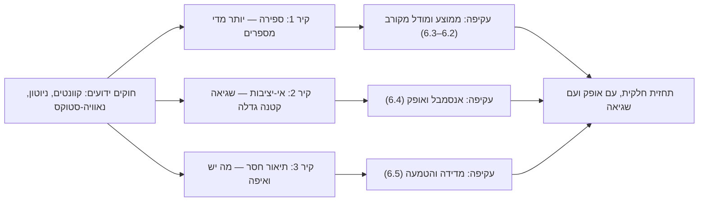
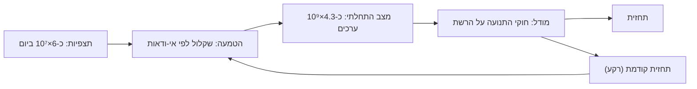
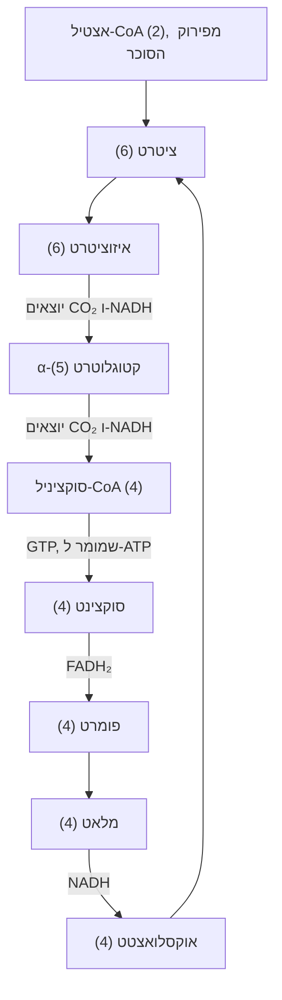
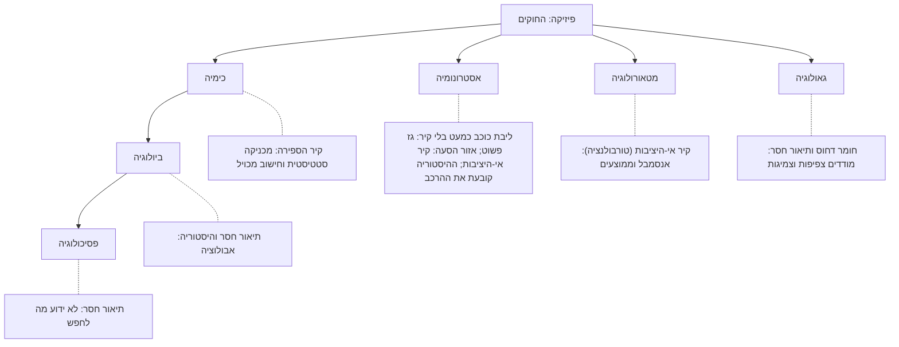

# M0.2 · שיעור 3: הפיזיקה ושאר המדעים: מחוקים פשוטים למערכות מורכבות

מכסה: 3-1 Introduction · 3-2 Chemistry · 3-3 Biology · 3-4 Astronomy · 3-5 Geology · 3-6 Psychology · 3-7 How did it get that way?

## הלומד · שיעור · 2026-11-15

כתוב את שיעור 3 במודול M0.2: הפיזיקה ושאר המדעים: מחוקים פשוטים למערכות מורכבות.

---

## המורה · claude-opus-5-5

## פרק 6: שלושה קירות בין החוקים לתחזית

אפליקציית מזג האוויר בטלפון אומרת שמחר בשלוש אחר הצהריים יש סיכוי של 60% לגשם. מאחורי המספר הזה עומד בדרך כלל מודל של המרכז האירופי לתחזיות בינוניות טווח (ECMWF). המודל פותר את משוואות התנועה של האוויר, משוואות שידועות כבר מהמאה התשע-עשרה. ובכל זאת, תחזית לעשרה ימים קדימה נכשלת לעתים קרובות, ותחזית מפורטת לשלושים יום פשוט לא קיימת. לכן השאלה של הפרק פשוטה: אם החוקים ידועים, מה חסר?

נראה שהתשובה איננה "עוד פיזיקה". בין החוקים לבין התחזית עומדים שלושה קירות נפרדים: יש יותר מדי מספרים לאחסן, שגיאה קטנה גדלה מעריכית, ואנחנו לא יודעים מה בדיוק נמצא איפה. לכל קיר יש סיבה משלו, מספר שמודד אותו ודרך עקיפה שהמדע בנה סביבו. לא נלמד כאן לפתור את משוואות הזרימה, כי זה נושא בפני עצמו. כאן נלמד לזהות איזה קיר עוצר בכל בעיה, ומה המחיר של כל עקיפה.

התחזית שבטלפון תלווה אותנו לאורך כל הפרק. בקיר הספירה נשאל כמה זיכרון דרוש כדי לעקוב אחרי כל מולקולה באטמוספרה. בסעיף על ממוצעים (6.3) נשאל למה מדחום בתחנת מזג אוויר לא רועד, אף שכל מולקולה סביבו נעה באקראי. בסוף הפרק נחבר את שלושת הקירות ונבדק אם הם מסבירים את אורך התחזית שמפרסם המרכז האירופי.

**מה אנחנו כבר יודעים.** משל השחמט מש2: קל לדעת את החוקים וקשה לשחק. עקרון פאולי מש2 קובע שבקליפה $n$ יש מקום לכל היותר ל-$2n^2$ אלקטרונים. מש1 אנחנו יודעים שהלחץ הוא ממוצע של חבטות, $p=\tfrac13nm\langle v^2\rangle$, ושהטמפרטורה היא אנרגיה קינטית ממוצעת, $\langle\tfrac12mv^2\rangle=\tfrac32kT$. גם צפיפות המולקולות בליטר אוויר מוכרת מש1. מ-M0.1 מוכרים הספרה הבינארית, הקירוב $2^{10}\approx10^3$ ושגיאת הקוונטיזציה $q/\sqrt{12}$ של ממיר אנלוגי-ספרתי. מש4 של M0.1 מוכר הכלל שזמן הסימולציה המשמעותי חסום על ידי $T\gtrsim\ln K/\lambda$, כש-$\lambda$ הוא קצב הגדילה. ב-M0.1 סימנו אותו $\sigma$. כאן נשמור את $\sigma$ לסטיית תקן, שתוגדר ב-6.3. מש2 של M0.2 מוכרים רדיוס בוהר $a_0$ ועקרון אי-הוודאות.

### 6.1 הסבר עקרוני מול יכולת לחשב

[[F1:32]] החוקים ידועים, אז איפה בדיוק נמצא הפער? כדי למצוא אותו נבדוק שני מקרים שבהם החוקים ידועים היטב ובכל זאת קשה לחזות: הכימיה, והזרימה של האוויר שמאחורי התחזית בטלפון. בשניהם צריך להבחין בין שני דברים שקל לבלבל ביניהם. **הסבר עקרוני** הוא ידיעה מאילו חוקים התופעה נובעת. **יכולת לחשב** היא היכולת להפיק מהחוקים האלה מספר שאפשר להשוות למדידה.

המקרה הראשון שנבדוק הוא הכימיה. בכימיה נמצאו סדירויות מספריות הרבה לפני החוקים שמסבירים אותן. לפי חוק היחסים הכפולים של דלטון, מתחילת המאה התשע-עשרה, גרם פחמן נקשר ל-1.333 גרם חמצן בפחמן חד-חמצני ול-2.667 גרם בפחמן דו-חמצני. היחס הוא בדיוק 2, כלומר אטום חמצן אחד או שניים לכל אטום פחמן [[ודאות: גבוהה]]. זו הייתה סדירות שנמדדה, ולא הסבר: אף אחד לא ידע אז מאילו חוקים נובע שאטומים נקשרים במספרים שלמים.

הדוגמה החדה ביותר לאותו דפוס היא הטבלה המחזורית. ב-1869 סידר מנדלייב את היסודות בטבלה לפי משקל ותכונות. הוא השאיר בה חורים וחזה את תכונותיהם של יסודות שעוד לא נמצאו, ובהם הגליום והגרמניום, שהתגלו ב-1875 וב-1886 [[ודאות: גבוהה]]. הטבלה הייתה, כמו היחס של דלטון, אוסף כללים שעבד לפני שמישהו הבין אותו. ההסבר הגיע ב-1925, והוא מורכב משני חלקים. החלק הראשון הוא עקרון פאולי, שקובע כמה אלקטרונים נכנסים לכל קליפה: בקליפה $n$ יש מקום ל-$2n^2$. כל קליפה מתחלקת ל**תת-קליפות**, שמסומנות s, p, d, f, ובכל אחת מהן יש מקום ל-2, 6, 10 ו-14 אלקטרונים, בהתאמה. הסימון "3d" פירושו תת-הקליפה d של הקליפה $n=3$. בקליפה $n$ יש $n$ תת-קליפות, הראשונות ברשימה. למשל, בקליפה 3 יש 3s, 3p ו-3d, כלומר $2+6+10=18=2\cdot3^2$ מקומות.

החלק השני הוא מכניקת הקוונטים. היא קובעת את רמות האנרגיה של תת-הקליפות, ולכן גם את הסדר שבו הן מתמלאות, והסדר הזה לא נקבע לפי $n$ בלבד. תת-הקליפה 4s נמוכה באנרגיה מ-3d. לכן אחרי ש-3s ו-3p מתמלאות, כלומר אחרי שמונה אלקטרונים, האלקטרון הבא נכנס ל-4s ופותח מחזור חדש. תת-הקליפה 3d מתמלאת רק במחזור הרביעי, והמחזור השלישי מקבל 8 יסודות ולא 18. הסולם מראה את תת-הקליפות לפי סדר האנרגיה שלהן, מלמטה למעלה, וסוגריים מסמנים כל מחזור. כדאי לשים לב איפה נכנסת תת-קליפה d או f של קליפה פנימית (בכתום). 3d נכנסת רק אחרי 4s, בתוך המחזור הרביעי. 4f מתעכבת עוד יותר: הקליפה הרביעית נפתחת במחזור הרביעי, אבל 4f נכנסת רק במחזור השישי, שני מחזורים אחר כך.

```svg
<svg viewBox="0 0 480 540" xmlns="http://www.w3.org/2000/svg" font-family="sans-serif" font-size="13" direction="ltr">
<title>סולם האנרגיה של תת-הקליפות לפי סדר המילוי</title>
<line x1="50" y1="525" x2="50" y2="34" stroke="#333" stroke-width="1.5"/>
<polygon points="50,22 45,34 55,34" fill="#333"/>
<text x="62" y="30">אנרגיה</text>
<g stroke-width="5">
<line x1="110" y1="500" x2="230" y2="500" stroke="#3b6fb6"/>
<line x1="110" y1="455" x2="230" y2="455" stroke="#3b6fb6"/>
<line x1="110" y1="430" x2="230" y2="430" stroke="#3b6fb6"/>
<line x1="110" y1="385" x2="230" y2="385" stroke="#3b6fb6"/>
<line x1="110" y1="360" x2="230" y2="360" stroke="#3b6fb6"/>
<line x1="110" y1="315" x2="230" y2="315" stroke="#3b6fb6"/>
<line x1="110" y1="290" x2="230" y2="290" stroke="#e07b24"/>
<line x1="110" y1="265" x2="230" y2="265" stroke="#3b6fb6"/>
<line x1="110" y1="220" x2="230" y2="220" stroke="#3b6fb6"/>
<line x1="110" y1="195" x2="230" y2="195" stroke="#e07b24"/>
<line x1="110" y1="170" x2="230" y2="170" stroke="#3b6fb6"/>
<line x1="110" y1="125" x2="230" y2="125" stroke="#3b6fb6"/>
<line x1="110" y1="100" x2="230" y2="100" stroke="#e07b24"/>
<line x1="110" y1="75" x2="230" y2="75" stroke="#e07b24"/>
<line x1="110" y1="50" x2="230" y2="50" stroke="#3b6fb6"/>
</g>
<g text-anchor="end">
<text x="100" y="505">1s</text><text x="100" y="460">2s</text><text x="100" y="435">2p</text>
<text x="100" y="390">3s</text><text x="100" y="365">3p</text>
<text x="100" y="320">4s</text><text x="100" y="295">3d</text><text x="100" y="270">4p</text>
<text x="100" y="225">5s</text><text x="100" y="200">4d</text><text x="100" y="175">5p</text>
<text x="100" y="130">6s</text><text x="100" y="105">4f</text><text x="100" y="80">5d</text><text x="100" y="55">6p</text>
</g>
<g fill="#555">
<text x="238" y="505">2</text><text x="238" y="460">2</text><text x="238" y="435">6</text>
<text x="238" y="390">2</text><text x="238" y="365">6</text>
<text x="238" y="320">2</text><text x="238" y="295">10</text><text x="238" y="270">6</text>
<text x="238" y="225">2</text><text x="238" y="200">10</text><text x="238" y="175">6</text>
<text x="238" y="130">2</text><text x="238" y="105">14</text><text x="238" y="80">10</text><text x="238" y="55">6</text>
</g>
<g fill="none" stroke="#333" stroke-width="1.5">
<path d="M282,494 H292 V506 H282"/>
<path d="M282,424 H292 V461 H282"/>
<path d="M282,354 H292 V391 H282"/>
<path d="M282,259 H292 V321 H282"/>
<path d="M282,164 H292 V226 H282"/>
<path d="M282,44 H292 V131 H282"/>
</g>
<text x="300" y="505">מחזור 1 · 2</text>
<text x="300" y="448">מחזור 2 · 8</text>
<text x="300" y="378">מחזור 3 · 8</text>
<text x="300" y="295">מחזור 4 · 18</text>
<text x="300" y="200">מחזור 5 · 18</text>
<text x="300" y="93">מחזור 6 · 32</text>
<rect x="300" y="520" width="14" height="8" fill="#e07b24"/>
<text x="320" y="529">d או f של קליפה פנימית</text>
</svg>
```

הטבלה מחברת את המקומות בתת-הקליפות של כל מחזור, והסכום הוא בדיוק אורך המחזור.

```table
{"title": "קליפות מול מחזורים בטבלה המחזורית", "columns": ["מחזור (הקליפה החיצונית n)", "2n²", "תת-הקליפות שמתמלאות בו", "מקומות בהן = אורך המחזור"], "rows": [["1", "2", "\"1s\"", "\"2\""], ["2", "8", "\"2s, 2p\"", "\"2+6=8\""], ["3", "18", "\"3s, 3p\"", "\"2+6=8\""], ["4", "32", "\"4s, 3d, 4p\"", "\"2+10+6=18\""], ["5", "50", "\"5s, 4d, 5p\"", "\"2+10+6=18\""], ["6", "72", "\"6s, 4f, 5d, 6p\"", "\"2+14+10+6=32\""], ["7", "98", "\"7s, 5f, 6d, 7p\"", "\"2+14+10+6=32\""]]}
```

מכיוון שתת-קליפות d ו-f של קליפה פנימית מתמלאות באיחור, כל אורך מחזור מופיע פעמיים, והסדרה היא 2, 8, 8, 18, 18, 32, 32 ולא $2n^2$. המחזוריות נובעת מפאולי ומרמות האנרגיה גם יחד. מכאן שהכימיה התאורטית היא פיזיקה. אבל זה הסבר **עקרוני** בלבד. אנחנו יודעים את חוקי המשחק, ועדיין קשה מאוד לחזות במדויק מה ייצא מתגובה מסוימת ובאיזה קצב. [[F1:33]] זה נכון גם לחומרים של יצורים חיים. מאז שוֶלֶר ייצר ב-1828 אוריאה ממלח אי-אורגני [[ודאות: גבוהה]], ברור שגם הם פועלים לפי אותם חוקים (7.1).


אותו פער קיים גם באוויר, ושם הוא נוגע ישירות לתחזית שבטלפון. **זורם** הוא כל חומר שיכול לזרום, נוזל או גז. התנועה שלו מתוארת על ידי משוואות נאוויה-סטוקס (Navier–Stokes), שנוסחו בין 1822 ל-1845. הרעיון שלהן הוא החוק השני של ניוטון: הכוח שפועל על גוף שווה למסה שלו כפול התאוצה שלו, והתאוצה היא קצב השינוי של המהירות. משוואות נאוויה-סטוקס הן החוק הזה כשמפעילים אותו על כל אלמנט קטן של זורם: מסה כפול תאוצה שווה להפרשי הלחץ, לחיכוך הפנימי ולכבידה. החיכוך הפנימי, ה**צמיגות**, הוא ההתנגדות בין שכבות סמוכות של זורם שנעות במהירויות שונות: השכבה המהירה גוררת את האיטית, והאיטית בולמת את המהירה. דבש צמיג מאוד, ואוויר צמיג מעט מאוד.

המשוואות מתייחסות לזורם כאל חומר רציף, ולכן הן תקפות רק בקנה מידה גדול בהרבה מה**מהלך החופשי הממוצע**, כלומר מהמרחק הממוצע שמולקולה עוברת בין שתי התנגשויות. באוויר המרחק הזה הוא כ-68 ננומטר. מעל קנה המידה הזה המשוואות נחשבות מדויקות.

ובכל זאת, ב-2000 הן נכנסו לרשימת "בעיות המילניום" של מכון קליי, עם פרס של מיליון דולר [[ודאות: גבוהה]]. הבעיה הפתוחה היא אם בשלושה ממדים יש תמיד פתרון חלק. פתרון חלק הוא פתרון שבו המהירות וכל הנגזרות שלה נשארות סופיות. השאלה היא אם, כשמתחילים ממצב התחלתי חלק, המהירות יכולה להפוך לאינסופית בנקודה כלשהי בתוך זמן סופי. אם זה קורה, המשוואות עצמן מפסיקות לתת תשובה בנקודה הזאת. כלומר, גם כשהחוקים ידועים, אפילו ההתנהגות הבסיסית של הפתרונות שלהם לא תמיד ידועה. הפער הזה שונה מהקירות שיבואו מיד, כי הוא נוגע למתמטיקה של החוקים עצמם ולא לתחזית. מודל התחזית פותר את המשוואות על רשת, בקני מידה שבהם הפתרונות מתנהגים היטב, ולכן השאלה הפתוחה לא עוצרת שום תחזית מעשית. מסיבה זו לא נמנה אותה בין הקירות.

**למה ידיעת החוקים לא מספיקה.** ההנחה הסמויה שמאחורי המשפט "החוקים ידועים, ולכן אפשר לחזות" היא שהחוקים לבדם מספיקים לתחזית. בפועל שלושה קירות עומדים בדרך, וכדאי להבדיל ביניהם כבר עכשיו. הראשון הוא **ספירה**: מספר המספרים הדרוש לתיאור המצב גדול מכל זיכרון. השני הוא **אי-יציבות**: שגיאה קטנה בתנאי ההתחלה גדלה מעריכית עם הזמן. השלישי הוא **תיאור חסר**: החוקים לא אומרים אילו אטומים יש ואיפה, ואת זה חייבים לקבל ממדידה. זה גם הקיר שכתבת עליו במחברת, כשהשווית לביולוגיה את הקושי לתרגם מציאות מדינית וצבאית לנתונים. ההנחה שהחוקים מספיקים נשברת בכל אחד מהקירות. הקיר השני קובע גם את אורך התחזית, אופק החיזוי, שנגזור ב-6.4.

סביב כל קיר נבנתה עקיפה משלו. את קיר הספירה עוקפים במיצוע, כלומר מוותרים על מעקב אחרי כל חלקיק ומסתפקים בממוצעים, ובמודל מקורב שמכויל בניסוי. את המודל המקורב נפגוש בסוף 6.2, ואת המיצוע ב-6.3. את קיר אי-היציבות עוקפים באנסמבל: מריצים הרבה תחזיות מתנאי התחלה שונים במעט, ומקבלים מהן אופק שמעבר לו אין טעם לחזות. זה הנושא של 6.4. את קיר התיאור החסר עוקפים במדידה ובהטמעת נתונים, כלומר מזינים מדידות לתוך המודל שוב ושוב. זה הנושא של 6.5. התרשים מסכם את המבנה. כל שורה בו נקראת משמאל לימין: קיר, העקיפה שלו והסעיף שמטפל בה. שלוש העקיפות מתכנסות לאותה תיבה, ושום חץ לא מגיע ל"תחזית מושלמת".



אף עקיפה לא מפילה את הקיר שלה, ולכן גם התוצאה איננה תחזית מושלמת. היא תחזית עם אופק ועם שגיאה ידועה. בשני המקרים, תגובה כימית והתחזית של מחר, החוקים ידועים. מה שמבדיל ביניהם הוא איזה קיר עוצר ראשון. בכימיה זה קיר הספירה: כבר מולקולה קטנה אחת דורשת יותר מספרים ממספר האטומים ביקום (6.2). בתחזית זה קיר אי-היציבות: את האוויר אפשר לתאר בממוצעים, אבל השגיאה בממוצעים האלה גדלה עד שהתחזית מאבדת את ערכה (6.4). זו השאלה שנשאל על כל מערכת מעכשיו.


### 6.2 הקיר הראשון: ספירה

[[F1:32]] כדי להבין את הקיר הראשון, נשאל שאלה מספרית: כמה מספרים צריך כדי לעקוב אחרי ליטר אוויר? בתיאור הקלאסי מספיקים לכל מולקולה שלושה מספרי מיקום ושלושה מספרי מהירות. לכן $N$ מולקולות דורשות $6N$ מספרים. בליטר אוויר ב-300 K ובלחץ של אטמוספרה אחת יש $N=2.446\times10^{22}$ מולקולות, כפי שראינו בש1. מכאן שדרושים $1.468\times10^{23}$ מספרים.

כדי לתרגם מספרים לזיכרון צריך יחידה. ספרה בינארית אחת היא **ביט** (bit). שמונה ביטים הם **בית** (byte), יחידת האחסון הבסיסית של מחשבים. מחשב שומר כל מספר ממשי באחד משני פורמטים קבועים. הנפוץ מביניהם הוא **דיוק כפול**.

```table
{"title": "שני הפורמטים של מספר ממשי במחשב", "columns": ["פורמט", "ביטים", "בתים", "ספרות משמעותיות"], "rows": [["\"דיוק כפול\"", "64", "8", "\"כ-16\""], ["\"דיוק יחיד\"", "32", "4", "\"כ-7\""]]}
```

בדיוק כפול, ליטר אוויר דורש $1.468\times10^{23}\times8=1.174\times10^{24}$ בתים. כל האחסון הדיגיטלי בעולם מוערך בסדר גודל של $10^{22}$ בתים [[ודאות: נמוכה]], ולכן ליטר אוויר אחד צריך זיכרון גדול פי מאה בערך מכל הדיסקים שבנינו.

בתחזית שבטלפון הפער גדל עוד יותר. באטמוספרה כולה יש בערך $1.07\times10^{44}$ מולקולות. לכן מודל שעוקב אחרי כל אחת מהן היה צריך:

$$
1.07\times10^{44}\times6\times8\ \text{bytes}=5.14\times10^{45}\ \text{bytes}
$$

וזה רק הזיכרון. מולקולה באוויר נעה במהירות ממוצעת של כ-470 מטר בשנייה, בסדר הגודל של $v_{\text{rms}}$ מש1, ומתנגשת בכל פעם שהיא עוברת מהלך חופשי של כ-68 ננומטר. לכן מספר ההתנגשויות שלה בשנייה הוא $470/(68\times10^{-9})\approx7\times10^{9}$, וצעד הזמן של מעקב מלא היה צריך להיות קצר מעשירית ננושנייה. זה הקיר הראשון במלוא גודלו: המספרים חורגים בהרבה מהיכולת של כל מחשב, ובוודאי מזו של כל מוח.

**הספירה הקוונטית גרועה בהרבה.** הספירה הקלאסית היא עוד התרחיש האופטימי. ראינו בש2 שלאלקטרון אין מיקום מוגדר, כי עקרון אי-הוודאות אוסר זאת. לכן צריך לתאר אותו בדרך אחרת: לכל מקום שבו הוא עשוי להימצא מצמידים מספר. כשיש כמה חלקיקים, המספר מוצמד לכל צירוף של מקומות של כולם יחד. האובייקט הזה הוא פונקציית הגל. לאלקטרון יש גם תכונה פנימית שנקראת **ספין**. לצורך הספירה כל מה שצריך לדעת עליה הוא שהיא מקבלת בדיוק שני ערכים.

```definition
@title: פונקציית גל של מערכת חלקיקים
@mark: summary
למערכת של $N$ חלקיקים, **פונקציית גל** היא פונקציה $\psi(\mathbf r_1,\mathbf r_2,\dots,\mathbf r_N)$ שמתאימה מספר מרוכב אחד לכל **תצורה**, כלומר לכל צירוף של מקומות $\mathbf r_i\in\mathbb R^3$ של כל החלקיקים יחד. התחום שלה הוא מרחב התצורות $\mathbb R^{3N}$. המספר שהיא מתאימה לתצורה נקרא ה**משרעת** של התצורה. באופן לא פורמלי: ככל ש-$|\psi|^2$ גדול יותר בתצורה מסוימת, כך סביר יותר למצוא את החלקיקים בה. את המשמעות ההסתברותית המדויקת אפשר לנסח רק אחרי ההגדרות של 6.3, ולספירה מספיק שיש מספר אחד לכל תצורה. בהגדרה הזאת התעלמנו מהספין. מיד אחרי הספירה נבדוק אם זה משנה אותה.
```

כל המשקל של ההגדרה מונח על המילה "יחד". אין מספר אחד לחלקיק הראשון ומספר אחר לשני. יש מספר אחד לכל צירוף של שניהם. כדי לספור, נניח רשת שמכסה את סביבת האטום ברזולוציה של כ-$a_0$, עם עשר נקודות לכל ציר. ההנחה הזאת נדיבה כלפי מטה: חישוב אמיתי צריך רשת עדינה יותר, ולכן כל ספירה שנקבל ממנה היא חסם תחתון. אלקטרון אחד דורש $10^3$ מספרים. לשני אלקטרונים, כל אחת מ-$10^3$ התצורות של הראשון מצטרפת לכל אחת מ-$10^3$ התצורות של השני, ולכן יש $10^6$ תצורות. בכל אלקטרון נוסף המספר מוכפל שוב ב-$10^3$:

$$
\#\psi = (10^3)^N = 10^{3N}
$$

למולקולת מים, עם עשרה אלקטרונים, זה $10^{30}$ מספרים. לבנזן, עם 42 אלקטרונים, זה $10^{126}$ מספרים, ואילו ביקום כולו יש בערך $10^{80}$ אטומים.

ומה עם הספין שהתעלמנו ממנו, ועם עקרון פאולי? הספין מגדיל את הספירה ופאולי מקטין אותה, וצריך לבדוק מי מהם מנצח.

```derivation
@title: הספין ופאולי לא מצילים את הספירה
**הספין מגדיל.** לכל אלקטרון יש שני מצבי ספין, ולכן כל תצורה של מקומות מתפצלת לכל היותר ל-$2^N$ צירופי ספין:
$$\#\psi\le2^N\cdot10^{3N}.$$

**פאולי מקטין.** בצורתו המלאה, עקרון פאולי קובע שפונקציית הגל מחליפה סימן כשמחליפים בין שני אלקטרונים. לכן מספיק לדעת אותה בתצורות שבהן האלקטרונים מסודרים בסדר אחד, וזה מקטין את הספירה בגורם של כ-$N!$:
$$\#\psi\approx\frac{2^N\cdot10^{3N}}{N!}.$$

**בבנזן.** עם $N=42$ יוצא $2^{42}\approx4.4\times10^{12}$ ו-$42!\approx1.4\times10^{51}$, ולכן $10^{126}$ יורד לכ-$10^{87}$. זה עדיין יותר מכל האטומים ביקום.

**הסכנה.** $N!$ גדל מהר יותר מכל אקספוננט. לכן ברשת קבועה, עם $G=10^3$ נקודות לכל אלקטרון, היחס $G^N/N!$ היה מתחיל בסוף לרדת.

**הרשת גדלה עם המולקולה.** מולקולה גדולה יותר תופסת נפח גדול יותר, ולכן מספר נקודות הרשת גדל בערך ביחס ישר למספר האלקטרונים: $G=gN$.

**סטירלינג.** עם הקירוב $N!\approx(N/e)^N$, שנשתמש בו בלי הוכחה:
$$\frac{G^N}{N!}\approx\Big(\frac{eG}{N}\Big)^N=(eg)^N .$$
```

התוצאה, $(eg)^N$, היא אקספוננט של קבוע כפול $N$. הספין ופאולי משנים את הבסיס של החזקה, אבל החזקה נשארת, ולכן הגדילה נשארת מעריכית.

**מכפלה מול סכום.** מה בדיוק הופך את הספירה למעריכית? נניח לרגע שכל אלקטרון מתנהג לבדו, בלי שהמקום של אלקטרון אחד ישפיע על ההסתברות למקום של אחר. אז פונקציית הגל מתפרקת למכפלה של פונקציות של אלקטרון אחד:

$$
\psi(\mathbf r_1,\dots,\mathbf r_N)=\varphi_1(\mathbf r_1)\,\varphi_2(\mathbf r_2)\cdots\varphi_N(\mathbf r_N)
$$

כל גורם במכפלה מתואר על ידי $10^3$ מספרים, ולכן כל המערכת דורשת רק $N\cdot10^3$ מספרים. לבנזן זה $4.2\times10^4$, מספר שכל מחשב נייד מחזיק בקלות. אי-תלות הופכת מכפלה של אפשרויות לסכום של תיאורים. המחיר הוא שההנחה פשוט לא נכונה, כי האלקטרונים דוחים זה את זה בכוח קולון. ההסתברות למצוא אלקטרון אחד במקום מסוים תלויה במקום של האחרים. המתאם הזה הוא כל הקיר: לא החוקים, אלא הצימוד בין החלקיקים.

הגרף משווה את שלוש הספירות כשמספר החלקיקים גדל: מעקב קלאסי, $6N$; אלקטרונים בלתי תלויים, $N\cdot10^3$; ותיאור קוונטי מלא, $10^{3N}$. הציר האנכי הוא הלוגריתם של מספר המספרים, ולכן שתי הספירות הראשונות נראות כמעט שטוחות, והשלישית היא קו ישר שעולה בתלילות.

```chart
{"title": "כמה מספרים דרושים לתיאור N חלקיקים", "caption": "שני הקווים התחתונים כמעט שטוחים: מעקב קלאסי (6N) ותיאור קוונטי של אלקטרונים בלתי תלויים (N·10³). הקו העליון הוא התיאור הקוונטי המלא (10^{3N}), ועולה בשלוש חזקות עשר לכל חלקיק.", "type": "line", "x": {"from": 1, "to": 50, "step": 1, "label": "מספר החלקיקים N"}, "series": [{"name": "קלאסי, 6N", "expr": "log10(6*x)"}, {"name": "קוונטי, בלתי תלויים: N·10³", "expr": "log10(1000*x)"}, {"name": "קוונטי מלא: 10^(3N)", "expr": "3*x"}], "yLabel": "log₁₀ של מספר המספרים"}
```

הקווים הליניאריים עולים בפחות משתי חזקות עשר לאורך כל הטווח. הקו המעריכי עולה ל-150 חזקות עשר כבר ב-50 חלקיקים. שום מחשב שאפשר לבנות לא סוגר פער כזה.

**התשובה ההנדסית: קירוב מכויל.** כימאים קוונטיים בכל זאת מחשבים מולקולות, כי הם עוקפים את הקיר במקום להפיל אותו. **מצב היסוד** של מולקולה הוא המצב שבו לאלקטרונים שלה יש האנרגיה הנמוכה ביותר. בו נמצאת מולקולה כשאין דבר שמעורר אותה, והוא שקובע את המבנה שלה ואת אנרגיות הקשרים שלה. ב-1964 הוכיחו הוהנברג וקון שכל תכונות מצב היסוד נקבעות, עקרונית, מצפיפות האלקטרונים בלבד. הצפיפות היא פונקציה של שלוש קואורדינטות, ולא של $3N$ [[ודאות: גבוהה]]. הנוסחה המדויקת שמתרגמת צפיפות לאנרגיה לא ידועה. לכן השיטה, תורת פונקציונל הצפיפות (DFT), משתמשת בנוסחאות מקורבות שכוילו מול ניסויים ומול חישובים מדויקים של מולקולות קטנות. העלות גדלה בערך כמו $N^3$ [[ודאות: בינונית]]. לבנזן זה $42^3=7.4\times10^4$ יחידות חישוב, ומולקולה כפולה בגודלה עולה פי שמונה. המעבר מאקספוננט לחזקה הוא בדיוק מה שהופך את החישוב לאפשרי.

מכאן אפשר לתפוס טענה שגויה שחוזרת בצורות שונות: "אם הכימיה היא פיזיקה, אפשר לחשב כל תגובה מתוך החוקים". הבדיקה היא ספירה. חישוב מדויק של בנזן דורש $10^{126}$ מספרים, יותר מאשר יש אטומים ביקום. הטענה הנכונה צנועה יותר: אפשר לחשב תגובות בקירוב שמכויל בניסוי, והקירוב מכייל בדיוק את מה שהנחת אי-התלות זרקה. לכן תוצאה של DFT היא חזקה רק כמו הכיול שלה. כשהמולקולה שונה מאוד מאלה שהשיטה כוילה עליהן, התאמה טובה לניסוי היא מקרה שצריך לבדוק, לא הוכחה.

כמה מדויק הכיול צריך להיות? את התשובה נותן קצב ארניוס מש1, $\Gamma=\nu e^{-E_a/kT}$. בנוסחה הזאת $\nu\approx10^{13}$ הוא מספר הניסיונות לחצות את המחסום $E_a$ בכל שנייה. ההופכי של הקצב הוא זמן ההמתנה הטיפוסי עד שהמחסום נחצה:

$$
t=\frac{1}{\Gamma}=\frac{e^{E_a/kT}}{\nu}
$$

ב-300 K, $kT=25.9$ meV. הטבלה מראה את זמן ההמתנה לשלושה מחסומים.

```table
{"title": "זמן ההמתנה לחציית מחסום ב-300 K, עם ν=10¹³ ניסיונות בשנייה", "columns": ["מחסום", "באנרגיה", "הסתברות לניסיון אחד, e^(−E_a/kT)", "זמן המתנה t"], "rows": [["\"20kT\"", "\"0.52 eV\"", "\"2.1×10⁻⁹\"", "\"4.9×10⁻⁵ s, כלומר כ-2×10⁴ חציות בשנייה\""], ["\"40kT\"", "\"1.03 eV\"", "\"4.2×10⁻¹⁸\"", "\"2.4×10⁴ s, כ-6.5 שעות\""], ["\"50kT\"", "\"1.29 eV\"", "\"1.9×10⁻²²\"", "\"5.2×10⁸ s, כ-16 שנה\""]]}
```

בשורה הראשונה יש מלכודת. הגורם $e^{-20}$ נראה זעיר, אבל הוא ההסתברות לניסיון **אחד** בלבד. בעשרה טריליון ניסיונות בשנייה, מחסום של 20kT נחצה מהר. כדי שקשר יחזיק מעמד בטווחי זמן אנושיים, המחסום צריך להיות 40–50kT. אותו אקספוננט פועל גם על החישוב, כי כל שגיאה במחסום המחושב נכנסת למעריך:

$$
\Delta E_a=10kT\ \Rightarrow\ t\ \text{גדל פי}\ e^{10}\approx2.2\times10^4,\qquad \Delta E_a=0.1\ \text{eV}\approx3.9\,kT\ \Rightarrow\ \Gamma\ \text{משתנה פי}\ e^{3.9}\approx50
$$

לכן קירוב שטועה בעשירית eV בלבד כבר טועה בקצב בכמעט שני סדרי גודל. ב-6.1 רק ציינו שקשה לחזות את הקצב. עכשיו רואים למה הוא הדבר הקשה ביותר לחזות בכימיה: השגיאה במחסום נכנסת למעריך.

כתבת במחברת שאולי AI שמנטר שגיאות כל הזמן, או מחשוב קוונטי, יקלו על הקיר הזה. נענה על כל חלק בנפרד, ונתחיל במחשוב הקוונטי. התשובה עליו תלויה בהנחה שאפשר לשבור. הספירה של $10^{3N}$ מניחה זיכרון קלאסי, שבו כל מספר יושב בתא נפרד. ב-1981 הציע פיינמן לשבור בדיוק את ההנחה הזאת: לדמות מערכת קוונטית בעזרת מערכת קוונטית אחרת, שמחזיקה את כל הצירופים מטבעה [[ודאות: גבוהה]]. **סיבית קוונטית** היא מערכת קוונטית עם שני מצבים, 0 ו-1. אוגר של $N$ סיביות כאלה הוא מערכת של $N$ חלקיקים שלכל אחד מהם שתי "תצורות". לכן פונקציית הגל שלו מחזיקה משרעת אחת לכל אחד מ-$2^N$ הצירופים של 0 ו-1. זה אותו מבנה צירופי שפוצץ את הספירה, $10^{3N}$, רק עם 2 במקום $10^3$. מה שבזיכרון קלאסי היה מחיר הופך כאן לתכונה של החומרה. נכון לעת כתיבת השיעור, מחשבים כאלה עדיין מוגבלים על ידי הרעש שלהם ופתרו רק מולקולות קטנות [[ודאות: בינונית]]. ומה עם AI? כשהוא מאומן על חישובי DFT, הוא עוקף את הקיר באותה דרך כמו DFT, כקירוב מכויל: הוא מהיר יותר, אבל לא סופר יותר. AI שמנטר שגיאות כל הזמן עושה משהו אחר. הוא לא מקטין את הספירה, אלא נאבק בשגיאה שגדלה תוך כדי ריצה. לכן מקומו בקיר השני, ונחזור אליו ב-6.4.

**המספרים של הקיר.** הטבלה אוספת את המספרים שבנו את קיר הספירה, כדי שאפשר יהיה לחזור על האומדן בראש. את קבועי האנרגיה נאסוף בפרק 7, כשנעסוק באנרגיה ובכוכבים.

```table
{"title": "המספרים של קיר הספירה", "scope": {"kB": 1.380649e-23, "e": 1.602177e-19}, "columns": ["גודל", "ערך", "יחידה", "שימוש באומדן"], "rows": [["\"צפיפות מולקולות באוויר, 300 K\"", "round(101325/(kB*300)/1e25, 3)", "\"10²⁵ m⁻³\"", "\"כ-2.4×10²² מולקולות בליטר\""], ["\"מספר ממשי בדיוק כפול\"", "8", "\"bytes\"", "\"64 ביטים, כ-16 ספרות משמעותיות\""], ["\"מהלך חופשי ממוצע באוויר\"", "68", "\"nm\"", "\"קנה המידה שמעליו משוואות הזרימה תקפות\""], ["\"קצב התנגשויות של מולקולה\"", "7e9", "\"1/s\"", "\"קובע את צעד הזמן של מעקב מלא\""], ["\"רדיוס בוהר a₀\"", "0.529", "\"10⁻¹⁰ m\"", "\"גודל של אטום; קובע כמה עדינה צריכה להיות הרשת\""], ["\"kT ב-300 K\"", "round(kB*300/e*1000, 2)", "\"meV\"", "\"אנרגיה תרמית טיפוסית; קובעת את קצב ארניוס\""]]}
```

עד כאן הראינו שמעקב מלא בלתי אפשרי, גם קלאסית וגם קוונטית. השאלה שנשארה פתוחה היא אם בכלל צריך את כל המספרים האלה.

```numeric
@answer: 5.87e26
@unit: בתים
@tol: 3%
מודל קלאסי עוקב אחרי כל מולקולה במטר מעוקב של אוויר ב-300 K ובאטמוספרה אחת. הצפיפות היא $n=2.446\times10^{25}$ מולקולות למטר מעוקב. לכל מולקולה שומרים שלושה מספרי מיקום ושלושה מספרי מהירות, בדיוק יחיד של 4 בתים למספר. כמה בתים דרושים?
---
מספר המולקולות במטר מעוקב שווה לצפיפות: $N=2.446\times10^{25}$.
לכל מולקולה שישה מספרים, ולכן יש $6N=1.468\times10^{26}$ מספרים.
בארבעה בתים למספר: $1.468\times10^{26}\times4=5.87\times10^{26}$ בתים. זה בערך פי 60,000 מכל האחסון הדיגיטלי בעולם.
- wrong: 1.17e27 :: חישבת בשמונה בתים למספר, כמו בדיוק כפול, במקום ארבעה.
- wrong: 9.79e25 :: שכחת את ששת המספרים לכל מולקולה וספרת מספר אחד לכל מולקולה.
- wrong: 2.94e26 :: ספרת רק את שלושת מספרי המיקום ושכחת את המהירויות.
```

```mcq
למה מספר המספרים בתיאור קוונטי מלא של $N$ אלקטרונים גדל כמו $10^{3N}$, ולא כמו $N\cdot10^3$?
- [ ] כי כל מספר קוונטי דורש יותר ספרות דיוק מאשר מספר קלאסי :: הדיוק של כל מספר משפיע רק על מכפלה בגורם קבוע, ולא על מעריך שגדל עם $N$.
- [ ] כי כל אלקטרון לבדו צריך $10^3$ מספרים, וכך יוצא $10^{3N}$ :: אם כל אלקטרון צריך $10^3$ מספרים לבדו, התיאורים מצטרפים בסכום ומקבלים $N\cdot10^3$. זה המקרה הבלתי תלוי.
- [x] כי פונקציית הגל מתאימה מספר לכל צירוף של מקומות של כל האלקטרונים יחד, ומספר הצירופים הוא מכפלה של $10^3$ אפשרויות לכל אלקטרון :: הצימוד בין האלקטרונים מונע את פירוק פונקציית הגל למכפלה, ולכן הספירה היא מכפלה ולא סכום.
- [ ] כי אלקטרונים נעים מהר יותר ממולקולות, ולכן צריך יותר צעדי זמן :: מספר צעדי הזמן לא משנה כמה מספרים דרושים כדי לתאר מצב אחד.
```

### 6.3 ממוצע במקום מעקב

[[F1:32]] בקיר הספירה אי אפשר לעבור, אבל מסתבר שלרוב גם לא צריך. בש1 ראינו שהלחץ על בוכנה הוא ממוצע של חבטות, ושהטמפרטורה היא האנרגיה הקינטית הממוצעת. מכשיר מדידה רואה רק ממוצעים כאלה. מדחום בתחנת מזג אוויר מראה מספר יציב, אף שכל מולקולה סביבו נעה באקראי. ומצד שני, המדידה עצמה כן רועדת. השאלה של הסעיף: למה ממוצע של המון אטומים יציב, וכמה הוא יציב? ומתי היציבות הזאת נשברת?

[[F1:33]] ב-1860 ויתר מקסוול על מעקב אחרי מסלולים ושאל שאלה אחרת: איזה חלק מהמולקולות נע בכל מהירות. מתוך הממוצעים האלה הוא חזה שהצמיגות של גז, החיכוך הפנימי בין שכבות שהגדרנו ב-6.1, לא תלויה בלחץ שלו: גז שדחסו פי שניים לא נעשה "סמיך" יותר. התחזית נראתה מוזרה, ומקסוול בדק אותה בעצמו בניסוי ב-1866 ומצא שהיא נכונה [[ודאות: גבוהה]]. בולצמן הכליל את הגישה ובנה ממנה את הגורם $e^{-E/kT}$ שמוכר לנו מש1. כך נולדה המכניקה הסטטיסטית: שימוש בסטטיסטיקה במקום שבו החוקים המכניים ידועים, אבל אי אפשר לעקוב אחריהם. היא מדע החום, כלומר התרמודינמיקה, כי חום וטמפרטורה הם ממוצעים. אבל כדי לומר "יציב" במספרים, צריך שני מושגים: הערך הממוצע, והסטייה הטיפוסית ממנו.

**מה צריך להגדיר.** גודל שהערך שלו נקבע במקרה נקרא משתנה מקרי, ולכל ערך שלו יש הסתברות. "ממוצע" במובן של הכשרה בבית ספר הוא ממוצע של מדגם. אנחנו צריכים את הממוצע שהמדגם שואף אליו, ואת הפיזור סביבו.

```definition
@title: תוחלת, שונות וסטיית תקן
@mark: summary
יהי $X$ משתנה מקרי שמקבל ערכים $x_i$ בהסתברויות $p_i$, כאשר $\sum_i p_i=1$. ה**תוחלת** שלו היא
$$E[X]=\sum_i p_i\,x_i\equiv\mu .$$
ה**שונות** שלו היא התוחלת של ריבוע הסטייה מהתוחלת:
$$\mathrm{Var}(X)=E\big[(X-\mu)^2\big]\equiv\sigma^2 .$$
**סטיית התקן** היא $\sigma=\sqrt{\mathrm{Var}(X)}$. מכאן והלאה $\sigma$ היא סטיית תקן, ולא קצב הגדילה מ-M0.1, שאותו אנחנו מסמנים עכשיו ב-$\lambda$. במשתנה רציף, ההסתברויות מתוארות על ידי **צפיפות הסתברות** $f(x)\ge0$. המכפלה $f(x)\,dx$ היא ההסתברות ש-$X$ ייפול בקטע $[x,x+dx]$. לכן $P(a<X<b)=\int_a^b f\,dx$ ו-$\int f\,dx=1$. בפרט, $P(X>x)=\int_x^\infty f(t)\,dt$, ומכאן $f(x)=-\frac{d}{dx}P(X>x)$. במשתנה כזה הסכומים מוחלפים באינטגרלים: $\mu=\int x f(x)\,dx$. ההגדרות תקפות רק כשהסכומים או האינטגרלים מתכנסים. בהתפלגות שבה השונות אינסופית, $\sigma$ לא מוגדרת.
```

כל חלק בהגדרה עושה עבודה משלו. התוחלת היא ממוצע משוקלל לפי הסתברויות, ולכן ערך נדיר בגודל רגיל כמעט לא מזיז אותה. ערך נדיר וקיצוני הוא סיפור אחר: מה שקובע את התרומה שלו הוא המכפלה $p\,x$, ולא ההסתברות לבדה. נניח שכל שאר הערכים הם בסדר גודל של 1. ערך שמופיע בהסתברות $10^{-6}$ וגודלו $10^{7}$ תורם לתוחלת $10^{-6}\times10^{7}=10$, פי עשרה מכל השאר יחד, ולכן הוא זה שקובע אותה. השונות מעלה את הסטייה בריבוע, כדי שסטיות חיוביות ושליליות לא יבטלו זו את זו. ממוצע של הסטיות עצמן, בלי ריבוע, תמיד אפס. השורש בסטיית התקן מחזיר את היחידות של $X$, ולכן אפשר להשוות את $\sigma$ ל-$\mu$ ישירות. התנאי האחרון חשוב: כשיש זנבות כבדים, אירועים נדירים שערכם עצום, השונות מתבדרת וכל מה שנבנה עליה קורס. עכשיו אפשר גם לקיים את ההבטחה מ-6.2: $|\psi|^2$ הוא צפיפות הסתברות על מרחב התצורות $\mathbb R^{3N}$. האינטגרל שלו על כל המרחב הוא 1, כמו $\sum_i p_i=1$, והאינטגרל שלו על אזור מסוים הוא ההסתברות למצוא את החלקיקים בתצורה מתוך האזור הזה.

כדי לראות למה זה מועיל, ניקח מולקולה אחת בתוך כלי גדול, ונשאל אם היא נמצאת בתוך קובייה קטנה שסימנו. נגדיר $X=1$ אם המולקולה בקובייה ו-$X=0$ אם לא, וההסתברות שהיא בקובייה היא $p$. אז $\mu=p$. השונות היא $\sigma^2=p(1-p)^2+(1-p)p^2=p(1-p)$. משתנה כזה, שמקבל רק 0 או 1 ומסמן אם אירוע קרה, נקרא **משתנה אינדיקטור**. עוד מעט נשתמש בו כדי לספור מולקולות.

הממוצע של המון מולקולות תלוי בשאלה אם הן משפיעות זו על זו. כבר ראינו את זה בספירה: אי-תלות פירקה מכפלה לסכום. כאן צריך את אותו רעיון בשפת ההסתברות, ובנוסף מדד שמודד כמה רחוקים מאי-תלות.

```definition
@title: אי-תלות סטטיסטית ושונות משותפת
@mark: summary
שני משתנים מקריים $X,Y$ הם **בלתי תלויים** אם לכל זוג ערכים $x,y$ מתקיים
$$P(X=x,\ Y=y)=P(X=x)\,P(Y=y).$$
ה**שונות המשותפת** שלהם היא
$$\mathrm{Cov}(X,Y)=E\big[(X-\mu_X)(Y-\mu_Y)\big],$$
ו**מקדם המתאם** הוא $\rho=\mathrm{Cov}(X,Y)/(\sigma_X\sigma_Y)$, שתמיד מקיים $-1\le\rho\le1$. אם $X,Y$ בלתי תלויים, אז $E[XY]=E[X]E[Y]$ ולכן $\mathrm{Cov}(X,Y)=0$. התנאי הזה הכרחי אך לא מספיק: שונות משותפת אפס לא מבטיחה אי-תלות.
```

הכלל של מכפלת ההסתברויות אומר שהידיעה של $X$ לא משנה דבר בציפייה ל-$Y$. השונות המשותפת מודדת נטייה לסטות יחד: היא חיובית כשהשניים נוטים לסטות לאותו כיוון, ושלילית כשהם נוטים לסטות בכיוונים הפוכים. מקדם המתאם מנרמל את הנטייה הזאת לסקאלה אחידה. ב-$\rho=1$ השניים זזים כגוף אחד. הכיוון ההפוך של המשפט לא מתקיים: למשל, אם $X$ סימטרי סביב אפס ו-$Y=X^2$, אז $Y$ נקבע לגמרי על ידי $X$, ובכל זאת השונות המשותפת שלהם אפס.

**הגזירה.** עכשיו אפשר לשאול את השאלה המרכזית בדיוק: אם מחברים $N$ תרומות, למשל חבטות על בוכנה או מולקולות בקובייה, כמה רועד הסכום ביחס לגודלו? התוצאה הזאת חוזרת בכל מקום שיש בו מדידה, ולכן נגזור אותה במלואה.

```derivation
@title: השונות של סכום תרומות בלתי תלויות גדלה כמו N
נניח $S=X_1+X_2+\dots+X_N$, כאשר לכל $X_i$ תוחלת $\mu$ ושונות $\sigma^2$.

**התוחלת.** תוחלת היא סכום משוקלל, וסכום משוקלל של סכום מתפרק לסכום של סכומים משוקללים. לכן תוחלת של סכום היא סכום התוחלות, גם בלי שום הנחת אי-תלות:
$$E[S]=\sum_{i=1}^N E[X_i]=N\mu .$$

**הסטייה של הסכום.** נחסר את התוחלת, והסטייה של הסכום מתפרקת לסכום הסטיות:
$$S-E[S]=\sum_{i=1}^N (X_i-\mu).$$

**ריבוע הסטייה.** ריבוע של סכום הוא סכום הריבועים, ועוד כל המכפלות של איברים שונים:
$$\big(S-E[S]\big)^2=\sum_{i}(X_i-\mu)^2+\sum_{i\neq j}(X_i-\mu)(X_j-\mu).$$

**תוחלת של הריבוע.** ניקח תוחלת של שני האגפים. האיברים מהסוג הראשון נותנים שונויות, והאיברים המעורבים נותנים שונויות משותפות:
$$\mathrm{Var}(S)=\sum_i \mathrm{Var}(X_i)+\sum_{i\neq j}\mathrm{Cov}(X_i,X_j).$$

**כאן נכנסת אי-התלות.** אם התרומות בלתי תלויות, כל שונות משותפת היא אפס, ונשארים רק $N$ האיברים האלכסוניים:
$$\mathrm{Var}(S)=N\sigma^2,\qquad \sigma_S=\sqrt N\,\sigma .$$

**התנודה היחסית.** נחלק את סטיית התקן של הסכום בתוחלת שלו:
$$\frac{\sigma_S}{E[S]}=\frac{\sqrt N\,\sigma}{N\mu}=\frac{\sigma}{\mu}\cdot\frac{1}{\sqrt N}.$$

**הממוצע.** הממוצע $\bar X=S/N$ הוא הסכום כשהוא מחולק בקבוע, ולכן סטיית התקן שלו מתחלקת באותו קבוע: $\sigma_{\bar X}=\sigma_S/N=\sigma/\sqrt N$.
```

הגזירה מראה שהרעש של הסכום גדל, אבל לאט יותר מהסכום עצמו. זו התוצאה שמאפשרת לסמוך על ממוצעים.

```formula
@title: התנודה היחסית של סכום ושל ממוצע
@mark: summary
הנוסחה מחשבת כמה רועד סכום של $N$ תרומות ביחס לגודלו, וכמה רועד הממוצע שלהן. היא הסיבה שגדלים מקרוסקופיים כמו לחץ וטמפרטורה יציבים, ושמדידה חוזרת משפרת דיוק.
$$\mathrm{Var}(S)=N\sigma^2,\qquad \frac{\sigma_S}{E[S]}=\frac{\sigma/\mu}{\sqrt N},\qquad \sigma_{\bar X}=\frac{\sigma}{\sqrt N}\tag{1}$$
$S$ הוא סכום של $N$ תרומות, $\mu$ ו-$\sigma$ הם התוחלת וסטיית התקן של תרומה אחת, ו-$\bar X=S/N$ הוא הממוצע. הנוסחה תקפה כשהתרומות בלתי תלויות, או לפחות לא מתואמות, וכשהשונות של כל תרומה סופית.
```

[[2.5: מבנה]] בנוסחה (1) יש שני גורמים, ולכל אחד תפקיד אחר. הגורם $\sigma/\mu$ הוא הפיזור היחסי של תרומה אחת, והוא חסר ממדים כי $\sigma$ ו-$\mu$ באותן יחידות. גם חבטה אחת חזקה מאוד וגם מולקולה שנמצאת או לא נמצאת בקובייה נותנות גורם בסדר גודל של אחד או יותר. הגורם $1/\sqrt N$ הוא שמכריע. כשיש $10^{22}$ תרומות, הוא מוחק 11 סדרי גודל, ושום ערך סביר של $\sigma/\mu$ לא מתקרב לפצות על זה. החזקה היא חצי ולא אחת, ולכן שיפור פי 2 בדיוק עולה פי 4 בתרומות.

[[2.5: מקור]] בגזירה כדאי לשים לב איפה נכנסת כל הנחה. התוחלת $E[S]=N\mu$ לא דורשת שום הנחה. את אי-התלות צריך רק בצעד אחד: כשמאפסים את $N(N-1)$ האיברים המעורבים. כלומר, השאלה אם הסכום יציב היא בעצם השאלה אם $N(N-1)$ השונויות המשותפות קטנות מספיק. ההנחה השנייה, שהשונות סופית, נכנסת כבר בהגדרה: בלעדיה אין מה לסכם.

נחזור עכשיו לקובייה שבתוך הכלי. בכלי יש $M$ מולקולות, וכל אחת נמצאת בקובייה בהסתברות $p$, בלי תלות באחרות. מספר המולקולות בקובייה הוא סכום של $M$ משתני אינדיקטור, אחד לכל מולקולה. כאן $M$ ממלא את התפקיד של $N$ ב-(1), כלומר את מספר התרומות. בדיון על הקוביות, עד שנגיע לגבולות של (1), האות $N$ תציין את מספר המולקולות שנמצאות בקובייה. לפי (1), עם $\mu=p$ ו-$\sigma^2=p(1-p)$:

$$
E[N]=Mp\equiv\langle N\rangle,\qquad \frac{\sigma_N}{\langle N\rangle}=\frac{\sqrt{Mp(1-p)}}{Mp}\approx\frac{1}{\sqrt{\langle N\rangle}}\quad(p\ll1)
$$

ההנחה האחרונה, $p\ll1$, מתקיימת בכל קובייה שקטנה בהרבה מהכלי. התוצאה היא כלל שימושי מאוד: התנודה היחסית בספירה היא אחד חלקי שורש המספר הממוצע.

[[2.5: סדר גודל]] בראש: בליטר יש כ-$10^{22}$ מולקולות, ולכן התנודה היחסית היא כ-$10^{-11}$. החישוב המדויק נותן $6.39\times10^{-12}$, כלומר האומדן נכון בתוך פי 1.6, וזה הדיוק שמספר עגול בחזקה נותן. כדי לראות איך התנודה תלויה בגודל הקובייה, נכתוב את המספר הממוצע כצפיפות כפול נפח, $\langle N\rangle=nL^3$, כאשר $L$ הוא אורך הצלע:

$$
\frac{\sigma_N}{\langle N\rangle}=\frac{1}{\sqrt{nL^3}}=n^{-1/2}L^{-3/2},\qquad \log_{10}\frac{\sigma_N}{\langle N\rangle}=-\tfrac12\log_{10}n-\tfrac32\log_{10}L
$$

הטבלה נותנת את התוצאה לארבע קוביות.

```table
{"title": "התנודה היחסית בקוביות אוויר בגדלים שונים (300 K, אטמוספרה אחת)", "columns": ["צלע הקובייה", "⟨N⟩=nL³", "התנודה היחסית 1/√⟨N⟩"], "rows": [["\"1 m\"", "\"2.4×10²⁵\"", "\"2.0×10⁻¹³\""], ["\"10 cm (ליטר)\"", "\"2.4×10²²\"", "\"6.4×10⁻¹²\""], ["\"74 nm\"", "\"9.9×10³\"", "\"1.0%\""], ["\"10 nm\"", "\"24.5\"", "\"20%\""]]}
```

בגרף שני הצירים לוגריתמיים. לכן, לפי השורה השנייה בתצוגה, התלות היא קו ישר בשיפוע $-3/2$. כדאי לחפש בו את הנקודה שבה הקו חוצה את קו ה-1%: שם, בצלע של כ-74 ננומטר, עובר הגבול בין "יציב" ל"רועש".

```chart
{"title": "התנודה היחסית במספר המולקולות בקובייה של אוויר", "caption": "שני הצירים לוגריתמיים, ולכן 1/√(nL³) הוא קו ישר בשיפוע −3/2. הקו האופקי מסמן 1%, והחצייה שלו היא ב-log₁₀L≈−7.1, כלומר בצלע של כ-74 ננומטר.", "type": "line", "x": {"from": -8, "to": -1, "step": 0.25, "label": "log₁₀ של צלע הקובייה (מטר)"}, "scope": {"n": 2.446e25}, "series": [{"name": "1/√⟨N⟩", "expr": "-0.5*log10(n) - 1.5*x"}, {"name": "קו של 1%", "expr": "-2"}], "yLabel": "log₁₀ של התנודה היחסית"}
```

השיפוע הזה מסביר למה המעבר כל כך חד. כשהצלע קטנה פי 10, התנודה גדלה פי $10^{1.5}=31.6$, ולכן העולם עובר מ"רועש" ל"יציב" בתוך שלושה סדרי גודל בלבד, מעשרות ננומטרים לעשרות מיקרונים. כדי לענות על השאלה על המדחום חסר עוד צעד אחד, כי מדחום מודד אנרגיה ממוצעת ולא סופר מולקולות. גם האנרגיה הקינטית של מולקולה בודדת היא משתנה מקרי, וה-$\sigma/\mu$ שלה מסדר גודל של אחד (בגז הוא $\sqrt{2/3}\approx0.82$. הערך הזה נובע מהתפלגות המהירויות של מקסוול, שלפיה $\mathrm{Var}(E)=\tfrac32(kT)^2$ ואילו $\langle E\rangle=\tfrac32kT$. כאן נשתמש בו בלי הוכחה). לכן לפי (1) הטמפרטורה בנפח נתון רועדת יחסית כמו $1/\sqrt N$, בדיוק כמו בטבלה, והשורה הראשונה בטבלה עונה על השאלה. כשקריאת המדחום רועדת, הרעש בא מהחיישן ומהמערבולות שסביבו, ולא מהאטומים.

[[2.5: גבולות]] מכאן $N$ שוב מציין את מספר התרומות, כמו ב-(1). יש שני סוגים של גבולות, וכדאי להפריד ביניהם. לנוסחה (1) עצמה יש רק שני תנאים: אי-תלות, או לפחות היעדר מתאם, ושונות סופית. כשהם מתקיימים, היא נכונה בדיוק לכל $N$. שני גבולות אחרים אינם תנאים של הנוסחה, אלא של השימוש בממוצע כדי לחזות: $N$ קטן ואי-יציבות. לכל אחד מהארבעה יש סימן מזהה. נתחיל ב-$N$ קטן. (1) עדיין נכונה בו, אבל בקובייה של 10 ננומטר היא עצמה נותנת תנודה של 20%. זה כבר איננו "רעש זניח", וצריך לטפל בתנודה כתופעה, כמו ברכיבים ננומטריים ובתאים חיים. התנאי הראשון של (1), אי-תלות, נשבר כשיש מתאמים. אם לכל זוג תרומות יש מקדם מתאם $\rho$, לא כל האיברים המעורבים בגזירה מתאפסים. כל אחד מהם תורם $\rho\sigma^2$, ואז:

$$
\mathrm{Var}(S)=N\sigma^2+N(N-1)\rho\sigma^2,\qquad \sigma_{\bar X}^2=\frac{\mathrm{Var}(S)}{N^2}=\sigma^2\left[\rho+\frac{1-\rho}{N}\right]
$$

כש-$N$ גדל, החלק $(1-\rho)/N$ נעלם, אבל $\rho$ נשאר. כלומר, סטיית התקן של הממוצע לא יורדת מתחת לרצפה $\sqrt\rho\,\sigma$, ושום מיצוע לא מוריד אותה. הגבול השני של השימוש בממוצעים הוא אי-יציבות. גם הוא לא תנאי של (1): הנוסחה מתארת כמה רועד הממוצע ברגע נתון, ולא אומרת דבר על מה שיקרה לסטייה אחר כך. במערכת שמגבירה סטיות, מולקולה אחת שסטתה עלולה בסוף לשנות תוצאה גלובלית. במקרה הזה נטפל ב-6.4. התנאי השני של (1), שונות סופית, כבר עלה בהגדרה. כדי לראות מה קורה בו, ניקח תרומות שבהן ההסתברות שתרומה תעלה על $x$ היא $x^{-1.5}$, לכל $x\ge1$, ונבדוק כמה מהר רועד הממוצע שלהן.

```derivation
@title: זנב כבד: התנודה יורדת כמו N^{-1/3}
**הצפיפות.** ההסתברות לעלות על $x$ היא $x^{-1.5}$, ולכן הצפיפות היא מינוס הנגזרת שלה:
$$f(x)=-\frac{d}{dx}x^{-1.5}=1.5\,x^{-2.5},\qquad x\ge1 .$$

**התוחלת סופית.**
$$\mu=\int_1^\infty x\cdot1.5x^{-2.5}\,dx=1.5\int_1^\infty x^{-1.5}\,dx=1.5\Big[\frac{x^{-0.5}}{-0.5}\Big]_1^\infty=1.5\cdot2=3 .$$

**השונות מתבדרת.** באינטגרל של $E[X^2]$ האינטגרנד הוא $x^2f(x)=1.5\,x^{-0.5}$. האינטגרל שלו עד $x$ גדל כמו $3\sqrt x$ בלי גבול, ולכן $\sigma$ לא מוגדרת, ונוסחה (1) לא חלה.

**הערך הגדול ביותר.** בין $N$ תרומות, המספר הצפוי של תרומות שעולות על $x$ הוא $Nx^{-1.5}$. הוא מגיע לאחת ב-$x=N^{2/3}$, ולכן הערך הגדול ביותר במדגם הוא בדרך כלל בסביבות $N^{2/3}$.

**ההזזה היחסית.** הסכום הוא בערך $3N$, ותרומה אחת בגודל $N^{2/3}$ מזיזה אותו בחלק יחסי של
$$\frac{N^{2/3}}{3N}=\tfrac13N^{-1/3}.$$
במיליון תרומות הערך הגדול ביותר הוא בסביבות $10^4$, והוא לבדו מזיז את הממוצע בכשליש אחוז.
```

התנודה היחסית יורדת כמו $N^{-1/3}$ ולא כמו $N^{-1/2}$. מיליון תרומות משפרות את הדיוק פי 100 ולא פי 1000, והתוצאה תלויה באירוע קיצון בודד שבמקרה נדגם. זו בדיוק התחושה שכתבת עליה במחברת, שממוצעים מסתירים אירועי קיצון: במצב כזה הם באמת מסתירים.

באנימציה אפשר להזיז את מקדם המתאם ולראות איך רצועת הסטייה של הממוצע מפסיקה לרדת.

```anim
{"title": "רצפה של שגיאה משותפת", "caption": "הנקודה נעה לאורך מספר התרומות N. הרצועה היא סטיית התקן של הממוצע ביחידות של σ, כלומר √(ρ+(1−ρ)/N). כשρ=0 הרצועה מתכווצת כמו 1/√N. הזיזו את ρ כלפי מעלה, והרצועה תיעצר על הקו המקווקו √ρ.", "duration": 6, "view": {"x": [0, 100], "y": [-1.25, 1.25]}, "params": [{"id": "rho", "label": "מקדם המתאם ρ", "min": 0, "max": 0.9, "value": 0}], "shapes": [{"type": "line", "x1": "0", "y1": "0", "x2": "100", "y2": "0"}, {"type": "path", "x": "s", "y": "sqrt(rho+(1-rho)/s)", "s": [1, 100], "label": "סטיית התקן של הממוצע"}, {"type": "path", "x": "s", "y": "-sqrt(rho+(1-rho)/s)", "s": [1, 100]}, {"type": "line", "x1": "0", "y1": "sqrt(rho)", "x2": "100", "y2": "sqrt(rho)", "dash": true, "label": "רצפה √ρ"}, {"type": "line", "x1": "0", "y1": "-sqrt(rho)", "x2": "100", "y2": "-sqrt(rho)", "dash": true}, {"type": "circle", "x": "1+16*t", "y": "sqrt(rho+(1-rho)/(1+16*t))", "r": "0.8", "accent": true}, {"type": "text", "x": "50", "y": "1.12", "text": "N = {round(1+16*t)}   σ(ממוצע)/σ = {round(sqrt(rho+(1-rho)/(1+16*t)), 3)}"}]}
```

הציר האופקי הוא מספר התרומות $N$, והציר האנכי הוא סטיית התקן של הממוצע ביחידות של $\sigma$, כלומר $\sigma_{\bar X}/\sigma$. כשהמתאם הוא 0.5, הרצועה נעצרת על $\sqrt{0.5}\approx0.707\,\sigma$, כבר אחרי כמה עשרות תרומות. מכאן והלאה, הוספת תרומות היא עבודה בלי תועלת.

[[2.5: ביקורת]] הרצפה הזאת תופסת טענה שמהנדסים שומעים כל הזמן: "שמנו ארבעה חיישנים במקום אחד, ולכן הדיוק השתפר פי ארבעה". הבדיקה הראשונה היא החזקה. לפי (1), ארבעה חיישנים בלתי תלויים משפרים פי $\sqrt4=2$, ולא פי 4. הבדיקה השנייה היא ההנחה. אם החיישנים חולקים מחצית מהשונות שלהם, למשל כי כולם כוילו מאותו תקן או יושבים באותו זרם אוויר חם, אז $\rho=0.5$. במקרה הזה הממוצע של ארבעתם רועד ב-$0.79\sigma$, שיפור של 21% בלבד. הטענה הנכונה: הדיוק משתפר לכל היותר פי $\sqrt N$, ורק בחלק הבלתי תלוי של השגיאה. זו בדיוק ההערה שכתבת במחברת על אי-תלות: גורם כשל משותף יוצר תלות גם בין רכיבים שנבנו בנפרד, וצריך להעריך אותה במפורש, ולא להניח שאינה קיימת.

[[2.5: פשרה]] הנוסחה (1) קובעת גם מחיר. כדי לראות פרטים קטנים, מודדים בתא קטן או בחלון זמן קצר, ואז $N$ קטן והתנודה גדלה. כדי להוריד את הרעש מגדילים את התא או מאריכים את הזמן, ומאבדים פרטים. רזולוציה ורעש נמצאים על אותו מאזן, בשער החליפין הקבוע של (1): כל שיפור פי 2 בדיוק עולה פי 4 בזמן או בנפח.

**התחזית שבטלפון: מה רועד בתא רשת.** מודל התחזית לא עוקב אחרי מולקולות. הוא מחלק את האטמוספרה ל**תאי רשת**, קופסאות שבכל אחת מהן נשמרים כמה ממוצעים בלבד: טמפרטורה, לחץ, לחות ומהירות רוח. במודל של המרכז האירופי המרווח האופקי בין נקודות הרשת הוא כ-9 ק"מ [[ודאות: גבוהה]]. תא קטן יותר מראה יותר פרטים, אבל כל ערך בו נשען על פחות מדידות. כדי לראות איזה תנאי של (1) קובע כאן את השגיאה, ניקח תא ליד הקרקע, 9 ק"מ על 9 ק"מ, בשכבה בעובי של כ-200 מטר [[ודאות: נמוכה]]. עובי השכבות משתנה, אבל לסדר הגודל זה לא משנה. כמה מולקולות יש בתא, וכמה רועדת הטמפרטורה שלו בגלל התנועה האקראית שלהן?

$$
V=9000\times9000\times200=1.6\times10^{10}\ \text{m}^3,\qquad N=nV=4\times10^{35},\qquad \frac{\delta T}{T}\approx\frac{0.82}{\sqrt N}=1.3\times10^{-18}
$$

ב-300 K זו תנודה של כ-$4\times10^{-16}$ K. הרעש המולקולרי זניח לגמרי, ובתא הזה קיר הספירה נעקף עד הסוף.

השגיאה האמיתית באה מהמדידות שמזינות את התא. נניח שהערך ההתחלתי באזור נבנה מ-25 תחנות, שלכל אחת מהן שגיאה של $\sigma=0.5$ K. נניח גם שהתחנות חולקות שגיאה משותפת במקדם מתאם $\rho=0.2$, למשל כי כוילו לפי אותו תקן או כי כולן ממוקמות באתרים דומים. אלה מספרים להמחשה [[ודאות: נמוכה]]. לפי נוסחת המתאם:

$$
\sigma_{\bar X}=0.5\sqrt{0.2+\frac{0.8}{25}}=0.24\ \text{K},\qquad \sqrt\rho\,\sigma=0.22\ \text{K},\qquad \text{ובלי מתאם: }\ \frac{\sigma}{\sqrt{25}}=0.10\ \text{K}
$$

עם המתאם השגיאה כבר יושבת כמעט על הרצפה של 0.22 K, ותחנות נוספות כמעט לא יעזרו. בתא של המודל, נוסחה (1) מנצחת את האטומים בקלות, אבל נעצרת מול התחנות המתואמות. השגיאה ההתחלתית שנשארת, כרבע מעלה, היא בדיוק מה שהקיר השני יגדיל ב-6.4, ומה שהקיר השלישי ינסה לצמצם ב-6.5.

[[2.5: מבנה משותף]] אותה משוואה, ואותה רצפה, מופיעות במקום שהכרנו כבר ב-M0.1: הממיר האנלוגי-ספרתי.

```domain
@field: signals
@title: מיצוע בממיר ספרתי: אותו √N, ואותה רצפה
ב-M0.1 ראינו שממיר עם מדרגה $q$ מוסיף שגיאת עיגול עם סטיית תקן $q/\sqrt{12}$, ושכל ביט נוסף מחצה את $q$. לכן הוא מחצה גם את משרעת הרעש, ויחס האות לרעש משתפר ב-$20\log_{10}2=6.02$ dB. אפשר לשפר את הממיר בלי לשנות אותו: לדגום $M$ פעמים ולמצע. אם שגיאות העיגול בלתי תלויות, הנוסחה (1) נותנת $q/\sqrt{12M}$. מיצוע של 16 דגימות מקטין את הרעש פי 4, כלומר משפר את ההספק ב-12.04 dB, וזה שווה בדיוק לשני ביטים. אבל כשהכניסה קבועה, כל דגימה מתעגלת לאותו ערך עם אותה שגיאה. זה המקרה $\rho=1$, ומיצוע לא נותן כלום. הפתרון ההנדסי הוא דיתור (dither): מוסיפים לכניסה רעש אקראי קטן לפני העיגול. הרעש הזה הופך את שגיאות העיגול לבלתי תלויות, ומחזיר את $\sqrt M$. המחיר משני צדדים: הדיתור מוסיף רעש משלו, וכל מדידה לוקחת פי $M$ זמן, כלומר אפשר לעקוב רק אחרי שינויים איטיים פי $M$. כך שבירת המתאם, ולא הגדלת $N$, היא שמשחררת את הרווח.
```

לפני שנבדוק את הנוסחה מול מערכת אמיתית, כדאי לוודא שהיא עומדת בבדיקות הבסיסיות.

```verify
@title: בדיקות לנוסחת התנודה היחסית
@result: $\sigma_S/E[S]=(\sigma/\mu)/\sqrt N$
- **ממדים:** $\sigma$ ו-$\mu$ באותן יחידות, ו-$N$ הוא מספר טהור. מצפים לתנודה חסרת ממדים, וזה מה שיוצא.
- **מקרה גבול $N=1$:** מצפים לפיזור של תרומה אחת, $\sigma/\mu$. הנוסחה נותנת בדיוק את זה.
- **מתאם מלא $\rho=1$:** מצפים שמיצוע לא יעזור, כי כל התרומות הן אותו מספר. מההרחבה עם המתאם נותנת $\sigma_{\bar X}^2=\sigma^2[\rho+(1-\rho)/N]$, ולכן ב-$\rho=1$ יוצא $\sigma_{\bar X}=\sigma$ לכל $N$, כצפוי.
- **ספירה מדויקת של מקרה קטן:** שני מטבעות הוגנים, ו-$X_i=1$ כשיוצא "עץ". לכל מטבע $\sigma^2=p(1-p)=1/4$, ולכן מצפים ש-$\mathrm{Var}(S)=2\cdot\tfrac14=\tfrac12$. בספירה ישירה, $S$ מקבל את הערכים 0, 1, 2 בהסתברויות $\tfrac14,\tfrac12,\tfrac14$. הסטיות מהתוחלת 1 הן $1,0,1$ בריבוע, והשונות היא $\tfrac14+0+\tfrac14=\tfrac12$. התוצאה זהה.
- **שינוי קנה מידה:** כשמכפילים כל תרומה ביחידה אחרת (גרם במקום קילוגרם), $\sigma$ ו-$\mu$ מוכפלים באותו גורם. לכן מצפים שהתנודה היחסית לא תשתנה, והנוסחה אכן נותנת אותה תנודה.
```

[[2.5: מבנה משותף]] את הנוסחה אפשר לבחון גם מול מערכת שהשגיאה שלה נמדדה בנפרד: סקרי בחירות. בסקר של 1000 נשאלים, כשהציבור מתחלק חצי-חצי, לכל נשאל $\sigma^2=p(1-p)=1/4$. לפי (1), סטיית התקן של האחוז שנמדד היא $\sqrt{1/4}/\sqrt{1000}$, ופעמיים הערך הזה הוא ה"טעות דגימה של ±3%" שהסקרים מפרסמים. את המספרים עצמם מרכזת השורה הראשונה בטבלה שבהמשך. החישוב הזה לבדו לא בודק כלום, כי המספר המפורסם נלקח מאותה נוסחה. הבדיקה האמיתית באה מהשוואה לתוצאות הבחירות עצמן. במחקר שבדק כ-4,000 סקרים מול התוצאות בפועל, השגיאה הממשית הייתה בערך פי שניים מהמרווח שהסקרים פרסמו [[ודאות: בינונית]]. הסבר הפער הוא רצפת המתאם. נשאלים שלא עונים לסוקרים, נוסח שאלה אחיד ומודל אחד שמשקלל את כולם מוסיפים שגיאה משותפת לכל הנשאלים.

התוצאה שקשה לנחש היא כמה קטן המתאם שמספיק לזה. כדי שסטיית התקן של סקר בן 1000 נשאלים תוכפל, השונות של הממוצע צריכה לגדול פי 4. לפי נוסחת המתאם:

$$
\rho+\frac{1-\rho}{1000}=\frac{4}{1000}\quad\Longrightarrow\quad\rho\Big(1-\frac{1}{1000}\Big)=\frac{3}{1000}\quad\Longrightarrow\quad\rho=\frac{3}{999}\approx0.0030
$$

מתאם של שלוש אלפיות בין נשאלים, שאף אחד לא היה מבחין בו בזוג בודד, מכפיל את השגיאה. ההחלטה ההנדסית נגזרת מכאן ישירות. הטבלה משווה סקר של 1000 נשאלים לסקר גדול פי עשרה, עם המתאם ובלעדיו.

```table
{"title": "טעות הסקר כשהציבור מתחלק חצי-חצי", "columns": ["נשאלים", "סטיית תקן אחת, ρ=0", "שתי סטיות תקן, ρ=0", "שתי סטיות תקן, ρ=0.003"], "rows": [["\"1,000\"", "\"1.58%\"", "\"3.16%\"", "\"6.32%\""], ["\"10,000\"", "\"0.50%\"", "\"1.00%\"", "\"5.57%\""]]}
```

בלי מתאם, עלות גדולה פי עשרה הייתה מורידה את הטעות פי $\sqrt{10}\approx3.2$. עם המתאם היא קונה שיפור של כ-12% בלבד ($5.57/6.32=0.881$), כי הרצפה $\sqrt\rho\,\sigma$ כבר שולטת. כסף שמושקע בהקטנת ההטיה, למשל בגיוון שיטות הדגימה, שווה יותר מכסף שמושקע בעוד נשאלים.

**מה הרווחנו.** המכניקה הסטטיסטית אינה ויתור על החוקים. היא עקיפה של קיר הספירה בזכות (1): במקום $6N$ מספרים מספיקים כמה ממוצעים בכל תא, והשגיאה שלהם קטנה כמו $1/\sqrt N$. בדקנו כאן את שני התנאים של (1), מתאמים קטנים ושונות סופית, וגם את הגבול של $N$ קטן. הגבול האחרון, אי-יציבות, נשאר פתוח. (1) אומרת כמה קטנה השגיאה ההתחלתית בתא, אבל לא מה יקרה לה כשהאוויר יזרום ויגביר אותה. זה הנושא של 6.4. מכאן השאלה הבאה: מה קורה לתחזית כשהמערכת עצמה מגבירה כל שגיאה?

```numeric
@answer: 2.02e-4
@unit: (יחס, חסר ממדים)
@tol: 3%
בקובייה של אוויר, שאורך הצלע שלה מיקרון אחד ($10^{-6}$ מטר), ב-300 K ובאטמוספרה אחת. הצפיפות היא $n=2.446\times10^{25}$ מולקולות למטר מעוקב, וכל מולקולה נמצאת בקובייה בלי תלות באחרות. מהי התנודה היחסית, $\sigma_N/\langle N\rangle$, במספר המולקולות בקובייה?
---
נפח הקובייה הוא $(10^{-6})^3=10^{-18}$ מטר מעוקב.
המספר הממוצע של מולקולות בה הוא $\langle N\rangle=2.446\times10^{25}\times10^{-18}=2.446\times10^{7}$.
הקובייה קטנה בהרבה מהכלי, ולכן $p\ll1$ ומתקיים $\sigma_N/\langle N\rangle\approx1/\sqrt{\langle N\rangle}$.
לכן התנודה היא $1/\sqrt{2.446\times10^7}=2.02\times10^{-4}$, כלומר כשתי מאיות האחוז.
- wrong: 4.09e-8 :: חילקת ב-$\langle N\rangle$ במקום בשורש שלו. השונות גדלה כמו $N$, ולכן סטיית התקן גדלה כמו $\sqrt N$.
- wrong: 2.02e-10 :: חישבת את הנפח כ-$10^{-6}$ מטר מעוקב. הצלע היא מיקרון, ולכן צריך להעלות אותה בחזקה שלישית.
```

```explain
למה ממוצע של הרבה חיישנים לא מוריד שגיאה שכולם חולקים, למשל שגיאת כיול מאותו תקן? הסבר בשניים-שלושה משפטים, והשתמש בגזירה של $\mathrm{Var}(S)$.
---
- בגזירה יש $N(N-1)$ איברים מעורבים של שונות משותפת, והם מתאפסים רק כשאין מתאם.
- שגיאה משותפת היא אותו מספר בכל החיישנים, ולכן היא לא מתבטלת במיצוע ($\rho>0$).
- סטיית התקן של הממוצע נעצרת ברצפה $\sqrt\rho\,\sigma$, שלא תלויה ב-$N$.
===
כשמחשבים את השונות של סכום, מופיעים גם $N(N-1)$ איברים של שונות משותפת. הם מתאפסים רק כשהשגיאות בלתי תלויות. שגיאת כיול משותפת זהה בכל החיישנים, ולכן כל איבר כזה תורם $\rho\sigma^2$. התוצאה היא $\sigma_{\bar X}^2=\sigma^2[\rho+(1-\rho)/N]$: החלק הבלתי תלוי יורד עם $N$, והחלק המשותף נשאר כרצפה $\sqrt\rho\,\sigma$ שאף מיצוע לא מוריד.
```

```mcq
מעבדה רוצה לשפר פי 10 את הדיוק של מדידה חוזרת, שהשגיאות שלה בלתי תלויות. כמה מדידות צריך למצע במקום מדידה אחת?
- [ ] 10, כי השגיאה של הממוצע יורדת כמו $1/N$ :: זה מבלבל בין התוחלת, שגדלה כמו $N$, לבין סטיית התקן של הסכום, שגדלה כמו $\sqrt N$. לכן הממוצע משתפר רק כמו $1/\sqrt N$.
- [x] 100, כי $\sigma_{\bar X}=\sigma/\sqrt N$ :: כדי ש-$\sqrt N$ יהיה 10, צריך $N=100$. שיפור בדיוק עולה בריבוע של מספר המדידות.
- [ ] כ-3, כי $\sqrt{10}\approx3.2$ :: זה הפוך: $\sqrt N$ צריך להיות 10, ולא $N$ צריך להיות $\sqrt{10}$.
- [ ] אי אפשר בשום מספר, כי תמיד יש רצפה $\sqrt\rho\,\sigma$ :: הרצפה קיימת רק כשיש מתאם. כאן השגיאות בלתי תלויות, $\rho=0$, ואין רצפה.
```

### 6.4 הקיר השני: אי-יציבות ואופק החיזוי

[[F1:38]] נוסחה (1) הניחה שסטייה קטנה נשארת קטנה. במים שעוברים מעל סכר ההנחה הזאת נשברת. לפני הסף הזרימה חלקה, ואנחנו יודעים היטב מה מצבה. ברגע שהמים נופלים הם מתפרקים לגושים ולטיפות, ואף אחד לא יודע לחזות איפה תתחיל הטיפה הראשונה ומה יהיה גודלה. [[F1:39]] גם אוויר שזורם בשקט מעל הר הופך במורד למערבולות. מערבולת כזאת אינה רעש של מולקולות בודדות. זו סטייה בגודל של מטרים שהזרימה עצמה ייצרה מתוך הבדל זעיר. מערכת כזאת נקראת **לא יציבה**: הבדל קטן בתנאי ההתחלה גדל עם הזמן עד שהוא משנה את כל התמונה. השאלה של הסעיף היא כמה מהר הבדל כזה גדל, ולמה שיפור במדידה כמעט לא מאריך את התחזית.

את הקיר הזה גילו כשמישהו נתקל בו בלי לחפש אותו. ב-1961 הריץ אדוארד לורנץ ב-MIT מודל מזג אוויר של שנים-עשר משתנים. הוא רצה לחזור על קטע מריצה קודמת, והקליד את ערכי ההתחלה מתוך הדפסה של שלוש ספרות: 0.506 במקום 0.506127 [[ודאות: גבוהה]]. ההבדל היה כאחד לארבעת אלפים. אחרי כחודשיים של זמן מודל, שתי התחזיות כבר לא היו דומות זו לזו [[ודאות: בינונית]]. לורנץ חשד תחילה בתקלה במחשב, ואז הבין שהמשוואות עצמן מגבירות את ההבדל. ב-1963 הוא צמצם את התופעה לשלוש משוואות של זרימת הסעה, והראה שגם בהן שני מצבים קרובים מתרחקים זה מזה. כדי להפוך את התצפית הזאת לתחזית מספרית, צריך מדד לקצב ההתרחקות.

```definition
@title: מעריך ליאפונוב
@mark: summary
תהי מערכת $\dot{\mathbf x}=\mathbf f(\mathbf x)$, ויהיו שני מסלולים שלה שמתחילים בהפרש $\boldsymbol\delta_0$. נסמן ב-$\boldsymbol\delta(t)$ את ההפרש ביניהם בזמן $t$. **מעריך ליאפונוב** (המקסימלי) של המסלול הוא
$$\gamma=\lim_{t\to\infty}\ \lim_{|\boldsymbol\delta_0|\to0}\ \frac1t\ln\frac{|\boldsymbol\delta(t)|}{|\boldsymbol\delta_0|}.$$
הגבול מוגדר כשהוא קיים, ובמערכות טיפוסיות הוא זהה כמעט לכל נקודת התחלה. אם $\gamma>0$, ההפרש גדל בממוצע כמו $|\boldsymbol\delta_0|e^{\gamma t}$, כלומר יש רגישות לתנאי ההתחלה. אם $\gamma<0$, ההפרש דועך. בנקודת שיווי משקל, $\gamma=\max\mathrm{Re}\,s_i$, כאשר $s_i$ הם השורשים של המערכת הלינארית סביב הנקודה.
```

לכל אחד משני הגבולות בהגדרה יש תפקיד משלו. הגבול הפנימי, $|\boldsymbol\delta_0|\to0$, שומר את ההפרש קטן. כל עוד ההפרש קטן, אפשר לקרב את החוק שלו לחוק **לינארי** בהפרש, כלומר לחוק שבו קצב השינוי של $\boldsymbol\delta$ פרופורציוני ל-$\boldsymbol\delta$ עצמו (נראה זאת בגזירה בהמשך). התחום שבו הקירוב הזה תקף נקרא **המשטר הלינארי**, ובו הגדילה המעריכית לא נבלמת. הגבול החיצוני, $t\to\infty$, ממצע לאורך המסלול. הסיבה היא שקצב הגדילה המקומי משתנה ממקום למקום: בסופה הוא גבוה, ברמה יציבה הוא נמוך. הלוגריתם הופך גדילה כפלית לחיבורית, ולכן $\gamma$ נמדד ביחידות של אחד חלקי זמן. אם מוותרים על הגבול הפנימי, ההפרש מגיע לגודל של המערכת כולה ומפסיק לגדול, ואז $\gamma$ נראה קטן מכפי שהוא. ב-M0.1 סימנו את קצב הגדילה ב-$\sigma$. כאן $\sigma$ כבר תפוסה לסטיית התקן, ולכן קצב הגדילה הוא $\gamma$.

הדרך הנוחה לחשוב על $\gamma$ היא דרך **זמן ההכפלה** $t_2$, הזמן שבו ההפרש גדל פי 2. מ-$e^{\gamma t_2}=2$ יוצא $t_2=\ln2/\gamma$, ובכיוון ההפוך $\gamma=\ln2/t_2$. כדוגמה, נניח ששגיאה בתחזית מזג אוויר מוכפלת כל $t_2=1.5$ יום [[ודאות: בינונית]]. אז $\gamma=\ln2/1.5=0.462$ ליום. כלומר, השגיאה גדלה פי $e$ בכל 2.16 ימים.

הסצנה מראה את המנגנון בזרימה פשוטה, שבה כל מצב נמתח בכיוון אחד ומתכווץ בשני הכיוונים האחרים.

```scene3d
{"title": "מתיחה: שני מצבים קרובים מתרחקים", "caption": "שתי הנקודות מתחילות במרחק 0.1 זו מזו ונסחפות באותה זרימה. בכיוון האנכי ובכיוון העומק הן מתקרבות לציר, ובכיוון האופקי המרחק ביניהן גדל פי e בכל 1/γ יחידות זמן. הזיזו את γ וראו כמה מהר נפתח הפער. כל האורכים באותו קנה מידה.", "axes": true, "params": [{"id": "g", "label": "γ (1/יחידת זמן)", "min": 0.3, "max": 1.2, "value": 0.9}], "view": {"cam": [3, -4.5, 2.5], "target": [0, 0, 0.4]}, "objects": [{"type": "field", "vx": "g*x", "vy": "-y", "vz": "-0.5*z", "box": [[-2, 2], [-1.5, 1.5], [0, 1.5]], "n": 5, "scale": 0.15, "label": "זרימה שמותחת ומכווצת", "info": "מהירות הזרימה בכל נקודה: מתיחה בקצב γ בכיוון x, והתכווצות בכיוונים y ו-z"}, {"type": "point", "at": ["0.05*exp(g*3*(atan2(sin(0.6*t),cos(0.6*t))+pi)/(2*pi))", "1.4*exp(-3*(atan2(sin(0.6*t),cos(0.6*t))+pi)/(2*pi))", "1.2*exp(-1.5*(atan2(sin(0.6*t),cos(0.6*t))+pi)/(2*pi))"], "trail": 120, "label": "מצב א"}, {"type": "point", "at": ["-0.05*exp(g*3*(atan2(sin(0.6*t),cos(0.6*t))+pi)/(2*pi))", "1.4*exp(-3*(atan2(sin(0.6*t),cos(0.6*t))+pi)/(2*pi))", "1.2*exp(-1.5*(atan2(sin(0.6*t),cos(0.6*t))+pi)/(2*pi))"], "trail": 120, "label": "מצב ב"}, {"type": "vector", "from": ["-0.05*exp(g*3*(atan2(sin(0.6*t),cos(0.6*t))+pi)/(2*pi))", "1.4*exp(-3*(atan2(sin(0.6*t),cos(0.6*t))+pi)/(2*pi))", "1.2*exp(-1.5*(atan2(sin(0.6*t),cos(0.6*t))+pi)/(2*pi))"], "to": ["0.05*exp(g*3*(atan2(sin(0.6*t),cos(0.6*t))+pi)/(2*pi))", "1.4*exp(-3*(atan2(sin(0.6*t),cos(0.6*t))+pi)/(2*pi))", "1.2*exp(-1.5*(atan2(sin(0.6*t),cos(0.6*t))+pi)/(2*pi))"], "label": "ההפרש δ"}], "tour": [{"cam": [0, -5, 0.6], "target": [0, 0, 0.4], "text": "מהחזית: שתי הנקודות יורדות יחד, כי בכיוון האנכי הזרימה מכווצת"}, {"cam": [0, 0.01, 5], "target": [0, 0, 0], "text": "מלמעלה: המרחק האופקי ביניהן נפתח מעריכית"}]}
```

בכיוונים שבהם הזרימה מכווצת, כל ההבדלים נמחקים. בכיוון שבו היא מותחת, ההבדל גדל, ולכן הכיוון הזה לבדו קובע את הגורל של התחזית. זה גם התפקיד של "המקסימלי" בהגדרה. נשאר להפוך את הקצב לזמן.

```derivation
@title: שגיאה קטנה גדלה מעריכית, ואופק החיזוי לוגריתמי ביחס הדיוק
לפי הסצנה, רק כיוון המתיחה קובע את גורל התחזית. לכן נעקוב אחרי רכיב אחד של ההפרש, בכיוון הזה, ונכתוב את החוק לאורכו בצורה $\dot x=f(x)$, כש-$x$ הוא מספר. זו הנחה מוקדמת, שכיוון מתיחה אחד שולט. המצב האמיתי הוא $x(t)$, והתחזית מתחילה ב-$x(0)+\delta_0$.

**משוואה להפרש.** נחסר את משוואת האמת ממשוואת התחזית:
$$\dot\delta=f(x+\delta)-f(x).$$

**לינאריזציה.** לפי הגדרת הנגזרת, לשינוי קטן $\delta$ מתקיים $f(x+\delta)-f(x)\approx f'(x)\,\delta$, כלומר שיפוע כפול צעד. כאן נכנסת ההנחה הראשונה, ש-$\delta$ קטן בהרבה מגודל המערכת:
$$\dot\delta\approx f'(x)\,\delta.$$

**הממוצע של $f'$ הוא $\gamma$.** נחלק את שני האגפים ב-$\delta$. כיוון ש-$\frac{d}{dt}\ln|\delta|=\dot\delta/\delta$, אפשר לבצע אינטגרל מ-0 עד $t$:
$$\frac{d}{dt}\ln|\delta|=f'(x(t))\ \Rightarrow\ \frac1t\ln\frac{|\delta(t)|}{|\delta_0|}=\frac1t\int_0^t f'(x(s))\,ds .$$
אגף שמאל הוא בדיוק הביטוי שמופיע בהגדרה של $\gamma$, ואגף ימין הוא הממוצע של $f'$ לאורך המסלול. לכן בגבול $t\to\infty$, $\gamma$ הוא הממוצע של $f'$.

**קצב קבוע.** הנגזרת $f'(x)$ משתנה לאורך המסלול. נחליף אותה בממוצע שלה, $\gamma$, כבר מהרגע הראשון. זו ההנחה השנייה. את הפתרון אנחנו מכירים מהמכל של M0.1: הנגזרת יחסית לגודל עצמו, ולכן הגדילה מעריכית:
$$\dot\delta=\gamma\delta\ \Rightarrow\ \delta(t)=\delta_0e^{\gamma t}.$$

**האופק.** התחזית מאבדת ערך כשהשגיאה מגיעה לגודל $\Delta$, הגודל האופייני של התנודות הטבעיות של המערכת (סטיית התקן האקלימית, באותן יחידות כמו $\delta$), כי אז היא לא טובה יותר מניחוש. זו ההנחה השלישית. נציב $\delta(T)=\Delta$ וניקח לוגריתם:
$$\delta_0e^{\gamma T}=\Delta\ \Rightarrow\ T=\frac1\gamma\ln\frac{\Delta}{\delta_0}.$$
```

התוצאה מתרגמת שלושה גדלים מדידים, קצב הגדילה, השגיאה ההתחלתית וסף התועלת, לתשובה לשאלה "כמה ימים קדימה אפשר לחזות".

```formula
@title: גדילת שגיאה ואופק החיזוי
@mark: summary
הנוסחה מחשבת כמה זמן נשארת תחזית שימושית במערכת לא יציבה, ומה מרוויחים משיפור במדידה. היא קובעת גבול לכל תחזית, ממזג אוויר ועד מטוטלת הפוכה.
$$\delta(t)=\delta_0e^{\gamma t},\qquad T=\frac1\gamma\ln\frac{\Delta}{\delta_0}\tag{2}$$
$\delta_0$ היא השגיאה ההתחלתית, ביחידות של הגודל הנחזה (למשל קלווין לטמפרטורה). $\gamma>0$ הוא מעריך ליאפונוב (אחד חלקי זמן). $\Delta$, באותן יחידות כמו $\delta_0$, הוא הגודל האופייני של התנודות הטבעיות, שבו התחזית מפסיקה להועיל, ולכן היחס $\Delta/\delta_0$ חסר ממדים. $T$ הוא אופק החיזוי. הנוסחה תקפה כל עוד $\delta\ll\Delta$ (המשטר הלינארי), כש-$\gamma$ ממוצע על פני מסלול ארוך, וכשלמערכת קצב גדילה אחד שולט.
```

[[2.5: מבנה]] בנוסחה (2) שני הגורמים לא שווים במשקלם. $\gamma$ יושב מחוץ ללוגריתם, ולכן הוא מכפיל או מחלק את האופק ישירות: מערכת שגדלה פי שניים מהר יותר נותנת חצי מהאופק. היחס $\Delta/\delta_0$ יושב בתוך הלוגריתם, ולכן אפילו שיפור עצום בו משנה את האופק רק בתוספת. שיפור פי 10 בדיוק ההתחלתי מוסיף תמיד אותו זמן, $\ln10/\gamma$, בלי קשר לנקודת המוצא. האופק נקבע בעיקר על ידי האטמוספרה, דרך $\gamma$, ופחות על ידי המדידה, דרך $\delta_0$.

[[2.5: מקור]] בגזירה נכנסות שלוש הנחות, כל אחת בצעד משלה. לפניהן בא הצמצום לכיוון מתיחה אחד, שנבדוק בגבול השלישי בהמשך. הלינאריזציה דורשת ש-$\delta$ יהיה קטן, ולכן היא תקפה רק בהתחלת הדרך. הקצב הקבוע מחליף את $f'(x)$ המשתנה בממוצע, ולכן האופק של מקרה בודד יכול לסטות מהממוצע לשני הכיוונים. הסף $\Delta$ הוא החלטה ולא חוק טבע: מי שמסתפק בתחזית גסה יותר בוחר $\Delta$ גדול יותר, ומרוויח אופק ארוך יותר, שוב רק לוגריתמית.

```verify
@title: בדיקות לנוסחת אופק החיזוי
@result: $T=\frac1\gamma\ln\frac{\Delta}{\delta_0}$
- **ממדים:** ל-$\gamma$ יש יחידות של אחד חלקי זמן, והלוגריתם של יחס שגיאות הוא מספר טהור. לכן מצפים ש-$T$ יהיה זמן, וזה מה שיוצא.
- **מקרה גבול $\delta_0=\Delta$:** כשהשגיאה ההתחלתית כבר בסף, מצפים לאופק אפס. מתקבל $\ln1=0$.
- **מערכת כמעט ניטרלית, $\gamma\to0^+$:** כשהשגיאה כמעט לא גדלה, מצפים לאופק שגדל בלי גבול. $T$ אכן מתבדר. מערכת יציבה, שבה $\gamma<0$, נמצאת מחוץ לתחום של הנוסחה: השגיאה שם דועכת, ולכן היא לעולם לא מגיעה ל-$\Delta$. האופק אינסופי, והנוסחה לא חלה.
- **ספירת הכפלות:** אם $\Delta/\delta_0=2^n$, מצפים לבדיוק $n$ זמני הכפלה. מתקבל $T=n\ln2/\gamma$, ו-$\ln2/\gamma$ הוא זמן ההכפלה (1.5 יום בדוגמה).
```

הגרף מציג את הלוגריתם העשרוני של השגיאה כתלות בזמן, עם $\gamma=0.462$ ליום, לשתי שגיאות התחלתיות: $\delta_0=10^{-3}$ ו-$\delta_0=10^{-4}$. השגיאה מנורמלת כך שהסף הוא $\Delta=1$. בציר כזה גדילה מעריכית היא קו ישר, בשיפוע $\gamma/\ln10=0.201$ ליום. כל קו חוצה את $\log_{10}\delta=0$, כלומר את הסף, בזמן $T$ שלו: 14.95 ימים לקו העליון ו-19.93 ימים לתחתון. הקטע השטוח שאחרי החצייה הוא הרוויה: השגיאה לא גדלה מעבר לגודל התנודות הטבעיות. נסביר אותו בהמשך, תחת "גבולות".

```chart
{"title": "גדילת השגיאה: קו ישר בציר לוגריתמי", "caption": "שני קווים באותו שיפוע, γ/ln10. הקו העליון (δ₀=10⁻³) חוצה את הסף, log=0, ביום 14.95. הקו התחתון (δ₀=10⁻⁴) חוצה אותו ביום 19.93. מדידה טובה פי 10 מזיזה את הקו ימינה ב-4.98 ימים. הקטע השטוח מימין הוא הרוויה.", "type": "line", "x": {"from": 0, "to": 25, "step": 0.25, "label": "זמן (ימים)"}, "scope": {"g": 0.462098}, "series": [{"name": "δ₀ = 10⁻³", "expr": "min(-3 + g*x/log(10), 0)"}, {"name": "δ₀ = 10⁻⁴ (מדידה טובה פי 10)", "expr": "min(-4 + g*x/log(10), 0)"}], "yLabel": "log₁₀ של השגיאה היחסית δ/Δ"}
```

המדידה הטובה יותר לא משנה את השיפוע. היא רק מזיזה את נקודת ההתחלה של הקו. בקני המידה שהמודל פותר, השיפוע $\gamma$ נקבע בעיקר על ידי האוויר. נבדוק את ההנחה הזאת שוב ב-6.7.

[[2.5: סדר גודל]] אפשר לחשב את האופק בראש בעזרת זמן ההכפלה. ניקח $\Delta/\delta_0=1000$ כערך להמחשה בלבד. זה לא ערך מדוד, ואת הערך המציאותי נאמוד ב-6.7. 1000 הוא בערך $2^{10}$, כלומר עשר הכפלות, ובהכפלה כל 1.5 יום יוצאים כ-15 ימים. באותה ספירה, חודש של 30 ימים הוא עשרים הכפלות. החשבון המדויק לפי (2):
$$\frac{\Delta}{\delta_0}=1000:\ \ T=\frac{\ln1000}{0.462}=14.95\ \text{ימים};\qquad T=30:\ \ \frac{\Delta}{\delta_0}=e^{0.462\times30}=2^{20}=1.05\times10^{6}=1000\times1049 .$$
הקירוב טוב כי $2^{10}=1024$ קרוב ל-1000, וכך כל אומדן של אופק מצטמצם לספירת הכפלות. כדי להכפיל את האופק מכ-15 ל-30 ימים, צריך לשפר את הדיוק ההתחלתי בעוד פי אלף בערך.

[[2.5: ביקורת]] מכאן אפשר לבדוק טענה שנשמעת סבירה: "מחשב חזק פי 1000 ייתן תחזית ארוכה פי 1000". הבדיקה הראשונה היא מה המחשב קונה. מודל מזג אוויר מחלק את האוויר לתאים ומחזיק בכל תא ממוצע, כמו עשר הנקודות לציר ב-6.2 (נגדיר במדויק ב-6.6). עדינות הרשת $k$ אומרת פי כמה התא קטן בכל ציר. עידון פי $k$ מכפיל את מספר התאים פי $k$ בכל אחד משלושת צירי המרחב. גם צעד הזמן מתקצר פי $k$: הפרעה שהרוח נושאת אסור לה לחצות יותר מתא אחד בצעד, אחרת החישוב מדלג עליה ומתפוצץ. לכן הצעד חסום בערך על ידי גודל התא חלקי מהירות הרוח, וחצי תא פירושו חצי צעד. מכאן שהעלות גדלה כמו $k^4$. נניח, באופן אופטימי, ש-$\delta_0$ קטן באותו יחס כמו התא. אז לפי (2):
$$k=1000^{1/4}=5.62,\qquad \Delta T=\frac{\ln5.62}{0.462}=3.74\ \text{ימים}.$$
הטענה הנכונה: האופק גדל בלוגריתם של השיפור בדיוק ההתחלתי, חלקי $\gamma$, ולא פי 1000.

אותו חשבון עונה על ההערה שכתבת במחברת, על AI שמנטר שגיאות כל הזמן. מדידה רציפה מאפסת את $\delta_0$ בכל מחזור, אבל תחזית ליום העשירי שיוצאת היום רצה בלי מדידות חדשות. לכן היא כפופה לאותו לוגריתם, כל עוד ה-AI לא משנה את $\gamma$. בקני המידה שהמודל פותר, את $\gamma$ קובע בעיקר האוויר. מודלים מבוססי למידה שהופיעו מאז 2023 מהירים בהרבה, אבל האופק שלהם דומה לזה של המודלים הפיזיקליים [[ודאות: בינונית]].

[[2.5: פשרה]] הנוסחה קובעת גם מחיר. עם $\gamma=0.462$ ליום, כל שיפור פי 10 ביחס $\Delta/\delta_0$ קונה 4.98 ימים, ולכן עשרה ימים נוספים עולים פי 100 בדיוק. המחיר של כל יום נוסף עולה מעריכית, והרווח נשאר קבוע. לכן מרכזי תחזית לא רודפים אחרי אופק ארוך יותר בכל מחיר. הם משקיעים בשני דברים שהנוסחה מתגמלת: מדידה חוזרת לעתים קרובות, כדי שכל תחזית חדשה תתחיל מ-$\delta_0$ קטן, ומדידה של אי-הוודאות עצמה, כדי לדעת מתי $\gamma$ של היום גבוה במיוחד.

[[2.5: גבולות]] הנוסחה (2) נשברת בשלושה מקומות. הראשון הוא הרוויה. כש-$\delta$ מתקרב ל-$\Delta$, הלינאריזציה כבר לא תקפה והשגיאה מפסיקה לגדול. מאותו רגע התחזית שווה להגרלה מתוך האקלים, ובמקומה באה תחזית סטטיסטית, כמו הממוצע הרב-שנתי לאותו תאריך. השני הוא $\gamma$ שאינו קבוע: מצב סוער מגביר שגיאות מהר יותר ממצב רגוע, ולכן האופק של כל יום שונה. השלישי הוא מערכת עם כמה קני מידה, שבה לכל קנה מידה קצב משלו, ולכן הצמצום של הגזירה לכיוון מתיחה אחד נשבר. במקרה הזה הלוגריתם מפסיק להבטיח אפילו תוספת קטנה, ונבדוק את זה מול האטמוספרה ב-6.7.

[[2.5: מבנה משותף]] אותה משוואה בדיוק מופיעה במערכת מכנית פשוטה, ושם רואים גם את התשובה ההנדסית לקיר: מטוטלת הפוכה, כלומר מוט שעומד על קצהו. לסטייה קטנה שלה קצב הגדילה הוא $\gamma=\sqrt{g/L}$. כאן $L$ הוא אורך המוט ו-$g=9.81$ מ'/ש² היא תאוצת הנפילה החופשית. במוט באורך מטר יוצא $\gamma=3.13$ לשנייה, כלומר הסטייה גדלה פי $e$ בכל $1/\gamma=0.319$ שניות. נניח שהיא נופלת כשהסטייה מגיעה ל-10 ס״מ, ונציב ב-(2) הצבה בדיוק של מילימטר והצבה בדיוק של אטום:
$$\delta_0=1\ \text{מ״מ}:\ T=\frac{\ln100}{3.13}=1.47\ \text{ש'};\qquad \delta_0=10^{-10}\ \text{מ'}:\ T=\frac{\ln10^{9}}{3.13}=6.62\ \text{ש'}.$$
גם בדיוק של אטום היא נופלת אחרי 6.62 שניות במקום 1.47: שיפור פי $10^7$ בדיוק קנה 5.15 שניות. לכן אף אחד לא מאזן מטוטלת בהצבה מדויקת. מודדים אותה שוב ושוב ומתקנים מהר יותר מ-$1/\gamma$. זה **משוב**: השגיאה לא מספיקה לגדול, כי מתקנים אותה לפני כן. המבנה הזה עובר לאטמוספרה רק בחציו. גם שם מודדים שוב ושוב, ובכל מחזור מתקנים את המצב המשוער (ב-6.6 נראה איך). אבל אין מנוע שדוחף את האטמוספרה עצמה בחזרה למסלול. לכן תחזית לעתיד רצה ב**לולאה פתוחה**, בלי תיקונים בדרך, והאופק שלה נשאר לוגריתמי.

כדי שהקיר יופיע, לא צריך אפילו רעש במדידה. את אותו מחיר לוגריתמי רואים בצורה הנקייה ביותר במערכת של לורנץ מ-1963. יש בה שלושה משתנים: $x$ מודד את עוצמת הסחרור של תא הסעה, ו-$y$ ו-$z$ מודדים הבדלי טמפרטורה בתוכו:
$$\dot x=a(y-x),\qquad \dot y=x(r-z)-y,\qquad \dot z=xy-bz .$$
$a$ הוא היחס בין קצב הדעיכה של התנועה בחיכוך לקצב הדעיכה של החום, $r$ מודד את עוצמת החימום מלמטה, ו-$b$ תלוי בגאומטריה של התא. לורנץ סימן אותם $\sigma$, $\rho$ ו-$\beta$, אבל $\sigma$ ו-$\rho$ תפוסים אצלנו. בערכים הסטנדרטיים $a=10$, $r=28$ ו-$b=8/3$, מעריך ליאפונוב הוא 0.906 ליחידת זמן [[ודאות: גבוהה]]. לפי (2), שיפור פי 1000 בדיוק ההתחלתי מוסיף 7.62 יחידות זמן, ולא יותר. החוקים שם ידועים במלואם ואין בהם שום רעש, ולכן הקיר נובע מהמשוואות עצמן ולא מחוסר ידע.

```numeric
@answer: 6.64
@unit: ימים
@tol: 2%
במודל מסוים השגיאה מוכפלת כל 2 ימים. מרכז התחזית משפר את מערך המדידה כך שהשגיאה ההתחלתית קטנה פי 10. בכמה ימים מתארך אופק החיזוי, לפי $T=\frac1\gamma\ln\frac{\Delta}{\delta_0}$?
---
קצב הגדילה הוא $\gamma=\ln2/2=0.347$ ליום.
הקטנה של $\delta_0$ פי 10 מגדילה את $\ln(\Delta/\delta_0)$ ב-$\ln10=2.303$, בלי קשר לערך ההתחלתי.
לכן התוספת היא $2.303/0.347=6.64$ ימים. זה בערך 3.3 זמני הכפלה, כי $10\approx2^{3.32}$.
- wrong: 2.30 :: חישבת את $\ln10$ ושכחת לחלק ב-$\gamma$.
- wrong: 20 :: הנחת שהאופק גדל פי 10 יחד עם הדיוק. הדיוק נמצא בתוך הלוגריתם.
- wrong: 4.98 :: השתמשת בזמן הכפלה של 1.5 יום מהטקסט במקום 2 ימים.
```

```mcq
מרכז תחזית מקבל מחשב חזק פי 1000. איזה שינוי באופק החיזוי סביר לצפות?
- [ ] האופק יתארך פי 1000, כי החישוב מהיר פי 1000 :: מהירות החישוב לא קובעת את האופק. האופק תלוי בשגיאה ההתחלתית ובקצב הגדילה שלה.
- [ ] האופק יתארך פי $\sqrt{1000}\approx32$, כמו בשיפור של ממוצע :: חוק $1/\sqrt N$ חל על מיצוע של תרומות בלתי תלויות, לא על גדילה של שגיאה בזמן.
- [x] האופק יתארך בכמה ימים לכל היותר, כי הרשת נעשית עדינה רק פי $1000^{1/4}$ והשיפור נכנס בתוך לוגריתם :: הרשת עדינה פי 5.62, וגם אם $\delta_0$ קטן באותו יחס, התוספת היא $\ln5.62/\gamma$, כ-3.7 ימים.
- [ ] האופק לא ישתנה בכלל, כי $\gamma$ הוא תכונה של האטמוספרה :: $\gamma$ אכן לא משתנה, אבל $\delta_0$ קטן, והתוספת הלוגריתמית שלו חיובית.
```

### 6.5 כשאי-יציבות פוגשת ספירה: הצינור

[[F1:40]] עד כאן ראינו את אי-היציבות לבדה. עכשיו נראה איפה היא פוגשת את קיר הספירה של 6.2, במערכת שבה אפשר לבדוק כל מספר בניסוי. הצורה הפשוטה ביותר של המפגש בין שני הקירות לא נמצאת באטמוספרה. היא נמצאת בצינור. דוחפים מים דרך צינור ארוך במהירות גבוהה ושואלים איזה לחץ צריך כדי להעביר כמות נתונה. אף אחד לא יודע לחשב את זה מעקרונות ראשונים ומתכונות המים. [[F1:41]] אם המים זורמים לאט, או אם מחליפים אותם בדבש, החישוב פשוט. בזרימה איטית וסמיכה כל הפרעה דועכת. בזרימה המהירה, הטורבולנטית, שני מצבים קרובים מתרחקים זה מזה, כלומר $\gamma>0$. המעבר בין השתיים אינו פשוט החלפה של הסימן של $\gamma$. זרימה חלקה בצינור יציבה לכל מהירות מול הפרעה אינפיניטסימלית. כלומר, לפי הגבול $|\boldsymbol\delta_0|\to0$ שבהגדרה יש לה $\gamma<0$, ובכל זאת היא הופכת לטורבולנטית. בנקודה הזאת המשטר הלינארי של הגזירה, ואיתו נוסחה (2), כבר לא מספיק. מה שמפיל את הזרימה למערבולות הן הפרעות סופיות, למשל מהכניסה לצינור או מרעידות, והן גדולות מכדי שהקירוב הלינארי יחול עליהן. ב-1883 הזרים אוסבורן ריינולדס מים בצינור זכוכית והחדיר לתוכם חוט של צבע. במהירות נמוכה החוט נשאר ישר, ובמהירות גבוהה יותר הוא התפרק פתאום ומילא את כל הצינור [[ודאות: גבוהה]]. ריינולדס מצא שהמעבר לא תלוי במהירות לבדה, אלא בצירוף אחד של מהירות, קוטר, צפיפות ו"סמיכות" הזורם.

כדי לכתוב את הצירוף הזה, צריך שני גדלים. הראשון הוא צפיפות המסה, מסה ליחידת נפח, $\rho_m=nm$ ביחידות ק"ג למטר מעוקב. נסמן אותה $\rho_m$ כי $\rho$ כבר תפוס למקדם המתאם. השני הוא יחידת הלחץ: **פסקל** (Pa) הוא ניוטון למטר רבוע, ומפל לחץ לאורך צינור נמדד בפסקל למטר. הגודל החסר הוא הסמיכות עצמה: דבש מתנגד לזרימה יותר ממים, וצריך מספר שמודד את זה.

```definition
@title: צמיגות ומספר ריינולדס
@mark: aid
נניח שכבות של זורם שמחליקות זו על זו, כשהמהירות $u$ משתנה בכיוון $y$ שניצב לזרימה. ה**צמיגות** (הדינמית) $\eta$ היא היחס בין כוח הגזירה ליחידת שטח, $F/A$, לבין קצב השינוי של המהירות:
$$\eta=\frac{F/A}{du/dy},$$
ביחידות $\mathrm{Pa\cdot s}$. ההגדרה מניחה זורם שבו היחס הזה קבוע ואינו תלוי בקצב הגזירה (זורם "ניוטוני"). לזרימה עם מהירות אופיינית $v$ וגודל אופייני $L$, **מספר ריינולדס** הוא
$$\mathit{Re}=\frac{\rho_m vL}{\eta}.$$
זה מספר טהור. הוא נכתב בכתב נטוי כדי להבדיל אותו מ-$\mathrm{Re}\,s$, החלק הממשי.
```

מספר ריינולדס הוא היחס בין שתי נטיות. כדי לראות אותן, נכפיל את המונה ואת המכנה ב-$v/L$:
$$\mathit{Re}=\frac{\rho_m vL}{\eta}=\frac{\rho_m v^2}{\eta v/L}.$$
המונה $\rho_m v^2$ מודד את התנע של הזורם, שנוטה להמשיך ולהגביר כל סטייה. המכנה $\eta v/L$ הוא צמיגות כפול קצב שינוי אופייני של המהירות, $v/L$, ולכן לפי ההגדרה הוא מודד את החיכוך, שמחליק סטיות ומרסן אותן. בצינור הגודל האופייני $L$ הוא הקוטר $D$. כשהחיכוך שולט, כל הפרעה דועכת והזרימה **למינרית**: שכבות מסודרות שאפשר לחשב. כשהתנע שולט, הפרעות סופיות כבר לא דועכות אלא גדלות, והזרימה **טורבולנטית**: מערבולות בכל הגדלים. בצינור המעבר קורה סביב $\mathit{Re}\approx2300$ [[ודאות: גבוהה]]. זה לא סף של הפרעה אינפיניטסימלית. זה הסף שמעליו הפרעות בגודל שקיים בצנרת רגילה כבר לא דועכות. בצינור שקט במיוחד, עם כניסה חלקה ובלי רעידות, הזרימה נשארת למינרית גם בעשרות אלפים ויותר [[ודאות: גבוהה]]. כיוון שזה מספר טהור, דגם קטן בניקבת רוח מתנהג כמו מטוס אמיתי רק כשמספר הריינולדס שלו זהה.

לשני המשטרים יש נוסחאות שונות למפל הלחץ, ושונה גם מקורן. שתיהן עונות על אותה שאלה מעשית: איזה לחץ צריך בכל מטר של צינור (בפסקל למטר) כדי שהזורם יעבור במהירות נתונה. מהתשובה הזאת נקבע גודל המשאבה. את החוק הלמינרי, שנקרא על שם הגר ופואזיי, מדדו קודם בניסויים, ורק אחר כך גזרו אותו ממשוואות נאוויה-סטוקס [[ודאות: גבוהה]]. **משוואות נאוויה-סטוקס** הן חוק ניוטון (כוח שווה לקצב שינוי התנע) לכל פיסה קטנה של זורם, וכוח הצמיגות $\eta$ שהגדרנו הוא אחד הכוחות בהן. את הגזירה עצמה לא נביא כאן. בזרימה למינרית התוצאה היא:

$$\frac{\Delta p}{L}=\frac{32\,\eta v}{D^2}\qquad(\mathit{Re}\lesssim2300)\tag{3}$$

כאן $v$ היא המהירות הממוצעת ו-$D$ הוא קוטר הצינור. כדי לראות מאיפה בא כל גורם, נסתכל על מטר אחד של צינור ועל שני הכוחות שפועלים עליו.

```svg
<svg viewBox="0 0 600 260" xmlns="http://www.w3.org/2000/svg" font-family="sans-serif" font-size="13">
<defs>
<marker id="ab" markerWidth="8" markerHeight="8" refX="7" refY="4" orient="auto"><path d="M0,0 L8,4 L0,8 z" fill="#1f5fa8"/></marker>
<marker id="ar" markerWidth="8" markerHeight="8" refX="7" refY="4" orient="auto"><path d="M0,0 L8,4 L0,8 z" fill="#c0392b"/></marker>
<marker id="ak" markerWidth="8" markerHeight="8" refX="7" refY="4" orient="auto"><path d="M0,0 L8,4 L0,8 z" fill="#333"/></marker>
</defs>
<line x1="150" y1="60" x2="470" y2="60" stroke="#333" stroke-width="3"/>
<line x1="150" y1="180" x2="470" y2="180" stroke="#333" stroke-width="3"/>
<ellipse cx="150" cy="120" rx="22" ry="60" fill="#cfe3f7" stroke="#333" stroke-width="2"/>
<ellipse cx="470" cy="120" rx="22" ry="60" fill="none" stroke="#333" stroke-width="1.5" stroke-dasharray="4 3"/>
<line x1="70" y1="90" x2="124" y2="90" stroke="#1f5fa8" stroke-width="2.5" marker-end="url(#ab)"/>
<line x1="70" y1="105" x2="124" y2="105" stroke="#1f5fa8" stroke-width="2.5" marker-end="url(#ab)"/>
<line x1="70" y1="120" x2="124" y2="120" stroke="#1f5fa8" stroke-width="2.5" marker-end="url(#ab)"/>
<line x1="70" y1="135" x2="124" y2="135" stroke="#1f5fa8" stroke-width="2.5" marker-end="url(#ab)"/>
<line x1="70" y1="150" x2="124" y2="150" stroke="#1f5fa8" stroke-width="2.5" marker-end="url(#ab)"/>
<text x="20" y="208" fill="#1f5fa8">לחץ Δp על החתך</text>
<text x="20" y="225" fill="#1f5fa8">שטח החתך ∝ D²</text>
<line x1="250" y1="51" x2="205" y2="51" stroke="#c0392b" stroke-width="2" marker-end="url(#ar)"/>
<line x1="350" y1="51" x2="305" y2="51" stroke="#c0392b" stroke-width="2" marker-end="url(#ar)"/>
<line x1="450" y1="51" x2="405" y2="51" stroke="#c0392b" stroke-width="2" marker-end="url(#ar)"/>
<line x1="250" y1="189" x2="205" y2="189" stroke="#c0392b" stroke-width="2" marker-end="url(#ar)"/>
<line x1="350" y1="189" x2="305" y2="189" stroke="#c0392b" stroke-width="2" marker-end="url(#ar)"/>
<line x1="450" y1="189" x2="405" y2="189" stroke="#c0392b" stroke-width="2" marker-end="url(#ar)"/>
<text x="180" y="35" fill="#c0392b">חיכוך τ ≈ ηv/D על הדופן · שטח הדופן במטר ∝ D</text>
<line x1="300" y1="60" x2="300" y2="180" stroke="#777" stroke-width="1"/>
<path d="M300,60 Q460,120 300,180" fill="none" stroke="#2e7d32" stroke-width="2"/>
<line x1="300" y1="75" x2="335" y2="75" stroke="#2e7d32" stroke-width="1.5" marker-end="url(#ak)"/>
<line x1="300" y1="90" x2="360" y2="90" stroke="#2e7d32" stroke-width="1.5" marker-end="url(#ak)"/>
<line x1="300" y1="105" x2="375" y2="105" stroke="#2e7d32" stroke-width="1.5" marker-end="url(#ak)"/>
<line x1="300" y1="120" x2="380" y2="120" stroke="#2e7d32" stroke-width="1.5" marker-end="url(#ak)"/>
<line x1="300" y1="135" x2="375" y2="135" stroke="#2e7d32" stroke-width="1.5" marker-end="url(#ak)"/>
<line x1="300" y1="150" x2="360" y2="150" stroke="#2e7d32" stroke-width="1.5" marker-end="url(#ak)"/>
<line x1="300" y1="165" x2="335" y2="165" stroke="#2e7d32" stroke-width="1.5" marker-end="url(#ak)"/>
<text x="250" y="210" fill="#2e7d32">מהירות: אפס בדופן, מרבית במרכז</text>
<line x1="152" y1="240" x2="468" y2="240" stroke="#333" stroke-width="1" marker-start="url(#ak)" marker-end="url(#ak)"/>
<text x="285" y="255">L = 1 מ'</text>
<line x1="515" y1="62" x2="515" y2="178" stroke="#333" stroke-width="1" marker-start="url(#ak)" marker-end="url(#ak)"/>
<text x="525" y="125">D</text>
</svg>
```

המהירות יורדת מכ-$v$ במרכז לאפס בדופן לאורך חצי קוטר, ולכן קצב השינוי שלה הוא כ-$v/D$. לפי הגדרת הצמיגות, כוח החיכוך ליחידת שטח של דופן הוא $\tau\approx\eta v/D$, והגזירה המלאה נותנת $\tau=8\eta v/D$. במצב יציב הלחץ על החתך מאזן את החיכוך על הדופן:
$$\frac{\Delta p}{L}\cdot\frac{\pi D^2}{4}=\tau\cdot\pi D\ \Rightarrow\ \frac{\Delta p}{L}=\frac{4\tau}{D}=\frac{32\,\eta v}{D^2}.$$
החתך גדל כמו $D^2$, ושטח הדופן במטר גדל רק כמו $D$. לכן $D^2$ במכנה: בצינור רחב פי 2 צריך לחץ קטן פי 4 באותה מהירות. המפל לינארי ב-$v$, כי בזורם ניוטוני החיכוך פרופורציוני לקצב הגזירה, והמספר 32 הוא 4 מהגאומטריה כפול 8 מהגזירה המלאה.

לזרימה טורבולנטית אין נוסחה שנגזרה מעקרונות ראשונים, ועד היום לא נמצאה כזאת. נשארת נוסחה של בלזיוס מ-1913, שכוילה מול מדידות [[ודאות: גבוהה]]. היא כתובה בעזרת **מקדם החיכוך** $f_D$, מספר חסר ממדים שמודד איזה חלק מהתנע של הזרימה הולך לאיבוד על הדופן. הוא לא קשור לחוק $f(x)$ מהגזירה:

$$\frac{\Delta p}{L}=f_D\,\frac{\rho_m v^2}{2D},\qquad f_D=0.316\,\mathit{Re}^{-1/4}\qquad(4000\lesssim\mathit{Re}\lesssim10^5)\tag{4}$$

הגורם $\rho_m v^2$ הוא התנע שהמערבולות מעבירות אל הדופן, ולכן כאן המפל גדל בערך כמו ריבוע המהירות ולא באופן לינארי. הצמיגות נכנסת רק דרך $f_D$ ומרככת את התלות: כיוון ש-$\mathit{Re}\propto v$, יוצא $v^2\cdot v^{-1/4}=v^{1.75}$. בין $\mathit{Re}\approx2300$ ל-4000 יש תחום מעבר, שבו הזרימה מתחלפת בין שני המשטרים, ואין לו נוסחה אמינה. הנוסחה (4) היא קירוב מכויל, כמו DFT ב-6.2: היא טובה בתחום שבו כוילה, ואין לה בסיס מחוץ לו.

הטבלה משווה בין דבש למים באותו צינור של 2 ס״מ.

```table
{"title": "למינרי מול טורבולנטי בצינור של 2 ס״מ", "scope": {"D": 0.02, "rh": 1400, "eh": 10, "vh": 0.1, "rw": 1000, "ew": 0.001, "vw": 1}, "columns": ["גודל", "דבש, 10 ס״מ/ש'", "מים, 1 מ'/ש'"], "rows": [["\"מספר ריינולדס\"", "round(rh*vh*D/eh, 2)", "rw*vw*D/ew"], ["\"משטר\"", "\"למינרי\"", "\"טורבולנטי\""], ["\"מפל לחץ לפי (3), למינרי (Pa/m)\"", "32*eh*vh/D^2", "32*ew*vw/D^2"], ["\"מפל לחץ בפועל (Pa/m)\"", "32*eh*vh/D^2", "round(0.316*(rw*vw*D/ew)^(-0.25)*rw*vw^2/(2*D))"], ["\"מקור הנוסחה\"", "\"גזירה מנאוויה-סטוקס\"", "\"כיול מול מדידות\""], ["\"מהירות מעבר, Re=2300 (מ'/ש')\"", "round(2300*eh/(rh*D))", "round(2300*ew/(rw*D), 3)"]]}
```

במים, הלחץ שנדרש בפועל גדול בהרבה ממה שהגזירה הלמינרית חוזה, וההפרש הזה הוא המחיר של המערבולות. השורה האחרונה בטבלה מראה למה זה המצב הרגיל. מהירות המעבר מתקבלת מהצבת $\mathit{Re}=2300$ בהגדרה:
$$v_{\text{מעבר}}=\frac{2300\,\eta}{\rho_m D}=\frac{2300\times10^{-3}}{1000\times0.02}=0.115\ \text{מ'/ש'}.$$
מים בבית זורמים בכמטר לשנייה, הרבה מעל 11.5 ס״מ לשנייה, ולכן הזרימה בדרך כלל טורבולנטית. דבש היה צריך לזרום במאות מטרים לשנייה כדי להגיע לאותו סף, ולכן כל הפרעה בו דועכת ואפשר לחשב אותו מהחוקים. הגרף מציג את שני החוקים למים באותו צינור.

```chart
{"title": "מפל לחץ מול מהירות: מים בצינור של 2 ס״מ", "caption": "ציר לוגריתמי בשני הצירים. הקו הלמינרי (3) תקף עד log v≈−0.94, ועקומת בלזיוס (4) תקפה מ-log v≈−0.70. משמאל לתחום המעבר, הקו של בלזיוס אינו פיזיקלי.", "type": "line", "x": {"from": -1.5, "to": 0.7, "step": 0.05, "label": "log₁₀ של המהירות (מ'/ש')"}, "series": [{"name": "למינרי (3): 80v", "expr": "log10(80) + x"}, {"name": "בלזיוס (4): 664v^1.75", "expr": "log10(664.3) + 1.75*x"}], "yLabel": "log₁₀ של מפל הלחץ (Pa/m)"}
```

בציר לוג-לוג כל חוק חזקה הוא קו ישר, והחזקה היא השיפוע. הקו הלמינרי עולה בשיפוע 1, כי המפל לינארי ב-$v$. עקומת בלזיוס עולה בשיפוע 1.75, ולכן הכפלת המהירות מכפילה את המפל פי $2^{1.75}=3.36$ ולא פי 2. הקו הלמינרי תקף עד מהירות המעבר, 11.5 ס״מ/ש' ($\log v=-0.94$). בלזיוס תקף מ-20 ס״מ/ש' ($\log v=-0.70$, $\mathit{Re}=4000$). בין שתי המהירויות האלה המפל האמיתי עובר מקו לקו, ואף נוסחה לא מתארת אותו. ב-1 מ'/ש' ($\log v=0$) המרחק האנכי בין הקווים הוא $\log_{10}8.30=0.92$: אותו פער של פי 8.30 מהטבלה.

למה לא לחשב את המים ישירות, כמו את הדבש? כי לשם כך צריך רשת שמגיעה עד המערבולת הקטנה ביותר. את מספר הנקודות ניקח מתורת הטורבולנציה של קולמוגורוב (1941), בלי הוכחה [[ודאות: גבוהה]]. לפיה מספר הנקודות בכל ציר גדל כמו $\mathit{Re}^{3/4}$, ומספר צעדי הזמן גדל גם הוא כמו $\mathit{Re}^{3/4}$. נגדיר **יחידת חישוב** כחישוב של נקודת רשת אחת בצעד זמן אחד. אז
$$\underbrace{\left(\mathit{Re}^{3/4}\right)^3}_{\text{נקודות בשלושה צירים}}\times\underbrace{\mathit{Re}^{3/4}}_{\text{צעדי זמן}}=\mathit{Re}^{9/4}\times\mathit{Re}^{3/4}=\mathit{Re}^{3}\ \text{יחידות חישוב}.$$
באטמוספרה ניקח רוח של 10 מ'/ש', מערכת מזג אוויר בגודל 1000 ק״מ, ואת היחס $\eta/\rho_m$ של אוויר.

```table
{"title": "עלות חישוב ישיר של טורבולנציה", "columns": ["מערכת", "v (מ'/ש')", "L (מ')", "η/ρ_m (מ\"ר/ש')", "Re", "יחידות חישוב, Re³"], "rows": [["\"מים בצינור\"", "\"1\"", "\"0.02\"", "\"10⁻⁶\"", "\"2×10⁴\"", "\"8×10¹²\""], ["\"אטמוספרה\"", "\"10\"", "\"10⁶\"", "\"1.5×10⁻⁵\"", "\"6.7×10¹¹\"", "\"3.0×10³⁵\""]]}
```

כדי לדעת אם $3.0\times10^{35}$ זה הרבה, צריך קנה מידה. מחשבי-העל המהירים ביותר כיום מבצעים כ-$10^{18}$ פעולות חשבון בשנייה [[ודאות: בינונית]]. נניח, באופן אופטימי, שיחידת חישוב היא פעולה אחת (בפועל היא דורשת רבות). אז ריצה אחת של האטמוספרה הייתה נמשכת
$$\frac{3.0\times10^{35}}{10^{18}\ \text{לשנייה}}=3\times10^{17}\ \text{שניות}\approx9.5\times10^{9}\ \text{שנים},$$
כ-70% מגיל היקום. המים בצינור, $8\times10^{12}$ יחידות, נמצאים בהישג ידו של מחשב-על, ואכן חוקרים מחשבים כך זרימה בצינור. לתכנון שגרתי של צנרת זה עדיין יקר מדי, ולכן מהנדסים משתמשים בבלזיוס. כאן שני הקירות נפגשים: אי-היציבות יוצרת את המערבולות, והספירה מונעת מאיתנו לעקוב אחריהן באטמוספרה. לכן מודל מזג אוויר מחזיק ממוצעים בתאים של קילומטרים, ואת המערבולות שקטנות מתא הוא מייצג בנוסחאות מכוילות, כמו שבלזיוס מייצג את המערבולות בצינור.

```explain
למה את מפל הלחץ בצינור של דבש אפשר לגזור מהחוקים, ואילו במים באותו צינור צריך נוסחה מכוילת? הסבר בשניים-שלושה משפטים, בעזרת מספר ריינולדס.
---
- $\mathit{Re}=\rho_m vD/\eta$ משווה בין תנע שמגביר הפרעות לבין צמיגות שמרסנת אותן.
- בדבש $\mathit{Re}\approx0.3$: הפרעות דועכות, הזרימה למינרית, ונוסחת הגר-פואזיי נגזרת ישירות.
- במים $\mathit{Re}=2\times10^4$: הפרעות גדלות ונוצרת טורבולנציה. חישוב ישיר עולה כ-$\mathit{Re}^3$, ולכן משתמשים בבלזיוס, שכוילה מול מדידות.
===
מספר ריינולדס משווה בין התנע, שמגביר כל הפרעה, לבין הצמיגות, שמרסנת אותה. בדבש הוא כ-0.3, ולכן כל הפרעה דועכת, הזרימה למינרית, ואת מפל הלחץ גוזרים מנאוויה-סטוקס. במים הוא $2\times10^4$: הפרעות גדלות למערבולות, וחישוב ישיר היה עולה כ-$\mathit{Re}^3$, ולכן משתמשים בנוסחה של בלזיוס, שכוילה במדידות.
```

עד כאן ראינו כמה מהר גדלה שגיאה בתנאי ההתחלה, ואיפה אי-היציבות פוגשת את הספירה. נשארה השאלה מאיפה בכלל באים תנאי ההתחלה.

### 6.6 הקיר השלישי: תיאור חסר

[[F1:40]] הנוסחה (2) מתחילה מ-$\delta_0$, ולכן הקיר הבא הוא השאלה מאיפה בכלל מגיע $x(0)$. ביולוג יכול לשאול "למה צפרדע קופצת?", ולפיזיקאי אין תשובה. אם הביולוג יאמר לו מה היא צפרדע, כמה מולקולות יש בה ואיפה עובר כל עצב, השאלה נעשית שונה. כדי שתורה פיזיקלית תועיל, צריך לדעת היכן נמצאים האטומים. כדי להבין תגובה כימית, צריך לדעת בדיוק אילו אטומים יש בה. החוקים לא מספקים את המידע הזה. הוא צריך להגיע מבחוץ, בשפה שהחוקים מבינים.

```definition
@title: מצב ותנאי התחלה
@mark: aid
למערכת שהחוק שלה הוא $\dot{\mathbf x}=\mathbf f(\mathbf x)$, ה**מצב** $\mathbf x(t)$ הוא קבוצת מספרים מינימלית כזאת שהחוק קובע ממנה את $\mathbf x(t')$ לכל $t'>t$. הערך $\mathbf x(t_0)$ הוא **תנאי ההתחלה**. **תיאור בשפת הפיזיקה** הוא רשימת הרכיבים של המערכת יחד עם המצב של כל אחד מהם. ההגדרה מניחה שהחוק דטרמיניסטי ושהמצב שלם: רכיב שחסר ברשימה לא יופיע בשום תחזית, וגם החוק המדויק ביותר לא ישלים אותו.
```

במצב יש שני תנאים, ולכל אחד תפקיד אחר. "מינימלית" אומר שאין בו מספרים מיותרים, ו"קובע" אומר שאין בו חוסר. התנאי השני הוא הקשה. מצב חלקי לא נותן תחזית חלקית, הוא נותן תחזית של מערכת אחרת. לכן הקיר השלישי איננו בעיה של דיוק כמו $\delta_0$. זו בעיה של שלמות. כדוגמה, למטוטלת יש מצב של שני מספרים, זווית ומהירות זוויתית. מי שיודע אותם ואת החוק יודע הכול.

ההבדל בין הפיזיקה למדעים האחרים מתחיל כאן. בעיה פיזיקלית טיפוסית מתחילה מתיאור נתון: מסה, מהירות התחלתית וזווית של פגז. בכימיה, צריך קודם לדעת מה בדיוק יש בבקבוק. בתא חי, התיאור עצמו הוא רוב העבודה: אילו מולקולות יש בו, וכמה מכל אחת. במזג האוויר, ידוע אילו מולקולות יש באוויר, אבל לא ידוע מה מצב האוויר הבוקר בכל נקודה. בשלושת המדעים האלה, התיאור הוא הבעיה, ולא נתון שמקבלים מראש.

**מה המודל מחזיק.** לפי 6.2, מודל של התחזית שבטלפון לא יכול להחזיק מולקולות. לפי 6.3, הוא גם לא צריך. לכן התיאור שלו בנוי מממוצעים בתוך תאים.

```definition
@title: רשת ותא רשת
@mark: aid
מחלקים את התחום $\Omega$ לתאים זרים $V_j$, שהאיחוד שלהם הוא $\Omega$. לכל גודל שדה $u(\mathbf r)$, המודל מחזיק בכל תא את הממוצע
$$\bar u_j=\frac{1}{|V_j|}\int_{V_j}u(\mathbf r)\,dV ,$$
כאשר $|V_j|$ הוא נפח התא. במילים: מחלקים את התא לפיסות נפח קטנות, מסכמים על פני כולן את $u$ כפול נפח הפיסה, ומחלקים בנפח התא. אם כל הפיסות שוות, זה ממוצע רגיל של $N$ ערכים, $\bar u_j\approx\frac1N\sum_{i=1}^{N}u_i$. המצב של המודל הוא אוסף כל הממוצעים $\bar u_j$ של כל הגדלים. התיאור הזה מדויק רק כשהשדה כמעט קבוע בתוך כל תא. מבנה שקטן מתא אינו מופיע במצב.
```

תא רשת הוא אותו ממוצע של 6.3, רק במרחב ולא על פני חבטות. בתוך התא, הממוצע על המולקולות יציב לפי נוסחה (1). מה שקטן מהתא, כמו ענן בודד או מערבולת מעל גג, נעלם מהמצב, והמודל צריך לייצג את ההשפעה הממוצעת שלו בנוסחאות מכוילות. כדוגמה, ECMWF מחלק את כדור הארץ לעמודות של 9 ק״מ ול-137 שכבות, ומחזיק חמישה גדלים בכל תא [[ודאות: בינונית]]. מספר העמודות הוא שטח פני כדור הארץ, $4\pi R^2=5.1\times10^{14}$ מ"ר עם $R=6371$ ק״מ, חלקי השטח של עמודה אחת:

$$
\frac{5.1\times10^{14}\ \mathrm{m^2}}{(9\ \mathrm{km})^2}\times137\times5\approx4.3\times10^{9}\ \text{ערכי מצב}
$$

**מעט תצפיות, הרבה נעלמים.** ההנחה הטבעית היא שאת 4.3 מיליארד הערכים האלה מודדים. בפועל, מגיעות למרכז כ-$6\times10^7$ תצפיות ביום [[ודאות: בינונית]], מלוויינים, בלוני מזג אוויר, מטוסים ותחנות קרקע. על כל תצפית יש כ-72 נעלמים. את החסר משלימה התחזית הקודמת, שכבר הכילה את מה שהפיזיקה יודעת על התנועה מאז המדידה הקודמת.

```definition
@title: הטמעת נתונים
@mark: aid
נתונים מצב רקע $\mathbf x_b$ (תחזית קודמת), עם אי-ודאות ידועה, ותצפיות $\mathbf y=H(\mathbf x)+\boldsymbol\epsilon$. כאן $H$ מתרגם מצב למה שהמכשירים מודדים, ו-$\boldsymbol\epsilon$ היא שגיאת המדידה. **הטמעת נתונים** היא בחירת מצב התחלתי $\mathbf x_0$ שקרוב גם לרקע וגם לתצפיות. כל מרחק משוקלל לפי אחד חלקי השונות שלו: מקור מדויק יותר מושך חזק יותר. השיטה דורשת אומדן של שתי אי-הוודאויות. אם אחת מהן מוערכת לא נכון, המצב ההתחלתי מוטה לכיוונה.
```

המשקל לפי אחד חלקי השונות הוא שמחבר את ההגדרה לשאר הפרק, ובמקרה של מספר אחד אפשר לכתוב אותו במפורש. נניח שהרקע נותן $x_b$ עם סטיית תקן $\sigma_b$, ותצפית ישירה ($H$ הוא הזהות) נותנת $y$ עם סטיית תקן $\sigma_o$. המצב ההתחלתי הוא ממוצע משוקלל, שבו המשקל של כל מקור הוא אחד חלקי השונות שלו:
$$x_0=\frac{x_b/\sigma_b^2+y/\sigma_o^2}{1/\sigma_b^2+1/\sigma_o^2}.$$
כדוגמה, נניח רקע של $20^\circ$ עם $\sigma_b=1^\circ$, ותצפית של $22^\circ$ עם $\sigma_o=0.5^\circ$. המשקלים הם 1 ו-4, ולכן $x_0=(20+4\times22)/5=21.6^\circ$, קרוב יותר לתצפית המדויקת. שני הגבולות מראים את ההיגיון. כש-$\sigma_o\to0$, המשקל של התצפית מתבדר ו-$x_0\to y$: תצפית מדויקת גוברת על הרקע. כש-$\sigma_o\to\infty$, המשקל שלה מתאפס ו-$x_0\to x_b$: תצפית רועשת כמעט לא מזיזה את המצב, ובמקום שאין בו תצפית בכלל, הרקע נשאר כמו שהוא. בתרשים רואים את הלולאה: המודל מזין את הרקע של המחזור הבא.



הלולאה הזאת היא המשוב מהמטוטלת של 6.4, אבל על האומדן ולא על האוויר. מכאן אפשר לבדוק את הטענה "עוד חיישנים יסגרו את הפער". אם מכפילים את מספר התצפיות, עדיין נשארים 36 נעלמים לכל תצפית, ואת רובם ממשיך להשלים המודל. את הפער סוגרים אפוא פיזיקה טובה ומדידות. בלי מודל שמשלים אותן, תצפיות בלבד לא מספיקות. זה מה שהופך את המחקר המדיני והצבאי שתיארת במחברת לקשה במיוחד: גם שם יש מעט תצפיות והרבה נעלמים, אבל אין תחזית קודמת שנשענת על חוקים ידועים. מכאן שהמצב ההתחלתי של ECMWF אינו מדידה, אלא אומדן. ב-6.7 נבדוק מה זה אומר על $\delta_0$ ועל האופק.

```mcq
מודל שהחוקים שלו מדויקים לגמרי והמחשב שלו חזק כרצוננו מנסה לחזות תהליך בתא חי. התחזית נכשלת, כי לא ידוע אילו מולקולות יש בתא ובאיזו כמות. איזה קיר עוצר?
- [ ] ספירה :: מחשב חזק כרצוננו מסיר את בעיית הזיכרון. הבעיה כאן היא מה לשים בזיכרון.
- [ ] אי-יציבות :: אי-יציבות מגבירה שגיאה בזמן, אבל כאן אין אפילו רשימה של הרכיבים להתחיל ממנה.
- [ ] אף קיר, כי החוקים מדויקים :: חוקים מדויקים מכתיבים את התנועה רק כשהמצב שלם. בלי רשימת הרכיבים אין מצב.
- [x] תיאור חסר :: המצב חייב להיות שלם. רכיב שלא נמצא ברשימה לא יופיע בשום תחזית, והחוק לא ישלים אותו.
```

```numeric
@answer: 50
@unit: נעלמים לתצפית
@tol: 2%
מודל אזורי מחזיק $2\times10^8$ ערכי מצב. בכל מחזור הטמעה מגיעות אליו $4\times10^6$ תצפיות. כמה נעלמים יש בממוצע לכל תצפית?
---
מחלקים את מספר ערכי המצב במספר התצפיות: $2\times10^8/4\times10^6=50$.
כלומר, כל תצפית צריכה "לשאת" 50 ערכים, ואת השאר משלים הרקע מהתחזית הקודמת.
- wrong: 0.02 :: חילקת תצפיות בערכי מצב, כלומר הפכת את היחס.
- wrong: 5e6 :: טעית בחזקות. $10^8/10^6=10^2$.
```

### 6.7 מקרה בוחן: ECMWF

התחזית שבטלפון מסכמת עכשיו את כל הפרק. ECMWF מפרסם תחזיות עד 15 יום קדימה, אבל המיומנות השימושית שלו מגיעה לכ-9 עד 10 ימים [[ודאות: בינונית]]. המספר הזה לבדו לא אומר איזה קיר עוצר: האם חסר זיכרון, חסרות תצפיות, או שהאוויר מגביר כל שגיאה.

**השאלה.** האם שלושת הקירות, עם המספרים שבנינו בלי להסתכל על הביצועים של ECMWF, נותנים אופק של כעשרה ימים? והאם הם מסבירים למה תחזית מפורטת לשלושים יום לא קיימת?

**הקלטים.** לכל קלט מצוין מקורו.
- רשת של 9 ק״מ, 137 שכבות ו-5 גדלים, ומכאן כ-$4.3\times10^9$ ערכי מצב (6.6). המקור הוא התיעוד הטכני של המודל של ECMWF [[ודאות: בינונית]].
- $1.07\times10^{44}$ מולקולות באטמוספרה, מחושב ממסת האטמוספרה (6.2).
- שגיאת מדידה של טמפרטורה, כמעלה אחת מתוך 250 K. זה סדר הגודל של שגיאות המדידה שמרכזי תחזית מייחסים בהטמעה לבלוני מזג אוויר ולמדידות לוויין [[ודאות: בינונית]]. היחס 1/250 משמש רק להשוואה עם התנודה המולקולרית, כי שתיהן יחסיות לטמפרטורה המוחלטת.
- זמן הכפלה של 1.5 יום, ולכן $\gamma=0.462$ ליום. המקור הוא מחקרים שמשווים תחזיות של אותו מודל שהתחילו בהפרש של יום, ומודדים כמה מהר הן מתרחקות זו מזו. את השיטה הציע לורנץ ב-1982, על תחזיות של ECMWF [[ודאות: בינונית]].
- הרוויה $\Delta$: הגודל של התנודות הטבעיות סביב הממוצע האקלימי, כמה מעלות לטמפרטורה. מחשבים אותו מעשרות שנים של מצבים מוטמעים [[ודאות: בינונית]]. זה לא 250 K, כי $\Delta$ מודד סטייה מהממוצע ולא את הטמפרטורה המוחלטת.
- השגיאה ההתחלתית $\delta_0$ ברכיבים הגדולים של השדה (אלפי ק״מ), אחרי ההטמעה: בין אחוז לכמה אחוזים מ-$\Delta$, כלומר $\Delta/\delta_0$ בין 30 ל-100 [[ודאות: נמוכה]]. היא קטנה מהשגיאה של מכשיר בודד, כי כל רכיב גדול נשען על הרבה תצפיות, ולפי (1) מיצוע מקטין שגיאה. אי אפשר למדוד את היחס הזה במכשיר, כי אין לנו את האוויר האמיתי להשוות אליו. לכן מעריכים אותו בשלוש דרכים עקיפות. הראשונה: משווים בין המצבים ההתחלתיים שמרכזים שונים בנו לאותו רגע. השנייה: מודדים את פיזור האנסמבל (נגדיר אותו בהמשך הסעיף) בזמן אפס. השלישית: בודקים כמה רחוקה תחזית של כמה שעות מהמצב שהוטמע אחריה. ההשוואה בין מרכזים ממעיטה בשגיאה, כי כולם משתמשים באותן תצפיות, והדרכים נותנות תוצאות שונות. מכאן הטווח הרחב, ומכאן שזה הקלט החלש ביותר.

הטווח הרחב של הקלט האחרון מתורגם לפי (2) לטווח של אופק, והשרשרת מראה בכמה.

**השרשרת.** הטבלה עוברת על הקירות לפי הסדר.

```table
{"title": "שלושת הקירות במספרים של ECMWF", "scope": {"cells": 8.626e8, "Nmol": 1.07e44, "g": 0.462098, "vals": 4.3e9, "obs": 6e7}, "columns": ["שלב", "משוואה", "ערך"], "rows": [["\"מולקולות בתא\"", "\"ספירה (6.2)\"", "Nmol/cells"], ["\"תנודה מולקולרית בתא\"", "\"(1): 1/√N\"", "1/sqrt(Nmol/cells)"], ["\"שגיאת מדידה יחסית\"", "\"1 K / 250 K\"", "1/250"], ["\"נעלמים לכל תצפית\"", "\"6.6\"", "round(vals/obs)"], ["\"אופק, Δ/δ₀ = 30 (ימים)\"", "\"(2)\"", "round(log(30)/g, 2)"], ["\"אופק, Δ/δ₀ = 100 (ימים)\"", "\"(2)\"", "round(log(100)/g, 2)"], ["\"אופק, Δ/δ₀ = 1000 (ימים)\"", "\"(2)\"", "round(log(1000)/g, 2)"]]}
```

השורה השנייה סוגרת את שתי ההנחות של נוסחה (1). בכל תא יש $1.24\times10^{35}$ מולקולות, והתנודה המולקולרית היא $2.84\times10^{-18}$. היא קטנה ב-15 סדרי גודל משגיאת המדידה, ולכן המולקולות לא מוסיפות שום רעש לתחזית, ואת קיר הספירה עוקפים לגמרי. את הקיר השלישי עוקפים בחלקו: 72 נעלמים לכל תצפית, שהמודל ממלא. זה מיישב גם את ההנחה מ-6.6: $\delta_0$ איננה שגיאת המדידה בנקודה, אלא שגיאת האומדן של השדה אחרי ההטמעה. ברכיבים הגדולים היא קטנה משגיאת המכשיר, כי הם נשענים על הרבה תצפיות. בקני המידה הקטנים היא גדולה ממנה, כי שם רוב המצב בא מהרקע.

**ההשוואה.** בטווח של הקלטים, (2) נותן אופק של 7.36 עד 9.97 ימים, ו-ECMWF מפרסם כ-9 עד 10 ימים. אלה מספרים שהושגו בנפרד: $\gamma$ נמדד מהתרחקות של תחזיות זו מזו, והאופק נמדד מהשוואה של התחזיות לתצפיות. המודל מתעלם משני דברים. הראשון הוא $\gamma$ שמשתנה: במצב רגוע האופק ארוך יותר. השני הוא האטה של הגדילה ככל שהשגיאה מתקרבת לרוויה, שמאריכה מעט את האופק. בשני המקרים ההשפעה מאריכה את האופק, וזה הכיוון של הפער.

השאלה הבאה היא מה עולה שלושים יום. השרשרת נתנה אופק של כעשרה ימים, ולכן חסרים כעשרים ימים. ההיסטוריה של התחום מראה תוספת של כיום אחד לעשור [[ודאות: גבוהה]]. לפי (2):
$$\frac{(\Delta/\delta_0)_{30}}{(\Delta/\delta_0)_{10}}=e^{0.462\times20}\approx1.0\times10^{4},\qquad \text{יום לעשור}\ \Leftrightarrow\ \delta_0\ \text{קטנה פי}\ e^{0.462}=1.59\ \text{לעשור}.$$
בקצב הנוכחי, עשרים הימים יידרשו כמאתיים שנה. וגם החשבון הזה אופטימי, כי הוא מניח ש-$\gamma$ קבוע. ב-1969 הראה לורנץ שבמערכת עם הרבה קני מידה, שגיאה בקנה מידה קטן רוויה מהר ועוברת לקנה המידה הגדול הבא. כאן נשברת ההנחה מ-6.4, ש-$\gamma$ נקבע בעיקר על ידי האוויר: היא נכונה רק בקני המידה שהמודל פותר. כשמעדנים את הרשת, נכנסות למודל מערבולות קטנות שמגבירות שגיאה מהר יותר, ו-$\gamma$ האפקטיבי גדל. התוצאה היא גבול חיזוי של כשבועיים, שאינו תלוי ב-$\delta_0$ [[ודאות: גבוהה]]. מכאן שהטענה "רשת עדינה תפתור הכול" נשברת בדיוק בגבול השלישי של (2). רשת של 9 ק״מ היא בחירה, כמו עשר הנקודות לציר ב-6.2. עדינה יותר הייתה עולה יותר, ומרוויחה מעט.

**ידוע לעומת מוערך.** ידועים בוודאות גבוהה: מספר המולקולות, ממדי הרשת ומבנה הנוסחה. מוערכים: זמן ההכפלה ומספר התצפיות, בוודאות בינונית. היחס $\Delta/\delta_0$ הוא הקלט החלש ביותר, ובכל זאת הלוגריתם מרכך אותו: אי-ודאות של פי 3.3 בו משנה את האופק ב-2.6 ימים בלבד.

**מה זה אומר.** את האופק קובע בעיקר $\gamma$, ו-$\delta_0$ מוסיף רק לוגריתמית. את $\gamma$ המודל לא יכול לשנות, כי זה קצב הגדילה של האוויר עצמו. לכן במקום להאריך את התחזית, מודדים כמה היא אמינה היום. הדרך לכך היא להריץ הרבה תחזיות.

```definition
@title: אנסמבל
@mark: aid
בהינתן התפלגות של אי-ודאות במצב ההתחלתי, **אנסמבל** הוא $M$ תחזיות $\mathbf x^{(m)}(t)$, $m=1,\dots,M$, שכל אחת מתחילה ממצב $\mathbf x_0^{(m)}$ שנדגם מתוך אותה התפלגות. ממוצע האנסמבל הוא $\frac1M\sum_m\mathbf x^{(m)}(t)$. ה**פיזור** הוא סטיית התקן של החברים סביב הממוצע. ההסתברות לאירוע $A$ נאמדת כחלק היחסי של החברים שבהם $A$ קורה. האומדנים תקפים כשההפרעות ההתחלתיות מייצגות נכון את אי-הוודאות, וכשהמודל עצמו אינו מוטה.
```

כל רכיב באנסמבל עונה על קיר אחר. הממוצע מבטל את החלקים שאי אפשר לחזות, ויש לכך נימוק. כל עוד השגיאה קטנה, החברים קרובים זה לזה, והממוצע כמעט שווה לכל אחד מהם. כשמתקרבים לאופק, החברים מתפזרים סביב אותו מרכז בכיוונים שאינם תלויים זה בזה, כי כל אחד מהם הגביר הפרעה התחלתית אחרת. לפי (1), מיצוע של $M$ חברים כאלה מקטין את הפיזור הזה פי $\sqrt M$, ונשאר החלק שכל החברים מסכימים עליו. בתחילת הדרך החלק הזה הוא התחזית עצמה. ככל שהשגיאות רוויות, הוא נוטה לממוצע האקלימי, וזה עדיין טוב מחבר בודד, שהוא בעצם הגרלה מתוך האקלים. הנימוק נכשל כשלכל החברים יש הטיה משותפת של המודל, כי מיצוע לא מבטל אותה. נחזור לזה בהמשך. הפיזור מודד את $\delta(t)$ של היום, כלומר את $\gamma$ האמיתי של המצב הנוכחי. ההסתברות היא החלק של החברים שבהם האירוע קורה. כדי לדעת כמה לסמוך עליה, צריך את שגיאת הדגימה שלה, וגם עליה חלה נוסחה (1).

```derivation
@title: שגיאת הדגימה של הסתברות מאנסמבל
לכל חבר נגדיר **משתנה אינדיקטור** $X$: 1 אם האירוע קורה אצלו, ו-0 אם לא. ההסתברות לאירוע היא $p$.

**ממוצע וממוצע הריבוע.** $X$ מקבל 1 בהסתברות $p$. כיוון ש-$1^2=1$ ו-$0^2=0$, מתקיים $X^2=X$:
$$\langle X\rangle=p,\qquad \langle X^2\rangle=p.$$

**שונות.** השונות היא ריבוע סטיית התקן של 6.3, כלומר הממוצע של ריבוע הסטייה מהממוצע. נפתח את הריבוע:
$$\mathrm{Var}\,X=\langle(X-\langle X\rangle)^2\rangle=\langle X^2\rangle-2\langle X\rangle^2+\langle X\rangle^2=\langle X^2\rangle-\langle X\rangle^2=p-p^2=p(1-p).$$

**ממוצע של $M$ חברים.** ההסתברות שהאנסמבל מדווח היא ממוצע האינדיקטורים. אם החברים בלתי תלויים, לפי (1) סטיית התקן קטנה פי $\sqrt M$:
$$\sigma_{\hat p}=\sqrt{\frac{p(1-p)}{M}}.$$
```

כדוגמה, ה-60% גשם שפתחו את הפרק פירושם שבכ-31 מתוך 51 החברים יורד גשם [[ודאות: בינונית]]. שגיאת הדגימה של האומדן היא $\sqrt{0.6\times0.4/51}=0.069$, כלומר כ-7% לכל כיוון.

מול תחזית יחידה ברזולוציה גבוהה, האנסמבל משלם ברזולוציה או בכוח חישוב. בתמורה הוא נותן את מה שתחזית יחידה לא יכולה לתת: מתי לא לסמוך עליה. במשך שנים הריץ ECMWF תחזית יחידה ברשת של 9 ק״מ ואנסמבל ברשת גסה יותר. מאז 2023 גם האנסמבל רץ ברשת של 9 ק״מ [[ודאות: בינונית]]. הטענה "ממוצע האנסמבל מבטל כל קיצון" נבדקת ברצפה של 6.3. כל 51 החברים משתמשים באותו מודל, ולכן שגיאה של המודל משותפת לכולם. מעבר לזה, $1/\sqrt{51}=0.140$ הוא כבר שגיאת הדגימה, ותוספת חברים לא תוריד את השגיאה המשותפת. זו הנקודה שהעלית במחברת על אירועי קיצון: אנסמבל מעריך היטב את מה שהמודל מסוגל לייצר, ומחמיץ בדיוק את מה שהמודל לא מסוגל לייצר.

```explain
איזה מבין שלושת הקירות קובע את אופק החיזוי של ECMWF, ואיך עוקפים את שני האחרים? הסבר בשלושה משפטים, עם המספרים מהשרשרת.
---
- קיר הספירה נעקף לגמרי: בכל תא יש כ-$10^{35}$ מולקולות, והתנודה של כ-$10^{-18}$ זניחה מול שגיאת מדידה של כ-$4\times10^{-3}$.
- הקיר השלישי נעקף בחלקו: יש כ-72 נעלמים לכל תצפית, והמודל משלים אותם דרך הרקע בהטמעה.
- אי-היציבות קובעת את האופק: $T=\ln(\Delta/\delta_0)/\gamma$ נותן כ-7 עד 10 ימים, ושיפור בנתונים מוסיף רק לוגריתמית.
===
ממוצע בתוך תא עוקף את קיר הספירה לגמרי, כי התנודה המולקולרית, כ-$3\times10^{-18}$, זניחה ב-15 סדרי גודל מול שגיאת המדידה. הטמעת הנתונים עוקפת את הקיר השלישי בחלקו: על כל תצפית יש כ-72 נעלמים, והתחזית הקודמת משלימה אותם. את האופק קובעת אי-היציבות. עם הכפלה כל 1.5 יום, $T=\ln(\Delta/\delta_0)/\gamma$ נותן 7 עד 10 ימים, וכל שיפור פי 10 בנתונים מוסיף רק כחמישה ימים.
```

```mcq
מרכז תחזית מכפיל את מספר התצפיות, והשגיאה ההתחלתית קטנה פי 2. השגיאה מוכפלת כל 1.5 יום. מה קורה לאופק החיזוי?
- [ ] הוא גדל פי 2, כי השגיאה ההתחלתית קטנה פי 2 :: השגיאה ההתחלתית נמצאת בתוך הלוגריתם. לכן האופק גדל בתוספת, ולא פי 2.
- [x] הוא מתארך ב-1.5 יום, כלומר בזמן הכפלה אחד :: הקטנה פי 2 מוסיפה $\ln2/\gamma$, וזה בדיוק זמן ההכפלה.
- [ ] הוא מתארך פי $\sqrt2$, לפי חוק הממוצע :: $1/\sqrt N$ מתאר מיצוע של תרומות בלתי תלויות. גדילה של שגיאה בזמן מתוארת על ידי (2).
- [ ] הוא לא משתנה, כי האופק נקבע רק על ידי $\gamma$ :: $\gamma$ קובע את קצב הגדילה, אבל נקודת ההתחלה זזה, ולכן גם האופק זז.
```

```numeric
@answer: 0.056
@unit: (הסתברות, חסר ממדים)
@tol: 3%
אנסמבל של 51 חברים חוזה סופה ב-20% מהם. כל חבר הוא משתנה אינדיקטור: 1 אם יש סופה ו-0 אם אין, בלי תלות בין החברים. מהי סטיית התקן של אומדן ההסתברות, כלומר של ממוצע האינדיקטורים?
---
לאינדיקטור עם הסתברות $p=0.2$, השונות היא $p(1-p)=0.16$.
לפי (1), סטיית התקן של הממוצע היא $\sqrt{0.16}/\sqrt{51}=0.4/7.14=0.056$.
כלומר, האומדן הוא $20\%\pm5.6\%$. זו שגיאת דגימה בלבד, בלי שגיאה משותפת של המודל.
- wrong: 0.0031 :: זו השונות של הממוצע, $0.16/51$. צריך לקחת שורש.
- wrong: 0.4 :: זו סטיית התקן של חבר בודד. שכחת לחלק ב-$\sqrt{51}$.
```

בפרק הזה עברנו מהשאלה "אם החוקים ידועים, מה חסר?" לשלוש תשובות מדויקות. ממוצע עוקף את הספירה, ונוסחה (1) אומרת כמה הוא יציב ומתי מתאם שובר אותו. נוסחה (2) קובעת אופק לכל מערכת לא יציבה, ומראה למה מדידה טובה יותר קונה רק תוספת לוגריתמית. הטמעת נתונים ממלאת חלק מהתיאור החסר, בעזרת המודל עצמו. במזג האוויר ידוע לפחות אילו אטומים יש באוויר, והשאלה היא רק איפה הם. בתא חי, בכוכב ובפנים כדור הארץ, גם השאלה הזאת פתוחה בדרגות שונות. לכן השאלה הבאה היא באיזה מדע הקירות האלה עומדים, ובאיזה מקום הפיזיקה מצליחה בכל זאת לנבא.

```keep
- name: מעריך ליאפונוב: ההגדרה, התפקיד של כל אחד משני הגבולות (ההפרש ההתחלתי שואף לאפס ושומר על המשטר הלינארי, הזמן שואף לאינסוף), היחידות של אחד חלקי זמן, וזמן ההכפלה $t_2=\ln2/\gamma$
- name: גדילה מעריכית של שגיאה, $\delta(t)=\delta_0e^{\gamma t}$, ואופק החיזוי $T=\frac1\gamma\ln\frac{\Delta}{\delta_0}$ ($\Delta$ הוא גודל התנודות הטבעיות, באותן יחידות כמו $\delta_0$): הגזירה (צמצום לכיוון מתיחה אחד, $\frac{d}{dt}\ln|\delta|=f'$ ולכן $\gamma$ הוא הממוצע של $f'$, ושלוש הנחות), תלות לוגריתמית בדיוק ההתחלתי ותלות לינארית ב-$1/\gamma$
- name: אומדן של אופק בספירת הכפלות ($2^{10}=1024\approx1000$, ושלושים יום הם $2^{20}$), ובדיקה של טענות נאיביות בסדרי גודל ("מחשב חזק פי 1000" קונה רשת עדינה רק פי $1000^{1/4}=5.62$, כלומר כ-3.7 ימים)
- name: שלושת הגבולות של נוסחה (2): רוויה, $\gamma$ שאינו קבוע, וריבוי קני מידה (לורנץ 1969: $\gamma$ האפקטיבי גדל כשהרשת מתעדנת, ולכן יש גבול של כשבועיים)
- name: משוב כתשובה ההנדסית לאי-יציבות (מטוטלת הפוכה: 1.47 שניות בדיוק של מילימטר מול 6.62 בדיוק של אטום, ולכן מתקנים מהר יותר מ-$1/\gamma$) לעומת תחזית בלולאה פתוחה; מערכת לורנץ כקיר בלי רעש
- name: צמיגות $\eta=(F/A)/(du/dy)$, מספר ריינולדס $\mathit{Re}=\rho_m vL/\eta=\rho_m v^2/(\eta v/L)$ (בצינור $L=D$), למינרי מול טורבולנטי (מעבר סביב 2300 בצינור בגלל הפרעות סופיות, מעבר לתחום של המשטר הלינארי; בצינור שקט הזרימה נשארת למינרית גם הרבה מעל 2300)
- name: הגר-פואזיי $\Delta p/L=32\eta v/D^2$ ממאזן כוחות (לחץ על חתך $\propto D^2$ מול חיכוך על דופן $\propto D$), חוק שאפשר לגזור מנאוויה-סטוקס (לינארי ב-$v$), ובלזיוס $f_D=0.316\,\mathit{Re}^{-1/4}$ כנוסחה מכוילת (כ-$v^{1.75}$, שיפוע 1.75 בציר לוג-לוג); מהירות מעבר 11.5 ס״מ/ש' למים בצינור של 2 ס״מ; תחום מעבר 2300 עד 4000; טורבולנציה כבעיה פתוחה
- name: עלות סימולציה ישירה $\mathit{Re}^{9/4}\times\mathit{Re}^{3/4}=\mathit{Re}^3$ יחידות חישוב (קולמוגורוב, בלי הוכחה); לאטמוספרה $3\times10^{35}$, כלומר כ-$9.5\times10^9$ שנים במחשב-על של $10^{18}$ פעולות בשנייה: כאן אי-היציבות והספירה נפגשות
- name: מצב ותנאי התחלה, ותיאור בשפת הפיזיקה כקלט שהחוקים זקוקים לו (צפרדע, כימיה, תא חי)
- name: תאי רשת כממוצעים, והטמעת נתונים בשקלול לפי אחד חלקי השונות, $x_0=(x_b/\sigma_b^2+y/\sigma_o^2)/(1/\sigma_b^2+1/\sigma_o^2)$ (כ-72 נעלמים לכל תצפית ב-ECMWF)
- name: אנסמבל: ממוצע (טוב מחבר בודד כי פיזור בלתי תלוי מתמצע, חוץ מהטיה משותפת), פיזור, הסתברות כממוצע של אינדיקטורים (שונות $\langle X^2\rangle-\langle X\rangle^2=p(1-p)$) עם שגיאת דגימה $\sqrt{p(1-p)/M}$, ורצפה של שגיאת מודל משותפת
- name: מקרה ECMWF: מקור לכל קלט, ואומדן עקיף של $\Delta/\delta_0$ (השוואה בין מרכזים, פיזור אנסמבל בזמן אפס, תחזית קצרה מול מצב מוטמע) כקלט החלש ביותר
```

## פרק 7: החיים, הכוכבים והאדמה: איפה הקירות עומדים בכל מדע

בפרק 6 ראינו שלושה קירות בין החוקים לתחזית: ספירה, אי-יציבות ותיאור חסר. עכשיו נבדוק איפה כל קיר עומד בכל אחד מהמדעים. בכימיה של התא, החוקים ידועים, אבל התא מריץ תגובות שבמעבדה כמעט לא קורות. בכוכב, החומר חם מאוד ופשוט מאוד, ולכן אפשר לחשב אותו כמעט כמו גז בבקבוק. בפנים כדור הארץ, באטמוספרה ובמוח, התיאור עצמו חסר. לא נראה כאן את הביוכימיה או את האסטרופיזיקה במלואן. נראה רק את הנקודה שבה כל מדע פוגש את הפיזיקה, ואיזה מספר מכריע שם.

מערכת העוגן של הפרק היא השמש. כל המכונה הכימית של החיים רצה על סוכר שהצמח בנה מאור השמש. את פנים השמש מבינים טוב יותר מאת פנים כדור הארץ שמתחת לרגלינו. השאלה מה מזין את השמש הכריעה ויכוח של חצי מאה בין פיזיקאים לגאולוגים. נעקוב אחרי האנרגיה הזאת: איך התא שורף את הסוכר, ממה עשויה השמש ומה מחזיק אותה, ואיזה מאגר מספיק לה למיליארדי שנים.

**מה אנחנו כבר יודעים.** בטמפרטורה $T$, אנרגיית התנועה האופיינית של מולקולה היא $kT$. ההסתברות למצוא מצב שאנרגייתו גבוהה ב-$E$ קטנה פי $e^{-E/kT}$, ומכאן חוק ארניוס לקצב תגובה, $\Gamma=\nu e^{-E_a/kT}$. מחבטות של מולקולות קיבלנו את הלחץ $p=\tfrac13 nm\langle v^2\rangle$ ואת $\langle\tfrac12mv^2\rangle=\tfrac32kT$. אנרגיה גרעינית נמדדת ב-MeV, ואנרגיה כימית ב-eV, כלומר פי מיליון פחות. אטום מקרין פוטון של $hf$. את חשבון המכל, מלאי חלקי זרם, נבנה ב-7.1 ונשתמש בו עד סוף הפרק. ומנוסחה (1) ידוע שממוצע של $N$ תרומות בלתי תלויות יציב ביחס $1/\sqrt N$.

**יחידות.** בפרק נצטרך כמה יחידות שעוד לא הגדרנו. כוח נמדד ב**ניוטון**, $\mathrm{N=kg\cdot m/s^2}$. **עבודה** היא כוח כפול המרחק שהגוף עובר בכיוון הכוח, וזו האנרגיה שהכוח מוסר לגוף. היחידה שלה היא **ג'אול**, $\mathrm{J=N\cdot m}$, ו-$1\ \mathrm{eV}=1.602\times10^{-19}$ J. **הספק** הוא אנרגיה ליחידת זמן, והיחידה שלו היא **וואט**, $\mathrm{W=J/s}$. **לחץ** הוא כוח ליחידת שטח, והיחידה שלו היא **פסקל**, $\mathrm{Pa=N/m^2}$. לחץ האוויר בגובה פני הים, אטמוספרה אחת, הוא כ-$10^5$ Pa, ו-GPa הוא $10^9$ Pa. את ערכת המספרים לאומדן נאסוף ב-7.4, שם נצטרך אותה לראשונה.

### 7.1 החיים כמכונה כימית

במזג האוויר ידוע אילו אטומים יש באוויר, והשאלה היא רק איפה הם. בתא החי, גם הרשימה עצמה היא חלק מהבעיה, ומעליה עומדת שאלה חדה יותר: איך התא מריץ תגובות שבמעבדה כמעט לא קורות? נשאל את השאלה דרך העוגן. הצמח בונה סוכר מאור השמש, ובעל החיים שאוכל אותו שורף את הסוכר ב-37 מעלות, בלי להבה. צריך להבין איך זה אפשרי.

[[F1:33]] **אותם אטומים, בסידור מסובך יותר.** לפני שמחפשים חוק לתא, צריך לבדוק שאין לו חוק משלו. במשך זמן רב חשבו שהחומרים של היצורים החיים, ה**חומרים האורגניים**, מופלאים מכדי שאפשר יהיה להכין אותם ביד מחומרים דוממים, ושבשבילם נחוץ "כוח חיים". ב-1828 חימם פרידריך ולר ציאנט אמוניום, מלח מינרלי, וקיבל אוריאה, חומר שעד אז הכירו רק מהשתן [[ודאות: גבוהה]]. בשני החומרים יש בדיוק אותם אטומים, $\mathrm{CH_4N_2O}$: פחמן אחד, ארבעה מימנים, שני חנקנים וחמצן אחד. ההבדל היחיד ביניהם הוא איך האטומים מסודרים. אחרי ולר באו סינתזות של חומרים אורגניים רבים מאבני בניין פשוטות, והטענה התבררה כשגויה לגמרי. החומרים של החיים הם אותם אטומים כמו בכימיה האי-אורגנית, רק בסידורים מסובכים יותר, ולכן אפשר להפעיל עליהם את אותה כימיה פיזיקלית ואת אותה מכניקת קוונטים. העבודה העיקרית של הכימיה האורגנית היא אחרת: לנתח את החומרים שיצורים חיים מייצרים, ולסנתז אותם. משם הדרך עוברת בצעדים קטנים, בלי קו גבול, אל הביוכימיה ואל הביולוגיה המולקולרית. המסקנה מחייבת: כל תכונה של החיים צריכה לבוא מהסידור, ולא מחוק נוסף. בהמשך הפרק נבדוק את זה שוב ושוב.

הקשר הראשון בין הביולוגיה לפיזיקה הלך דווקא בכיוון ההפוך: הביולוגיה עזרה לפיזיקה. ב-1840 שירת יוליוס רוברט מאייר כרופא ספינה, ושם לב שבאזורים הטרופיים הדם בוורידים של המלחים אדום יותר [[ודאות: גבוהה]]. ההסבר שלו היה שבחום הגוף צריך לשרוף פחות דלק כדי לשמור על הטמפרטורה שלו, ולכן נשאר בדם יותר חמצן. **חום** הוא אנרגיה שעוברת מגוף לגוף דרך התנועה האקראית של המולקולות, בסולם של $kT$ לכל מולקולה. עבודה, לעומת זאת, היא אנרגיה שכוח מוגדר מוסר לגוף כשהוא דוחף אותו לאורך מסלול. משם הגיע מאייר ב-1842 לטענה שחום ועבודה הם צורות של גודל אחד שנשמר [[ודאות: גבוהה]]. בכך שימור האנרגיה נכנס לפיזיקה דרך גוף חי. אבל מאייר השאיר שאלה פתוחה: אם הגוף הוא תנור, איך הוא שורף בטמפרטורה נמוכה כל כך?

[[F1:34]] התשובה מתחילה בתמונה של גבעה. שתי מולקולות דומות לא הופכות זו לזו מעצמן, כי ביניהן עומד מחסום אנרגיה, **אנרגיית שפעול** $E_a$. כדי לעבור, צריך לדחוף אטום קרוב מספיק כך שהקשרים יסתדרו מחדש. אם אין מספיק אנרגיה, המולקולה עולה חלק מהגבעה ונופלת בחזרה. כמה מהר זה קורה אומר חוק ארניוס מהשיעור הראשון, $\Gamma=\nu e^{-E_a/kT}$. בגוף $kT=26.71$ meV, ונניח $\nu=10^{13}$ לשנייה. כך נראים שני מחסומים:

```table
{"title": "חוק ארניוס בטמפרטורת הגוף, ν = 1e13 לשנייה", "scope": {}, "columns": ["מחסום E_a (eV)", "E_a/kT", "e^(−E_a/kT)", "Γ (מעברים לשנייה)"], "rows": [["0.8", "29.95", "\"9.8e-14\"", "0.98"], ["0.4", "14.98", "\"3.1e-7\"", "\"3.1e6\""]]}
```

ההפרש בין "בערך פעם בשנייה" לבין "מיליוני פעמים בשנייה" הוא 0.4 eV בלבד.

[[F1:35]] התא לא מחמם את המולקולות. הוא עוקף את הגבעה. מולקולות ענק אוחזות במולקולות הקטנות בדיוק במקום הנכון, פותחות פתח לאטום החדש ומשחררות אותו. כך המסלול לא עובר דרך הפסגה. התרשים מציג את שני המסלולים על אותה גבעה. בכל הגזירות שבהמשך נחזור לגבהים שמסומנים בו.

```svg
@caption: גבעת האנרגיה של התגובה A⇄B. קו מלא: המסלול בלי אנזים. הפסגה שלו נמצאת E_a מעל A, ולכן E_a−ΔE מעל B. קו מקווקו: המסלול עם אנזים, שהפסגה שלו נמוכה יותר ב-ΔE_a. הרמות של A ושל B לא זזות, ולכן גם ΔE=E_B−E_A לא משתנה.
<svg viewBox="0 0 660 320" xmlns="http://www.w3.org/2000/svg" font-family="sans-serif" font-size="13">
  <defs>
    <marker id="arrE" viewBox="0 0 10 10" refX="9" refY="5" markerWidth="7" markerHeight="7" orient="auto-start-reverse">
      <path d="M0,0 L10,5 L0,10 z" fill="currentColor"/>
    </marker>
  </defs>
  <g stroke="currentColor" stroke-width="1.5" fill="none">
    <line x1="30" y1="290" x2="30" y2="20" marker-end="url(#arrE)"/>
    <line x1="30" y1="290" x2="640" y2="290" marker-end="url(#arrE)"/>
  </g>
  <g fill="currentColor">
    <text x="40" y="22">אנרגיה</text>
    <text x="630" y="312" text-anchor="end">התקדמות התגובה</text>
  </g>
  <path d="M40,230 L120,230 C200,230 240,60 300,60 C360,60 400,200 480,200 L580,200" stroke="currentColor" stroke-width="2.5" fill="none"/>
  <path d="M120,230 C200,230 240,120 300,120 C360,120 400,200 480,200" stroke="currentColor" stroke-width="2" fill="none" stroke-dasharray="7 5"/>
  <g stroke="currentColor" stroke-width="1" stroke-dasharray="3 3" fill="none">
    <line x1="60" y1="60" x2="520" y2="60"/>
    <line x1="120" y1="230" x2="590" y2="230"/>
  </g>
  <g stroke="currentColor" stroke-width="1.2" fill="none">
    <line x1="70" y1="227" x2="70" y2="63" marker-start="url(#arrE)" marker-end="url(#arrE)"/>
    <line x1="300" y1="63" x2="300" y2="117" marker-start="url(#arrE)" marker-end="url(#arrE)"/>
    <line x1="510" y1="197" x2="510" y2="63" marker-start="url(#arrE)" marker-end="url(#arrE)"/>
    <line x1="570" y1="227" x2="570" y2="203" marker-start="url(#arrE)" marker-end="url(#arrE)"/>
  </g>
  <g fill="currentColor">
    <text x="78" y="150">E<tspan baseline-shift="sub" font-size="10">a</tspan></text>
    <text x="308" y="95">ΔE<tspan baseline-shift="sub" font-size="10">a</tspan></text>
    <text x="518" y="135">E<tspan baseline-shift="sub" font-size="10">a</tspan> − ΔE</text>
    <text x="578" y="220">ΔE</text>
    <text x="80" y="252" text-anchor="middle">A</text>
    <text x="605" y="205">B</text>
  </g>
  <line x1="390" y1="25" x2="430" y2="25" stroke="currentColor" stroke-width="2.5"/>
  <text x="440" y="29" fill="currentColor">בלי אנזים</text>
  <line x1="390" y1="45" x2="430" y2="45" stroke="currentColor" stroke-width="2" stroke-dasharray="7 5"/>
  <text x="440" y="49" fill="currentColor">עם אנזים</text>
</svg>
```

```definition
@title: זרז ואנזים
@mark: summary
**זרז** הוא חומר שמוסיף לתגובה $A\rightleftharpoons B$ מסלול שבו המחסום נמוך יותר, ובסוף כל מעבר חוזר למצבו ההתחלתי. הזרז לא משנה את האנרגיות של $A$ ושל $B$, ולכן הוא מוריד את המחסום באותו שיעור $\Delta E_a$ בשני הכיוונים. כשהמקדם $\nu$ לא משתנה, הקצב בכל כיוון גדל פי $e^{\Delta E_a/kT}$. **אנזים** הוא זרז שהוא חלבון, ובדרך כלל הוא ספציפי לתגובה אחת.
```

האיבר החשוב בהגדרה הוא המעריך. המחסום נמצא בחזקה, ולכן הורדה קטנה במחסום נותנת האצה עצומה. הורדה של 0.3 eV בגוף מאיצה את התגובה פי $7.54\times10^4$. היחס לא תלוי ב-$\nu$, כי $\nu$ מופיע גם במונה וגם במכנה. זה גם הגבול של המודל. את היחס בין שני מחסומים קובעים טוב, אבל את הקצב המוחלט אפשר לדעת רק בסדר גודל, כי $\nu$ ידוע רק בקירוב. גם שגיאה של 0.1 eV בהערכת המחסום משנה את הקצב פי 42. מי שמציג קצב תגובה מחושב "מעקרונות ראשונים" בדיוק של עשרות אחוזים צריך לומר מאיפה בא לו מחסום בדיוק של כמה meV.

**שיווי משקל לא זז.** האנזים מאיץ את התגובה גם קדימה וגם אחורה, ולכן נשאלת השאלה מה קובע לאן היא הולכת.

```definition
@title: שיווי משקל כימי
@mark: summary
עבור תגובה $A\rightleftharpoons B$, **שיווי משקל** הוא מצב שבו מספר המעברים $A\to B$ ביחידת זמן שווה למספר המעברים $B\to A$, כך שהכמויות $N_A$ ו-$N_B$ לא משתנות. **מספר הסידורים** של מצב הוא מספר הדרכים המיקרוסקופיות השונות לממש אותו באותה אנרגיה. כאשר $\Delta E=E_B-E_A$, ולשני המצבים אותו מקדם $\nu$ ואותו מספר סידורים,
$$\frac{N_B}{N_A}=e^{-\Delta E/kT}.$$
דוגמה: נניח ש-$B$ היא מולקולה שיכולה להתקפל לשתי צורות שוות אנרגיה, ו-$A$ רק לאחת. כל צורה של $B$ מקבלת גורם בולצמן משלה, ולכן היחס מוכפל ב-2. באופן כללי, היחס מוכפל ביחס בין מספרי הסידורים.
```

את היחס הזה, ואת העובדה שאנזים לא משנה אותו, אפשר לקבל משני קצבי ארניוס. בתרשים הגבעה המחסום נמצא $E_a$ מעל $A$, ולכן $E_a-\Delta E$ מעל $B$, והאנזים מוריד את הפסגה ב-$\Delta E_a$. בשיווי משקל מספר המעברים בשני הכיוונים שווה:

$$
N_A\,\nu e^{-(E_a-\Delta E_a)/kT}=N_B\,\nu e^{-(E_a-\Delta E-\Delta E_a)/kT}
\;\Rightarrow\;
\frac{N_B}{N_A}=e^{-\Delta E/kT}
$$

גם $\nu$ וגם $\Delta E_a$ מתבטלים. האנזים מקצר את הזמן עד שיווי המשקל, אבל לא מזיז את שיווי המשקל עצמו. אילו אנזים היה מעדיף כיוון אחד, הוא היה מרחיק את התערובת משיווי המשקל שלה, ומההפרש אפשר היה להפיק עבודה שוב ושוב, מתערובת שכולה בטמפרטורה אחת. **החוק השני של התרמודינמיקה** אוסר בדיוק את זה: ממערכת בשיווי משקל בטמפרטורה אחת אי אפשר להפיק עבודה. לא נגזור את החוק כאן. זה עיקרון שעמד בכל ניסוי עד היום, ונקבל אותו כנתון. כדי שהתא יקבל תגובה שהולכת לכיוון אחד, הוא צריך מקור אנרגיה.

```definition
@title: ATP, מטבע האנרגיה של התא
@mark: aid
**ATP** (אדנוזין טריפוספט) היא מולקולה עם שלוש קבוצות פוספט. כשהיא מאבדת את הפוספט האחרון והופכת ל-ADP, היא משחררת כמות מוגדרת של אנרגיה, כ-0.5 eV בתנאי התא. הכמות הזאת תלויה בריכוזים של ATP, ADP ופוספט. תגובה שזקוקה לאנרגיה מצומדת אצל אנזים להפיכה כזאת, ולכן היא מתקדמת.
```

למה האנרגיה תלויה בריכוזים? לפי הגדרת שיווי המשקל, תערובת שהגיעה ליחס של שיווי משקל כבר לא יכולה לבצע עבודה, וככל שהיא רחוקה ממנו יותר, כל מעבר משחרר יותר. את המרחק מודד היחס בין מספר המעברים קדימה למספר המעברים אחורה ביחידת זמן. משני קצבי ארניוס שלמעלה, עם $\Delta E=E_B-E_A$:

$$
\frac{N_A\,\Gamma_{A\to B}}{N_B\,\Gamma_{B\to A}}=\frac{N_A}{N_B}\,e^{-\Delta E/kT}=\frac{N_A/N_B}{(N_A/N_B)_{\text{eq}}}
$$

בשיווי משקל היחס הזה שווה 1. כאן נכנסת הנחה שלא נגזור: האנרגיה שכל מעבר נטו $A\to B$ יכול למסור היא $kT$ כפול הלוגריתם של היחס הזה,

$$
W=kT\ln\frac{N_A/N_B}{(N_A/N_B)_{\text{eq}}}.
$$

$N_A/N_B$ הוא יחס הריכוזים בפועל, ו-$(N_A/N_B)_{\text{eq}}=e^{\Delta E/kT}$ הוא היחס בשיווי משקל. $kT$ ממיר את המרחק ביניהם, בסולם לוגריתמי, לאנרגיה. הנוסחה נותנת אפס בשיווי משקל, ומוסיפה $kT\ln2$ על כל הכפלה של היחס. אצל ATP, $A$ הוא ATP ו-$B$ הוא ADP יחד עם פוספט. לפוספט, החומר השלישי, יש גורם ריכוז משלו, ונתעלם ממנו כאן.

ריכוזים נמדדים ב**מולר**. **מול** הוא $6.02\times10^{23}$ חלקיקים, ו**מולר אחד** (1 M) הוא מול אחד בליטר. בריכוזים ה"סטנדרטיים", מולר אחד מכל חומר, ההפיכה משחררת כ-0.32 eV. התא מחזיק הרבה ATP ומעט ADP, כלומר רחוק עוד יותר משיווי המשקל [[ודאות: בינונית]]:

```table
{"title": "האנרגיה שמשחרר ATP: ריכוזים סטנדרטיים מול התא", "scope": {"kT": 0.02671}, "columns": ["תנאים", "W (eV)", "W ביחידות kT", "e^(W/kT): המרחק משיווי משקל"], "rows": [["\"סטנדרטיים: 1 M מכל חומר\"", "0.32", "round(0.32/kT, 1)", "\"כ-1.6e5\""], ["\"בתא\"", "0.52", "round(0.52/kT, 1)", "\"כ-2.9e8\""], ["\"הפרש\"", "0.20", "round(0.20/kT, 1)", "\"כ-1800: היחס בתא חלקי היחס הסטנדרטי\""]]}
```

לפי הנוסחה, ההפרש בין השורות, 0.20 eV או כ-7.5 $kT$, אומר שיחס הריכוזים בתא רחוק פי $e^{7.5}\approx1800$ מהיחס הסטנדרטי. התא "טוען" את הסוללה שלו בכך שהוא מחזיק את היחס הזה, ושריפת הסוכר היא שטוענת אותה מחדש. 19.5 $kT$ מספיקים כדי שהתנודות התרמיות לא יבטלו את הצעד, והם קטנים מספיק כדי לחלק את האנרגיה במנות.

[[F1:34]] **למה צעדים קטנים.** ההבנה הזאת מסבירה את המבנה של חילוף החומרים. מולקולת גלוקוז ששורפים עד הסוף משחררת 29.7 eV, כלומר 1113 $kT$. אילו האנרגיה הזאת השתחררה בבת אחת, היא הייתה מתפזרת כחום. במקום זה, התא מפרק את השריפה לשרשרת של צעדים, וכל צעד קטן מספיק כדי ש-ATP אחד יקלוט אותו.

```definition
@title: מסלול חילוף חומרים
@mark: summary
**מסלול חילוף חומרים** הוא סדרת תגובות $X_1\to X_2\to\dots\to X_n$, שבה התוצר של כל תגובה הוא החומר הנכנס לתגובה הבאה, ולכל תגובה יש אנזים משלה. כשהתגובה האחרונה מחזירה את $X_1$, המסלול הוא **מעגל**. קצב המסלול כולו נקבע בצעד האיטי ביותר. התא שולט בו בעיקר דרך הפעילות של אנזימי מפתח. במקרה הנפוץ, התוצר הסופי של המסלול נקשר לאנזים של אחד הצעדים הראשונים ומעכב אותו. זה **עיכוב במשוב שלילי**: כשמצטבר תוצר, הייצור שלו מואט.
```

המשוב הזה פועל בתוך שניות, כי הוא משנה רק את הצורה של אנזים שכבר קיים. שינוי בכמות האנזים מחייב לבנות חלבון חדש או לפרק אותו, ולכן הוא אמצעי שליטה איטי ומשני. המבנה כאן, תוצר שמווסת את מקור הייצור שלו, הוא המבנה הבסיסי של כל מערכת בקרה, ונחזור אליו כשנלמד מערכות בקרה.

התרשים מציג מעגל אחד כזה, מעגל קרבס. כדאי לעקוב אחרי מספר אטומי הפחמן בסוגריים: שניים נכנסים עם האצטיל, ושניים יוצאים כ-CO₂.



כל חץ בתרשים הוא תגובה פשוטה עם אנזים משלה. GTP היא מולקולה אחות של ATP, והפוספט שלה עובר מיד ל-ATP. NADH ו-FADH₂ הם נשאי המימן: הם לוקחים מימן בצעד אחד ומוסרים אותו בהמשך, בשרשרת שמייצרת את רוב ה-ATP. בתום התהליך כולו, כ-30 מולקולות ATP קולטות כ-52% מהאנרגיה של הגלוקוז [[ודאות: בינונית]]. מעגל קרבס הוא רק כאחוז מהרשת הכימית של התא, ובכל זאת נדרשו עשרות שנים כדי למפות אותו.

[[F1:35]] **איך מיפו את הרשת.** כדי לעקוב אחרי אטום בתוך הרשת, צריך לסמן אותו כך שהכימיה לא תשים לב לסימון. התכונות הכימיות של אטום נקבעות לפי מספר האלקטרונים, ולא לפי המסה של הגרעין, וזו הדרך לסמן.

```definition
@title: איזוטופ וסימון
@mark: aid
**איזוטופים** של יסוד הם אטומים עם אותו מספר פרוטונים, ולכן אותו מספר אלקטרונים ואותה כימיה, אבל עם מספר שונה של נייטרונים ולכן עם מסה שונה. **סימון** הוא הכנסה של איזוטופ נדיר לתגובה, ומדידה של המקומות שאליהם הוא הגיע לפי המסה שלו או לפי הקרינה שלו.
```

[[F1:36]] איזוטופ רדיואקטיבי קל יותר לגלות, כי הוא מודיע על עצמו כשהוא מתפרק. כמה זמן הוא נשאר בדגימה קובעת הדעיכה.

```definition
@title: דעיכה רדיואקטיבית וזמן מחצית
@mark: summary
אם לכל גרעין יש הסתברות קבועה $\Gamma\,dt$ להתפרק בפרק זמן $dt$, בלי תלות בגילו ובגרעינים האחרים, אז $dN/dt=-\Gamma N$, ולכן
$$N(t)=N_0e^{-\Gamma t},\qquad t_{1/2}=\frac{\ln2}{\Gamma}.$$
$t_{1/2}$ הוא **זמן המחצית**: אחריו נשארת מחצית מהגרעינים. ההנחה היא אי-תלות, והיא מתקיימת כמעט תמיד, כי הגרעין מבודד מסביבתו.
```

**הפתרון.** בפרק זמן $dt$ מתפרקים בממוצע $\Gamma N\,dt$ גרעינים, ולכן $dN=-\Gamma N\,dt$. מעבירים את $N$ לצד אחד ומקבלים $dN/N=-\Gamma\,dt$. האגף השמאלי הוא השינוי ב-$\ln N$, ולכן $\ln N$ יורד בקצב קבוע:

$$
\ln N(t)-\ln N_0=-\Gamma t\;\Rightarrow\;N(t)=N_0e^{-\Gamma t}.
$$

אפשר לבדוק בגזירה: הנגזרת של $N_0e^{-\Gamma t}$ היא $-\Gamma$ כפול הפונקציה עצמה, כמו שהמשוואה דורשת. את זמן המחצית מקבלים מהדרישה $e^{-\Gamma t_{1/2}}=\tfrac12$. לוקחים לוגריתם ומקבלים $\Gamma t_{1/2}=\ln2$. התכונה המיוחדת של הפתרון היא שבכל פרק זמן של $t_{1/2}$ הכמות נחצית, בלי קשר לכמה שנשאר. לכן אחרי זמן $t$ נשאר $(1/2)^{t/t_{1/2}}$. הגודל $1/\Gamma=t_{1/2}/\ln2$ הוא זמן החיים הממוצע של גרעין, והוא ארוך פי 1.44 מזמן המחצית.

**המכל.** אותה משוואה מתארת מכל שזרם היציאה ממנו פרופורציוני לכמות שבו, למשל מכל שמתרוקן דרך צינור ארוך וצר. צריך להבחין בינו לבין מכל עם זרם יציאה קבוע $P$. שם המלאי $S$ יורד ליניארית ונגמר אחרי זמן סופי, $S/P$. בדעיכה הזרם קטן יחד עם המלאי, ולכן המלאי אף פעם לא מתאפס. במקום זמן התרוקנות יש קבוע זמן $1/\Gamma$, שהוא הזמן שבו המכל היה מתרוקן אילו הזרם נשאר בגודלו ההתחלתי, $\Gamma N_0$. בשני המקרים "מלאי חלקי זרם" נותן את הזמן האופייני. בזה נשתמש ב-7.4 וב-7.5.

ל-C-14 זמן מחצית של 5730 שנה, כלומר זמן חיים ממוצע של 8267 שנה. לכן אחרי 10,000 שנה נשאר $(1/2)^{10000/5730}=0.298$ מהכמות. ב-1949 בנה וילארד ליבי על המספר הזה את תיארוך הפחמן [[ודאות: גבוהה]]. מלווין קלווין (Calvin) הזין צמחים ב-CO₂ מסומן, עצר אותם אחרי שניות ספורות, ובדק לאן הגיע הפחמן. כך מיפה את מסלול הפוטוסינתזה, ועל כך קיבל פרס נובל ב-1961 [[ודאות: גבוהה]]. בלי פיזיקה ניסויית, כלומר איזוטופים ומונים שמגלים אותם, לא היה תרשים של מסלול הפוטוסינתזה. עכשיו ברור איך התא שורף בלי להבה: אנזימים מורידים מחסומים, ו-ATP נותן לכל צעד כיוון. אבל כל האנזימים הם חלבונים, ולכן השאלה הבאה היא מי בונה אותם.

```numeric
@answer: 1784
@unit: פעמים
@tol: 2%
בטמפרטורת הגוף $kT=26.71$ meV. אנזים מוריד את מחסום התגובה ב-0.2 eV, והמקדם $\nu$ לא משתנה. פי כמה גדל קצב התגובה?
---
לפי הגדרת הזרז, ההאצה היא $e^{\Delta E_a/kT}$.
המעריך הוא $0.2/0.02671=7.49$.
לכן ההאצה היא $e^{7.49}\approx1784$. התשובה לא תלויה ב-$\nu$, כי $\nu$ מופיע גם בקצב עם האנזים וגם בקצב בלעדיו, ומתבטל.
- wrong: 7.49 :: זה המעריך. צריך להעלות את $e$ בחזקתו.
- wrong: 75371 :: זו ההאצה מהורדה של 0.3 eV שבטקסט, לא של 0.2 eV.
```

### 7.2 מידע ואות: חלבון, DNA ועצב

האנזים הוא מכונה שבנויה לתגובה אחת. לכן מישהו צריך לשמור את ההוראות לבנייה שלו ולהעביר אותן מתא לתא: זבוב עם עיניים אדומות מוליד זבוב עם עיניים אדומות. השאלה היא איך נשמרת ואיך מועברת הוראה בתוך חומר.

[[F1:36]] נתחיל במה שבונים. חלבון הוא שרשרת של חומצות אמינו, מתוך 20 סוגים. לכל סוג יש תפקיד: גופרית שנקשרת לגופרית אחרת וסוגרת לולאה, קבוצה גדולה שתופסת מקום, פרולין שמכופף את השרשרת. כך רצף החומצות קובע את הצורה המרחבית, והצורה קובעת איזו מולקולה האנזים יחזיק. בכל מקום בשרשרת יש 20 אפשרויות, כלומר $\log_220$ ביט. לכן חלבון של 100 חומצות נושא 432 ביט. את מבנה החלבון הראשון פענח ג'ון קנדרו ב-1958, והיה זה מיוגלובין עם 153 חומצות אמינו [[ודאות: גבוהה]]. אבל גם כשהמבנה ידוע עד רמת האטום, לא רואים מתוכו למה החלבון עובד. התוכנה AlphaFold, שזכתה להכרה בפרס נובל לכימיה של 2024 [[ודאות: גבוהה]], חוזה מבנה מתוך הרצף, אבל גם היא נותנת מבנה, ולא הסבר. זה קירוב מכויל מול מדידות, כמו בלזיוס ב-6.4.

**השרטוט.** ההוראות שמורות ב-DNA, וממנו מגיעה הדרישה הראשונה: השרטוט חייב לשכפל את עצמו. מולקולה לא יכולה לגדול ולהתחלק כמו תא, ולכן צריך מנגנון אחר. ב-1953 הציעו ווטסון וקריק מבנה של שני גדילים כרוכים [[ודאות: גבוהה]]. השלד של כל גדיל עשוי סוכר ופוספט לסירוגין. אל כל סוכר מחובר אחד מארבעה בסיסים: A, T, G או C. השרטוט מראה את הסולם בלי הפיתול, ברוחב ובמרווח אמיתיים: 2 ננומטר בין השלדים, ו-0.34 ננומטר בין שלב לשלב. כדאי להסתכל אילו אותיות עומדות זו מול זו.

```svg
@caption: משמאל: קטע DNA בלי הפיתול, לפי קנה מידה (רוחב 2 nm, מרווח 0.34 nm בין שלבים). A עומד תמיד מול T, ו-G מול C. מימין: שכפול. כל גדיל ישן (קו מלא) מרכיב לעצמו גדיל חדש משלים (קו מקווקו), ושתי המולקולות שמתקבלות זהות.
<svg viewBox="0 0 700 320" xmlns="http://www.w3.org/2000/svg" font-family="sans-serif" font-size="12">
  <g stroke="currentColor" fill="none" stroke-width="2">
    <line x1="60" y1="70" x2="60" y2="230"/>
    <line x1="200" y1="70" x2="200" y2="230"/>
  </g>
  <g stroke="currentColor" stroke-width="1">
    <line x1="60" y1="80" x2="200" y2="80"/>
    <line x1="60" y1="104" x2="200" y2="104"/>
    <line x1="60" y1="128" x2="200" y2="128"/>
    <line x1="60" y1="152" x2="200" y2="152"/>
    <line x1="60" y1="176" x2="200" y2="176"/>
    <line x1="60" y1="200" x2="200" y2="200"/>
    <line x1="60" y1="224" x2="200" y2="224"/>
  </g>
  <g fill="currentColor" text-anchor="middle">
    <text x="85" y="76">A</text><text x="175" y="76">T</text>
    <text x="85" y="100">G</text><text x="175" y="100">C</text>
    <text x="85" y="124">T</text><text x="175" y="124">A</text>
    <text x="85" y="148">C</text><text x="175" y="148">G</text>
    <text x="85" y="172">G</text><text x="175" y="172">C</text>
    <text x="85" y="196">A</text><text x="175" y="196">T</text>
    <text x="85" y="220">T</text><text x="175" y="220">A</text>
    <text x="130" y="40">2 nm</text>
    <text x="230" y="96" text-anchor="start">0.34 nm</text>
    <text x="130" y="262">שלד סוכר-פוספט בשני הצדדים</text>
    <text x="130" y="282">מולקולה אחת</text>
  </g>
  <g stroke="currentColor" stroke-width="1">
    <line x1="60" y1="48" x2="200" y2="48"/>
    <line x1="215" y1="80" x2="225" y2="80"/><line x1="215" y1="104" x2="225" y2="104"/>
    <line x1="220" y1="80" x2="220" y2="104"/>
  </g>
  <g stroke="currentColor" fill="none" stroke-width="2">
    <line x1="300" y1="70" x2="300" y2="230"/>
    <line x1="440" y1="70" x2="440" y2="230" stroke-dasharray="6 4"/>
    <line x1="510" y1="70" x2="510" y2="230"/>
    <line x1="650" y1="70" x2="650" y2="230" stroke-dasharray="6 4"/>
  </g>
  <g stroke="currentColor" stroke-width="1" stroke-dasharray="3 3">
    <line x1="300" y1="80" x2="440" y2="80"/><line x1="300" y1="104" x2="440" y2="104"/>
    <line x1="300" y1="128" x2="440" y2="128"/><line x1="300" y1="152" x2="440" y2="152"/>
    <line x1="300" y1="176" x2="440" y2="176"/><line x1="300" y1="200" x2="440" y2="200"/>
    <line x1="300" y1="224" x2="440" y2="224"/>
    <line x1="510" y1="80" x2="650" y2="80"/><line x1="510" y1="104" x2="650" y2="104"/>
    <line x1="510" y1="128" x2="650" y2="128"/><line x1="510" y1="152" x2="650" y2="152"/>
    <line x1="510" y1="176" x2="650" y2="176"/><line x1="510" y1="200" x2="650" y2="200"/>
    <line x1="510" y1="224" x2="650" y2="224"/>
  </g>
  <g fill="currentColor" text-anchor="middle">
    <text x="325" y="76">A</text><text x="415" y="76">T</text>
    <text x="325" y="100">G</text><text x="415" y="100">C</text>
    <text x="325" y="124">T</text><text x="415" y="124">A</text>
    <text x="325" y="148">C</text><text x="415" y="148">G</text>
    <text x="325" y="172">G</text><text x="415" y="172">C</text>
    <text x="325" y="196">A</text><text x="415" y="196">T</text>
    <text x="325" y="220">T</text><text x="415" y="220">A</text>
    <text x="535" y="76">T</text><text x="625" y="76">A</text>
    <text x="535" y="100">C</text><text x="625" y="100">G</text>
    <text x="535" y="124">A</text><text x="625" y="124">T</text>
    <text x="535" y="148">G</text><text x="625" y="148">C</text>
    <text x="535" y="172">C</text><text x="625" y="172">G</text>
    <text x="535" y="196">T</text><text x="625" y="196">A</text>
    <text x="535" y="220">A</text><text x="625" y="220">T</text>
    <text x="475" y="262">שכפול: גדיל ישן (מלא) + גדיל חדש (מקווקו)</text>
    <text x="475" y="282">שתי מולקולות זהות</text>
  </g>
</svg>
```

בשרטוט רואים שהאות בצד אחד קובעת את האות שמולה, ושכל צד לבדו נושא את כל המידע.

```definition
@title: שכפול משלים
@mark: aid
**זיווג משלים** הוא כלל שבו כל אות ברצף יכולה לעמוד רק מול אות אחת, שהיא בת הזוג שלה. ב-DNA, A מול T ו-G מול C. **שכפול משלים**: מפרידים את שני הגדילים, וכל גדיל משמש תבנית. מבין אבני הבניין החופשיות, רק בת הזוג הנכונה נקשרת בכל מקום, ולכן מתקבלים שני עותקים זהים.
```

[[F1:37]] הכלל הזה הופך מידע לגאומטריה, כי רק הזוג הנכון מתאים במקומו ונקשר בחוזקה. ב-1958 הוכיחו מסלסון וסטאל שהשכפול עובד כך [[ודאות: גבוהה]]. הם גידלו חיידקים בחנקן כבד, N-15, ואז העבירו אותם לחנקן רגיל. אחרי דור אחד כל מולקולת DNA הייתה בדיוק חצי כבדה, כלומר גדיל ישן אחד וגדיל חדש אחד. זה הסימון באיזוטופים מ-7.1, הפעם לפי מסה ולא לפי קרינה. בכל אות של DNA יש 2 ביט ($\log_24$). מידע נוהגים למדוד ב**בתים**: בית (byte) הוא 8 ביט, ו-MB (מגה-בית) הוא $10^6$ בתים. לכן הגנום האנושי, עם $3.1\times10^9$ זוגות, מכיל $3.1\times10^9\times2/8=7.75\times10^8$ בתים, כלומר 775 MB.

**הקוד.** הדרישה השנייה מהשרטוט היא להורות לתא איזה חלבון לבנות. עותק קצר של קטע מה-DNA, ה-RNA, יוצא מ**גרעין התא** אל ה**ריבוזום**. גרעין התא הוא המדור שבתוך התא שבו שמור ה-DNA, ואין לו קשר לגרעין האטום. הריבוזום הוא מכונה מולקולרית שקוראת את ה-RNA ומשרשרת לפיו חומצות אמינו לחלבון. ב-RNA מופיעה האות U (אורציל) במקום T, ולכן האותיות שבו הן A, U, G ו-C. השאלה היא כמה אותיות קובעות חומצת אמינו אחת.

```definition
@title: קודון
@mark: aid
**קודון** הוא רצף של $n$ אותיות מתוך אלפבית של $q$ אותיות, שמציין סמל אחד מתוך $K$ סמלים. כדי שכל סמל יקבל קוד משלו צריך $q^n\ge K$. כש-$q^n>K$, יש סמלים עם יותר מקוד אחד, כלומר יתירות.
```

בקוד הגנטי $q=4$ ו-$K=20$. שתי אותיות נותנות רק 16 צירופים, פחות מ-20, ולכן הקוד חייב להשתמש בשלוש אותיות. שלוש אותיות נותנות $4^3=64$ צירופים, ולכן לרוב החומצות יש כמה קודונים. כך שגיאה באות השלישית לא משנה פעמים רבות את החלבון. ב-1961 זו עוד הייתה אחת השאלות הפתוחות המרכזיות בביולוגיה. באותה שנה הראה מרשל ניירנברג ש-UUU מקודד את החומצה פנילאלנין, ועד 1966 פוענח הקוד כולו [[ודאות: גבוהה]].

[[F1:33]] **אות לאורך מטר.** בתוך התא, מידע עובר בתור מולקולות. כדי להעביר הודעה מכף הרגל אל המוח, לאורך מטר וחצי, צריך משהו אחר: אות חשמלי. לשם כך צריך שני גדלים.

```definition
@title: מתח
@mark: aid
**מתח** $V$ בין שתי נקודות הוא העבודה שנדרשת להעביר מטען מנקודה אחת לאחרת, חלקי המטען. היחידה היא וולט, $\mathrm{V=J/C}$. מטען $q$ שעובר מתח $V$ מקבל אנרגיה $qV$. בשדה אחיד $E$, לאורך מרחק $d$, המתח הוא $V=Ed$.
```

```definition
@title: קבל וקיבול
@mark: summary
**קבל** הוא שני מוליכים שמופרדים במבודד. כשמעבירים מטען $Q$ מאחד לשני, נוצר ביניהם מתח $V$ שפרופורציוני ל-$Q$:
$$Q=CV.$$
**הקיבול** $C$ תלוי רק בגאומטריה ובמבודד. היחידה היא פאראד, $\mathrm F=\mathrm{C/V}$. ללוחות גדולים וקרובים יש קיבול גדול: הוא פרופורציוני לשטח, והפוך למרחק בין הלוחות.
```

תא העצב הוא צינור דק, עם דופן שעוביה כ-5 ננומטר. משאבות מעבירות דרכה יונים, כך שבחוץ יש יותר יונים חיוביים ובפנים יותר שליליים, ממש כמו בקבל. המתח על הדופן הוא כ-70 mV, והקיבול של הממברנה הוא כמיקרופאראד לסמ"ר [[ודאות: גבוהה]], כלומר $10^{-14}$ F לכל מיקרון רבוע. כדי לספור יונים, נסמן ב-$e=1.602\times10^{-19}$ C את המטען של פרוטון, המטען היסודי. יון נתרן או אשלגן נושא בדיוק מטען כזה. זה גם המספר שבהגדרת ה-eV: 1 eV היא האנרגיה שמטען $e$ מקבל במתח של וולט אחד, ולכן $kT/e$ בגוף הוא 26.71 mV. בביטוי $e^{eV/kT}$ שבהמשך, ה-$e$ שבבסיס הוא בסיס הלוגריתם הטבעי, וה-$e$ שבמעריך הוא המטען. יון שעובר את הדופן משנה את האנרגיה שלו ב-$eV$ (לפי הגדרת המתח, $qV$ עם $q=e$). לכן לפי בולצמן, בצד שבו האנרגיה של היון גבוהה יותר, הריכוז קטן פי $e^{eV/kT}$. מכאן שלוש מסקנות, שורה לכל אחת: השדה בדופן, $V/d$; יחס הריכוזים שהמתח מחזיק; ומספר היונים שצריך להעביר במיקרון רבוע כדי לשנות את המתח ב-100 mV, לפי $Q=CV$:

$$
\begin{aligned}
E&=\frac{0.07\ \mathrm V}{5\times10^{-9}\ \mathrm m}=1.4\times10^{7}\ \mathrm{V/m},\\
\frac{eV}{kT}&=\frac{70\ \mathrm{mV}}{26.71\ \mathrm{mV}}=2.62,\qquad e^{2.62}=13.7,\\
\frac{Q}{e}&=\frac{10^{-14}\ \mathrm F\times0.1\ \mathrm V}{1.602\times10^{-19}\ \mathrm C}\approx6240.
\end{aligned}
$$

בדופן יש שדה של 14 מיליון וולט למטר ויחס ריכוזים של 13.7 בין שני צדיה, ובכל זאת כל שינוי מעביר רק כ-6240 יונים בכל מיקרון רבוע. כמות קטנה כזאת מאפשרת לעצב לפעול מהר ובזול.

מה שמיוחד בדופן הזאת הוא שהיא מגיבה למתח. כשהמתח יורד בנקודה אחת, השדה משפיע על הדופן השכנה והיא נפתחת ליונים, וכך הפריקה עוברת הלאה. זה דומה לשורה של אבני דומינו: כל אבן מפילה את הבאה, וכל אבן נופלת במלוא הכוח. האנימציה משווה בין פולס כזה, שמתחדש בכל נקודה, לבין אות שרק מתפשט בכבל דולף. אפשר לשנות במחוון את המרחק שבו האות הדולף נחלש.

```anim
{"title": "פולס מתחדש מול אות שדועך", "caption": "למעלה: פולס עצבי, שהממברנה מחדשת בכל נקודה, ולכן הגובה שלו קבוע לאורך כל הסיב. למטה: אותו פולס בכבל דולף בלי חידוש, שנחלש ומתמרח. ככל שאורך הדעיכה קצר יותר, האות התחתון נעלם מהר יותר.", "duration": 6, "view": {"x": [0, 20], "y": [-3.5, 3.5]}, "params": [{"id": "lam", "label": "אורך דעיכה של הכבל הדולף (יחידות)", "min": 1, "max": 12, "value": 4}], "shapes": [{"type": "line", "x1": "0", "y1": "1", "x2": "20", "y2": "1", "dash": true}, {"type": "line", "x1": "0", "y1": "-2.5", "x2": "20", "y2": "-2.5", "dash": true}, {"type": "path", "x": "s", "y": "1 + 1.8*exp(-((s - 3*t)^2)/0.4)", "s": [0, 20], "accent": true}, {"type": "path", "x": "s", "y": "-2.5 + 1.8*exp(-3*t/lam)*exp(-((s - 3*t)^2)/(0.4 + 0.5*t))", "s": [0, 20]}, {"type": "text", "x": "10", "y": "3.2", "text": "עצב: הפולס מתחדש (דומינו)"}, {"type": "text", "x": "10", "y": "-0.4", "text": "כבל דולף: גובה {round(100*exp(-3*t/lam))}%"}]}
```

האנימציה מראה למה החידוש הכרחי. סיב עצב הוא כבל גרוע מאוד: הדופן שלו דולפת, והתווך שבתוכו מוליך חלש. אות שרק מתפשט בו מתנהג כמו המכל הדולף מ-7.1, עם מרחק במקום זמן. כל קטע של הסיב מאבד דרך הדופן חלק קבוע מהמתח שהגיע אליו, ולכן המתח דועך כמו $V_0e^{-x/\ell}$. **אורך הדעיכה** $\ell$ תלוי בשני דברים: כמה מהר הזרם דולף החוצה דרך הדופן, וכמה קשה לו לזרום לאורך התווך שבתוך הסיב. את ערכו מודדים, ובסיבים דקים הוא בסדר גודל של עשיריות מילימטר עד מילימטרים [[ודאות: בינונית]]. זה אורך הדעיכה שבמחוון. אחרי כמה פעמים $\ell$ האות כמעט נעלם, הרבה לפני שהוא עובר מטר. החידוש בכל נקודה שומר על גובה הפולס לאורך מטרים, אבל המחיר הוא המהירות. נשווה את שני הערוצים לאורך 1.7 מטר, מכף הרגל למוח. סיב עצב מהיר מוליך כ-60 מטר לשנייה [[ודאות: בינונית]], ובכבל חשמלי אות נע בכשני שלישים ממהירות האור [[ודאות: גבוהה]]:

```table
{"title": "פולס עצבי מול אות בכבל, לאורך 1.7 מ'", "scope": {}, "columns": ["ערוץ", "מהירות (m/s)", "זמן ל-1.7 מ'"], "rows": [["\"סיב עצב\"", "60", "\"28.3 ms\""], ["\"כבל חשמלי\"", "\"2e8\"", "\"8.5 ns\""]]}
```

הכבל מהיר פי $3.3\times10^6$. גם האנרגיה עולה: משאבות היונים צריכות להחזיר את הדומינו למקומו לפני הפולס הבא, ועד אז הסיב "מת". את המנגנון המלא תיארו הודג'קין והאקסלי ב-1952, עם משוואות שחזו את מהירות הפולס [[ודאות: גבוהה]].

[[F1:34]] בקצה העצב, האות חוזר להיות כימי. המפגש בין קצה העצב לתא הבא, שריר או עצב אחר, נקרא **סינפסה**: מרווח צר שהאות חוצה בצורת מולקולות, שמשתחררות בצד אחד ונקלטות בצד השני. בסינפסה שבין עצב לשריר משתחררות חבילות של אצטילכולין. בהרצאות פיינמן מ-1961 נכתב שכל חבילה מכילה "חמש או עשר מולקולות". ברנרד כץ מדד שבכל חבילה יש אלפי מולקולות, בערך 5,000 עד 10,000 [[ודאות: גבוהה]]. ההבדל חשוב לפי נוסחה (1). בעשר מולקולות, התנודה היחסית היא 0.32, וזה אות רועש. בחמשת אלפים היא 0.014, וזה אות אמין.

בשריר האות מסיים את דרכו, והאנרגיה של ה-ATP מ-7.1 הופכת לבסוף לעבודה מכנית. השריר עשוי סיבים של אקטין ומיוזין. ראש המיוזין צועד לאורך סיב האקטין צעד אחד על כל ATP, כ-5 ננומטר בכוח של כ-5 פיקו-ניוטון [[ודאות: בינונית]]. העבודה היא כוח כפול מרחק:

$$
W=F\,d=5\times10^{-12}\ \mathrm N\times5\times10^{-9}\ \mathrm m=2.5\times10^{-20}\ \mathrm J=0.156\ \mathrm{eV}.
$$

זה כ-30% מ-0.52 eV שמשחרר ATP בתא. השאר הופך לחום, ולכן שריר עובד מחמם את הגוף.

[[F1:37]] כל ההסברים האלה נשענים על הנחה אחת, ההשערה האטומית שהורחבה אל החיים: כל מה שיצור חי עושה אפשר להבין כתנועות של אטומים. ההנחה הזאת לא נשברה עד היום, והיא שמנחה את הביולוגיה המולקולרית. היא אומרת רק שאין שם חוק אחר. היא לא אומרת שאפשר לחשב: הקיר השלישי עומד כאן במלוא גובהו.

[[F1:34]] נשאר לבדוק מאיפה מגיעה האנרגיה. כל המכונה הזאת, מהאנזים ועד העצב, רצה על סוכר שהצמח בנה מאור השמש. הספק השמש, $L=3.828\times10^{26}$ W, מתפזר על פני כדור ברדיוס $d=1.496\times10^{11}$ m, המרחק לכדור הארץ. לכן לכל מטר רבוע שם מגיעים $L/4\pi d^2=1361$ W. זה **הקבוע הסולארי**. כדור הארץ חוסם מהאור הזה את שטח החתך שלו, $\pi R_\oplus^2$ עם $R_\oplus=6371$ km, וקולט $1.74\times10^{17}$ W. הפוטוסינתזה בכל העולם קולטת כ-$10^{14}$ W, בסביבות אלפית מזה [[ודאות: בינונית]]. מכאן שכל החיים על כדור הארץ תלויים בכוכב אחד, ולכן אנחנו עוברים לשאלה ממה הוא עשוי.

```mcq
למה הקוד הגנטי משתמש בשלישיות של אותיות ולא בזוגות?
- [ ] כי שלוש אותיות נותנות בדיוק 20 צירופים :: שלוש אותיות מתוך 4 נותנות $4^3=64$ צירופים, הרבה יותר מ-20.
- [x] כי זוגות נותנים רק $4^2=16$ צירופים, פחות מ-20 חומצות אמינו, ושלישיות הן האורך הקצר ביותר שמספיק :: התנאי הוא $q^n\ge K$. עם $n=2$ הוא לא מתקיים, ועם $n=3$ הוא מתקיים עם עודף, ולכן יש יתירות.
- [ ] כי ה-DNA בנוי משלושה גדילים :: ל-DNA יש שני גדילים. אורך הקודון נובע מספירת צירופים, לא ממבנה הסליל.
- [ ] כי שלישיות מבטיחות שאין שום יתירות בקוד :: ההפך: 64 צירופים ל-20 חומצות, ולכן לרוב החומצות יש כמה קודונים.
```

```explain
למה הפולס העצבי מגיע לקצה הסיב באותו גובה, אף שהסיב הוא כבל דולף? ומה המחיר? הסבר בשניים-שלושה משפטים.
---
- הממברנה מגיבה למתח: ירידה במתח בנקודה אחת פותחת את הנקודה השכנה, והיא נפרקת במלוא הכוח (דומינו).
- לכן האות מתחדש בכל נקודה ולא רק מתפשט, ודליפה לא מחלישה אותו.
- המחיר: מהירות של כ-60 מ'/ש' בלבד, ואנרגיה למשאבות שמחזירות את היונים לפני הפולס הבא.
===
הממברנה של העצב נפתחת ליונים כשהמתח עליה יורד. לכן הפריקה בנקודה אחת פותחת את הנקודה השכנה, וזו נפרקת במלוא הכוח, כמו אבן דומינו שמפילה את הבאה. האות מתחדש בכל נקודה, ולכן הדליפה לא מחלישה אותו. המחיר הוא מהירות של כ-60 מטר לשנייה, פי מיליונים לאט מחוט, ואנרגיה שהמשאבות צורכות כדי להחזיר את היונים לפני הפולס הבא.
```

### 7.3 הכוכבים: אותם אטומים

החיים רצים על אור השמש. לפני שנשאל מה מזין את השמש, נשאל שתי שאלות פשוטות יותר: ממה היא עשויה, ומה מחזיק אותה מלקרוס תחת משקלה. מכוכב מגיעה רק נקודת אור, ובכל זאת יש בה מספיק מידע כדי לענות על שתיהן.

[[F1:37]] התגלית הגדולה של האסטרונומיה היא שהכוכבים עשויים מאותם אטומים כמו כדור הארץ. כדי לראות את זה, צריך לפרק את האור לתדרים, כמו שהאוזן מפרקת אקורד לצלילים. העין לא יודעת לעשות את זה, אבל ספקטרוסקופ, מכשיר שמפרק אור לפי אורך גל, יודע.

```definition
@title: קו ספקטרלי
@mark: summary
לאטום יש רמות אנרגיה בדידות $E_i$. כשהוא עובר מרמה $E_i$ לרמה נמוכה יותר $E_j$, הוא פולט פוטון שתדרו
$$hf=E_i-E_j,$$
וכשהוא בולע פוטון כזה, הוא עולה מ-$E_j$ ל-$E_i$. **הספקטרום** של יסוד הוא אוסף הקווים האלה. הוא קבוע לכל יסוד, ולכן מזהה אותו כמו טביעת אצבע. ההגדרה מניחה גז דליל, שבו האטומים כמעט לא מפריעים זה לזה. בחומר דחוס הקווים מתרחבים ומתמזגים.
```

ספקטרוסקופ מודד אורך גל $\lambda$, ולא אנרגיה, ולכן צריך המרה. אור הוא גל שנע במהירות $c$, ובכל מחזור הוא מתקדם אורך גל אחד, כך ש-$f=c/\lambda$. ביחידות של eV, קבוע פלנק הוא $h=4.136\times10^{-15}$ eV·s, ו-$c=2.998\times10^{17}$ nm/s. לכן $hc=4.136\times10^{-15}\times2.998\times10^{17}\approx1240$ eV·nm, ומכאן אנרגיית הפוטון:

$$
hf=\frac{hc}{\lambda}=\frac{1240\ \mathrm{eV\cdot nm}}{\lambda}.
$$

אורך גל קצר פירושו פוטון אנרגטי: קו ב-620 nm נושא 2.0 eV, וקו ב-124 nm נושא 10 eV.

[[F1:38]] ב-1859 הראו קירכהוף ובונזן שכל יסוד חם פולט קווים משלו [[ודאות: גבוהה]]. בליקוי חמה של 1868 נראה באור השמש קו צהוב ב-587.6 ננומטר, שלא התאים לשום יסוד מוכר. הוא נקרא הליום, על שם השמש, ונמצא על כדור הארץ רק ב-1895 [[ודאות: גבוהה]]. לפי ההמרה, פוטון של הקו הזה נושא $1240/587.6=2.110$ eV, כמעט כמו קו D הצהוב של הנתרן, ב-589 nm. ובכל זאת להבה של גז בישול, שבה $kT\approx0.17$ eV, פולטת את קו הנתרן בקלות (לכן היא מצהיבה כשנופל לתוכה מלח), ואת קו ההליום היא לא פולטת. את $kT$ צריך להשוות לא לאנרגיית הפוטון אלא ל**אנרגיית העירור**, כלומר לגובה של הרמה העליונה מעל מצב היסוד. לפי בולצמן, היא קובעת איזה חלק מהאטומים נמצא ברמה הזאת ויכול לפלוט:

```table
{"title": "אנרגיית עירור מול kT: נתרן והליום", "scope": {}, "columns": ["קו", "אנרגיית הפוטון (eV)", "אנרגיית העירור (eV)", "גורם בולצמן בלהבה (kT = 0.17 eV)", "גורם בולצמן ב-10,000 K (kT = 0.86 eV)"], "rows": [["\"נתרן, 589 nm\"", "2.105", "2.1", "\"4.3e-6\"", "\"0.087\""], ["\"הליום, 587.6 nm\"", "2.110", "23", "\"1.7e-59\"", "\"2.6e-12\""]]}
```

בנתרן כמה מיליוניות מהאטומים מעוררים כבר בלהבה, וזה מספיק כדי לראות את הקו. בהליום הגורם בלהבה הוא אפס מעשי, וגם ב-10,000 K הוא זעיר. לכן את קו ההליום מעורר רק גז חם מאוד, ובשמש הוא נראה בשכבות החמות של האטמוספרה שלה [[ודאות: בינונית]]. טכנציום הוא מקרה הפוך. נאמר עליו לעתים שהתגלה בכוכבים לפני כדור הארץ, אבל הוא נוצר במעבדה ב-1937 וזוהה בכוכבים רק ב-1952 [[ודאות: גבוהה]]. החשיבות של הגילוי בכוכבים היא אחרת. לטכנציום אין איזוטופ יציב, וזמן המחצית של האיזוטופים שלו קצר בהרבה מגיל הכוכב. לפי חוק הדעיכה מ-7.1, טכנציום מגיל היווצרות הכוכב היה נעלם מזמן. לכן הטכנציום שנראה נוצר בתוך הכוכב עצמו, וזו הייתה ההוכחה הישירה הראשונה לכך שכוכבים מייצרים יסודות.

**גז בליבה.** כדי לדעת מה קורה בפנים, צריך חוק שמחבר לחץ, צפיפות וטמפרטורה. שני חלקיו כבר בידינו. השאלה היא איזה לחץ מפעיל גז שמספר החלקיקים שלו ליחידת נפח הוא $n$ והטמפרטורה שלו $T$. מתחילים מהלחץ כחבטות, $p=\tfrac13nm\langle v^2\rangle$, וכותבים את $m\langle v^2\rangle$ כפעמיים האנרגיה הקינטית הממוצעת, שידוע שהיא $\tfrac32kT$:

$$
p=\tfrac13nm\langle v^2\rangle=\tfrac23\,n\left\langle\tfrac12mv^2\right\rangle=\tfrac23\,n\cdot\tfrac32kT
$$

$$
p=nkT\tag{5}$$

זהו חוק הגז האידיאלי. המסה של החלקיק נעלמה ממנו, ולכן אלקטרון ופרוטון תורמים כל אחד אותו לחץ. החוק מניח שהחלקיקים לא מושכים ולא דוחים זה את זה בין החבטות, ההנחה שנכנסה כשגזרנו את $p=\tfrac13nm\langle v^2\rangle$ מכדורי ביליארד. לכן (5) תקף כשאנרגיית האינטראקציה בין שכנים קטנה בהרבה מ-$kT$.

כדי לדעת אם ההנחה מתקיימת בליבת השמש, משווים בין שתי אנרגיות. לפי מודלי השמש, הטמפרטורה בליבה היא כ-$1.57\times10^7$ K [[ודאות: בינונית]]. עם קבוע בולצמן $k=8.617\times10^{-5}$ eV/K מקבלים $kT=8.617\times10^{-5}\times1.57\times10^7=1353$ eV, כלומר 1.353 keV. זה פי מאה מ-13.6 eV שמחזיקים את האלקטרון באטום מימן, ולכן כל האטומים מיוננים לגמרי.

```definition
@title: פלזמה
@mark: aid
**פלזמה** היא גז שבו $kT$ גדול מאנרגיית היינון, כך שהאטומים מפורקים לגרעינים ולאלקטרונים חופשיים. כשאנרגיית הדחייה בין שכנים, $ke^2/d$ במרחק $d$, קטנה בהרבה מ-$kT$, הפלזמה מתנהגת כגז אידיאלי. כאן $k$ הוא קבוע קולון ולא קבוע בולצמן של $kT$, ו-$e$ הוא המטען היסודי מ-7.2. לאומדנים נוח לזכור את המכפלה $ke^2=1.44$ eV·nm.
```

נבדוק את התנאי בליבה. לפי מודלי השמש, הצפיפות שם היא כ-$1.5\times10^5$ ק"ג למטר מעוקב [[ודאות: בינונית]]. כדי לפשט נניח מימן טהור, כלומר גרעין אחד לכל $m_p$. ההליום שבליבה מקטין את מספר הגרעינים ומגדיל את המטען של כל אחד מהם, אבל לא משנה את המסקנה. מהצפיפות מגיעים למספר הגרעינים במטר מעוקב, ממנו למרחק בין שכנים, וממנו לאנרגיית הדחייה:

$$
\begin{aligned}
n&=\frac{\rho}{m_p}=\frac{1.5\times10^5\ \mathrm{kg/m^3}}{1.673\times10^{-27}\ \mathrm{kg}}=9.0\times10^{31}\ \mathrm{m^{-3}},\\
d&=n^{-1/3}=2.2\times10^{-11}\ \mathrm m=0.022\ \mathrm{nm},\\
\frac{ke^2}{d}&=\frac{1.44\ \mathrm{eV\cdot nm}}{0.022\ \mathrm{nm}}=64\ \mathrm{eV}\approx0.048\,kT.
\end{aligned}
$$

הצפיפות גדולה פי 150 מזו של המים, ובכל זאת זה גז: הגרעינים זעירים, והם נעים מהר מכדי להרגיש זה את זה. במרכז כדור הארץ התמונה הפוכה. ניסויים שמודדים את נקודת ההתכה של ברזל בלחצים של מרכז האדמה מעריכים שהטמפרטורה שם היא כ-5400 K [[ודאות: בינונית]]. לכן $kT=8.617\times10^{-5}\times5400=0.465$ eV, פחות מאנרגיה של קשר כימי, והחומר דחוס ומוצק בחלקו. ב-7.5 נראה מה ההבדל הזה עושה לחישוב.

כדי לדעת איזה לחץ הגז צריך לספק, אומדים את משקל הכוכב. המשיכה בין שני חצאי כוכב שמסתו $M$ ורדיוסו $R$ היא בסדר גודל $GM^2/R^2$. הכוח הזה פועל על שטח בסדר גודל $R^2$, ולכן הלחץ שנדרש כדי לעמוד בו הוא

$$
p\sim\frac{GM^2}{R^4}\approx1.13\times10^{15}\ \mathrm{Pa}.
$$

זה אומדן של הלחץ הממוצע בכוכב שצפיפותו אחידה. במקרה הקצר שבהמשך נשווה אותו ללחץ שחוק (5) נותן במרכז. אותו טיעון נותן גם טמפרטורה, אבל לשם כך צריך להשוות אנרגיה לאנרגיה, ולא כוח. עבודה היא כוח כפול מרחק. כשמסה $m$ נופלת מרחוק מאוד עד מרחק $r$ ממסה $M$, הכוח $GMm/x^2$ משתנה לאורך הדרך. לכן מסכמים כוח כפול צעד קטן, כלומר מחשבים אינטגרל:

$$
\int_r^\infty\frac{GMm}{x^2}\,dx=\frac{GMm}{r}.
$$

זו **אנרגיית הקשירה הכבידתית**. הכבידה משחררת אותה בנפילה, ואותה כמות צריך להשקיע כדי להרחיק את $m$ בחזרה. כשכל מסת הכוכב נאספת לרדיוס $R$, אותו סיכום נותן בסדר גודל $GM^2/R$, וזה יהיה המאגר הכבידתי של 7.4. אם האנרגיה התרמית של פרוטון צריכה לעמוד בקשירה הכבידתית שלו, $GMm_p/R$, אז $kT$ בסדר גודל של 1.99 keV, כמעט כמו ה-1.35 keV בליבה. הכבידה קובעת את הטמפרטורה של הכוכב.

**מקרה קצר: לחץ הליבה.** האם (5), עם הצפיפות והטמפרטורה של הליבה, נותן את הלחץ שמודלים של השמש מפרסמים? כדי להציב צריך את $n$, מספר החלקיקים במטר מעוקב. נמדוד מסות ב**יחידת מסה אטומית**, u. זו 1/12 ממסת אטום פחמן-12, כלומר $1.661\times10^{-27}$ ק"ג, ופרוטון שוקל כ-1 u. במימן מיונן כל אטום, כ-1 u, נותן שני חלקיקים: פרוטון ואלקטרון. גרעין הליום שוקל כ-4 u ומביא איתו שני אלקטרונים, כלומר 3 חלקיקים לכל 4 u. הליבה כבר שרפה חלק מהמימן שלה, ולפי מודלי השמש היא בנויה מכ-34% מימן ו-66% הליום, לפי מסה [[ודאות: בינונית]]. אם $X$ ו-$Y$ הם חלקי המסה של המימן ושל ההליום,

$$
n=\frac{\rho}{m_p}\left(2X+\tfrac34Y\right)=\frac{1.5\times10^5}{1.673\times10^{-27}}\,(0.68+0.495)=1.05\times10^{32}\ \mathrm{m^{-3}}.
$$

עם $kT=1353$ eV $=2.17\times10^{-16}$ J, חוק (5) נותן $p=nkT=2.28\times10^{16}$ Pa. במימן טהור, $X=1$, הלחץ היה גדול פי $2/1.175$:

$$
\underbrace{3.89\times10^{16}}_{\text{מימן מיונן}}\quad\text{מול}\quad\underbrace{2.28\times10^{16}}_{\text{ליבה מועשרת בהליום}}\quad\text{מול}\quad\underbrace{\approx2.5\times10^{16}}_{\text{מודל השמש}}\ \ \mathrm{Pa}
$$

הערך המפורסם [[ודאות: בינונית]] נופל בין שני המקרים, ממש ליד ההרכב האמיתי. שורה אחת של תורת הגזים נותנת את הלחץ בליבת כוכב בטעות של כ-10%, וזה מה שמסביר למה מבינים את פנים השמש: היא גז פשוט.

עכשיו אפשר לחזור לאומדן הגס, $p\sim GM^2/R^4\approx1.1\times10^{15}$ Pa. הלחץ שחוק (5) נותן במרכז, $2.3\times10^{16}$ Pa, גדול ממנו פי 20. הפער לא נובע משגיאה באומדן אלא מההנחה שבבסיסו, צפיפות אחידה. הצפיפות הממוצעת של השמש, $M/(\tfrac43\pi R^3)$, היא 1410 ק"ג למטר מעוקב, והמרכז צפוף ממנה פי 106. המסה מרוכזת סביב המרכז, וכל השכבות שמעליו לוחצות על ליבה קטנה, ולכן הלחץ שם גבוה בהרבה מהממוצע. האומדן נותן את סדר הגודל של הלחץ הממוצע, ואילו (5) נותן את הלחץ במרכז.

**מה בוער שם.** בליבה חם, אבל אף תגובה כימית לא יכולה להתקיים שם, כי אין אטומים. האנרגיה צריכה לבוא מהגרעינים.

```definition
@title: היתוך ושקילות מסה-אנרגיה
@mark: aid
**היתוך** הוא מיזוג של גרעינים קלים לגרעין כבד יותר. כדי שהכוח הגרעיני יפעל, הגרעינים צריכים להתקרב למרחק של פמטומטרים, נגד הדחייה החשמלית ביניהם. אם מסת התוצרים קטנה מזו של המגיבים ב-$\Delta m$, משתחררת אנרגיה $E=\Delta m\,c^2$. **חסר המסה** הוא $\Delta m$ חלקי המסה של המגיבים.
```

הקשר $E=\Delta m\,c^2$ הוא שקילות המסה והאנרגיה של איינשטיין, תוצאה של תורת היחסות. לא נגזור אותו כאן, ונקבל אותו כנתון, כמו את החוק השני ב-7.1. הוא אושר במדידות רבות. למשל, חסרי המסה של גרעינים, שנמדדים בשקילה, מתאימים לאנרגיות שמשתחררות בתגובות גרעיניות. הדוגמה החשובה היא ארבעה אטומי מימן שהופכים להליום. שוות האנרגיה של יחידת מסה אטומית היא 931.5 MeV. אטום מימן שוקל 1.007825 u, ואטום הליום 4.002603 u. חסר המסה הוא $(4\times1.007825-4.002603)/(4\times1.007825)=0.712\%$, ולכן כל תגובה משחררת 26.73 MeV. שריפה של מולקולת גלוקוז שלמה משחררת 29.7 eV, ולכן תגובת היתוך אחת גדולה ממנה פי $9\times10^5$. ב-1938–39 תיאר הנס בתה את שתי שרשראות התגובה שעושות את זה בכוכבים, את מחזור CNO ואת שרשרת pp [[ודאות: גבוהה]].

הגרף מציב את כל סולמות האנרגיה של הפרק על ציר אחד. הקו העולה הוא $kT$ כפונקציה של הטמפרטורה, והקווים האופקיים הם אנרגיות קבועות. כדאי לבדוק באיזו טמפרטורה $kT$ חוצה כל קו.

```chart
{"title": "סולמות אנרגיה מול kT", "caption": "הקו העולה הוא kT. בטמפרטורת החדר (log T ≈ 2.5) הוא נמוך בהרבה מ-ATP ומקשר כימי, ולכן הכימיה יציבה ותגובות זקוקות לאנזים. בליבת השמש (log T ≈ 7.2) הוא חוצה את כל הסולמות הכימיים, אבל עדיין נמוך פי 532 ממחסום הדחייה בין שני פרוטונים.", "type": "line", "x": {"from": 1, "to": 8, "step": 0.1, "label": "log₁₀ של הטמפרטורה (K)"}, "scope": {"k": 8.617333e-5}, "series": [{"name": "kT", "expr": "log10(k) + x"}, {"name": "ATP (0.52 eV)", "expr": "log10(0.52) + 0*x"}, {"name": "פוטון ההליום (2.11 eV)", "expr": "log10(2.11) + 0*x"}, {"name": "קשר C–H (4.3 eV)", "expr": "log10(4.3) + 0*x"}, {"name": "מחסום דחייה p–p (0.72 MeV)", "expr": "log10(0.72e6) + 0*x"}, {"name": "היתוך 4H→He (26.7 MeV)", "expr": "log10(26.7e6) + 0*x"}], "yLabel": "log₁₀ של האנרגיה (eV)"}
```

הגרף מסביר למה השמש בוערת לאט. מחסום הדחייה בין שני פרוטונים במרחק של 2 פמטומטר הוא כ-0.72 MeV, פי 532 מ-$kT$ בליבה. רק פרוטונים מזנב התפלגות בולצמן חוצים אותו, וגם הם רק בעזרת אי-הוודאות הקוונטית, שמאפשרת לעבור דרך המחסום (מנהור). זה מחסום של ארניוס בקנה מידה גרעיני, אבל הוא רק חלק מההסבר. צוואר הבקבוק העיקרי של שרשרת pp הוא הצעד הראשון, $p+p\to d+e^++\nu_e$. כאן $d$ הוא **דאוטרון**, גרעין של פרוטון אחד ונייטרון אחד. $e^+$ הוא **פוזיטרון**, חלקיק במסת האלקטרון עם מטען חיובי, שלוקח את המטען העודף. $\nu_e$ הוא **נייטרינו**, חלקיק כמעט חסר מסה שבקושי מגיב עם חומר, ואין לו קשר ל-$\nu$ של ארניוס. שני פרוטונים לא יכולים להיצמד זה לזה. כדי שייווצר דאוטרון, אחד מהם צריך להפוך לנייטרון בדיוק ברגע הקצר שבו הם קרובים. את ההפיכה הזאת מאפשרת רק ה**אינטראקציה החלשה**, כוח יסודי נוסף בעל טווח זעיר שמסוגל להפוך פרוטון לנייטרון. ההסתברות שהוא יפעל במפגש בודד זעירה. לכן פרוטון בליבה מחכה בממוצע מיליארדי שנים, בסדר גודל של $10^{10}$ שנה, עד שהוא נכנס לתגובה [[ודאות: בינונית]]. שאר הצעדים בשרשרת מהירים לעומתו. הזמן הזה מתאים לזמן החיים הגרעיני שנחשב ב-7.4.

**אפר של כוכב.** [[F1:38]] ההיתוך לא נעצר בהליום. בכוכבים כבדים ובפיצוצים שלהם, הסופרנובות, נוצרים היסודות הכבדים ומתפזרים בחלל. הראיה לכך היא יחסי האיזוטופים. תגובות כימיות כמעט לא מבחינות בין C-12 ל-C-13, ולכן הן לא משנות את היחס ביניהם. היחס נקבע רק בתגובות גרעיניות. כשמודדים אותו בכדור הארץ ובגוף שלנו ומשווים לחישובים של תגובות בכוכבים, הם מתאימים. החומר שממנו אנחנו עשויים "בושל" פעם בכוכב. השמש מובנת עכשיו כגז, והשאלה היחידה שנשארה היא מה מזין אותה ולכמה זמן.

```numeric
@answer: 1353
@unit: eV
@tol: 2%
הטמפרטורה בליבת השמש היא $1.57\times10^7$ K, וקבוע בולצמן הוא $8.617\times10^{-5}$ eV/K. מהו $kT$ בליבה?
---
$kT=8.617\times10^{-5}\times1.57\times10^7=1353$ eV, כלומר כ-1.35 keV.
זה פי מאה מאנרגיית היינון של מימן (13.6 eV), ולכן הליבה מיוננת לגמרי. זה גם פי 532 פחות ממחסום הדחייה בין שני פרוטונים.
- wrong: 2029 :: זו האנרגיה הקינטית הממוצעת $\tfrac32kT$, לא $kT$.
- wrong: 0.465 :: זה $kT$ במרכז כדור הארץ (5400 K), לא בשמש.
```

### 7.4 מקרה בוחן: גיל השמש

השמש מקרינה $3.828\times10^{26}$ W, ובמרחק של כדור הארץ מגיעים מזה 1361 W לכל מטר רבוע. המספר הזה לבדו לא אומר כמה זמן היא יכולה להמשיך. בשביל זה צריך לדעת כמה אנרגיה יש במאגר שלה, ואיזה סוג של מאגר זה.

הכלי לשאלה הזאת הוא המכל מ-7.1, במקרה של זרם יציאה קבוע: מלאי חלקי זרם יציאה נותן זמן.

```definition
@title: זמן החיים של מאגר
@mark: summary
מאגר שמסתו $M$, שכל קילוגרם בו יכול לשחרר אנרגיה $\varepsilon$ (ביחידות J/kg), ומוציא הספק קבוע $P$, מחזיק מעמד
$$\tau=\frac{\varepsilon M}{P}.\tag{6}$$
ההגדרה מניחה שכל המסה זמינה ושההספק קבוע. כשרק חלק $f$ מהמסה זמין, מחליפים את $M$ ב-$fM$.
```

היחידות מסתדרות: $\mathrm{J/kg}\times\mathrm{kg}/\mathrm{W}=\mathrm{s}$. הנוסחה בנויה כך שכל המידע הפיזיקלי על המאגר נמצא ב-$\varepsilon$. לכן ההכרעה בין מאגרים היא בעצם השוואה בין ערכים של $\varepsilon$.


הגשר בין הסולם של האטום לבין $\varepsilon$ הוא המרה אחת: אנרגיה של 1 eV לכל יחידת מסה אטומית (u, מ-7.3) היא

$$
1\ \mathrm{eV/u}=\frac{1.602\times10^{-19}\ \mathrm J}{1.661\times10^{-27}\ \mathrm{kg}}=9.65\times10^{7}\ \mathrm{J/kg}\approx100\ \mathrm{MJ/kg}.
$$

בעזרת ההמרה הזאת אפשר לקרוא כל דלק בשתי השפות:

```table
{"title": "שלושה מאגרים ב-eV לכל u וב-J/kg", "scope": {"eVu": 9.65e7}, "columns": ["מאגר", "eV לכל u", "ε (J/kg)", "מאיפה המספר"], "rows": [["\"סוללת ליתיום\"", "round(0.9e6/eVu, 3)", "0.9e6", "\"כ-4 eV לכל אטום ליתיום, אבל סביבו סריג מארח כבד, מארז ואלקטרוליט שלא מגיבים\""], ["\"בנזין\"", "round(46e6/eVu, 2)", "46e6", "\"כמה eV לקשר, במולקולה ששוקלת עשרות u\""], ["\"היתוך 4H→He\"", "round(26.73e6/4.03)", "26.73e6/4.03*eVu", "\"26.73 MeV לכל 4.03 u, כלומר 0.00712 c²\""]]}
```

נתון הסוללה הוא הערכה [[ודאות: בינונית]]. כך רואים מראש, עוד לפני כל חשבון של זמן, שהיחס בין המאגר הגרעיני למאגר הכימי הוא היחס בין MeV ל-eV, בערך עשרה מיליון.

**השאלה.** ב-1862 חישב ויליאם תומסון, לימים לורד קלווין, את גיל השמש. מסקנתו הייתה שהשמש כנראה לא זורחת יותר מ-100 מיליון שנה, וכמעט בוודאות לא יותר מ-500 מיליון [[ודאות: גבוהה]]. בסוף שנות ה-80 ובשנות ה-90 של המאה ה-19 הוא הוריד את ההערכה לכ-20 מיליון שנה [[ודאות: גבוהה]]. הגאולוגים, ואיתם דרווין, נזקקו למאות מיליונים. ב-1859 העריך דרווין שהשחיקה של עמק אחד באנגליה לבדה נמשכה כ-300 מיליון שנה [[ודאות: גבוהה]]. הבדיקה כאן: האם נוסחה (6), עם מאגרים שאפשר לחשב בלי לדעת דבר על גיל השמש, מגיעה לגיל שנמדד בנפרד?

**הקלטים.**
- הספק השמש $L=3.828\times10^{26}$ W, מסה $1.989\times10^{30}$ ק"ג, רדיוס $6.957\times10^8$ מ' [[ודאות: גבוהה]].
- מאגר כימי: בנזין, 46 MJ/kg, ופחם, 30 MJ/kg [[ודאות: גבוהה]].
- מאגר כבידתי: האנרגיה שמשתחררת כשהשמש מתכווצת מפיזור אינסופי לגודלה הנוכחי, $\sim GM^2/R$. בכדור אחיד הגורם הוא 3/5. הגזירה מסכמת קליפות כדוריות, והאלגברה שלה דולגה כאן.
- מאגר גרעיני: 0.7% מ-$mc^2$, מחסר המסה של 7.3. נניח ש-10% מהמסה נשרפים, כלומר המימן בליבה החמה [[ודאות: בינונית]]. ב-7.7 נבדוק את ההנחה הזאת.
- גיל השמש, 4.6 מיליארד שנה [[ודאות: גבוהה]]. הגיל נמדד בתיארוך רדיואקטיבי של מטאוריטים, לפי חוק הדעיכה מ-7.1, ולא תלוי בשום מודל של השמש.

**השרשרת.** כל שורה בטבלה היא נוסחה (6) עם $\varepsilon$ אחר.

```table
{"title": "שלושה מאגרים לשמש, לפי τ = εM/P", "scope": {"M": 1.989e30, "R": 6.957e8, "L": 3.828e26, "G": 6.674e-11, "c": 2.998e8, "yr": 3.156e7, "age": 4.6e9}, "columns": ["מאגר", "ε (J/kg)", "זמן חיים (שנים)", "חלקי הגיל הנמדד"], "rows": [["\"כימי: בנזין\"", "46e6", "round(46e6*M/L/yr)", "round(46e6*M/L/yr/age, 7)"], ["\"כימי: פחם\"", "30e6", "round(30e6*M/L/yr)", "round(30e6*M/L/yr/age, 7)"], ["\"כבידתי: GM²/R\"", "G*M/R", "G*M^2/R/L/yr", "round(G*M^2/R/L/yr/age, 4)"], ["\"כבידתי, כדור אחיד (3/5)\"", "0.6*G*M/R", "0.6*G*M^2/R/L/yr", "round(0.6*G*M^2/R/L/yr/age, 4)"], ["\"גרעיני: 0.7% מ-mc², 10% מהמסה\"", "0.1*0.007*c^2", "0.1*0.007*c^2*M/L/yr", "round(0.1*0.007*c^2*M/L/yr/age, 2)"]]}
```

**ההשוואה.** שמש כימית הייתה בוערת 7,570 שנה, קצר פי $6\times10^5$ מגילה. המאגר הכבידתי נותן $3.14\times10^7$ שנה, או $1.88\times10^7$ עם הגורם 3/5. זה בדיוק סדר הגודל של ההערכות המאוחרות של קלווין, כ-20 מיליון שנה, קצר פי 146 מהגיל. גם החסם העליון שלו מ-1862, 500 מיליון שנה, קצר פי 9 מהגיל. שום גורם גאומטרי לא סוגר פער כזה, כי $3/5$ רק מקצר את הזמן. המאגר הגרעיני נותן $1.04\times10^{10}$ שנה, פי 2.25 מהגיל. השמש נמצאת בערך באמצע חייה, והמודל עובר את המבחן. אין סיבה לצפות להתאמה מדויקת יותר. ה-10% הוא קלט מוערך, והשמש גם מגבירה את ההספק שלה לאט עם הזמן. לפני 4.6 מיליארד שנה היא הקרינה כ-70% מההספק של היום [[ודאות: גבוהה]], ולכן ההנחה של הספק קבוע ב-(6) מקצרת מעט את זמן החיים שחישבנו.

**מה שלא היינו מנחשים.** אותה שקילות מסה-אנרגיה אומרת שהשמש מאבדת מסה. כל שנייה היא מקרינה $L/c^2=4.26\times10^9$ ק"ג, כלומר יותר מארבעה מיליון טון. כדי לייצר את ההספק הזה היא צריכה לשרוף כ-$6\times10^{11}$ ק"ג מימן בשנייה, כי רק 0.712% מהמסה הופכים לאנרגיה. ובכל זאת, בכל 4.6 מיליארד השנים היא איבדה רק $3.1\times10^{-4}$ ממסתה. היא שרפה עד היום כ-4.4% מהמסה שלה, פחות ממחצית ה-10% שהנחנו. זו בדיקה פנימית שאינה תלויה בטבלה, והיא מתאימה לשמש שנמצאת באמצע חייה.

**ידוע לעומת מוערך.** את ההספק, המסה, הרדיוס וחסר המסה מודדים ישירות, ואת הגיל מודדים בשיטה שאינה קשורה לשמש. שלושה קלטים מוערכים: החלק הנשרף $f=10\%$, ההנחה שההספק קבוע, והגורם הגאומטרי במאגר הכבידתי. הגורם הגאומטרי לא משנה את המסקנה, כי הפער שם הוא פי 146. ההנחה על ההספק מזיזה את התוצאה בעשרות אחוזים בלבד. את $f$ נבדוק ב-7.7. לכן ההכרעה בין המאגרים יציבה, אף שהמספר הגרעיני עצמו ידוע רק עד גורם של 2 בערך. כדאי גם לזהות בדיקה שלא מכריעה. הקשר $kT\sim GMm_p/R$ מ-7.3 מתקיים בכל כוכב שמחזיק את עצמו בלחץ גז, יהיה מקור האנרגיה שלו אשר יהיה, וגם שמש שחיה מהתכווצות הייתה מגיעה כמעט לאותה טמפרטורה. ההתאמה שלו מאשרת את התמונה של הליבה, אבל לא מבחינה בין המאגרים. את ההכרעה נותנת רק ההשוואה בין $\tau$ לגיל המטאוריטים, מדידה שאינה תלויה בשמש.

**מה זה אומר להחלטה.** $\varepsilon$ קבע את סדר הגודל: בין המאגר הכימי לגרעיני הוא קופץ פי $10^7$. ל-$f$ יש השפעה ליניארית בלבד, וגם הכפלה שלו לא תחזיר את המאגר הכבידתי למשחק. מהנדס שבודק מאגר אנרגיה, של כוכב, של סוללה או של חללית, שואל קודם איזה $\varepsilon$ בכלל אפשרי, ורק אחר כך מכייל את $f$.

**החלופה ההנדסית.** אותה נוסחה משווה בין המאגרים שעומדים לרשותנו. הטבלה מציבה אותם זה לצד זה, יחד עם התנאי לשחרור האנרגיה:

```table
{"title": "אנרגיה לק\"ג ומחיר השחרור שלה", "scope": {"c": 2.998e8}, "columns": ["מאגר", "ε (J/kg)", "פי כמה מבנזין", "מה צריך כדי לשחרר"], "rows": [["\"סוללת ליתיום\"", "0.9e6", "round(0.9e6/46e6, 3)", "\"תגובה כימית בטמפרטורת החדר\""], ["\"בנזין\"", "46e6", "1", "\"להבה, כ-kT של עשירית eV\""], ["\"היתוך 4H→He\"", "0.00712*c^2", "0.00712*c^2/46e6", "\"מיליוני מעלות, ומשהו שכולא את הפלזמה\""]]}
```

בטבלה רואים שהיתוך נותן פי $1.39\times10^7$ מבנזין לכל קילוגרם. המחיר הוא התנאי שבעמודה האחרונה. השמש פותרת אותו בחינם, כי הכבידה שלה כולאת את הפלזמה ומחממת אותה. מעבר לכך, אם ההיתוך מאיץ, הליבה מתחממת, מתפשטת ומתקררת, וזה מאט אותו בחזרה. זה משוב שלילי, תרמוסטט טבעי. על כדור הארץ אין כבידה כזאת, ולכן כור היתוך צריך לכלוא את הפלזמה בשדות מגנטיים או בלייזרים. הפער בין $\varepsilon$ למחיר השחרור הוא הסיבה שעדיין שורפים בנזין.

**שלוש טענות שגויות.** טענה ראשונה: "השמש בוערת כמו אש ענקית". הבדיקה היא $\varepsilon$, ושמש כימית הייתה כבה אחרי 7,570 שנה. טענה שנייה: "לפי $E=mc^2$ כל מסת השמש הופכת לאנרגיה". אם זה היה נכון, (6) היה נותן $1.48\times10^{13}$ שנה. זה ארוך פי 1429 מהמספר הגרעיני, כי הטענה שוכחת שני גורמים: רק 0.7% מהמסה הופכים לאנרגיה, ורק 10% מהמסה נשרפים. טענה שלישית: "קלווין טעה בחשבון". החשבון שלו נכון, ושורת המאגר הכבידתי בטבלה משחזרת אותו. מה שהכשיל אותו הוא הנחה סמויה, שכל מקורות האנרגיה האפשריים כבר ידועים. הרדיואקטיביות התגלתה רק ב-1896, והגרעין רק ב-1911 [[ודאות: גבוהה]]. אף אחד מהם לא היה יכול להופיע ברשימה שלו. הלקח ההנדסי הוא שכשמודל נכון מתנגש במדידה עצמאית בפער של פי 100, הפער לא נובע משגיאת חישוב. הוא מצביע על פיזיקה שחסרה במודל. בפער כזה דווקא הגאולוגים, עם השחיקה שמדדו, החזיקו בטענה הנכונה.

לפני שמסתמכים על הטבלה, אפשר לבדוק אותה בכמה דרכים שאינן תלויות זו בזו:

```verify
@title: בדיקת זמני החיים של השמש
@result: גרעיני כ-$10^{10}$ שנה, פי 2.25 מהגיל הנמדד; כבידתי וכימי נפסלים
- **יחידות:** $\mathrm{(J/kg)\cdot kg/W=s}$, ובחלוקה ב-$3.156\times10^7$ שניות לשנה מקבלים שנים. מצפים שכל שורה בטבלה תהיה מספר טהור של שנים.
- **בדיקה פנימית:** קצב שריפת המימן, $L/(0.00712\,c^2)$, כפול הגיל נותן 4.4% מהמסה. מצפים לפחות מה-10% שהנחנו, וזה מה שיוצא.
- **עקביות עם הכבידה:** $GMm_p/R$ נותן $kT\approx1.99$ keV, קרוב ל-1.35 keV שבליבה (7.3). מצפים להתאמה בסדר גודל, וזה מה שיוצא.
- **מדידה עצמאית:** הגיל, 4.6 מיליארד שנה, נמדד בתיארוך רדיואקטיבי של מטאוריטים (חוק הדעיכה מ-7.1), ולא מתוך שום מודל של השמש. זמן החיים הגרעיני חייב להיות גדול ממנו, וזה מתקיים.
- **מקרה גבול:** עם $f=1$ ו-$\varepsilon=c^2$ מקבלים חסם עליון של $1.48\times10^{13}$ שנה. מצפים שכל מאגר אמיתי ייתן פחות מזה.
```

**ערכת המספרים לאומדן.** החישוב הזה הוא **אומדן פרמי**: שורה אחת שבנויה מכמה קבועים שכדאי לזכור בעל פה. $kT$ בטמפרטורת החדר, 300 K, הוא 25.9 meV, בערך $\tfrac1{40}$ eV, ובגוף 26.7 meV. 1 eV $=1.602\times10^{-19}$ J, ו-1 eV לכל u הוא כ-100 MJ/kg. אנרגיה כימית היא כמה eV לקשר, ואת הסיבה לכך נותן רדיוס בוהר. $a_0=0.0529$ nm קובע את גודל האטום, ו-$ke^2/a_0=27.2$ eV, פעמיים 13.6 eV של המימן. גודל האטום וסולם ה-eV הם אפוא אותו מספר, ולכן שום דלק כימי לא יעבור כמה eV לכל u, כלומר כמה מאות MJ/kg. הגבול מהצד השני הוא $c^2=9\times10^{16}$ J/kg, ה-$\varepsilon$ הגדול ביותר האפשרי, כי לפי $E=\Delta m\,c^2$ קילוגרם יכול לאבד לכל היותר את כל מסתו. הקבוע הסולארי, 1361 W/m², כפול שטח החתך של כדור הארץ נותן $1.74\times10^{17}$ W. ולדלקים: בנזין 46 MJ/kg, פחם 30 MJ/kg, וסוללת ליתיום כ-0.9 MJ/kg.

החישוב עבד מסיבה אחת: השמש היא גז פשוט. כל קלט שלו מגיע משורה אחת של פיזיקה: (5) לליבה, $E=\Delta m\,c^2$ למאגר ו-(6) לזמן. בפנים כדור הארץ, שקרוב אלינו בהרבה, אף אחד מהקיצורים האלה לא עובד.

```mcq
איזה מאגר אנרגיה יכול להחזיק את השמש 4.6 מיליארד שנה, ולמה?
- [ ] כימי, כי לשמש יש מסה עצומה :: המסה מופיעה ב-(6) גם במאגר הכימי, ובכל זאת הוא מספיק רק ל-7,570 שנה. מה שמכריע הוא $\varepsilon$, לא $M$.
- [ ] כבידתי, אם מתקנים את הגורם הגאומטרי :: הגורם 3/5 רק מקצר את הזמן ל-$1.88\times10^7$ שנה. הפער הוא פי 146, ושום גורם מסדר 1 לא סוגר אותו.
- [x] גרעיני, כי $\varepsilon$ שלו גדול מהכימי פי $10^7$, וגם כשנשרפים רק 10% מהמסה הוא נותן $10^{10}$ שנה :: זה פי 2.25 מהגיל הנמדד, כלומר השמש באמצע חייה.
- [ ] גרעיני, כי כל מסת השמש הופכת לאנרגיה לפי $E=mc^2$ :: רק 0.712% מהמסה הופכים לאנרגיה, ורק החלק שבליבה נשרף. הטענה מגזימה פי 1429.
```

```numeric
@answer: 1.04e7
@unit: שנים
@tol: 5%
לכוכב מסוים מסה גדולה פי 10 ממסת השמש והספק גדול פי $10^4$. נניח שהוא שורף אותו חלק מהמסה שלו ובאותו $\varepsilon$. זמן החיים הגרעיני של השמש הוא $1.04\times10^{10}$ שנה. מהו זמן החיים של הכוכב לפי $\tau=\varepsilon M/P$?
---
לפי (6), $\tau\propto M/P$ כש-$\varepsilon$ ו-$f$ קבועים.
היחס הוא $10/10^4=10^{-3}$.
לכן $\tau=1.04\times10^{10}\times10^{-3}=1.04\times10^{7}$ שנה.
לכוכב יש יותר דלק, אבל הוא שורף אותו מהר בהרבה, ולכן הוא חי פחות מאלפית מחיי השמש.
- wrong: 1.04e11 :: הכפלתם במסה ושכחתם לחלק בהספק.
- wrong: 1.04e6 :: חילקתם בהספק ושכחתם שגם המסה גדולה פי 10.
```

```explain
החשבון של קלווין לגיל השמש היה נכון, ובכל זאת המסקנה שלו שגויה. הסבר בשניים-שלושה משפטים למה, ומה היה צריך לעורר חשד.
---
- המאגר הכבידתי מחושב נכון ונותן עשרות מיליוני שנים.
- ההנחה הסמויה: כל מקורות האנרגיה ידועים. הגרעין והרדיואקטיביות עוד לא היו ידועים.
- הפער של פי מאה מול מדידה עצמאית (שחיקה גאולוגית) הצביע על פיזיקה חסרה, לא על שגיאת חשבון.
===
המאגר הכבידתי, $GM^2/R$ חלקי ההספק, באמת נותן עשרות מיליוני שנים, וקלווין חישב אותו נכון. אבל הוא הניח שאין מקור אנרגיה שעוד לא התגלה, והמאגר הגרעיני הגדול פי $10^7$ לכל קילוגרם נעלם מהרשימה. הפער של פי מאה מול השחיקה שהגאולוגים מדדו בנפרד היה צריך לעורר חשד שחסרה פיזיקה במודל, ולא שהגאולוגים טועים.
```

### 7.5 האדמה: חוקים ידועים, חומר קשה

[[F1:38]] החישוב של השמש הצליח כי השמש היא גז פשוט. כדור הארץ קולט ממנה $1.74\times10^{17}$ W, אנחנו עומדים עליו וקודחים בו, ובכל זאת את פנים השמש מבינים טוב יותר מאת פנים האדמה. כדי להבין למה, נבדוק איזה מהקירות של פרק 6 עומד בדרך. נתחיל משאלה על פני השטח: למה ההרים עדיין קיימים?

[[F1:39]] נהרות ורוחות שוחקים את היבשות כל הזמן, ובכל זאת ההרים של היום אינם נמוכים, בממוצע, מההרים של העבר. כדי לדעת אם יש כאן בעיה אמיתית, צריך לחשב כמה זמן הייתה לוקחת לשחיקה לבדה להשטיח אותם. בשביל החישוב מפרידים בין שני תהליכים מנוגדים:

```definition
@title: שחיקה מול הרמה
@mark: aid
**שחיקה** היא הסרת חומר מפני היבשה והובלתו לים, והיא מנמיכה את הגובה הממוצע $h$ בקצב $\dot h_-$. נקודה מעל אות מסמנת קצב שינוי בזמן, $\dot h=dh/dt$. **הרמה** היא כל תהליך שמגביה את פני היבשה, בקצב $\dot h_+$. הגובה משתנה לפי
$$\dot h=\dot h_+-\dot h_-.$$
אם הגובה נשאר קבוע לאורך זמן רב, אז $\dot h_+=\dot h_-$. זה מאזן בלבד, והוא לא אומר דבר על המנגנון שמרים את היבשה.
```

זה המכל מ-7.1 בצורה אחרת. הגובה הוא מפלס המים, השחיקה היא זרם היציאה וההרמה היא זרם הכניסה. אם זרם הכניסה נעצר **וקצב השחיקה נשאר קבוע**, היבשה מתרוקנת בזמן $h/\dot h_-$. זה אותו מבנה כמו $\tau=\varepsilon M/P$: מלאי חלקי קצב. אבל ההנחה של קצב קבוע לא מובנת מאליה. נהרות שוחקים מהר יותר כשהשיפועים תלולים, ולכן ככל שהנוף נמוך יותר, השחיקה מאטה. במקרה כזה זה המכל של 7.1 עם זרם שפרופורציוני למלאי: היבשה אף פעם לא משתטחת לגמרי, ו-$h/\dot h_-$ הוא קבוע הזמן שבו הגובה יורד פי $e$. לכן נקרא ל-$h/\dot h_-$ **הזמן האופייני** של השחיקה, ולא חסם עליון. בשני המקרים הוא מודד כמה זמן הרים יכולים להחזיק מעמד בלי הרמה.

כדי להציב מספרים צריך לדעת כמה חומר הנהרות מובילים לים, וההערכה היא כ-20 מיליארד טון בשנה [[ודאות: בינונית]]. מחלקים בצפיפות הסלע ומקבלים $\dot V$, נפח הסלע שנשחק בשנה. מחלקים אותו בשטח היבשות ומקבלים את קצב ההנמכה. מחלקים את הגובה הממוצע של היבשות בקצב ומקבלים את הזמן:

$$
\begin{aligned}
\dot V&=\frac{2\times10^{13}\ \mathrm{kg/yr}}{2700\ \mathrm{kg/m^3}}=7.4\times10^{9}\ \mathrm{m^3/yr},\\
\dot h_-&=\frac{7.4\times10^{9}\ \mathrm{m^3/yr}}{1.49\times10^{14}\ \mathrm{m^2}}=5.0\times10^{-5}\ \mathrm{m/yr}=0.050\ \mathrm{mm/yr},\\
\tau&=\frac{h}{\dot h_-}=\frac{840\ \mathrm m}{5.0\times10^{-5}\ \mathrm{m/yr}}=1.69\times10^{7}\ \mathrm{yr}.
\end{aligned}
$$

בקצב קבוע, השחיקה לבדה הייתה משטיחה את היבשות תוך 16.9 מיליון שנה. אם השחיקה מאטה, הגובה יורד בתוך אותם כ-17 מיליון שנה פי $e$, מ-840 מ' ל-309 מ'. גיל כדור הארץ, כ-4.5 מיליארד שנה, נמדד בתיארוך רדיואקטיבי של סלעים ומטאוריטים [[ודאות: גבוהה]], והוא ארוך פי 266 מהזמן הזה.

בגרף שני קווים: שחיקה בקצב המוערך, ושחיקה בקצב קטן פי 3. כדאי לראות איפה כל אחד מהם פוגש את האפס.

```chart
{"title": "גובה היבשות בשחיקה בלבד", "caption": "בשחיקה בקצב קבוע, בקצב המוערך היבשות נעלמות אחרי 16.9 מיליון שנה. גם אם הקצב קטן פי 3, הן נעלמות אחרי 50.7 מיליון שנה. שני הזמנים זניחים לעומת 4,500 מיליון שנות הקיום של כדור הארץ.", "type": "line", "x": {"from": 0, "to": 60, "step": 0.5, "label": "זמן (מיליוני שנים)"}, "scope": {"h0": 840, "r": 49.71}, "series": [{"name": "שחיקה בקצב המוערך (0.050 מ\"מ לשנה)", "expr": "max(0, h0 - r*x)"}, {"name": "שחיקה בקצב קטן פי 3", "expr": "max(0, h0 - r/3*x)"}], "yLabel": "גובה ממוצע (מ')"}
```

הגרף מראה למה אפשר לסמוך על המסקנה גם בלי לדעת את קצב השחיקה במדויק. הקלט החלש ביותר בחישוב הוא שטף המשקעים. גם אם הוא קטן פי 3, ההשטחה לוקחת רק 50.7 מיליון שנה, ופני כדור הארץ היו מספיקים להשתטח 89 פעמים בתוך גילו. לכן חייב להיות תהליך שמרים את היבשות, ובטווח הארוך הוא מאזן בדיוק את השחיקה. כשמסקנה שורדת שגיאה של פי 3 בקלט הכי חלש, אין טעם לשפר את הקלט לפני שמחליטים.

את התהליך שמרים את היבשות רואים בתנועה של הקרום עצמו. קרום כדור הארץ מחולק ל**לוחות טקטוניים**, משטחי סלע ברוחב אלפי קילומטרים שנעים זה ביחס לזה. מדידות לוויין (GPS) נותנות להם מהירויות של סנטימטרים בודדים בשנה, עד כ-5 ס"מ ומעט יותר [[ודאות: גבוהה]]. במקומות שבהם לוחות נדחקים זה אל זה, הקרום מתקמט ומתרומם. הבדיקה שלהלן בודקת, בין השאר, אם קצב כזה מספיק.

```verify
@title: בדיקת זמן ההשטחה
@result: 16.9 מיליון שנה של שחיקה, קצר פי 266 מגיל כדור הארץ
- **יחידות:** $\mathrm{(kg/yr)/(kg/m^3)/m^2=m/yr}$, ו-$\mathrm{m}/(\mathrm{m/yr})=\mathrm{yr}$. מצפים לקבל זמן.
- **רגישות:** כשמחלקים את השטף ב-3, הזמן גדל פי 3, ל-50.7 מיליון שנה. מצפים שהוא עדיין יהיה קטן בהרבה מ-4.5 מיליארד שנה, וזה מתקיים, פי 89.
- **ראיה עצמאית:** על היבשות יש סלעים בני כמעט 4 מיליארד שנה [[ודאות: גבוהה]]. מצפים לפגוש יבשות עתיקות שהתחדשו שוב ושוב ולא נשחקו עד היסוד, וזה מה שרואים.
- **סדר גודל של ההרמה:** לוח שזז 5 ס"מ בשנה עובר 5000 ק"מ ב-100 מיליון שנה. מצפים שתנועה בקצב כזה תספיק להחזיר חומר ליבשות מהר יותר מהשחיקה.
```

**מה מרים את ההרים.** הלוחות הנעים מובילים לשאלה מה דוחף אותם. ההסבר המקובל הוא זרמים בתוך כדור הארץ.

```definition
@title: זרמי מעטפת
@mark: aid
**המעטפת** היא שכבת הסלע שבין הקרום הדק לבין ליבת הברזל. היא מוצקה, אבל לאורך מיליוני שנים היא זורמת כמו נוזל צמיג מאוד. **זרמי מעטפת** הם תנועה מחזורית שהפרש הטמפרטורות יוצר: סלע חם מלמטה עולה, וסלע קר מלמעלה שוקע. הכוח המניע הוא הציפה של חומר חם, וההתנגדות היא הצמיגות $\eta$.
```

```svg
@caption: חתך של חצי כדור הארץ, לפי קנה מידה. ליבה פנימית ברדיוס 1220 ק"מ, ליבה חיצונית עד 3480 ק"מ, מעטפת בעובי של כ-2900 ק"מ, וקרום בעובי 5 עד 70 ק"מ, שהוא רק עובי הקו החיצוני. החצים במעטפת הם תאי הסעה: סלע חם עולה, זורם לאורך החלק העליון, מתקרר ושוקע. מעל זרם עולה הלוחות מתרחקים זה מזה (רכס). במקום שבו שני זרמים שוקעים יחד, הלוחות נדחקים זה אל זה ונערמים להרים.
<svg viewBox="0 0 700 370" xmlns="http://www.w3.org/2000/svg" font-family="sans-serif" font-size="12">
  <defs>
    <marker id="arrM" viewBox="0 0 10 10" refX="9" refY="5" markerWidth="7" markerHeight="7" orient="auto-start-reverse">
      <path d="M0,0 L10,5 L0,10 z" fill="currentColor"/>
    </marker>
  </defs>
  <path d="M50,330 A300,300 0 0 1 650,330 Z" fill="currentColor" fill-opacity="0.07" stroke="currentColor" stroke-width="3"/>
  <path d="M186,330 A164,164 0 0 1 514,330 Z" fill="currentColor" fill-opacity="0.2" stroke="currentColor" stroke-width="1"/>
  <path d="M293,330 A57,57 0 0 1 407,330 Z" fill="currentColor" fill-opacity="0.4" stroke="currentColor" stroke-width="1"/>
  <g stroke="currentColor" stroke-width="1.6" fill="none">
    <path d="M317,62 A270,270 0 0 0 184,117" marker-end="url(#arrM)"/>
    <path d="M184,117 L232,179"/>
    <path d="M232,179 A192,192 0 0 1 327,139" marker-end="url(#arrM)"/>
    <path d="M327,139 L317,62"/>
    <path d="M383,62 A270,270 0 0 1 516,117" marker-end="url(#arrM)"/>
    <path d="M516,117 L468,179"/>
    <path d="M468,179 A192,192 0 0 0 373,139" marker-end="url(#arrM)"/>
    <path d="M373,139 L383,62"/>
    <path d="M83,292 A270,270 0 0 1 137,164" marker-end="url(#arrM)"/>
    <path d="M137,164 L199,212"/>
    <path d="M199,212 A192,192 0 0 0 160,303" marker-end="url(#arrM)"/>
    <path d="M160,303 L83,292"/>
    <path d="M617,292 A270,270 0 0 0 563,164" marker-end="url(#arrM)"/>
    <path d="M563,164 L501,212"/>
    <path d="M501,212 A192,192 0 0 1 540,303" marker-end="url(#arrM)"/>
    <path d="M540,303 L617,292"/>
  </g>
  <g fill="currentColor">
    <polygon points="149,107 127,129 120,100"/>
    <polygon points="551,107 573,129 580,100"/>
  </g>
  <line x1="350" y1="22" x2="350" y2="38" stroke="currentColor" stroke-width="1.5"/>
  <g fill="currentColor" text-anchor="middle">
    <text x="350" y="15">רכס: הלוחות מתרחקים</text>
    <text x="85" y="72">הרים: הלוחות נדחקים</text>
    <text x="615" y="72">הרים: הלוחות נדחקים</text>
    <text x="232" y="38">לוח</text>
    <text x="468" y="38">לוח</text>
    <text x="58" y="212">לוח</text>
    <text x="642" y="212">לוח</text>
    <text x="350" y="100" font-size="11">חם עולה</text>
    <text x="188" y="170" font-size="11">קר</text>
    <text x="512" y="170" font-size="11">קר</text>
    <text x="118" y="352">מעטפת</text>
    <text x="240" y="352">ליבה חיצונית</text>
    <text x="350" y="352">ליבה פנימית</text>
    <text x="590" y="352">קרום: הקו החיצוני</text>
  </g>
</svg>
```

בחתך כדאי לשים לב לשני דברים. הראשון הוא המקומות שבהם תאי ההסעה נפגשים: מעל זרם עולה הלוחות מתרחקים, ומעל זרם שוקע הם נדחקים זה אל זה. שם החומר נערם לרכסי הרים, ושם גם יש הרי געש ורעידות אדמה. השני הוא קנה המידה: הקרום, שעליו נמצא כל הנוף, הוא קו דק, והמעטפת שזורמת מתחתיו מגיעה כמעט עד מחצית הרדיוס. את הזרמים מניע חום פנימי של כ-47 TW [[ודאות: בינונית]], פחות פי 3700 ממה שהשמש מספקת לפני השטח. חלקו מגיע מדעיכה רדיואקטיבית. קלווין חישב גם את גיל כדור הארץ לפי קצב ההתקררות שלו, וקיבל כמה עשרות מיליוני שנים [[ודאות: גבוהה]]. כאן הטעות העיקרית הייתה אחרת מבשמש. קלווין הניח כדור קשיח שמתקרר בהולכת חום בלבד. ב-1895 הראה ג'ון פרי שאם הפנים זורם, ההסעה מעלה חום מהעומק ומחזיקה שיפוע טמפרטורה תלול ליד פני השטח לאורך זמן רב בהרבה. אז שיפוע הטמפרטורה שנמדד בקידוחים מתאים לגיל של מיליארדי שנים [[ודאות: גבוהה]]. החימום הרדיואקטיבי תורם לכך, אבל הוא לא הגורם המכריע. זרמי המעטפת עצמם הם שהפילו את החישוב.

הזרימה הזאת אינה כאוטית, וזה מה שהופך אותה למעניינת. כדי לבדוק את זה משתמשים ב**מספר ריינולדס** מפרק 6, $Re=\rho vL/\eta$. כאן Re הוא שם של מספר, ולא החלק הממשי. המספר הזה הוא היחס בין האינרציה, הנטייה של חומר נע להמשיך בתנועתו, לבין הצמיגות שבולמת אותה. $\rho$ היא הצפיפות (kg/m³), $v$ המהירות (m/s), $L$ גודל אופייני של הזרימה (m), ו-$\eta$ הצמיגות (Pa·s). בזרימה בצינור, מעל כ-2000 הזרימה נעשית כאוטית [[ודאות: גבוהה]], והרבה מתחת ל-1 היא חלקה ומסודרת. דבש שבוחשים בכפית, עם $\eta\approx10$ Pa·s, מהירות של 1 ס"מ לשנייה וגודל של 1 ס"מ, נותן $Re\approx0.01$. במעטפת נציב צפיפות של 4000 ק"ג למטר מעוקב, מהירות של 5 ס"מ בשנה, עומק של 3000 ק"מ וצמיגות של כ-$10^{21}$ Pa·s [[ודאות: בינונית]]. מקבלים $Re\approx1.9\times10^{-20}$, קטן פי $10^{18}$ מזה של הדבש. הקיר של אי-היציבות לא עומד כאן. מה שחסר הוא תיאור החומר: את הצמיגות לא יודעים לחשב מהאטומים. מודדים אותה, למשל לפי הקצב שבו סקנדינביה עדיין מתרוממת מאז שהפשירה שכבת הקרח שלחצה עליה [[ודאות: בינונית]].

**פנים האדמה מול פנים השמש.** כדי לראות למה הגאולוגיה תקועה במקום שבו השמש פשוטה, נבנה את המודל של הלחץ במרכז בשני הגופים באותו אופן. את הצפיפות בפנים כדור הארץ מסיקים מ[[מונח: סיסמולוגיה | מדידת גלים של רעידות אדמה שעוברים בתוך כדור הארץ; מזמני ההגעה שלהם מסיקים את הצפיפות בפנים]]. במרכז הצפיפות היא כ-13,000 ק"ג למטר מעוקב [[ודאות: גבוהה]], והחומר שם הוא בעיקר ברזל, 56 u לאטום. נספור כל אטום ברזל כחלקיק אחד, ונציב בחוק (5) את $kT=0.465$ eV מ-7.3:

$$
n=\frac{13{,}000\ \mathrm{kg/m^3}}{56\times1.661\times10^{-27}\ \mathrm{kg}}=1.4\times10^{29}\ \mathrm{m^{-3}},\qquad p=nkT=1.4\times10^{29}\times0.465\times1.602\times10^{-19}\ \mathrm J=1.04\times10^{10}\ \mathrm{Pa}.
$$

מאותן מדידות סיסמולוגיות מסיקים גם את הלחץ האמיתי במרכז, כ-364 GPa [[ודאות: גבוהה]]. הטבלה מציבה את שני הגופים זה לצד זה:

```table
{"title": "שמש מול אדמה: מתי p = nkT עובד", "scope": {}, "columns": ["גודל", "ליבת השמש", "מרכז כדור הארץ"], "rows": [["\"kT (eV)\"", "1353", "0.465"], ["\"אינטראקציה בין שכנים לעומת kT\"", "\"64 eV, כ-0.05 kT: זניחה\"", "\"קשר של כמה eV: גדול מ-kT\""], ["\"לחץ לפי p = nkT (Pa)\"", "\"2.3e16 עד 3.9e16\"", "1.04e10"], ["\"לחץ אמיתי (Pa)\"", "\"כ-2.5e16\"", "364e9"], ["\"מה מחזיק את הלחץ\"", "\"תנועה תרמית של חלקיקים חופשיים\"", "\"דחיסה של ענני אלקטרונים זה אל זה\""]]}
```

בשמש חוק הגז מגיע לטווח של 10% מהלחץ. באדמה הוא נותן 10.4 GPa, פחות פי 35 מהערך האמיתי. הסיבה היא שבמרכז האדמה האטומים לוחצים זה על זה. הלחץ נובע מאנרגיית הכליאה של אלקטרונים שנדחסים לנפח קטן, כמו בשיעור 2, ולא מהתנועה התרמית שלהם. כדי לחשב אותו צריך לפתור 26 אלקטרונים לכל אטום ברזל בתוך סריג דחוס, כלומר להיתקל בקיר הספירה. לכן משתמשים בחישוב מכויל ובניסוי: [[מונח: תא סדן יהלום | שני יהלומים שלוחצים ביניהם דגימה זעירה עד מיליוני אטמוספרות, וכך מודדים חומר בתנאים של מרכז האדמה]].

גם הצפיפות עצמה לא ידועה מהחוקים. אם נניח כדור אחיד ונסכם את המשקל של הקליפות, נקבל את האומדן $p\sim GM^2/R^4$ מ-7.3 עם הגורם $3/(8\pi)$. האלגברה של הסיכום דולגה כאן. התוצאה היא 172 GPa, לעומת 364 GPa שמסיקים מהסיסמולוגיה. הפער של פי 2 נובע מההנחה שנשברה: הצפיפות עולה לכיוון ליבת הברזל. את פנים השמש מחשבים מהחוקים, ואת פנים האדמה מודדים, כי החומר שלה דחוס מכדי להיות פשוט.

```numeric
@answer: 2e7
@unit: שנים
@tol: 3%
הגובה הממוצע של אזור יבשתי מסוים הוא 400 מ', וקצב השחיקה בו הוא 0.02 מ"מ לשנה. אם אין בו הרמה, תוך כמה זמן הוא יישחק עד גובה פני הים?
---
זמן ההתרוקנות הוא מלאי חלקי קצב: $h/\dot h_-$.
הקצב במטרים: $0.02$ מ"מ לשנה $=2\times10^{-5}$ מ' לשנה.
$400/(2\times10^{-5})=2\times10^7$ שנה, כלומר 20 מיליון שנה. גם זה קצר בהרבה מגיל כדור הארץ.
- wrong: 20000 :: חילקתם 400 מטר ב-0.02 בלי להמיר מילימטרים למטרים, ולכן התשובה קטנה פי 1000.
- wrong: 8e-3 :: כפלתם את הקצב ($2\times10^{-5}$ מ' לשנה) בגובה במקום לחלק את הגובה בקצב.
```

באדמה החוקים ידועים, והקושי הוא החומר. במוח גם רכיבי המיקרו ידועים, העצב והסינפסה מ-7.2, אבל עדיין לא יודעים מה לחפש.

### 7.6 המוח: הגבול של מה שהפיזיקה מסבירה היום

כשכלב לומד תרגיל, הוא יכול לעשות משהו שלא יכול היה לעשות קודם. אם הוא עשוי מאטומים, משהו באטומים של המוח שלו השתנה. השאלה היא מה השתנה, והיא מראה את הקיר השלישי בצורה החדה ביותר: גם אם יודעים את כל החוקים ואת כל הרכיבים, לא יודעים איזה תיאור של המצב צריך כדי לחזות.

[[F1:39]] לפני שבודקים את השאלה, צריך להחליט איזו טענה על הנפש בכלל נחשבת למדע. לפי 6.1, מדע טבע נבחן בניסוי. פסיכואנליזה לא עברה את המבחן הזה: אין רשימה של המקרים שבהם היא הצליחה ושל המקרים שבהם נכשלה. מכשף השבט יודע שכינין עוזר למלריה, אבל התאוריה שלו על רוחות אינה מדע, כי לא ספרו בה הצלחות וכישלונות. מבחינה הנדסית זו הדרישה שמאחורי **כלל השלוש**. אם ב-$n$ ניסיונות בלתי תלויים לא נצפה אף כישלון, אפשר לטעון ברמת ביטחון של 95% רק ששיעור הכישלון קטן מבערך $3/n$. המקור: כששיעור הכישלון הוא $p$, ההסתברות לא לראות אף כישלון היא $(1-p)^n\approx e^{-pn}$. היא יורדת מתחת ל-5% רק כש-$pn>\ln20\approx3$. לכן 30 מקרים מוצלחים בלי אף כישלון עדיין משאירים אפשרות לשיעור כישלון של 10%. ובלי לספור את $n$ אין אפילו את החסם הזה, כלומר אי אפשר לטעון שום שיעור הצלחה.

ב-1961 לא ידעו אפילו איפה לחפש את הזיכרון. מאז נמצא מנגנון אחד: סינפסה שמופעלת שוב ושוב מתחזקת לאורך זמן. התופעה נמדדה ב-1973 [[ודאות: גבוהה]]. אבל איזה דפוס של חיזוקים שומר איזה זיכרון, ואיך הוא נקרא בחזרה, זו עדיין שאלה פתוחה. כדי להתקרב אליה צריך לפחות לדעת מי מחובר למי.

[[F1:40]] המוח הוא מסה עצומה של חוטים וחיבורים. הצעד הראשון הוא לכתוב את החיבורים האלה כרשימה, ולשם כך משתמשים במבנה מתמטי פשוט. **גרף מכוון** הוא אוסף של נקודות, שנקראות **קודקודים**, ושל חצים, שנקראים **קשתות**. כל קשת יוצאת מקודקוד אחד ומגיעה לקודקוד אחר. למשל, נניח שלושה תאי עצב 1, 2 ו-3, שבהם 1 מעביר אות ל-2, ו-2 מעביר אות ל-3. זה גרף עם שלושה קודקודים ושתי קשתות, $1\to2$ ו-$2\to3$. הכיוון חשוב: הקשת $1\to2$ לא אומרת ש-2 מעביר אות ל-1.

```definition
@title: קונקטום
@mark: summary
**קונקטום** של מערכת עצבים הוא הגרף המכוון שקודקודיו הם תאי העצב, ושיש בו קשת מתא $i$ לתא $j$ לכל סינפסה שבה $i$ מעביר אות ל-$j$. הגדרה מלאה יותר מצמידה לכל קשת משקל, כלומר את חוזק הסינפסה ואת הסימן שלה (מעוררת או מעכבת). הגרף לבדו הוא תיאור מבני, והוא לא כולל את המצב הדינמי: אילו תאים פעילים, ואיזה ריכוז יש לחומרים הכימיים שמווסתים אותם.
```

הגרף בנוי כך שאפשר לספור את גודלו. סינפסה מחברת שני תאים, אבל ב**רשימת קשרים** שמסודרת לפי תא המקור מספיק לרשום לכל סינפסה מספר אחד, את המספר של תא היעד. המקור נקבע לפי המקום ברשימה, שבה מופיעים כל היעדים של תא 1, אחריהם כל היעדים של תא 2, וכן הלאה. בשביל $N$ תאים המספר הזה צריך $\log_2N$ ביטים. בלי המשקלים, הגרף מספר מי מחובר למי, אבל לא כמה חזק ובאיזה כיוון. בלי המצב הדינמי, הוא דומה לשרטוט של מעגל חשמלי בלי ערכי הרכיבים ובלי המתחים.

המיפוי המלא הראשון היה של [[מונח: C. elegans | תולעת באורך מילימטר; מערכת העצבים שלה הייתה הראשונה שמופתה במלואה]], 302 תאי עצב, ב-1986 [[ודאות: גבוהה]]. ב-2024 פרסם פרויקט FlyWire את הקונקטום המלא של מוח זבוב הפירות. בטבלה הוא מושווה למוח אדם, לפי הספירה שהגדרנו:

```table
{"title": "קונקטום: זבוב מול אדם", "scope": {"nf": 139255, "sf": 5e7, "nh": 8.6e10, "sh": 1e14}, "columns": ["גודל", "זבוב (FlyWire 2024)", "אדם", "יחס אדם/זבוב"], "rows": [["\"תאי עצב\"", "nf", "nh", "round(nh/nf)"], ["\"סינפסות\"", "sf", "sh", "sh/sf"], ["\"ביטים לזיהוי תא\"", "round(log2(nf), 1)", "round(log2(nh), 1)", "\"-\""], ["\"רשימת קשרים (בתים)\"", "sf*log2(nf)/8", "sh*log2(nh)/8", "(sh*log2(nh)/8)/(sf*log2(nf)/8)"]]}
```

רשימת הקשרים של הזבוב תופסת כ-$1.07\times10^8$ בתים, ונכנסת לטלפון. כדי לדעת איפה ברשימה מתחילים היעדים של כל תא, מוסיפים לכל תא **מצביע**: מספר המקום ברשימה שבו מתחילים היעדים שלו. המקום הוא מספר בין 1 למספר הסינפסות, ולכן הוא צריך $\log_2(5\times10^7)\approx25.6$ ביט. ל-139,255 התאים של הזבוב זה כ-$4.5\times10^5$ בתים, כ-0.4% מהרשימה, ולכן הטבלה מזניחה את המצביעים. רשימת הקשרים של אדם תופסת כ-$4.5\times10^{14}$ בתים, גדולה פי $4.2\times10^6$ [[ודאות: בינונית]]. גם זה לא בלתי אפשרי לאחסן. הספירה לבדה לא עוצרת כאן.

**מפה איננה הבנה.** הטענה "כשיהיה קונקטום, נבין את המוח" חוזרת על הטעות של החלבון מ-7.2: מבנה שידוע במלואו עדיין לא מסביר את הפעולה. הבדיקה כבר נעשתה. החיווט של התולעת ידוע כמעט 40 שנה, ועדיין לא יודעים לחזות ממנו את ההתנהגות שלה. חסרים המשקלים, הסימנים והמצב הדינמי, כלומר בדיוק מה שההגדרה משאירה בחוץ. הניסוח הנכון הוא שקונקטום הוא תנאי הכרחי ולא תנאי מספיק.

ההשוואה למחשב מראה גם איפה המוח שונה. תא עצב צריך כמה אלפיות שנייה לכל צעד, ואילו טרנזיסטור מחליף מצב בפחות מננו-שנייה. ובכל זאת אדם מזהה פנים תוך כשלוש עשיריות שנייה, כלומר בכ-100 צעדים רצופים לכל היותר [[ודאות: בינונית]]. לכן המוח מחשב במקביל עצום, בכ-20 W [[ודאות: גבוהה]]. מחשב רגיל בנוי אחרת, ולכן ההשוואה מלמדת בעיקר על ההבדלים.

גם אם נבין כלב, עוד לא נבין את ההתנהגות האנושית, כי כל בני האדם שונים זה מזה. כלב קל יותר להבנה, אבל גם היום אף אחד לא יודע איך כלב עובד. זה המקום שבו הפיזיקה רחוקה ביותר מתחזית. החוקים לא חסרים. חסר התיאור הנכון של המערכת. נשאר לבדוק מה עוד חסר, מעבר לתיאור, בכל המדעים יחד.

```mcq
יש בידינו קונקטום מלא של מוח הזבוב: כל תא עצב וכל סינפסה. מה עוד חסר כדי לחזות את ההתנהגות שלו?
- [ ] מקום אחסון: הנתונים גדולים מכדי לעבד אותם :: רשימת הקשרים של הזבוב תופסת כ-$10^8$ בתים ונכנסת לטלפון. הספירה לא עוצרת כאן.
- [ ] שום דבר: עם הגרף המלא אפשר להריץ סימולציה :: החיווט של התולעת ידוע מאז 1986, ועדיין אי אפשר לחזות ממנו את ההתנהגות שלה.
- [x] החוזק והסימן של כל סינפסה, והמצב הדינמי: אילו תאים פעילים ומה ריכוז החומרים שמווסתים אותם :: הקונקטום הוא תיאור מבני. כמו במבנה של חלבון, הוא הכרחי אבל לא מספיק.
- [ ] חישוב קוונטי מלא של כל אטום במוח :: החוסר אינו ברמת האטומים. חסר תיאור של המצב ברמה של תאים וסינפסות.
```

```keep
- name: אנרגיית שפעול וחוק ארניוס $\Gamma=\nu e^{-E_a/kT}$: הורדה קטנה במחסום נותנת האצה גדולה באופן מעריכי (0.4 eV מפרידים בין בערך פעם בשנייה למיליוני פעמים בשנייה)
- name: זרז ואנזים: מאיץ את שני הכיוונים פי $e^{\Delta E_a/kT}$ ולא מזיז את שיווי המשקל (מאזן מפורט, החוק השני)
- name: שיווי משקל כימי $N_B/N_A=e^{-\Delta E/kT}$, ו-ATP כנשא אנרגיה שמצמד תגובות (כ-0.32 eV סטנדרטי, כ-0.52 eV בתנאי התא, כי התא מחזיק אותו רחוק משיווי משקל)
- name: מסלול חילוף חומרים: שרשרת של צעדים קטנים, הצעד האיטי קובע, ובקרה בעיקר דרך עיכוב במשוב שלילי של אנזימי מפתח; מעגל קרבס כדוגמה
- name: איזוטופים וסימון; חוק הדעיכה $dN/dt=-\Gamma N$, פתרונו $N=N_0e^{-\Gamma t}$, $t_{1/2}=\ln2/\Gamma$, זמן חיים ממוצע $1/\Gamma$; מכל עם זרם יחסי למלאי מול מכל עם זרם קבוע
- name: ספירת מידע: $\log_2 20$ ביט לחומצת אמינו, 2 ביט לאות DNA, אורך קודון מ-$q^n\ge K$, ועקרון השכפול המשלים
- name: עצב: הממברנה כקבל ($Q=CV$, מתח, שדה), ופולס שמתחדש בכל נקודה מול אות שדועך בכבל דולף
- name: קווים ספקטרליים $hf=E_i-E_j$, זיהוי יסודות בכוכבים (הליום, טכנציום), ואנרגיית העירור (לא אנרגיית הפוטון) כמה שמשווים ל-$kT$
- name: $p=nkT$ ותנאי התוקף שלו, פלזמה, והאומדנים $p\sim GM^2/R^4$ ו-$kT\sim GMm_p/R$
- name: חסר מסה ו-$E=\Delta m c^2$ (0.7% ב-4H→He), מחסום הדחייה, וצוואר הבקבוק החלש של הצעד $p+p\to d$
- name: זמן החיים של מאגר $\tau=\varepsilon M/P$ (מלאי חלקי קצב, גם בזמן ההשטחה של היבשות), והשוואה בין מאגר כימי, כבידתי וגרעיני לגיל השמש הנמדד
- name: ערכת המספרים לאומדן: $kT\approx25$ meV ב-300 K, 1 eV, רדיוס בוהר 0.053 nm, $c$, הקבוע הסולארי 1361 W/m², בנזין 46 MJ/kg, פחם 30 MJ/kg, סוללה כ-0.9 MJ/kg; 1 eV לכל u ≈ 96.5 MJ/kg
- name: זרמי מעטפת ב-$Re$ נמוך מאוד: המכשול הוא תיאור החומר ולא אי-יציבות
- name: למה את ליבת השמש אפשר לחשב ואת פנים כדור הארץ לא (חומר דחוס מול גז פשוט)
- name: קונקטום כתנאי הכרחי ולא מספיק, והמבחן הניסויי כקריטריון למדע; כלל השלוש: אפס כישלונות ב-$n$ ניסיונות נותן שיעור כישלון קטן מבערך $3/n$
```

### 7.7 איך זה הגיע לכך: השאלה ההיסטורית

הקירות עומדים בכל מדע, מהשמש ועד המוח. נשאר לשאול מה עוד צריך מעבר לחוקים. נתחיל בשאלה של ביולוג, ממנה נגיע להגדרה של השאלה ההיסטורית, ואחר כך נבחן אותה על השמש של 7.4: מה בשמש אפשר לחשב מהחוקים, ומה דורש לדעת את ההיסטוריה שלה.

[[F1:40]] ביולוג יכול לשאול "למה צפרדע קופצת?", ולפיזיקאי אין תשובה. אם יאמרו לו מה זו צפרדע, כמה מולקולות יש בה, איפה עובר העצב ואיפה השריר, הוא יכול לחשב חלקים מהתהליך. זה הקיר השלישי בצורתו הכללית: כדי שהפיזיקה תועיל, המדע האחר צריך למסור לה תיאור של העצם בשפה של הפיזיקה, כלומר אילו אטומים יש ואיפה הם. במפה רואים, לכל מדע של הפרק, איזה קיר עוצר אותו ואיזו דרך עקיפה נמצאה:



במפה רואים שרק ליבת הכוכב נמצאת כמעט בלי קיר. בליבת השמש החום יוצא החוצה כקרינה והחומר עצמו לא זורם, ולכן אין שם קיר אי-יציבות. למה חוק הגז הפשוט עצמו תקף שם זו טענה נפרדת, ואותה נבדוק ב-7.8, כשנשווה את $kT$ לאנרגיית קולון בין שכנים. באזורים שבהם החומר מתחיל לזרום, כמו השכבה החיצונית של השמש, גם כוכב נתקל בקיר אי-היציבות, בצורה של הטורבולנציה שנפגוש ב-7.9. עוד רואים במפה שככל שמתרחקים מהפיזיקה, התיאור החסר הופך לקיר הגבוה ביותר, ואת הקיר הזה חוצים בדרך כלל במדידה ולא בחישוב.

[[F1:41]] כך עשה לואי פסטר בשנות ה-50 וה-60 של המאה ה-19, כשחיפש למה יין ובירה מתקלקלים. במיקרוסקופ הוא ראה שהתסיסה היא עבודה של מיקרואורגניזמים חיים, ושהקלקול נגרם על ידי מיקרואורגניזמים אחרים שחימום עדין עוצר [[ודאות: גבוהה]]. התצפית נתנה את התיאור שהיה חסר, כלומר איזה יצור פועל ביין ומה הוא עושה בו, ועם התיאור הזה ביד הכימיה יכלה לחקור את התהליך עצמו. אבל גם כשהתיאור שלם, ליד הביולוגיה ממתין מכשול נוסף, שאינו אף אחד משלושת הקירות.

[[F1:40]] המכשול הנוסף הוא שאלה שאין לה מקבילה בפיזיקה. אחרי שמבינים איך הרים נוצרים, רוצים לדעת איך נוצר כדור הארץ כולו. אחרי שמבינים איך יצור חי פועל, רוצים לדעת איך הוא הגיע להיות כזה.

```definition
@title: השאלה ההיסטורית
@mark: aid
**השאלה ההיסטורית** על מערכת היא איך היא הגיעה למצבה הנוכחי. כלומר, אילו תנאי התחלה, ואיזה רצף של אירועים בהשפעת החוקים, הובילו אליו. השאלה הזאת נבדלת מהשאלה איך המערכת פועלת. כשהחוקים קבועים בזמן, התשובה תלויה רק בתנאי ההתחלה ובמסלול, ולא בחוקים חדשים.
```

ההגדרה מפרידה בין שני מרכיבים של כל תחזית: החוקים, שהם זהים בכל מקום ובכל זמן, והמצב ההתחלתי, שהוא ייחודי. האבולוציה בביולוגיה, היווצרות מערכת השמש והיווצרות היסודות באסטרונומיה עונות כולן על החלק השני. אם מורידים את ההנחה שהחוקים קבועים, השאלה ההיסטורית חודרת גם לפיזיקה עצמה.

את ההנחה הזאת בודקים, ולא רק מכריזים עליה. בגבון, באתר שנקרא אוקלו, פעל לפני כשני מיליארד שנה כור גרעיני טבעי. במרבץ אורניום התבקעו גרעיני אורניום לשניים בתגובת שרשרת, כמו בכור של תחנת כוח, והנייטרונים שהשתחררו נבלעו בגרעינים שמסביב. קצב הבליעה תלוי מאוד באנרגיות של הרמות בתוך הגרעין, והאנרגיות האלה תלויות בדחייה החשמלית (קולון, ש2) בין הפרוטונים שבו. אילו הכוח החשמלי היה חזק או חלש יותר, היו נשארים במרבץ יחסים אחרים בין האיזוטופים, כלומר בין גרסאות של אותו יסוד שנבדלות במספר הנייטרונים. היחסים שנמדדים היום באוקלו מגבילים את השינוי בעוצמת הכוח החשמלי מאז לפחות מחלק אחד בעשרה מיליון בערך [[ודאות: בינונית]]. בדיקה שנייה באה מקווזרים. קווזר הוא ליבה של גלקסיה רחוקה מאוד שמאירה בעוצמה עצומה, ולכן רואים אותו ממרחק כה גדול שהאור שלו יצא לפני מיליארדי שנים (ההשהיה $r/c$ מ-ש2). קווי הספקטרום באור הזה, שנמדדים בשיטה של 7.3, מראים את החוקים כפי שהיו אז, החסם שהם נותנים רופף יותר, כמה חלקים למיליון, אבל הוא חל על תקופה ארוכה פי כמה [[ודאות: בינונית]]. סדר הגודל הוא מה שחשוב כאן. שינוי של חלק בעשרה מיליון בכוח החשמלי היה מזיז את המספרים של השמש פחות בהרבה מהאי-ודאות של אחוזים בנתונים שלה. עד היום הבדיקה עוברת, ולכן לפיזיקה עדיין אין שאלה היסטורית על החוקים שלה.

**השמש כמבחן.** עכשיו אפשר לפרק את החישוב של 7.4 לשני המרכיבים של ההגדרה, ולשאול על כל מספר בו מאין הוא בא:

```table
| מרכיב | ערך | מקור |
|---|---|---|
| חסר המסה בהיתוך | 0.712% | חוקים בלבד: אותו מספר בכל היתוך של ארבעה מימנים להליום, בכל כוכב |
| $kT$ ו-$p=nkT$ בליבה | 1.35 keV | החוקים, מתוך $M$ ו-$R$: החוקים רק ממירים את הנתונים |
| מסה ורדיוס, $M$ ו-$R$ | של השמש הזאת | נתון נמדד על השמש |
| הספק הקרינה $P$ | $3.8\times10^{26}$ W | נתון נמדד על השמש: המכנה של $\tau=\varepsilon fM/P$ מ-7.4 |
| הרכב התחלתי | כ-71% מימן במסה [[ודאות: בינונית]] | היסטוריה: המפץ הגדול והכוכבים שקדמו לשמש |
| החלק הנשרף $f$ | 10% [[ודאות: בינונית]] | מודל התפתחות: החוקים לאורך מסלול בזמן |
```

השורה האחרונה היא ההנחה שהבטחנו לבדוק ב-7.4, והיא נשענת על שני דברים. הראשון כבר הופיע במפה: בליבת השמש החום יוצא החוצה כקרינה והחומר עצמו לא זורם. לכן הליבה לא מתערבבת עם השכבות שמעליה, והמימן שמעליה לעולם לא מגיע לאזור הבעירה. הבעירה עצמה רגישה מאוד לטמפרטורה, כמו כל תהליך שצריך לעבור מחסום, ולכן היא מתרכזת במרכז החם. השני הוא מספר: מודל ההתפתחות מוצא שהשמש עוזבת את השלב היציב שלה כשליבת ההליום מגיעה לכעשירית מהמסה. את המספר הזה לא נגזור בספר, והוא תוצאה של המודל. גם הבדיקה הפנימית של 7.4, שלפיה נשרפו עד היום 4.4%, בודקת שהמודל עקבי, ולא גוזרת את $f$.

לכן הטענה "זמן החיים של השמש נגזר מהחוקים" נכונה רק בחלקה: רק השורה הראשונה בטבלה באה מהחוקים לבדם. זמן החיים, $\tau=\varepsilon fM/P$, נגזר מהחוקים יחד עם שלושה נתונים שנמדדו על השמש (המסה, הרדיוס וההספק), עם ההרכב ההתחלתי ועם מסלול ההתפתחות.

### 7.8 למה את השמש מבינים טוב יותר מהאדמה

הפירוק של 7.7 הראה שלשמש צריך להוסיף לחוקים רק נתונים: מסה, רדיוס, הספק והרכב. לפי המפה, בגאולוגיה צריך למדוד גם את החומר עצמו. כאן נבדוק את הטענה הזאת במספרים. ההבדל נובע מהתנאי של חוק הגז. $p=nkT$ מניח שכל חלקיק נע חופשי, ולכן הוא תקף רק כש-$kT$ גדול בהרבה מאנרגיית האינטראקציה בין שכנים. כדי לבדוק את התנאי בליבת השמש צריך קודם את צפיפות המספר שם. צפיפות הליבה, כ-150 g/cm³ [[ודאות: בינונית]], מחושבת ממודל פנים השמש, כמו $kT$ של 7.4. מחלקים אותה במסה הממוצעת לחלקיק. הגז מיונן, ולכן גם האלקטרונים החופשיים נספרים כחלקיקים, והמסה הממוצעת יוצאת קרובה למסת פרוטון: $n\approx1.5\times10^{5}/1.67\times10^{-27}\approx10^{32}$ חלקיקים ב-m³. עם הצפיפות הזאת מחשבים את המרחק הממוצע בין שכנים, $a=n^{-1/3}$ (כל חלקיק תופס נפח $1/n$, ו-$a$ היא צלע הקובייה הזאת), ואת אנרגיית קולון בין שני מטענים במרחק הזה. כאן $1/4\pi\varepsilon_0$ הוא קבוע קולון מ-ש2, ו-$e$ הוא המטען של האלקטרון (לא הבסיס של הפונקציה המעריכית). $e^2/4\pi\varepsilon_0\approx1.44$ eV·nm היא אנרגיית קולון של שני מטענים כאלה כפול המרחק ביניהם:

$$a=\left(10^{32}\ \text{m}^{-3}\right)^{-1/3}\approx2.15\times10^{-11}\ \text{m}=0.0215\ \text{nm},\qquad U=\frac{e^2}{4\pi\varepsilon_0a}\approx\frac{1.44\ \text{eV·nm}}{0.0215\ \text{nm}}\approx67\ \text{eV}$$

זה כ-5% מ-$kT=1.35$ keV. מכאן אפשר להעריך כמה טועה חוק הגז. כל חלקיק נושא אנרגיה תרמית של כ-$kT$, ונוסף עליה כ-$U$ של אינטראקציה עם שכניו. $nkT$ מביא בחשבון רק את החלק התרמי, ולכן הלחץ האמיתי חורג ממנו בשבר מסדר גודל של $U/kT$. זו הערכה של סדר גודל ולא תיקון מדויק, אבל היא מספיקה: בליבת השמש חוק הגז מדויק עד כמה אחוזים.

במרכז האדמה המצב הפוך, ושם אפשר גם לבדוק את חוק הגז מול לחץ שידוע ממקור אחר. את הצפיפות והלחץ בפנים כדור הארץ מחשבים מהמסה שלו ומהמדידות הסייסמיות, כלומר מהזמן שלוקח לגלי רעידות אדמה לחצות את פנים כדור הארץ [[ודאות: גבוהה]]. הטמפרטורה היא הערכה, עם אי-ודאות של כמה מאות K [[ודאות: בינונית]]. בגז אידיאלי $p/n=kT$ בדיוק, ולכן היחס $(p/n)/kT$ מודד כמה הלחץ חורג מחוק הגז. בשמש, שבה הלחץ האמיתי לא נמדד בנפרד, המדד הוא $U/kT$:

```table
| | ליבת השמש | מרכז האדמה |
|---|---|---|
| $T$ | $1.57\times10^7$ K | כ-5400 K (הערכה, ± כמה מאות K) |
| $kT$ | 1.35 keV | 0.47 eV |
| $n$ | כ-$10^{32}$ חלקיקים ב-m³ (צפיפות הליבה חלקי מסת פרוטון) | $1.4\times10^{29}$ אטומי ברזל ב-m³ (13 g/cm³, מסייסמולוגיה) |
| מדד לחשיבות האינטראקציה (מול $kT$) | $U\approx67$ eV, כ-5% מ-$kT$ | $p/n\approx16$ eV, פי 35 מ-$kT$ |
| $nkT$ מול הלחץ בפועל | מתאים עד כמה אחוזים | 10.4 GPa מול 364 GPa (מסייסמולוגיה) |
```

באדמה $nkT$ קטן פי 35 מהלחץ האמיתי, כלומר הלחץ לא בא מתנועה תרמית. אפשר לחשוב בטעות ש-$p/n\approx16$ eV (הלחץ כפול הנפח לכל אטום) היא האנרגיה האגורה בכל אטום, ואז ההשוואה ל-$U$ של השמש לא הייתה הוגנת. כדי להשוות כמו שצריך, מעריכים את האנרגיה האגורה מהעבודה שהדחיסה דורשת: לחץ כפול שינוי הנפח, כמו בבוכנה. בצפיפות שעל פני האדמה, 7.9 g/cm³, יש $8.5\times10^{28}$ אטומי ברזל ב-m³, ובמרכז יש $1.4\times10^{29}$. בדרך הלחץ עולה מכמעט אפס ל-364 GPa, ולכן נשתמש בחצי מהערך הסופי כלחץ ממוצע גס:

$$\Delta V=\frac{1}{8.5\times10^{28}}-\frac{1}{1.4\times10^{29}}\approx4.6\times10^{-30}\ \text{m}^3,\qquad W\approx\bar p\,\Delta V\approx1.8\times10^{11}\cdot4.6\times10^{-30}\ \text{J}\approx5\ \text{eV}$$

$\Delta V$ הוא כמה הנפח לכל אטום מתכווץ, ו-$W$ היא העבודה לכל אטום. היא בוודאות קטנה מ-$364\ \text{GPa}\cdot\Delta V\approx10$ eV. כמה eV לאטום זה פחות מ-16 eV, אבל עדיין פי 10 בערך מ-$kT=0.47$ eV. גם במדד הזה אנרגיית האינטראקציה בין שכנים גדולה בהרבה מהאנרגיה התרמית, הפוך מליבת השמש, שבה $U$ היה 5% מ-$kT$. מקור ההתנגדות הוא עקרון פאולי מ-ש2. כשענני האלקטרונים של אטומים שכנים נדחסים זה לתוך זה, חלק מהאלקטרונים נאלצים לעבור למצבים של אנרגיה גבוהה יותר, כי שני אלקטרונים לא יכולים להיות באותו מצב. חוק הגז לא יודע על זה דבר, ולכן את הקשר בין לחץ לצפיפות במצב כזה מודדים. זה קיר התיאור החסר שהמפה מראה בגאולוגיה.

### 7.9 טורבולנציה: הבעיה המשותפת

ב-7.8 השווינו את השמש לאדמה במקומות שבהם החומר שלהן עומד. בשתיהן יש גם אזורים שבהם החומר זורם: השכבה החיצונית של השמש והליבה החיצונית של האדמה. שם מופיע מכשול אחר, שמשותף לכל המדעים של הפרק ועדיין לא נפתר. כדי לנסח אותו צריך קודם להבחין בין שני סוגים של זרימה.

**למינרית או טורבולנטית.** זרימה **למינרית** היא זרימה בשכבות מסודרות: כל שכבה של נוזל מחליקה על השכנה שלה, וכל חלקיק נוזל נע במסלול חלק. בזרימה **טורבולנטית** נוצרות מערבולות בכל הגדלים ומתפרקות בלי הפסק, והמהירות בכל נקודה משתנה בלי סדר. איזו מהשתיים תתקיים נקבע בתחרות בין שתי נטיות. הראשונה היא האינרציה: נוזל שנע ממשיך לנוע, וכך הוא נושא הפרעה הלאה. השנייה היא **צמיגות**: החיכוך הפנימי בין שכבות נוזל שנעות במהירויות שונות. החיכוך הזה מקטין את הפרש המהירויות ביניהן, וכך מרסן הפרעות. דבש צמיג מאוד, מים פחות, ואוויר עוד פחות. את היחס בין שתי הנטיות מודד **מספר ריינולדס**. בצד האינרציה, דרך כל מטר רבוע של חתך עוברת בכל שנייה מסה $\rho v$, וכל קילוגרם ממנה נושא מהירות $v$. לכן הזרימה נושאת "מסה כפול מהירות" בשיעור של כ-$\rho v^2$ לכל מטר רבוע. מסה כפול מהירות שעוברת בכל שנייה היא כוח. כך בדיוק נולד הלחץ של הגז ב-ש1, $p=\frac13nm\langle v^2\rangle$, שהוא צפיפות המסה $nm$ כפול ריבוע מהירות. לכן $\rho v^2$ הוא כוח לכל מטר רבוע. בצד הצמיגות, מאמץ החיכוך (גם הוא כוח לכל מטר רבוע) הוא בערך $\mu v/D$, כי הפרש מהירות $v$, מאפס בדופן ועד $v$ באמצע, נפרש על פני רוחב $D$. לשני הגדלים אותן יחידות, ולכן היחס ביניהם הוא מספר בלי יחידות, שמשווה את שתי הנטיות בהגינות:

$$Re=\frac{\rho v^2}{\mu v/D}=\frac{\rho vD}{\mu}$$

$\rho$ היא צפיפות הנוזל (kg/m³; במים $\rho=1000$ kg/m³). $v$ היא המהירות הממוצעת של הזרימה (m/s). $D$ הוא קוטר הצינור (m). $\mu$ היא הצמיגות (Pa·s; במים $10^{-3}$ Pa·s). זרימה מהירה יותר או צינור רחב יותר מגדילים אותו, ונוזל צמיג יותר מקטין אותו. שימו לב: $Re$ כאן הוא מספר ריינולדס, ולא החלק הממשי מ-M0.1.

בצינור, מתחת ל-$Re\approx2000$ הזרימה למינרית והפרעות דועכות. הזרימה הלמינרית בצינור יציבה ליניארית בכל $Re$. "יציבה ליניארית" פירושו התנאי $\max\,\mathrm{Re}\,s<0$ של M0.1 (כאן $\mathrm{Re}$ הוא החלק הממשי). כלומר הפרעה קטנה מאוד לא גדלה מעריכית אף פעם. אבל מעל כ-2000 הפרעות בגודל סופי כבר לא דועכות ויכולות לקיים טורבולנציה, ומעל כ-4000 הזרימה טורבולנטית בפועל [[ודאות: גבוהה]]. המעבר לטורבולנציה דורש אפוא הפרעה סופית, כמו יציאה מתחום המשיכה של M0.1. ברגע שהזרימה טורבולנטית היא כאוטית, ושם הפרעה קטנה כן גדלה מעריכית, ותוך זמן קצר אי אפשר לחזות את הזרימה בשום נקודה. לכן טורבולנציה אינה קיר רביעי: זה קיר אי-היציבות של 6.4 כשהוא פועל בנוזלים ובגזים.

**למה גם המיצוע נתקע.** לטורבולנציה יש תכונה שמחמירה את המצב: גם הדרך העקיפה הרגילה, המיצוע, לא עובדת בה עד הסוף. נכתוב את המהירות בנקודה כ-$V+u$, כאשר $V$ היא המהירות הממוצעת (ולא אנרגיית קולון $U$ של 7.8) ו-$u$ התנודה סביבה, $\langle u\rangle=0$. אז

$$\langle (V+u)^2\rangle=V^2+2V\langle u\rangle+\langle u^2\rangle=V^2+\langle u^2\rangle .$$

ראינו שהזרימה נושאת "מסה כפול מהירות" בשיעור $\rho v^2$, ולכן המשוואה לממוצע של כל גודל שמכיל $v^2$ מקבלת נעלם חדש, $\langle u^2\rangle$. את משוואת התנועה המלאה של הנוזל לא נכתוב בספר. מספיק לדעת שהיא מכילה את המכפלה $v\cdot v$ (האיבר $\rho v^2$). כדי לקבל משוואה ל-$\langle u^2\rangle$ כופלים אותה ב-$u$ וממצעים, וכך מופיעה מכפלה של שלושה $u$, כלומר נעלם חדש $\langle u^3\rangle$. המשוואה שלו תכיל את $\langle u^4\rangle$, וכן הלאה בלי סוף. אין משוואה סגורה לממוצעים בלבד, ולכן את החסר משלימים בקשרים אמפיריים. הצינור מראה את זה במספרים.

**הצינור של 6.4.** כדי לראות עד לאן מגיעים מעקרונות ראשונים, נחשב את מפל הלחץ, כלומר כמה פסקל לכל מטר צינור צריך כדי לדחוף את המים. נחשב אותו פעם כאילו הזרימה למינרית, ופעם כפי שהיא באמת. המים זורמים בצינור של $D=2$ ס"מ במהירות $v=1$ m/s, ולכן

$$Re=\frac{1000\cdot1\cdot0.02}{10^{-3}}=2\times10^{4},$$

עמוק בתחום הטורבולנטי. לזרימה למינרית יש נוסחה מעקרונות ראשונים, חוק הגן-פואזיי, שנביא אותו כאן בלי גזירה. בזרימה קבועה בצינור ארוך, החיכוך הצמיג בין השכבות מאזן בדיוק את הדחיפה של הלחץ. מזה יוצא פרופיל מהירות פרבולי, מהיר במרכז ואפס בדופן, ומפל הלחץ

$$\frac{\Delta p}{L}=\frac{32\mu v}{D^2}.$$

הנוסחה נותנת את מפל הלחץ מהצמיגות לבדה, בלי שום מספר מניסוי. צינור רחב פי 2 דורש מפל לחץ קטן פי 4: פי 2 כי הפרש המהירות נפרש על רוחב כפול, ומאמץ החיכוך $\mu v/D$ קטן פי 2, ועוד פי 2 כי החתך שעליו הלחץ דוחף גדל פי 4, והדופן שעליה פועל החיכוך גדלה רק פי 2. לזרימה טורבולנטית אין נוסחה כזאת. במקומה מגדירים את **מקדם החיכוך** $\lambda$, מספר טהור, דרך

$$\frac{\Delta p}{L}=\lambda\,\frac{\rho v^2}{2D}.$$

ההגדרה הזאת אינה חוק. היא רק מרכזת את כל הקושי במספר אחד, $\lambda$. בזרימה למינרית, הצבת הגן-פואזיי בהגדרה נותנת $\lambda=64/Re$. בזרימה טורבולנטית את $\lambda$ לוקחים מהתאמה לניסויים, קשר בלסיוס:

$$\lambda=0.316\,Re^{-1/4},$$

שתקף בצינור חלק בערך בתחום $4000<Re<10^5$ [[ודאות: גבוהה]].

```table
| | זרימה למינרית (חישוב) | זרימה טורבולנטית (בפועל) |
|---|---|---|
| מקור | הגן-פואזיי, עקרונות ראשונים | בלסיוס, התאמה לניסויים |
| מקדם החיכוך $\lambda$ | $64/Re=0.0032$ | $0.316\,Re^{-1/4}=0.0266$ |
| מפל הלחץ $\Delta p/L$ | $32\mu v/D^2=80$ Pa/m | $\lambda\rho v^2/2D=664$ Pa/m |
```

הזרימה האמיתית דורשת לחץ גדול פי 8 בערך ממה שהחישוב הלמינרי נותן, ואת הפער הזה ממלא רק קשר אמפירי. לפער יש מחיר בהחלטה. ספיקת המים, כלומר הנפח שעובר בשנייה, היא $Q=v\pi D^2/4=3.1\times10^{-4}$ m³/s. הלחץ דוחף בכוח $\Delta p\cdot A$ על חתך של מים בשטח $A$, והחתך הזה נע במהירות $v$. הספק הוא עבודה לשנייה, כלומר כוח כפול הדרך שעוברים בשנייה, ולכן $P=\Delta p\cdot A\cdot v=\Delta p\cdot Q$. לכל מטר צינור ההספק הוא $Q\,\Delta p/L$:

$$\frac{P}{L}=3.1\times10^{-4}\cdot664\approx0.21\ \text{W/m}\qquad\text{מול}\qquad3.1\times10^{-4}\cdot80\approx0.025\ \text{W/m}.$$

משאבה שתוכננה לפי הנוסחה הלמינרית הייתה חלשה פי 8 מהדרוש. בחשבון יש שני סוגים של מספרים: $\rho$, $\mu$, $D$ ו-$v$ הם נתונים נמדדים, ו-$\lambda$ הטורבולנטי הוא התאמה אמפירית, שתקפה רק בתחום שבו נמדדה. בדבש, או בזרימה איטית מאוד, $Re$ יורד מתחת לסף, והחישוב מעקרונות ראשונים עובד.

בגרף הציר האופקי הוא $Re$ והאנכי הוא $\lambda$, ושניהם לוגריתמיים. הקו התלול הוא $64/Re$ (שיפוע −1), והמתון הוא בלסיוס (שיפוע −1/4). חוק חזקה $\lambda\propto Re^k$ הוא קו ישר בצירים לוגריתמיים, כי $\log\lambda=k\log Re+\text{קבוע}$. מעל 2000 הקו הלמינרי המקווקו מראה מה היה קורה אילו הזרימה נשארה למינרית. בנקודה המסומנת, $Re=2\times10^4$, הפער בין הקווים הוא הפער שבטבלה:

```svg
<svg viewBox="0 0 560 370" xmlns="http://www.w3.org/2000/svg" font-family="sans-serif" font-size="12">
  <rect x="269.5" y="30" width="46.1" height="280" fill="#cccccc" opacity="0.5"/>
  <text x="292.5" y="46" text-anchor="middle" font-size="11">מעבר</text>
  <text x="292.5" y="60" text-anchor="middle" font-size="11">2000–4000</text>
  <g stroke="#e6e6e6">
    <line x1="70" y1="110" x2="530" y2="110"/><line x1="70" y1="190" x2="530" y2="190"/><line x1="70" y1="270" x2="530" y2="270"/>
    <line x1="223.3" y1="30" x2="223.3" y2="310"/><line x1="376.7" y1="30" x2="376.7" y2="310"/>
  </g>
  <line x1="70" y1="310" x2="530" y2="310" stroke="black"/>
  <line x1="70" y1="30" x2="70" y2="310" stroke="black"/>
  <g text-anchor="middle">
    <text x="70" y="328">100</text><text x="223.3" y="328">1000</text><text x="376.7" y="328">10⁴</text><text x="530" y="328">10⁵</text>
    <text x="300" y="356">מספר ריינולדס Re</text>
  </g>
  <g text-anchor="end">
    <text x="64" y="34">1</text><text x="64" y="114">0.1</text><text x="64" y="194">0.01</text><text x="64" y="274">0.001</text>
  </g>
  <text x="20" y="170" text-anchor="middle" transform="rotate(-90 20 170)">מקדם החיכוך λ</text>
  <line x1="70" y1="45.5" x2="269.5" y2="149.6" stroke="#1f5fbf" stroke-width="2.5"/>
  <line x1="269.5" y1="149.6" x2="530" y2="285.5" stroke="#1f5fbf" stroke-width="2" stroke-dasharray="6 4"/>
  <line x1="315.6" y1="142.1" x2="530" y2="170" stroke="#c0392b" stroke-width="2.5"/>
  <text x="175" y="122" fill="#1f5fbf">למינרית: λ = 64/Re</text>
  <text x="470" y="276" text-anchor="middle" fill="#1f5fbf" font-size="11">אילו נשארה למינרית (היפותטי)</text>
  <text x="175" y="137" fill="#1f5fbf" font-size="11">שיפוע −1</text>
  <text x="528" y="188" text-anchor="end" fill="#c0392b" font-size="11">שיפוע −1/4</text>
  <text x="528" y="146" text-anchor="end" fill="#c0392b">בלסיוס: 0.316·Re^(-1/4)</text>
  <line x1="422.8" y1="156" x2="422.8" y2="229.6" stroke="black" stroke-dasharray="2 3"/>
  <circle cx="422.8" cy="156" r="4.5" fill="#c0392b"/>
  <circle cx="422.8" cy="229.6" r="4.5" fill="#1f5fbf"/>
  <text x="415" y="197" text-anchor="end">פי 8.3</text>
  <text x="422.8" y="250" text-anchor="middle" font-size="11">הצינור: Re = 2×10⁴</text>
</svg>
```

הבעיה פתוחה כבר יותר ממאה שנה, והיא עוצרת חישובים בכל מדעי הפרק. בשלב מסוים בחיי כוכב מתחילה בשכבות שלו הסעה, כלומר חומר חם זורם כלפי מעלה וחומר קר כלפי מטה, ומאותו רגע כבר אי אפשר לגזור מהחוקים מה יקרה בשכבות האלה. אותה בעיה עוצרת את חיזוי מזג האוויר. בתוך האדמה היא עוצרת את החישוב של הזרמים בליבה החיצונית, שבה ברזל נוזלי זורם ויוצר את השדה המגנטי של כדור הארץ (הגאודינמו). זרמי המעטפת, לעומת זאת, למינריים לגמרי. את שתי הטענות בודקים באותה נוסחה, עם הנתונים של כל אזור:

```table
| גודל | ליבה חיצונית (ברזל נוזלי) | מעטפת (סלע) | מקור |
|---|---|---|---|
| $\rho$ (kg/m³) | כ-$1.1\times10^4$ | כ-4000 | המסה של כדור הארץ וסייסמולוגיה |
| $v$ (m/s) | כ-$5\times10^{-4}$ (כ-15 ק"מ בשנה) | כ-$10^{-9}$ (כ-3 ס"מ בשנה) | ליבה: השינוי האיטי בשדה המגנטי; מעטפת: תנועת הלוחות |
| $D$ (m) | כ-$2.3\times10^6$ (עובי השכבה) | כ-$3\times10^6$ (עובי המעטפת) | סייסמולוגיה |
| $\mu$ (Pa·s) | כ-$10^{-2}$ | כ-$10^{21}$ | ליבה: ניסויים וחישובים בברזל נוזלי; מעטפת: התרוממות הקרקע אחרי שנמסו הקרחונים |
| $Re$ | כ-$10^9$ | כ-$10^{-20}$ | $\rho vD/\mu$ |
```

כל הערכים הם הערכות של סדר גודל [[ודאות: בינונית]]. בליבה החיצונית $Re$ גבוה פי חצי מיליון בערך מהסף, והזרימה טורבולנטית. במעטפת ההצבה נותנת:

$$Re=\frac{4000\cdot10^{-9}\cdot3\times10^{6}}{10^{21}}\approx10^{-20}.$$

זה רחוק מהסף ב-23 סדרי גודל. הקושי במעטפת שונה: אי אפשר לחשב כמה מהר סלע "נכנע" בלחץ גבוה, ואת זה צריך למדוד בניסוי, כמו את הלחץ במרכז האדמה ב-7.8.


### 7.10 אנזימים: כמה דיוק דורש מחסום

המפה מציבה את הכימיה מול קיר הספירה ואת הביולוגיה מול התיאור החסר. האנזים, המכונה הכימית של התא, עומד בתפר ביניהן, ו**חוק ארניוס** מ-ש1, $\Gamma=\nu e^{-E_a/kT}$, מראה למה קשה לחשב אותו. אנזים לא משנה את מצב ההתחלה ואת מצב הסוף. הוא מחזיק את המולקולות כך שנפתחת דרך שהמחסום בה נמוך יותר ב-$\Delta E_a$. כש-$\nu$ לא משתנה, יחס הקצבים הוא

$$\frac{\Gamma_{\text{עם אנזים}}}{\Gamma_{\text{בלי אנזים}}}=\frac{\nu e^{-(E_a-\Delta E_a)/kT}}{\nu e^{-E_a/kT}}=e^{\Delta E_a/kT}.$$

מצבי ההתחלה והסוף לא זזו, ולכן המחסום יורד באותו שיעור גם בכיוון ההפוך, והתגובה מואצת בשני הכיוונים באותו יחס. הרגישות גבוהה: בטמפרטורת הגוף $kT=26.7$ meV, ושגיאה של 0.1 eV במחסום משנה את הקצב פי $e^{0.1/0.0267}\approx42$. זו בדיוק השגיאה האופיינית של שיטות החישוב המכוילות. השיטות האלה מחשבות את האנרגיות של האלקטרונים במולקולה מהחוקים של ש2, עם פרמטרים שמכוונים כך שהתוצאות יתאימו למולקולות שנמדדו, והשגיאה האופיינית שלהן היא כ-0.1 eV [[ודאות: בינונית]]. לכן החישוב מסביר מגמות אבל לא נותן את הקצב עצמו. החוק תקף כש-$E_a\gg kT$, כלומר כשהמעבר נדיר, והמערכת מספיקה להגיע לשיווי משקל תרמי בין ניסיון לניסיון.

### 7.11 סיכום המודול

שלושת השיעורים בנו תמונה אחת. ההשערה האטומית הסבירה לחץ, מצבי צבירה ותגובות באמצעות כוחות בין אטומים ו-$kT$. הפיזיקה הבסיסית נתנה את הכוחות, את השדות, את הקוונטים ואת הגרעין, ואיתם את סולם האנרגיה: $kT\approx25$ meV ב-300 K, כ-eV לקשר כימי ו-MeV לתגובה גרעינית. היתוך של ארבעה מימנים להליום משחרר 26.7 MeV, שהם 0.712% ממסת המנוחה ופי $10^7$ בערך מקשר כימי. בזכות זה זמן החיים של השמש נמדד במיליארדי שנים. השיעור הזה הראה שלדעת את החוקים זה לא לדעת את התוצאה. בין השניים עומדים שלושה קירות, ספירה, אי-יציבות ותיאור חסר, ומעליהם השאלה ההיסטורית. טורבולנציה היא קיר אי-היציבות בנוזלים, ושם גם הממוצעים נזקקים לקשר אמפירי. לכל קיר יש דרך עקיפה: ממוצע, אנסמבל ומדידה. לכן הפיזיקה משחקת תפקיד אחר בכל מדע: בשמש היא מנבאת, באדמה היא נעזרת במדידה, ובחיים ובמוח היא מסבירה בלי לנבא. כשניגשים למערכת חדשה, השאלה הראשונה היא איזה קיר עומד בדרך, ורק אחר כך כמה חישוב להשקיע.

השאלות הבאות מערבבות את כל הפרק, כולל חוק ארניוס והאנזים של 7.10.

```explain
למה "למה צפרדע קופצת?" אינה שאלה שפיזיקאי יכול לענות עליה כמות שהיא? מה צריך להוסיף לה כדי שתהפוך לשאלה של פיזיקה, ואיזה חלק ממנה יישאר מחוץ לפיזיקה גם אז?
---
- הפיזיקה צריכה תיאור של העצם בשפה שלה: אילו מולקולות, איפה העצב והשריר. בלעדיו אין לה ממה לחשב (הקיר השלישי).
- כשהתיאור נמסר, אפשר לחשב חלקים מהתהליך: הפולס בעצב, ההתכווצות בשריר.
- "למה יש לצפרדע רגליים כאלה" היא שאלה היסטורית: היא תלויה במסלול האבולוציה ולא בחוקים.
===
החוקים לבדם לא יודעים מה זו צפרדע. פיזיקאי צריך שיתארו לו אותה, כלומר אילו מולקולות יש בה ואיפה העצבים והשרירים, ורק אז הוא יכול לחשב חלקים מהקפיצה, כמו הפולס בעצב וההתכווצות בשריר. גם עם תיאור מלא נשארת השאלה למה לצפרדע יש בכלל מבנה כזה. זו שאלה היסטורית, והתשובה עליה נמצאת באבולוציה ולא בחוקים.
```


```mcq
למה את פנים השמש מבינים טוב יותר מאת פנים כדור הארץ, אף שהשמש רחוקה מאיתנו בהרבה?
- [ ] כי בשמש יש רק מימן, ובאדמה יש יסודות רבים :: בשמש יש גם הליום ויסודות כבדים. ההבדל המכריע הוא אם האינטראקציה בין שכנים קטנה מ-$kT$.
- [x] כי בליבת השמש $kT$ גדול בהרבה מהאינטראקציה בין שכנים, ולכן $p=nkT$ תקף. במרכז האדמה האטומים דחוסים, והלחץ נובע מדחיסת ענני האלקטרונים :: בשמש חוק הגז מדויק עד כמה אחוזים. באדמה הוא נותן 10.4 GPa מול 364 GPa.
- [ ] כי הזרימה בתוך השמש למינרית, ובתוך האדמה טורבולנטית :: זה לא ההבדל. גם בשמש יש אזור הסעה טורבולנטי. באדמה הליבה החיצונית טורבולנטית ($Re\sim10^{9}$), וזרמי המעטפת למינריים ($Re\sim10^{-20}$). הקושי באדמה הוא לתאר את החומר בלחץ גבוה.
- [ ] כי את הטמפרטורה בליבת השמש מודדים ישירות בספקטרוסקופ :: הספקטרוסקופ רואה את פני השמש. את הליבה מחשבים מהחוקים, ודווקא זה עובד.
```

```numeric
@answer: 7.54e4
@unit: פי
@tol: 3%
אנזים מוריד את מחסום התגובה ב-0.3 eV. בטמפרטורת הגוף, $kT=26.71$ meV. פי כמה גדל קצב התגובה לפי ארניוס, $\Gamma=\nu e^{-E_a/kT}$, אם $\nu$ לא משתנה?
---
היחס בין הקצבים הוא $e^{\Delta E_a/kT}$, ו-$\nu$ מצטמצם.
$\Delta E_a/kT=0.3/0.02671=11.23$.
$e^{11.23}=7.54\times10^4$. האנזים מאיץ את התגובה פי כ-75 אלף.
- wrong: 11.2 :: זה המעריך עצמו. שכחתם להעלות את $e$ בחזקתו.
- wrong: 1.1e5 :: השתמשתם ב-$kT$ של 300 K (25.85 meV) במקום בטמפרטורת הגוף.
```

```explain
למה מספיק לראות טכנציום בספקטרום של כוכב כדי להוכיח שכוכבים מייצרים יסודות? הסבר בשניים-שלושה משפטים.
---
- הקו הספקטרלי מזהה את היסוד, כי כל יסוד פולט קווים משלו.
- לטכנציום אין איזוטופ יציב, וזמן המחצית שלו קצר בהרבה מגיל הכוכב.
- לפי חוק הדעיכה, טכנציום מזמן היווצרות הכוכב היה נעלם מזמן. לכן הטכנציום שרואים נוצר בכוכב עצמו.
===
הקווים בספקטרום מזהים את הטכנציום כמו טביעת אצבע. לטכנציום אין איזוטופ יציב, וזמני המחצית שלו קצרים בהרבה מגיל הכוכב, ולכן לפי $N=N_0e^{-\Gamma t}$ כל טכנציום שהיה בכוכב כשנוצר היה דועך מזמן. מכאן שהטכנציום שרואים נוצר בתוך הכוכב עצמו.
```

```decide
@kind: review
@title: שלוש הצעות מחקר, ובכל אחת קיר אחר
אתה חבר בוועדה של קרן מחקר, והגיעו אליה שלוש הצעות:
(א) "תחזית מזג אוויר מקומית ל-30 יום, בזכות מחשב חזק פי 1000 מהקיים".
(ב) "חישוב מעקרונות ראשונים של קצב תגובה אנזימטית בטמפרטורת הגוף, בדיוק של פי 2, בלי ניסוי".
(ג) "מיפוי הקונקטום המלא של מוח אדם, שיגלה איך נשמר זיכרון".
הגש בכתב, לכל הצעה: איזה קיר עומד בדרכה, האם ההבטחה ניתנת לקיום (עם מספר), תנאי אחד או מדידה אחת שתדרוש, והחלטה: לממן, לממן בשינוי או לדחות.
---
**(א) קיר אי-היציבות.** כשהשגיאה מוכפלת כל 1.5 יום, $\gamma=\ln2/1.5=0.462$ ליום. מחשב חזק פי 1000 לא נותן רשת עדינה פי 1000. כשמעדנים את הרשת פי $k$ בכל אחד משלושת ממדי המרחב, צריך גם צעד זמן קטן פי $k$, ולכן החישוב גדל פי $k^4$. הרשת מתעדנת אפוא רק פי $1000^{1/4}=5.62$. גם אם השגיאה ההתחלתית קטנה באותו יחס, האופק $T=\frac1\gamma\ln\frac\Delta{\delta_0}$ גדל רק לוגריתמית, ב-$\ln5.62/0.462=3.74$ יום לכל היותר. נניח שהאופק המפורט היום הוא כ-15 יום. תחזית ל-30 יום פירושה להוסיף עוד 15 יום, וזה דורש שגיאה התחלתית קטנה פי $e^{0.462\cdot15}=2^{10}\approx1000$, כלומר רשת עדינה פי 1000 ומחשב חזק פי $1000^4=10^{12}$. ומעבר לשבועיים יש גבול שאינו תלוי בכלל ב-$\delta_0$. **החלטה:** לממן בשינוי, תחזית אנסמבל של ממוצעים, כמו חריגה חודשית בטמפרטורה, שבה מיצוע מקטין את הפיזור.
**(ב) קיר הספירה והתיאור החסר.** כדי לדייק פי 2 צריך לדעת את המחסום בדיוק של $kT\ln2=18.5$ meV. שגיאה של 0.1 eV משנה את הקצב פי 42, ושיטות חישוב מכוילות טועות בדרך כלל בסדר גודל כזה [[ודאות: בינונית]]. **החלטה:** לממן בשינוי. החישוב ידרג מועמדים ויסביר מגמות, והניסוי יכריע במספר.
**(ג) תיאור חסר.** רשימת הקשרים, כ-$4.5\times10^{14}$ בתים, היא אתגר טכני אבל לא קיר. הקיר הוא שמפה אינה מנגנון: החיווט של התולעת ידוע מאז 1986, ושל הזבוב מאז 2024, ועדיין אין חיזוי של התנהגות מתוך החיווט. **החלטה:** לממן בשינוי. לדרוש מבחן מוקדם וניתן להפרכה במערכת קטנה, למשל חיזוי של התנהגות הזבוב מהמפה ומהקלטות של פעילות, לפני שמגדילים את ההיקף.
**מה מכריע:** לזהות את הקיר לפני שמחליטים על התקציב. כסף שמושקע בכוח חישוב עוזר רק מול קיר הספירה, ואפילו שם רק עד גבול מסוים.
**טעויות נפוצות:** להתייחס לכל שלוש ההצעות כבעיה של "עוד חישוב"; לצפות שנתונים טובים יותר יאריכו את התחזית באופן ליניארי; לבלבל בין תיאור מלא לבין הבנה.
```

```keep
- שיטת הגישה למערכת חדשה, שלושה קירות ודרך עקיפה לכל אחד: תחזית = חוקים (קבועים בזמן) + תנאי התחלה והיסטוריה. בין החוקים לתחזית עומדים: ספירה, שעוקפים בממוצעים ובמכניקה סטטיסטית; אי-יציבות, שעוקפים באנסמבל של ממוצעים (אופק החיזוי גדל רק לוגריתמית עם שיפור הנתונים או החישוב); תיאור חסר, שעוקפים במדידה. טורבולנציה היא קיר אי-היציבות בנוזלים, ובה גם הממוצעים נזקקים לקשר אמפירי, כי אין משוואה סגורה לממוצעים בלבד (המשוואה של $\langle u^2\rangle$ מכילה את $\langle u^3\rangle$, וכן הלאה). לפני שמשקיעים בחישוב, מזהים איזה קיר עומד בדרך. כוח חישוב עוזר רק מול קיר הספירה.
- השאלה ההיסטורית: איך המערכת הגיעה למצבה (תנאי התחלה ומסלול), בנפרד מאיך היא פועלת. לפיזיקה אין שאלה היסטורית כל עוד החוקים לא משתנים, וזה נבדק: יחסי האיזוטופים בכור הטבעי באוקלו (שינוי בכוח החשמלי בעשרים מיליון השנים האחרונות קטן מחלק אחד בעשרה מיליון בערך) וספקטרום של קווזרים (כמה חלקים למיליון). דוגמה: זמן החיים של השמש, $\tau=\varepsilon fM/P$ = חוקים (0.712% מהחוקים בלבד; ההמרה של $M$ ו-$R$ ל-$kT$ ול-$p=nkT$) + נתונים נמדדים ($M$, $R$ וההספק $P=3.8\times10^{26}$ W) + הרכב התחלתי היסטורי (כ-71% מימן) + החלק הנשרף $f\approx10\%$, תוצאה של מודל ההתפתחות (ליבה קורנת שלא מתערבבת; את הגבול של כעשירית לא גוזרים בספר). הבדיקה של 4.4% בודקת את עקביות המודל ולא גוזרת את $f$.
- תנודה יחסית של סכום: $\mathrm{Var}(S)=N\sigma^2$ ו-$\sigma_S/E[S]=(\sigma/\mu)/\sqrt N$, כאשר $\mu$ כאן הוא הממוצע של תרומה אחת (לא צמיגות). תקף ל-$N$ תרומות בלתי תלויות בעלות שונות סופית.
- אופק החיזוי: $\delta=\delta_0e^{\gamma t}\Rightarrow T=\frac1\gamma\ln\frac{\Delta}{\delta_0}$. תקף כל עוד השגיאה גדלה מעריכית, לפני רוויה. מחשב חזק פי 1000 מעדן את הרשת רק פי $1000^{1/4}=5.62$ (שלושה ממדי מרחב וגם צעד זמן).
- קו ספקטרלי: $hf=E_i-E_j$. קבוע לכל יסוד, בגז דליל.
- זמן החיים של מאגר: $\tau=\varepsilon M/P$. מניח הספק קבוע ושכל המסה זמינה (אחרת מחליפים $M$ ב-$fM$).
- חוק ארניוס: $\Gamma=\nu e^{-E_a/kT}$. יחס הקצבים הוא $e^{\Delta E_a/kT}$ ($\nu$ מצטמצם). אנזים מוריד את המחסום ומאיץ את התגובה בשני הכיוונים. רגישות גבוהה: 0.1 eV שווה פי 42 בטמפרטורת הגוף, וזו השגיאה האופיינית של שיטות חישוב מכוילות (אנרגיות אלקטרונים מחוקי ש2, עם פרמטרים מכוונים למולקולות שנמדדו). תקף כש-$E_a\gg kT$.
- סולם האנרגיה: $kT\approx25$ meV ב-300 K, קשר כימי כ-eV, תגובה גרעינית MeV. היתוך מימן להליום משחרר 0.712% ממסת המנוחה (26.7 MeV לכל הליום).
- תוקף $p=nkT$: רק כש-$kT$ גדול בהרבה מהאינטראקציה בין שכנים, $U=e^2/4\pi\varepsilon_0a$ עם $a=n^{-1/3}$ ו-$e^2/4\pi\varepsilon_0\approx1.44$ eV·nm ($e$ כאן הוא מטען האלקטרון). הערכת סדר גודל: כל חלקיק נושא כ-$kT$ תרמי ועוד כ-$U$ אינטראקציה, ולכן השגיאה היחסית היא כ-$U/kT$. בליבת השמש ($n\approx10^{32}$ m⁻³, צפיפות הליבה חלקי מסת פרוטון) 67 eV מול 1.35 keV, דיוק של כמה אחוזים. בגז אידיאלי $p/n=kT$, ולכן $(p/n)/kT$ מודד את החריגה. במרכז האדמה הלחץ (מהמסה ומסייסמולוגיה) נובע מדחיסת ענני האלקטרונים (פאולי): 10.4 GPa לפי חוק הגז מול 364 GPa בפועל ($p/n\approx16$ eV, פי 35 מ-$kT$). האנרגיה האגורה, עבודת הדחיסה $\bar p\,\Delta V\approx5$ eV לאטום, גדולה פי 10 מ-$kT=0.47$ eV, ולכן מודדים.
- מספר ריינולדס: $Re=\rho vD/\mu$, היחס בין שטף האינרציה $\rho v^2$ (כוח לכל m², כמו לחץ הגז) למאמץ החיכוך $\mu v/D$. מספר טהור. בצינור, מתחת לכ-2000 הפרעות דועכות, ומעל כ-4000 הזרימה טורבולנטית בפועל. הזרימה הלמינרית יציבה ליניארית ($\max\,\mathrm{Re}\,s<0$, חלק ממשי) בכל $Re$, והמעבר דורש הפרעה סופית, אבל הזרימה הטורבולנטית כאוטית. זרימה למינרית: הגן-פואזיי, $\Delta p/L=32\mu v/D^2$ (צינור רחב פי 2 דורש מפל לחץ קטן פי 4; 80 Pa/m בדוגמה, $\lambda=64/Re$). זרימה טורבולנטית: $\Delta p/L=\lambda\rho v^2/2D$, ובלסיוס האמפירי נותן $\lambda=0.316\,Re^{-1/4}$ (צינור חלק, $4000<Re<10^5$; 664 Pa/m בדוגמה, פי 8). הספק משאבה $P=Q\,\Delta p$ (כוח $\Delta p\,A$ כפול מהירות $v$), לכל מטר $Q\,\Delta p/L$: 0.21 W/m מול 0.025 W/m. מעטפת האדמה: $Re\approx10^{-20}$, ליבה חיצונית: $Re\sim10^9$.
```
השיעור הבא הוא המבחן המסכם של המודול.

