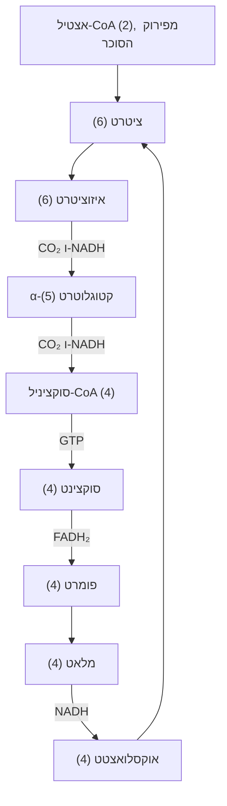
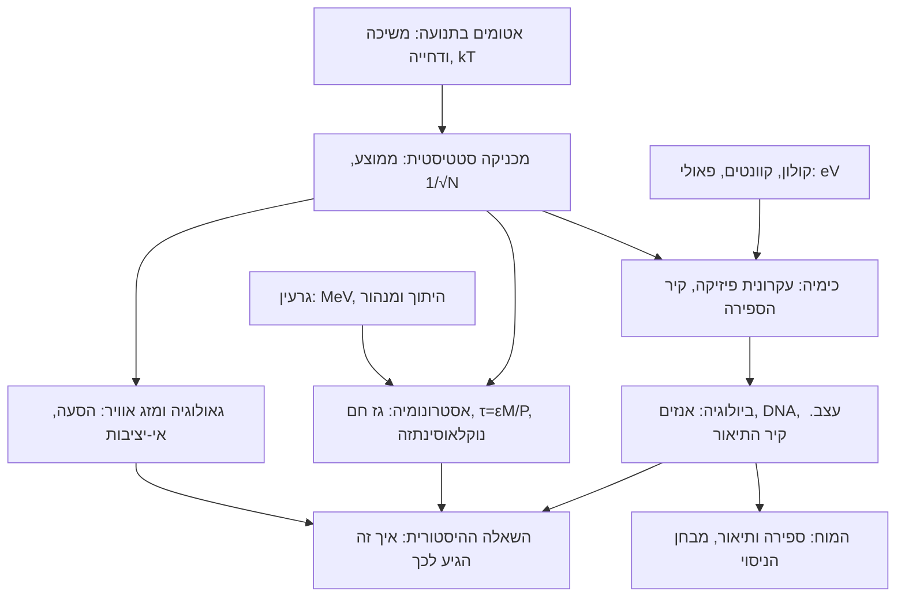

# M0.2 · שיעור 3: הפיזיקה ושאר המדעים: מחוקים פשוטים למערכות מורכבות

מכסה: 3-1 Introduction · 3-2 Chemistry · 3-3 Biology · 3-4 Astronomy · 3-5 Geology · 3-6 Psychology · 3-7 How did it get that way?

## הלומד · שיעור · 2026-11-06

כתוב את שיעור 3 במודול M0.2: הפיזיקה ושאר המדעים: מחוקים פשוטים למערכות מורכבות.

---

## המורה · claude-opus-5-5

## פרק 6: לדעת את החוקים ולחזות: ממוצע במקום מעקב

החוקים שקובעים איך אוויר זורם ידועים לנו כבר יותר ממאה שנה. גם החוקים שקובעים איך שתי מולקולות מגיבות זו עם זו ידועים, כמעט בשלמותם, מאז שנות העשרים. ובכל זאת אי אפשר לחשב מהם את מזג האוויר של בעוד שלושה שבועות, ואי אפשר לחשב בדיוק כמה מהר תתקדם תגובה כימית. מה חסר? הפרק עוסק בפער שבין ידיעת החוקים לבין חיזוי התוצאה, ובשלוש דרכים להתגבר עליו. בסופו נוכל לספור כמה מספרים מעקב מלא היה צריך, ולשפוט לפי זה אם טענה כמו "אפשר לחשב את זה מעקרונות ראשונים" מציאותית. נוכל לחשב כמה קטנה התנודה של ממוצע על $N$ רכיבים, ולבחור לפי זה גודל של תא מדידה. נוכל גם לאמוד כמה ימים קדימה אפשר לחזות מערכת לא יציבה, ולזהות מתי הממוצע עצמו מפסיק לעבוד.

הפרק מתקדם כך. סעיף 6.1 מבחין בין הסבר עקרוני לבין יכולת לחשב, ומציג שלושה קירות שמפרידים ביניהם. סעיף 6.2 מודד את הקיר הראשון, הספירה: כמה מספרים מעקב מלא דורש, בתיאור הקלאסי ובתיאור הקוונטי. סעיף 6.3 מציג את התחליף, ממוצע במקום מעקב, וגוזר את החוק שקובע את הדיוק שלו: התנודה היחסית קטנה כמו $1/\sqrt N$. סעיף 6.4 עוסק במצב שבו הממוצע עצמו לא יציב: מזג אוויר, מים שנופלים ממפל וזרימה בצינור. סעיף 6.5 מראה איך חיזוי מזג אוויר אמיתי משלב את שני הרעיונות.

**מה אנחנו כבר יודעים.** בשיעור הקודם ראינו את משל השחמט: קל ללמוד את החוקים, וקשה לשחק. בשיעור הראשון של המודול ראינו שהניסוי הוא השופט היחיד של טענה על הטבע, ושליטר אוויר מכיל $2.45\times10^{22}$ מולקולות, שכל אחת מהן מתנגשת כ-$7\times10^9$ פעמים בשנייה. ראינו שם גם שהלחץ הוא ממוצע, $p=\tfrac13nm\langle v^2\rangle$, כאשר $n$ היא צפיפות המולקולות, $m$ המסה של מולקולה ו-$\langle v^2\rangle$ הממוצע של ריבוע המהירות. בשיעור השני ראינו את עקרון פאולי ואת מילוי הקליפות. במודול הקודם ראינו שהוכחה מתמטית היא גזירה מאקסיומות, ש-RMS הוא השורש של ממוצע הריבועים, ושרעש העיגול של ממיר אנלוגי-ספרתי הוא $q/\sqrt{12}$, כאשר $q$ הוא גודל צעד העיגול. ראינו שם גם שכל ביט של ממיר מוסיף 6.02 dB, שמספר double תופס 8 בתים, ושבמערכת לא יציבה זמן החיזוי חסום בערך ב-$T\approx\ln K/\sigma$, כאשר $K$ הוא הגורם שבו מותר לשגיאה לגדול ו-$\sigma$ הוא קצב הגדילה שלה.

### 6.1 פיזיקה, מדע, ו"הסבר עקרוני"

**השאלה.** [[F1:32]] בשיעור הקודם ראינו שאפשר לדעת את כל חוקי השחמט ובכל זאת לשחק רע. עכשיו נשאל את אותה שאלה על המדעים: באיזה מובן הכימיה "היא" פיזיקה, ומה חסר כדי לחזות בעזרתה? הפיזיקה של היום היא היורשת של מה שנקרא פעם "פילוסופיה טבעית", המסגרת שממנה צמחו רוב המדעים. לכן הסטודנטים של כמעט כל מדע לומדים פיזיקה. אבל הקשר בין הפיזיקה לשאר המדעים צר יותר ממה שהמשפט "הכול זה אטומים" מרמז.

**מתמטיקה ומדע.** לפני שנשווה בין המדעים צריך להגדיר מה נחשב מדע טבע. מדע טבע הוא תחום שבו טענה נבחנת בניסוי: מדידה אחת שסותרת אותה מפילה אותה. לפי ההגדרה הזו המתמטיקה אינה מדע טבע, כי משפט מתמטי נבחן בגזירה מאקסיומות, כפי שראינו במודול הקודם, ושום מדידה לא תפריך אותו. אין בזה זלזול. דבר שאינו מדע אינו בהכרח רע, כמו שאהבה אינה מדע. ההבחנה חשובה לנו כי בכל מקום בקורס נצטרך לשאול על טענה: האם היא נכונה כי הוכחנו אותה, או כי מדדנו אותה, ובאיזה תחום?

**מנדלייב והסבר עקרוני.** הכימיה המוקדמת עסקה בעיקר בחומרים שאינם קשורים ליצורים חיים: מינרלים, אדמה, מלחים. היא גילתה את היסודות ואת הכללים שקובעים איזה יסוד מתרכב עם איזה, ובכך סיפקה לפיזיקה את רוב הראיות לקיום האטומים. הטבלה המחזורית של מנדלייב סיכמה את הכללים האלה: יסודות שבאותו טור מתנהגים בצורה דומה. תורת הקוונטים הסבירה את הטבלה "עקרונית", דרך עקרון פאולי שראינו בשיעור הקודם. כל קליפה מכילה $2n^2$ אלקטרונים, ולכן מספר האלקטרונים החיצוניים חוזר על עצמו במחזוריות, ואיתו חוזרת ההתנהגות הכימית. כך הכימיה התיאורטית היא במהותה פיזיקה. אבל "עקרונית" פירושו שהמשוואות שקובעות את התשובה ידועות, לא שאפשר לפתור אותן. בדיוק כמו בשחמט: את החוקים אנחנו יודעים, ולשחק אנחנו יודעים רק בקושי. גם היום קשה מאוד לחזות במדויק מה יקרה בתגובה כימית נתונה.

**כימיה של החיים.** [[F1:33]] הענף השני של הכימיה, הכימיה האורגנית, עוסק בחומרים של יצורים חיים. פעם האמינו שחומרים כאלה מיוחדים כל כך שאי אפשר להכין אותם ביד מחומרים דוממים. האמונה הזו נפלה כשוולר סינתז ב-1828 אוריאה, חומר מהשתן, מחומרים דוממים [[ודאות: גבוהה]]. מאז ידוע שאלה אותם אטומים ואותם קשרים, רק בסידורים מסובכים יותר. לכן הבעיות העיקריות של הכימיה האורגנית הן לפרק חומר ביולוגי ולזהות את המבנה שלו, ולבנות אותו מחדש. הדרך הזו מובילה בהדרגה לביוכימיה ולביולוגיה המולקולרית.

**שלושה קירות.** אם החוקים ידועים, משהו אחר עוצר את החישוב, ובפועל אלה שלושה דברים שונים. הקיר הראשון הוא הספירה: מעקב מלא דורש יותר מספרים ממה שאפשר לאחסן ולעדכן. הקיר השני הוא אי-יציבות: הבדל זעיר במצב ההתחלה גדל באופן מעריכי, ולכן שגיאה קטנה בנתונים הופכת לשגיאה מלאה בתחזית. הקיר השלישי הוא תיאור חסר: לא יודעים אילו אטומים יש במערכת ואיפה הם. הטבלה שלהלן מסדרת כמה מערכות לפי מה שמונע לחשב אותן, ולפי מה שמשמש תחליף לחישוב הישיר. כדאי להסתכל על העמודה האחרונה.

```table
{"title": "החוק ידוע, אבל האם אפשר לחשב?", "scope": {}, "columns": ["מערכת", "גודל", "החוק ידוע?", "חישוב ישיר מהחוק", "מה מחליף את החישוב הישיר"], "rows": [
["\"אטום מימן\"", "\"אלקטרון אחד\"", "\"כן\"", "\"פתרון מדויק: 13.6 eV\"", "\"לא צריך תחליף\""],
["\"אטום הליום\"", "\"2 אלקטרונים\"", "\"כן\"", "\"אין נוסחה סגורה\"", "\"חישוב מספרי מדויק מאוד\""],
["\"בנזן\"", "\"42 אלקטרונים\"", "\"כן\"", "\"לא: נדרשים 10^126 מספרים\"", "\"שיטות מקורבות שמכוילות בניסוי\""],
["\"חלבון\"", "\"אלפי אטומים\"", "\"כן\"", "\"לא\"", "\"קירובים, ומבנה שנמדד בניסוי\""],
["\"ליטר אוויר\"", "\"2.45e22 מולקולות\"", "\"כן\"", "\"לא: 1.17e24 בתים למצב אחד\"", "\"ממוצעים: מכניקה סטטיסטית\""],
["\"מים מהירים בצינור\"", "\"זורם רציף\"", "\"כן\"", "\"לא: הזרימה לא יציבה\"", "\"מדידות ונוסחאות ניסיוניות\""],
["\"מזג אוויר\"", "\"האטמוספרה כולה\"", "\"כן\"", "\"רק לטווח קצר\"", "\"ממוצעים בתאים ואוסף של תחזיות\""]
]}
```

בכל השורות התשובה בעמודה "החוק ידוע?" היא כן, ובכל זאת כמעט אף מערכת לא מחושבת ישירות מהחוק. ההבדל בין השורות הוא איזה תחליף מחליף את החישוב: חישוב מספרי, קירוב מכויל, ממוצע או מדידה.

**הקיר השלישי: אילו אטומים ואיפה.** [[F1:40]] הקיר השלישי שונה משני הקודמים, כי הוא לא נוגע לחישוב אלא לקלט. כדי שהפיזיקה תענה על שאלה של מדע אחר, המדע הזה צריך לתאר את האובייקט בשפה של פיזיקאי. על השאלה "למה צפרדע קופצת?" הפיזיקאי לא יכול לענות. אם יאמרו לו מכמה מולקולות היא עשויה ואיפה עובר כל עצב, השאלה הופכת לשאלה שאפשר לעבוד עליה. כלומר החוקים צריכים תנאי התחלה, ובביולוגיה ובגאולוגיה תנאי ההתחלה הם בעצמם רוב הבעיה. גם בכימיה צריך לדעת בדיוק אילו אטומים נמצאים בכלי. אחרת אין על מה להפעיל את החוק.

**גם "עקרונית" היא טענה שצריך לבדוק.** מכאן עולה ביקורת על המשפט "הכול מוסבר עקרונית". הוא נכון רק במקום שבו הראו שהחוקים הידועים קובעים את התשובה, וזה לא תמיד המצב. התנועה של מים ושל אוויר מתוארת ב[[מונח: משוואות נאוויה-סטוקס | משוואות התנועה של נוזל או גז: החוק השני של ניוטון לכל פיסה זעירה של הזורם]]. ועדיין לא הוכח אפילו שהפתרונות שלהן נשארים חלקים לאורך כל הזמן, ומכון קליי מציע פרס על השאלה הזו מאז שנת 2000 [[ודאות: גבוהה]]. בצד השני של הסולם, איננו יודעים איזה שינוי פיזי במוח נשאר כשלומדים עובדה. שם אין לנו אפילו תיאור של המערכת שעליו אפשר להפעיל חוק. לכן על כל טענה של "מוסבר עקרונית" כדאי לשאול שתי שאלות: מי הראה שהחוק קובע את התשובה, ומה בדיוק חסר כדי לחשב אותה?

**מה מחבר ביניהן.** ראינו שהכימיה היא פיזיקה במובן שהחוקים שלה הם חוקי הפיזיקה, ושבין החוק לבין התחזית עומדים שלושה קירות. הקיר הראשון, הספירה, הוא היחיד שאפשר למדוד במספר אחד: כמה מספרים מעקב מלא דורש. נמדוד אותו עכשיו.

```mcq
מה הופך טענה לטענה של מדע טבע?
- [ ] היא נגזרת בהיגיון תקין מהנחות מוגדרות היטב :: זה המבחן של מתמטיקה. משפט מתמטי תקף גם אם שום מדידה לא נוגעת בו, ולכן המתמטיקה אינה מדע טבע.
- [ ] היא מנוסחת במשוואות ובמספרים :: גם טענה כמותית יכולה להיות לא ניתנת לבדיקה. הניסוח המתמטי לא מחליף את השיפוט של הניסוי.
- [x] אפשר לבחון אותה בניסוי, ומדידה שסותרת אותה מפילה אותה :: זה ההבדל בין מדע טבע לבין מתמטיקה: השופט הוא הניסוי.
- [ ] רוב המומחים בתחום מקבלים אותה :: הסכמה אינה מבחן. ראינו בשיעור הראשון שגם חוק מקובל הוא קירוב בתחום תקפות, ומדידה יכולה לשנות אותו.
```

```explain
הטבלה המחזורית "מוסברת עקרונית" בתורת הקוונטים. הסבר בשניים-שלושה משפטים מה המשמעות של הטענה הזו, ולמה היא לא אומרת שאפשר לחשב כל תגובה כימית.
---
- המשמעות: המשוואות שקובעות את מבנה האלקטרונים ידועות, ומהן (עם עקרון פאולי) נובעת המחזוריות של הקליפות ושל ההתנהגות הכימית
- ידיעת המשוואות אינה פתרון שלהן: משל השחמט, חוקים מול משחק
- לפחות אחד מהקירות: כמות המספרים, אי-יציבות, או תיאור חסר של המערכת
===
"מוסבר עקרונית" פירושו שהחוקים שקובעים את התשובה ידועים: עקרון פאולי ומילוי הקליפות קובעים כמה אלקטרונים חיצוניים יש ליסוד, ומכאן המחזוריות של הטבלה. אבל זה המצב של מי שיודע את חוקי השחמט ולא בהכרח יודע לשחק. כדי לחשב תגובה ממשית צריך לפתור את המשוואות למערכת של עשרות אלקטרונים ויותר, וכמות המספרים הנדרשת חוסמת את זה. לכן מחשבים בקירובים שמכוילים בניסוי.
```

### 6.2 קיר הספירה: כמה מספרים צריך

**השאלה.** הקיר הראשון שהגדרנו הוא הספירה, ועכשיו נשאל כמה מספרים דרושים כדי לתאר מצב אחד של מערכת במלואו. נעשה זאת פעמיים: פעם בתיאור הקלאסי של מולקולות כנקודות שנעות, ופעם בתיאור הקוונטי של אלקטרונים. התשובה תקבע איזו מהשתיים היא בעיה טכנית ואיזו בלתי אפשרית בעיקרון.

**ספירה קלאסית.** [[F1:32]] בתיאור הקלאסי, המצב המכני של מערכת הוא רשימת המקומות והמהירויות של כל החלקיקים. אם נדע אותה ברגע אחד, חוקי ניוטון קובעים את ההמשך. לכל חלקיק יש שלוש קואורדינטות של מקום ושלוש רכיבים של מהירות. לכן מצב של $N$ חלקיקים הוא $6N$ מספרים. בליטר אוויר יש $N=2.446\times10^{22}$ מולקולות, ולכן המצב הוא $6N=1.468\times10^{23}$ מספרים. כל מספר נשמר ב-double של 8 בתים, ולכן מצב אחד תופס $1.174\times10^{24}$ בתים. כל נפח האחסון הדיגיטלי בעולם הוא בסדר גודל של $10^{22}$ עד $10^{23}$ בתים [[ודאות: נמוכה]]. כלומר תמונת מצב אחת של ליטר אוויר גדולה פי 10 עד 100 מכל הזיכרון של העולם. וזו רק תמונה אחת. בליטר מתרחשות $8.56\times10^{31}$ התנגשויות של זוגות מולקולות בשנייה, וכל אחת מהן משנה את המצב, ולכן גם עדכון התמונה בזמן הוא מעבר לכל מחשב.

**ספירה קוונטית.** המצב הקלאסי גדל ליניארית במספר החלקיקים, ולכן הוא עוד בגדר בעיה של קנה מידה. במצב הקוונטי של אלקטרונים המצב גרוע הרבה יותר. ראינו בשיעור הקודם שתורת הקוונטים נותנת רק הסתברויות. האובייקט שנושא את ההסתברויות הוא פונקציית הגל: מספר (מרוכב) לכל צירוף אפשרי של המקומות של כל האלקטרונים יחד, שריבוע הגודל שלו נותן את ההסתברות לצירוף הזה. נניח שנסתפק ברשת גסה מאוד, של 10 נקודות בלבד לאורך כל ציר. לאלקטרון אחד יש $10^3$ מקומות אפשריים. ל-$N$ אלקטרונים יש $10^{3N}$ צירופים, ולכל צירוף צריך מספר משלו. מולקולת מים, עם 10 אלקטרונים, דורשת $10^{30}$ מספרים. בנזן, עם 42 אלקטרונים, דורש $10^{126}$ מספרים, בעוד שבכל היקום יש כ-$10^{80}$ אטומים. בגרף שלהלן כדאי להשוות את שיפועי שני הקווים, ולא את הערכים בנקודה אחת.

```chart
{"title": "כמה מספרים דרושים כדי לשמור מצב אחד", "caption": "סולם לוגריתמי: כל שנתה היא פי 10. הקו הקלאסי כמעט שטוח, והקו הקוונטי עולה ב-3 שנתות (פי 1000) לכל אלקטרון נוסף, וחוצה את האחסון העולמי ואת מספר האטומים ביקום.", "type": "line", "x": {"from": 1, "to": 50, "step": 1, "label": "מספר האלקטרונים N"}, "scope": {}, "series": [{"name": "קלאסי: 6N מספרים", "expr": "log10(6*x)"}, {"name": "קוונטי, רשת של 10 נקודות לציר: 10^(3N)", "expr": "3*x"}, {"name": "האחסון העולמי, בבתים (בערך)", "expr": "23"}, {"name": "האטומים ביקום (בערך)", "expr": "80"}], "yLabel": "log10 של כמות המספרים"}
```

הגרף מראה שהבעיה הקוונטית לא נפתרת במחשב גדול יותר. מחשב גדול פי מיליון מוסיף שתי מולקולות של אלקטרונים בקירוב גס כזה, כי כל אלקטרון נוסף מכפיל את הדרישה פי 1000. הסיבה לגדילה המעריכית היא שהאלקטרונים דוחים זה את זה, ולכן ההסתברות למקום של אחד תלויה במקום של האחרים. אם האלקטרונים היו בלתי תלויים, פונקציית הגל הייתה מתפרקת לפונקציה נפרדת לכל אלקטרון. אז היו מספיקים $10^3$ מספרים לכל אלקטרון, ובסך הכול $N\times10^3$ מספרים. אותו רעיון של אי-תלות יחזור בסעיף הבא, הפעם כמקור הכוח של הממוצע.

**מה הכימאים עושים בפועל.** [[F1:33]] מכיוון שהחישוב הישיר חסום, הכימיה התחלקה לשני ענפים, וכל אחד עוקף את הקיר בדרך משלו. הכימיה הפיזיקלית מודדת כמה מהר תגובה מתקדמת ומה קורה בה בפירוט: איך המולקולות פוגעות זו בזו ואיזה חלק ניתק ראשון. הכימיה הקוונטית מחשבת בקירובים. השיטה הנפוצה ביותר היום היא [[מונח: DFT | תורת פונקציונל הצפיפות: מחשבת את צפיפות האלקטרונים במרחב במקום את פונקציית הגל של כל הצירופים]]. העלות שלה גדלה בערך כמו $N^3$ [[ודאות: בינונית]]. לכן הכפלת מספר האלקטרונים מ-42 ל-84 מייקרת אותה פי $2^3=8$, ולא פי $10^{126}$. המחיר הוא שהקירוב מכיל הנחה על האופן שבו האלקטרונים מתואמים, וההנחה הזו מכוילת מול ניסויים. ולכן הניסוי נשאר השופט גם בכימיה "התיאורטית". על השיטה הזו קיבל וולטר קון את פרס נובל בכימיה ב-1998 [[ודאות: גבוהה]].

**ביקורת: רדוקציוניזם נאיבי.** הטענה "אם הכימיה היא פיזיקה, אפשר לחשב כל תגובה" נשמעת כמו מסקנה הגיונית מהסעיף הקודם. היא נכשלת בבדיקת סדר גודל אחת: תגובה של בנזן דורשת $10^{126}$ מספרים, ובכל היקום אין מספיק אטומים כדי לרשום אותם. הניסוח הנכון הוא שהחוקים קובעים את התשובה, אבל כדי לחשב אותה צריך קירוב, וטיב הקירוב נבדק בניסוי. ולגבי ליטר אוויר, ייתכן שבכלל לא צריך מעקב. אם השאלה היא מה הלחץ, ולא איפה כל מולקולה, אולי כמה ממוצעים מספיקים.

```numeric
@answer: 1.174e24
@unit: בתים
@tol: 3%
בליטר אוויר יש $2.446\times10^{22}$ מולקולות. כמה בתים דרושים כדי לשמור את המצב המכני הקלאסי שלו ברגע אחד (מקום ומהירות של כל מולקולה), כשכל מספר נשמר ב-double של 8 בתים?
---
1. מצב של מולקולה אחת: 3 קואורדינטות של מקום ו-3 רכיבים של מהירות, כלומר 6 מספרים.
2. כל המולקולות: $6\times2.446\times10^{22}=1.468\times10^{23}$ מספרים.
3. בבתים: $8\times1.468\times10^{23}=1.174\times10^{24}$ בתים, פי 10 עד 100 מהאחסון העולמי.
- wrong: 1.468e23 :: ספרת מספרים ולא בתים: שכחת את 8 הבתים של כל double.
- wrong: 1.957e23 :: שמרת מספר אחד לכל מולקולה במקום 6: שכחת שמצב מכני כולל מקום ומהירות בשלושה צירים.
```

```mcq
למה אי אפשר לשמור את פונקציית הגל של בנזן (42 אלקטרונים), אפילו על רשת גסה של 10 נקודות לציר?
- [ ] כי 42 אלקטרונים הם יותר מדי חלקיקים, כמו בליטר אוויר :: ליטר אוויר מכיל $10^{22}$ מולקולות, והבעיה שלו ליניארית ($6N$). 42 הוא מספר קטן, והבעיה אינה מספר החלקיקים עצמו.
- [x] כי כמות המספרים היא $10^{3N}$: כל אלקטרון נוסף מכפיל אותה פי 1000, ובנזן מגיע ל-$10^{126}$ :: הגדילה המעריכית נובעת מכך שצריך מספר לכל צירוף של מקומות, ולא רשימה נפרדת לכל אלקטרון.
- [ ] כי חוקי הקוונטים של מולקולות גדולות עוד לא ידועים :: החוקים ידועים. זה בדיוק ההבדל בין הסבר עקרוני לבין יכולת לחשב.
- [ ] כי double של 8 בתים לא מדויק מספיק לחישוב קוונטי :: הדיוק של המספרים אינו הבעיה. גם עם בית אחד למספר, $10^{126}$ מספרים הם יותר מכמות האטומים ביקום.
```

### 6.3 ממוצע במקום מעקב: התנודה היחסית $1/\sqrt N$

**השאלה.** מעקב מלא אחרי ליטר אוויר חסום, ובכל זאת מד לחץ מראה בו מספר יציב, והנוסחה $p=\tfrac13nm\langle v^2\rangle$ חוזה אותו נכון. כלומר כמה ממוצעים מספיקים, במקום $1.468\times10^{23}$ מספרים. הענף שבנוי על הרעיון הזה הוא המכניקה הסטטיסטית: חישוב של תכונות מערכת רבת חלקיקים מממוצעים על התפלגות המצבים שלה, במקום מעקב אחרי כל חלקיק. היא פותחה במשותף בידי פיזיקאים וכימאים, והיא התורה של תופעות החום. השאלה שנענה עליה כאן היא כמה מדויק ממוצע על $N$ רכיבים, ומה קובע את הדיוק שלו. התשובה תאפשר לנו לבחור גודל של תא מדידה, מספר דגימות או גודל של מדגם.

**תוחלת וסטייה.** כדי לדבר על דיוק של ממוצע צריך שלושה מושגים: המרכז של כמות אקראית, הפיזור שלה סביב המרכז, ומתי שתי כמויות לא משפיעות זו על זו.

```definition
@title: תוחלת, שונות, סטיית תקן ואי-תלות
@mark: summary
יהי $X$ משתנה מקרי שמקבל את הערכים $x_1,x_2,\dots$ בהסתברויות $p_1,p_2,\dots$ (כל $p_i\ge0$ ו-$\sum_ip_i=1$).

- **תוחלת**: $\mu=E[X]=\sum_i x_i\,p_i$. בהתפלגות רציפה עם צפיפות $f(x)$ הסכום הופך לאינטגרל, $E[X]=\int x f(x)\,dx$, בתנאי שהוא מתכנס.
- **שונות**: $\mathrm{Var}(X)=E\big[(X-\mu)^2\big]$, הממוצע של ריבוע הסטייה מהתוחלת.
- **סטיית תקן**: $\sigma=\sqrt{\mathrm{Var}(X)}$, באותן יחידות כמו $X$.
- **אי-תלות**: המשתנים $X$ ו-$Y$ בלתי תלויים אם לכל זוג ערכים $P(X=x,\,Y=y)=P(X=x)\,P(Y=y)$. במילים: ידיעת הערך של אחד לא משנה את ההתפלגות של האחר.
- **שונות משותפת**: $\mathrm{Cov}(X,Y)=E\big[(X-\mu_X)(Y-\mu_Y)\big]$. אי-תלות היא תנאי מספיק לכך ש-$\mathrm{Cov}=0$, אבל לא תנאי הכרחי.
```

כל חלק בהגדרה נמצא שם מסיבה. התוחלת היא ממוצע משוקלל לפי ההסתברויות, ולכן היא המרכז שסביבו הערכים מתפזרים. בשונות מעלים את הסטייה בריבוע כדי שסטיות למעלה ולמטה לא יבטלו זו את זו, כי הממוצע של הסטייה עצמה הוא תמיד אפס. המחיר הוא שהיחידות של השונות הן ריבוע היחידות של $X$, ולכן מוציאים שורש ומקבלים את סטיית התקן. סטיית התקן היא בדיוק ה-RMS של הסטייה, אותו RMS שראינו בעיגול של הממיר. תנאי אי-התלות הוא המהותי מכולם. אם מורידים אותו, סטיות של רכיבים שונים יכולות לנוע יחד, ואז, כפי שנראה מיד, הן כבר לא מבטלות זו את זו.

*דוגמה.* מטבע הוגן: $X=1$ (עץ) בהסתברות $\tfrac12$ ו-$X=0$ (פלי) בהסתברות $\tfrac12$. התוחלת היא $\mu=\tfrac12$. הסטייה מהתוחלת היא תמיד $\pm\tfrac12$, ולכן השונות היא $\tfrac14$ וסטיית התקן היא $\tfrac12$. שתי הטלות של מטבע הן בלתי תלויות: התוצאה של הראשונה לא משנה את הסיכויים של השנייה.

**שונות של סכום.** [[2.5: מקור]] כדי לדעת כמה מדויק ממוצע של $N$ רכיבים, נגזור קודם את התוחלת ואת השונות של הסכום שלהם. ההנחה המכרעת, אי-תלות, נכנסת בצעד אחד מסוים, ונציין אותו.

```derivation
@title: התוחלת והשונות של סכום של N רכיבים
נגדיר סכום של $N$ משתנים: $S=X_1+X_2+\dots+X_N$. לכל אחד תוחלת $\mu$ ושונות $\sigma^2$.

**צעד 1: התוחלת של סכום.** התוחלת היא סכום משוקלל, ולכן היא ליניארית: $E[X+Y]=E[X]+E[Y]$, בלי שום הנחה על תלות. מכאן
$$E[S]=\sum_{i=1}^N E[X_i]=N\mu.$$

**צעד 2: הסטייה של הסכום.** נחסר את התוחלת. הסטייה של הסכום היא סכום הסטיות:
$$S-N\mu=\sum_{i=1}^N (X_i-\mu).$$

**צעד 3: ריבוע הסטייה.** ריבוע של סכום כולל את ריבועי האיברים ואת כל המכפלות של זוגות שונים:
$$\Big(\sum_i (X_i-\mu)\Big)^2=\sum_i (X_i-\mu)^2+\sum_{i\ne j}(X_i-\mu)(X_j-\mu).$$

**צעד 4: לוקחים תוחלת.** בגלל הליניאריות מצעד 1 אפשר לקחת תוחלת של כל איבר בנפרד. ריבוע הסטייה נותן $\sigma^2$, ומכפלת הסטיות של זוג נותנת את השונות המשותפת:
$$\mathrm{Var}(S)=\sum_i \sigma^2+\sum_{i\ne j}\mathrm{Cov}(X_i,X_j).$$

**צעד 5: כאן נכנסת אי-התלות.** כשהרכיבים בלתי תלויים, התוחלת של מכפלה היא מכפלת התוחלות. התוחלת של כל סטייה היא אפס, ולכן $\mathrm{Cov}(X_i,X_j)=0$ לכל $i\ne j$. כל האיברים המעורבים נעלמים:
$$\mathrm{Var}(S)=N\sigma^2.$$

**צעד 6: סטיית התקן.** מוציאים שורש: $\sigma_S=\sqrt N\,\sigma$.

**צעד 7: התנודה היחסית.** מחלקים את סטיית התקן בתוחלת:
$$\frac{\sigma_S}{E[S]}=\frac{\sqrt N\,\sigma}{N\mu}=\frac{\sigma}{\mu}\cdot\frac{1}{\sqrt N}.$$
ממוצע של $N$ רכיבים הוא $S/N$, ולכן סטיית התקן שלו היא $\sigma_S/N=\sigma/\sqrt N$.
```

```formula
@title: ממוצע של N רכיבים בלתי תלויים: התנודה היחסית
@mark: summary
$$E[S]=N\mu \tag{1}$$
$$\sigma_S=\sqrt N\,\sigma,\qquad \sigma_{\bar X}=\frac{\sigma}{\sqrt N} \tag{2}$$
$$\frac{\sigma_S}{E[S]}=\frac{\sigma}{\mu}\cdot\frac{1}{\sqrt N} \tag{3}$$
$S$ הוא הסכום של $N$ רכיבים, ו-$\bar X=S/N$ הוא הממוצע שלהם. $\mu$ ו-$\sigma$ הם התוחלת וסטיית התקן של רכיב אחד, ו-$\sigma/\mu$ היא התנודה היחסית של רכיב יחיד. (1) תקפה תמיד. (2) ו-(3) דורשות שהרכיבים יהיו בלתי תלויים, או לפחות בלי שונות משותפת, ושלכל אחד תהיה שונות סופית.
```

**למה $\sqrt N$ ולא $N$.** [[2.5: מבנה]] משוואה (1) אומרת שהתוחלת גדלה כמו $N$, כי כל רכיב תורם לה באותו כיוון. משוואה (2) אומרת שהסטייה גדלה רק כמו $\sqrt N$, כי לסטיות של רכיבים בלתי תלויים יש סימנים אקראיים, והן מבטלות זו את זו בחלקן. לכן היחס ביניהן, במשוואה (3), קטן כמו $1/\sqrt N$. התוצאה תלויה בשתי כמויות בלבד: $N$, ו-$\sigma/\mu$ של רכיב יחיד. רכיב רועש פי 10 דורש פי 100 רכיבים כדי להגיע לאותו דיוק. במאה הטלות של מטבע, לדוגמה, התוחלת היא 50 עצים וסטיית התקן היא $\sqrt{100\cdot\tfrac14}=5$, כלומר תנודה יחסית של 10%, כצפוי מ-$\sigma/\mu=1$ ומ-$1/\sqrt{100}$. ההנחה נשברת כשהרכיבים נעים יחד. אם כל המטבעות מודבקים זה לזה, כל המכפלות בצעד 5 שוות ל-$\sigma^2$, השונות היא $N^2\sigma^2$, ולמיצוע אין שום ערך.

**קוביה של מיקרון.** [[2.5: סדר גודל]] כדי לראות מתי ממוצע על מולקולות יציב, נחשב את התנודה של מספר המולקולות בקוביה קטנה בתוך אוויר. כל מולקולה נמצאת בקוביה או מחוצה לה, ולכן המספר שבתוך הקוביה הוא סכום של משתנים של "כן" או "לא", בהסתברות קטנה. במקרה כזה השונות של הסכום שווה כמעט בדיוק לתוחלת שלו, ולכן התנודה היחסית היא $1/\sqrt{\langle N\rangle}$. מספר המולקולות בקוביה הוא הצפיפות, $n=2.446\times10^{25}$ למטר מעוקב, כפול הנפח. בליטר שלם התנודה היחסית היא $6.39\times10^{-12}$. בקוביה שצלעה 0.1 מ"מ היא $2.02\times10^{-7}$. בקוביה שצלעה מיקרון אחד יש $2.45\times10^7$ מולקולות, והתנודה היא $2.02\times10^{-4}$. בקוביה שצלעה 10 ננומטר יש 24.5 מולקולות בממוצע, והתנודה היא 0.202, כלומר 20%. כדי לאמוד את זה בראש: $\sqrt{2.4\times10^{22}}\approx1.5\times10^{11}$, ולכן בליטר מקבלים כ-$7\times10^{-12}$, קרוב לערך המחושב. ובגרף שלהלן כדאי לשים לב לשיפוע.

```chart
{"title": "התנודה היחסית של מספר המולקולות בקוביית אוויר", "caption": "שני הצירים לוגריתמיים. השיפוע הוא −1.5: הקטנת הצלע פי 10 מקטינה את הנפח פי 1000 ומגדילה את התנודה פי √1000 ≈ 32. הקו האופקי מסמן תנודה של 1%, שאליה מגיעים בקוביה של כ-74 ננומטר.", "type": "line", "x": {"from": -8, "to": -1, "step": 0.25, "label": "log10 של צלע הקוביה (מטר)"}, "scope": {"n": 2.446e25}, "series": [{"name": "1/√N", "expr": "-0.5*(log10(n) + 3*x)"}, {"name": "תנודה של 1%", "expr": "-2"}], "yLabel": "log10 של התנודה היחסית"}
```

הגרף מראה שעד צלע של כ-74 ננומטר הממוצע יציב ברמה של אחוז ויותר, ולכן לחץ וצפיפות הם כמויות מוגדרות היטב. בקנה מידה של עשרות מולקולות הם כבר כמויות רועשות. אותו דבר מסביר את מד הלחץ. מספר הפגיעות בשטח נתון בזמן נתון הוא בסדר גודל של $n\bar v$, כפול השטח והזמן (ספירה מדויקת נותנת גם גורם של $\tfrac14$, שאותו נקבל בלי גזירה). כאן $\bar v=476$ מטר לשנייה היא המהירות הממוצעת שראינו בשיעור הראשון. על סנטימטר רבוע במשך אלפית שנייה מתקבלות כ-$2.9\times10^{20}$ פגיעות, ולכן התנודה היחסית בכוח היא $5.9\times10^{-11}$.

**רזולוציה מול רעש.** [[2.5: פשרה]] משוואה (3) מתמחרת כל ניסיון לראות פרטים קטנים יותר. תא קטן מראה מבנה עדין, אבל מכיל פחות רכיבים, ולכן הוא רועש יותר. הקטנת הצלע פי 2 מקטינה את מספר המולקולות פי 8, ולכן מגדילה את התנודה פי $\sqrt8=2.83$. אותו מחיר משולם גם בזמן. כדי להקטין את הרעש פי 2 צריך פי 4 דגימות, כלומר מדידה איטית פי 4. כל מערכת מדידה בוחרת נקודה על העקומה הזו: כמה פרטים, כמה מהר, ובאיזה רעש. ומכיוון שהשיפוע הוא שורש, השיפור נעשה יקר במהירות. כל ספרה נוספת של דיוק עולה פי 100 בכמות הנתונים.

**מיצוע ממירים וסקרים.** [[2.5: מבנה משותף]] משוואה (2) לא יודעת שמדובר במולקולות. היא חלה על כל סכום של רכיבים בלתי תלויים, ולכן היא מופיעה גם בממיר האנלוגי-ספרתי שפגשנו במודול הקודם, וגם בסקר של דעת קהל. בשני המקרים התרגום עובר כמעט מילה במילה, והוא נשבר בדיוק באותה הנחה, אי-תלות. פירוט שני המיפויים בא בבלוקים שבסוף הסעיף.

**ביקורת: "ארבעה חיישנים, שגיאה קטנה פי ארבעה".** [[2.5: ביקורת]] נניח שמהנדס, או מערכת בינה מלאכותית, כותב: "נמצע ארבעה חיישני טמפרטורה זהים, ולכן השגיאה תקטן פי 4". יש בטענה הזו שתי טעויות, ושתיהן נתפסות במשוואה (2). הראשונה היא טעות של חזקה. השגיאה קטנה כמו $1/\sqrt N$, ולכן ארבעה חיישנים מקטינים אותה פי 2 בלבד. השנייה היא טעות של הנחה. אם לכל החיישנים יש רכיב שגיאה משותף, למשל כיול מאותו יצרן או חום מאותה קופסה, הרכיב הזה לא מתמצע. נניח שמחצית מהשונות של כל חיישן משותפת לכולם. אז השונות של הממוצע היא $0.5+0.5/4$ מהשונות של חיישן יחיד, וסטיית התקן היא 0.79 ממנה, ולא 0.5. הניסוח הנכון: מיצוע של $N$ מדידות מקטין רק את החלק הבלתי תלוי של השגיאה, ורק פי $\sqrt N$. החלק המתואם נשאר בשלמותו, וכדי להקטין אותו צריך מקור מדידה שונה ולא עוד מאותו מקור. זה קרוב לנקודה בהערה שלך על ממוצעים ואירועי קיצון, וגם לטענה ברעיון למאמר שמדגם שנבנה לא נכון לא נעשה טוב יותר כשמגדילים אותו. שגיאה מתואמת לא נעלמת כשמוסיפים עוד דגימות מאותו מקור.

**מה הרווחנו.** ממוצע מחליף מעקב, כי הדיוק שלו משתפר כמו $1/\sqrt N$, ובמערכות של $10^{22}$ רכיבים זה מספיק לכל צורך מעשי. אבל הגזירה הניחה בשקט עוד דבר: שהגודל שעליו ממצעים יציב בזמן. כשהדינמיקה עצמה מגבירה הפרעות קטנות, גם ממוצע מדויק מאוד היום אינו מבטיח ממוצע צפוי מחר. זה הקיר השני, וממנו נמשיך.

```verify
@result: התנודה היחסית של סכום של N רכיבים בלתי תלויים היא (σ/μ)/√N
- **ממדים**: $\sigma$ ו-$\mu$ באותן יחידות, ולכן התנודה היחסית במשוואה (3) חסרת ממד, ו-$\sigma_S$ במשוואה (2) ביחידות של $X$. מצפים ש-(3) לא תלויה ביחידות שנבחרו, וכך הוא.
- **מקרה גבול $N=1$**: (3) נותנת $\sigma/\mu$ של רכיב יחיד, כמו שצריך.
- **מקרה עם תשובה ידועה**: 100 הטלות של מטבע הוגן. ספירה ישירה של ההתפלגות הבינומית נותנת שונות $Np(1-p)=25$, כלומר סטיית תקן 5, בדיוק כמו $\sqrt{100}\times\tfrac12$ מ-(2).
- **מתאם מלא**: אם כל הרכיבים זהים, השונות המשותפת שווה ל-$\sigma^2$, והגזירה (צעד 4) נותנת $N^2\sigma^2$, כלומר אין שיפור. מצפים שבמקרה הזה המיצוע לא יעזור, וכך הוא.
- **התאמה לתוצאה קודמת**: מיצוע של 4 דגימות של רעש בלתי תלוי מקטין את הרעש פי 2, כלומר מוסיף $10\log_{10}4=6.02$ dB. זה בדיוק הערך של ביט אחד בנוסחת יחס האות לרעש $6.02N+1.76$ מהמודול הקודם.
- **סימולציה**: אם נגריל $10^4$ פעמים סכום של 100 הטלות מטבע, נצפה שסטיית התקן של הסכומים תצא קרובה ל-5, בסטייה של אחוז אחד בערך.
```

```domain
@field: signals
@title: מיצוע דגימות בממיר אנלוגי-ספרתי
**המיפוי.** הרכיבים הם דגימות חוזרות של אותו מתח. $\sigma$ היא רעש הממיר (לפחות רעש העיגול $q/\sqrt{12}$), ו-$N$ הוא מספר הדגימות שממצעים.

**מה עובר.** לפי משוואה (2), מיצוע של 16 דגימות מקטין את הרעש פי 4, כלומר מוסיף $10\log_{10}16=12.04$ dB. לפי 6.02 dB לביט מהמודול הקודם, זה שווה ל-2 ביטים של רזולוציה. המחיר, כמו בפשרה שראינו, הוא קצב: 16 דגימות לכל מספר אחד, כלומר מהירות של פי 16 פחות.

**איפה זה נשבר.** אם המתח קבוע והממיר שקט, כל הדגימות נותנות אותו קוד, ושגיאת העיגול שלהן זהה. זה המקרה של מתאם מלא, והמיצוע לא מרוויח כלום. לכן מוסיפים לכניסה [[מונח: דיתור | רעש קטן שמוסיפים בכוונה לכניסה, כדי ששגיאת העיגול תשתנה מדגימה לדגימה]]: הרעש הופך את השגיאות לבלתי תלויות, ורק אז $1/\sqrt N$ חל [[ודאות: גבוהה]].
```

```domain
@field: probability
@title: סקר של 1000 נשאלים
**המיפוי.** כל נשאל הוא רכיב שערכו 1 (תומך) או 0 (לא תומך), כמו המטבע מהדוגמה. אם שיעור התמיכה האמיתי הוא $p=0.5$, אז $\sigma=0.5$, והשיעור שנמדד הוא ממוצע של $N=1000$ רכיבים.

**מה עובר.** לפי משוואה (2), סטיית התקן של השיעור היא $\sqrt{0.25/1000}=1.58\%$. שתי סטיות תקן הן 3.16%, וזה מקור ה"טעות דגימה של ±3%" שמופיעה בסקרים. כדי להקטין אותה פי 2 צריך פי 4 נשאלים, אותו מחיר של שורש שראינו בתא המולקולות.

**איפה זה נשבר.** הנוסחה מניחה שהנשאלים נבחרו באקראי ובאופן בלתי תלוי. אם כולם מאותה שכונה, או שרק סוג מסוים של אנשים עונה לטלפון, נוצרת הטיה משותפת לכולם. ההטיה הזו לא קטנה כשמגדילים את $N$, בדיוק כמו רכיב השגיאה המשותף של החיישנים.
```

```numeric
@answer: 0.000202
@unit: (יחסית, בלי יחידות)
@tol: 3%
צפיפות המולקולות באוויר בטמפרטורת החדר ובלחץ של אטמוספרה אחת היא $n=2.446\times10^{25}$ מולקולות למטר מעוקב. מה התנודה היחסית של מספר המולקולות בקוביה שצלעה מיקרון אחד ($10^{-6}$ מטר)?
---
1. הנפח: $(10^{-6})^3=10^{-18}$ מטר מעוקב.
2. מספר המולקולות הממוצע: $\langle N\rangle=2.446\times10^{25}\times10^{-18}=2.45\times10^7$.
3. מספר המולקולות הוא סכום של משתני "כן או לא" בהסתברות קטנה, ולכן השונות שווה לתוחלת, והתנודה היחסית היא $1/\sqrt{\langle N\rangle}$.
4. $\sqrt{2.45\times10^7}\approx4.9\times10^3$, ולכן התנודה היחסית היא $2.02\times10^{-4}$.
- wrong: 4.09e-8 :: חילקת ב-$N$ במקום ב-$\sqrt N$: הנחת שהסטייה לא גדלה כלל עם $N$, ושכחת שהיא גדלה כמו $\sqrt N$.
- wrong: 2.02e-10 :: חישבת את הנפח כ-$10^{-6}$ מטר מעוקב: שכחת להעלות את הצלע בחזקה שלישית.
```

```mcq
ממצעים את הקריאות של 4 חיישנים זהים. לכל חיישן שגיאה אקראית עם סטיית תקן $\sigma$, והשגיאות שלהם בלתי תלויות. מה סטיית התקן של הממוצע?
- [ ] $\sigma/4$ :: זו הטעות של "ארבעה חיישנים, שגיאה קטנה פי ארבעה". הסטיות מבטלות זו את זו רק בחלקן, ולכן השיפור הוא $\sqrt N$ ולא $N$.
- [ ] $\sigma$, כי מיצוע לא משפר שגיאה אקראית :: זה נכון רק כשהשגיאות מתואמות לחלוטין. כאן הן בלתי תלויות, והאיברים המעורבים בשונות מתאפסים.
- [ ] $\sigma/\sqrt2$ :: זה השיפור של 2 חיישנים, לא של 4.
- [x] $\sigma/2$ :: לפי משוואה (2), $\sigma_{\bar X}=\sigma/\sqrt N=\sigma/\sqrt4$.
```

```explain
מד לחץ שמחובר למכל אוויר מראה מספר יציב, אף שהלחץ נוצר מפגיעות של מולקולות בודדות שמגיעות בזמנים אקראיים. הסבר בשניים-שלושה משפטים למה המחוג לא רועד.
---
- הכוח על המד הוא סכום של מספר עצום של פגיעות בלתי תלויות (בסדר גודל של $10^{20}$ על סנטימטר רבוע באלפית שנייה)
- התנודה היחסית של סכום כזה היא $1/\sqrt N$, כלומר כ-$10^{-10}$: הרבה מתחת לכל מה שמחוג יכול להראות
- הסיבה היא שהסטייה גדלה רק כמו $\sqrt N$ בעוד שהממוצע גדל כמו $N$, כי לסטיות של פגיעות בלתי תלויות יש סימנים אקראיים והן מתבטלות בחלקן
===
הלחץ הוא סכום של מספר עצום של פגיעות בלתי תלויות: על סנטימטר רבוע במשך אלפית שנייה יש כ-$2.9\times10^{20}$ פגיעות. הסכום גדל כמו $N$, אבל הסטייה שלו גדלה רק כמו $\sqrt N$, כי לסטיות של פגיעות בלתי תלויות יש סימנים אקראיים והן מבטלות זו את זו בחלקן. לכן התנודה היחסית היא $1/\sqrt N\approx6\times10^{-11}$, הרבה מתחת לכל מה שמחוג יכול להראות.
```

### 6.4 כשהממוצע לא יציב: מזג אוויר, מפל וצינור

**השאלה.** [[F1:37]] בגזירה של $1/\sqrt N$ הנחנו שני דברים בלי לומר אותם: שהרכיבים בלתי תלויים, ושהגודל שעליו ממצעים לא משנה את אופיו עם הזמן. במזג האוויר שתי ההנחות נפגעות, אף שהאוויר עשוי מאותן מולקולות שבליטר המכל. המשוואות של תנועת האוויר ידועות, ומכשירי המדידה של המטאורולוגיה הם מכשירים של פיזיקה. ובכל זאת אין תורה שמחשבת מהן את מזג האוויר לטווח ארוך. מתי, אם כן, הממוצע עצמו מפסיק להיות צפוי?

**המפל.** [[F1:38]] המים שזורמים לקראת שפת סכר זורמים חלק, ואת מצבם אנחנו יודעים היטב. אבל ברגע שהם מתחילים ליפול הם מתפרקים לגושים ולטיפות, ואין חוק שאומר איפה תיווצר הטיפה הראשונה ומה יהיה גודלה. [[F1:39]] באותו אופן אוויר שזורם בשקט מעל הר הופך במורד למערבולות. הסיבה היא אי-יציבות: הבדל זעיר בין שני מצבי התחלה גדל עד שהוא קובע את הצורה כולה. לכן "לא יודעים את המצב של היום" היא לא בעיה של רשלנות. הרגישות של המערכת הופכת כל אי-דיוק קטן במדידה לטעות מלאה בתחזית.

**כמה זמן אפשר לחזות.** אי-היציבות הזו היא אותה אי-יציבות שפגשנו במודול הקודם, ולכן גם הכלי זהה. שם ראינו שמצב שיווי משקל יציב אם לכל השורשים חלק ממשי שלילי. למטוטלת הפוכה באורך מטר היה שורש חיובי של 3.13 לשנייה, ולכן כל סטייה גדלה פי $e$ בכל 0.319 שנייה. כאן נגזור מאותו רעיון את הזמן שבו התחזית מאבדת ערך. במודול הקודם סימנו את קצב הגדילה ב-$\sigma$. בשיעור הזה $\sigma$ כבר מסמנת סטיית תקן, ולכן נסמן את קצב הגדילה ב-$\gamma$.

נקודת המוצא היא שני מסלולים של אותה מערכת, שמתחילים במרחק קטן $\delta_0$ זה מזה.

כל עוד ההפרש קטן, אפשר ללינאריז את המשוואות סביב המסלול הראשון. לכן ההפרש מקיים משוואה ליניארית, כמו הסטייה של המטוטלת.

לפתרון של משוואה כזו יש רכיבים שגדלים כמו $e^{s t}$, וכעבור זמן קצר שולט בו הרכיב שקצב הגדילה שלו $\gamma$ הוא הגדול ביותר. לכן $\delta(t)\approx\delta_0e^{\gamma t}$.

התחזית מאבדת ערך כשההפרש מגיע לשגיאה הגדולה ביותר שעוד מותר לנו לסבול, $\Delta$. לכן נדרוש $\delta_0e^{\gamma T}=\Delta$.

כדי לבודד את $T$ מחלקים ב-$\delta_0$ ולוקחים לוגריתם טבעי של שני האגפים: $\gamma T=\ln(\Delta/\delta_0)$.

כשמחלקים ב-$\gamma$ מתקבל אופק החיזוי. במערכת כאוטית, שבה המסלול עצמו נע כל הזמן, $\gamma$ הוא הממוצע של קצב הגדילה לאורך המסלול, והוא נקרא [[מונח: מעריך ליאפונוב | קצב הגדילה הממוצע של הפרש זעיר בין שני מסלולים סמוכים, ביחידות של 1 חלקי זמן]].

```formula
@title: גדילת שגיאה ואופק החיזוי
@mark: summary
$$\delta(t)\approx\delta_0\,e^{\gamma t} \tag{4}$$
$$T=\frac{1}{\gamma}\ln\frac{\Delta}{\delta_0} \tag{5}$$
$\delta_0$ היא השגיאה במצב ההתחלה, $\Delta$ השגיאה הגדולה ביותר שעוד מותרת, באותן יחידות כמו $\delta_0$, ו-$\gamma>0$ קצב הגדילה (מעריך ליאפונוב) ביחידות של 1 חלקי זמן. $T$ הוא הזמן שבו התחזית מאבדת ערך. התוצאה תקפה כל עוד ההפרש קטן מספיק כדי שהלינאריזציה תחזיק, כלומר עד בערך $\Delta$. מעבר לזה השגיאה רוויה בגודל של התנודות הטבעיות של המערכת. כש-$\gamma\le0$ המערכת יציבה, והשגיאה לא מגיעה ל-$\Delta$ בכלל.
```

הגורם $1/\gamma$ הוא קבוע הזמן של אי-היציבות. כשהמערכת מגבירה הפרעות מהר יותר, האופק מתקצר באותו יחס. הגורם $\ln(\Delta/\delta_0)$ קובע כמה קבועי זמן יש לנו, והלוגריתם שבו הוא העיקר. נניח שהשגיאה מוכפלת כל 1.5 יום. אז $\gamma=\ln2/1.5=0.462$ ליום, ושגיאה שמותר לה לגדול פי 1000 מגיעה ל-$\Delta$ אחרי 14.95 יום. נתונים טובים פי 10 מקטינים את $\delta_0$ פי 10, ולכן מוסיפים $\ln10/\gamma=4.98$ יום בלבד. בראש אפשר לחשב את זה כך: פי 10 הם $\log_210\approx3.3$ הכפלות של 1.5 יום, כלומר כ-5 ימים. כל ספרה של דיוק בנתונים קונה אותו מספר קבוע של ימים. זה תשלום חמור עוד יותר מהשורש של $1/\sqrt N$.

**ביקורת: "מחשב גדול פי 1000 ייתן תחזית לחודש".** משוואה (5) מראה שהטענה מחליפה את הקיר הלא נכון. מחשב חזק פוגע בקיר הספירה, אבל האופק נקבע ב-$\delta_0$, כלומר בשגיאה של הנתונים ההתחלתיים. פי 1000 בכוח החישוב קונים רשת עדינה פי 10 בכל אחד משני הכיוונים האופקיים וצעד זמן קצר פי 10. במקרה הטוב שגיאת הייצוג קטנה בזכות זה פי 10, וזה מוסיף כ-5 ימים. כדי להגיע ל-30 יום צריך להקטין את $\delta_0$ פי 1046. הניסוח הנכון הוא שכוח חישוב מוסיף ימים רק במידה שהוא מקטין את השגיאה ההתחלתית, ובערך יום אחד לכל פי $e^{\gamma}$.

**דבש מול מים.** [[F1:40]] אי-היציבות מופיעה גם בבעיה הפשוטה ביותר של זרימה: כמה לחץ צריך כדי לדחוף כמות נתונה של מים מהירים בצינור ארוך? אם דוחפים דבש, או מים לאט, התשובה יוצאת ישירות מהחוקים. אם דוחפים מים מהר, אי אפשר לחשב אותה מעקרונות ראשונים ומתכונות המים. הבעיה פתוחה כבר יותר ממאה שנה, אף שהיא חשובה לכוכבים, למזג האוויר ולפנים כדור הארץ. ההבדל בין שני המקרים הוא ההבדל בין שני סוגי זרימה.

```definition
@title: זרימה למינרית וזרימה טורבולנטית
@mark: summary
נתונה זרימה של נוזל או גז עם שדה מהירות $\vec u(\vec x,t)$, בתנאי שפה קבועים בזמן (למשל הפרש לחצים קבוע לאורך צינור).

- **זרימה למינרית**: שדה המהירות משתנה במרחב באופן חלק, ובתנאים קבועים הוא קבוע בזמן. שכבות סמוכות של הזורם מחליקות זו על זו בלי להתערבב, ושני מצבי התחלה סמוכים נשארים סמוכים.
- **זרימה טורבולנטית**: המהירות בנקודה קבועה מתנודדת באופן לא סדיר סביב ממוצע, גם כשתנאי השפה קבועים. בזרימה יש מערבולות במגוון רחב של גדלים, ושני מצבי התחלה סמוכים מתרחקים זה מזה כמו במשוואה (4).

המעבר ביניהן תלוי בגאומטריה ובמספר ריינולדס (שיוגדר מיד), והוא אינו חד: זהו תחום של ערכים, לא סף אחד.
```

ההגדרה מבחינה בין שני הסוגים לפי ההתנהגות בזמן, ולא לפי המהירות. זרימה מהירה יכולה להיות למינרית, וזרימה איטית יכולה להיות טורבולנטית. בזרימה למינרית הממוצע בזמן שווה למהירות עצמה, ולכן החוקים נותנים אותו ישירות. בזרימה טורבולנטית רק הממוצע מוגדר היטב, והוא תלוי במערבולות שאי אפשר לחזות. *דוגמה:* עשן של סיגריה עולה כחוט ישר וחלק כמה סנטימטרים, ואחר כך מתפרק לסלסולים לא סדירים. החוט הוא זרימה למינרית, והסלסולים הם המעבר לטורבולנציה.

**מה מכריע בין השתיים.** כדי לדעת מראש איזו זרימה נקבל צריך להשוות שני כוחות. הכוח הראשון הוא התמדה, שנוטה להגביר כל הפרעה. הכוח השני הוא החיכוך הפנימי של הזורם, שמרסן אותה. את החיכוך הזה מודדים בגודל שנקרא צמיגות.

```definition
@title: צמיגות ומספר ריינולדס
@mark: aid
**צמיגות דינמית**: בזורם ששכבותיו מחליקות זו על זו, $\mu=\tau/(du/dy)$, כאשר $\tau$ הוא כוח הגזירה ליחידת שטח בין השכבות (Pa), ו-$du/dy$ הוא קצב השינוי של המהירות בניצב לזרימה (1/s). היחידות של $\mu$ הן Pa·s.

**מספר ריינולדס**: לזרימה בגודל אופייני $L$ (למשל קוטר הצינור) ובמהירות אופיינית $v$, של זורם בצפיפות $\rho$,
$$Re=\frac{\rho\,v\,L}{\mu}.$$
זהו מספר טהור. הוא מוגדר עד כדי בחירת $L$ ו-$v$, ולכן ערכי סף שלו משווים רק בין זרימות בעלות אותה גאומטריה.
```

המונה של $Re$ בא מההתמדה: הכוח ליחידת נפח שנדרש כדי לשנות מהירות $v$ לאורך מרחק $L$ הוא בסדר גודל של $\rho v^2/L$. המכנה בא מהחיכוך: כוח הצמיגות ליחידת נפח הוא בסדר גודל של $\mu v/L^2$. היחס בין שני הכוחות הוא $\rho vL/\mu$. כשהוא גדל, ההתמדה גוברת, ההפרעות לא נבלמות, והזרימה הופכת לטורבולנטית. בצינור עגול המעבר מתחיל בסביבות $Re\approx2300$ [[ודאות: גבוהה]]. מכיוון ש-$Re$ הוא מספר טהור, שתי זרימות עם אותה גאומטריה ואותו $Re$ מתנהגות אותו דבר. כך בוחנים בניקבת רוח דגם קטן במקום כנף שלמה. נחזור לזה כשנלמד אווירודינמיקה וסימולציה של זרימה. בטבלה הבאה כדאי להשוות את עמודת $Re$ לסף של 2300.

```table
{"title": "מספר ריינולדס של שלוש זרימות", "scope": {}, "columns": ["זרימה", "ρ (kg/m³)", "μ (Pa·s)", "v (m/s)", "L (m)", "Re", "משטר"], "rows": [
["\"דבש בצינור של 2 ס\\\"מ\"", "1420", "10", "0.1", "0.02", "1420*0.1*0.02/10", "\"למינרי\""],
["\"מים בצינור של 2 ס\\\"מ\"", "1000", "1e-3", "1", "0.02", "1000*1*0.02/1e-3", "\"טורבולנטי\""],
["\"רוח מעל גבעה של 1 ק\\\"מ\"", "1.2", "1.8e-5", "10", "1000", "1.2*10*1000/1.8e-5", "\"טורבולנטי\""]
]}
```

בין הדבש למים יש פי $7\times10^4$ במספר ריינולדס, כמעט כולו בגלל הצמיגות. האטמוספרה נמצאת עמוק בתחום הטורבולנטי, ולכן מזג האוויר הוא בעיה של טורבולנציה.

**מה מחליף את החישוב.** בזרימה למינרית החוקים נותנים את מפל הלחץ ישירות, בנוסחת הייגן-פואזיי $\Delta p/L=32\mu v/D^2$, כאשר $D$ הוא קוטר הצינור. למים בצינור של 2 ס"מ במהירות של 1 m/s היא נותנת 80 Pa/m. אבל ב-$Re=2\times10^4$ הזרימה טורבולנטית, והנוסחה הזו פשוט שגויה. מה שמחליף אותה הוא התאמה למדידות, נוסחת בלזיוס מ-1913 [[ודאות: גבוהה]]. מקדם החיכוך שלה הוא $f=0.316\,Re^{-1/4}=0.0266$, ומפל הלחץ הוא $\Delta p/L=f\,\rho v^2/(2D)=664$ Pa/m, פי 8.3 מהערך הלמינרי. את פי 8.3 האלה גורמות מערבולות שמעבירות תנע מהמרכז אל הדופן, והן בדיוק החלק שאיננו יודעים לחשב. גם היום מתכננים צנרת בעזרת טבלאות ונוסחאות ניסיוניות כאלה.

**מתאמים ואירועי קיצון.** [[2.5: גבולות]] המים בצינור מראים ש-$1/\sqrt N$ נשבר בשלושה מצבים, ולכל אחד יש תחליף משלו. המצב הראשון הוא $N$ קטן, כמו 24.5 המולקולות שראינו בקוביה של 10 ננומטר, שם התנודה היא 20%. התחליף הוא לעבוד עם ההתפלגות המלאה ולא רק עם הממוצע. המצב השני הוא מתאמים. במערבולת מיליארדי מולקולות נעות יחד, ולכן הרכיבים הבלתי תלויים הם המערבולות ולא המולקולות. התנודה של הרוח בנקודה אחת היא אחוזים, ולא $10^{-11}$, והתחליף הוא לספור את היחידות הבלתי תלויות לפי גודל המערבולת. המצב השלישי הוא אי-יציבות, כלומר משוואה (4): גם ממוצע מדויק היום מאבד ערך אחרי זמן של $T$. התחליף כאן הוא תחזית הסתברותית. כשרכיבים מתואמים זנבות ההתפלגות כבדים יותר, ולכן סערה, משב חזק או שיטפון קורים לעתים קרובות הרבה יותר ממה ש-$1/\sqrt N$ על רכיבים בלתי תלויים היה צופה. זה ההמשך הישיר לשאלה שבהערה שלך על אירועי קיצון: הממוצע מסתיר אותם בדיוק כשהמתאמים גדולים.

**מה פתוח היום.** הבעיה רחבה יותר ממזג האוויר. בכוכב שמתפתח מגיע שלב שבו מתחילה הסעה, וממנו כבר אי אפשר לגזור מה יקרה. כעבור כמה מיליוני שנים הכוכב מתפוצץ, ולא יודעים לחשב למה. גם את דפוסי התנועה בפנים כדור הארץ איננו יודעים. הקיר כאן הוא גם קיר ספירה. בסימולציה מלאה של טורבולנציה העלות גדלה בערך כמו $Re^3$ [[ודאות: גבוהה]], וזה תוצאה של קולמוגורוב מ-1941, אותו קולמוגורוב שכתב את ספר המתמטיקה של הקורס. לצינור המים זה $8\times10^{12}$ צעדים כפול תאים, וזה אפשרי. לרוח מעל הגבעה זה $3\times10^{26}$, וזה בלתי אפשרי. לכן משלבים פתרון של המשוואות בקנה מידה גדול עם קירוב מכויל לכל מה שקטן מתא הרשת. את ההיגיון של אי-יציבות במודל מזג אוויר גילה אדוארד לורנץ ב-1963 [[ודאות: גבוהה]].

**מה הרווחנו.** משוואה (5) נותנת אופק שגדל רק לוגריתמית באיכות הנתונים, ומספר ריינולדס אומר מתי האופק הזה קצר. כך יש לנו שני מספרים שמכריעים אם ממוצע יספיק: $1/\sqrt N$ אומר כמה רועש הוא היום, ו-$T$ אומר כמה זמן הוא יישאר שימושי.

כדי לראות את משוואה (4) בפעולה, כדאי להזיז במחוונים את $\gamma$ ואת $\delta_0$ ולעקוב אחרי הקו המקווקו.

```anim
{"title": "שני מסלולים שמתחילים כמעט באותה נקודה", "caption": "הקו המודגש הוא ה'מציאות', והקו השני הוא התחזית שהתחילה בשגיאה δ0. ציר הזמן בימים. הקו המקווקו מסמן את האופק T = ln(Δ/δ0)/γ, עם Δ = 1. הקטנה של δ0 פי 10 מזיזה את הקו רק ב-ln10/γ.", "duration": 15, "view": {"x": [0, 15], "y": [-3, 3]},
 "params": [{"id": "g", "label": "γ (1/יום)", "min": 0.2, "max": 1, "value": 0.462}, {"id": "d0", "label": "δ0 (שגיאה התחלתית)", "min": 0.0001, "max": 0.1, "value": 0.001}],
 "shapes": [
  {"type": "path", "x": "s", "y": "sin(1.3*s)", "s": [0, 15], "accent": true},
  {"type": "path", "x": "s", "y": "sin(1.3*s) + min(1.6, d0*exp(g*s))*cos(0.7*s)", "s": [0, 15]},
  {"type": "line", "x1": "log(1/d0)/g", "y1": "-3", "x2": "log(1/d0)/g", "y2": "3", "dash": true},
  {"type": "circle", "x": "t", "y": "sin(1.3*t)", "r": "0.15", "label": "מציאות"},
  {"type": "circle", "x": "t", "y": "sin(1.3*t) + min(1.6, d0*exp(g*t))*cos(0.7*t)", "r": "0.15", "label": "תחזית"},
  {"type": "text", "x": "7.5", "y": "2.6", "text": "T = {round(log(1/d0)/g, 1)} ימים"}
 ]}
```

הקווים כמעט חופפים לאורך רוב הדרך, ומתפצלים בבת אחת ליד האופק. הגדלה של $\gamma$ מקרבת את האופק פי אותו גורם, והקטנה של $\delta_0$ פי 1000 רק מכפילה אותו בערך.

```verify
@result: אופק החיזוי T = ln(Δ/δ0)/γ
- **ממדים**: $\gamma$ ביחידות של 1 חלקי זמן, ו-$\Delta/\delta_0$ חסר ממד. מצפים ש-$T$ ייצא ביחידות של זמן, וכך הוא.
- **מקרה גבול $\delta_0=\Delta$**: השגיאה כבר מלאה בהתחלה, ו-(5) נותנת $T=\ln1/\gamma=0$, כמו שצריך.
- **מערכת יציבה**: כש-$\gamma<0$, (5) נותנת $T$ שלילי, כלומר השגיאה לעולם לא מגיעה ל-$\Delta$. זה מתאים לכלל של המודול הקודם: כל השורשים בחצי השמאלי פירושם שהפרעות דועכות.
- **התאמה לתוצאה קודמת**: במטוטלת ההפוכה ($\gamma=3.13$ לשנייה), סטייה של אלפית רדיאן מגיעה לעשירית רדיאן אחרי $\ln100/3.13=1.47$ שנייה, כלומר אחרי כ-4.6 קבועי זמן של 0.319 שנייה.
- **הכפלת $\Delta/\delta_0$ פי 10**: מצפים לתוספת קבועה של $\ln10/\gamma$, ללא קשר לנקודת המוצא. בהכפלה כל 1.5 יום זה 4.98 יום, גם מ-$K=10$ וגם מ-$K=1000$.
- **ניסוי מספרי**: בסימולציה של מודל לורנץ מ-1963, שמעריך ליאפונוב שלו 0.906 [[ודאות: גבוהה]], שתי הרצות שנבדלות ב-$10^{-8}$ צפויות להתפצל לגודל של 1 אחרי $\ln10^8/0.906=20.3$ יחידות זמן.
```

```numeric
@answer: 4.98
@unit: ימים
@tol: 3%
שגיאת התחזית מוכפלת כל 1.5 יום. בזכות לוויינים חדשים, השגיאה ההתחלתית קטנה פי 10, והשגיאה המותרת $\Delta$ לא השתנתה. בכמה ימים מתארך אופק החיזוי?
---
1. קצב הגדילה: $\gamma=\ln2/1.5=0.462$ ליום.
2. לפי משוואה (5), $T=\ln(\Delta/\delta_0)/\gamma$. כשמקטינים את $\delta_0$ פי 10, הלוגריתם גדל ב-$\ln10=2.303$.
3. התוספת: $2.303/0.462=4.98$ יום. בראש: פי 10 הם כ-3.3 הכפלות של 1.5 יום.
- wrong: 149.5 :: הכפלת את האופק כולו פי 10. אבל השגיאה ההתחלתית נכנסת דרך לוגריתם, ולכן פי 10 בנתונים מוסיף זמן קבוע ולא מכפיל.
- wrong: 1.5 :: הנחת שפי 10 שווה הכפלה אחת. כדי להגיע לפי 10 צריך $\log_210\approx3.3$ הכפלות.
```

```mcq
דבש זורם בצינור שקוטרו 2 ס"מ במהירות של 0.1 m/s. מספר ריינולדס שלו הוא 0.28. מה אפשר לומר על הזרימה?
- [ ] היא טורבולנטית, כי דבש הוא נוזל סמיך שזורם באופן לא אחיד :: הסמיכות פועלת בכיוון ההפוך: הצמיגות במכנה של $Re$ בולמת הפרעות, וזה מה שמקטין את $Re$.
- [x] היא למינרית, ולכן אפשר לחשב את מפל הלחץ ישירות מהחוקים :: $Re$ קטן בהרבה מ-2300, כלומר החיכוך הפנימי גובר על ההתמדה, הפרעות נבלמות, והנוסחה של הייגן-פואזיי תקפה.
- [ ] אי אפשר לדעת בלי לדעת גם את אורך הצינור :: $Re$ כבר משווה בין ההתמדה לחיכוך. אורך הצינור משנה את מפל הלחץ הכולל, לא את סוג הזרימה.
- [ ] היא למינרית רק אם הצינור חלק לגמרי :: חספוס משנה את המעבר רק סביב הסף של 2300. ב-$Re=0.28$ כל הפרעה נבלמת.
```

### 6.5 מקרה: חיזוי מזג האוויר המספרי

**השאלה.** שני הקירות שמדדנו, הספירה ואי-היציבות, פוגשים זה את זה בבעיה אחת: התחזית היומית. אי אפשר לעקוב אחרי מולקולות האטמוספרה, ולכן חייבים ממוצע. הממוצע הזה טורבולנטי, ולכן הוא חסום באופק. איך מערכת אמיתית משלבת את שני הרעיונות, ומה המספרים שלה מלמדים על המודל שבנינו? לשם כך צריך שני כלים: ממוצע מרחבי, ותחזית שבנויה מהרבה תחזיות.

**תא רשת.** הדרך לעבור ממיליארדי מולקולות לכמה מספרים היא לחלק את המרחב לתאים, ולשמור לכל תא רק את הממוצעים.

```definition
@title: ערך של תא רשת
@mark: aid
נתון שדה $u(\vec x,t)$, למשל טמפרטורה או רכיב של מהירות, ונתונה חלוקה של המרחב לתאים $V_j$ שאינם חופפים. הערך של התא $j$ הוא הממוצע המרחבי
$$\bar u_j(t)=\frac{1}{|V_j|}\int_{V_j}u(\vec x,t)\,dV,$$
כאשר $|V_j|$ הוא נפח התא. המודל מתקדם בזמן לפי הערכים $\bar u_j$ בלבד. השפעתם של תהליכים שקטנים מהתא, כמו מערבולות ועננים, מוכנסת בקירוב שמכויל במדידות.
```

הממוצע מוחק את כל מה שקורה בתוך התא, ולכן יש לו שני צדדים. מצד אחד מספר המספרים יורד מ-$6N$ של מולקולות לכמה משתנים לכל תא. מצד שני, הקירוב לתהליכים שבתוך התא הוא מקור שגיאה שהחוקים לא מכסים. *דוגמה:* בתא שצלעו 9 ק"מ, ענן רעמים ברוחב 2 ק"מ לא נראה כענן. הוא מופיע רק כתוספת לממוצע של הלחות ושל החום בתא.

**אנסמבל.** משוואה (5) אומרת שאחרי האופק תחזית אחת חסרת ערך. אבל אפשר לשאול שאלה אחרת: לא "מה יהיה" אלא "מה הסיכוי".

```definition
@title: תחזית אנסמבל
@mark: aid
נתונים מצב התחלה משוער $\hat x_0$ והתפלגות של השגיאה בו. אנסמבל בגודל $M$ הוא $M$ תחזיות שכל אחת מתחילה במצב $\hat x_0+\epsilon^{(m)}$, כאשר ההפרעות $\epsilon^{(m)}$ נבחרות כך שיתאימו להתפלגות השגיאה. הממוצע של התחזיות הוא התחזית הטובה ביותר, הפיזור שלהן מעריך את אי-הוודאות, והשבר של התחזיות שבהן קורה אירוע מסוים מעריך את ההסתברות שלו. ההערכה תקפה רק אם ההפרעות מייצגות את השגיאה האמיתית.
```

האנסמבל ממצע על תחזיות ולא על מולקולות, והוא משתמש ב-$1/\sqrt N$ פעם שנייה: עם $M$ תחזיות ההסתברות לאירוע מוערכת בדיוק של כ-$1/\sqrt M$. אבל הוא לא מאריך את האופק. הוא מחליף תשובה אחת שהולכת ומשתבשת בהתפלגות שהולכת ומתרחבת. *דוגמה:* אם ב-30 מתוך 51 תחזיות יורד גשם בעוד שבוע, התחזית היא "סיכוי של כ-60% לגשם".

הטבלה הבאה מרכזת את המספרים של מערכת החיזוי של המרכז האירופי, ECMWF. כדאי להשוות בה בין שתי שורות: התנודה הסטטיסטית בתא ושגיאת המדידה.

```table
{"title": "החיזוי של ECMWF במספרים", "scope": {}, "columns": ["גודל", "ערך", "איך מתקבל"], "rows": [
["\"מרווח רשת אופקי\"", "\"9 ק\\\"מ\"", "\"נתון [ודאות גבוהה]\""],
["\"שכבות גובה\"", "137", "\"נתון [ודאות גבוהה]\""],
["\"עמודות\"", "\"6.30e6\"", "\"שטח כדור הארץ 5.10e14 מ\\\"ר חלקי (9 ק\\\"מ)²\""],
["\"תאים\"", "\"8.63e8\"", "\"עמודות כפול 137\""],
["\"מולקולות באטמוספרה\"", "\"1.07e44\"", "\"5.15e18 ק\\\"ג חלקי מסה של מולקולת אוויר\""],
["\"מולקולות בתא\"", "\"1.24e35\"", "\"מולקולות חלקי תאים\""],
["\"תנודה סטטיסטית בתא, 1/√N\"", "\"2.8e-18\"", "\"משוואה (3)\""],
["\"שגיאת מדידה של טמפרטורה, כ-1 K מתוך 250 K\"", "\"4e-3\"", "\"גדולה פי 1.4e15 מהתנודה הסטטיסטית\""],
["\"מצב אחד: 10 משתנים ב-float32\"", "\"34.5 GB\"", "\"8.63e8 תאים × 10 × 4 בתים\""],
["\"שיפור בכושר החיזוי\"", "\"יום אחד לכל עשור\"", "\"נמדד מול המציאות (Bauer ושותפיו, 2015)\""]
]}
```

הטבלה מראה שהקיר הסטטיסטי נעלם כמעט לגמרי, כי התנודה בתא קטנה פי $10^{15}$ משגיאת המדידה. מה שנשאר הוא הקירוב לתהליכים שבתוך התא, והשגיאה במצב ההתחלה.

```casestudy
@title: מזג האוויר של ECMWF: תאים כממוצעים, ואופק של שבועיים
**המערכת.** המרכז האירופי לתחזיות בינוניות טווח (ECMWF) מריץ מודל גלובלי עם רשת של 9 ק"מ ו-137 שכבות [[ודאות: גבוהה]]. בנוסף הוא מריץ אנסמבל של 51 תחזיות: תחזית אחת בלי הפרעה, ו-50 תחזיות שמתחילות ממצבים מופרעים [[ודאות: גבוהה]]. מאז 2023 גם תחזיות האנסמבל רצות ברזולוציה של 9 ק"מ [[ודאות: בינונית]].

**הספירה.** לפי הטבלה שלפני המקרה, מצב אחד של כל המודל תופס 34.5 GB, ואילו מצב קלאסי של ליטר אוויר אחד תופס $1.174\times10^{24}$ בתים. כלומר הממוצע בתאים הוא מה שהופך את הבעיה מבלתי אפשרית למשימה של מחשב-על. זה הקיר הראשון, והוא נפתר.

**הרעש בתא.** בכל תא יש $1.24\times10^{35}$ מולקולות, ולכן לפי משוואה (3) התנודה הסטטיסטית היא $2.8\times10^{-18}$. אילו זה היה מקור השגיאה, התחזית הייתה מושלמת. אבל בתוך התא האוויר טורבולנטי, ומערבולות שגודלן מ-9 ק"מ ועד מילימטרים מזיזות את המולקולות יחד. לכן מספר הרכיבים הבלתי תלויים קטן בהרבה מ-$10^{35}$, וההשפעה של המערבולות על הממוצע מוכנסת בקירוב. מצב ההתחלה ידוע רק מתחנות, מבלונים, ממטוסים ומלוויינים, בשגיאה של כ-1 K בטמפרטורה [[ודאות: בינונית]].

**האופק מול המודל.** שגיאה בקנה מידה של מערכות לחץ מוכפלת בערך כל 1.5 יום [[ודאות: בינונית]]. לפי משוואה (5), עם $K=1000$ זה נותן אופק של 14.95 יום. זה קרוב לגבול של כשבועיים שלורנץ העריך ב-1969 [[ודאות: גבוהה]]. תחזית "שימושית" דורשת שגיאה קטנה יותר מהרוויה המלאה, למשל $K=100$, ואז האופק הוא 9.97 יום. בפועל, התחזית הדטרמיניסטית של ECMWF שומרת על ערך עד כשמונה עד עשרה ימים [[ודאות: בינונית]]. ההתאמה הזו היא בדיקה אמיתית של המודל, כי מדד הכושר נמדד בהשוואה של תחזיות למציאות ולא מתוך משוואה (5).

**יום לכל עשור.** הבדיקה החזקה יותר היא הקצב שבו המערכת השתפרה. כושר החיזוי גדל בכיום אחד לכל עשור [[ודאות: בינונית]], כלומר תחזית לחמישה ימים היום טובה כמו תחזית לארבעה ימים לפני עשור. לפי משוואה (5), יום נוסף מחייב להקטין את השגיאה האפקטיבית פי $e^{0.462}=1.59$. לכן חצי מאה של לוויינים, מחשבים ושיטות להטמעת מדידות במודל הקטינה אותה בערך פי 10. אילו כוח החישוב לבדו היה קובע, השיפור היה מהיר בהרבה, כי כוח החישוב גדל באותה תקופה בסדרי גודל רבים. המספר האיטי של יום לעשור הוא בדיוק החתימה של הלוגריתם.

**מה זה מלמד.** החוקים ידועים. הממוצע עובד, והרעש הסטטיסטי שלו זניח. התחזית נעצרת בגלל אי-יציבות, ולכן אחרי שבוע עוברים להסתברויות של האנסמבל. אבל כל זה עבד כי האטמוספרה היא גז: $10^{44}$ רכיבים פשוטים ודומים זה לזה. ומה קורה במערכת שבה מעט מולקולות מסובכות, כל אחת במקומה המדויק, קובעות את התוצאה, כמו חלבון בתא חי?
```

**מה מחבר בין השיטות.** המקרה מראה שלוש שיטות, וכל אחת מהן נשברת במקום אחר. מעקב מלא דורש $6N$ מספרים, או $10^{3N}$ בתיאור קוונטי, והוא עובד רק כשיש מעט חלקיקים. ממוצע דורש מספר גדול של רכיבים בלתי תלויים ודינמיקה יציבה, והוא נותן דיוק של $1/\sqrt N$. אנסמבל מחליף את התחזית האחת בהתפלגות, ומשלם על כך במספר $M$ של הרצות מלאות. במזג האוויר נדרשים שלושתם: תאים כממוצעים, קירוב לתהליכים שבתוך התא, ואנסמבל אחרי האופק.

**ומה עם החלבון.** בטבלת הקירות של סעיף 6.1 הופיעה גם שורת החלבון: אלפי אטומים, החוק ידוע, והמבנה נמדד בניסוי. לחלבון אף אחת משלוש השיטות לא מתאימה כמו שהיא. לממוצע אין בו מספיק רכיבים, ולמעקב קוונטי מלא יש בו יותר מדי. ויותר מזה, בתא חי מנה קטנה של מולקולות במקום מסוים קובעת אם תגובה תקרה בכלל. כאן הקיר השלישי, התיאור, הוא העיקר: איזו מולקולה, איפה, ובאיזה סדר.

**מה בנינו בפרק.** בנינו מפה של המרחק בין חוק לבין תחזית. הקיר של הספירה נמדד במספרים: $1.174\times10^{24}$ בתים לליטר אוויר, ו-$10^{126}$ מספרים לבנזן. הממוצע עקף את הקיר הזה בדיוק של $1/\sqrt N$, והגבולות שלו הם $N$ קטן, מתאמים ואי-יציבות. אי-היציבות חוסמת כל תחזית באופק $T=\ln(\Delta/\delta_0)/\gamma$, ומספר ריינולדס אומר מתי היא שולטת. עכשיו אפשר לפנות לביולוגיה, לאסטרונומיה ולגאולוגיה, ולשאול על כל אחת מהן איזה קיר עוצר בה את הפיזיקה, ומה מחליף בה את החישוב.

```mcq
בתא של מודל מזג אוויר ברשת של 9 ק"מ יש כ-$1.24\times10^{35}$ מולקולות. מה המקור העיקרי של השגיאה בערך הטמפרטורה שהמודל שומר לתא?
- [ ] התנודה הסטטיסטית של מספר המולקולות בתא, $1/\sqrt N$ :: היא $2.8\times10^{-18}$, קטנה פי $10^{15}$ משגיאת המדידה. הקיר הסטטיסטי לא משחק כאן תפקיד.
- [ ] העיגול של float32, שמדויק רק עד כשבע ספרות :: $1.19\times10^{-7}$ יחסית הם אלפית מעלה מתוך 250 K, הרבה מתחת לשגיאה של 1 K במדידה.
- [x] הקירוב לתהליכים שקטנים מהתא, כמו מערבולות ועננים, והשגיאה במצב ההתחלה, שגדלה עם הזמן :: המולקולות בתוך התא נעות יחד במערבולות, ולכן אינן רכיבים בלתי תלויים. המדידה ההתחלתית שגויה בכ-1 K, והשגיאה מוכפלת כל כ-1.5 יום.
- [ ] העובדה שמשוואות התנועה של האוויר עוד לא ידועות :: החוקים ידועים. הבעיה היא לפתור אותם במערכת לא יציבה עם נתונים חלקיים.
```

```numeric
@answer: 1.24e35
@unit: מולקולות
@tol: 3%
באטמוספרה יש כ-$1.07\times10^{44}$ מולקולות. מודל חיזוי מחלק אותה ל-$6.30\times10^6$ עמודות אופקיות ול-137 שכבות גובה. כמה מולקולות יש בממוצע בתא אחד?
---
1. מספר התאים: $6.30\times10^6\times137=8.63\times10^8$.
2. מולקולות לתא: $1.07\times10^{44}/8.63\times10^8=1.24\times10^{35}$.
3. לבדיקה: התנודה היחסית בתא היא $1/\sqrt{1.24\times10^{35}}=2.8\times10^{-18}$, זניחה לגמרי.
- wrong: 1.7e37 :: חילקת במספר העמודות ולא במספר התאים: שכחת את 137 השכבות.
- wrong: 2.8e-18 :: זו התנודה היחסית בתא, לא מספר המולקולות שבו.
```

```explain
למה מרכז חיזוי מריץ עשרות תחזיות מאותה נקודת זמן במקום תחזית אחת מדויקת יותר? הסבר בשניים-שלושה משפטים.
---
- מצב ההתחלה ידוע רק בשגיאה, והשגיאה גדלה מעריכית ($\delta_0e^{\gamma t}$), ולכן אחרי האופק תחזית אחת חסרת ערך
- הרצה מכמה מצבי התחלה שמייצגים את השגיאה נותנת פיזור, ולכן הערכה של אי-הוודאות ושל הסתברות לאירועים
- שיפור הדיוק של תחזית אחת מאריך את האופק רק לוגריתמית, ולכן הוא לא מחליף את האנסמבל
===
מצב ההתחלה ידוע רק בשגיאה, והאטמוספרה מגבירה אותה מעריכית, ולכן אחרי כשבוע עד שבועיים תחזית אחת היא כמעט ניחוש. אנסמבל מריץ את המודל מכמה מצבי התחלה שמייצגים את השגיאה הזו. הפיזור בין התחזיות מראה כמה התחזית אמינה, והשבר של התחזיות שבהן קורה אירוע נותן את ההסתברות שלו. שיפור של תחזית אחת לא היה מחליף את זה, כי שיפור בנתונים מאריך את האופק רק לוגריתמית.
```

```mcq
שגיאת התחזית מוכפלת כל 1.5 יום, והאופק הנוכחי הוא כ-15 יום ($K=1000$). פי כמה צריך להקטין את השגיאה ההתחלתית כדי להגיע לאופק של 30 יום?
- [ ] פי 2, כי רוצים אופק כפול :: האופק תלוי בלוגריתם של השגיאה ההתחלתית, ולא בשגיאה עצמה. פי 2 בנתונים מוסיף רק 1.5 יום.
- [ ] פי 10 :: פי 10 מוסיף $\ln10/0.462=4.98$ יום בלבד, ואז האופק הוא כ-20 יום.
- [x] בערך פי 1000 :: נדרשים עוד 15.05 יום, כלומר פי $e^{0.462\times15.05}=1046$. בקצב של יום לעשור, זה כ-150 שנה של התקדמות.
- [ ] אי אפשר בכלל, כי משוואה (5) לא מאפשרת אופק ארוך מ-15 יום :: משוואה (5) לא קובעת תקרה. היא רק אומרת שכל יום נוסף עולה פי 1.59 בשגיאה ההתחלתית.
```

## פרק 7: החיים, הכוכבים והאדמה בשפת האטומים

תא חי מפרק סוכר ב-37 מעלות, בתוך מים, בתוך שניות. כימאי שמנסה לעשות את אותו דבר במבחנה צריך חום, חומצה וזמן. כוכב בוער מיליארדי שנים. כדור הארץ שמתחת לרגלינו מובן לנו פחות מליבת השמש. בפרק הקודם ראינו שלושה קירות שמפרידים בין החוק לבין התחזית: הספירה, אי-היציבות והתיאור החסר. עכשיו נבדוק בכל מדע איזה קיר עוצר בו את הפיזיקה, ומה מחליף בו את החישוב. בסוף הפרק נוכל לחשב פי כמה מאיץ אנזים תגובה, לפי הירידה במחסום שלה. נוכל לספור בביטים את המידע שב-DNA, ולאמוד את הזמן ואת השדה החשמלי באות של עצב. נוכל גם לאמוד כמה זמן יחזיק כל מאגר אנרגיה, מהשמש ועד סוללה, ולשפוט טענות של "הכול מוסבר" לפי סדרי גודל.

הפרק מתקדם מהקטן לגדול. סעיף 7.1 עוסק במכונה הכימית של התא: מחסומי אנרגיה, אנזימים, ותיוג של אטומים באיזוטופים. סעיף 7.2 עוסק במידע: חלבונים, DNA והקוד שמתרגם ביניהם. סעיף 7.3 עוסק באותות של התא, כלומר בעצבים ובשריר. סעיף 7.4 עובר לכוכבים, ושואל איך יודעים ממה הם עשויים. סעיף 7.5 שואל כמה זמן מחזיק מאגר אנרגיה, ובונה כלל אחד לשמש, לגוף ולסוללה. סעיף 7.6 עוסק בגאולוגיה, בפסיכולוגיה ובשאלה ההיסטורית. סעיף 7.7 מסיים במקרה של גיל השמש: חישוב נכון שנפל בגלל הנחה סמויה.

**מה אנחנו כבר יודעים.** בשיעור הראשון של המודול ראינו שהאנרגיה התרמית האופיינית לחלקיק היא $kT$, ושבטמפרטורת החדר היא 25.85 meV. ראינו שם גם שמולקולה מתאדה רק כשהיא צוברת במקרה מספיק אנרגיה כדי לעבור מחסום, ולכן קצב האידוי רגיש מאוד לטמפרטורה. בשיעור השני ראינו שהגרעין בנוי מפרוטונים ומנייטרונים, ושמספר הפרוטונים קובע את מספר האלקטרונים, ולכן את היסוד ואת הכימיה שלו. ראינו שם שהחומר כמעט נייטרלי לגמרי, שמטען יוצר שדה חשמלי, ושאנרגיה גרעינית נמדדת ב-MeV ואילו אנרגיה כימית נמדדת ב-eV. במודול הקודם ראינו מכל שדולף, שבו הגובה דועך מעריכית עם קבוע זמן $\tau$. בפרק הקודם ראינו שידיעת החוקים אינה יכולת לחשב, ושהתנודה של ממוצע על $N$ רכיבים בלתי תלויים קטנה כמו $1/\sqrt N$.

### 7.1 המחסום והאנזים

**השאלה.** הפרק הקודם נסגר בחלבון: מעט מולקולות מסובכות שקובעות במקום מסוים אם תגובה תקרה בכלל. הפעולה הבסיסית של התא היא תגובה כימית. אבל רוב התגובות שהתא מריץ בשניות כמעט לא מתרחשות במבחנה באותה טמפרטורה. מה יש בתא שאין במבחנה? כדי לענות צריך להבין קודם למה תגובה כימית לא קורה, גם כשהתוצרים שלה יציבים יותר מהמגיבים.

**ויטליזם ומאייר.** [[F1:33]] עד המאה ה-19 רבים האמינו ב"כוח חיים", כוח מיוחד שפועל רק ביצורים חיים. ההשקפה הזו נקראת ויטליזם. ראינו בסעיף 6.1 איך הסינתזה של אוריאה הפילה את הצד הכימי שלה. הצד האנרגטי נפל דרך הביולוגיה עצמה. יוליוס רוברט מאייר היה רופא אוניה, ובשנת 1840 הבחין שדם הוורידים של מלחים באזורים הטרופיים אדום ובהיר מהרגיל [[ודאות: גבוהה]]. ההסבר שלו היה שבחום הגוף צריך לשרוף פחות מזון כדי לשמור על הטמפרטורה שלו, ולכן נשאר בדם יותר חמצן. מכאן הסיק שהחום והעבודה של הגוף באים מאותו מקור, אנרגיה כימית של המזון, ושהסכום שלהם נשמר. ב-1842 פרסם את אחת הניסוחים הראשונים של שימור האנרגיה [[ודאות: גבוהה]]. כלומר הגוף החי אינו פטור מחוקי הפיזיקה. הוא מנוע כימי, ולכן צריך להסביר את המהירות של התגובות שלו באותם מושגים שמסבירים אידוי.

**הגבעה.** [[F1:35]] רוב התגובות האפשריות לא מתרחשות, כי בדרך מהמגיבים לתוצרים יש מחסום אנרגיה. כדי שאטום יתחבר למולקולה הוא צריך להתקרב אליה מספיק כדי שהקשרים יתארגנו מחדש. בדרך הוא נדחה, ולכן הוא צריך אנרגיה נוספת כדי לטפס על "גבעה". אם אין לו מספיק, הוא עולה חלק מהדרך וחוזר. האנרגיה הזו מגיעה מהתנועה התרמית, ולכן השאלה היא כמה פעמים בשנייה מולקולה צוברת במקרה מספיק אנרגיה. זו בדיוק השאלה של האידוי, והתשובה עליה נקראת חוק ארניוס.

```definition
@title: קצב מעבר מחסום (חוק ארניוס)
@mark: aid
נתונה מולקולה במצב יציב, ובינו לבין מצב אחר מפריד מחסום אנרגיה בגובה $E_a$ (אנרגיית השפעול). הסביבה בטמפרטורה $T$, וההתפלגות של האנרגיות בשיווי משקל תרמי. ההסתברות ליחידת זמן שהמולקולה תעבור את המחסום היא
$$\Gamma=\nu\,e^{-E_a/kT}.$$
$\nu$ הוא תדירות הניסיונות (1/s), ו-$e^{-E_a/kT}$ הוא החלק מהניסיונות שיש בהם מספיק אנרגיה. החוק תקף כש-$E_a\gg kT$, כשיש מחסום אחד שקובע את הקצב, וכשהמולקולות מספיקות לחזור לשיווי משקל תרמי בין ניסיון לניסיון.
```

שני הגורמים בנוסחה עושים דברים שונים. הגורם $\nu$ סופר כמה פעמים בשנייה המולקולה "דופקת" על המחסום, וזה בסדר גודל של תדירות הרטט של קשר כימי, כ-$10^{13}$ לשנייה. הגורם המעריכי הוא החלק מהדפיקות שיש בהן אנרגיה של $E_a$ לפחות. היחס $E_a/kT$ נמצא במעריך, ולכן הקצב רגיש מאוד גם לגובה המחסום וגם לטמפרטורה. אם המחסום נמוך כמו $kT$ או ממנו, אין "מחסום" במובן הזה, והנוסחה מאבדת את המשמעות שלה. *דוגמה:* בגוף, ב-310 K, $kT=26.7$ meV. נניח $\nu=10^{13}$ לשנייה. מחסום של 0.8 eV נותן כ-0.99 מעברים בשנייה, כלומר בערך אחד. מחסום של 0.4 eV נותן $3.1\times10^6$ מעברים בשנייה.

```svg
@caption: גבעת האנרגיה של תגובה, בקנה מידה: 1 eV לכל 250 פיקסלים. הקו הרציף הוא המסלול בלי אנזים (מחסום 0.8 eV), והקו המקווקו הוא המסלול עם אנזים (0.4 eV). רמת התוצרים, 0.2 eV מתחת למגיבים, זהה בשני המסלולים.
<svg viewBox="0 0 640 390" xmlns="http://www.w3.org/2000/svg" font-size="14" fill="none" stroke="currentColor">
  <line x1="60" y1="370" x2="620" y2="370" stroke-width="1.5"/>
  <line x1="60" y1="370" x2="60" y2="30" stroke-width="1.5"/>
  <text x="340" y="388" fill="currentColor" stroke="none" text-anchor="middle">מהלך התגובה</text>
  <text x="40" y="200" fill="currentColor" stroke="none" text-anchor="middle" transform="rotate(-90 40 200)">אנרגיה</text>
  <path d="M80 260 L200 260 C260 260 280 60 320 60 C360 60 380 310 440 310 L600 310" stroke-width="2.5"/>
  <path d="M200 260 C260 260 280 160 320 160 C360 160 380 310 440 310" stroke-width="2" stroke-dasharray="7 5"/>
  <line x1="80" y1="60" x2="320" y2="60" stroke-width="0.8" stroke-dasharray="3 4"/>
  <line x1="80" y1="160" x2="320" y2="160" stroke-width="0.8" stroke-dasharray="3 4"/>
  <line x1="200" y1="260" x2="580" y2="260" stroke-width="0.8" stroke-dasharray="3 4"/>
  <line x1="100" y1="258" x2="100" y2="64" stroke-width="1.5"/>
  <path d="M95 70 L100 60 L105 70" stroke-width="1.5"/>
  <line x1="150" y1="258" x2="150" y2="164" stroke-width="1.5"/>
  <path d="M145 170 L150 160 L155 170" stroke-width="1.5"/>
  <line x1="560" y1="262" x2="560" y2="306" stroke-width="1.5"/>
  <path d="M555 300 L560 310 L565 300" stroke-width="1.5"/>
  <text x="112" y="120" fill="currentColor" stroke="none">0.8 eV</text>
  <text x="160" y="215" fill="currentColor" stroke="none">0.4 eV</text>
  <text x="570" y="290" fill="currentColor" stroke="none">0.2 eV</text>
  <text x="320" y="48" fill="currentColor" stroke="none" text-anchor="middle">בלי אנזים</text>
  <text x="370" y="150" fill="currentColor" stroke="none">עם אנזים</text>
  <text x="140" y="280" fill="currentColor" stroke="none" text-anchor="middle">מגיבים</text>
  <text x="520" y="330" fill="currentColor" stroke="none" text-anchor="middle">תוצרים</text>
</svg>
```

הציור מראה שהאנזים משנה רק את הגבעה, ולא את שתי הרמות שמשני צדיה. בהמשך הסעיף נראה שזה מה שקובע את הכיוון של התגובה.

**האנזים.** בתא יש מולקולות גדולות בהרבה מהמגיבים, שמחזיקות אותם בדיוק במקום ובזווית הנכונים. כך הן פותחות להם דרך "מסביב לגבעה". המולקולות האלה נקראות אנזימים, ובתחילה נקראו "תסיסים", כי התגלו בתסיסה של סוכר.

```definition
@title: זרז ואנזים
@mark: summary
**זרז** הוא חומר שמאפשר לתגובה מסלול עם מחסום נמוך יותר, $E_a-\Delta E_a$, ויוצא ממנה ללא שינוי. לכן מולקולה אחת של זרז מטפלת במולקולות רבות, זו אחר זו. **אנזים** הוא זרז ביולוגי, בדרך כלל חלבון, שמתאים לתגובה אחת מסוימת או למעט תגובות. לפי חוק ארניוס, כש-$\nu$ לא משתנה, הירידה במחסום מגדילה את הקצב פי $e^{\Delta E_a/kT}$.
```

שלושה חלקים בהגדרה עושים את העבודה. "מסלול אחר" אומר שהזרז אינו מוסיף אנרגיה, אלא משנה את הדרך. "יוצא ללא שינוי" הופך אותו למכונה במפעל ולא לחומר גלם. והתאמה לתגובה אחת היא מה שמאפשר לתא לשלוט: האנזים שקיים הוא שקובע איזו תגובה תקרה. בגלל המעריך, ירידה קטנה באנרגיה נותנת תאוצה עצומה. *דוגמה:* ב-310 K, ירידה של 0.3 eV במחסום מאיצה את התגובה פי $7.54\times10^4$. ירידה של 0.4 eV מאיצה אותה פי $3.18\times10^6$, וירידה של 0.5 eV פי $1.34\times10^8$. בדוגמה של הגבעה בציור, האנזים מוריד את המחסום מ-0.8 ל-0.4 eV, ולכן תגובה שהתרחשה פעם בשנייה מתרחשת עכשיו מיליוני פעמים בשנייה. כך התא מריץ תגובות שבמבחנה כמעט לא זזות.

**מה החוק לא נותן.** הנוסחה הזו מסבירה את התאוצה, אבל אינה מאפשרת לחשב קצב מעקרונות ראשונים. היא נכשלת בשלושה מקומות. הראשון: את $\nu$ לא יודעים מראש, ובפועל מתאימים אותו למדידות. השני: תגובה אמיתית עוברת כמה שלבים, וכל אחד מהם מחסום, כך ש"המחסום" הוא בפועל השלב האיטי ביותר. השלישי, והחמור מכולם: המעריך מגביר כל שגיאה ב-$E_a$. שגיאה של 0.1 eV, בסדר הגודל של הדיוק של שיטות החישוב המקורבות מסעיף 6.2 [[ודאות: בינונית]], משנה את הקצב פי 42 ב-310 K. לכן הטענה "נחשב קצב של תגובה אנזימטית מהמשוואות" נשברת בסדר גודל אחד. כדי לחזות קצב בדיוק של פי 2 צריך לדעת את המחסום בדיוק של כ-$kT\ln2\approx18$ meV, כלומר טוב יותר מאחוזים בודדים.

**הכיוון.** [[F1:35]] אנזים מאיץ תגובה, אבל אינו קובע לאיזה כיוון היא תלך. הכיוון נקבע בשיווי משקל דינמי, כמו באידוי: מצב שבו המעבר קדימה והמעבר אחורה מתרחשים באותו קצב. נבדוק מה האנזים עושה למצב הזה.

התגובה קדימה עוברת מחסום בגובה $E_a$, ולכן הקצב שלה הוא $\nu e^{-E_a/kT}$.

התוצרים נמוכים מהמגיבים ב-$\Delta E$, ולכן בדרך חזרה צריך לטפס $E_a+\Delta E$. הקצב אחורה הוא $\nu e^{-(E_a+\Delta E)/kT}$.

היחס בין הקצבים הוא $e^{\Delta E/kT}$. הגובה $E_a$ התבטל, כי הוא מופיע בשני הכיוונים.

האנזים מוריד את אותה גבעה בשני הכיוונים, ולכן הוא מכפיל את שני הקצבים באותו גורם $e^{\Delta E_a/kT}$, והיחס לא משתנה.

כלומר המצב הסופי נקבע רק בהפרש בין הרמות, והאנזים משנה רק את המהירות שבה מגיעים אליו. (בתמיסה אמיתית ההפרש כולל גם תרומה של ריכוזים, אבל המסקנה נשארת.) אילו זרז היה מזיז את שיווי המשקל, אפשר היה להכניס ולהוציא אותו לסירוגין, להריץ את התגובה הלוך וחזור, ולהפיק עבודה מחום של סביבה בטמפרטורה אחת. החוק השני של התרמודינמיקה, שיילמד בהמשך הקורס, אוסר זאת. לכן התא מכוון את התגובות שלו בעזרת ריכוזים ובעזרת צימוד לתגובות אחרות, ולא בעזרת האנזים.

**מעגל ונשאים.** [[F1:34]] בתא התגובות האלה מסודרות בשרשראות ובמעגלים, וכל צעד בהם מזורז בידי אנזים משלו. המוכר מכולם הוא מעגל קרבס, מעגל הנשימה שמפרק את שאריות הסוכר. התרשים הבא מראה גרסה מפושטת שלו, והמספר בסוגריים הוא מספר אטומי הפחמן במולקולה. כדאי לעקוב אחרי הפחמנים: שניים נכנסים ושניים יוצאים.



המעגל מכניס שני פחמנים, מוציא אותם כשתי מולקולות $\text{CO}_2$, וחוזר לנקודת ההתחלה. בדרך הוא מוסר את רוב האנרגיה לנשאים. ההבדל בין שתי מולקולות דומות בכל צעד קטן, אבל במבחנה הצעד כמעט לא קורה בלי האנזים שלו. NADH ו-FADH₂ הם נשאים של מימן ושל אלקטרונים: אנזים אחד טוען אותם במקום אחד, ואנזים אחר פורק אותם במקום אחר. [[F1:35]] הנשא השני הוא קבוצת הזרחה המשולשת שב-ATP וב-GTP. התנתקות של זרחה אחת מ-ATP משחררת כ-0.52 eV, כלומר כ-19.5$kT$ ב-310 K. זו מנה גדולה מספיק כדי להניע תגובה אחרת שדורשת אנרגיה, וקטנה מספיק כדי שהתא ישתמש בה כמטבע קטן. המעגל עצמו מייצר GTP בצעד אחד, אבל השריר והרוב הגדול של המכונות בתא עובדים על ATP, ו-GTP הופך ל-ATP בקלות. בשרשרת הזו מתגלה שוב הקיר השלישי. מעגל קרבס הוא רק כאחוז מהתגובות הידועות בתא, וכל צעד בו פשוט. הקושי הוא לדעת אילו מולקולות יש בתא, ובאיזה סדר הן מגיבות.

**איזוטופים, דעיכה וסימון.** את המפה של מעגל קרבס לא גילו בחישוב אלא במדידה, וכאן הפיזיקה תרמה כלי ניסויי. הרעיון הוא "לצבוע" אטומים, ולעקוב לאן הם הולכים. כדי לצבוע אטום בלי לשנות את הכימיה שלו, צריך לשנות בו משהו שהכימיה לא רואה.

```definition
@title: איזוטופ
@mark: summary
**איזוטופים** של יסוד הם גרעינים עם אותו מספר פרוטונים $Z$ ומספר נייטרונים $N_n$ שונה. מכיוון ש-$Z$ קובע את מספר האלקטרונים, והאלקטרונים קובעים את הכימיה, לאיזוטופים של יסוד יש כמעט אותה כימיה. הם נבדלים במסה, ולעתים ביציבות של הגרעין. האיזוטופ מסומן במספר המסה $Z+N_n$, למשל C-12.
```

ההגדרה בנויה על ההפרדה שראינו בשיעור הקודם: הכימיה תלויה באלקטרונים, ומה שקורה בגרעין בקושי משפיע עליה. ה"כמעט" נובע מכך שהמסה משנה מעט את קצב הרטט של קשרים, ובעקבותיו את הקצבים, ובמדידות עדינות רואים את זה. *דוגמה:* לכל גרעיני הפחמן יש 6 פרוטונים. ב-C-12 יש 6 נייטרונים, ב-C-13 יש 7, וב-C-14 יש 8. C-12 ו-C-13 יציבים, ומבחינים ביניהם לפי המסה. C-14 רדיואקטיבי.

איזוטופ רדיואקטיבי נוח במיוחד לסימון, כי כל גרעין מכריז על עצמו כשהוא מתפרק. כדי להשתמש בו צריך לדעת כמה מהר הוא נעלם.

```definition
@title: דעיכה רדיואקטיבית וזמן מחצית חיים
@mark: summary
בכל גרעין רדיואקטיבי, ההסתברות להתפרק בזמן קצר $dt$ היא $\Gamma\,dt$. הקצב $\Gamma$ קבוע: הוא אינו תלוי בגיל הגרעין, ואינו תלוי בגרעינים האחרים. אם בזמן $0$ יש $N_0$ גרעינים, אז בזמן $t$ נשארו בממוצע
$$N(t)=N_0e^{-\Gamma t}=N_0\,2^{-t/t_{1/2}},\qquad t_{1/2}=\frac{\ln2}{\Gamma}.$$
$t_{1/2}$ הוא **זמן מחצית החיים**, הזמן שבו נשארת מחצית מהגרעינים. החוק תקף כש-$N$ גדול מספיק כדי שהממוצע יתאר אותו (התנודה היא $1/\sqrt N$).
```

הנוסחה נגזרת בשלושה צעדים. בזמן $dt$ מתפרקים בממוצע $\Gamma N\,dt$ גרעינים, כי כל אחד מהם מתפרק בהסתברות $\Gamma\,dt$, באופן בלתי תלוי. לכן $dN/dt=-\Gamma N$, אותה משוואה של המכל הדולף מהמודול הקודם, עם קבוע זמן $1/\Gamma$. הפתרון שלה הוא $N_0e^{-\Gamma t}$. זמן מחצית החיים מתקבל מהדרישה $e^{-\Gamma t_{1/2}}=\tfrac12$. בהגדרה יש שתי הנחות: אי-תלות בגיל, כלומר לגרעין אין "זיכרון", ואי-תלות בשכנים. אם הן נשברות, הדעיכה כבר אינה מעריכית. כך קורה בתגובת שרשרת, שבה התפרקות אחת גורמת לאחרות. *דוגמה:* זמן מחצית החיים של C-14 הוא 5,730 שנה [[ודאות: גבוהה]]. אחרי 11,460 שנה נשאר רבע, ואחרי 10,000 שנה נשאר 0.298 מהכמות.

כך בונים ניסוי סימון. נותנים לתא $\text{CO}_2$ שהפחמן שבו הוא C-14. אחרי 3 שניות, ושוב אחרי 10 שניות, עוצרים את התא ובודקים באילו מולקולות נמצא הסימן. סדר ההופעה הוא סדר התגובות. בשיטה הזו מיפה מלווין קלווין את מסלול הפחמן בפוטוסינתזה, וקיבל על כך את פרס נובל בכימיה ב-1961 [[ודאות: גבוהה]]. הסימון הרדיואקטיבי רגיש במיוחד, כי סופרים בו התפרקויות של גרעינים בודדים. המכונה הכימית של התא, אם כן, מובנת לגמרי במונחים של מחסומים, אנזימים ונשאים. אבל כל אנזים בנוי לתגובה אחת. מאיפה התא יודע אילו אנזימים לבנות?

```numeric
@answer: 75400
@unit: (פי כמה)
@tol: 3%
בגוף, ב-310 K, $kT=26.7$ meV. אנזים מוריד את מחסום התגובה ב-0.3 eV, ותדירות הניסיונות $\nu$ לא משתנה. פי כמה גדל קצב התגובה?
---
1. לפי חוק ארניוס, $\Gamma=\nu e^{-E_a/kT}$. אם $\nu$ לא משתנה, יחס הקצבים הוא $e^{\Delta E_a/kT}$.
2. היחס במעריך: $0.3/0.0267=11.23$.
3. התאוצה: $e^{11.23}=7.54\times10^4$.
- wrong: 11.2 :: זה המעריך, $\Delta E_a/kT$, ולא התאוצה. שכחת להעלות את $e$ בחזקתו.
- wrong: 109600 :: השתמשת ב-$kT$ של 300 K (25.85 meV) במקום של 310 K. המעריך מגביר גם הפרש של 10 מעלות.
```

```mcq
אנזים מאיץ תגובה פי $10^6$. מה הוא עושה למצב שיווי המשקל שלה?
- [ ] מזיז אותו לכיוון התוצרים, כי הוא מאיץ את התגובה קדימה :: האנזים מוריד את אותה גבעה בשני הכיוונים, ולכן הוא מאיץ באותו גורם גם את התגובה אחורה.
- [x] לא משנה אותו: שני הכיוונים מואצים באותו גורם, והיחס ביניהם נקבע רק בהפרש הרמות $\Delta E$ :: יחס הקצבים הוא $e^{\Delta E/kT}$, וגובה המחסום מתבטל בו. האנזים מקצר רק את הזמן שבו מגיעים לשיווי המשקל.
- [ ] מזיז אותו לכיוון התוצרים פי $10^6$ :: זה היה מאפשר להפיק עבודה מחום של סביבה בטמפרטורה אחת, בהכנסה ובהוצאה לסירוגין של האנזים.
- [ ] מבטל אותו, כי התגובה הולכת עד הסוף :: שיווי משקל דינמי נשאר: קצב קדימה וקצב אחורה מתאזנים, רק מהר יותר.
```

```mcq
במה שונה אטום C-14 מאטום C-12?
- [ ] ביש לו שני אלקטרונים נוספים, ולכן הוא מגיב אחרת :: מספר האלקטרונים נקבע במספר הפרוטונים, שהוא 6 בשניהם. לכן הכימיה כמעט זהה.
- [ ] יש לו שני פרוטונים נוספים :: אז הוא היה יסוד אחר, חמצן. מספר הפרוטונים קובע את היסוד.
- [x] יש לו שני נייטרונים נוספים: הכימיה כמעט זהה, אבל הגרעין כבד יותר ורדיואקטיבי :: זה מה שמאפשר סימון: התא מטפל בו כמו בפחמן רגיל, והגלאי מבחין בו לפי ההתפרקות.
- [ ] הוא נבדל רק במבנה הקשרים שהוא יוצר במולקולה :: הקשרים נקבעים באלקטרונים, ואלה זהים. ההבדל כולו בגרעין.
```

### 7.2 מידע: חלבונים ו-DNA

**השאלה.** [[F1:36]] כל אנזים הוא חלבון שבנוי לתגובה מסוימת, ולכן השאלה הבאה היא מי מתכנן אותו. זבוב בעל עיניים אדומות מוליד זבוב בעל עיניים אדומות. כלומר ההוראות לבניית כל האנזימים שמייצרים את הצבע האדום עוברות מדור לדור. כדי לדבר על הוראות באופן כמותי צריך קודם יחידה שמודדת כמה מידע יש בהן.

```definition
@title: ביט
@mark: aid
נתונות $M$ אפשרויות שוות הסתברות. מספר השאלות של כן או לא שדרוש כדי לזהות אחת מהן הוא
$$I=\log_2M\ \text{ביטים}.$$
כש-$M$ אינו חזקה של 2, $I$ אינו שלם, והוא הממוצע של מספר השאלות על פני רצף ארוך של בחירות כאלה.
```

הלוגריתם בא מכך שכל שאלה טובה חוצה את מספר האפשרויות. אם מצרפים שתי בחירות בלתי תלויות, מספרי האפשרויות מוכפלים, והביטים מתחברים. ההנחה של הסתברויות שוות חשובה: כשאפשרות אחת שכיחה בהרבה, צריך בממוצע פחות שאלות. *דוגמה:* אות אחת מתוך 4 דורשת 2 ביטים. חומצת אמינו אחת מתוך 20 דורשת 4.32 ביטים.

**השרשרת.** כל החלבונים בנויים באותו אופן, ולכן אפשר לתאר אותם ברשימה.

```definition
@title: חלבון
@mark: aid
**חלבון** הוא שרשרת ליניארית של חומצות אמינו, מתוך מבחר של 20 סוגים. השלד חוזר על עצמו (קבוצת CO-NH בכל חוליה), והסוגים נבדלים בקבוצה שבולטת הצידה. השרשרת מתקפלת לצורה מרחבית, והצורה הזו נקבעת בעיקר ברצף.
```

הרצף הוא המידע, והקיפול הוא מה שהופך אותו למכונה. לכל סוג של חומצת אמינו יש תפקיד בקיפול. לשתי חוליות שיש בהן גופרית אפשר להתחבר בקשר, ואז השרשרת נסגרת ללולאה. קבוצה גדולה תופסת מקום, קבוצה חומצית או בסיסית מושכת מטען, והחוליה פרולין יוצרת כיפוף בשרשרת. הוראות הבנייה נראות לכן כמו "וו גופרית כאן, משהו גדול אחריו, כיפוף שם". *דוגמה:* לחלבון של 100 חומצות אמינו יש $20^{100}=10^{130.1}$ רצפים אפשריים, כלומר 432 ביטים. זה יותר ממספר האטומים ביקום בחזקת 1.6, ולכן הטבע אינו בוחר מתוך כל האפשרויות. הוא משכפל רצפים קיימים.

**מבנה בלי הבנה.** לדעת את הרצף עדיין לא אומר לדעת את הצורה. את הצורה מודדים בעקיפה של קרני רנטגן בגביש של החלבון. החלבון הראשון שמבנהו נפתר כך היה המיוגלובין, שבו 153 חומצות אמינו, בידי ג'ון קנדרו ב-1958. אחריו פענח מקס פרוץ את ההמוגלובין, שבו 574 חומצות אמינו [[ודאות: גבוהה]]. המבנה הראה איפה כל אטום, אבל לא הסביר למה החלבון עובד כמו שהוא עובד. זה שוב משל השחמט: יש בידינו את הלוח המלא, ולא את המשחק. בשנת 2020 הראתה מערכת AlphaFold שאפשר לחזות צורה של חלבון מתוך הרצף שלו, ברוב המקרים בדיוק שמתקרב לזה של הניסוי. על כך קיבלו דמיס הסאביס וג'ון ג'מפר את פרס נובל בכימיה ב-2024, יחד עם דייוויד בייקר [[ודאות: גבוהה]]. מכאן צמחה הטענה "בינה מלאכותית פתרה את בעיית החלבונים", וכדאי לבדוק אותה. המערכת למדה מעשרות אלפי מבנים שנמדדו בניסוי, ממש כמו השיטות המקורבות בסעיף 6.2 שמכוילות מול הניסוי. היא נותנת צורה סטטית אחת. היא אינה נותנת את התנועה של החלבון, ואינה מסבירה את המנגנון. הניסוח הנכון: הקיר של מציאת המבנה ירד מאוד, והפער בין מבנה לבין הבנה נשאר.

**תוכנית העבודה.** ההוראות לבניית החלבונים נמצאות בגרעין התא, בחומר שאינו חלבון: DNA. לחומר כזה יש שתי דרישות. הוא צריך לשכפל את עצמו, והוא צריך להורות לתא איזה חלבון לבנות. [[F1:37]] המבנה של DNA נקבע ב-1953 בידי ווטסון וקריק, על סמך תמונות רנטגן של רוזלינד פרנקלין [[ודאות: גבוהה]]. אלה שתי שרשראות שמלופפות זו סביב זו בסליל כפול. השלד של כל שרשרת הוא רצף של סוכר וזרחה, ולכל סוכר מחובר אחד מארבעה בסיסים: A, T, C ו-G. הסדר של הבסיסים לאורך השרשרת הוא ההוראות.

```definition
@title: זוגות משלימים ושכפול על תבנית
@mark: summary
בסליל הכפול, כל בסיס בשרשרת אחת מחובר לבסיס בשרשרת השנייה, ורק בזוגות מסוימים: A מול T, ו-C מול G. לכן הרצף של שרשרת אחת קובע לגמרי את הרצף של השנייה, וכל שרשרת היא **תבנית** של בת הזוג שלה. בשכפול השרשראות נפרדות, ועל כל אחת נבנית שרשרת חדשה מבסיסים חופשיים שמתאימים לה.
```

הכלל של הזוגות נובע מצורה ומקשרים. A ו-T נקשרים בשני קשרי מימן, ו-C ו-G נקשרים בשלושה, וכל זוג אחר לא נכנס בין שני השלדים באותו רוחב. כך המידע שמור פעמיים, וכל עותק מספיק כדי לשחזר את השני. *דוגמה:* לשרשרת ATTCG מתאימה השרשרת TAAGC. בגנום האדם יש $3.1\times10^9$ זוגות בסיסים. לכל זוג 2 ביטים, ולכן המידע הוא $7.75\times10^8$ בתים, כלומר 775 MB.

**שכפול.** תא גדל ומתחלק לשניים, אבל מולקולה אינה יכולה "לגדול ולהתחלק", כי אטום אינו מתחלק. הזוגות המשלימים פותרים את זה. הסליל נפתח באמצע, וכל חצי מחזיק בסיסים חשופים. מבין הבסיסים החופשיים שבתא, רק המשלים המתאים נקשר לכל בסיס חשוף. כך נבנות שתי מולקולות זהות, ובכל אחת מהן חצי ישן וחצי חדש. ב-1958 הוכיחו מסלסון וסטאל שכך זה קורה, בניסוי סימון [[ודאות: גבוהה]]. הם גידלו חיידקים על חנקן כבד, N-15, העבירו אותם לחנקן רגיל, ושקלו את ה-DNA. אחרי דור אחד היה כל ה-DNA במשקל ביניים, בדיוק כמו שצפוי מחצי ישן וחצי חדש.

**הקוד.** נותר לברר איך רצף של ארבע אותיות קובע רצף של עשרים חומצות אמינו. החלבונים לא נבנים בגרעין, שבו נמצא ה-DNA, אלא מחוצה לו. את הפער מגשרת מולקולה שלישית.

```definition
@title: RNA וריבוזום
@mark: aid
**RNA שליח** הוא עותק קצר של קטע מה-DNA, של גן אחד, שנבנה באותו כלל של זוגות משלימים (ב-RNA האות U מחליפה את T). הוא יוצא מהגרעין אל **הריבוזום**, מכונה מולקולרית שקוראת את הרצף שלו ומחברת חומצות אמינו לשרשרת, לפי הסדר.
```

ההפרדה בין המקור לעותק מגינה על ה-DNA, ומאפשרת לייצר עותקים רבים של חלבון שהתא צריך הרבה ממנו. *דוגמה:* גן של המוגלובין מועתק שוב ושוב בתאי מח העצם, וכל עותק נקרא בריבוזומים רבים.

הריבוזום צריך מילון שמתרגם רצף של אותיות לחומצת אמינו. שאלת המילון היא שאלה של ספירה: כמה אותיות צריך במילה. בטבלה הבאה כדאי להשוות את עמודת $4^n$ למספר 20.

```table
{"title": "כמה מילים אפשר לכתוב בארבע אותיות", "scope": {}, "columns": ["אותיות במילה n", "מילים אפשריות 4^n", "ביטים 2n", "מספיק ל-20 חומצות אמינו (4.32 ביטים)?"], "rows": [
["1", "4^1", "2*1", "\"לא\""],
["2", "4^2", "2*2", "\"לא: 16 קטן מ-20\""],
["3", "4^3", "2*3", "\"כן: 64, עם עודף\""]
]}
```

```definition
@title: קוד גנטי של שלישיות
@mark: summary
ה-RNA נקרא בשלישיות של אותיות, שנקראות **קודונים**. יש $4^3=64$ קודונים: 61 מהם מסמנים חומצות אמינו, ו-3 מסמנים "עצור". לרוב חומצות האמינו יש כמה קודונים, ולכן הקוד עודף. הקריאה רציפה, בלי רווחים בין השלישיות, מנקודת התחלה מוגדרת.
```

השלישייה היא האורך הקצר ביותר שמספיק, כי $4^2=16<20\le4^3=64$. העודף אינו בזבוז. שינוי של אות אחת, בעיקר בתו השלישי, משאיר לעתים קרובות אותה חומצת אמינו, ולכן הקוד עמיד לחלק מהשגיאות. *דוגמה:* השלישייה UUU מסמנת את החומצה פנילאלנין. זה היה הצעד הראשון בפענוח: ניירנברג ומתאי שמו RNA שכולו U במערכת שבונה חלבון, ב-1961, וקיבלו שרשרת של פנילאלנין בלבד. בשנת 1961 זו עוד הייתה הבעיה הפתוחה המרכזית של הביולוגיה. הקוד כולו פוענח עד 1966, ועל כך ניתן פרס נובל ב-1968 [[ודאות: גבוהה]].

**מה הרווחנו.** המידע של החיים הוא רצף של ארבע אותיות, שמשתכפל על תבנית ומתורגם בשלישיות. כל צעד בו הוא כימיה של זוגות שמתאימים זה לזה. הסצנה מראה את הסליל הכפול בקנה המידה האמיתי שלו: רדיוס של כ-1 ננומטר, 0.34 ננומטר בין זוג לזוג, ועשרה זוגות לסיבוב. כדאי להזיז את המחוון ולראות שכל חצי נושא את הבסיסים שקובעים את בן הזוג שלו.

```scene3d
{"title": "הסליל הכפול של DNA ופתיחתו", "caption": "שני שלדים של סוכר וזרחה, ושמונה זוגות בסיסים ביניהם, בקנה מידה בננומטרים. הזיזו את 'פתיחה': השרשראות נפרדות, וכל בסיס חשוף מכתיב איזה בסיס חופשי יוכל להיקשר אליו (A עם T, C עם G). לחצו על בסיס כדי לראות את שמו.", "axes": false,
 "params": [{"id": "sp", "label": "פתיחה (nm)", "min": 0, "max": 1.5, "value": 0}],
 "view": {"cam": [6, -6, 4], "target": [0, 0, 1.2]},
 "objects": [
  {"type": "curve", "x": "cos(s) - sp", "y": "sin(s)", "z": "0.541*s", "s": [-0.3, 4.7], "label": "שלד 1 (סוכר-זרחה)", "info": "שלד של סוכר וזרחה. הבסיסים מחוברים לסוכרים, והסדר שלהם הוא המידע."},
  {"type": "curve", "x": "cos(s+2.4) + sp", "y": "sin(s+2.4)", "z": "0.541*s", "s": [-0.3, 4.7], "label": "שלד 2 (סוכר-זרחה)", "info": "השרשרת המשלימה. הרצף שלה נקבע לגמרי ברצף של שלד 1."},
  {"type": "curve", "x": "(1-s)*(cos(0)-sp) + s*((cos(0)+cos(2.4))/2 - sp)", "y": "(1-s)*sin(0) + s*(sin(0)+sin(2.4))/2", "z": "0", "s": [0, 1], "label": "A", "info": "אדנין: נקשר רק לתימין (T)."},
  {"type": "curve", "x": "(1-s)*(cos(2.4)+sp) + s*((cos(0)+cos(2.4))/2 + sp)", "y": "(1-s)*sin(2.4) + s*(sin(0)+sin(2.4))/2", "z": "0", "s": [0, 1], "label": "T", "info": "תימין: בן הזוג של A, בשני קשרי מימן."},
  {"type": "curve", "x": "(1-s)*(cos(0.6283)-sp) + s*((cos(0.6283)+cos(3.0283))/2 - sp)", "y": "(1-s)*sin(0.6283) + s*(sin(0.6283)+sin(3.0283))/2", "z": "0.34", "s": [0, 1], "label": "C", "info": "ציטוזין: נקשר רק לגואנין (G)."},
  {"type": "curve", "x": "(1-s)*(cos(3.0283)+sp) + s*((cos(0.6283)+cos(3.0283))/2 + sp)", "y": "(1-s)*sin(3.0283) + s*(sin(0.6283)+sin(3.0283))/2", "z": "0.34", "s": [0, 1], "label": "G", "info": "גואנין: בן הזוג של C, בשלושה קשרי מימן."},
  {"type": "curve", "x": "(1-s)*(cos(1.2566)-sp) + s*((cos(1.2566)+cos(3.6566))/2 - sp)", "y": "(1-s)*sin(1.2566) + s*(sin(1.2566)+sin(3.6566))/2", "z": "0.68", "s": [0, 1], "label": "G", "info": "גואנין."},
  {"type": "curve", "x": "(1-s)*(cos(3.6566)+sp) + s*((cos(1.2566)+cos(3.6566))/2 + sp)", "y": "(1-s)*sin(3.6566) + s*(sin(1.2566)+sin(3.6566))/2", "z": "0.68", "s": [0, 1], "label": "C", "info": "ציטוזין."},
  {"type": "curve", "x": "(1-s)*(cos(1.885)-sp) + s*((cos(1.885)+cos(4.285))/2 - sp)", "y": "(1-s)*sin(1.885) + s*(sin(1.885)+sin(4.285))/2", "z": "1.02", "s": [0, 1], "label": "T", "info": "תימין."},
  {"type": "curve", "x": "(1-s)*(cos(4.285)+sp) + s*((cos(1.885)+cos(4.285))/2 + sp)", "y": "(1-s)*sin(4.285) + s*(sin(1.885)+sin(4.285))/2", "z": "1.02", "s": [0, 1], "label": "A", "info": "אדנין."},
  {"type": "curve", "x": "(1-s)*(cos(2.5133)-sp) + s*((cos(2.5133)+cos(4.9133))/2 - sp)", "y": "(1-s)*sin(2.5133) + s*(sin(2.5133)+sin(4.9133))/2", "z": "1.36", "s": [0, 1], "label": "A", "info": "אדנין."},
  {"type": "curve", "x": "(1-s)*(cos(4.9133)+sp) + s*((cos(2.5133)+cos(4.9133))/2 + sp)", "y": "(1-s)*sin(4.9133) + s*(sin(2.5133)+sin(4.9133))/2", "z": "1.36", "s": [0, 1], "label": "T", "info": "תימין."},
  {"type": "curve", "x": "(1-s)*(cos(3.1416)-sp) + s*((cos(3.1416)+cos(5.5416))/2 - sp)", "y": "(1-s)*sin(3.1416) + s*(sin(3.1416)+sin(5.5416))/2", "z": "1.7", "s": [0, 1], "label": "G", "info": "גואנין."},
  {"type": "curve", "x": "(1-s)*(cos(5.5416)+sp) + s*((cos(3.1416)+cos(5.5416))/2 + sp)", "y": "(1-s)*sin(5.5416) + s*(sin(3.1416)+sin(5.5416))/2", "z": "1.7", "s": [0, 1], "label": "C", "info": "ציטוזין."},
  {"type": "curve", "x": "(1-s)*(cos(3.7699)-sp) + s*((cos(3.7699)+cos(6.1699))/2 - sp)", "y": "(1-s)*sin(3.7699) + s*(sin(3.7699)+sin(6.1699))/2", "z": "2.04", "s": [0, 1], "label": "C", "info": "ציטוזין."},
  {"type": "curve", "x": "(1-s)*(cos(6.1699)+sp) + s*((cos(3.7699)+cos(6.1699))/2 + sp)", "y": "(1-s)*sin(6.1699) + s*(sin(3.7699)+sin(6.1699))/2", "z": "2.04", "s": [0, 1], "label": "G", "info": "גואנין."},
  {"type": "curve", "x": "(1-s)*(cos(4.3982)-sp) + s*((cos(4.3982)+cos(6.7982))/2 - sp)", "y": "(1-s)*sin(4.3982) + s*(sin(4.3982)+sin(6.7982))/2", "z": "2.38", "s": [0, 1], "label": "T", "info": "תימין."},
  {"type": "curve", "x": "(1-s)*(cos(6.7982)+sp) + s*((cos(4.3982)+cos(6.7982))/2 + sp)", "y": "(1-s)*sin(6.7982) + s*(sin(4.3982)+sin(6.7982))/2", "z": "2.38", "s": [0, 1], "label": "A", "info": "אדנין."}
 ]}
```

כשהסליל פתוח, כל חצי נושא את הרצף ACGTAGCT או את המשלים שלו, TGCATCGA, ולכן כל חצי לבדו מספיק לבנות מחדש את השלם.

```mcq
למה הקוד הגנטי משתמש בשלישיות של אותיות ולא בזוגות?
- [ ] כי שלישיות עמידות יותר לשגיאות, וזו הסיבה היחידה :: העמידות היא תוצאה של העודף, לא הסיבה. הסיבה היא ספירה פשוטה.
- [x] כי בזוגות יש רק $4^2=16$ מילים, פחות מ-20 חומצות האמינו, ושלישיות נותנות 64 :: השלישייה היא המילה הקצרה ביותר שמספיקה. העודף (64 מול 20) מנוצל לקודונים כפולים ולסימני עצירה.
- [ ] כי לכל חומצת אמינו יש בדיוק שלושה אטומים שצריך לקודד :: הקוד מתאים מילה לחומצת אמינו שלמה, ולא אות לאטום.
- [ ] כי ב-DNA יש שלושה סוגי בסיסים :: יש ארבעה: A, T, C ו-G. בדיוק בגלל זה $4^n$ הוא מספר המילים.
```

```explain
הסבר בשניים-שלושה משפטים למה הכלל "A רק מול T, C רק מול G" מאפשר ל-DNA להעתיק את עצמו.
---
- כל שרשרת קובעת לגמרי את הרצף של השרשרת שמולה, ולכן היא תבנית שלה
- כשהסליל נפתח, כל בסיס חשוף מקבל רק את הבסיס החופשי שמשלים אותו
- כך כל חצי בונה שרשרת משלימה, ומתקבלות שתי מולקולות זהות, בלי שמולקולה צריכה "לגדול ולהתחלק"
===
מכיוון שכל בסיס מתאים לבן זוג אחד בלבד, כל שרשרת קובעת לגמרי את הרצף של השרשרת שמולה. כשהסליל נפתח, הבסיסים החופשיים שבתא נקשרים רק לבסיסים החשופים שהם משלימים אותם, ולכן כל חצי בונה מחדש את בן הזוג שלו. כך נוצרות שתי מולקולות זהות, בכל אחת חצי ישן וחצי חדש.
```

### 7.3 עצבים ושריר

**השאלה.** [[F1:33]] ראינו את המכונה הכימית של התא ואת המידע שלו. עכשיו נשאל איך תאים מעבירים אותות זה לזה במהירות. כשדורכים על אבן חדה, משהו עובר מכף הרגל אל המוח. ההסבר בנוי מחומרים מוכרים: מטענים, שדה חשמלי, ומאגר שמתרוקן ומתמלא. החלק הראשון שלו הוא מבנה הדופן של סיב העצב.

**הממברנה כקבל.** סיב עצב הוא צינור דק מאוד, שהדופן שלו, הממברנה, דקה ומבודדת. התא שואב יונים דרכה, כך שבחוץ נשאר עודף של מטען חיובי ובפנים עודף של מטען שלילי. שתי שכבות מוליכות שמופרדות בשכבה מבודדת דקה הן מבנה ידוע בחשמל.

```definition
@title: קבל וקיבול
@mark: aid
**קבל** הוא שני מוליכים שמופרדים בשכבה מבודדת. כשמחברים ביניהם מתח $V$, נאגר על אחד מהם מטען $+Q$ ועל השני $-Q$, באופן פרופורציוני למתח:
$$Q=CV.$$
$C$ הוא **הקיבול**, ביחידות פרד (קולון לוולט). בשתי שכבות מקבילות, הקיבול גדל עם השטח וקטן עם העובי. השדה החשמלי בשכבה המבודדת הוא בערך $E=V/d$, כאשר $d$ הוא העובי.
```

הפרופורציה נובעת מכך שהשדה שבין השכבות נוצר מהמטען עצמו. כדי להכפיל את המתח צריך להכפיל את המטען. שכבה דקה מקרבת את המטענים זה לזה, ולכן אותו מתח מחזיק יותר מטען. המחיר הוא שדה חזק יותר, שבסוף פורץ את הבידוד. *דוגמה:* לממברנה של עצב יש קיבול של כ-1 µF לסמ"ר, עובי של כ-5 ננומטר, ומתח מנוחה של כ-70 mV [[ודאות: בינונית]]. השדה בה הוא $1.4\times10^7$ V/m, פי 4.7 משדה הפריצה של אוויר. המטען שמחזיק את המתח הוא 4,370 יונים לכל מיקרון רבוע. לשם השוואה, במיקרון מעוקב של תמיסה בריכוז 0.15 מול לליטר יש $9.0\times10^7$ יונים. כלומר רק חלק קטן מאוד מהיונים, בשכבה דקה ליד הממברנה, אינו מאוזן. זו הנייטרליות שראינו בשיעור השני: עודף מטען זעיר יוצר שדה עצום.

המתח הזה, בין פנים התא לחוץ במצב מנוחה, נקרא **פוטנציאל מנוחה**. יש לו סולם טבעי: $kT/e$, שהוא 26.7 mV ב-310 K. יון שחוצה את הממברנה צובר אנרגיה של 70 meV, כלומר 2.62$kT$. לפי אותו גורם $e^{-E/kT}$ שבחוק ארניוס, זה מתאזן כשהריכוז של היון בצד אחד גדול פי $e^{2.62}=13.7$ מבצד שני. זה בסדר הגודל של יחסי הריכוזים שנמדדים בתא [[ודאות: בינונית]].

**הגל.** אם הממברנה "נפרקת" במקום אחד, כלומר יונים עוברים דרכה שם, המתח המקומי יורד. השינוי במתח משפיע על הממברנה הסמוכה, ופותח גם בה מעברים ליונים. כך המתח יורד גם בנקודה הבאה, ומשם בנקודה שאחריה. נוצר גל של "חדירות" שרץ לאורך הסיב. זה דומה לשורה של אבני דומינו עומדות: כל אבן נופלת על הבאה, וכל אחת נופלת בכוח שלה. לגל הזה קוראים **פולס עצבי**. בכל נקודה הוא מתחדש מהאנרגיה שאגורה בהפרש הריכוזים המקומי, ולכן אינו נחלש לאורך הדרך. הודג'קין והקסלי מדדו ותיארו את המנגנון ב-1952 [[ודאות: גבוהה]].

**האיפוס.** דומינו שנפל מעביר רק הודעה אחת, עד שמעמידים אותו מחדש. גם בעצב, אחרי שהפולס עובר, משאבות יונים מחזירות את היונים לאט ומטעינות מחדש את הקבל. בזמן הזה, שנקרא זמן התאוששות, אותו קטע לא יכול לשלוח פולס נוסף. לכן הפולס רץ רק קדימה: מאחוריו הממברנה עדיין "שוכבת". כאן עולה ההשוואה בין עצב לבין חוט חשמל. אות בחוט רץ במהירות של כ-$2\times10^8$ m/s ועובר 1.7 מ' ב-8.5 ננו-שנייה. פולס בסיב עצב מהיר רץ בכ-60 m/s [[ודאות: בינונית]], ועובר את אותה דרך מכף הרגל למוח ב-28 אלפיות שנייה, כלומר לאט פי $3.3\times10^6$. אבל אות פסיבי בסיב עצב היה דועך אחרי מילימטרים ספורים [[ודאות: בינונית]], כי הממברנה דולפת, כמו מכל עם חור. העצב מוותר על מהירות ומקבל אות שמתחדש בכל צעד ומגיע לקצה בגובה מלא.

**הקצה והשריר.** [[F1:34]] בקצה העצב הסיב מתפצל, וכל ענף מגיע קרוב מאוד לתא השריר, בלי לגעת בו. המקום הזה נקרא **סינפסה**. כשהפולס מגיע, הקצה משחרר מנות של חומר כימי, אצטילכולין. החומר חוצה את המרווח, ומעורר פולס חשמלי בסיב השריר. היו שנהגו לתאר את המנה כחמש או עשר מולקולות, אבל המדידות של ברנרד כץ בשנות החמישים הראו שבכל מנה יש אלפי מולקולות, בסביבות 5,000 עד 10,000 [[ודאות: גבוהה]]. הבדיקה של $1/\sqrt N$ מראה למה זה משנה. במנה של 10 מולקולות התנודה היחסית היא 0.32. במנה של 5,000 היא 0.014, כלומר אות שחוזר על עצמו כמעט במדויק. השריר עצמו בנוי מסיבים צפופים של שני חלבונים, אקטין ומיוזין, שמחליקים זה על זה. המודל הזה של סיבים מחליקים הוצע ב-1954 [[ודאות: גבוהה]]. ראש של מיוזין נאחז באקטין, מושך, ומשתחרר, ובכל צעד כזה הוא מפרק מולקולה אחת של ATP. הצעד הוא כ-5 ננומטר והכוח כ-5 פיקו-ניוטון [[ודאות: בינונית]]. העבודה היא $5\times10^{-12}\times5\times10^{-9}$ J, כלומר 0.156 eV, כ-30% מה-0.52 eV של ATP. כלומר מכונה מולקולרית אחת עומדת בשימור האנרגיה, ביעילות של מנוע.

**צמחים ומשוב.** לצמחים אין עצבים ואין שרירים, והם חיים לגמרי. לכן עצבים אינם הרובד היסודי של החיים. מה שמשותף לכל יצור חי הוא תאים, ובתוכם המכונה הכימית שראינו בסעיף 7.1. בצמח היא קולטת אור ומייצרת סוכר, ובחושך היא שורפת אותו כדי להחזיק את הצמח בחיים. המכונה הזו גם שולטת בעצמה. כשתוצר של שרשרת תגובות מצטבר, הוא נקשר לעתים קרובות לאנזים הראשון בשרשרת ומאט אותו. זה משוב: המערכת מודדת את התוצאה ומתקנת את הקצב, כמו ברז שנסגר כשהמכל מתמלא. במבנה הזה, של מדידה ותיקון, נעסוק לעומק כשנלמד בקרה.

**ההשערה האטומית לחיים.** [[F1:37]] אף אחד מהמנגנונים בפרק לא דרש כוח מיוחד: מחסומים ו-$kT$, זוגות שמתאימים זה לזה, מטענים וקבל. לכן ההנחה החזקה ביותר שמובילה את הביולוגיה היא שכל דבר עשוי מאטומים, ושכל מה שיצורים חיים עושים אפשר להבין במונחים של הרעידות והתנועות של האטומים. בצד השני של הסולם נמצאים הכוכבים, שהם רחוקים מאוד ושאי אפשר לגעת בהם. האם גם הם עשויים מאותם אטומים, ואיך אפשר לדעת?

```anim
{"title": "פולס עצבי מול אות פסיבי", "caption": "ציר האורך בסנטימטרים, והזמן מואט פי 2,000 (שנייה של אנימציה היא חצי אלפית שנייה). למעלה פולס שמתחדש בכל נקודה, עם שקע התאוששות מאחוריו. למטה אותו אות בכבל דולף בלי חידוש: הוא דועך ומתמרח. הזיזו את קבוע הדעיכה הפסיבי.", "duration": 8, "view": {"x": [0, 10], "y": [-2.5, 2.5]},
 "params": [{"id": "v", "label": "מהירות הולכה (m/s)", "min": 5, "max": 120, "value": 60}, {"id": "lam", "label": "מרחק דעיכה פסיבי (ס\"מ)", "min": 0.1, "max": 3, "value": 0.5}],
 "shapes": [
  {"type": "line", "x1": "0", "y1": "0.8", "x2": "10", "y2": "0.8", "dash": true},
  {"type": "path", "x": "s", "y": "0.8 + 1.2*exp(-((s - (mod(0.05*v*t, 12) - 1))/0.3)^2) - 0.25*exp(-((s - (mod(0.05*v*t, 12) - 1) + 1.2)/0.7)^2)", "s": [0, 10], "accent": true},
  {"type": "text", "x": "5", "y": "2.3", "text": "פולס מתחדש: גובה קבוע"},
  {"type": "line", "x1": "0", "y1": "-1.6", "x2": "10", "y2": "-1.6", "dash": true},
  {"type": "path", "x": "s", "y": "-1.6 + 1.2*exp(-mod(0.05*v*t, 12)/lam)*exp(-((s - (mod(0.05*v*t, 12) - 1))/(0.3 + 0.15*mod(0.05*v*t, 12)))^2)", "s": [0, 10]},
  {"type": "text", "x": "5", "y": "-0.3", "text": "אות פסיבי: גובה יחסי {round(exp(-mod(0.05*v*t, 12)/lam), 3)}"}
 ]}
```

הפולס העליון שומר על הגובה שלו לכל אורך הסיב, והאות התחתון נעלם אחרי כמה מרחקי דעיכה. ההבדל כולו הוא חידוש מקומי מאנרגיה אגורה.

```numeric
@answer: 28.3
@unit: אלפיות שנייה (ms)
@tol: 3%
פולס עצבי רץ במהירות של 60 m/s לאורך סיב שאורכו 1.7 מ', מכף הרגל ועד חוט השדרה והמוח. כמה זמן לוקח לו להגיע?
---
1. זמן הוא מרחק חלקי מהירות: $1.7/60=0.0283$ שנייה.
2. באלפיות שנייה: 28.3 ms.
3. לשם השוואה, אות חשמלי בחוט עובר את אותה דרך ב-8.5 ננו-שנייה, מהר פי $3.3\times10^6$.
- wrong: 0.0283 :: זו התשובה בשניות, והשאלה מבקשת אלפיות שנייה.
- wrong: 102000 :: הכפלת את המרחק במהירות ($1.7\times60=102$) במקום לחלק. היחידות של מכפלה כזו הן מ"ר לשנייה, לא זמן.
```

```mcq
למה פולס עצבי מגיע לקצה הסיב בגובה מלא, אף שהממברנה דולפת?
- [ ] כי הממברנה מבודדת לחלוטין, ולכן אין בה הפסדים :: הממברנה דולפת, ולכן אות פסיבי בסיב דועך אחרי מילימטרים ספורים.
- [ ] כי הפולס נע מהר מאוד, ואין לו זמן לדעוך :: הפולס איטי פי מיליונים מאות בחוט. המהירות אינה הסיבה.
- [x] כי בכל נקודה הפולס מתחדש מהאנרגיה שאגורה בהפרש הריכוזים המקומי, כמו דומינו שכל אבן בו נופלת בכוח שלה :: הפולס רק מפעיל את הנקודה הבאה, והאנרגיה באה מהקבל המקומי שהמשאבות הטעינו. לכן הגובה לא תלוי במרחק שעבר.
- [ ] כי המוח מגביר את האות כשהוא מגיע :: האות מגיע למוח כבר בגובה מלא. ההגברה מתרחשת לאורך כל הדרך, בכל קטע של הממברנה.
```

### 7.4 כוכבים עשויים מאותם אטומים

**השאלה.** [[F1:37]] ההשערה האטומית הסבירה את התא, אבל את התא אפשר לפרק במעבדה ולתייג. לכוכב אי אפשר להגיע, וכל מה שמגיע ממנו הוא אור. האם אפשר לדעת מנקודת אור ממה עשוי כוכב, ואפילו מה קורה בתוכו? התשובה מתחילה בתכונה של אטומים שראינו בשיעור הקודם: הם פולטים אור רק בתדרים מסוימים.

**צליל האטום.** כשמנגנים אקורד, האוזן מבחינה בצלילים שמרכיבים אותו. העין לא יודעת לעשות את זה עם צבעים, כי היא רואה רק את התערובת. אבל מנסרה, או מכשיר שפועל באותו עיקרון, מפרקת את האור לתדרים כמו שהאוזן מפרקת צליל. בשנת 1859 הראו קירכהוף ובונזן שלכל יסוד יש סדרה קבועה של קווים כאלה [[ודאות: גבוהה]].

```definition
@title: ספקטרוסקופיה
@mark: aid
מפרקים אור לתדרים שלו, ומודדים את העוצמה בכל תדר $f$. אטום או יון בגז דליל פולט אור ובולע אותו רק בתדרים שבהם $hf=E_i-E_j$, כאשר $E_i$ ו-$E_j$ הן שתי רמות אנרגיה שלו. לכן לכל סוג אטום יש סדרה משלו של **קווי ספקטרום**, והמיקום שלהם לא תלוי במרחק מהמקור. ההגדרה תקפה לגז דליל. בחומר דחוס האטומים משפיעים זה על זה, הקווים מתרחבים ומתמזגים לרצף.
```

המיקום של הקווים נקבע ברמות של האלקטרונים, ולכן הוא מזהה את היסוד. העוצמה שלהם תלויה במספר האטומים ובטמפרטורה, ולכן היא מגלה גם כמה יש מכל יסוד וכמה הגז חם. *דוגמה:* להליום יש קו צהוב באורך גל של 587.6 ננומטר, ולכן $hf=2.11$ eV. זה פי 81.6 מ-$kT$ בטמפרטורת החדר, ולכן הליום קר לא זוהר. הקו נראה רק בגז חם מאוד.

**הליום וטכנציום.** [[F1:38]] בליקוי חמה של 1868 נראה בספקטרום של השמש קו צהוב שלא התאים לאף יסוד מוכר. היסוד החדש נקרא הליום, על שם הליוס, השמש ביוונית. בכדור הארץ הוא נמצא רק ב-1895, במינרל של אורניום, כעבור 27 שנה [[ודאות: גבוהה]]. לעתים קרובות אומרים שגם הטכנציום התגלה בכוכב לפני שהתגלה בכדור הארץ, אבל הסדר הפוך. לטכנציום, היסוד ה-43, אין איזוטופ יציב. הוא נוצר במעבדה ב-1937, כשהפציצו מוליבדן בגרעינים מואצים, ורק ב-1952 זיהה פול מריל את הקווים שלו בכוכבים אדומים וקרים [[ודאות: גבוהה]]. מה שהתגלית של מריל הוכיחה גדול יותר מסדר הגילוי, ונחזור לזה בסעיף הבא.

**השמש מול הארץ.** אנחנו מבינים את פנים השמש טוב יותר מאשר את פנים כדור הארץ, אף שהשמש רחוקה מאיתנו פי עשרות מיליונים. הסיבה היא שבפנים השמש החומר הוא גז חם מאוד, וגז חם הוא המקרה הפשוט ביותר. כדי לראות את זה, נשאל איזה לחץ מפעיל גז שיש בו $n$ חלקיקים ביחידת נפח, בטמפרטורה $T$.

בשיעור הראשון של המודול ראינו שהלחץ נובע מפגיעות של חלקיקים בדופן: $p=\tfrac13nm\langle v^2\rangle$.

ראינו שם גם שהאנרגיה התנועתית הממוצעת של חלקיק היא $\langle\tfrac12mv^2\rangle=\tfrac32kT$. לכן $m\langle v^2\rangle=3kT$.

מציבים את זה בביטוי של הלחץ ומקבלים $p=\tfrac13n\cdot3kT$, כלומר:

```formula
@title: חוק הגז האידיאלי
@mark: aid
$$p=n\,kT \tag{6}$$
$p$ הוא הלחץ (Pa), $n$ מספר החלקיקים ביחידת נפח (1/m³), ו-$kT$ האנרגיה התרמית (J). החוק תקף כשאנרגיית האינטראקציה בין חלקיקים קטנה בהרבה מ-$kT$, וכשהמרחקים ביניהם גדולים בהרבה מהגודל שלהם.
```

המסה של החלקיק נעלמה מהתוצאה. חלקיק כבד נע לאט יותר, וחלקיק קל נע מהר יותר, ושני האפקטים מבטלים זה את זה בדיוק. לכן הלחץ תלוי רק במספר החלקיקים, ואלקטרון חופשי תורם לו כמו גרעין שלם. כשמכפילים את $n$ או את $T$, הלחץ מוכפל.

```definition
@title: גז מיונן (פלזמה) מול חומר דחוס
@mark: summary
**פלזמה** היא גז שבו $kT$ גדול מאנרגיית היינון. האלקטרונים נתלשים מהגרעינים, וכל חלקיק נע חופשי. כשאנרגיית האינטראקציה בין החלקיקים קטנה מ-$kT$, הלחץ נתון במשוואה (6), ו-$n$ סופר גם גרעינים וגם אלקטרונים.
**חומר דחוס** הוא חומר שבו האטומים נוגעים זה בזה, $kT$ קטן מאנרגיית הקשר, והלחץ בסדר הגודל של אנרגיית קשר ליחידת נפח. יחידה נוחה לזה היא 1 eV לאנגסטרום מעוקב, שהם 160 GPa. במצב כזה הקליפות והקשרים קובעים את התכונות, ואין בו גודל קטן שמותר להזניח.
```

ההגדרה מבחינה בין המצבים לפי שני יחסים: $kT$ חלקי אנרגיית הקשר, והלחץ חלקי אנרגיית הקשר ליחידת נפח. ההשוואה בין השמש לכדור הארץ היא בדיוק השוואה בין שני היחסים האלה. בליבת השמש $T=1.57\times10^7$ K, ולכן $kT=1.35$ keV. זה פי 99 מאנרגיית היינון של מימן, 13.6 eV, ולכן החומר שם הוא פלזמה. אפשר לבדוק את משוואה (6) בליבה. נניח מימן מיונן לגמרי בצפיפות של 150 גרם לסמ"ק. אז יש $1.79\times10^{32}$ חלקיקים במטר מעוקב, והלחץ יוצא $3.9\times10^{16}$ Pa. במודלים המלאים של השמש הלחץ הוא כ-$2.5\times10^{16}$ Pa [[ודאות: בינונית]]. ההפרש נובע בעיקר מההליום שכבר הצטבר בליבה, כי הליום מספק פחות חלקיקים לכל קילוגרם. הלחץ הזה הוא $1.56\times10^5$ eV לאנגסטרום מעוקב, ולכן הקליפות של האטומים מרוסקות לגמרי, והתמונה נשארת פשוטה. במרכז כדור הארץ הלחץ הוא 364 GPa, כלומר 2.27 eV לאנגסטרום מעוקב. הטמפרטורה שם היא כ-5,400 K [[ודאות: בינונית]], ולכן $kT=0.47$ eV. שני היחסים בסדר גודל של אחד. הלחץ מספיק כדי לסדר מחדש את הקשרים של הברזל, אבל לא כדי למחוק אותם. לכן את הצפיפות של ברזל בלחץ כזה מודדים בניסוי ולא מחשבים.

**החידה.** כדי שהשמש תבער מאנרגיה גרעינית, שני פרוטונים צריכים להתקרב עד שהכוח הגרעיני יחבר ביניהם. אבל שניהם חיוביים, ולכן הם נדחים.

```definition
@title: מחסום קולון
@mark: summary
שני גרעינים, עם מטענים $Z_1e$ ו-$Z_2e$, נדחים בכוח קולון עד שהם מגיעים למרחק $r_n$, שבו הכוח הגרעיני גובר. הטווח של הכוח הגרעיני הוא כ-1–2 fm. גובה המחסום הוא בערך
$$E_C\approx\frac{Z_1Z_2e^2}{4\pi\varepsilon_0\,r_n}.$$
לפי הפיזיקה הקלאסית, גרעין שהאנרגיה שלו קטנה מ-$E_C$ לא יכול להגיע ל-$r_n$.
```

הגובה תלוי במכפלת המטענים, ולכן גרעינים כבדים מתמזגים קשה עוד יותר. הוא תלוי גם ב-$1/r_n$, ולכן המחסום הגרעיני גבוה פי $10^5$ מהאנרגיה החשמלית בין אטומים. אותו צירוף $e^2/4\pi\varepsilon_0$ נותן 14.4 eV במרחק של אנגסטרום אחד, ו-0.72 MeV במרחק של 2 fm. *דוגמה:* לשני פרוטונים במרחק 2 fm, $E_C=0.72$ MeV. זה פי 532 מ-$kT$ בליבה. לפי הגורם $e^{-E/kT}$, החלק של הפרוטונים שיש להם מספיק אנרגיה הוא $e^{-532}=10^{-231}$. גם כל הפרוטונים בשמש, לאורך כל גיל היקום, לא היו מגיעים למספר כזה של ניסיונות.

כדאי לעקוב בתרשים אחרי הפער בין העמודה הרביעית לחמישית. ציר ה-$y$ לוגריתמי.

```chart
{"title": "סולם האנרגיות לחלקיק", "caption": "1: kT בחדר · 2: הקו הצהוב של הליום · 3: יינון מימן · 4: kT בליבת השמש · 5: מחסום קולון בין שני פרוטונים · 6: היתוך 4p→He", "type": "bar", "x": {"from": 1, "to": 6, "step": 1, "label": "סוג האנרגיה"}, "scope": {}, "series": [{"name": "log10 של האנרגיה ב-eV", "expr": "x==1 ? log10(0.02585) : x==2 ? log10(2.11) : x==3 ? log10(13.6) : x==4 ? log10(1353) : x==5 ? log10(7.2e5) : log10(2.673e7)"}], "yLabel": "log10(E / eV)"}
```

הליבה חמה מספיק כדי לרסק כל אטום, אבל קרה פי 532 מהמחסום שהפרוטונים צריכים לעבור. אנרגיית ההיתוך, לעומת זאת, גבוהה מהמחסום עצמו.

**השאלה הפתוחה.** קבענו שהשמש עשויה מאותם אטומים כמו כדור הארץ, ושפנים השמש הוא גז שאפשר לחשב. אבל נשארה חידה. הליבה קרה מדי להיתוך, ואנרגיה כימית נשמעת קטנה מדי. כדי להכריע ממה השמש בוערת, צריך לבדוק כמה זמן כל מקור אנרגיה יכול להחזיק אותה.

```explain
למה הפנים של השמש קל יותר לחישוב מהפנים של כדור הארץ, אף שהשמש רחוקה ואי אפשר לשלוח אליה מכשיר? הסבר בשניים-שלושה משפטים.
---
- בליבת השמש $kT$ גדול בהרבה מאנרגיית היינון, ולכן החומר הוא פלזמה של חלקיקים חופשיים
- בפלזמה הלחץ נתון ב-$p=nkT$ ותלוי רק במספר החלקיקים ובטמפרטורה, בלי פרטים של קשרים
- במרכז כדור הארץ הלחץ ו-$kT$ באותו סדר גודל של אנרגיות הקשר, ולכן הקשרים והקליפות קובעים את התכונות, ואין תורה פשוטה שמחליפה את הניסוי
===
בליבת השמש $kT$ גדול פי 99 מאנרגיית היינון, ולכן החומר הוא פלזמה. בפלזמה כל חלקיק נע חופשי, והלחץ נתון ב-$p=nkT$, שתלוי רק במספר החלקיקים. במרכז כדור הארץ הלחץ (כ-2 eV לאנגסטרום מעוקב) ו-$kT$ (כ-0.5 eV) באותו סדר גודל של אנרגיות הקשר. לכן הקשרים של הברזל משתנים בלי להיעלם, ואת התכונות שלו צריך למדוד בניסוי.
```

### 7.5 כמה זמן מאגר אנרגיה מחזיק: $\tau=\varepsilon M/P$

**השאלה.** הסעיף הקודם נסגר בחידה: ממה השמש בוערת. אפשר להפוך אותה לשאלה כמותית. השמש מאירה בהספק ידוע, ועשתה זאת לפחות כל עוד יש חיים על כדור הארץ. לכן מועמד לדלק שלה צריך לעמוד בבדיקה אחת: כמה זמן הוא יחזיק אותה בהספק הזה. הכלי שנבנה לבדיקה הזו עובד באותו אופן גם לגוף האדם, לסוללה ולחללית.

**מקבוע השמש לבהירות.** כדי לדעת כמה השמש מוציאה, מודדים כמה מגיע אלינו.

```definition
@title: קבוע השמש
@mark: aid
**קבוע השמש** $S$ הוא ההספק של קרינת השמש שעובר דרך משטח של מטר רבוע, הניצב לקרניים, במרחק הממוצע של כדור הארץ מהשמש ומחוץ לאטמוספרה. היחידות שלו הן W/m².
```

המדידה נעשית מחוץ לאטמוספרה, כי האוויר בולע ומפזר חלק מהאור. המשטח ניצב לקרניים, כי משטח נטוי קולט פחות. *דוגמה:* לוויינים מודדים $S=1361$ W/m² [[ודאות: גבוהה]].

אנרגיה שיוצאת מהשמש לכל הכיוונים עוברת דרך כדור דמיוני בכל רדיוס. זה אותו ריבוע הפוך שראינו בשיעור הקודם כתכונה של הגאומטריה.

```formula
@title: בהירות מתוך שטף במרחק
@mark: summary
$$L=4\pi r^2S \tag{7}$$
$L$ הוא ההספק הכולל של המקור (W), $r$ המרחק מהמקור (m), ו-$S$ השטף הנמדד במרחק הזה (W/m²). $4\pi r^2$ הוא שטח הכדור שההספק מתפזר עליו. התוצאה תקפה כשהמקור מקרין באופן שווה לכל הכיוונים, וכשאין בליעה בדרך.
```

כש-$r$ מוכפל, אותו הספק מתפזר על שטח גדול פי ארבעה, ולכן הנוסחה הופכת שטף נמדד להספק. עבור השמש, $r=1.496\times10^{11}$ מ', ולכן $L=3.83\times10^{26}$ W. בראש: $4\pi\approx12.6$, $r^2\approx2.2\times10^{22}$, וכשמכפילים ב-1361 מקבלים כ-$3.8\times10^{26}$.

**מאגר חלקי הספק.** [[2.5: מבנה]] נשאל עכשיו שאלה כללית: כמה זמן יחזיק מאגר של דלק שמסתו $M$, אם מוציאים ממנו הספק $P$. התשובה תלויה בכמות האנרגיה שכל קילוגרם דלק נושא.

```formula
@title: אורך החיים של מאגר אנרגיה
@mark: summary
$$\tau=\frac{\varepsilon M}{P} \tag{8}$$
$$\varepsilon\approx\left(9.65\times10^{7}\ \tfrac{\text{J}}{\text{kg}}\right)\times\frac{\text{אנרגיה לתגובה ב-eV}}{\text{מסת המגיבים ב-u}} \tag{9}$$
$\varepsilon$ היא **האנרגיה הסגולית**: האנרגיה שמשתחררת לכל קילוגרם דלק (J/kg). $M$ היא מסת הדלק שאפשר לנצל (kg), $P$ ההספק (W), ו-$\tau$ הזמן עד שהמאגר מתרוקן (s). המשוואה תקפה כש-$P$ בערך קבוע, וכשאין דליפה אחרת. משוואה (9) הופכת אנרגיה לחלקיק לאנרגיה לקילוגרם: 1 eV ל-u אחת הם $9.65\times10^7$ J/kg.
```

הגורם שקובע את התוצאה הוא $\varepsilon$, כי הוא משתנה בשמונה סדרי גודל בין סוללה לבין היתוך. $M$ ו-$P$ משתנים בדרך כלל בסדרי גודל מעטים בין מערכות דומות. משוואה (9) מראה מה קובע את $\varepsilon$: האנרגיה שמשתחררת בכל תגובה בודדת, חלקי מסת החלקיקים שמשתתפים בה. תגובה כימית מסדרת מחדש אלקטרונים במרחקים של אנגסטרום, ולכן היא משחררת כ-eV. תגובה גרעינית מסדרת מחדש נוקלאונים במרחקים של fm, ולכן היא משחררת MeV. המסה לחלקיק דומה בשני המקרים, כמה u, ולכן היחס בין האנרגיות הסגוליות הוא בערך יחס המרחקים.

[[2.5: מקור]] הגזירה קצרה, אבל היא מראה באיזה צעד נכנסת כל הנחה, ולכן כדאי לכתוב אותה במפורש.

```derivation
@title: מאזן האנרגיה של מאגר
1. האנרגיה האגורה בתחילת הדרך היא $E_0=\varepsilon M$. זו ההגדרה של $\varepsilon$, וכאן נכנסת ההנחה שכל המסה $M$ זמינה לשימוש.
2. לפי שימור האנרגיה, האנרגיה שבמאגר קטנה בדיוק בקצב שבו היא יוצאת: $dE/dt=-P$. כאן נכנסת ההנחה שאין דליפה אחרת.
3. נניח ש-$P$ קבוע. אז הפתרון הוא קו ישר: $E(t)=\varepsilon M-Pt$.
4. המאגר מתרוקן כש-$E(\tau)=0$, ולכן $\tau=\varepsilon M/P$.
5. אם ההספק פרופורציוני לאנרגיה שנשארה, $P=E/\tau$, צעד 3 משתנה. הפתרון הוא $E_0e^{-t/\tau}$, ו-$\tau$ הופך מזמן התרוקנות לקבוע זמן.
```

**דלק כימי: 7,600 שנה.** [[2.5: סדר גודל]] המועמד הראשון לדלק של השמש הוא דלק כימי. ניקח את הדלק הכימי הטוב ביותר שמוכר לנו, בנזין, עם $\varepsilon=4.6\times10^7$ J/kg. המסה של השמש היא $1.989\times10^{30}$ ק"ג, וההספק שלה $3.83\times10^{26}$ W. לפי משוואה (8), $\tau=2.39\times10^{11}$ שניות, כלומר 7,570 שנה. בראש: $5\times10^7$ כפול $2\times10^{30}$, חלקי $4\times10^{26}$, הם $2.5\times10^{11}$ שניות. כשמחלקים ב-$\pi\times10^7$ שניות לשנה, מקבלים כ-8,000 שנה, כ-6% מעל החישוב המדויק. גם הערכה גסה יותר, של 1 eV לכל 10 u, נותנת לפי משוואה (9) $9.6\times10^6$ J/kg ו-1,590 שנה בלבד. ההיסטוריה הכתובה של בני האדם ארוכה מזה, ולכן אנרגיה כימית נפסלת.

**מועמד: כיווץ כבידתי.** המועמד השני היה הכבידה. ניוטון קבע שכל שתי מסות $M$ ו-$m$ במרחק $r$ נמשכות בכוח $F=GMm/r^2$, כאשר $G=6.674\times10^{-11}$ N·m²/kg². גוש של מסה $m$ שנופל מרחוק אל פני גוף שמסתו $M$ ורדיוסו $R$ צובר אנרגיה של $GMm/R$. האנרגיה היא כוח כפול מרחק, והכוח דועך כמו $1/r^2$, ולכן הסכום לאורך הדרך מ-$R$ עד אינסוף נותן $1/R$. אם בונים את השמש גוש אחרי גוש, משתחררת אנרגיה בסדר גודל של $GM^2/R=3.8\times10^{41}$ J. המקדם המדויק תלוי בפיזור המסה, ולכן זה אומדן של סדר גודל בלבד. האנרגיה הסגולית היא $GM/R=1.9\times10^{11}$ J/kg, כלומר כ-2,000 eV ל-u, ומשוואה (8) נותנת $3.14\times10^7$ שנה. זה פי 4,100 מהדלק הכימי, אבל בסעיף 7.7 נראה שהגאולוגים דרשו הרבה יותר.

**היתוך ומנהור.** המועמד השלישי הוא תגובה גרעינית. בליבה, ארבעה גרעיני מימן הופכים בסופו של דבר לגרעין הליום אחד. נחשב את $\varepsilon$ שלה בעזרת $E=mc^2$, מתוך הפרש המסות.

ארבעה אטומי מימן שוקלים $4\times1.007825=4.0313$ u.

אטום הליום שוקל 4.002602 u, ולכן הפרש המסה הוא 0.028698 u.

כל u שווה ל-931.5 MeV, ולכן כל תגובה משחררת 26.73 MeV.

החלק של המסה שהופך לאנרגיה הוא $0.028698/4.0313=0.712\%$, ולכן $\varepsilon=0.00712\,c^2=6.40\times10^{14}$ J/kg. זה פי $1.39\times10^7$ מבנזין.

רק בליבה חם מספיק להיתוך, וכ-10% מהמסה בוערת לפני שהשמש משנה את אופייה [[ודאות: בינונית]]. לכן משוואה (8) נותנת $1.05\times10^{10}$ שנה. נשארה החידה של המחסום: $kT$ בליבה נמוך פי 532 ממנו. את החידה פותרת תורת הקוונטים.

```definition
@title: מנהור
@mark: aid
בתורת הקוונטים חלקיק מתואר בגל, שחודר גם לאזור שבו האנרגיה שלו נמוכה מגובה המחסום, ושם הוא דועך מעריכית. אם המחסום דק, נשאר מעבר לו גל קטן, ולכן יש לחלקיק הסתברות שאינה אפס להופיע בצד השני. ההסתברות קטנה מעריכית ככל שהמחסום רחב יותר וגבוה יותר.
```

הדעיכה המעריכית היא הסיבה שמנהור נדיר בחיי היום-יום, ושכיח במרחקים של fm. *דוגמה:* לפרוטון בליבת השמש, באנרגיה $kT$, ההסתברות לעבור את המחסום במנהור היא כ-$5\times10^{-9}$ [[ודאות: בינונית]]. זה במקום $10^{-231}$ של התמונה הקלאסית. גם אחרי שהפרוטונים מתקרבים, אחד מהם צריך להפוך לנייטרון. זה תהליך נדיר מאוד, ולכן פרוטון ממוצע מחכה כ-$10^{10}$ שנה עד שהוא בוער [[ודאות: בינונית]]. ההיתוך שולח גם עד: בכל תגובה נפלטים שני [[מונח: נייטרינו | חלקיק נייטרלי וקל מאוד שנפלט בהיתוך, ועובר כמעט דרך כל חומר בלי להיבלע]]. כשמחלקים את $L$ ב-26.73 MeV, מקבלים $8.94\times10^{37}$ תגובות בשנייה, ולכן $1.79\times10^{38}$ נייטרינו בשנייה. לפי משוואה (7), בכל סמ"ר בכדור הארץ עוברים $6.4\times10^{10}$ מהם בכל שנייה.

**אפר של כוכבים.** אם כוכבים בונים יסודות, צריכה להישאר מזה עדות בחומר. [[F1:38]] העדות היא יחסי האיזוטופים. ראינו בסעיף 7.1 שהכימיה תלויה באלקטרונים, ולכן היא כמעט לא מבחינה בין C-12 ל-C-13. מכאן שהיחס בין האיזוטופים של יסוד נקבע רק בתגובות גרעיניות.

```definition
@title: נוקלאוסינתזה
@mark: aid
**נוקלאוסינתזה** היא בנייה של גרעינים כבדים מגרעינים קלים בתגובות גרעיניות, בליבות של כוכבים ובפיצוצים שלהם. כל סביבה, עם הטמפרטורה, הצפיפות והזמן שלה, יוצרת יחסי איזוטופים אופייניים. החומר שנפלט ממנה נושא את היחסים האלה הלאה, ותגובות כימיות לא משנות אותם.
```

היחסים פועלים כמו טביעת אצבע של התנור. היחסים שנמדדים בכדור הארץ, ובגופנו, מתאימים לתנורים של כוכבים, ולכן החומר שלנו נוצר בכוכבים ונפלט בפיצוצים שלהם. *דוגמה:* הטכנציום מסעיף 7.4 מספק עדות ישירה יותר. לאיזוטופ שלו שחי הכי הרבה זמן יש זמן מחצית חיים של 4.2 מיליון שנה. כוכב שגילו מיליארד שנה הספיק לעבור 238 זמני מחצית חיים, ולכן מטכנציום שהיה בו מלידתו נשאר חלק של $10^{-72}$. לכן הקווים שמריל ראה מראים שהכוכב מייצר טכנציום עכשיו.

**מתי $\tau$ מטעה.** [[2.5: גבולות]] משוואה (8) נשענת על שלוש הנחות מהגזירה, וכל אחת מהן נשברת במערכות אמיתיות. ההנחה הראשונה היא שכל $M$ זמין. בשמש רק 10% בוערים, ובסוללה רק חלק מהקיבולת שמותר לפרוק בלי לפגוע בה. ההנחה השנייה היא ש-$P$ קבוע. השמש הייתה חלשה בכ-30% בתחילת דרכה [[ודאות: בינונית]]. ההנחה השלישית היא שאין דליפה. סוללה מאבדת מטען גם במגירה, וגרעין רדיואקטיבי דועך גם בלי שמשתמשים בו. כשהנחה נשברת, חוזרים לצעד 2 של הגזירה, $dE/dt=-P$, ומכניסים לתוכו את $P(t)$ ואת הדליפה. מכאן עולה גם טעות נפוצה: "השמש מאירה כמו שהיא מאירה, כי זה קצב השריפה של הדלק שלה". אבל ההספק לא נקבע בדלק. הוא נקבע בקצב שבו החום מצליח לצאת מהליבה החוצה. אם ההיתוך מאיץ, הליבה מתחממת, מתפשטת ומתקררת, וההיתוך מאט חזרה. כלומר הליבה עובדת כמו תרמוסטט, ו-$P$ הוא תכונה של הבידוד ולא של הדלק. לכן כוכבים כבדים, שהחום בורח מהם מהר יותר, חיים קצר יותר. אם $L\propto M^{3.5}$ [[ודאות: בינונית]], אז $\tau\propto M^{-2.5}$, וכוכב שמסתו פי 10 מהשמש חי כ-$3.3\times10^7$ שנה בלבד.

הטבלה הבאה מסדרת מאגרים לפי $\varepsilon$. כדאי להשוות את העמודה של eV ל-u למשוואה (9). ערכי הסוללות והדלקים הם ערכים טיפוסיים [[ודאות: בינונית]].

```table
{"title": "אנרגיה סגולית של מאגרים", "scope": {"k": 9.6485e7, "li": 0.9e6}, "columns": ["מאגר", "ε (J/kg)", "ε ב-eV ל-u", "פי כמה מליתיום-יון"], "rows": [
["\"סוללת ליתיום-יון\"", "0.9e6", "0.9e6/k", "0.9e6/li"],
["\"סוללה ראשונית (לא נטענת)\"", "2e6", "2e6/k", "2e6/li"],
["\"TNT\"", "4.184e6", "4.184e6/k", "4.184e6/li"],
["\"שומן\"", "3.7e7", "3.7e7/k", "3.7e7/li"],
["\"בנזין\"", "4.6e7", "4.6e7/k", "4.6e7/li"],
["\"מימן\"", "1.2e8", "1.2e8/k", "1.2e8/li"],
["\"כיווץ כבידתי של השמש, GM/R\"", "1.908e11", "1.908e11/k", "1.908e11/li"],
["\"ביקוע אורניום-235\"", "8.21e13", "8.21e13/k", "8.21e13/li"],
["\"היתוך 4p→He\"", "6.398e14", "6.398e14/k", "6.398e14/li"],
["\"כל המסה, c²\"", "8.988e16", "8.988e16/k", "8.988e16/li"]
]}
```

הטבלה מתחלקת לשני גושים. הדלקים הכימיים נמצאים בין 0.01 ל-1 eV ל-u, והתגובות הגרעיניות בין 0.85 ל-6.6 MeV ל-u. ביניהם יש פער של פי מיליון, ורק הכבידה של השמש יושבת באמצע.

**סוללה מול דלק מול גרעין.** [[2.5: פשרה]] אם $\varepsilon$ הוא הכול, למה טלפונים ומכוניות חשמליות עובדים על סוללות שחלשות פי 51 מבנזין? כי כל מאגר משלם על ה-$\varepsilon$ שלו במקום אחר. דלק צריך חמצן מהאוויר, ומנוע שהופך חום לעבודה ביעילות של כ-30%. סוללה מחזירה כ-90% מהאנרגיה שלה כחשמל, ומנוע חשמלי הופך כ-90% ממנו לעבודה [[ודאות: בינונית]]. לכן היתרון האפקטיבי של בנזין יורד מפי 51 לפי 17. בתמורה, סוללה נטענת מחדש, שקטה, ובלי פליטה. מאגר גרעיני נותן עוד פי מיליון, אבל דורש מיגון, מנגנון בקרה ומסה מינימלית של כור, ולכן הוא לא מתאים לגדלים קטנים. במטוס המשקל קובע כמעט הכול, ולכן מטוסים נשארים עם דלק. בלוויין רחוק מהשמש, בלי חמצן ובלי אור, מאגר גרעיני הוא לעתים המאגר היחיד שמחזיק.

**ערכת קבועים לאומדן.** ערכת הקבועים של המודול הקודם, עם $kT=25$ meV, eV, רדיוס בוהר ו-$c$, מתרחבת כאן בכמה קבועים שמספיקים לכל אומדן בסעיף: $S=1361$ W/m², מרחק השמש $1.5\times10^{11}$ מ', מסת השמש $2\times10^{30}$ ק"ג, $u=931.5$ MeV, ו-1 eV ל-u שווה $10^8$ J/kg בקירוב. כדאי להוסיף אותם לקובץ הקבועים שבנינו בשיעור הקודם.

התרשים מציג את $\tau$ של שלושת המועמדים בסולם לוגריתמי, ולידו את גיל מערכת השמש.

```chart
{"title": "כמה זמן כל דלק היה מחזיק את השמש", "caption": "1: כימי, 1 eV ל-10 u · 2: כימי, בנזין · 3: כיווץ כבידתי GM/R · 4: היתוך, 10% מהמסה. הקו השני הוא גיל מערכת השמש, 4.567 מיליארד שנה.", "type": "bar", "x": {"from": 1, "to": 4, "step": 1, "label": "מועמד"}, "scope": {"M": 1.989e30, "L": 3.828e26, "yr": 3.15576e7, "G": 6.674e-11, "R": 6.957e8}, "series": [{"name": "log10 של τ בשנים", "expr": "x==1 ? log10(9.65e6*M/L/yr) : x==2 ? log10(4.6e7*M/L/yr) : x==3 ? log10(G*M/R*M/L/yr) : log10(0.1*6.398e14*M/L/yr)"}, {"name": "log10 של גיל מערכת השמש", "expr": "log10(4.567e9)"}], "yLabel": "log10(τ / שנה)"}
```

רק ההיתוך עובר את הקו של הגיל. הכיווץ הכבידתי נמוך ממנו בשני סדרי גודל, והדלק הכימי בשישה.

**אותו מכל מהמודול הקודם.** [[2.5: מבנה משותף]] משוואה (8) היא מקרה פרטי של מבנה שכבר פגשנו: מאגר שמתרוקן דרך יציאה, וזמן אופייני שהוא התכולה חלקי הספיקה. שני המקרים הבאים מראים מה עובר ממקרה למקרה, ואיפה ההבדל מלמד.

```domain
@field: other
@title: המכל הדולף והשמש: התרוקנות מעריכית מול התרוקנות ליניארית
במודול הקודם ראינו מכל שבו $A\dot h=Q_{in}-h/R_h$, עם קבוע זמן $\tau=AR_h$ של 600 שניות. ההתאמה לשמש ישירה. נפח המים $Ah$ מתאים לאנרגיה האגורה $\varepsilon M$, והספיקה החוצה $h/R_h$ מתאימה להספק $P$. בשני המקרים $\tau$ הוא התכולה חלקי קצב היציאה. ההבדל הוא בצעד 3 של הגזירה. במכל הספיקה פרופורציונית לגובה, ולכן היא קטנה ככל שהמכל מתרוקן. המכל אף פעם לא מתרוקן עד הסוף, ו-$\tau$ הוא קבוע זמן: אחרי $\tau$ נשאר 37%. בשמש התרמוסטט שומר על $P$ כמעט קבוע, ולכן הדלק יורד בקו ישר עד שהליבה מתרוקנת, ו-$\tau$ הוא זמן ההתרוקנות. מקור חום רדיואקטיבי בחללית שייך לסוג של המכל, כי ההספק שלו פרופורציוני לכמות שנשארה. השאלה הראשונה לכל מאגר היא לכן: האם קצב היציאה תלוי במה שנשאר?
```

```domain
@field: other
@title: הגוף מול השמש: הספק לקילוגרם
הגוף שלנו הוא מאגר כימי. 2,000 קילו-קלוריות ליום הן 96.9 W, וגוף של 68 ק"ג מוציא 1.43 W לקילוגרם. השמש מוציאה $1.92\times10^{-4}$ W לקילוגרם, ולכן כל קילוגרם של אדם מפיק פי 7,400 יותר חום מקילוגרם של שמש. משוואה (8) מסבירה את הפער כשכותבים אותה כ-$\tau=\varepsilon/(P/M)$. האדם בוחר הספק גבוה ומאגר קטן: 15 ק"ג שומן, עם $\varepsilon=3.7\times10^7$ J/kg, מחזיקים 66 ימים. השמש מחזיקה דלק גדול פי $10^7$ לקילוגרם, אבל המנהור והתהליך הנדיר שבו פרוטון הופך לנייטרון מגבילים אותה להספק זעיר. ההבדל אינו ב"חום" אלא בקצב שבו המנגנון מאפשר לשחרר אנרגיה. אנזים מאיץ את השחרור בגוף, ומחסום קולון מאט אותו בשמש.
```

**מה הרווחנו.** משוואה (8) הכריעה ממה השמש בוערת: רק $\varepsilon$ גרעיני, של MeV ל-u, נותן אורך חיים של מיליארדי שנים. משוואה (9) הסבירה למה הפער הוא פי מיליון, ויחסי האיזוטופים והטכנציום הראו שהכוכבים גם בונים את היסודות. השמש הייתה קלה לחישוב כי היא גז חם. כדור הארץ, שעשוי מחומר דחוס ואי אפשר לחשב אותו מראש, הוא הנושא הבא, יחד עם מערכת מסובכת עוד יותר, המוח.

```verify
@result: אורך החיים של מאגר τ = εM/P, והשמש כמאגר גרעיני
- **ממדים**: J/kg כפול kg חלקי W נותנים J חלקי J/s, כלומר שניות. מצפים לזמן, וכך יוצא.
- **מקרה גבול**: אם ההספק פרופורציוני לתכולה, הגזירה נותנת דעיכה מעריכית עם אותו $\tau$ כקבוע זמן, כמו המכל מהמודול הקודם (600 שניות).
- **שתי דרכים לאותו $\varepsilon$**: מהפרש המסות, $0.00712\,c^2=6.40\times10^{14}$ J/kg. ממשוואה (9), 26.73 MeV חלקי 4.03 u הם 6.63 MeV ל-u, וכפול $9.65\times10^7$ זה $6.40\times10^{14}$ J/kg.
- **מדידה בלתי תלויה**: לפי $L$ ו-26.73 MeV לתגובה צפויים $6.4\times10^{10}$ נייטרינו לסמ"ר לשנייה בכדור הארץ. ניסוי Borexino מדד שטף בסדר הגודל הזה, אחרי שמתחשבים בכך שנייטרינו מחליפים סוג בדרך [[ודאות: בינונית]].
- **סולם**: ערך הביקוע $8.21\times10^{13}$ J/kg נותן לפי משוואה (9) 0.85 MeV ל-u, באותו גוש של התגובות הגרעיניות ולא של הכימיה.
```

```numeric
@answer: 7570
@unit: שנים
@tol: 3%
נניח שהשמש עשויה מדלק כימי עם אנרגיה סגולית של $4.6\times10^7$ J/kg. המסה שלה $1.989\times10^{30}$ ק"ג, ההספק שלה $L=3.83\times10^{26}$ W, ובשנה יש $3.156\times10^7$ שניות. כמה זמן הייתה מאירה?
---
1. האנרגיה האגורה: $\varepsilon M=4.6\times10^7\times1.989\times10^{30}=9.15\times10^{37}$ J.
2. לפי משוואה (8): $\tau=9.15\times10^{37}/3.83\times10^{26}=2.39\times10^{11}$ שניות.
3. בשנים: $2.39\times10^{11}/3.156\times10^7=7{,}570$ שנה.
- wrong: 2.39e11 :: זו התשובה בשניות. שכחת להמיר לשנים.
- wrong: 2.13e27 :: חילקת בקבוע השמש $S=1361$ W/m² במקום בהספק הכולל $L$. $S$ הוא הספק למטר רבוע בכדור הארץ, ולא ההספק של השמש.
```

```mcq
מה קובע בעיקר את האנרגיה הסגולית $\varepsilon$ של מאגר?
- [ ] המסה הכוללת של המאגר: מאגר גדול יותר נושא יותר אנרגיה לכל קילוגרם :: מסה גדולה מגדילה את $\varepsilon M$, ולא את $\varepsilon$. האנרגיה לקילוגרם היא תכונה של החומר.
- [ ] ההספק שבו מוציאים את האנרגיה :: ההספק קובע את $\tau$ דרך המכנה של משוואה (8), ולא את התכולה לקילוגרם.
- [x] האנרגיה שמשתחררת בכל תגובה בודדת, חלקי מסת החלקיקים שמשתתפים בה: כ-eV לכמה u בכימיה, וכ-MeV ל-u בגרעין :: זו משוואה (9). eV או MeV נקבעים במרחק שבו פועל הכוח: אנגסטרום לאלקטרונים, fm לנוקלאונים.
- [ ] הטמפרטורה של המאגר: מאגר חם נושא יותר אנרגיה :: הטמפרטורה קובעת אם התגובה מתחילה ובאיזה קצב. ליבת השמש חמה, ובכל זאת ה-$\varepsilon$ שלה נקבע בהפרש המסות.
```

```explain
למה תגובה גרעינית משחררת לכל קילוגרם פי $10^7$ בערך יותר מתגובה כימית? הסבר בשניים-שלושה משפטים.
---
- בשני המקרים המסה לחלקיק דומה, כמה u, ולכן היחס ב-$\varepsilon$ הוא יחס האנרגיות לתגובה
- אנרגיה חשמלית בין מטענים גדלה כמו $1/r$: באנגסטרום היא כ-14 eV, וב-2 fm כ-0.72 MeV, פער של פי $10^4$–$10^5$
- הכוח הגרעיני מוסיף עוד, ולכן תגובה גרעינית משחררת כמה MeV ל-u מול כחצי eV ל-u בבנזין
===
לפי משוואה (9), $\varepsilon$ היא אנרגיה לתגובה חלקי מסה, והמסה לחלקיק דומה בכימיה ובגרעין. האנרגיה לתגובה נקבעת במרחק שבו פועלים הכוחות. אלקטרונים נקשרים במרחקים של אנגסטרום, ונוקלאונים במרחקים של fm, קטנים פי $10^5$. לכן אנרגיה של eV הופכת ל-MeV: היתוך נותן 6.6 MeV ל-u, מול 0.48 eV ל-u בבנזין, ובסך הכול פי $1.39\times10^7$.
```

### 7.6 האדמה, המוח ו"איך זה הגיע לכך"

**השאלה.** בעזרת $\tau=\varepsilon M/P$ חזינו את משך חייה של השמש מתוך חוקים ידועים, בלי לגעת בה. האם אפשר לעשות את אותו הדבר עם כדור הארץ שמתחת לרגלינו, ועם המוח? נבדוק כל תחום מול שלושת הקירות של פרק 6: הספירה, אי-היציבות והתיאור החסר. מזג האוויר כבר נבדק בסעיף 6.4 ונעצר בקיר אי-היציבות. מכאן נעבור לאדמה המוצקה.

**הרים שלא נשחקים.** [[F1:38]] נהרות ורוחות שוחקים הרים כל הזמן, ובכל זאת ההרים של היום אינם נמוכים, בממוצע, מההרים של העבר. נחשב כמה מהר הם היו נעלמים. בקצב שחיקה טיפוסי של 0.1 מ"מ לשנה [[ודאות: בינונית]], הר בגובה 3 ק"מ נעלם תוך $3\times10^7$ שנה. כדור הארץ קיים כבר 4.54 מיליארד שנה, כלומר פי 151 מהזמן הזה. לכן חייב להיות תהליך שמרים את פני השטח באותו קצב.

```definition
@title: איזון בין שחיקה להרמה
@mark: aid
נסמן ב-$h$ את הגובה הממוצע של אזור, ב-$v_u$ את קצב ההרמה וב-$v_e$ את קצב השחיקה, שניהם במטרים לשנה. אז
$$\frac{dh}{dt}=v_u-v_e.$$
הגובה הממוצע נשאר קבוע כש-$v_u=v_e$. זה שיווי משקל דינמי: שני התהליכים פעילים, וההפרש ביניהם אפס. הקשר תקף לממוצע על אזור גדול ועל זמנים ארוכים. הר בודד יכול לעלות או לרדת.
```

המבנה הזה הוא המבנה של האידוי משיעור 1 ושל המכל מ-M0.1: קצב כניסה מול קצב יציאה. הוא מסביר למה הגובה לא משתנה, אבל לא מסביר מה מניע את $v_u$. *דוגמה:* בהימלאיה נמדדת הרמה של כמה מילימטרים בשנה [[ודאות: בינונית]], ולכן שם $v_u>v_e$ וההרים עדיין גדלים.

**מה דוחף.** רעידת אדמה מובנת ברמה של המנגנון: סלע נדחף עד שהוא נשבר ומחליק. השאלה היא מה דוחף אותו, ולמה. בזמנו של פיינמן התשובה הזו הייתה עדיין השערה. היא התקבלה בסוף שנות השישים [[ודאות: גבוהה]].

```definition
@title: הסעה במעטפת וטקטוניקת לוחות
@mark: aid
**הסעה** היא זרימה שמונעת בהפרשי טמפרטורה: חומר חם קל יותר ועולה, וחומר קר יורד במקומו. במעטפת של כדור הארץ, הסלע החם זורם לאט מאוד, כמה סנטימטרים בשנה. פני השטח שבורים ל**לוחות** קשיחים שהזרימה הזו מניעה. במקומות שבהם לוחות נפגשים נוצרים הרים, הרי געש ורעידות אדמה.
```

ההסבר הזה מעביר את השאלה מהתוצאה אל הסיבה: השחיקה הייתה ידועה, וההסעה היא המקור של $v_u$. אבל כדי לחשב את ההסעה צריך לדעת את הצמיגות של סלע בלחץ גבוה, ואותה לא מחשבים מעקרונות ראשונים, אלא מודדים. *דוגמה:* לוח שנע 5 ס"מ בשנה עובר 5,000 ק"מ ב-100 מיליון שנה, וזה בערך רוחב האוקיינוס האטלנטי. מקלטי GPS מודדים היום את התנועה הזו ישירות [[ודאות: גבוהה]]. ובכל זאת, לחזות רעידה אדמה מסוימת, במקום מסוים ובזמן מסוים, עדיין אי אפשר [[ודאות: גבוהה]]. ההחלקה היא אי-יציבות: הלחץ מצטבר לאט, והשבר מתחיל בנקודה חלשה שאיש לא רואה. זה המפל מסעיף 6.4, בגרסה של סלע.

**פנים הארץ.** בסעיף 7.4 ראינו שבמרכז כדור הארץ ה-$kT$ והלחץ הם באותו סדר גודל של אנרגיות הקשר. נבדוק עכשיו מה העובדה הזו עושה לחישוב. אם מניחים שהצפיפות אחידה, הלחץ במרכז יוצא $3GM^2/(8\pi R^4)=172$ GPa. המודלים שנבנו מזמני ההגעה של גלי רעידות נותנים 364 GPa, פי 2.12. הפער נובע מכך שהצפיפות גדלה לכיוון המרכז, כי יש שם ליבת ברזל. את הנתון הזה מודדים מגלי רעידות, והוא לא נגזר מתורה. בזמנו אמר פיינמן שעוד לא מצליחים לחשב צפיפות של חומר בלחצים כאלה. היום דוחסים דגימות בין שני יהלומים עד לחץ של הליבה, ושיטות מקורבות מסעיף 6.2 מגיעות לברזל במצב הזה בדיוק סביר [[ודאות: בינונית]]. הקיר ירד, אבל רק בעזרת ניסויים שמכיילים את החישוב.

**פסיכולוגיה ומבחן הניסוי.** [[F1:39]] בפסיכולוגיה עולה שאלה אחרת: לא כמה קשה לחשב, אלא אם בכלל בודקים. פסיכואנליזה מציעה תיאוריה על הסיבות למחלה, אבל אין לה רשימה של המקרים שבהם הטיפול הצליח ושל המקרים שבהם נכשל. רופא אליל מחזיק תיאוריה שגויה על רוחות, ובכל זאת הכינין שהוא נותן עוזר נגד מלריה. הידע שלו מועיל, אבל הוא אינו מדע, כי אף אחד לא בדק אותו מול ניסוי.

```definition
@title: מבחן ניסוי של טיפול
@mark: aid
קובעים מראש מה צפוי לקרות. מחלקים חולים **באקראי** לקבוצת טיפול ולקבוצת ביקורת, וסופרים בכל קבוצה את ההצלחות. בקבוצה של $n$ חולים עם שיעור הצלחה $p$, התנודה המקרית של השיעור היא $\sqrt{p(1-p)/n}$. הטיפול נחשב יעיל רק כשההפרש בין הקבוצות גדול מכמה פעמים התנודה של ההפרש.
```

לכל חלק בהגדרה יש תפקיד. ההגרלה מחלקת את ההבדלים הנסתרים בין החולים שווה בשווה בין שתי הקבוצות. קבוצת הביקורת מבודדת את ההחלמה הטבעית, שהייתה קורה גם בלי טיפול. התחזית המוקדמת מונעת בחירה של מדד שמתאים לתוצאה אחרי שהיא כבר ידועה. התנודה היא ה-$1/\sqrt N$ מפרק 6. *דוגמה* [[היפותטי]]: 100 חולים בכל קבוצה, 60% הצלחה בטיפול ו-40% בביקורת. התנודה בכל קבוצה היא 4.9%, ושל ההפרש $\sqrt2\times4.9\%=6.93\%$. לכן ההפרש של 20 נקודות הוא פי 2.89 מהתנודה. הביקורת של פיינמן מכוונת לשיטת הבדיקה, ולא לתוכן של הטיפול. ניסוח נכון שלה: טענה טיפולית הופכת למדע ברגע שעוברת מבחן כזה, ומאז נבדקו כך גם שיטות טיפול רבות בשיחה [[ודאות: בינונית]]. יש כאן גם מורכבות שהפיזיקה אינה מכירה: בני אדם משנים את ההתנהגות שלהם כשהם יודעים שבודקים אותם. זה קרוב לנקודה (2) בשלד המוצע לרעיון למאמר על הערכות במלחמה: יריב שמשנה את המודל עצמו, ולכן גם מדגם אקראי תקף לא מבטיח שהתוצאה תחזיק מחר.

**הזיכרון.** כשבעל חיים לומד משהו, משהו במוח שלו חייב להשתנות, כי המוח עשוי מאטומים. בזמנו לא ידעו איפה לחפש. היום ידוע שחלק מהשינוי הוא חיזוק או החלשה של סינפסות, ההתחברויות שראינו בסעיף 7.3. הייב הציע את הרעיון ב-1949, והחיזוק נמדד לראשונה ב-1973 [[ודאות: גבוהה]]. כאן פוגעים שני קירות בבת אחת. במוח האנושי יש $8.6\times10^{10}$ נוירונים [[ודאות: גבוהה]], ולכל נוירון כ-$10^4$ סינפסות [[ודאות: בינונית]], כלומר כ-$8.6\times10^{14}$ חיבורים. זה קיר הספירה. וגם מפה מלאה אינה מספיקה. מפת החיבורים של התולעת הזעירה C. elegans, עם 302 נוירונים, הושלמה ב-1986 [[ודאות: גבוהה]], ועדיין אי אפשר לחזות ממנה את כל ההתנהגות שלה. כמו במיוגלובין מסעיף 7.2, יש בידינו את הלוח ולא את המשחק. "איך כלב עובד" היא עדיין שאלה פתוחה.

**תיאור בשפת הפיזיקאי.** [[F1:40]] כדי שהפיזיקה תעזור למדע אחר, אותו מדע צריך לתאר לה את המערכת בשפה שלה: אילו אטומים יש, ואיפה. על השאלה "למה צפרדע קופצת?" הפיזיקאי לא יודע לענות. אבל אם מתארים לו כמה מולקולות יש, איפה עובר עצב ואיפה שריר, הוא יכול להתחיל לעבוד. זה הקיר השלישי. הטבלה מסדרת את התחומים של הפרק לפי הקיר שעוצר בהם את החישוב. כדאי לשים לב לעמודה האחרונה: בכל שורה, משהו מדוד מחליף את מה שלא מחושב.

```table
{"title": "איזה קיר עוצר כל תחום, ומה מחליף את החישוב", "scope": {}, "columns": ["תחום", "הקיר העיקרי", "מספר מהשיעור", "מה מחליף את החישוב"], "rows": [
["\"כימיה של מולקולה\"", "\"ספירה\"", "\"בנזן: 10^126 מספרים\"", "\"שיטות מקורבות שמכוילות בניסוי\""],
["\"מזג אוויר\"", "\"אי-יציבות\"", "\"אופק של כ-15 יום\"", "\"אנסמבל של תחזיות\""],
["\"מים בצינור\"", "\"אי-יציבות\"", "\"664 מול 80 Pa/m\"", "\"נוסחאות שהותאמו למדידות\""],
["\"התא\"", "\"תיאור\"", "\"קרבס: כאחוז מהתגובות\"", "\"תיוג באיזוטופים\""],
["\"פנים השמש\"", "\"כמעט אין (גז חם)\"", "\"p = nkT\"", "\"חישוב ישיר\""],
["\"פנים הארץ\"", "\"תיאור וחומר דחוס\"", "\"172 מול 364 GPa\"", "\"גלי רעידות ודחיסה במעבדה\""],
["\"רעידות אדמה\"", "\"אי-יציבות ותיאור\"", "\"לוח: 5 ס\\\"מ בשנה\"", "\"סיכון לפי אזור, לא תחזית\""],
["\"המוח\"", "\"ספירה ותיאור\"", "\"8.6e10 נוירונים\"", "\"ניסוי על התנהגות\""]
]}
```

הטבלה מראה שהשמש היא החריג. בכל שאר התחומים החישוב נעצר, והמדידה ממשיכה במקומו.

**השאלה ההיסטורית.** במדעים האחרים יש סוג של שאלה שאין בפיזיקה: איך זה הגיע לכך. בביולוגיה שואלים איך נוצרו היצורים שחיים היום, ומכאן תורת האבולוציה. בגאולוגיה שואלים איך נוצרו כדור הארץ ומערכת השמש, ובאסטרונומיה איך התפתחו הכוכבים ומה היו תנאי ההתחלה.

```definition
@title: השאלה ההיסטורית
@mark: summary
המצב של מערכת היום נקבע על ידי שלושה דברים: החוקים, תנאי ההתחלה, והזמן שחלף. **השאלה ההיסטורית** שואלת מה היו תנאי ההתחלה ואיזו דרך עברה המערכת עד היום. החוקים לא עונים עליה. בפיזיקה אין שאלה כזו כל עוד החוקים עצמם לא משתנים עם הזמן. אם יתברר שהם משתנים, יהיה גם לחוקים סיפור היסטורי.
```

ההגדרה מפרידה בין "מה החוק" לבין "מאיפה התחלנו". זו אותה הפרדה כמו בקיר השלישי: החוק לא מספר אילו אטומים יש ואיפה הם. ההנחה שהחוקים קבועים ניתנת לבדיקה. *דוגמה:* באוקלו שבגבון פעל לפני כ-1.7 מיליארד שנה כור ביקוע טבעי [[ודאות: גבוהה]]. יחסי האיזוטופים שהשאיר מראים שהקבוע $\alpha$ מהשיעור הקודם לא השתנה מאז ביותר מכחלק אחד ל-$10^7$ [[ודאות: בינונית]]. כך יחסי איזוטופים, אותה טביעת אצבע של תנור מסעיף 7.5, בודקים כאן את החוקים עצמם.

**מה הרווחנו.** בכדור הארץ ובמוח החישוב נעצר בקירות של ספירה, של אי-יציבות ושל תיאור, והשאלה ההיסטורית מוסיפה ממד שהחוקים לא עונים עליו. השאלה ההיסטורית הגדולה הראשונה שהפיזיקה הכריעה בה, ובתחילה הכריעה בה לא נכון, הייתה גיל השמש.

```explain
למה פסיכואנליזה, בזמן שבו נאמרו הדברים, אינה מדע לפי מבחן הניסוי, גם אם אולי היא עוזרת לחלק מהמטופלים? הסבר בשניים-שלושה משפטים.
---
- המבחן של מדע טבע הוא ניסוי: תחזית מראש, וספירה של הצלחות ושל כישלונות מול קבוצת ביקורת
- לפסיכואנליזה לא הייתה טבלה כזו, ולכן אי אפשר להבחין בין השפעה של הטיפול לבין החלמה טבעית או מקריות
- גם ידע מועיל, כמו הכינין של רופא האליל, אינו מדע עד שנבדק. הביקורת היא על שיטת הבדיקה, לא על התוכן
===
מדע טבע נבדק בניסוי: קובעים תחזית מראש, משווים לקבוצת ביקורת אקראית, ובודקים אם ההפרש גדול מהתנודה המקרית. לפסיכואנליזה לא הייתה רשימה של הצלחות ושל כישלונות, ולכן אי אפשר להבחין בין השפעת הטיפול לבין החלמה טבעית. היא יכולה לעזור, כמו הכינין של רופא האליל, ובכל זאת אינה מדע עד שהיא עוברת מבחן כזה.
```

```mcq
מה תהיה "השאלה ההיסטורית" בפיזיקה, ומתי היא תתעורר?
- [ ] השאלה מי גילה כל חוק ומתי. היא קיימת תמיד :: זו היסטוריה של המדע, ולא שאלה על הטבע עצמו.
- [ ] השאלה מה היו תנאי ההתחלה של כל ניסוי. היא קיימת בכל ניסוי :: תנאי התחלה של ניסוי קובעים אותם במעבדה. השאלה ההיסטורית היא על המצב של העולם, ואין לה מקבילה בחוקים שאינם משתנים.
- [x] השאלה איך החוקים עצמם הגיעו להיות כפי שהם. היא תתעורר רק אם יתברר שהחוקים משתנים עם הזמן :: כל עוד החוקים קבועים, כמו שאוקלו מראה לגבי $\alpha$, אין לחוקים היסטוריה. אם יתגלה שינוי, הפיזיקה תשאל את אותן שאלות כמו האסטרונומיה.
- [ ] השאלה איך התפתחו הכוכבים. זו השאלה ההיסטורית של הפיזיקה :: זו השאלה ההיסטורית של האסטרונומיה. החוקים שבעזרתם עונים עליה הם קבועים.
```

### 7.7 מקרה: גיל השמש, וקלווין מול הגאולוגים

**השאלה.** בסעיף 7.5 פסלנו את הכיווץ הכבידתי, כי $\tau=3.14\times10^7$ שנה קטן מגיל מערכת השמש. במאה ה-19 לא ידעו את הגיל הזה, ולכן אותו חישוב שימש כדי לקבוע אותו. איך חישוב נכון, שעשה הפיזיקאי החשוב של תקופתו, נתן תשובה שגויה פי עשרות? ומה בזמנו היה צריך לעורר חשד?

**המספרים של קלווין.** בשנת 1862 חישב ויליאם תומסון, לימים לורד קלווין, שהשמש מאירה לכל היותר כ-100 מיליון שנה, ובוודאי לא 500 מיליון שנה [[ודאות: בינונית]]. החישוב היה שלנו, $\tau=\varepsilon M/P$ עם $\varepsilon\approx GM/R$. הערך שלו גדול פי 3.18 מהערך שלנו, כי הניח שהמסה מרוכזת יותר במרכז. באותה שנה הוא חישב גם את הזמן שלוקח לכדור ארץ מותך להתקרר עד הטמפרטורה של היום, וקיבל בין 20 ל-400 מיליון שנה [[ודאות: בינונית]]. בטבלה כדאי להשוות את העמודה האחרונה לטווח של עשרות אחוזים שאנחנו מצפים לו מאומדן טוב.

```table
{"title": "קלווין מול המדידה של היום", "scope": {"sun": 4.567e9, "earth": 4.54e9}, "columns": ["אומדן", "השיטה", "ערך (שנים)", "ערך נמדד היום (שנים)", "פי כמה גדול הנמדד"], "rows": [
["\"קלווין 1862: השמש, ערך סביר\"", "\"כיווץ כבידתי\"", "1e8", "sun", "sun/1e8"],
["\"קלווין 1862: השמש, תקרה\"", "\"כיווץ כבידתי\"", "5e8", "sun", "sun/5e8"],
["\"קלווין 1862: הארץ, תחתון\"", "\"התקררות בהולכה\"", "2e7", "earth", "earth/2e7"],
["\"קלווין 1862: הארץ, עליון\"", "\"התקררות בהולכה\"", "4e8", "earth", "earth/4e8"]
]}
```

גם התקרה של קלווין נמוכה פי 9.1 מהגיל האמיתי, וכל הטווח של התקררות הארץ נמוך פי 11 עד 227.

```casestudy
@title: גיל השמש: חישוב נכון והנחה שנפלה
**המערכת והמודל.** קלווין שאל כמה זמן יכולה השמש להאיר בהספק של היום. הוא סכם את כל מקורות האנרגיה שהכיר: אנרגיה כימית, מטאורים שנופלים לשמש, וכיווץ כבידתי. לכל מקור חישב $\tau=\varepsilon M/P$, ואת הגדול מהם, הכבידה, הפך לתקרה על גיל השמש. הגזירה הייתה נכונה, והמספרים טובים בסדר גודל. המקור הכבידתי באמת מחזיק כמה עשרות מיליוני שנים.

**המדידה הבלתי תלויה.** היום קובעים את גיל מערכת השמש ב-4.567 מיליארד שנה. המספר הזה נמדד מדעיכה רדיואקטיבית של אורניום לעופרת בגרגרים הקדומים ביותר במטאוריטים [[ודאות: גבוהה]], בלי שום מודל של השמש. הוא גדול פי $6.0\times10^5$ מהאומדן הכימי, ופי 145 מהאומדן הכבידתי של סעיף 7.5.

**מה היה צריך לעורר חשד.** גם בלי פיזיקה גרעינית היו שלושה סימנים. הראשון: הגאולוגים העריכו לפי קצב השקיעה ועובי השכבות, וגם לפי קצב השחיקה מסעיף 7.6, שנדרשים מאות מיליוני שנים. דרווין העריך ב-1859 שבשחיקה של אזור אחד בדרום אנגליה, הוויל, לבדה עברו כ-300 מיליון שנה [[ודאות: בינונית]]. האבולוציה בקצב שנצפה דרשה זמן דומה. אלה שיטות בלתי תלויות, ופער של פי עשרה ויותר ביניהן לבין הפיזיקה הוא מידע. השני: הטווח של קלווין להתקררות הארץ, פי 20 בין הגבול התחתון לעליון, הראה שהמודל רגיש מאוד לגדלים שלא נמדדו. השלישי: המודל של התקררות הארץ הניח הולכת חום בלבד בסלע מוצק. ג'ון פרי הראה ב-1895 שזרימה בפנים הארץ, ההסעה מסעיף 7.6, מאריכה את הזמן מאוד [[ודאות: בינונית]].

**ההכרעה.** ב-1896 התגלתה הרדיואקטיביות. ב-1903 מדדו פייר קירי ולבורד שרדיום פולט חום ברציפות, בלי שום מקור שנראה לעין [[ודאות: גבוהה]]. כלומר, היה בחומר מאגר אנרגיה שאף אחד לא ספר. כחלק מאחד למיליון של רדיום מספיק כדי לשנות את כל מאזן החום של הארץ. ב-1929 הציעו אטקינסון והאוטרמנס שבשמש מתרחש היתוך שמתאפשר בזכות מנהור. לפי סיפור שמיוחס להאוטרמנס, דבריו לחברתו מאותו ערב הם הסיפור שהובא בסעיף 7.4 [[ודאות: בינונית]]. ב-1938 חישב בתה את שרשראות ההיתוך במפורט [[ודאות: גבוהה]].

**מה ידוע ומה מוערך.** הגיל של 4.567 מיליארד שנה ידוע היטב. המקדם המדויק של קלווין והטווחים שלו מוערכים, כי פרסם כמה גרסאות.
```

```definition
@title: ההנחה הסמויה "אין מקור שלא ידוע"
@mark: aid
מאזן אנרגיה $\tau=\varepsilon M/P$ סוכם רק את המקורות שברשימה. הטענה "המערכת לא יכולה להחזיק יותר מ-$\tau$" מניחה, בלי לומר זאת, שהרשימה שלמה. בלי ההנחה הזו, החישוב אומר רק "המקורות המוכרים מספיקים ל-$\tau$". זהו חסם תחתון על האנרגיה, ולא חסם עליון על הזמן.
```

ההנחה נכנסת בצעד 1 של הגזירה בסעיף 7.5, כשכותבים $E_0=\varepsilon M$ ומניחים שה-$\varepsilon$ הזה כולל את כל המקורות. אצל קלווין זה מה שנפל. השימור של האנרגיה עמד, והגזירה עמדה, אבל $\varepsilon$ הגרעיני היה גדול פי $3.4\times10^3$ מהכבידתי. *דוגמה:* לשמש, הטענה הנכונה של 1862 הייתה "הכבידה מספיקה לכ-$3\times10^7$ שנה". המשפט "השמש צעירה מ-100 מיליון שנה" כבר הוסיף הנחה.

**האם הגאולוגים צדקו מהסיבה הנכונה?** [[2.5: ביקורת]] נוח לספר את הסיפור כך: "קלווין חישב לא נכון, והגאולוגים ידעו טוב יותר". את הטענה הזו אפשר לבדוק בשני כיוונים. החישוב של קלווין עומד בבדיקת הממדים, ובסדר הגודל הוא מתאים לערך הכבידתי שחישבנו בעצמנו. כלומר הטעות לא הייתה בחשבון. המספרים של הגאולוגים, לעומת זאת, היו גסים. דרווין הוציא את אומדן הוויל ממהדורות מאוחרות של ספרו אחרי ביקורת [[ודאות: גבוהה]]. כלומר הגאולוגים צדקו בכיוון, והחסם שלהם היה חלש. הניסוח הנכון: שתי שיטות בלתי תלויות נתנו מספרים רחוקים זה מזה פי עשרות, ולכן לפחות לאחד המודלים חסר איבר. ההכרעה לא באה מאף אחד הצדדים. היא באה ממדידה שלישית, של חום רדיואקטיבי ושל גיל רדיומטרי. אותה ביקורת חלה גם עלינו: מה היה מפריך את ההסבר של ההיתוך?

```definition
@title: נייטרינו מהשמש כמבחן להיתוך
@mark: aid
אם האנרגיה של השמש באה מהתגובה 4p→He, שמשחררת $Q=26.73$ MeV ושני נייטרינו בכל פעם, אז השטף של הנייטרינו במרחק $d$ הוא
$$\Phi_\nu=\frac{2L}{Q\cdot4\pi d^2}.$$
כיווץ כבידתי לא פולט נייטרינו כאלה בכלל. לכן מדידה של $\Phi_\nu$ בודקת ישירות אם מתרחש היתוך עכשיו.
```

בנוסחה, $L/Q$ הוא מספר התגובות בשנייה, והגורם 2 סופר את הנייטרינו בכל תגובה. המכנה $4\pi d^2$ פורש אותם על כדור, כמו במשוואה (7). הנוסחה מניחה שהנייטרינו לא נבלעים ולא משנים את הסוג שלהם בדרך. *דוגמה:* בכדור הארץ יוצא $6.4\times10^{10}$ לסמ"ר לשנייה, הערך שכבר חישבנו בסעיף 7.5. מסוף שנות השישים מדד ריימונד דייוויס, במכרה הומסטייק, רק כשליש מהשטף שהמודל חזה [[ודאות: גבוהה]]. ההיתוך עמד בסכנה. ב-2001–2002 מדד גלאי SNO את כל סוגי הנייטרינו, ומצא שהשטף הכולל מתאים לתחזית, ושחלק מהנייטרינו מחליפים סוג בדרך [[ודאות: גבוהה]]. כמו אצל קלווין, פער בין מספרים בלתי תלויים חשף הנחה סמויה. הפעם נפלה הנחה על הנייטרינו, ולא על השמש.

```decide
@kind: architecture
@title: חשמל לגשושית: איזה מאגר, ומה לא נספר בטבלה
גשושית צריכה 10 W של חשמל, ברציפות, במשך 10 שנים, כלומר $3.16\times10^9$ J. בודקים חמישה יעדים: מסלול סביב כדור הארץ (1 AU), צדק (5.2 AU), שבתאי (9.58 AU), פלוטו (39.5 AU), ופני הירח, שבהם הלילה נמשך 14.75 יום. האפשרויות: סוללת ליתיום-יון (0.9 MJ/kg), סוללה ראשונית (2 MJ/kg), דלק עם מנוע ביעילות 30% (בנזין, 46 MJ/kg), פאנל סולארי ביעילות 30% ($S=1361$ W/m² ב-1 AU), ומקור רדיואקטיבי, RTG: פלוטוניום-238 שפולט 0.57 W לגרם חום, עם המרה לחשמל ביעילות 6% וזמן מחצית חיים של 87.7 שנה.
הגישו בכתב: לכל יעד, בחירה עם המסה או השטח שלה, ומקור אחד או צרכן אחד שהטבלה של סעיף 7.5 לא סופרת.
---
**המספרים.** סוללת ליתיום-יון: 3,506 ק"ג. סוללה ראשונית: 1,578 ק"ג. שתיהן נפסלות בגלל ה-$\varepsilon$. דלק: 229 ק"ג, אבל בלי המחמצן. בחלל צריך לשאת גם את החמצן, פי 3.5 ממסת הבנזין, ולכן הדלק שוקל 1,029 ק"ג, ובנוסף נדרש מנוע שפועל עשר שנים ברציפות. פאנל: 0.0245 מ"ר ב-1 AU, 0.66 מ"ר בצדק, 2.25 מ"ר בשבתאי ו-38.2 מ"ר בפלוטו, כי השטח גדל כמו $d^2$. RTG: בתום עשר שנים נשאר חלק של 0.924 מהפלוטוניום, ולכן נדרשים 316 גרם פלוטוניום-238. מערכת RTG אמיתית כוללת גם ממיר, מעטפת ומצנן, ולכן שוקלת עשרות קילוגרמים [[ודאות: בינונית]].
**מה הכריע.** קודם כול $\varepsilon$, שפוסל כל מאגר כימי לעשר שנים. אחר כך המרחק: פאנל מנצח עד צדק בערך. ג'ונו טסה לצדק עם פאנלים סולאריים, ואילו קאסיני לשבתאי וניו הורייזונס לפלוטו טסו עם RTG [[ודאות: גבוהה]]. בירח, הפאנל מספיק ביום, אבל לילה של 14.75 יום דורש סוללה של 14.2 ק"ג, ובנוסף פאנל גדול יותר שיטעין אותה ביום.
**המקור שלא נספר.** חום. אלקטרוניקה בשבתאי או בליל הירח קופאת, וחימום עולה לרוב יותר מ-10 W. ה-RTG פולט 180 W של חום, ומזה כ-170 W הם פסולת. הפסולת הזו מחממת את הגשושית בחינם. בחישוב של פאנל חייבים להוסיף את החימום כצרכן. צרכן שלישי שלא נספר הוא האספקה: פלוטוניום-238 מיוצר בכמויות קטנות מאוד, ולכן כל RTG הוא החלטה ברמה של סוכנות [[ודאות: בינונית]].
**טעויות נפוצות.** להשוות רק את $\varepsilon$; לשכוח את $d^2$; לשכוח את הדעיכה (בלי הדעיכה יוצאים 292 גרם במקום 316); לשכוח את המחמצן; ולהתעלם מחימום, שהוא בדיוק סוג המקור שקלווין לא ספר.
```

**כוס היין.** [[F1:41]] פיינמן סוגר את הפרק בכוס יין, ובתוכה כל היקום. יש בה נוזל שמתערבל ומתאדה לפי מזג האוויר, וזכוכית שהיא תמצית של סלעי האדמה. ההרכב של הזכוכית מספר על גיל היקום ועל התפתחות הכוכבים. יש ביין תסיסים, אנזימים, מגיבים ותוצרים, ופסטר, שחקר את הכימיה של היין, גילה דרכה את הסיבה למחלות רבות. אנחנו מחלקים את הכוס לפיזיקה, לביולוגיה, לגאולוגיה ולאסטרונומיה, אבל הטבע לא יודע על החלוקה הזו. המפה מסכמת את המודול: מאיזה חוק כל מדע יוצא, ואיזה קיר עוצר אותו.



כל החצים יוצאים משלושה מקורות: אטומים, אלקטרונים וגרעין. כל הענפים מגיעים בסוף לשאלה ההיסטורית.

**מה בנה הפרק.** מחוק אחד, $e^{-E/kT}$, קיבלנו את האנזים, את פוטנציאל המנוחה, את הליבה של השמש ואת הצורך במנהור. מספירה בביטים קיבלנו את הקוד. ממאזן אחד, $\tau=\varepsilon M/P$, הכרענו ממה השמש בוערת, וראינו שהחישוב נכון רק כמו רשימת המקורות שלו. בכל תחום מצאנו קיר: ספירה, אי-יציבות או תיאור. ובכל אחד מהם המדידה ממשיכה מהנקודה שבה החישוב נעצר. עם הכלים האלה המודול נסגר, ומה שנשאר הוא לבדוק אותם.

```numeric
@answer: 2.25
@unit: מ"ר
@tol: 3%
גשושית ליד שבתאי, במרחק 9.58 AU מהשמש, צריכה 10 W של חשמל מפאנל סולארי ביעילות 30%. במרחק של 1 AU השטף הוא $S=1361$ W/m², והשטף יורד כמו $1/d^2$. מה שטח הפאנל?
---
1. השטף ליד שבתאי: $1361/9.58^2=1361/91.78=14.83$ W/m².
2. חשמל למטר רבוע: $0.3\times14.83=4.45$ W/m².
3. השטח: $10/4.45=2.25$ מ"ר.
- wrong: 0.0245 :: זה השטח ב-1 AU. שכחת שהשטף קטן כמו ריבוע המרחק.
- wrong: 0.235 :: חילקת את השטף ב-9.58 ולא ב-$9.58^2$. העוצמה יורדת כריבוע הפוך, כמו במשוואה (7).
- wrong: 0.674 :: שכחת את היעילות של 30%. זה השטח שהיה נדרש אילו כל האור היה הופך לחשמל.
```

```mcq
איזו הנחה סמויה הפילה את התקרה של קלווין על גיל השמש?
- [ ] שהכבידה פועלת לפי $GMm/r^2$ :: חוק הכבידה נכון, והאנרגיה הכבידתית שחישב קרובה בסדר גודל לזו שחישבנו בסעיף 7.5.
- [x] שרשימת מקורות האנרגיה שלו שלמה, כלומר שאין מקור שלא ידוע :: בלי ההנחה הזו, החישוב אומר רק שהכבידה מספיקה לכ-$3\times10^7$ שנה. ההיתוך, עם $\varepsilon$ גדול פי $3.4\times10^3$, לא היה ברשימה.
- [ ] שההספק של השמש קבוע לאורך הזמן :: השמש אכן השתנתה בכ-30%, אבל זה לא מסביר פער של פי 45.
- [ ] שהשמש עשויה מאותם אטומים כמו כדור הארץ :: את זה הספקטרוסקופיה אישרה, וזה גם נכון.
```

```mcq
איזו עדות, שהייתה זמינה כבר בזמנו של קלווין או זמן קצר אחריו, הייתה צריכה לעורר חשד בתקרה שלו?
- [ ] שהשמש נראית יציבה בהירות לאורך ההיסטוריה הכתובה :: זה מתאים גם לתקרה של 100 מיליון שנה, ולכן אינו מבחין בין ההשערות.
- [ ] שהחישוב שלו נתן טווח רחב להתקררות הארץ :: טווח רחב מעיד על רגישות, אבל לבדו אינו מראה שהתשובה נמוכה מדי.
- [x] שגיל השכבות הגאולוגיות והאבולוציה דרשו מאות מיליוני שנים, ושאחרי 1896 נמדד חום רדיואקטיבי שלא נספר :: שתי שיטות בלתי תלויות שרחוקות פי עשרות מצביעות על איבר חסר. חום הרדיום ב-1903 הראה איזה איבר.
- [ ] שקווי ההליום נמצאו בשמש לפני שנמצאו בכדור הארץ :: זו עדות על ההרכב של השמש, ולא על מקור האנרגיה שלה או על גילה.
```

```explain
גשושית צריכה 10 W לעשר שנים. מתי עדיף פאנל סולארי, ומתי ההחלטה מתהפכת לטובת RTG? הסבר בשניים-שלושה משפטים, עם מספר אחד לפחות.
---
- שטח הפאנל גדל כמו $d^2$: 0.0245 מ"ר ב-1 AU, 0.66 בצדק, 2.25 בשבתאי ו-38.2 בפלוטו
- ה-RTG כמעט לא תלוי במרחק ובלילה (316 גרם פלוטוניום עם הדעיכה), והפסולת שלו, כ-170 W חום, מחממת את הגשושית
- ההחלטה מתהפכת כשהמרחק גדול (אחרי צדק בערך), או כשיש לילה ארוך בלי אור; מה שמגביל את ה-RTG הוא האספקה המוגבלת של פלוטוניום-238
===
ליד השמש פאנל קטן מספיק (0.0245 מ"ר ב-1 AU), ולכן הוא עדיף. השטח גדל כמו ריבוע המרחק, ומגיע ל-2.25 מ"ר בשבתאי ול-38.2 מ"ר בפלוטו, ושם נדרש גם חימום. RTG של 316 גרם פלוטוניום לא תלוי באור, וכ-170 W של חום פסולת מחממים את הגשושית. לכן ההחלטה מתהפכת אחרי צדק בערך, או בלילה ארוך כמו בירח, אלא אם אין פלוטוניום-238 זמין.
```

```keep
- התנודה היחסית של סכום: ל-$N$ רכיבים בלתי תלויים עם תוחלת $\mu$ וסטיית תקן $\sigma$, $\sigma_{\Sigma}/\mu_{\Sigma}=\sigma/(\mu\sqrt N)$. תקף לרכיבים בלתי תלויים ול-$N$ גדול.
- אופק חיזוי: $T=\ln(\Delta/\delta_0)/\gamma$, כאשר השגיאה גדלה כמו $\delta_0e^{\gamma t}$ ו-$\Delta$ היא השגיאה שאפשר לסבול. תקף כשהגידול מעריכי.
- זרז ואנזים: מורידים את המחסום ב-$\Delta E_a$ ומאיצים פי $e^{\Delta E_a/kT}$, בלי לשנות את שיווי המשקל. תקף כש-$\nu$ קבוע.
- איזוטופ: אותו $Z$, $N_n$ שונה; כמעט אותה כימיה, מסה ויציבות שונות.
- דעיכה רדיואקטיבית: $N(t)=N_0e^{-\Gamma t}$, $t_{1/2}=\ln2/\Gamma$. תקפה לגרעינים בלתי תלויים, ל-$N$ גדול.
- זוגות משלימים: A–T, C–G; כל שרשרת היא תבנית של בת הזוג שלה.
- קוד גנטי: קודונים של 3 אותיות, $4^3=64\ge20$, עם עודף ו-3 סימני עצירה.
- פלזמה מול חומר דחוס: $kT$ מול אנרגיית הקשר; בפלזמה $p=nkT$.
- מחסום קולון: $E_C\approx Z_1Z_2e^2/(4\pi\varepsilon_0r_n)$, כ-0.72 MeV לשני פרוטונים ב-2 fm.
- בהירות: $L=4\pi r^2S$. תקפה למקור שמקרין שווה לכל הכיוונים, בלי בליעה בדרך.
- מאגר אנרגיה: $\tau=\varepsilon M/P$, ו-$\varepsilon\approx9.65\times10^7$ J/kg כפול eV ל-u. תקף כש-$P$ קבוע, כשאין דליפה וכשרשימת המקורות שלמה.
- ערכת קבועים לאומדן: $S=1361$ W/m²; $u=931.5$ MeV; 1 eV ל-u ≈ $10^8$ J/kg ($9.65\times10^7$); מסת השמש $1.989\times10^{30}$ ק"ג, רדיוסה $6.96\times10^8$ מ', מרחקה $1.496\times10^{11}$ מ', $L=3.83\times10^{26}$ W; $\varepsilon$ כימי כ-0.01 עד כ-1 eV ל-u (מימן 1.2) מול גרעיני כ-1–7 MeV ל-u, פער של $10^6$–$10^7$ (פי $5\times10^4$ מ-$1/r$, והשאר מהכוח החזק וממסה קטנה יותר לכל eV).
- שלושת הקירות בין ידיעת החוקים לחיזוי: ספירה (יותר מדי מספרים, כמו בנזן או המוח), אי-יציבות (שגיאה קטנה גדלה, כמו מזג אוויר, צינור ורעידות אדמה), ותיאור חסר (לא ידוע אילו אטומים יש ואיפה, כמו התא ופנים הארץ). בכל אחד מהם מדידה מחליפה את החישוב: ממוצעים ו-$1/\sqrt N$, אנסמבלים וסיכון, התאמות מכוילות בניסוי, ותיוג באיזוטופים.
- השאלה ההיסטורית: מצב = חוקים + תנאי התחלה + זמן. בפיזיקה אין שאלה כזו כל עוד החוקים אינם משתנים.
```
השיעור הבא הוא מבחן מסכם על M0.2. אחריו נשלים את מה שחסר בשיעור הראשון של המודול ואת החובות שנשארו מ-M0.1, לפני שנמשיך למודול הבא.

## השלמה לשיעור

ההשלמה הזו מתקנת שמונה טעויות בניסוח שנמצאו בשיעור. שלוש מהן הן טענות שהיו נכונות ב-1963, כשפיינמן נתן את ההרצאה, אבל בשיעור הן מוצגות כאילו זה המצב היום. ההשלמה גם מוסיפה צעד אחד שחסר בגזירה של סעיף 6.3: למה השונות של מספר המולקולות בתא שווה לתוחלת. בסופה יש סעיף שמסביר מה השתנה מאז 1963 בשלוש השאלות הפתוחות. התוכן שלא נזכר כאן נשאר כפי שהוא.

- תיקון לסעיף 6.1, «מנדלייב והסבר עקרוני». במקום "כל קליפה מכילה $2n^2$ אלקטרונים, ולכן מספר האלקטרונים החיצוניים חוזר על עצמו במחזוריות" צריך לבוא: "עקרון פאולי, יחד עם סדר האנרגיה של תת-הקליפות (s, p, d, f), קובע באיזה סדר הן מתמלאות וכמה אלקטרונים חיצוניים יש לכל יסוד. לכן ההתנהגות הכימית חוזרת במחזורים של 2, 8, 8, 18, 18, 32, 32." הקיבולות $2n^2$ הן 2, 8, 18 ו-32, והן לבדן לא נותנות את אורכי המחזורים. למשל, תת-הקליפה 4s מתמלאת לפני 3d, ולכן המחזור השלישי נסגר כבר אחרי 8 יסודות. סכום אורכי המחזורים הוא 118.
- תיקון לסעיף 6.2, ההסבר שאחרי הגרף. במקום "מוסיף שתי מולקולות של אלקטרונים" צריך לבוא "מוסיף שני אלקטרונים בלבד". כל אלקטרון נוסף מכפיל את הדרישה פי 1000, ו-$10^6=1000^2$.
- תיקון לסעיף 6.4, «מה פתוח היום». במקום "אותו קולמוגורוב שכתב את ספר המתמטיקה של הקורס" צריך לבוא "אחד משלושת העורכים של ספר המתמטיקה של הקורס, יחד עם אלכסנדרוב ולברנטייב, שגם כתב חלק מפרקיו".
- תיקון לסעיף 6.2, «מה הכימאים עושים בפועל». במקום "הכימיה התחלקה לשני ענפים, וכל אחד עוקף את הקיר בדרך משלו" צריך לבוא: "הכימיה האי-אורגנית מצטמצמת היום בעיקר לשני ענפים: כימיה פיזיקלית וכימיה קוונטית, וכל אחד עוקף את הקיר בדרך משלו." [[F1:33]] הניסוח הקודם סתר את סעיף 6.1. שם "הענף השני של הכימיה" הוא הכימיה האורגנית, שעומדת מול האי-אורגנית. החלוקה לכימיה פיזיקלית ולכימיה קוונטית היא חלוקה פנימית של הכימיה האי-אורגנית. כמובן שגם על חומרים אורגניים אפשר להפעיל כימיה פיזיקלית וכימיה קוונטית, אבל הבעיות העיקריות של הכימיה האורגנית הן הפירוק והבנייה של חומרים ביולוגיים.
- תיקון לסעיף 6.4, «ביקורת: "מחשב גדול פי 1000 ייתן תחזית לחודש"». במקום "צריך להקטין את $\delta_0$ פי 1046" צריך לבוא "צריך להקטין את $\delta_0$ פי כ-1050 ($2^{20}/1000$)". החשבון: 30 יום הם 20 הכפלות של 1.5 יום, ולכן צריך $\Delta/\delta_0=e^{30\gamma}=2^{20}=1.049\times10^6$. נקודת המוצא הייתה $\Delta/\delta_0=1000$, כלומר אופק של 14.95 יום. היחס בין השניים הוא $1.049\times10^6/1000=1048.6$. בדיקה: $\ln(1048.6)/0.462=15.05$ יום, ו-$14.95+15.05=30$.
- תיקון לסעיף 6.4, «דבש מול מים». במקום "אם דוחפים מים מהר, אי אפשר לחשב אותה מעקרונות ראשונים ומתכונות המים. הבעיה פתוחה כבר יותר ממאה שנה" צריך לבוא: "אם דוחפים מים מהר, אין נוסחה שגוזרת אותה מעקרונות ראשונים. אפשר לחשב אותה רק בסימולציה מספרית ישירה של משוואות נאוויה-סטוקס, וזה מתאפשר רק במספרי ריינולדס בינוניים. נוסחה כזו חסרה כבר יותר ממאה שנה." הניסוח הקודם סתר את המשפט "לצינור המים זה $8\times10^{12}$ צעדים כפול תאים, וזה אפשרי" שבהמשך אותו סעיף. הפירוט בסעיף האחרון של ההשלמה.
- תיקון לסעיף 6.4, «מה פתוח היום». במקום "כעבור כמה מיליוני שנים הכוכב מתפוצץ, ולא יודעים לחשב למה" צריך לבוא: "כעבור כמה מיליוני שנים הכוכב מתפוצץ. ב-1963 פיינמן כתב שאי אפשר לחשב למה. היום את המנגנון מבינים בקווים כלליים, והחלק שעדיין פתוח הוא לחזות באופן אמין אם כוכב מסוים יתפוצץ ובאיזו עוצמה." הפירוט בסעיף האחרון.
- תיקון לסעיף 6.1, «גם "עקרונית" היא טענה שצריך לבדוק». במקום "איננו יודעים איזה שינוי פיזי במוח נשאר כשלומדים עובדה" צריך לבוא: "ידוע היום שלמידה משנה את החוזק ואת המספר של הסינפסות, ושזיכרון מסוים קשור לקבוצה של תאים שאפשר לזהות. אבל אין עדיין תיאור מלא של האופן שבו עובדה מסוימת מקודדת, כזה שאפשר להפעיל עליו חוק פיזיקלי." ב-1963 הטענה המקורית הייתה נכונה [[F1:39]]. הפירוט בסעיף האחרון.

### השלמה לסעיף 6.3: למה השונות של מספר המולקולות בתא שווה לתוחלת

**השאלה.** ב«קוביה של מיקרון» אמרנו שכאשר סוכמים משתני "כן או לא" בהסתברות קטנה, השונות שווה כמעט בדיוק לתוחלת. על הצעד הזה נשענים גם החישוב של $1/\sqrt{\langle N\rangle}$ וגם השאלה המספרית על קוביית המיקרון, אבל לא גזרנו אותו. הנוסחה $Np(1-p)$ הופיעה רק בבלוק הבדיקה. נגזור אותו עכשיו מההגדרות של סעיף 6.3.

```derivation
@title: השונות של מספר המולקולות בתא
במכל יש $N_{\rm tot}$ מולקולות. מסמנים תא, וההסתברות שמולקולה מסוימת נמצאת בו היא $p$, היחס בין נפח התא לנפח המכל. לכל מולקולה $i$ מגדירים $X_i=1$ אם היא בתא ו-$X_i=0$ אם לא.

**צעד 1: התוחלת של רכיב אחד.** לפי ההגדרה, $E[X_i]=1\cdot p+0\cdot(1-p)=p$.

**צעד 2: השונות של רכיב אחד.** כשפותחים את הריבוע מתקבל $\mathrm{Var}(X)=E[X^2]-\mu^2$. משתנה של 0 או 1 מקיים $X_i^2=X_i$, ולכן $E[X_i^2]=p$ ו-
$$\mathrm{Var}(X_i)=p-p^2=p(1-p).$$

**צעד 3: סכום על כל המולקולות.** מספר המולקולות בתא הוא $N_{\rm cell}=\sum_iX_i$, ולכן לפי משוואה (1), $\langle N\rangle=N_{\rm tot}\,p$.

**צעד 4: כאן נכנסת אי-התלות.** בגז אידאלי המולקולות לא מפעילות כוחות זו על זו, ולכן המקום של מולקולה אחת לא משנה את ההסתברויות של האחרות. השונויות המשותפות מתאפסות, כמו בצעד 5 של הגזירה הקודמת:
$$\mathrm{Var}(N_{\rm cell})=N_{\rm tot}\,p(1-p)=\langle N\rangle(1-p).$$

**צעד 5: תא קטן.** כאשר $p\ll1$ מתקבל $\mathrm{Var}\approx\langle N\rangle$, ולכן $\sigma/\langle N\rangle=1/\sqrt{\langle N\rangle}$.
```

**מה זה אומר.** התוצאה היא בדיוק משוואה (3) של סעיף 6.3, עם $N=N_{\rm tot}$. לרכיב יחיד יש $\sigma/\mu=\sqrt{p(1-p)}/p=\sqrt{(1-p)/p}$, וכשמחלקים ב-$\sqrt{N_{\rm tot}}$ מתקבל $\sqrt{(1-p)/\langle N\rangle}$. *המספרים:* קוביה של מיקרון בתוך ליטר היא $p=10^{-18}/10^{-3}=10^{-15}$. רכיב יחיד רועש מאוד, $\sigma/\mu=3.16\times10^7$, כי מולקולה כמעט אף פעם לא נמצאת בתא. אבל $\sqrt{N_{\rm tot}}=1.564\times10^{11}$, והמנה היא $2.02\times10^{-4}$. זה אותו ערך שקיבלנו קודם, והגורם $(1-p)$ משנה אותו רק בספרה החמש-עשרה.

**הקשר לסקר ולמטבע.** אותו צעד 2 נותן את $\sigma=0.5$ שבבלוק הסקר ובדוגמת המטבע. כשההסתברות היא $p=0.5$, השונות של רכיב אחד היא $0.5\times0.5=0.25$, וסטיית התקן היא $0.5$. כאן $p$ אינה קטנה, ולכן אין לכתוב "שונות שווה לתוחלת". השונות היא $Np(1-p)$, חצי מהתוחלת.

**הגבולות.** הקירוב $\mathrm{Var}\approx\langle N\rangle$ דורש שני תנאים, ולכל אחד יש מקרה שבו הוא נשבר.
- **$p$ לא קטנה.** אם התא הוא חצי ליטר מתוך ליטר, אז $p=0.5$ ו-$\langle N\rangle=1.223\times10^{22}$. התנודה היחסית היא $\sqrt{1-p}/\sqrt{\langle N\rangle}=6.39\times10^{-12}$, ולא $1/\sqrt{\langle N\rangle}=9.04\times10^{-12}$: קטנה פי $\sqrt{0.5}=0.707$. במקרה הקיצוני, תא שהוא המכל כולו ($p=1$), השונות היא אפס, כי מספר המולקולות במכל סגור קבוע.
- **מולקולות לא בלתי תלויות.** בנוזל המולקולות צפופות ודוחות זו את זו. תא שכבר מלא פחות מוכן לקבל עוד מולקולה, ולכן השונויות המשותפות שליליות, והשונות קטנה מהתוחלת. כאן נכשלת ההנחה של צעד 4, ולא הנוסחה של רכיב יחיד.

### השלמה לסעיפים 6.1 ו-6.4: מה השתנה מאז 1963

**השאלה.** [[F1:40]] פיינמן מנה שלוש שאלות שאיש לא ידע לענות עליהן ב-1963: מפל הלחץ של מים מהירים בצינור, הסיבה שכוכב מתפוצץ, והשינוי במוח כשלומדים עובדה. בשיעור הן הוצגו בזמן הווה. בכל אחת מהן חלק נפתר מאז וחלק נשאר פתוח. ההבחנה בין שני החלקים היא בדיוק ההבחנה של סעיף 6.1 בין שלושת הקירות. לכן כדאי לבדוק כל שאלה לפי השאלה מה בדיוק נפתר, ואיזה קיר עוד עומד בדרך.

**הצינור: חישוב בלי נוסחה.** מאז שנות התשעים מריצים [[מונח: סימולציה ישירה (DNS) | פתרון מספרי של משוואות נאוויה-סטוקס על רשת עדינה מספיק כדי לייצג גם את המערבולות הקטנות ביותר, בלי שום מודל לטורבולנציה]] של זרימה טורבולנטית בצינור. אחת הראשונות הייתה של אגלס ושותפיו ב-1994, ב-$Re=5300$ [[ודאות: בינונית]]. היום סימולציה כזו ב-$Re\approx2\times10^4$ היא שגרה, ומקדם החיכוך שמתקבל ממנה מתאים למדידות ולנוסחת בלזיוס, $f=0.316\,Re^{-1/4}=0.0266$, בתוך אחוזים בודדים [[ודאות: בינונית]]. כלומר את המספר 664 Pa/m אפשר היום לחשב מתכונות המים ומהחוקים בלבד. מה שחסר הוא משהו צר יותר, ושני דברים כאלה נשארו פתוחים.

הדבר הראשון הוא שאין גזירה אנליטית. אין נוסחה סגורה שמראה מהמשוואות למה $f$ תלוי ב-$Re$ דווקא כך. בלזיוס היא התאמה למדידות, והמחשב מאשר אותה מספרית אבל לא מסביר אותה. זה המצב של "יודעים לשחק, אבל לא יודעים למה המהלך טוב".

הדבר השני הוא שהחישוב הישיר לא מגיע ל-$Re$ גבוה, וכאן קיר הספירה חוזר. העלות גדלה כמו $Re^3$. נניח, כהערכה גסה בלבד, שכל צעד של תא עולה כ-$10^3$ פעולות חשבון [[ודאות: נמוכה]], ושיש לנו מחשב שמבצע $10^{15}$ פעולות בשנייה. בצינור, $8\times10^{12}$ צעדי-תא הם $8\times10^{15}$ פעולות, כלומר כ-8 שניות. ברוח מעל הגבעה, $Re=6.67\times10^8$, ולכן $Re^3=2.96\times10^{26}$ צעדי-תא, $3\times10^{29}$ פעולות, כ-$9.4\times10^6$ שנים. גם אם ההערכה של העלות לתא טועה פי 100 לכאן או לכאן, היחס בין שתי הבעיות לא משתנה: פי $3.7\times10^{13}$, כלומר 13.6 סדרי גודל. מחשב מהיר פי אלף לא סוגר פער כזה. לכן את האטמוספרה מחשבים כמו שתיארנו בשיעור: פותרים את המשוואות בקנה מידה גדול, ומשתמשים בקירוב מכויל לכל מה שקטן מתא הרשת. גם הפרס של מכון קליי עוסק בשאלה מתמטית שלישית, אם הפתרונות נשארים חלקים, ולא בחישוב מפל הלחץ.

לכן הניסוח הנכון של הטענה של פיינמן היום הוא זה: לטורבולנציה אין תורה אנליטית, וחישוב ישיר שלה אפשרי רק ב-$Re$ בינוני. את מפל הלחץ בצינור מחשבים, אבל לא גוזרים.

**הכוכב: המנגנון ידוע, התחזית לא.** [[F1:38]] בכוכב מסיבי מצטברת בסוף חייו ליבה של ברזל. בברזל היתוך כבר לא משחרר אנרגיה, ולכן הליבה, כמסה וחצי של השמש, קורסת בפחות משנייה עד לצפיפות של גרעין אטום. שם היא נעצרת וקופצת בחזרה, ונוצר גל הלם שנע החוצה. גל ההלם נעצר בדרך, והוא מתחדש כשחלק קטן מהניטרינו שהליבה הקורסת פולטת נבלע בחומר שמאחוריו ומחמם אותו. ההסעה והטורבולנציה בשכבה הזו מגבירות את החימום [[ודאות: גבוהה]]. מאז אמצע שנות האלפיים ועשרה, סימולציות תלת-ממדיות אכן מפיקות פיצוצים [[ודאות: בינונית]].

כדאי לראות למה זה קשה. הקריסה משחררת כ-$3\times10^{46}$ ג'ול, רובם בניטרינו, ואילו אנרגיית הפיצוץ היא כ-$10^{44}$ ג'ול, כלומר $0.33\%$ בלבד [[ודאות: בינונית]]. כדי לחזות אם כוכב מסוים מתפוצץ, ובאיזו עוצמה, צריך לחשב בדיוק של שבר מאחוז בעיה תלת-ממדית וטורבולנטית. זה אותו קיר כמו בצינור, והוא החלק שעדיין פתוח: חיזוי מפורט ואמין לכל כוכב.

**הזיכרון: השינוי ידוע, הקוד לא.** [[F1:39]] פיינמן שאל איזה שינוי פיזי נשאר במוח כשלומדים עובדה, וב-1963 איש לא ידע איפה לחפש. מאז נמצאו שתי תשובות חלקיות. התשובה הראשונה היא ש[[מונח: פוטנציאציה ארוכת טווח (LTP) | התחזקות מתמשכת של סינפסה אחרי גירוי חוזר, כך שאותו אות מעורר אחר כך תגובה חזקה יותר בתא שמקבל אותו]] התגלתה ב-1973 [[ודאות: גבוהה]]. קנדל הראה שלמידה משנה את החוזק של סינפסות, ושזיכרון ארוך טווח דורש ייצור של חלבונים חדשים ובניית סינפסות חדשות. על כך קיבל את פרס נובל ב-2000 [[ודאות: גבוהה]]. התשובה השנייה היא שזיכרון מסוים קשור לקבוצה של תאים שאפשר לזהות, שנקראת [[מונח: אנגרם | קבוצת תאי העצב שפעלו בזמן הלמידה, ושהפעלה מחודשת שלהם מעוררת את הזיכרון]]. ב-2012 הראו שהפעלה של קבוצה כזו באור, בעכברים, מעוררת זיכרון של פחד [[ודאות: גבוהה]].

החלק שחסר הוא הקיר השלישי של סעיף 6.1, תיאור המערכת. אין לנו תיאור של האופן שבו עובדה מסוימת מקודדת: אילו סינפסות השתנו ובאיזו תבנית. במוח האדם יש בסדר גודל של $10^{14}$ סינפסות [[ודאות: בינונית]], ולכן גם אם היה לנו תיאור כזה, היינו נתקלים מיד בקיר הספירה.

**מה הרווחנו.** בשלוש השאלות של פיינמן, החלק שנפתר הוא החלק שאפשר היה לפתור במדידה או בכוח חישוב. החלק שנשאר פתוח הוא אחד משלושת הקירות: אין גזירה אנליטית ואי אפשר לספור ב-$Re$ גבוה (הצינור והאטמוספרה), נדרש דיוק של שבר מאחוז בבעיה טורבולנטית (הכוכב), וחסר תיאור של המערכת (הזיכרון). כשקוראים טענה "לא יודעים לחשב", כדאי לשאול שלוש שאלות: מתי היא נכתבה, האם הכוונה לנוסחה או למספר, ובאיזה תחום של פרמטרים.

```keep
- מדע טבע מול מתמטיקה: טענה של מדע טבע נבחנת בניסוי, ומדידה שסותרת אותה מפילה אותה. משפט מתמטי נבחן בגזירה מאקסיומות.
- הסבר עקרוני מול יכולת לחשב: "מוסבר עקרונית" פירושו שהמשוואות ידועות, לא שאפשר לפתור אותן (משל השחמט). הכימיה התיאורטית היא פיזיקה במובן הזה. הכימיה האי-אורגנית מצטמצמת היום בעיקר לכימיה פיזיקלית ולכימיה קוונטית.
- שלושת הקירות בין החוק לתחזית: ספירה (יותר מדי מספרים), אי-יציבות (שגיאה קטנה גדלה מעריכית) ותיאור חסר (אילו אטומים יש ואיפה הם).
- ספירת המצב: בתיאור הקלאסי מצב של $N$ חלקיקים הוא $6N$ מספרים. מצב אחד של ליטר אוויר תופס $1.174\times10^{24}$ בתים. בתיאור הקוונטי, על רשת של 10 נקודות לציר, צריך $10^{3N}$ מספרים, ולבנזן $10^{126}$. מחשב גדול פי מיליון מוסיף רק שני אלקטרונים.
- קירובים מכוילים: שיטת DFT מחשבת צפיפות אלקטרונים, ועלותה גדלה בערך כמו $N^3$. ההנחה שבה מכוילת מול ניסויים, ולכן הניסוי נשאר השופט.
- תוחלת, שונות, סטיית תקן, אי-תלות ושונות משותפת: $E[X]=\sum x_ip_i$, $\mathrm{Var}=E[(X-\mu)^2]$, $\sigma=\sqrt{\mathrm{Var}}$. אי-תלות פירושה $P(x,y)=P(x)P(y)$, והיא גוררת $\mathrm{Cov}=0$ (ההפך לא נכון).
- ממוצע של $N$ רכיבים: $E[S]=N\mu$ תקפה תמיד. כשהרכיבים בלתי תלויים, $\sigma_S=\sqrt N\sigma$, $\sigma_{\bar X}=\sigma/\sqrt N$, והתנודה היחסית היא $(\sigma/\mu)/\sqrt N$. אי-התלות נכנסת בגזירה כשהשונויות המשותפות מתאפסות.
- ספירת מולקולות בתא: למשתנה של 0 או 1 בהסתברות $p$, $\mathrm{Var}=p(1-p)$. לכן $\mathrm{Var}(N_{\rm cell})=\langle N\rangle(1-p)\approx\langle N\rangle$ בתא קטן, והתנודה היחסית היא $1/\sqrt{\langle N\rangle}$. בקוביה של מיקרון היא $2.02\times10^{-4}$, ובקוביה של 10 ננומטר כ-20%. כש-$p=0.5$ (סקר, מטבע) מתקבל $\sigma=0.5$.
- שגיאה מתואמת אינה מתמצעת: מיצוע מקטין רק את החלק הבלתי תלוי של השגיאה, ורק פי $\sqrt N$. בפשרה בין רזולוציה לרעש, הקטנת הרעש פי 2 עולה פי 4 בנתונים.
- אופק החיזוי: $\delta(t)\approx\delta_0e^{\gamma t}$ ו-$T=\ln(\Delta/\delta_0)/\gamma$, כאשר $\gamma$ הוא מעריך ליאפונוב. נתונים טובים פי 10 מוסיפים רק $\ln10/\gamma$. כשהשגיאה מוכפלת כל 1.5 יום, אופק של 30 יום דורש $\Delta/\delta_0=2^{20}$.
- זרימה למינרית מול טורבולנטית: הזרימה הלמינרית חלקה וקבועה בזמן. בזרימה הטורבולנטית יש תנודות לא סדירות ומערבולות בכל הגדלים, ומצבי התחלה סמוכים מתרחקים זה מזה.
- צמיגות ומספר ריינולדס: $\mu=\tau/(du/dy)$ ו-$Re=\rho vL/\mu$, היחס בין התמדה לחיכוך. בצינור עגול המעבר לטורבולנציה מתחיל בסביבות 2300.
- מפל לחץ בצינור: בזרימה למינרית הייגן-פואזיי נותנת $\Delta p/L=32\mu v/D^2$. בזרימה טורבולנטית התחליף הניסיוני הוא בלזיוס: $f=0.316Re^{-1/4}$ ו-$\Delta p/L=f\rho v^2/(2D)$.
- טורבולנציה כבעיה פתוחה: אין גזירה אנליטית של מפל הלחץ הטורבולנטי. סימולציה ישירה של צינור ב-$Re\approx2\times10^4$ היא שגרה ומשחזרת את בלזיוס, אבל העלות שלה גדלה כמו $Re^3$. לכן ב-$Re$ גבוה, כמו ברוח ובאטמוספרה, חישוב ישיר בלתי אפשרי: הוא יקר פי $3.7\times10^{13}$ מהצינור.
```

ההשלמה מתקנת את שתי השאלות שבהן החשבון או התשובה השגויה לא התאימו להסבר, ואת הניסוח של הגדרת הפלזמה.

### שאלת הרב-ברירה על מקור השגיאה בתא
משלים את «6.5 מקרה: חיזוי מזג האוויר המספרי». בהסבר של התשובה השנייה החשבון היה שגוי. העיגול של float32 הוא $1.19\times10^{-7}$ יחסית, ומתוך 250 K זה $2.98\times10^{-5}$ K. זו לא אלפית מעלה, אלא כ-3 מאות-אלפיות מעלה, קטן פי $3.4\times10^4$ משגיאת המדידה של 1 K. השאלה המתוקנת:

```mcq
בתא של מודל מזג אוויר ברשת של 9 ק"מ יש כ-$1.24\times10^{35}$ מולקולות. מה המקור העיקרי של השגיאה בערך הטמפרטורה שהמודל שומר לתא?
- [ ] התנודה הסטטיסטית של מספר המולקולות בתא, $1/\sqrt N$ :: היא $2.8\times10^{-18}$, קטנה פי $10^{15}$ משגיאת המדידה. הקיר הסטטיסטי לא משחק כאן תפקיד.
- [ ] העיגול של float32, שמדויק רק עד כשבע ספרות :: $1.19\times10^{-7}$ יחסית הם כ-$3\times10^{-5}$ K מתוך 250 K, הרבה מתחת לשגיאה של 1 K במדידה.
- [x] הקירוב לתהליכים שקטנים מהתא, כמו מערבולות ועננים, והשגיאה במצב ההתחלה, שגדלה עם הזמן :: המולקולות בתוך התא נעות יחד במערבולות, ולכן אינן רכיבים בלתי תלויים. המדידה ההתחלתית שגויה בכ-1 K, והשגיאה מוכפלת כל כ-1.5 יום.
- [ ] העובדה שמשוואות התנועה של האוויר עוד לא ידועות :: החוקים ידועים. הבעיה היא לפתור אותם במערכת לא יציבה עם נתונים חלקיים.
```

### השאלה המספרית על זמן ההולכה בעצב
משלים את «7.3 עצבים ושריר». התשובה השגויה הייתה 102000, אבל ההסבר שלה מתאר הכפלה של המרחק במהירות, $1.7\times60=102$. לומד שמכפיל מקבל 102, והמשוב לא תפס אותו. עכשיו יש שתי תשובות שגויות: 102 למי שהכפיל, ו-102000 למי שהכפיל וגם המיר לאלפיות שנייה.

```numeric
@answer: 28.3
@unit: אלפיות שנייה (ms)
@tol: 3%
פולס עצבי רץ במהירות של 60 m/s לאורך סיב שאורכו 1.7 מ', מכף הרגל ועד חוט השדרה והמוח. כמה זמן לוקח לו להגיע?
---
1. זמן הוא מרחק חלקי מהירות: $1.7/60=0.0283$ שנייה.
2. באלפיות שנייה: 28.3 ms.
3. לשם השוואה, אות חשמלי בחוט עובר את אותה דרך ב-8.5 ננו-שנייה, מהר פי $3.3\times10^6$.
- wrong: 102 :: הכפלת את המרחק במהירות ($1.7\times60=102$) במקום לחלק. היחידות של מכפלה כזו הן מ"ר לשנייה, לא זמן.
- wrong: 102000 :: הכפלת את המרחק במהירות במקום לחלק, ואחר כך גם המרת לאלפיות שנייה. צריך לחלק: $1.7/60$.
- wrong: 0.0283 :: זו התשובה בשניות, והשאלה מבקשת אלפיות שנייה.
```

### תיקון
- ב«גז מיונן (פלזמה) מול חומר דחוס» (סעיף 7.4) כתוב שפלזמה היא "גז שבו $kT$ גדול מאנרגיית היינון". הניסוח הנכון: פלזמה היא גז שבו רוב האטומים מיוננים. כש-$kT$ גדול מאנרגיית היינון, כמו בליבת השמש ($kT=1.35$ keV, פי 99 מ-13.6 eV), היינון מלא. אבל זה תנאי מספיק, לא ההגדרה. בגז דליל מימן מיונן ברובו כבר בכ-$10^4$ K, שבהם $kT=0.86$ eV, פחות מ-1/15 מאנרגיית היינון. הסיבה היא שלאלקטרון חופשי בגז דליל יש הרבה מאוד מצבים אפשריים, וזה מכריע את הגורם $e^{-I/kT}$.

- בסעיף 7.4, בפסקה «השמש מול הארץ», כתוב שהשמש "רחוקה מאיתנו פי עשרות מיליונים". ליחס הזה אין בסיס השוואה. אם משווים למרחק ממרכז כדור הארץ, הוא גם שגוי: $1.496\times10^{11}$ מ' חלקי $6.37\times10^6$ מ' נותן $2.35\times10^4$. הניסוח הנכון: "אף שהשמש רחוקה מאיתנו פי כ-25,000 ממרכז כדור הארץ". הטענה עצמה נשארת: את הפנים של השמש מבינים טוב יותר מאת הפנים של כדור הארץ.

### זמן ההתאוששות של העצב: תעלות, לא משאבות
משלים את «7.3 עצבים ושריר». בפסקה "האיפוס" נכתב שאחרי הפולס "משאבות יונים מחזירות את היונים לאט ומטעינות מחדש את הקבל", ושזה מה שמונע מהקטע לשלוח פולס נוסף. זה לא נכון. זמן ההתאוששות והחזרה של המתח למנוחה נעשים בידי תעלות. המשאבות עושות עבודה אחרת, איטית בהרבה.

**מה קורה בפולס.** בממברנה יש שני סוגים של תעלות שנפתחות כשהמתח עולה. תעלות הנתרן נפתחות ראשונות. יוני $\text{Na}^+$ זורמים פנימה, והמתח מתהפך תוך כאלפית שנייה. אחרי זמן קצר תעלות הנתרן **מושבתות**: הן נחסמות מבפנים ולא נפתחות שוב, גם אם המתח עדיין גבוה. באותו זמן נפתחות תעלות האשלגן. יוני $\text{K}^+$ זורמים החוצה דרכן, והם מחזירים את המתח למנוחה. כלומר הקבל נפרק ונטען מחדש בזרימה של יונים דרך תעלות, לפי הפרשי הריכוזים, בלי שום שאיבה.

```definition
@title: זמן התאוששות (תקופה רפרקטורית)
@mark: summary
**זמן ההתאוששות** הוא הזמן שאחרי פולס, בערך 1–2 אלפיות שנייה, שבו קטע של הממברנה לא יכול לשלוח פולס נוסף. הסיבה היא שתעלות הנתרן שלו מושבתות, ותעלות האשלגן שלו עדיין פתוחות. כשהתעלות חוזרות למצבן הרגיל, הקטע מוכן שוב.
```

ההגדרה מסבירה למה הפולס רץ רק קדימה. הקטע שמאחוריו נמצא בזמן התאוששות, ולכן השינוי במתח שמגיע ממנו לא מפעיל אותו שוב. היא גם קובעת את הקצב המרבי: פולס לכל 2 אלפיות שנייה הוא עד כ-500 פולסים בשנייה. *דוגמה:* במהירות של 60 m/s, בזמן של 1–2 ms הפולס עובר 6–12 ס"מ. כל הקטע הזה שמאחוריו "שוכב".

**מה המשאבות עושות.** פולס אחד מעביר רק מעט מאוד יונים. כדי לשנות את המתח בכ-100 mV צריך מטען $Q=CV=1\ \mu\text{F/cm}^2\times0.1\ \text{V}$, כלומר כ-6,240 יונים לכל מיקרון רבוע. בסיב שקוטרו 10 מיקרון, לכל מיקרון של אורך יש $31.4\ \mu\text{m}^2$ של ממברנה, ולכן נכנסים כ-$1.96\times10^5$ יוני נתרן. בתוך אותו מיקרון של סיב, בריכוז של כ-12 מילימול לליטר, כבר יש $5.67\times10^8$ יוני נתרן [[ודאות: בינונית]]. לכן פולס אחד משנה את ריכוז הנתרן בפנים ב-$3.5\times10^{-4}$ בלבד, ואת ריכוז האשלגן (כ-140 מילימול לליטר) ב-$3\times10^{-5}$. זה ערך מינימלי, כי זרמי הנתרן והאשלגן חופפים חלקית, אבל סדר הגודל נשאר. המשאבות מחזירות את הנתרן החוצה ואת האשלגן פנימה ברציפות ולאט. כך הן שומרות על הפרשי הריכוזים לאורך פולסים רבים. המשאבות מטעינות את ה"סוללה", כלומר את הפרש הריכוזים. את ה"קבל", כלומר את המתח על הממברנה, טוענות התעלות. ב-7.3, בתשובה הנכונה לשאלת הרב-ברירה, "הקבל המקומי שהמשאבות הטעינו" פירושו הפרש הריכוזים שהמשאבות בנו לאורך זמן.

### חומר דחוס: הגדרה מתוקנת
משלים את «7.4 כוכבים עשויים מאותם אטומים». בהגדרה של חומר דחוס נכתב שהלחץ בו "בסדר הגודל של אנרגיית קשר ליחידת נפח". זה לא חלק מההגדרה. מוצק ונוזל רגילים נמצאים בלחץ נמוך בהרבה מזה. ההגדרה המתוקנת:

```definition
@title: חומר דחוס
@mark: summary
**חומר דחוס** הוא חומר שבו האטומים נוגעים זה בזה, ו-$kT$ קטן מאנרגיית הקשר. הקליפות והקשרים קובעים בו את התכונות, ואין בו גודל קטן שמותר להזניח.
```

**סולם הלחץ.** בנפרד מההגדרה, יש לחץ שבו הדחיסה כבר משנה את הקשרים: אנרגיית קשר ליחידת נפח. היחידה הנוחה לזה היא $1\ \text{eV}/\text{Å}^3=1.60\times10^{11}$ Pa, כלומר 160 GPa. ממנה מקבלים גם את הקשיחות של מוצק. מודול הדחיסה של ברזל הוא כ-170 GPa [[ודאות: בינונית]], באותו סולם. בלחץ $p$ קטן ממנו, הנפח קטן בשבר של כ-$p/B$. *דוגמה:* בלחץ של אטמוספרה אחת, $1.01\times10^5$ Pa, זה $6.3\times10^{-7}$ eV לאנגסטרום מעוקב. לכן ברזל מתכווץ בכ-$6\times10^{-7}$ בלבד, והקשרים שלו לא משתנים. במרכז כדור הארץ, ב-364 GPa, הלחץ הוא 2.27 eV לאנגסטרום מעוקב, כלומר בסדר הגודל של הסולם. ההערכה $p/B$ כבר יוצאת גדולה מ-1, כלומר הדחיסה כבר לא ליניארית. הצפיפות בליבה הפנימית היא כ-13 גרם לסמ"ק, לעומת 7.87 לברזל על פני השטח [[ודאות: בינונית]], ולכן הנפח של כל אטום קטן לכ-0.61 מהנפח הרגיל שלו. בתחום הזה הקשרים מסתדרים מחדש בלי להיעלם, ואין תורה פשוטה שמחליפה את המדידה. לכן את התכונות של ברזל בלחץ כזה מודדים בניסוי. בליבת השמש הלחץ גבוה מהסולם הזה פי $10^5$, והקליפות מרוסקות לגמרי. כך חוזרים לפלזמה ול-$p=nkT$.

### קווי הספקטרום: התבנית קבועה, המיקום זז
משלים את «7.4 כוכבים עשויים מאותם אטומים». בהגדרה של ספקטרוסקופיה כתוב שהמיקום של הקווים "לא תלוי במרחק מהמקור". זה לא נכון. התבנית של הקווים, כלומר היחסים ביניהם, היא שמזהה את היסוד. המיקום המוחלט שלהם זז לפי מהירות המקור, ובגלקסיות רחוקות הוא זז יותר ככל שהן רחוקות יותר. ההגדרה המתוקנת:

```definition
@title: ספקטרוסקופיה
@mark: aid
מפרקים אור לתדרים שלו, ומודדים את העוצמה בכל תדר $f$. אטום או יון בגז דליל פולט אור ובולע אותו רק בתדרים שבהם $hf=E_i-E_j$, כאשר $E_i$ ו-$E_j$ הן שתי רמות אנרגיה שלו. לכן לכל סוג אטום יש סדרה משלו של **קווי ספקטרום**. התבנית שלהם, כלומר היחסים בין התדרים, קבועה לכל יסוד, ותזוזה אחידה של כל התבנית מגלה את המהירות של המקור. ההגדרה תקפה לגז דליל. בחומר דחוס האטומים משפיעים זה על זה, הקווים מתרחבים ומתמזגים לרצף.
```

**למה התבנית נשמרת.** כשהמקור מתרחק מאיתנו במהירות $v$, כל גל מגיע אלינו מתוח מעט. אם $v\ll c$, כל אורך גל גדל באותו גורם:
$$\lambda_{\text{נמדד}}=\lambda\left(1+\frac{v}{c}\right).$$
מקור שמתקרב נותן $v$ שלילי, והקווים זזים לכחול. התופעה נקראת **אפקט דופלר**. כל הקווים מוכפלים באותו מספר, ולכן היחס בין כל שניים מהם לא משתנה. *דוגמה:* להליום יש קו צהוב ב-587.6 ננומטר וקו ירוק ב-501.6 ננומטר. היחס ביניהם, 1.171, זהה במעבדה ובכל כוכב, ולפיו מזהים את ההליום. את המהירות קובעים לפי התזוזה. בכוכב שמתרחק ב-30 km/s, $v/c=1.0\times10^{-4}$, והקו הצהוב זז ב-0.059 ננומטר בלבד. כדי לראות תזוזה כזו צריך מכשיר מדויק, ובזכותה מודדים מהירויות של כוכבים לאורך קו הראייה.

**גלקסיות רחוקות.** אצל גלקסיות רחוקות התזוזה היא תמיד לאדום, והיא גדלה עם המרחק. זה הסימן לכך שהגלקסיות מתרחקות זו מזו "מנקודת התחלה משותפת", כמו שפיינמן כותב בהערה שלו [[F1:37]]. בקירוב, מהירות ההתרחקות היא $v\approx H_0d$, עם $H_0\approx70$ km/s לכל מגה-פרסק [[ודאות: בינונית]]. *דוגמה:* בגלקסיה במרחק של 100 מגה-פרסק, $v\approx7{,}000$ km/s ו-$v/c=0.0233$. הקו הצהוב של ההליום נמדד שם ב-601.3 ננומטר ולא ב-587.6. היחס בין הקווים עדיין 1.171, ולכן אותו ספקטרום מגלה גם ממה עשויה הגלקסיה וגם כמה מהר היא מתרחקת.

**הגבולות.** הנוסחה $1+v/c$ תקפה כש-$v\ll c$. בגלקסיות רחוקות מאוד התזוזה כבר לא קטנה, וצריך תורת יחסות כדי לקשר אותה למהירות ולמרחק. גם אז כל הקווים מוכפלים באותו גורם, ולכן התבנית נשמרת. מה שאינו תלוי במהירות הוא היחסים בין הקווים, ולא המיקום המוחלט שלהם.

```keep
- name: ערך של תא רשת כממוצע מרחבי, תחזית אנסמבל, והגבול של החיזוי שנקבע באופק אי-היציבות (המקרה של ECMWF: רשת של 9 ק"מ, 51 תחזיות, אופק של כשבועיים, שיפור של יום לכל עשור)
- name: חוק ארניוס $\Gamma=\nu e^{-E_a/kT}$, והרגישות המעריכית לגובה המחסום ולטמפרטורה
- name: זרז או אנזים מוריד את המחסום, מאיץ את שני הכיוונים פי $e^{\Delta E_a/kT}$, ואינו מזיז את שיווי המשקל (יחס הקצבים $e^{\Delta E/kT}$)
- name: איזוטופים: אותו $Z$ ולכן כמעט אותה כימיה, מספר נייטרונים שונה; סימון באיזוטופים
- name: דעיכה רדיואקטיבית $N=N_0e^{-\Gamma t}$, זמן מחצית חיים $t_{1/2}=\ln2/\Gamma$
- name: ביטים $I=\log_2M$; חלבון כשרשרת של 20 חומצות אמינו; הפער בין מבנה לבין הבנה
- name: DNA: זוגות משלימים (A–T, C–G), שכפול על תבנית, RNA והריבוזום, קוד של שלישיות ($4^2<20\le4^3$)
- name: הממברנה כקבל $Q=CV$, שדה $V/d$, ו-$kT/e$ כסולם של מתח
- name: הפולס העצבי כגל שמתחדש מקומית; זמן ההתאוששות (1–2 ms) נובע מהשבתת תעלות הנתרן ומפתיחת תעלות האשלגן, והמשאבות שומרות לאט על הפרשי הריכוזים; ההשוואה לאות פסיבי
- name: ספקטרוסקופיה $hf=E_i-E_j$: תבנית הקווים (היחסים ביניהם) מזהה את היסוד (הליום), ותזוזה אחידה שלה, $\lambda(1+v/c)$ (אפקט דופלר), מגלה את המהירות של המקור, וההסחה לאדום של גלקסיות גדלה עם המרחק
- name: חוק הגז האידיאלי $p=nkT$, וההבחנה בין פלזמה (רוב האטומים מיוננים) לבין חומר דחוס (אטומים נוגעים, $kT$ קטן מאנרגיית הקשר); סולם הלחץ $1\ \text{eV/Å}^3=160$ GPa (השמש מול כדור הארץ)
- name: מחסום קולון $E_C$ והחידה הקלאסית של ההיתוך בליבת השמש
```

ההשלמה מוסיפה את רדיוס השמש שחסר באומדן הכבידתי, ומשלימה את ערכת הקבועים לאומדן: מה היא כוללת, ולמה יש פער כזה בין אנרגיה כימית לאנרגיה גרעינית. היא גם מציעה שתי קריאות ומתקנת ארבעה משפטים.

### רדיוס השמש בחישוב הכיווץ הכבידתי
משלים את «7.5 כמה זמן מאגר אנרגיה מחזיק: $\tau=\varepsilon M/P$», בפסקה «מועמד: כיווץ כבידתי».

בפסקה הזו הופיעו $GM/R$ ו-$GM^2/R$ בלי ערך של $R$. רדיוס השמש הוא $R_\odot=6.96\times10^8$ מ'. עם הערך הזה אפשר לחזור על החישוב צעד אחר צעד:

1. האנרגיה הסגולית: $GM/R=6.674\times10^{-11}\times1.989\times10^{30}/6.96\times10^8=1.91\times10^{11}$ J/kg. כשמחלקים ב-$9.65\times10^7$ J/kg לכל eV ל-u, מקבלים 1,977 eV ל-u, כלומר "כ-2,000" מהשיעור.
2. האנרגיה הכוללת: $GM^2/R=1.91\times10^{11}\times1.989\times10^{30}=3.79\times10^{41}$ J.
3. אורך החיים: $\tau=3.79\times10^{41}/3.83\times10^{26}=9.9\times10^{14}$ שניות. כשמחלקים ב-$3.156\times10^7$ שניות לשנה, מקבלים $3.14\times10^7$ שנה.

בראש: $GM\approx6.7\times10^{-11}\times2\times10^{30}\approx1.3\times10^{20}$. אחרי חלוקה ב-$7\times10^8$ יוצא כ-$1.9\times10^{11}$ J/kg. בתרשים של השיעור הוצב $R=6.957\times10^8$ מ'. ההבדל זניח באומדן של סדר גודל.

### ערכת הקבועים לאומדן, ולמה הגושים רחוקים פי מיליון
משלים את «7.5», בפסקה «ערכת קבועים לאומדן».

הערכה המלאה של הסעיף, בערכים מדויקים ובערכים לחישוב בראש:

| קבוע | ערך | בראש |
|---|---|---|
| קבוע השמש $S$ | 1361 W/m² | $1.4\times10^3$ |
| מרחק השמש $d$ | $1.496\times10^{11}$ מ' | $1.5\times10^{11}$ |
| מסת השמש $M_\odot$ | $1.989\times10^{30}$ ק"ג | $2\times10^{30}$ |
| רדיוס השמש $R_\odot$ | $6.96\times10^8$ מ' | $7\times10^8$ |
| בהירות השמש $L=4\pi d^2S$ | $3.83\times10^{26}$ W | $4\times10^{26}$ |
| יחידת מסה אטומית $u$ | 931.5 MeV ($1.6605\times10^{-27}$ ק"ג) | $10^3$ MeV |
| 1 eV ל-u | $9.65\times10^7$ J/kg | $10^8$ J/kg |
| $\varepsilon$ כימי (דלקים) | 0.1–1 eV ל-u, כלומר $10^7$–$10^8$ J/kg | בנזין: 0.48 eV ל-u |
| $\varepsilon$ גרעיני | 1–7 MeV ל-u, כלומר $10^{14}$–$7\times10^{14}$ J/kg | היתוך: 6.6 MeV ל-u |

**מאיפה בא הקבוע 1 eV ל-u.** מחלקים $1.602\times10^{-19}$ J ב-$1.6605\times10^{-27}$ ק"ג ומקבלים $9.65\times10^7$ J/kg. זו כל משוואה (9): אנרגיה לחלקיק חלקי מסה לחלקיק. סוללות יורדות עד כ-0.01 eV ל-u, כי רוב המסה שלהן היא אלקטרודות, אלקטרוליט ומעטפת שלא מגיבים.

**למה הפער הוא $10^6$–$10^7$.** כדאי לבנות אותו משלושה גורמים, ולא מיחס המרחקים לבדו:
1. *הכוח החשמלי מתנהג כמו $1/r$.* $e^2/(4\pi\varepsilon_0 r)$ שווה ל-14.4 eV במרחק של אנגסטרום, ול-0.72 MeV במרחק של 2 fm. זה פער של פי $5\times10^4$.
2. *הכוח הגרעיני החזק.* הכוח הזה קושר את הגרעין חזק יותר מהדחייה החשמלית. תגובת 4p→He משחררת 26.73 MeV, פי 37 מ-0.72 MeV. מנגד, תגובה כימית משחררת רק חלק מ-14 eV: שריפת יחידת CH₂ של בנזין משחררת כ-6.7 eV. לכן האנרגיה לתגובה גדלה פי $26.73\ \text{MeV}/6.7\ \text{eV}=4.0\times10^6$, כלומר פי 80 מעבר לגורם הקולוני.
3. *מסה קטנה יותר לכל eV בגרעין.* האנרגיה הכימית מתחלקת על 14 u של דלק, והגרעינית על 4 u בלבד. זה מוסיף פי 3.5.

המכפלה היא $4.0\times10^6\times3.5=1.40\times10^7$. היא מתאימה ליחס $6.40\times10^{14}/4.6\times10^7=1.39\times10^7$ מהשיעור, ולתשובת ה-explain.

**גבולות הערכה.** הערכים של $\varepsilon$ הם טווחים טיפוסיים, ולא ערכים של חומר מסוים. ה-$\varepsilon$ של הכבידה, $GM/R$, אינו תכונה של חומר. הוא תלוי בגוף כולו, ולכן הוא לא נכנס לאף גוש.

**לקריאה (RE004).** *Street-Fighting Mathematics* של Sanjoy Mahajan, פרקים 1–3. אלה כלי האומדן שהערכה הזו משרתת: ניתוח ממדים, שימוש במקרים קיצוניים, וחלוקה ושבירה של בעיה לגורמים. בחלוקה לגורמים השתמשנו בפירוק הפער לשלושה גורמים למעלה.

### קריאה לביקורת "מה היה מפריך את ההיתוך?"
משלים את «7.7 מקרה: גיל השמש, וקלווין מול הגאולוגים», בפסקה «האם הגאולוגים צדקו מהסיבה הנכונה?».

**לקריאה (RE003).** *Cargo Cult Science* של ריצ'רד פיינמן, הטקסט המלא. פיינמן דורש שם יושר מדעי "עד כדי התכופפות לאחור" (bend over backwards): לדווח על כל מה שעלול להפריך את ההסבר שלך, ולא רק על מה שתומך בו. זה בדיוק המבחן של המקרה. קלווין לא פרסם את התקרה שלו ביחד עם ההנחה שרשימת המקורות שלמה. ההיתוך, לעומת זאת, עמד בסכנה כשדייוויס מדד שליש מהנייטרינו. ההכרעה באה רק כשמישהו חיפש במכוון את הניסוי שיכול להפיל את ההסבר.

### תיקונים
- «ולכן היחס בין האנרגיות הסגוליות הוא בערך יחס המרחקים». צריך להיות: יחס המרחקים, דרך $1/r$, נותן רק $10^4$–$10^5$. הכוח הגרעיני החזק והמסה הקטנה יותר לכל eV בגרעין משלימים את השאר, עד $10^6$–$10^7$ (ראו הפירוק למעלה).
- «ההיסטוריה הכתובה של בני האדם ארוכה מזה, ולכן אנרגיה כימית נפסלת». צריך להיות: ההיסטוריה הכתובה, כ-5,000 שנה, פוסלת רק את 1,590 השנים של האומדן הגס. את 7,570 השנים של הבנזין פוסלים בני האדם עצמם, שקיימים כ-$10^5$ שנה, פי 13. עוד יותר פוסל תיעוד המאובנים, שמראה חיים רציפים מעל $3.5\times10^9$ שנה, פי $4.6\times10^5$. זה בדיוק המבחן "כל עוד יש חיים" מתחילת הסעיף.
- «לכן היתרון האפקטיבי של בנזין יורד מפי 51 לפי 17». צריך להיות: «לפי 19», כי $51\times0.30/(0.9\times0.9)=18.9$. המספר 17 מתקבל רק עם גורם אחד של 0.9.
- «זה קרוב לנקודה (2) בשלד המוצע לרעיון למאמר על הערכות במלחמה: יריב שמשנה את המודל עצמו». צריך להיות: נבדקים שיודעים שחוקרים אותם משנים את ההתנהגות שלהם, ולכן הם משנים את המערכת שהמודל מתאר. בגלל זה גם מדגם אקראי תקף היום לא מבטיח שהתוצאה תחזיק מחר.


- «ניקח את הדלק הכימי הטוב ביותר שמוכר לנו, בנזין». צריך להיות: «ניקח דלק כימי טוב וטיפוסי, בנזין». בנזין אינו הדלק הכימי הטוב ביותר. בטבלה של הסעיף, למימן יש $1.2\times10^8$ J/kg, פי 2.61 מבנזין. גם המסקנה לא משתנה: שמש עשויה מימן ששורף חמצן הייתה מחזיקה לפי משוואה (8) $1.2\times10^8\times1.989\times10^{30}/3.83\times10^{26}$ שניות, כלומר כ-19,700 שנה. זה עדיין קצר פי $1.8\times10^5$ מתיעוד המאובנים, ולכן גם הדלק הכימי הטוב ביותר נפסל.
- «הדלקים הכימיים נמצאים בין 0.01 ל-1 eV ל-u». צריך להיות: «בין 0.01 לכ-1 eV ל-u, והמימן מעט מעל 1». לפי משוואה (9), $1.2\times10^8/9.65\times10^7=1.24$ eV ל-u. הפער בין הגושים עדיין כפי מיליון. הגוש הגרעיני מתחיל ב-0.85 MeV ל-u, פי $6.8\times10^5$ מהמימן.
- «כחלק מאחד למיליון של רדיום מספיק כדי לשנות את כל מאזן החום של הארץ». צריך להיות: «חלק אחד ל-$10^{13}$ בערך». רתרפורד העריך ב-1904 שכ-$5\times10^{-14}$ גרם רדיום לכל גרם של חומר הארץ מאזן את כל איבוד החום שלה [[ודאות: בינונית]]. בדיקה: מסת הארץ היא $5.97\times10^{27}$ גרם, ולכן מדובר ב-$3.0\times10^{14}$ גרם רדיום. רדיום עם תוצרי הדעיכה שלו פולט כ-0.116 W לגרם, לפי המדידה של קירי ולבורד, כ-100 קלוריות לגרם בשעה. יחד זה $3.5\times10^{13}$ W, באותו סדר גודל כמו זרם החום שיוצא מהארץ, כ-$4\times10^{13}$ W [[ודאות: בינונית]]. עוצמת הרדיום גדולה לכן בשבעה סדרי גודל ממה שנכתב. זה מה שהפך את המקור "שלא נספר" להכרעה כל כך חדה.

- «כי הוא משתנה בשמונה סדרי גודל בין סוללה לבין היתוך». צריך להיות: «כי הוא משתנה בכמעט תשעה סדרי גודל (פי $7\times10^8$) בין סוללה לבין היתוך». לפי הטבלה של הסעיף, $6.40\times10^{14}/0.9\times10^6=7.1\times10^8$, ו-$\log_{10}$ של היחס הוא 8.85.
- במשוב לתשובה הנכונה בשאלת ה-mcq «מה קובע בעיקר את האנרגיה הסגולית $\varepsilon$ של מאגר?», המשפט «זו משוואה (9). eV או MeV נקבעים במרחק שבו פועל הכוח: אנגסטרום לאלקטרונים, fm לנוקלאונים.» צריך להיות: «זו משוואה (9). המרחק (אנגסטרום מול fm, דרך $1/r$) נותן כפי $5\times10^4$. הכוח החזק, וחלק קטן יותר של המסה לכל תגובה, משלימים לפי $10^7$ בערך.» זה אותו פירוק לשלושה גורמים שמופיע למעלה ובתשובת המופת המתוקנת: $5\times10^4$ מ-$1/r$, עוד פי 80 מהכוח החזק, ועוד פי 3.5 מהמסה. יחד זה $1.4\times10^7$.

### תשובת המופת המתוקנת לשאלה "למה גרעין פי $10^7$"
מתקן את שאלת ה-explain בסוף «7.5». התשובה שבשיעור מייחסת את כל המעבר מ-eV ל-MeV ליחס המרחקים, וזו בדיוק הטעות שתוקנה למעלה. זו הגרסה שמולה כדאי לבדוק את התשובה שלכם:

```explain
למה תגובה גרעינית משחררת לכל קילוגרם פי $10^7$ בערך יותר מתגובה כימית? הסבר בשניים-שלושה משפטים.
---
- לפי משוואה (9), $\varepsilon$ היא אנרגיה לתגובה חלקי מסה לתגובה, ולכן הפער הוא מכפלה של שני יחסים
- האנרגיה החשמלית גדלה כמו $1/r$: 14.4 eV באנגסטרום מול 0.72 MeV ב-2 fm, כלומר פי $5\times10^4$ בלבד
- הכוח החזק מעלה את האנרגיה לתגובה ל-26.73 MeV, ובשריפה משתחרר רק חלק מ-14 eV, כ-6.7 eV. לכן היחס לתגובה הוא פי $4\times10^6$
- המסה למגיבים היא 4 u בהיתוך מול 14 u ביחידת CH₂ של בנזין, ולכן עוד פי 3.5. המכפלה היא $1.4\times10^7$
===
לפי משוואה (9), $\varepsilon$ היא האנרגיה לתגובה חלקי מסת המגיבים, ולכן הפער מורכב משלושה גורמים. הכוח החשמלי בלבד, שגדל כמו $1/r$, נותן מ-14.4 eV באנגסטרום ל-0.72 MeV ב-2 fm, כלומר פי $5\times10^4$. הכוח החזק מביא את תגובת 4p→He ל-26.73 MeV, ובשריפה משתחרר רק כ-6.7 eV מתוך ה-14 eV האפשריים. לכן כל תגובה גרעינית משחררת פי $4.0\times10^6$ יותר. בנוסף האנרגיה הגרעינית מתחלקת על 4 u בלבד ולא על 14 u, וזה עוד פי 3.5. בסך הכול $4.0\times10^6\times3.5=1.4\times10^7$, כמו היחס בין 6.6 MeV ל-u בהיתוך לבין 0.48 eV ל-u בבנזין.
```

