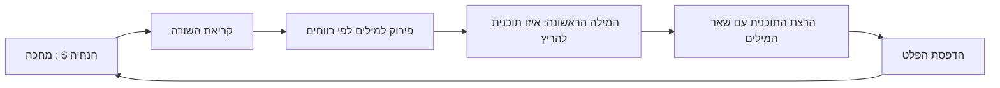

# M0.3 · שיעור 1: שיעור 1: מבנה פרויקט ומערכת הקבצים מהמעטפת: נתיבים, יצירה, העברה, מחיקה ות

מכסה: 1.1 Project Structure · 1.1.1 Standard information · 1.1.2 Organizing project content · 1.2 Downloading the Data · 1.3 Installing the Software · 1.4 Summary · 1.5 Exercises · 1.5.1 Getting ready · 1.6 Key Points · 2.1 Exploring Files and Directories · 2.2 Moving Around · 2.3 Creating New Files and Directories · 2.4 Moving Files and Directories · 2.5 Copying Files and Directories · 2.6 Deleting Files and Directories · 2.7 Wildcards · 2.8 Reading the Manual · 2.9 Summary · 2.10 Exercises · 2.10.1 Exploring more ls flags · 2.10.2 Listing recursively and by time · 2.10.3 Absolute and relative paths · 2.10.4 Relative path resolution · 2.10.6 Creating files a different way · 2.10.7 Using rm safely · 2.10.8 Moving to the current folder · 2.10.9 Renaming files · 2.10.10 Moving and copying · 2.10.11 Copy with multiple filenames · 2.10.12 List filenames matching a pattern · 2.10.13 Organizing directories and files · 2.10.14 Reproduce a directory structure · 2.10.15 Wildcard expressions · 2.10.16 Removing unneeded files · 2.10.17 Other wildcards · 2.11 Key Points

## הלומד · שיעור · 2026-11-26

כתוב את שיעור 1 במודול M0.3: שיעור 1: מבנה פרויקט ומערכת הקבצים מהמעטפת: נתיבים, יצירה, העברה, מחיקה ותווים כלליים.

---

## המורה · (נקטע)

## פרק 1: המעטפת, העץ והפרויקט

נניח שקיבלנו שבעה ספרים מ[[מונח: פרויקט גוטנברג | ספרייה מקוונת חינמית של ספרים שזכויות היוצרים עליהם פגו, שמפרסמת אותם כקובצי טקסט פשוטים]], ואנחנו רוצים לבדוק בכל אחד מהם את [[מונח: חוק Zipf | הטענה שהמילה הנפוצה ביותר בטקסט מופיעה בערך פי 2 מהשנייה, פי 3 מהשלישית, וכן הלאה]]. בשביל זה צריך לספור את המילים בכל ספר, לשמור את הספירות ולצייר גרף, ולעשות את זה באותה דרך בדיוק בכל שבעת הספרים. קל להתחיל בתיקייה אחת שבה הכול מעורבב: ספרים, ספירות, גרפים וקוד. אחרי חודש כבר לא ברור איזה גרף נוצר מאיזו גרסה של הקוד, ואם מישהו ערך את אחד הספרים באמצע הדרך. זו השאלה של הפרק: איך מגיעים לכל קובץ בפרויקט, ואיך מסדרים את הפרויקט כך שכל תוצאה בו תשוחזר.

נבנה את התשובה בשלוש שכבות. קודם הכלי: ממשק טקסט שבו כל פעולה היא שורה שאפשר לשמור ולהריץ שוב. אחר כך המפה: מערכת הקבצים היא עץ, ולכל קובץ יש בו כתובת שנקבעת לפי כלל אחד ומדויק. בסוף ההחלטה: איזה עץ לבנות לפרויקט, כך שהתוצאות יהיו פונקציה של הקוד ושל הנתונים, ולא של הזיכרון שלנו. לא נלמד כאן קטלוג של פקודות. נלמד את המודל שכל פקודה פועלת בתוכו, ונבדוק כמה ממנו משתנה כשעוברים ממחשב למחשב.

מערכת העוגן של הפרק, וגם של המודול כולו, היא הפרויקט zipf: שבעה ספרים, תוכנית שסופרת מילים וגרפים של התפלגות המילים. בכל צעד נשאל עליו שאלה אחת: איך מריצים את אותו ניתוח על שבעה ספרים, איפה יושבת התיקייה שלו, איך מגיעים ממנה לנתונים ובחזרה, איפה יגור כל קובץ, והאם הוא ירוץ אצלכם כמו אצל Amira, המשתמשת שבמחשב שלה נעשות הדוגמאות.

**מה אנחנו כבר יודעים.** ב-M0.1 ראינו כשלי תוכנה שנבעו מ**הנחה סמויה שנפרצה**: הפטריוט צבר שגיאת זמן כי הניחו שהסוללה תרוץ שעות ולא ימים, ובאריאן 5 הריצו קוד של משגר אחר בתנאים שהוא לא תוכנן להם. גם בפרק הזה תיכנס הנחה כזאת: שגרסה אחרת של תוכנה משנה רק את צורת הפלט ולא את התוצאה. נכתוב אותה במפורש ברגע שהיא נכנסת, ונבדוק אותה בסוף הפרק מול שלוש מעטפות אמיתיות.

### 1.1 למה מעטפת: ממשק שמשאיר עקבות

השאלה הראשונה היא בחירת הכלי. בממשק גרפי היינו פותחים את קובץ הספר, מריצים עליו את ספירת המילים בקליקים ושומרים את התוצאה, ואחר כך חוזרים על כל זה שבע פעמים. אם בעוד חודש נגלה טעות בספירה, נצטרך לזכור מה בדיוק לחצנו ובאיזה סדר. לכן מהנדס בוחר ממשק שבו הפעולה עצמה היא טקסט: שורה שאפשר לקרוא, להעתיק ולהריץ שוב על הספר השמיני.

[[W01:13]] לשני סוגי הממשק יש מחיר הפוך. [[מונח: GUI | ממשק משתמש גרפי: חלונות, סמלים ועכבר; אומרים למחשב מה לעשות בלחיצה על מה שמוצג]] קל ללמידה, כי רואים את מה שאפשר לעשות. אבל קשה להריץ בו פעולה אוטומטית, והוא לא שומר רישום של מה שעשינו. ב-[[מונח: CLI | ממשק שורת פקודה: מקלידים פקודה בטקסט, והמחשב עונה בטקסט]] המחיר הפוך: צריך לזכור את שמות הפקודות, אבל כל פעולה היא שורה, ושורות אפשר לחבר, לחזור עליהן ולשמור בקובץ. ממשקי שורת פקודה היו קיימים הרבה לפני הממשקים הגרפיים, והם שרדו בגלל שלוש התכונות האלה: יעילות, אוטומציה ורישום.

**קרא, הערך, הדפס.** בלב כל ממשק שורת פקודה יש לולאה אחת, שנקראת [[מונח: REPL | read-evaluate-print loop: לולאה שקוראת פקודה, מבצעת אותה, מדפיסה את הפלט וחוזרת לחכות לפקודה הבאה]]. מי שהשתמש במסוף אינטראקטיבי של פייתון כבר הכיר לולאה כזאת. התוכנית שמריצה את הלולאה הזאת מול מערכת ההפעלה נקראת **מעטפת** (shell): תוכנית שתפקידה להריץ תוכניות אחרות בשבילנו. המעטפת לא צריכה לדעת באיזו שפה נכתבה התוכנית שהיא מריצה, או מה התוכנית עושה. מספיק שהתוכנית מצייתת לכמה כללים פשוטים, ולכן אותה מעטפת מריצה גם תוכנית שמציגה את השעה וגם מודל אקלים.

```figure
W01:14:0
חלון מעטפת Bash: הנחיה, פקודה שהוקלדה, והפלט שהמעטפת הדפיסה לפני שחזרה לחכות.
```

באיור רואים את הלולאה כפי שהיא נראית למשתמש. בתחילת כל סיבוב המעטפת מציגה **הנחיה** (prompt), סימן שאומר שהיא מחכה. ב-Bash ההנחיה היא `$`, ובמעטפת zsh היא `%`. את ההנחיה לא מקלידים: היא מופיעה בדוגמאות רק כדי שיהיה ברור איפה מתחילה הפקודה. Bash היא המעטפת הנפוצה ביותר, ו-zsh היא מעטפת ברירת המחדל בגרסאות החדשות של macOS. הפקודות שנשתמש בהן כאן זהות בשתיהן, והנחה זו תיבדק בסעיף 1.5, יחד עם ההבדלים שבכל זאת יש ביניהן.

למבנה הזה יש היסטוריה שמסבירה אותו. Ken Thompson כתב את המעטפת הראשונה של [[מונח: Unix | מערכת הפעלה שפותחה במעבדות Bell בשנות ה-70; לינוקס ו-macOS הן צאצאיות ישירות של רעיונותיה]] ב-1971, ו-Stephen Bourne כתב ב-1979 מעטפת שאפשר היה לכתוב בה תסריטים שלמים, עם לולאות ומשתנים. ב-1989 כתב Brian Fox את Bash, ‏Bourne Again SHell, כמעטפת חופשית לפרויקט [[מונח: GNU | פרויקט שהחל ב-1983 לבנות מערכת דמוית Unix מתוכנה חופשית; רוב הכלים הבסיסיים בלינוקס הם שלו]] [[ודאות: גבוהה]]. הדרישה שהובילה מגרסה לגרסה הייתה אותה דרישה: שהעבודה האינטראקטיבית תוכל להפוך לקובץ שמריצים שוב.



בתרשים כדאי לשים לב לצעד השלישי: המעטפת מפרקת את השורה למילים לפני שהיא מריצה משהו. התוכנית לא מקבלת את השורה שהקלדנו. היא מקבלת רשימת מילים שהמעטפת כבר הכינה.

**מילים, אפשרויות וארגומנטים.** [[W01:15]] מהפירוק הזה נובע הכלל הבסיסי של שורת פקודה. המילה הראשונה היא שם התוכנית, מילה שמתחילה ב-`-` היא **אפשרות** (option) שמשנה את אופן הפעולה, ושאר המילים הן **ארגומנטים** (arguments), כלומר הדברים שהתוכנית פועלת עליהם. הפקודה `whoami` היא תוכנית בלי אפשרויות ובלי ארגומנטים, ובמחשב של Amira היא מדפיסה `amira`. הפקודה `ls`, שמציגה את תוכן התיקייה, מקבלת את שני הסוגים: ב-`ls -F /Users` המילה `-F` היא אפשרות שמסמנת תיקיות בלוכסן, ו-`/Users` הוא ארגומנט. [[W01:18]] רווח הוא הגבול בין מילים. לכן `ls-F` בלי רווח היא מילה אחת, והמעטפת מחפשת תוכנית בשם הזה ועונה `ls-F: command not found`. במתמטיקה $1+2$ ו-$1 + 2$ הם אותו דבר, אבל במעטפת הרווח הוא חלק מהתחביר.

כדאי לדייק כאן בטענה על רישום. ממשק שורת פקודה לא מבטיח רישום מעצמו. פקודה שהקלדנו ושכחנו נעלמת כמו קליק. הרישום נשמר רק כשכותבים את הפקודות לקובץ ומריצים אותן ממנו, וזה הצעד שהפרויקט ייבנה סביבו בסעיף 1.4. מה שהממשק נותן הוא האפשרות: אותן שבע ריצות של ספירת המילים הן שבע שורות כמעט זהות, ולכן אפשר להפוך אותן לפקודה אחת. אבל כדי שהשורות יפעלו על הקבצים הנכונים, צריך לדעת איך המעטפת מוצאת קובץ.

```mcq
מקלידים `ls-F` (בלי רווח) ולוחצים Enter. מה קורה?
- [ ] `ls` רץ עם האפשרות `-F` כרגיל :: זה קורה רק כשיש רווח; בלי רווח המעטפת לא מפרקת את המחרוזת לשתי מילים.
- [x] המעטפת מחפשת תוכנית בשם `ls-F`, לא מוצאת אותה ומדפיסה שגיאה :: הפירוק לפי רווחים יוצר מילה אחת, והמילה הראשונה היא תמיד שם התוכנית.
- [ ] `ls` רץ ומדפיס שגיאה על אפשרות לא מוכרת :: `ls` בכלל לא רץ, כי שם התוכנית שנמצא הוא `ls-F`.
- [ ] `ls` רץ בלי אפשרויות ומתעלם מ-`-F` :: המעטפת לא "מנחשת" גבולות בין מילים; היא חותכת רק ברווחים.
```

### 1.2 עץ הקבצים, תיקיית העבודה והמדריך

יש לנו כלי שמריץ תוכניות עם אפשרויות וארגומנטים. כדי לתת לו ארגומנט כמו `data/dracula.txt`, צריך להבין איך מאורגנים הקבצים, איך יודעים איפה אנחנו נמצאים, ואיך מגלים מה פקודה יודעת לעשות. החלק של מערכת ההפעלה שמנהל את כל זה נקרא **מערכת הקבצים** (filesystem). הוא שומר שני סוגי דברים: **קבצים**, שמחזיקים תוכן כמו טקסט של ספר, ו**תיקיות** (directories, או folders), שמחזיקות קבצים ותיקיות אחרות. מהעובדה שתיקייה יכולה להכיל תיקייה נובע המבנה כולו.

**עץ עם שורש.** [[W01:16]] מכיוון שכל תיקייה נמצאת בתוך תיקייה אחת בדיוק, מבנה התיקיות הוא עץ. כמו עץ משפחה, לכל צומת יש הורה אחד, ולמעלה יש צומת אחד שאין לו הורה.

```figure
W01:16:0
מערכת הקבצים במחשב של Amira: השורש / למעלה, ומתחתיו bin, ‏data, ‏tmp ו-Users, שבתוכה תיקייה לכל משתמש.
```

באיור, למעלה נמצאת **תיקיית השורש** (root), שמחזיקה את כל השאר, וקוראים לה `/` בלבד. מתחתיה יושבות `bin` לתוכניות מובנות, `data` לנתונים כלליים, `tmp` לקבצים זמניים ו-`Users` לתיקיות של המשתמשים: `/Users/amira`, `/Users/jun` ו-`/Users/sami`. שם כמו `/Users/amira` נקרא **נתיב** (path), כי הוא אומר איך מגיעים ממקום אחד בעץ למקום אחר. לסימן `/` יש בנתיב שני תפקידים. בתחילת הנתיב, או לבד, הוא השורש. בתוך הנתיב הוא מפריד בין שמות. ב-Windows המפריד הוא לוכסן הפוך, `\`.

**איפה אני.** [[W01:15]] המעטפת זוכרת כל הזמן מקום אחד בעץ, שנקרא **תיקיית העבודה** (working directory). רוב הפקודות קוראות וכותבות בה, אלא אם אומרים להן אחרת, ולכן לפני כל פקודה שכותבת או מוחקת צריך לדעת איפה אנחנו. הפקודה `pwd` (print working directory) מדפיסה את המקום הזה, ואצל Amira היא מדפיסה `/Users/amira`. זו **תיקיית הבית** שלה: התיקייה שמחזיקה את הקבצים שלה, ושהמעטפת שמה אותה בה כשהיא נכנסת למחשב.

כך נראה העץ של Amira כשמסמנים עליו את שני המקומות המיוחדים. התיקייה zipf, מערכת העוגן שלנו, יושבת ישירות מתחת לתיקיית הבית.

```svg
@caption: העץ של Amira. המסגרת המקווקוות היא תיקיית הבית, הקבועה. המסגרת העבה היא תיקיית העבודה אחרי הפקודה cd zipf, והיא זזה עם כל cd.
<svg viewBox="0 0 640 340" xmlns="http://www.w3.org/2000/svg" font-family="sans-serif" font-size="14">
  <g stroke="currentColor" fill="none" stroke-width="1.2">
    <line x1="320" y1="40" x2="90" y2="100"/>
    <line x1="320" y1="40" x2="210" y2="100"/>
    <line x1="320" y1="40" x2="330" y2="100"/>
    <line x1="320" y1="40" x2="470" y2="100"/>
    <line x1="470" y1="120" x2="380" y2="180"/>
    <line x1="470" y1="120" x2="480" y2="180"/>
    <line x1="470" y1="120" x2="580" y2="180"/>
    <line x1="380" y1="200" x2="320" y2="260"/>
    <line x1="380" y1="200" x2="440" y2="260"/>
    <rect x="340" y="168" width="80" height="44" rx="6" stroke-dasharray="5,4"/>
    <rect x="282" y="248" width="76" height="30" rx="6" stroke-width="3"/>
  </g>
  <g fill="currentColor" text-anchor="middle">
    <text x="320" y="34">/</text>
    <text x="90" y="116">bin</text>
    <text x="210" y="116">data</text>
    <text x="330" y="116">tmp</text>
    <text x="470" y="116">Users</text>
    <text x="380" y="196">amira</text>
    <text x="480" y="196">jun</text>
    <text x="580" y="196">sami</text>
    <text x="320" y="268">zipf</text>
    <text x="440" y="268">Movies</text>
    <text x="380" y="160" font-size="12">תיקיית הבית (~)</text>
    <text x="320" y="300" font-size="12">תיקיית העבודה אחרי cd zipf</text>
    <text x="320" y="318" font-size="12">/Users/amira/zipf</text>
    <text x="120" y="34" font-size="12">השורש: הצומת היחיד בלי הורה</text>
  </g>
</svg>
```

בתרשים רואים שני מצביעים על אותו עץ. תיקיית הבית קבועה למשתמש, ותיקיית העבודה זזה. כמעט כל טעות של "הקובץ לא נמצא" היא בלבול בין שני המצביעים האלה, או בין תיקיית העבודה שחשבנו שאנחנו בה לבין זו שאנחנו בה באמת. [[W01:17]] גם תיקיית הבית עצמה לא נמצאת באותו מקום בכל מערכת. ב-macOS היא `/Users/amira`, בלינוקס בדרך כלל `/home/amira`, וב-Windows ‏`C:\Users\amira` או נתיב ישן יותר. ההבדל הזה ייראה זניח עכשיו, אבל בסעיף 1.5 נראה שהוא משנה תוצאה ולא רק צורה.

**מה יש כאן.** הפקודה `ls` (listing) מציגה את השמות שבתיקיית העבודה: אצל Amira תשע תיקיות כמו `Desktop` ו-`Movies`, קובץ אחד בשם `todo.txt`, והתיקייה `zipf`. אפשרויות משנות את מה שמוצג. האפשרות `-F` מוסיפה `/` אחרי תיקייה ו-`*` אחרי תוכנית שאפשר להריץ. [[W01:22]] האפשרות `-a` (all) מציגה גם שמות שמתחילים בנקודה. אלה **קבצים מוסתרים**: קובצי הגדרות של תוכניות, כמו `.jupyter`, שהמוסכמה מסתירה כדי לא להעמיס על הרשימה. ביניהם יופיעו שני שמות מיוחדים, `.` ו-`..`, שנשתמש בהם בסעיף הבא. [[W01:36]] יש עוד ארבע אפשרויות שכדאי להכיר:

- `-l` מציג רשימה ארוכה, שורה לכל פריט, עם הרשאות, בעלים, גודל בבתים ותאריך השינוי האחרון.
- `-h` מציג את הגודל ביחידות קריאות, כמו K ו-M. יש לו משמעות רק ביחד עם `-l`, ולכן משתמשים בהם יחד: `ls -l -h`.
- `-R` מציג את התוכן ברקורסיה: את התיקייה, אחריה את תתי-התיקיות שלה, אחריהן את התיקיות שבתוכן, וכן הלאה.
- `-t` ממיין לפי זמן השינוי האחרון, מהחדש לישן.

[[W01:37]] כשמשלבים את `-R` ו-`-t`, המיון לפי זמן חל בתוך כל תיקייה בנפרד. הפקודה מדפיסה רמה אחרי רמה, ובכל רשימה הפריטים מסודרים מהחדש לישן. היא לא ממיינת את כל הקבצים בעץ ברשימה אחת.

**איך יודעים אילו אפשרויות יש.** [[W01:34]] אף אחד לא זוכר את כל האפשרויות, ולכן כל פקודה מגיעה עם דף במדריך. הפקודה `wc` (word count), למשל, סופרת שורות, מילים ותווים. כדי לגלות שהאפשרות `-l` מגבילה אותה לספירת שורות, מקלידים `man wc`. הדף נפתח ב-`less`, תוכנית שמציגה טקסט ארוך עמוד אחרי עמוד: `/` ואחריו מילה מחפשים, `N` עובר להתאמה הבאה, ו-`Q` יוצא. דפי המדריך קיימים מאז המהדורה הראשונה של מדריך המתכנת של Unix ב-1971, ולכן הם בנויים אותו דבר כבר יותר מחמישים שנה [[ודאות: גבוהה]].

```figure
W01:35:0
דף man טיפוסי: שם הפקודה ותיאור בשורה אחת, תבנית השימוש (SYNOPSIS) עם אפשרויות בסוגריים מרובעים, ואחריה רשימת האפשרויות.
```

באיור כדאי להסתכל על שורת התבנית. מה שבסוגריים מרובעים הוא רשות, והסדר בתבנית הוא הסדר שבו התוכנית מצפה לקבל את המילים: קודם אפשרויות, אחר כך קבצים. [[W01:35]] יש עוד שני מקורות עזרה, ומחירם שונה. האפשרות `--help` נותנת סיכום קצר, אבל לא כל פקודה תומכת בה. האתר TLDR נותן כמה דוגמאות נפוצות לכל פקודה: ל-`wc` הוא מראה `-l` לשורות, `-w` למילים, `-c` לבתים ו-`-m` לתווים, שבהם תו אחד יכול לתפוס יותר מבית אחד. [[W01:36]] לכל המקורות האלה יש מגבלה משותפת: הם עוזרים רק למי שכבר יודע את שם הפקודה. מי שרוצה לספור שורות בקובץ לא יחפש בעצמו `wc`. לכן את השמות לומדים מדוגמאות, ואת הפרטים מחפשים במדריך.

עכשיו אנחנו יודעים איפה אנחנו ומה יש סביבנו. אבל כדי להגיע ל-`data` מתוך `zipf`, או לחזור הביתה, צריך כלל שאומר לאיזה צומת בעץ מצביע כל נתיב.

```mcq
מה מציג `ls -a` שלא מציג `ls` רגיל?
- [ ] את תוכן כל תתי-התיקיות :: זה `-R`, הרקורסיה; `-a` נשאר בתיקייה אחת.
- [ ] את הגודל והתאריך של כל קובץ :: זה `-l` (ועם `-h` ביחידות קריאות).
- [x] שמות שמתחילים בנקודה, ביניהם `.` ו-`..` :: המוסכמה מסתירה שמות כאלה; `-a` מבטל את ההסתרה.
- [ ] קבצים שנמחקו לאחרונה :: מחיקה במעטפת לא משאירה רשימה שאפשר להציג; `ls` רואה רק מה שקיים.
```

### 1.3 פתרון נתיב ו-cd

מהסעיף הקודם יש לנו עץ, שורש, תיקיית בית ותיקיית עבודה. אבל עדיין לא ענינו על השאלה המעשית: כשנותנים לתוכנית את המחרוזת `data/dracula.txt`, איך המחשב מחליט לאיזה קובץ התכוונו? אותה מחרוזת יכולה להצביע על ספר בפרויקט שלנו, על קובץ אחר באותו שם או על כלום. מי שכותב תסריט שירוץ אצל מישהו אחר חייב לדעת את התשובה בדיוק, כי טעות בה פירושה תסריט שקורא את הקובץ הלא נכון בלי להודיע על כך.

**שתי דרכים לכתובת.** [[W01:19]] יש שתי דרכים לתת כתובת, כמו בהוראות הגעה. אפשר לתת קו רוחב וקו אורך, שמובילים לאותה נקודה מכל מקום שבו נמצאים. אפשר גם לומר "שני קילומטרים צפונה וחצי קילומטר מזרחה", הוראה שמובילה למקום אחר לגמרי אם מתחילים ממקום אחר. **נתיב מוחלט**, כמו `/Users/amira`, מתחיל בשורש ותמיד מצביע על אותו צומת. **נתיב יחסי**, כמו `zipf`, מתחיל מתיקיית העבודה. ההבדל נקבע לפי התו הראשון בלבד: אם הנתיב מתחיל ב-`/`, הוא מוחלט.

[[W01:20]] כדי לא להקליד `zipf/` שוב ושוב, משנים את תיקיית העבודה בפקודה `cd` (change directory). השם מטעה מעט, כי `cd` לא משנה שום תיקייה. היא משנה רק את המקום שהמעטפת זוכרת. אחרי `cd zipf` הפקודה לא מדפיסה דבר, כי רוב הפקודות שותקות כשהכול תקין, ו-`pwd` מראה `/Users/amira/zipf`. [[W01:21]] מכאן עולה השאלה ההפוכה: איך עולים חזרה? הניסיון הטבעי, `cd amira`, נכשל עם `No such file or directory`. הסיבה היא ש-`amira` לבד הוא נתיב יחסי, ופירושו "צומת בשם amira מתחת לתיקיית העבודה". מתחת ל-`zipf` אין צומת כזה. גם מתוך `/Users/amira` עצמה הפקודה הייתה נכשלת, כי amira אינה ילדה של עצמה. כדי לעלות צריך שם מיוחד להורה, וכאן נכנס החלק השני של הכלל.

כדי לראות את הכלל לפני שמנסחים אותו, נעקוב אחרי הפקודה `cd ../Movies` מתוך `zipf`, רכיב אחרי רכיב. הנקודה בסצנה מתחילה בתיקיית העבודה, עולה להורה ויורדת לילד.

```scene3d
{"title": "פתרון הנתיב היחסי ../Movies מתוך zipf",
 "caption": "הנקודה מתחילה ב-zipf (תיקיית העבודה), עולה ברכיב '..' אל amira, ואז יורדת ברכיב 'Movies'. סובבו את העץ: כל רכיב בנתיב הוא צעד אחד לאורך קשת אחת בעץ.",
 "axes": false,
 "view": {"cam": [4.5, -6, 3.5], "target": [0.6, 0, 1]},
 "objects": [
  {"type": "curve", "x": "0 + (-2 - 0)*s", "y": "0", "z": "3 - s", "s": [0, 1], "label": "קשת: / → bin"},
  {"type": "curve", "x": "0 + (-0.7 - 0)*s", "y": "0", "z": "3 - s", "s": [0, 1], "label": "קשת: / → tmp"},
  {"type": "curve", "x": "1.5*s", "y": "0", "z": "3 - s", "s": [0, 1], "label": "קשת: / → Users"},
  {"type": "curve", "x": "1.5 - 1.0*s", "y": "0", "z": "2 - s", "s": [0, 1], "label": "קשת: Users → amira"},
  {"type": "curve", "x": "1.5", "y": "1.0*s", "z": "2 - s", "s": [0, 1], "label": "קשת: Users → jun"},
  {"type": "curve", "x": "1.5 + 1.0*s", "y": "0", "z": "2 - s", "s": [0, 1], "label": "קשת: Users → sami"},
  {"type": "curve", "x": "0.5 - 0.7*s", "y": "-0.8*s", "z": "1 - s", "s": [0, 1], "label": "קשת: amira → zipf"},
  {"type": "curve", "x": "0.5 + 0.7*s", "y": "-0.8*s", "z": "1 - s", "s": [0, 1], "label": "קשת: amira → Movies"},
  {"type": "curve", "x": "-0.2", "y": "-0.8 - 0.8*s", "z": "0 - s", "s": [0, 1], "label": "קשת: zipf → data"},
  {"type": "point", "at": [0, 0, 3], "label": "/ (השורש)"},
  {"type": "point", "at": [-2, 0, 2], "label": "bin"},
  {"type": "point", "at": [-0.7, 0, 2], "label": "tmp"},
  {"type": "point", "at": [1.5, 0, 2], "label": "Users"},
  {"type": "point", "at": [0.5, 0, 1], "label": "amira (תיקיית הבית)"},
  {"type": "point", "at": [1.5, 1, 1], "label": "jun"},
  {"type": "point", "at": [2.5, 0, 1], "label": "sami"},
  {"type": "point", "at": [-0.2, -0.8, 0], "label": "zipf (תיקיית העבודה בהתחלה)"},
  {"type": "point", "at": [1.2, -0.8, 0], "label": "Movies (היעד)"},
  {"type": "point", "at": [-0.2, -1.6, -1], "label": "data"},
  {"type": "point",
   "at": ["-0.2 + 0.7*min(1, (atan2(sin(pi*t/4), cos(pi*t/4)) + pi)/pi) + 0.7*max(0, (atan2(sin(pi*t/4), cos(pi*t/4)) + pi)/pi - 1)",
          "-0.8 + 0.8*min(1, (atan2(sin(pi*t/4), cos(pi*t/4)) + pi)/pi) - 0.8*max(0, (atan2(sin(pi*t/4), cos(pi*t/4)) + pi)/pi - 1)",
          "0 + 1*min(1, (atan2(sin(pi*t/4), cos(pi*t/4)) + pi)/pi) - 1*max(0, (atan2(sin(pi*t/4), cos(pi*t/4)) + pi)/pi - 1)"],
   "trail": 120, "label": "המיקום בזמן פתרון הנתיב"}
 ],
 "tour": [
  {"cam": [4.5, -6, 3.5], "target": [0.6, 0, 1], "text": "הנתיב ../Movies לא מתחיל ב-/, ולכן נקודת המוצא היא תיקיית העבודה zipf ולא השורש."},
  {"cam": [0.5, -5, 1], "target": [0.5, -0.4, 0.5], "text": "הרכיב '..' הוא צעד אחד למעלה, אל ההורה amira. הרכיב 'Movies' הוא צעד אחד למטה, אל הילד שנקרא כך."}
 ]}
```

בסצנה רואים שהנתיב הוא רשימה של צעדים בעץ, ולא שם של מקום. כל רכיב מזיז את הנקודה לאורך קשת אחת, וזה כל מה שהמחשב עושה כשהוא פותר נתיב. אותה רשימה של צעדים מתוך `data` הייתה עולה ל-`zipf` ומחפשת שם צומת בשם `Movies`, ולא הייתה מוצאת אותו. מכאן אפשר לנסח את הכלל.

```definition
@title: נתיב, נתיב מוחלט ונתיב יחסי, ופתרון נתיב
@mark: summary
תהי $T$ מערכת קבצים: עץ עם שורש $r$, שבו לכל צומת מלבד $r$ יש הורה יחיד $\mathrm{parent}(v)$, ולילדים של כל צומת יש שמות שונים זה מזה. נגדיר $\mathrm{parent}(r)=r$. יהיו $w$ תיקיית העבודה ו-$h$ תיקיית הבית.

**נתיב** הוא מחרוזת $p=c_1/c_2/\cdots/c_k$ של רכיבים שמופרדים ב-`/`. אם $p$ מתחיל ב-`/` הוא **נתיב מוחלט**, ונקודת המוצא היא $v_0=r$. אחרת הוא **נתיב יחסי**, ונקודת המוצא היא $v_0=w$. נתיב שמתחיל ב-`~` מוחלף על ידי המעטפת, לפני כל השאר, בנתיב המוחלט של $h$.

**פתרון** הנתיב עובר על הרכיבים לפי הסדר, $i=1,\dots,k$:
- אם $c_i$ הוא `.`, אז $v_i=v_{i-1}$.
- אם $c_i$ הוא `..`, אז $v_i=\mathrm{parent}(v_{i-1})$.
- אחרת, $v_i$ הוא הילד של $v_{i-1}$ ששמו $c_i$. אם אין ילד כזה, או ש-$v_{i-1}$ הוא קובץ ולא תיקייה, הפתרון נכשל.

הנתיב מצביע על $v_k$. התנאי לכך שהפתרון מצליח הוא הכרחי ומספיק: כל צעד בדרך קיים. התוצאה של נתיב מוחלט אינה תלויה ב-$w$, ושל נתיב יחסי תלויה בו. ההגדרה מתעלמת מקישורים סימבוליים, שהופכים את המבנה מעץ לגרף.
```

[[2.5: מבנה]] להגדרה יש שני קלטים, נקודת מוצא ורשימת רכיבים, ונקודת המוצא נקבעת לפי התו הראשון בלבד. לכן התו הראשון קובע אם התוצאה תלויה בתיקיית העבודה, כלומר אם הנתיב יעבוד בכל מקום או רק ממקום אחד. הרכיבים עצמם מקומיים לגמרי: כל רכיב מסתכל רק על הצומת הנוכחי ועל השכנים הישירים שלו. בגלל זה `..` חוזר רק צעד אחד, ו-`../..` עולה שניים. ההגדרה של $\mathrm{parent}(r)=r$ נראית כמו פרט שולי, אבל היא מבטיחה שגם `cd ..` בשורש לא נכשל, אלא נשאר במקום.

[[2.5: מקור]] הצורה הזאת לא הייתה מובנת מאליה. ב-1965 תיארו Robert Daley ו-Peter Neumann מערכת קבצים היררכית ל-[[מונח: Multics | מערכת הפעלה לשיתוף זמן מאמצע שנות ה-60 (MIT, ‏Bell ו-GE), שממנה ירשה Unix רבים מרעיונותיה]], בתקופה שבה מחשב אחד שירת משתמשים רבים, ולכל משתמש היה צריך מרחב שמות משלו [[ודאות: גבוהה]]. Unix אימצה את העץ ופישטה אותו. ב-1974 תיארו Dennis Ritchie ו-Ken Thompson את `.` ואת `..` כרשומות אמיתיות שיושבות בכל תיקייה, בדיוק כמו שמות של קבצים [[ודאות: גבוהה]]. הבחירה הזאת היא הסיבה לכך שהאלגוריתם אחיד: מבחינת המערכת, `..` הוא עוד ילד שמצביע במקרה על ההורה. [[W01:22]] מאותה סיבה `.` ו-`..` אינם שייכים ל-`cd`. הם אומרים אותו דבר לכל תוכנית, ומתוך `zipf` הפקודה `ls ..` תציג את תיקיית הבית. כשהמשמעות של כל חלק לא תלויה בהקשר שבו משתמשים בו, צריך לזכור פחות מקרים מיוחדים.

**שמות מיוחדים.** [[W01:23]] מלבד `.` ו-`..` יש עוד שלושה קיצורים, ותחום הפעולה של כל אחד מהם שונה. `cd` בלי ארגומנט מחזיר תמיד לתיקיית הבית. הסימן `~` הוא קיצור לתיקיית הבית שהמעטפת מרחיבה לפני הריצה, ולכן הוא עובד בכל פקודה, למשל `ls ~/Downloads`. [[W01:24]] הסימן `-` פירושו "התיקייה הקודמת שהייתי בה", אבל רק ב-`cd`. הפקודה `ls -` תחפש תיקייה ששמה הוא מקף. ההבדל בין `~` לבין `-` הוא ההבדל בין המעטפת לתוכנית: את `~` מבינה המעטפת, ולכן כל תוכנית מקבלת נתיב מוכן, ואת `-` מבינה רק התוכנית `cd`.

הטבלה הבאה מראה את האלגוריתם על פקודות אמיתיות. בכל שורה כדאי לבדוק שאפשר לחזות את העמודה השלישית מתוך השנייה ומהכלל בלבד.

```table
{"title": "פתרון נתיב בפועל: איך כל פקודה משנה את תיקיית העבודה (העץ של Amira)",
 "scope": {},
 "columns": ["פקודה", "pwd לפני", "pwd אחרי", "למה"],
 "rows": [
  ["\"cd zipf\"", "\"/Users/amira\"", "\"/Users/amira/zipf\"", "\"יחסי: ילד של תיקיית העבודה\""],
  ["\"cd amira\"", "\"/Users/amira/zipf\"", "\"/Users/amira/zipf\"", "\"נכשל: אין ל-zipf ילד בשם amira\""],
  ["\"cd ..\"", "\"/Users/amira/zipf\"", "\"/Users/amira\"", "\"'..' הוא ההורה\""],
  ["\"cd ../..\"", "\"/Users/amira/zipf\"", "\"/Users\"", "\"שני צעדים למעלה\""],
  ["\"cd ../Movies\"", "\"/Users/amira/zipf\"", "\"/Users/amira/Movies\"", "\"למעלה ואז למטה\""],
  ["\"cd\"", "\"/Users/amira/Movies\"", "\"/Users/amira\"", "\"בלי ארגומנט: הביתה\""],
  ["\"cd -\"", "\"/Users/amira\"", "\"/Users/amira/Movies\"", "\"התיקייה הקודמת (רק ב-cd)\""],
  ["\"cd ~/zipf/data\"", "\"כל מקום\"", "\"/Users/amira/zipf/data\"", "\"~ מוחלף בנתיב הבית, ולכן הנתיב מוחלט\""]
 ]}
```

השורה האחרונה עונה על שאלת העוגן של הסעיף. מתוך `zipf` מגיעים לנתונים ב-`cd data` וחוזרים ב-`cd ..`. מכל מקום אחר מגיעים אליהם ב-`cd ~/zipf/data`, שמצביע תמיד לאותו צומת כי `~` הופך אותו לנתיב מוחלט. השורה השנייה מראה את הביקורת שכדאי לזכור: אותה מחרוזת יחסית מצביעה על מקומות שונים מתיקיות עבודה שונות, ולפעמים לא מצביעה על כלום. תסריט שכתוב בנתיבים יחסיים מניח בשקט שהוא רץ מתוך תיקייה מסוימת. בסעיף הבא נהפוך את ההנחה הזאת לחלק מכוון של התכנון.

[[W01:38]] כדי לתרגל את האלגוריתם, נשתמש בעץ הבא.

```figure
W01:38:0
עץ התרגילים: מתחת ל-/Users יושבות, בין השאר, התיקיות sami ו-backup, וב-backup שלוש תיקיות.
```

בעץ הזה כדאי לחפש את התיקייה `/Users/backup` ואת שלוש התיקיות שבתוכה, ולשים לב ש-`sami` ו-`backup` הן אחיות: שתיהן ילדות של `/Users`.

```numeric
@answer: 5
@unit: פקודות
@tol: 0%
Amira נמצאת ב-`/Users/amira/data`, ותיקיית הבית שלה היא `/Users/amira`. כמה מהפקודות הבאות יחזירו אותה הביתה?
(1) `cd .` (2) `cd /` (3) `cd /home/amira` (4) `cd ../..` (5) `cd ~` (6) `cd home` (7) `cd ~/data/..` (8) `cd` (9) `cd ..` (10) `cd ../.`
---
נפתור כל נתיב לפי הכלל: נקודת המוצא היא השורש אם הנתיב מתחיל ב-`/`, ואחרת `/Users/amira/data`.
(1) `.` נשאר ב-data. (2) מגיע לשורש. (3) נתיב מוחלט לתיקייה שאינה קיימת ב-macOS, ולכן נכשל. (4) עולה פעמיים, אל `/Users`. (5) `~` הוא הבית: מצליח. (6) אין ב-data ילד בשם home: נכשל. (7) `~/data` הוא `/Users/amira/data`, ו-`..` עולה ממנו הביתה: מצליח. (8) `cd` לבד: מצליח. (9) עולה פעם אחת, הביתה: מצליח. (10) `..` מביא הביתה, ו-`.` משאיר שם: מצליח.
הפקודות שמצליחות הן 5, 7, 8, 9 ו-10, כלומר חמש פקודות.
- wrong: 6 :: נספרה גם `cd /home/amira`, שזה נתיב הבית בלינוקס ולא במחשב Mac של Amira.
- wrong: 4 :: הוחמצה `cd ../.`, כלומר לא שמת לב ש-`.` בסוף נתיב לא מזיז.
- wrong: 3 :: כנראה נפסלה `cd ~/data/..`, כאילו `..` אינו מותר באמצע נתיב; הכלל פותר כל רכיב בתורו.
```

```mcq
בעץ התרגילים, `pwd` מציג `/Users/sami`. מה תציג הפקודה `ls -F ../backup`?
- [ ] `../backup: No such file or directory` :: `..` מ-sami הוא `/Users`, ושם יש ילד בשם backup; הנתיב נפתר בהצלחה.
- [ ] `final original revised` :: אלה השמות הנכונים, אבל `-F` מוסיף `/` אחרי כל תיקייה.
- [x] `final/ original/ revised/` :: `..` מביא ל-`/Users`, ‏`backup` יורד לילד, ו-`-F` מסמן את שלוש התיקיות בלוכסן.
- [ ] `data/ analysis/ doc/` :: זו רשימה של תיקייה אחרת בעץ, לא של `/Users/backup`.
```

```explain
Amira נמצאת בתיקיית הבית שלה, `/Users/amira`, ומקלידה `cd amira`. הפקודה נכשלת. הסבר בשני משפטים למה.
---
- `amira` לא מתחיל ב-`/`, ולכן הוא נתיב יחסי שנפתר מתיקיית העבודה.
- הוא מחפש ילד בשם amira בתוך `/Users/amira`, ואין כזה: התיקייה אינה ילדה של עצמה.
- הדרך הנכונה היא נתיב מוחלט, או `..` כדי לעלות.
===
שם בלי `/` בהתחלה הוא נתיב יחסי, ולכן המעטפת מחפשת ילד בשם amira בתוך תיקיית העבודה `/Users/amira`. אין לתיקייה הזאת ילד בשם הזה, כי amira היא התיקייה עצמה ולא צומת מתחתיה, ולכן הפתרון נכשל בצעד הראשון.
```

### 1.4 פרויקט כמבנה צפוי: תבנית Noble

עכשיו יש לנו כתובת לכל צומת בעץ, ואנחנו יודעים שנתיב יחסי עובד רק מנקודת מוצא ידועה. מכאן עולה החלטה: איזה עץ לבנות לפרויקט. [[W01:7]] בפרויקט zipf יהיו בקרוב קובצי ספרים, ספירות, גרפים, הקוד שמייצר אותם, וגם התיעוד. אפשר לשים הכול בתיקייה אחת בשם "stuff" ולסדר אחר כך. אבל סידור בדיעבד יקר יותר מסידור מההתחלה, כי צריך לשחזר מהזיכרון מה נוצר ממה. בסידור מההתחלה הקשר הזה כתוב במבנה עצמו. פרויקט "בריא" הוא פרויקט שבו כל אחד מוצא את מה שהוא צריך בלי לשאול, וזה תלוי בשני דברים: כמה הפרויקט מסודר, וכמה הסידור מוכר. חלקים קטנים במקומות צפויים, עם שמות קריאים, קל יותר למצוא מגושים גדולים שהמבנה שלהם משתנה מפרויקט לפרויקט.

[[2.5: מקור]] בשביל zipf נשתמש בתבנית שתיאר William Noble ב-2009, במאמר קצר בכתב העת PLoS Computational Biology על ארגון פרויקטים בביולוגיה חישובית [[ודאות: גבוהה]]. הוא כתב אותו מתוך הניסיון של מעבדות שבהן ניסוי חישובי שנעשה לפני חצי שנה כבר לא היה אפשר לשחזר, כי איש לא ידע איזו גרסה של הנתונים, ואיזה סדר של פקודות, יצרו את הגרף שבמאמר [[ודאות: בינונית]]. הרעיון שלו היה לא לבקש מהחוקר משמעת חדשה, אלא לתת לו עץ קבוע שבו המקום של כל קובץ אומר מה תפקידו. [[W01:9]] התבנית מחלקת את התיקיות שבשורש הפרויקט לפי תפקיד.

```svg
@caption: העץ של zipf לפי תבנית Noble. החצים מראים את כיוון הייצור: התוכניות שב-bin רצות על הנתונים שב-data ומייצרות את מה שב-results. אף חץ לא נכנס ל-data.
<svg viewBox="0 0 660 330" xmlns="http://www.w3.org/2000/svg" font-family="sans-serif" font-size="13">
  <defs>
    <marker id="ah" viewBox="0 0 10 10" refX="9" refY="5" markerWidth="7" markerHeight="7" orient="auto-start-reverse">
      <path d="M0,0 L10,5 L0,10 z" fill="currentColor"/>
    </marker>
  </defs>
  <g stroke="currentColor" fill="none" stroke-width="1.2">
    <rect x="290" y="14" width="80" height="30" rx="6"/>
    <line x1="330" y1="44" x2="90" y2="96"/>
    <line x1="330" y1="44" x2="250" y2="96"/>
    <line x1="330" y1="44" x2="420" y2="96"/>
    <line x1="330" y1="44" x2="580" y2="96"/>
    <rect x="45" y="96" width="90" height="30" rx="6"/>
    <rect x="205" y="96" width="90" height="30" rx="6" stroke-width="3"/>
    <rect x="375" y="96" width="90" height="30" rx="6" stroke-dasharray="5,4"/>
    <rect x="535" y="96" width="90" height="30" rx="6"/>
    <path d="M 135 140 C 200 250, 340 250, 400 140" stroke-width="1.8" marker-end="url(#ah)"/>
    <path d="M 270 140 C 300 200, 360 200, 410 140" stroke-width="1.8" marker-end="url(#ah)"/>
  </g>
  <g fill="currentColor" text-anchor="middle">
    <text x="330" y="34">zipf/</text>
    <text x="90" y="116">bin/</text>
    <text x="250" y="116">data/</text>
    <text x="420" y="116">results/</text>
    <text x="580" y="116">docs/</text>
    <text x="90" y="148" font-size="11">countwords.py</text>
    <text x="90" y="163" font-size="11">collate.py</text>
    <text x="250" y="148" font-size="11">dracula.txt</text>
    <text x="250" y="163" font-size="11">frankenstein.txt ...</text>
    <text x="420" y="148" font-size="11">dracula.csv</text>
    <text x="420" y="163" font-size="11">dracula.png ...</text>
    <text x="580" y="148" font-size="11">תיעוד ומאמרים</text>
    <text x="90" y="84" font-size="11">קוד: מה עושים</text>
    <text x="250" y="84" font-size="11">גולמי: לא משתנה</text>
    <text x="420" y="84" font-size="11">נגזר: מותר למחוק</text>
    <text x="270" y="262" font-size="13">results = f(bin, data)</text>
    <text x="560" y="34" font-size="11">README, LICENSE, CITATION ...</text>
  </g>
</svg>
```

בתרשים כדאי לעקוב אחרי כיוון החצים. הם יוצאים מ-`bin` ומ-`data` ונכנסים ל-`results`, ואף חץ לא נכנס ל-`data`. הכיוון הזה הוא כל התבנית, ואפשר לנסח אותו ככלל.

```definition
@title: תבנית Noble והכלל results = f(bin, data)
@mark: summary
פרויקט חישובי $P$ מאורגן לפי תבנית Noble אם בשורש שלו יש ארבע תיקיות לפי תפקיד: $\texttt{bin}$ לתוכניות שאפשר להריץ, $\texttt{data}$ לנתונים הגולמיים, $\texttt{results}$ לכל מה שנוצר מהם, ו-$\texttt{docs}$ לתיעוד ולכתבי יד, ובנוסף שני כללים:

1. **הנתונים קבועים:** קובץ ב-$\texttt{data}$ נכתב פעם אחת, כשהוא נכנס לפרויקט, ואחר כך אף תוכנית לא משנה אותו.
2. **התוצאות נגזרות:** כל קובץ ב-$\texttt{results}$ הוא פלט של הרצת תוכנית מ-$\texttt{bin}$ על קבצים מ-$\texttt{data}$:
$$\texttt{results}=f(\texttt{bin},\texttt{data})$$

כאן $f$ הוא "הרצת הצעדים" (סדר הפקודות, שיכול להיות כתוב בקובץ). הכלל מקיים את מה שהוא מבטיח, כלומר אפשר למחוק את $\texttt{results}$ ולייצר אותו מחדש, רק אם שלושה תנאים מתקיימים: $f$ דטרמיניסטית (אותו קלט נותן אותו פלט), הסביבה שהתוכניות רצות בה (גרסאות התוכנה) קבועה, והצעדים מורצים מנקודת מוצא קבועה, שורש הפרויקט, שממנה נפתרים הנתיבים היחסיים.
```

[[2.5: מבנה]] להגדרה יש שני חלקים. הכלל הראשון קובע מה אסור למחוק, והשני קובע מה מותר למחוק. ביחד הם הופכים את `results` לזיכרון מטמון: עותק נוח של חישוב שאפשר לחזור עליו. הגודל שקובע אם הכול עובד הוא $f$. אם הצעדים כתובים בקובץ, מחיקה של `results` עולה רק זמן ריצה. אם הם רק בזיכרון של החוקר, אותה מחיקה היא אובדן של התוצאה. במילה **תסריט** (script) נקרא לקובץ שמכיל פקודות ושאפשר להריץ, כמו `book_summary.sh` או `countwords.py`, ולכן גם הוא שייך ל-`bin`. לשם `bin` יש מקור היסטורי: זה קיצור ישן של Unix ל-binary, כלומר "לא טקסט", והשם נשאר גם כשהתוכניות הן קובצי טקסט. התנאי השלישי בהגדרה, נקודת מוצא קבועה, מחבר את הסעיף הזה לסעיף הקודם. תסריט שקורא `data/dracula.txt` משתמש בנתיב יחסי, ולכן הוא עובד רק כשמריצים אותו משורש הפרויקט. המבנה הקבוע הוא מה שמאפשר לתסריט לרוץ אצל אחרים: אצל כל מי שיש לו את העץ הזה, הנתיב היחסי מוביל לאותו קובץ.

הטבלה הבאה מסכמת לכל תיקייה את שתי השאלות המעשיות: מי מייצר את התוכן שלה, והאם מותר למחוק אותו.

```table
{"title": "ארבע התיקיות של zipf: תוכן, מי מייצר, והאם מותר למחוק",
 "scope": {},
 "columns": ["תיקייה", "מה יש בה ב-zipf", "מי מייצר", "מותר למחוק?"],
 "rows": [
  ["\"bin/\"", "\"book_summary.sh, countwords.py, collate.py\"", "\"אנחנו, ביד\"", "\"לא: זה החלק הקבוע של f\""],
  ["\"data/\"", "\"שבעה ספרים ו-README\"", "\"מקור חיצוני, פעם אחת\"", "\"לא, ולא לשנות\""],
  ["\"results/\"", "\"dracula.csv, dracula.png, collated.csv\"", "\"התוכניות שב-bin\"", "\"כן: נוצר מחדש\""],
  ["\"docs/\"", "\"תיעוד ומאמר\"", "\"אנחנו, או כלי שמייצר תיעוד מהקוד\"", "\"תלוי: תיעוד שנוצר מהקוד כן\""]
 ]}
```

בטבלה רואים שהשאלה "מותר למחוק?" נענית לפי העמודה "מי מייצר". את מה שמכונה מייצרת אפשר למחוק, ואת מה שהגיע מבחוץ אי אפשר. כאן נמצאת ההחלטה ההנדסית החשובה: לאן הולך קובץ נתונים שניקינו, למשל ספר אחרי שהסרנו ממנו את הכותרת של גוטנברג? הוא נראה כמו נתונים, ולכן נוטים לשים אותו ב-`data`. אבל מכונה ייצרה אותו, ולכן מקומו ב-`results`. ניקוי "במקום", כלומר עריכה של הקובץ המקורי, חוסך מעט מקום ומאבד את האפשרות לבדוק את הניקוי עצמו. אם הניקוי שגוי, המקור כבר לא קיים.

[[W01:8]] לצד ארבע התיקיות, בשורש של כל פרויקט יש כמה קבצים סטנדרטיים. כמעט תמיד מעתיקים אותם מפרויקט לפרויקט, ולכן קוראים להם [[מונח: boilerplate | טקסט סטנדרטי שמעתיקים כמעט בלי שינוי משימוש לשימוש]]. הם מופיעים כאן רק כטבלת עזר, כי כל אחד מהם הוא החלטה שתילמד במקום שבו היא מתקבלת.

```table
{"title": "הקבצים הסטנדרטיים בשורש הפרויקט",
 "scope": {},
 "columns": ["קובץ", "תפקיד", "איפה נלמד"],
 "rows": [
  ["\"README\"", "\"מה הפרויקט, איך מריצים, מי כתב\"", "\"שיעורים 5 ו-15\""],
  ["\"LICENSE\"", "\"מה מותר לאחרים לעשות בקוד ובנתונים\"", "\"שיעור 6\""],
  ["\"CONTRIBUTING\"", "\"איך תורמים לפרויקט\"", "\"שיעור 6\""],
  ["\"CONDUCT\"", "\"קוד התנהגות של הקהילה\"", "\"שיעור 6\""],
  ["\"CITATION\"", "\"איך לצטט את התוכנה\"", "\"שיעור 15\""]
 ]}
```

[[2.5: מבנה משותף]] הכלל $\texttt{results}=f(\texttt{bin},\texttt{data})$ אינו המצאה של תוכנה. זה אותו כלל שמעבדת פיזיקה בתיכון מלמדת בלי לנסח אותו, ושמתמטיקה מנסחת כפונקציה. בשני המקרים מבדילים בין מה שנמדד לבין מה שחושב ממנו, ומוודאים שאת מה שחושב אפשר לחשב שוב.

```domain
@field: physics
@title: מחברת מעבדה: מדידה בעט, חישוב שאפשר לחזור עליו
במעבדת פיזיקה כותבים את המדידות הגולמיות בעט: זמני המחזור של מטוטלת, כמו שהשעון הראה. אם מגלים טעות, מעבירים קו על המספר ולא מוחקים אותו. את הממוצע, את סטיית התקן ואת $g$ מחשבים בעמוד נפרד. המיפוי לפרויקט ישיר: המדידות בעט הן `data`, דרך החישוב היא `bin`, והעמוד של התוצאות הוא `results`. מה שעובר בשלמותו הוא הכלל: מותר לחשב שוב את $g$ בכל פעם, ואסור "לתקן" מדידה כדי שתתאים. מה שעובר גם הוא הסיבה. אם בודק מטיל ספק ב-$g$, הוא חוזר למדידות ולחישוב, ולא סומך על הזיכרון של התלמיד. המיפוי נשבר בנקודה אחת, והיא בדיוק החולשה שהתבנית באה לתקן: במחברת, דרך החישוב היא לעתים קרובות בראש של התלמיד. כתוב "ממוצע", אבל לא כתוב אם הוציאו מדידה חריגה. בפרויקט חישובי $f$ חייבת להיות קובץ, אחרת הכלל הופך להבטחה שאי אפשר לבדוק.
```

המחיר של התבנית קטן אבל אמיתי. צריך להחליט מראש איפה יגור כל קובץ, צריך לכתוב את הצעדים לקובץ במקום להריץ אותם ביד, וקובץ מנוקה תופס מקום לצד המקור. התמורה היא שמחיקה של `results` הופכת מאסון לפקודה, ושאדם זר מוצא את הקוד, את הנתונים ואת הגרפים בלי לשאול. מכאן גם התשובה לשאלת העוגן של הסעיף: הספרים יגורו ב-`data`, הקובץ `countwords.py` ב-`bin`, והגרפים ב-`results`. אבל ההגדרה עצמה מסמנת את החוליה החלשה: הכלל מניח ש-`results` נקבע לגמרי על ידי `bin` ועל ידי `data`, ולכן שאותן תוכניות על אותם נתונים נותנות אותה תוצאה בכל מחשב. נכתוב את ההנחה במפורש: **הבדלי גרסה ופלטפורמה משנים רק את צורת הפלט.** בסעיף הבא נבדוק אותה.

```mcq
תסריט ב-`bin` מסיר מכל ספר את הכותרת והסיום של פרויקט גוטנברג ושומר עותק נקי. לאן שייך העותק הנקי?
- [ ] `data/`, ליד המקור, כי זה עדיין טקסט של ספר :: התוכן דומה, אבל מכונה ייצרה אותו; `data` מיועדת רק למה שהגיע מבחוץ ולא משתנה.
- [ ] `data/`, במקום הקובץ המקורי, כדי לחסוך מקום :: זה מוחק את המקור ושובר את הכלל הראשון; טעות בניקוי כבר לא תתגלה.
- [x] `results/` :: הוא נוצר מהרצה של `bin` על `data`, ולכן אפשר למחוק אותו ולייצר אותו מחדש.
- [ ] `bin/`, ליד התסריט שיצר אותו :: `bin` מכילה רק דברים שמריצים, לא את הפלט שלהם.
```

```explain
למה אסור לשנות קובץ בתיקייה `data/`, גם כשהשינוי הוא תיקון של טעות אמיתית בספר? הסבר בשניים-שלושה משפטים.
---
- כל התוצאות הן $f(\texttt{bin},\texttt{data})$; שינוי ב-data משנה בשקט את כל התוצאות, בלי רישום של מה השתנה.
- אחרי עריכה במקום אי אפשר לחזור למקור או לבדוק את התיקון.
- הדרך הנכונה: התיקון הוא צעד בתסריט ב-bin, והקובץ המתוקן נשמר ב-results.
===
התוצאות מחושבות מ-`data`, ולכן שינוי בו משנה את כל מה שנגזר ממנו, בלי שום עקבות של מה שונה ולמה. אם התיקון עצמו שגוי, אחרי עריכה במקום כבר אין מקור לחזור אליו. לכן גם תיקון נכתב כצעד בתסריט שב-`bin`, והקובץ המתוקן נשמר ב-`results`, כך שאפשר לבדוק את התיקון, לבטל אותו או לשנות אותו.
```

### 1.5 הכנה: נתונים, תוכנות וגרסאות; מקרה בוחן: אותן פקודות בשלוש מעטפות

המבנה מתוכנן. עכשיו ממלאים אותו בנתונים ובכלים, ובודקים את ההנחה שנכתבה בסוף הסעיף הקודם. השאלה המעשית היא אם הניתוח ירוץ אצלנו כמו בדוגמאות. אם ההנחה נכונה, ההבדלים בין המחשבים יהיו קוסמטיים, והמבנה של 1.4 יספיק כדי לשחזר תוצאה.

[[W01:9]] הנתונים נשמרו בארכיון מקוון בשם Figshare, ומצביע עליהם [[מונח: DOI | Digital Object Identifier: מזהה קבוע למסמך או למאגר נתונים, שמפנה אליו גם אם הכתובת באינטרנט משתנה]]. ה-DOI הוא `10.6084/m9.figshare.13040516`. הוא מתאים לכלל הראשון של התבנית, כי הוא מזהה גרסה קבועה של הנתונים ולא כתובת שהתוכן שבה יכול להשתנות. [[W01:10]] מורידים את הקובץ המכווץ ופותחים אותו לתוך `zipf/data`. אחרי כן יש בתיקייה 8 פריטים: שבעה ספרים, מ-`dracula.txt` עד `time_machine.txt`, וקובץ README שמתאר אותם.

הכלים שצריך הם חמישה, ולכל אחד תפקיד אחר בפרויקט. בטבלה מופיעות גם הגרסאות שבהן נוצרו הפלטים של הדוגמאות. [[W01:11]]

```table
{"title": "הכלים של הפרויקט והגרסאות שבהן נוצרו הפלטים בדוגמאות (Mac)",
 "scope": {},
 "columns": ["כלי", "גרסה בדוגמאות", "תפקיד בפרויקט"],
 "rows": [
  ["\"Bash\"", "\"3.2.57\"", "\"המעטפת: מריצה פקודות ותסריטים\""],
  ["\"Git\"", "\"2.29.2\"", "\"מכונת הזמן של הקוד (שיעורים 4–5)\""],
  ["\"עורך טקסט\"", "\"—\"", "\"כתיבת קוד ותסריטים\""],
  ["\"Python (דרך Anaconda)\"", "\"3.7.6, conda 4.9.2\"", "\"התוכניות שב-bin\""],
  ["\"GNU Make\"", "\"3.81\"", "\"כתיבת f כקובץ: מה מייצר מה\""]
 ]}
```

את Python מתקינים דרך [[מונח: Anaconda | הפצה של Python שכוללת הרבה חבילות מדעיות ואת conda, מנהל חבילות וסביבות]], כי היא מביאה איתה את החבילות שיידרשו בהמשך. [[מונח: Make | כלי שקורא קובץ שבו כתוב איזה קובץ נוצר מאילו קבצים ובאיזו פקודה, ומריץ רק את מה שצריך לעדכן]] הוא, במובן של 1.4, הדרך לכתוב את $f$ כקובץ. בדיקה מהירה של התקנתו היא `make -v`. ב-Windows, אם הפקודה `conda` לא מוכרת במעטפת, מריצים פעם אחת `conda init bash` מתוך Anaconda Prompt. ליד הגרסאות יש הסתייגות: מה שמודפס למסך "עשוי להיות שונה מעט" לפי הגרסה. זו בדיוק ההנחה של 1.4, ומקרה הבוחן יבדוק אותה.

**מקרה בוחן: אותן פקודות בשלוש מעטפות.** הפלטים בדוגמאות נוצרו ב-bash 3.2.57. גרסה 3.2 שוחררה ב-2006, ולכן ב-2026 היא בת 20 שנה. המספר הזה לבדו לא אומר אם הפקודות של הפרק יתנהגו אחרת היום. גרסה ישנה יכולה להיות זהה לחדשה בכל מה שנוגע לנו, ויכולה גם להיות שונה ממנה בדבר אחד שמשנה תוצאה.

**השאלה.** ההנחה שבודקים היא שהבדלי גרסה ופלטפורמה משנים רק את צורת הפלט: את ההנחיה, את הצבעים ואת חלוקת הפלט לעמודות. את ההנחה הזאת נבדוק מול שלוש סביבות אמיתיות שבהן ירוצו הפקודות של הפרק. הראשונה היא bash 3.2 עם כלי [[מונח: BSD | משפחת מערכות Unix מאוניברסיטת ברקלי; macOS משתמשת בגרסאות BSD של הכלים הבסיסיים כמו ls]], כמו ב-macOS ובדוגמאות. השנייה היא bash 5 עם כלי GNU, כמו בלינוקס. השלישית היא zsh, מעטפת ברירת המחדל ב-macOS מאז 2019. לכל הבדל נשאל שאלה אחת: האם הוא משנה צורה, או משנה תוצאה, כלומר פלט אחר, קובץ אחר או שגיאה במקום פלט.

**הקלטים.** הפלטים של bash 3.2 ו-BSD לקוחים מהדוגמאות עצמן: ‏`ls /Users -F` נכשל ב-`ls: -F: No such file or directory` ([[W01:18]]), ונתיב הבית הוא `/Users/amira` ([[W01:15]]). שתי ההערות שליד הדוגמאות נותנות את הצד של לינוקס: אותה פקודה "עובדת בחלק ממערכות הלינוקס" ([[W01:19]]), ונתיב הבית שם הוא `/home/amira` ([[W01:17]]). ההנחיה `$` מול `%` לקוחה מ-[[W01:14]]. את הסיבה להבדל ב-`ls` אנחנו מוסיפים מהידע שלנו: ה-`ls` של GNU מסדר מחדש את המילים, כך שאפשרויות שבאות אחרי ארגומנטים עדיין מטופלות כאפשרויות, וה-`ls` של BSD מפסיק לחפש אפשרויות במילה הראשונה שאינה אפשרות [[ודאות: גבוהה]].

**השרשרת.** נעבור על הפקודות של הפרק, ולכל אחת נשאל אם הפלט שונה, ואם כן, האם ההבדל בצורה או בתוצאה.

```table
{"title": "אותן פקודות בשלוש סביבות: האם ההבדל בצורה או בתוצאה",
 "scope": {},
 "columns": ["פקודה", "bash 3.2 + BSD (macOS, הדוגמאות)", "bash 5 + GNU (לינוקס)", "zsh (macOS מ-2019)", "צורה או תוצאה"],
 "rows": [
  ["\"ההנחיה\"", "\"$\"", "\"$\"", "\"%\"", "\"צורה\""],
  ["\"ls (צבעים ועמודות)\"", "\"בלי צבע כברירת מחדל\"", "\"לרוב בצבע\"", "\"כמו macOS\"", "\"צורה\""],
  ["\"whoami, cd .., cd ~, cd -\"", "\"זהה\"", "\"זהה\"", "\"זהה\"", "\"אין הבדל\""],
  ["\"pwd בתיקיית הבית\"", "\"/Users/amira\"", "\"/home/amira\"", "\"/Users/amira\"", "\"תוצאה: נתיב מוחלט אחר\""],
  ["\"ls /Users -F\"", "\"שגיאה על -F, ואחריה הרשימה\"", "\"amira/ jun/ sami/\"", "\"שגיאה, כמו macOS (אותו ls)\"", "\"תוצאה: שגיאה מול פלט תקין\""]
 ]}
```

בשורה האחרונה כדאי לשים לב לעמודת zsh. ההבדל ב-`ls /Users -F` לא נובע מהמעטפת אלא מהתוכנית `ls`. zsh ב-Mac מריצה את ה-`ls` של BSD ולכן נכשלת בדיוק כמו bash 3.2, ואילו bash 5 בלינוקס מריצה את ה-`ls` של GNU. המודל של 1.1, שלפיו המעטפת רק מריצה תוכניות, מנבא את זה מראש: כשההתנהגות שונה, צריך לברר מי מפרש את המילה, המעטפת או התוכנית.

**ההשוואה.** ההנחה עומדת ברוב השורות: ההנחיה, הצבעים והעמודות הם צורה בלבד, והניווט עצמו (`.`, `..`, `~`, `cd`) זהה בשלוש הסביבות, כפי שההגדרה של 1.3 מבטיחה. [[2.5: גבולות]] אבל בשתי שורות ההנחה נשברת, וההסתייגות "שונה מעט" נכונה רק בחלקה. בשורה של `ls /Users -F` אותה שורה נותנת פלט תקין בסביבה אחת ושגיאה בשתיים האחרות. תסריט שנכתב בלינוקס ובודק אם הפקודה הצליחה יקבל במחשב Mac תשובה הפוכה. בשורה של `pwd`, תסריט שכתוב בו `/home/amira/zipf/data` כנתיב מוחלט לא ימצא את הנתונים ב-Mac. מה שנשבר הוא התנאי השני בהגדרה של התבנית, סביבה קבועה, ולכן גם ההבטחה ש-`results` משתחזר בכל מחשב. מה שנשאר הוא הכלל עצמו בתוך סביבה אחת. מה שמחליף את ההנחה הוא סביבה שמתעדים ונועלים: רשימה של הכלים והגרסאות המדויקות, שמשחזרת את אותה סביבה בכל מחשב. נבנה אותה בשיעור 15. בינתיים, הלקח המעשי מהשורה של `pwd` מחזק את 1.4: תסריט בפרויקט משתמש בנתיבים יחסיים משורש הפרויקט, ולא בנתיב מוחלט שכולל את שם המשתמש ואת מערכת ההפעלה.

התוצאה שקשה לנחש מראש היא למה Mac נשארה עם מעטפת בת 20 שנה. הסיבה אינה טכנית אלא משפטית. מ-bash 4.0 ב-2009 התוכנה מופצת ברישיון [[מונח: GPLv3 | רישיון תוכנה חופשית שמחייב את מי שמפיץ את התוכנה לאפשר למשתמשים לשנות ולהחליף אותה, בתנאים מסוימים]]. Apple נמנעה מהרישיון הזה, השאירה את bash 3.2 האחרונה שברישיון הקודם, ובגרסת Catalina ב-2019 העבירה את ברירת המחדל ל-zsh [[ודאות: גבוהה]]. כלומר, החלטה על רישיון, נושא שנראה רחוק מהנדסה, קבעה איזו גרסה של כלי ירוצו מיליוני מחשבים במשך שנים. גם Python 3.7, שבה נוצרו הדוגמאות, יצאה מתמיכה ביוני 2023 [[ודאות: גבוהה]]. מי שמתקין היום יקבל גרסה חדשה יותר, ולכן לא יוכל להשוות את הפלט שלו לדוגמאות שורה אחר שורה, אלא רק את מה שהפלט אומר.

**ידוע לעומת מוערך.** ידוע מהדוגמאות ומההערות לידן: השגיאה ב-macOS, ההצלחה בחלק ממערכות הלינוקס, שני נתיבי הבית ושתי ההנחיות. ידוע מהידע שלנו, בוודאות גבוהה: המנגנון של סידור המילים ב-GNU, תאריכי הרישיון ותאריך המעבר ל-zsh. מוערך: ההבדל בצבעים תלוי בהגדרות של כל הפצת לינוקס, ולכן הוא דוגמה לצורה ולא כלל.

המשמעות להחלטות ברורה. הפרמטר שמכריע אם הבדל הוא צורה או תוצאה הוא איזה פלט התסריט שלנו קורא. מה שנועד לעין האנושית יכול להשתנות בחופשיות. מה שתסריט קורא או בודק, כמו קוד שגיאה, נתיב או רשימת קבצים, חייב להיות זהה בכל הסביבות, או שהסביבה צריכה להיות נעולה. לכן הבדיקה הראשונה בפרויקט חדש היא לבדוק את הסביבה עצמה, לפני שבודקים תוצאה כלשהי.

```verify
@title: האם הסביבה שלך מתאימה לפרויקט zipf
@result: zipf מוכן: המבנה, הנתונים והכלים במקומם, וההבדלים מהדוגמאות ידועים מראש
- `bash --version` (או `zsh --version`) ו-`echo $0`: יודעים איזו מעטפת וגרסה רצות. צפוי: bash 3.2 ב-Mac ישן, bash 5 בלינוקס, zsh ב-Mac חדש. זה קובע אילו שורות בטבלת שלוש הסביבות חלות עליך.
- `pwd` מיד אחרי פתיחת המעטפת: צפוי נתיב הבית שלך (`/Users/...` או `/home/...`). אם הוא שונה מ-`/Users/amira`, כל נתיב מוחלט בדוגמאות צריך תרגום, ונתיב יחסי לא צריך.
- `ls -F ~/zipf/data`: צפויים בדיוק 8 פריטים, שבעה ספרים עם הסיומת `.txt` ו-`README.md`. פריט חסר או נוסף אומר שה-DOI לא נפתח למקום הנכון.
- `ls -F ~/zipf`: צפויה `data/`, ושאר תיקיות התבנית (bin, results, docs) כשייווצרו. קובץ שמונח ישר בשורש, מחוץ להן, הוא סימן ראשון לבלגן.
- `git --version`, `python --version`, `make -v`: כל אחד מדפיס גרסה ולא `command not found`. גרסה חדשה מזו שבדוגמאות צפויה ותקינה; היעדר הכלי אינו תקין.
```

```mcq
למה macOS נשארה במשך שנים עם bash 3.2 משנת 2006, ואחר כך עברה ל-zsh?
- [ ] כי bash 4 ו-5 איטיות יותר מ-3.2 :: אין לכך קשר להחלטה; ההבדל העיקרי הוא ברישיון, לא בביצועים.
- [ ] כי bash חדשה אינה רצה על מעבדים של Apple :: bash 5 רצה ב-Mac ללא בעיה, ומשתמשים מתקינים אותה בעצמם.
- [x] כי מ-bash 4.0 (2009) הרישיון הוא GPLv3, ו-Apple נמנעה מלהפיץ תוכנה ברישיון הזה :: לכן היא השאירה את הגרסה האחרונה ברישיון הקודם, ובשנת 2019 עברה ל-zsh כברירת מחדל.
- [ ] כי zsh תואמת לחלוטין את bash 3.2 ולכן לא היה צורך לעדכן :: zsh שונה מ-bash בפרטים, למשל בהנחיה `%`; המעבר לא נבע מתאימות אלא מהרישיון.
```

```explain
בטבלת שלוש הסביבות, איזה הבדל משנה תוצאה ולא רק צורה, ולמה? הסבר בשניים-שלושה משפטים, וציין מי אחראי להבדל: המעטפת או התוכנית.
---
- `ls /Users -F` מצליח עם ה-ls של GNU ונכשל עם ה-ls של BSD: שגיאה מול פלט תקין, כלומר תוצאה שונה.
- האחראית היא התוכנית ls ולא המעטפת: zsh ב-Mac נכשלת כמו bash 3.2, כי היא מריצה אותו ls.
- גם נתיב הבית (`/Users` מול `/home`) משנה תוצאה לכל תסריט שכתוב בו נתיב מוחלט.
- הבדל הוא בתוצאה כשתסריט קורא או בודק את הפלט; ההנחיה והצבעים נועדו רק לעין.
===
`ls /Users -F` נותן פלט תקין בלינוקס ושגיאה ב-macOS, ותסריט שבודק אם הפקודה הצליחה יקבל תשובות הפוכות. ההבדל נובע מהתוכנית `ls` ולא מהמעטפת: ה-ls של GNU מסדר מחדש אפשרויות שבאות אחרי ארגומנטים, וה-ls של BSD לא, ולכן zsh ב-Mac נכשלת כמו bash 3.2. גם נתיב הבית השונה משנה תוצאה לכל תסריט שכתוב בו נתיב מוחלט, ואילו ההנחיה והצבעים הם צורה בלבד, כי שום תסריט לא קורא אותם.
```

בפרק בנינו שלוש שכבות. הראשונה היא ממשק שבו כל פעולה היא שורה שאפשר להריץ שוב. השנייה היא כלל מדויק שהופך כל נתיב לצומת בעץ,ולכן מאפשר לכתוב כתובת לכל קובץ, מוחלטת מהשורש או יחסית לתיקיית העבודה. השלישית היא עץ קבוע לפרויקט: הנתונים לא משתנים, כל תוצאה נגזרת מהקוד ומהנתונים, ולכן מותר למחוק אותה. מקרה הבוחן הראה איפה השכבה השלישית תלויה בדבר שעוד לא שולט בו: הסביבה. בתוך מחשב אחד הכלל $\texttt{results}=f(\texttt{bin},\texttt{data})$ מחזיק. כשעוברים בין מחשבים, תוכנית כמו `ls` ונתיב מוחלט לבית יכולים לשנות את התוצאה עצמה ולא רק את הצורה שלה. עד עכשיו רק הסתכלנו על העץ: קראנו אותו, נעננו בו ובחרנו לו מבנה. מכאן והלאה נשנה אותו: ניצור תיקיות, נזיז קבצים ונמחק אותם. כאן מתברר שהכלל הראשון של התבנית, "אסור לגעת ב-`data`", אינו מוגן בשום מנגנון. פקודה אחת עם תבנית שגויה יכולה למחוק את הספרים, ושום פח אשפה לא יחזיר אותם. לכן השאלה של הפרק הבא היא מה כל פעולה עושה לעץ, מי מפרש את התבנית שאנחנו מקלידים, ואיך בודקים לפני שמריצים.

## פרק 2: לשנות את העץ בבטחה

עד כאן רק קראנו את העץ. בפרק הזה נשנה אותו, ולכן השאלה משתנה. כבר לא שואלים איך מגיעים לקובץ, אלא מה קורה לו כשמזיזים, משכפלים או מוחקים אותו, ואיזו מהפעולות האלה אי אפשר לבטל. נראה שבחלק מהמקרים הטעות קורית עוד לפני שהפקודה רצה, כי המעטפת היא שמפרשת את מה שהקלדנו. לא נלמד כאן הרשאות קבצים ולא כלי שחזור. הפרויקט שילווה אותנו הוא שוב zipf: בהתחלה ניצור בו את `docs`, אחר כך נזיז ונמחק בו קבצים, נבחר בעזרת תבנית את הספרים שב-`data`, ובסוף נבדוק אם הספרים שהורדנו הם באמת אותם ספרים שהספירות שבדוגמאות נעשו עליהם.

**מה אנחנו כבר יודעים.** המעטפת מפרקת כל שורה למילים לפי רווחים: המילה הראשונה היא התוכנית, מילה שמתחילה ב-`-` היא אפשרות, וכל השאר ארגומנטים. נתיב שמתחיל ב-`/` נפתר מהשורש, וכל נתיב אחר נפתר מתיקיית העבודה ש-`pwd` מדפיסה. `..` הוא תיקיית ההורה, `.` היא התיקייה הנוכחית ו-`~` היא תיקיית הבית. בפרויקט, `data` לא משתנה ו-`results` נגזרת ממנו לפי הכלל $\texttt{results}=f(\texttt{bin},\texttt{data})$. ראינו גם שהבדל בגרסה או בפלטפורמה יכול לשנות תוצאה, ולא רק את הצורה של הפלט.

### 2.1 יצירה ושמות

אחרי שהנתונים ירדו ל-`data` והכלים הותקנו, אפשר ליצור את שאר התיקיות של התבנית. כאן מתקבלת ההחלטה הראשונה שקשה לשנות אחר כך: השם. תסריט שיכתוב בעוד חודש `docs/draft.txt`
