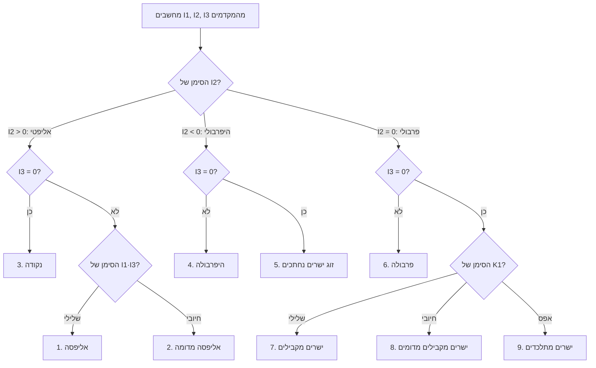
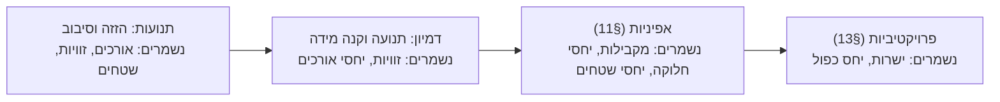

# 📖 מתמטיקה כרך א׳ · עמ' 240

ספר: מתמטיקה: תוכנה, שיטותיה ומשמעותה — כרך א׳

## 🧑 שיעור על סעיף · 2026-10-24

למד אותי את הסעיף הבא בספר Mathematics: Its Content, Methods and Meaning — Vol. 1, החל מהעמוד המודפס 240 (הסעיף האחרון שלמדנו: §12 תורת האינווריאנטים (בערך)).

---

## 🧑 שיעור על סעיף · 2026-10-24

יאלה בוא נתחיל את החל מעמוד 240 עינייים שלי

---

## 📘 המורה · claude-opus-5-5

## פתיחה: אורח שעבר דרך מערכת השמש

```story
@title: 19 באוקטובר 2017 — אליפסה או היפרבולה?
בלילה של 19 באוקטובר 2017 עבר רוברט וריק (Robert Weryk), חוקר באוניברסיטת הוואי, על תמונות מהטלסקופ Pan-STARRS1 שעל פסגת הר הליאקלה במאווי. בתמונות היה גוף קלוש שזז מהר מדי ביחס לרקע [[ודאות: גבוהה]]. זו שגרה בסקר שמחפש אסטרואידים שעלולים להתקרב לכדור הארץ: מוצאים נקודה זזה, מודדים כמה מיקומים ומחשבים מסלול. אבל המסלול של הגוף הזה לא הסתדר.

הגוף קיבל תחילה את הכינוי C/2017 U1. האות C מסמנת שביט. אחר כך הסתבר שאין לו זנב או הילה, והכינוי שונה ל-A/2017 U1 (אסטרואיד). לבסוף קבע האיגוד האסטרונומי הבין-לאומי קטגוריה חדשה לגמרי, והגוף נקרא 1I/2017 U1 ʻOumuamua, "האורח הבין-כוכבי הראשון" [[ודאות: גבוהה]]. השם בהוואית פירושו בערך "שליח מרחוק שמגיע ראשון" [[ודאות: בינונית]].

השאלה המעשית שעמדה בפני הצוותים באותם ימים הייתה פשוטה לנסח: האם המסלול הוא עקומה סגורה, אליפסה, כך שהגוף קשור לשמש ויחזור? או שהוא עקומה פתוחה, היפרבולה, כך שהגוף בא מבין הכוכבים, יעבור פעם אחת וייעלם? התשובה הייתה היפרבולה מובהקת, עם אקסצנטריות גדולה בהרבה מ-1 [[ודאות: גבוהה]]. את המספרים המדויקים נבנה בעצמנו במקרה הבוחן בהמשך השיעור.
```

נשים לב לשאלה של וריק ונראה כמה היא קרובה לעמוד שאנחנו קוראים. מהתצפיות אפשר לבנות משוואה מסדר שני שמתארת את המסלול, $Ax^2+2Bxy+Cy^2+2Dx+2Ey+F=0$, אבל רק במערכת צירים שמישהו בחר: ראשית הצירים בשמש, ציר $x$ לכיוון נקודת האביב, או כל בחירה נוחה אחרת. לטבע לא אכפת מהבחירה הזו. אליפסה נשארת אליפסה גם אם מסובבים את הצירים, והיפרבולה נשארת היפרבולה גם אם מזיזים את הראשית. [[תוספת]] בפועל אסטרונומים קובעים את סוג המסלול מתוך "יסודות מסלול" (orbital elements) ומסימן האנרגיה, ולא מששת המקדמים. אלא שזו אותה שאלה גאומטרית בניסוח אחר, ובמקרה הבוחן נראה ששתי הדרכים נותנות אותה תשובה בדיוק.

### הבעיה

[[מהספר]] נכתוב את הבעיה כמו שהמחברים מציבים אותה בעמ' 238–239. נתון פולינום ממעלה שנייה בשני משתנים. אם נעבור ממערכת צירים מלבנית אחת לאחרת, כל ששת המקדמים $A,B,C,D,E,F$ ישתנו, אבל העקומה עצמה, כלומר קבוצת הנקודות במישור, לא זזה. לכן כל תשובה לשאלה גאומטרית ("האם זו אליפסה?", "כמה ארוך הציר הגדול?") חייבת להיות כזו שלא תלויה במערכת הצירים. נשאל: איך מוציאים מתוך מקדמים שתלויים בבחירה שרירותית תשובה שלא תלויה בה?

### למה זה קשה

אם רק היינו מזיזים את הראשית, אולי היה קל לעקוב אחרי השינויים. אבל סיבוב של הצירים, $x=x'\cos\theta-y'\sin\theta$ ו-$y=x'\sin\theta+y'\cos\theta$, מערבב את המקדמים זה בזה: $A$ החדש תלוי ב-$A$, ב-$B$ וב-$C$ הישנים יחד עם $\cos^2\theta$, $\sin\theta\cos\theta$ ו-$\sin^2\theta$. הזזה מעבירה חלק מהמקדמים הריבועיים אל $D$, $E$ ו-$F$. בסוף אף מקדם בודד לא "מחזיק" את הגאומטריה, היא מפוזרת בין כולם. לכן אי אפשר לקרוא את המשוואה ולראות מה היא מתארת, כמו שהיה אפשר אילו הייתה כתובה בצורה קנונית כמו $x^2/a^2+y^2/b^2=1$.

### הרעיון

הרעיון הוא לחפש צירופים של המקדמים ששרדים כל החלפת צירים מלבנית, כלומר אינווריאנטים אורתוגונליים (orthogonal invariants). ראינו בעמ' 238 שיש שלושה כאלה. בעמ' 239 נאמרו שני דברים חשובים יותר. הראשון: כל אינווריאנט אורתוגונלי מתבטא דרך שלושת אלה. השני: אם מכפילים את כל המשוואה במספר $t\neq0$, העקומה לא משתנה. לכן ביטוי שמתאר תכונה גאומטרית חייב להיות כזה שה-$t$ מצטמצם בו. במונחי הספר, הוא חייב להיות הומוגני ממעלה אפס (homogeneous of degree zero). בהמשך החלק הזה נבנה בעצמנו ביטוי כזה, את חצאי הצירים, ונראה איך שני התנאים האלה מתקיימים בו.

## שלושת האינווריאנטים: רענון לפני שבונים

```refresh
@title: האינווריאנטים האורתוגונליים $I_1, I_2, I_3$
@first: הוגדרו בעמ' 238–239. ערכים מספריים מהדוגמה בעמ' 241 ($A=1,B=-3,C=5,D=-1,E=2,F=3$): $I_1=6,\ I_2=-4,\ I_3=-9$
שלושת הביטויים הם

$$I_1=A+C,\qquad I_2=AC-B^2=\begin{vmatrix}A&B\\B&C\end{vmatrix},\qquad I_3=\begin{vmatrix}A&B&D\\B&C&E\\D&E&F\end{vmatrix}.$$

את $I_3$ מחשבים בפיתוח לפי השורה הראשונה. כל איבר בשורה מוכפל בדטרמיננטה $2\times2$ שנשארת אחרי מחיקת השורה והעמודה שלו, והסימנים מתחלפים $+,-,+$:

$$I_3=A(CF-E^2)-B(BF-ED)+D(BE-CD).$$

בדוגמה של הספר: האיבר הראשון הוא $1\cdot(5\cdot3-2^2)=11$. האיבר השני הוא $-(-3)\cdot\big((-3)\cdot3-2\cdot(-1)\big)=-21$. האיבר השלישי הוא $(-1)\cdot\big((-3)\cdot2-5\cdot(-1)\big)=1$. הסכום $11-21+1=-9$, וזה בדיוק מה ש-`det` מחזיר על המטריצה כולה (בדקתי את שתי הדרכים בכלי compute).
```

למה דווקא דטרמיננטות? התשובה באה מ-§11, ולכן נרענן אותה.

```refresh
@title: דטרמיננטה = מקדם השינוי של שטח
@first: §11, עמ' 236, נוסחה (21): $\Delta=a_1b_2-a_2b_1$ שווה ליחס בין שטח המקבילית שבנויה על וקטורי המערכת החדשה לבין שטח המקבילית שבנויה על וקטורי המערכת הישנה
בסיבוב, וקטורי המערכת החדשה הם $(\cos\theta,\sin\theta)$ ו-$(-\sin\theta,\cos\theta)$, ולכן $\Delta=\cos^2\theta+\sin^2\theta=1$. סיבוב לא משנה שטחים. גם הזזה לא משנה שטחים. [[תוספת]] יש עוד עובדה שנזדקק לה עכשיו: כשמבצעים שתי טרנספורמציות זו אחר זו, מקדמי השטח שלהן מוכפלים, כלומר $\det(XY)=\det X\cdot\det Y$. לכן כל מעבר שמקדם השטח שלו הוא 1 לא יכול לשנות דטרמיננטה שבנויה נכון.
```

[[תוספת]] כדי להפעיל את הכלל הזה נכתוב את הפולינום ככפל מטריצות. נסמן $\mathbf{u}=(x,y,1)$ ואת המטריצה הסימטרית של $I_3$ ב-$M$. אז

$$Ax^2+2Bxy+Cy^2+2Dx+2Ey+F=\mathbf{u}\,M\,\mathbf{u}^{T}.$$

אפשר לבדוק על ידי פתיחת הכפל: האיבר $2Bxy$ מגיע פעמיים, מ-$B$ שמעל האלכסון ומ-$B$ שמתחתיו, וכך גם $2Dx$ ו-$2Ey$. בזכות ה-1 השלישי ב-$\mathbf{u}$ אפשר לכתוב גם הזזה ככפל במטריצה: $\mathbf{u}^T=T\,\mathbf{u}'^T$, כאשר $T=\begin{pmatrix}1&0&x_0\\0&1&y_0\\0&0&1\end{pmatrix}$. המטריצה החדשה היא אז $M'=T^{T}MT$, ולכן $\det M'=\det M\cdot(\det T)^2=\det M$, כי $\det T=1$. אותו נימוק עובד לסיבוב. זו הסיבה העמוקה ש-$I_3$ הוא אינווריאנט: הוא מקדם השינוי של "נפח" במרחב של $(x,y,1)$, וטרנספורמציה שלא משנה שטחים לא משנה אותו.

```history
@title: מאיפה באה תורת האינווריאנטים
@who: ג'ורג' בול, ארתור קיילי, ג'יימס סילבסטר, ובהמשך דויד הילברט
@when: 1841 עד 1890
אוילר סיווג כבר ב-1748, בספרו Introductio in analysin infinitorum, את העקומות מסדר שני לפי המשוואה הכללית [[ודאות: גבוהה]]. אבל הוא עשה זאת בהעברה מפורשת לצורה קנונית, מקרה אחר מקרה. הצורך שהוליד את התורה היה לבנות סיווג שלא דורש בכל פעם לחשב את הסיבוב ואת ההזזה: לקרוא את סוג העקומה ישירות מהמקדמים. ב-1841 פרסם ג'ורג' בול עבודה על ביטויים שנשמרים בהחלפה ליניארית של משתנים, ובדרך כלל רואים בה את ראשית התחום [[ודאות: גבוהה]]. קיילי וסילבסטר פיתחו אותה בשנות ה-50 של המאה ה-19, והמונח invariant מיוחס לסילבסטר, כנראה מ-1851 [[ודאות: בינונית]].

השאלה שהעסיקה את התחום הייתה מה שהספר אומר בעמ' 239: האם יש מספר סופי של אינווריאנטים "בסיסיים" שכל האחרים מתבטאים דרכם. לעקומות מסדר שני התשובה היא כן, שלושה. במקרה הכללי הוכיח הילברט ב-1890 את משפט הבסיס, שמבטיח קיום של בסיס סופי, בהוכחה שלא בנתה את הבסיס במפורש [[ודאות: גבוהה]]. מסופר שפאול גורדן, שבנה בסיסים כאלה בחישוב ידני ממושך, הגיב "זו לא מתמטיקה, זו תאולוגיה" [[ודאות: בינונית]]. ההנחה של כל הבניין היא שהשאלות המעניינות הן אלה שלא תלויות בבחירת הצירים. היום הרעיון הזה חי בראייה ממוחשבת (אינווריאנטים פרויקטיביים, שנפגוש ב-§13), באינווריאנטים של טנזורים בהנדסה ובפיזיקה, ובלמידת מכונה ברשתות שבנויות להיות אינווריאנטיות או אקוויווריאנטיות לסיבובים. בנוסף, האלגברה הממוחשבת (בסיסי גרובנר) הפכה את החישוב המפורש של בסיסים לבר-ביצוע.
```

## מאינווריאנטים לחצאי צירים: גזירה צעד אחר צעד

[[מהספר]] בעמ' 239 המחברים נותנים את התוצאה בלבד: "על ידי העברה לצורה קנונית וחישוב נוסף" מתקבלת נוסחה לחצאי הצירים של אליפסה. ב-OCR הנוסחה שבורה. מהשחזור, שנאמת מיד בגזירה, היא:

```formula
@title: חצאי הצירים דרך האינווריאנטים (משוחזר מ-OCR פגום)
$$a,\,b=\sqrt{\dfrac{|I_3|}{|I_2|\cdot\tfrac12\left|I_1\pm\sqrt{I_1^2-4I_2}\right|}}$$
סימן ה-$+$ נותן חצי ציר אחד וסימן ה-$-$ נותן את השני. הביטוי $\tfrac12\big(I_1\pm\sqrt{I_1^2-4I_2}\big)$ הוא בדיוק שני השורשים $\lambda_1,\lambda_2$ של המשוואה האופיינית שנגזור עכשיו, ולכן הנוסחה היא $a^2=|I_3|/(|I_2|\,|\lambda_1|)$. היא תקפה לאליפסה ולהיפרבולה, כלומר כש-$I_2\neq0$ ו-$I_3\neq0$.
```

[[תוספת]] את הגזירה נבנה בשלושה שלבים, וכל שלב יענה על שאלה שהשלב הקודם השאיר פתוחה.

### שלב 1: הזזה למרכז, ומדוע $F'=I_3/I_2$

נניח שלעקומה יש מרכז $(x_0,y_0)$. נציב $x=x'+x_0$, $y=y'+y_0$ ונאסוף את האיברים הליניאריים. המקדם של $2x'$ יוצא $Ax_0+By_0+D$, והמקדם של $2y'$ יוצא $Bx_0+Cy_0+E$. מרכז פירושו שהעקומה סימטרית ביחס להיפוך $(x',y')\to(-x',-y')$, ולכן שני המקדמים האלה צריכים להתאפס:

$$\begin{pmatrix}A&B\\B&C\end{pmatrix}\begin{pmatrix}x_0\\y_0\end{pmatrix}=-\begin{pmatrix}D\\E\end{pmatrix}.$$

למערכת הזו יש פתרון יחיד בדיוק כשהדטרמיננטה שלה, $I_2$, שונה מאפס. זו כבר רמז ראשון לתפקיד של $I_2$: כש-$I_2=0$ אין מרכז יחיד, וזה המקרה של הפרבולה. הקבוע החדש הוא ערך הפולינום במרכז, $F'=Ax_0^2+2Bx_0y_0+Cy_0^2+2Dx_0+2Ey_0+F$. אפשר לפשט אותו בטריק קטן. נכתוב את החלק הריבועי כ-$x_0(Ax_0+By_0)+y_0(Bx_0+Cy_0)$ ונציב את משוואות המרכז: זה שווה ל-$-Dx_0-Ey_0$. לכן

$$F'=F+Dx_0+Ey_0.$$

עדיין לא ברור מה הקשר לאינווריאנטים. כאן נכנס הכפל של המטריצות. אחרי ההזזה למרכז העמודה השלישית של $M'$ היא $(0,0,F')$, ולכן

$$M'=\begin{pmatrix}A&B&0\\B&C&0\\0&0&F'\end{pmatrix},\qquad \det M'=F'\,(AC-B^2)=F'\,I_2.$$

ראינו ש-$\det M'=\det M=I_3$, ולכן $F'=I_3/I_2$. הקבוע החופשי שאחרי ההזזה נקבע כולו על ידי שני אינווריאנטים, בלי לחשב את המרכז. [[תוספת]] בדקתי ב-compute על דוגמת הספר שהדרך הישירה, $F+Dx_0+Ey_0$ עם המרכז שמתקבל מ-`lusolve`, נותנת אותו מספר כמו $I_3/I_2$. את המספרים עצמם נפרוס כשנפתור את הדוגמה במלואה בהמשך השיעור.

### שלב 2: סיבוב שמבטל את $B$, ומשפט ויאטה

עכשיו המשוואה היא $Ax'^2+2Bx'y'+Cy'^2+F'=0$, ונשאר להיפטר מהאיבר המעורב. נסובב את הצירים בזווית $\theta$ שמקיימת $\tan2\theta=2B/(A-C)$. הסיבוב הזה מאפס את המקדם של $x'y'$, כפי שראינו בהעברה לצורה קנונית ב-§8. נסמן את המקדמים החדשים ב-$\lambda_1,\lambda_2$. אפשר היה לחשב אותם מנוסחאות הסיבוב, אבל יש דרך קצרה הרבה יותר: הסיבוב לא משנה את $I_1$ ואת $I_2$. אחרי הסיבוב $I_1=\lambda_1+\lambda_2$ ו-$I_2=\lambda_1\lambda_2-0^2=\lambda_1\lambda_2$. אנחנו יודעים אם כן את הסכום ואת המכפלה של שני מספרים, ולפי משפט ויאטה הם שני השורשים של

```formula
@title: המשוואה האופיינית (characteristic equation)
$$\lambda^2-I_1\lambda+I_2=0,\qquad \lambda_{1,2}=\tfrac12\Big(I_1\pm\sqrt{I_1^2-4I_2}\Big).$$
$\lambda_1,\lambda_2$ הם המקדמים של $x'^2$ ושל $y'^2$ אחרי ביטול האיבר המעורב. במונחים מאוחרים יותר אלה הערכים העצמיים של המטריצה $\begin{pmatrix}A&B\\B&C\end{pmatrix}$. הדיסקרימיננטה $I_1^2-4I_2=(A-C)^2+4B^2$ לעולם אינה שלילית, ולכן השורשים תמיד ממשיים.
```

מה שהיה צריך זווית, סינוסים וקוסינוסים נפתר במשוואה ריבועית אחת, שמקדמיה הם אינווריאנטים. [[תוספת]] על דוגמת הספר וידאתי ב-compute שהסכום של שני השורשים הוא בדיוק $I_1=6$, שהמכפלה שלהם היא בדיוק $I_2=-4$, ושהם זהים לערכים העצמיים של המטריצה $\begin{pmatrix}1&-3\\-3&5\end{pmatrix}$.

### שלב 3: קריאת חצאי הצירים

אחרי שני השלבים המשוואה היא $\lambda_1x'^2+\lambda_2y'^2+I_3/I_2=0$. נעביר אגף ונחלק כדי להגיע לצורה $x'^2/a^2\pm y'^2/b^2=1$. מתקבל $a^2=\left|\dfrac{I_3/I_2}{\lambda_1}\right|$, וכך גם עבור $b$ עם $\lambda_2$:

$$a^2=\frac{|I_3|}{|I_2|\,|\lambda_1|},\qquad b^2=\frac{|I_3|}{|I_2|\,|\lambda_2|}.$$

זו בדיוק הנוסחה המשוחזרת מעמ' 239, וכך גם וידאנו שהשחזור נכון.

### בדיקת מעלות: למה הנוסחה "מותרת"

נחזור לדרישה של עמ' 239. אם מכפילים את כל ששת המקדמים ב-$t$, אז $I_1$ גדל פי $t$ (מעלה 1), $I_2$ גדל פי $t^2$ (מעלה 2, מכפלה של שני מקדמים), ו-$I_3$ גדל פי $t^3$ (דטרמיננטה $3\times3$, מעלה 3). גם $\lambda$ גדל פי $t$, כי הוא שורש של משוואה שבה $I_1$ ממעלה 1 ו-$I_2$ ממעלה 2. בביטוי של $a^2$ המעלה הכוללת היא

$$3-2-1=0,$$

ולכן ה-$t$ מצטמצם וחצי הציר לא משתנה. זה מה שהיינו צריכים לצפות: אותה אליפסה, אותו חצי ציר.

```think
לפני שממשיכים, נסו לחשוב: $I_1=A+C$ לא משתנה בשום סיבוב או הזזה. למה, למרות זאת, הספר אומר שאין לו משמעות גאומטרית ישירה? נסו למצוא שתי משוואות של אותה עקומה בדיוק שנותנות ערכים שונים של $I_1$.
---
קחו את המעגל $x^2+y^2-1=0$, שבו $I_1=2$. עכשיו כפלו את כל המשוואה ב-3: $3x^2+3y^2-3=0$. זה אותו מעגל בדיוק, אבל $I_1=6$. האינווריאנטיות של $I_1$ נוגעת רק להחלפת צירים. היא לא מגינה עליו מפני הכפלת המשוואה בקבוע, שגם היא לא משנה את העקומה. לכן $I_1$, וכך גם $I_2$ (מעלה 2) ו-$I_3$ (מעלה 3), הם "ישויות אלגבריות" בלשון הספר: הם תלויים באופן שבו כתבנו את המשוואה, ולא רק בעקומה. משמעות גאומטרית יש רק לצירופים שבהם המעלות מתקזזות, כמו $a^2=|I_3|/(|I_2||\lambda_1|)$, או כמו $I_1^2/I_2$ (מעלה $2-2=0$). את המשמעות של $I_1^2/I_2$ נבדוק באחד התרגילים.
```

זו המסקנה שהמחברים מסיימים בה את עמ' 239 [[מהספר]]: $I_1$, $I_2$ ו-$I_3$ הומוגניים, אבל לא ממעלה אפס, ולכן הם לא אורכים ולא זוויות. הם חומר הגלם שממנו בונים אורכים וזוויות. יש להם גם תפקיד שני, שלא מצריך לחלק אותם זה בזה. הסימן של מספר לא משתנה כשמכפילים אותו ב-$t^2>0$, ולכן הסימן של $I_2$ הוא תכונה גאומטרית אמיתית, גם אם הערך של $I_2$ אינו כזה. על ההבחנה הזו בין ערך לסימן בנויה טבלה 1 בעמ' 240, וממנה ממשיך החלק הבא של השיעור, יחד עם החצי-אינווריאנט $K_1$, הכמות שמשתנה בהזזה ובכל זאת מועילה.

## החצי-אינווריאנט $K_1$: כמות ששורדת רק חלק מהמעברים

נתחיל מהכמות הזו, כי בלעדיה הטבלה לא נסגרת. נניח שכבר יודעים ש-$I_2=0$ ו-$I_3=0$. במקרה הזה, כפי שנראה מיד, העקומה היא זוג ישרים מקבילים, ושלושת האינווריאנטים לא מספיקים כדי לקבוע אם הישרים ממשיים, מדומים או מתלכדים. צריך מידע נוסף. [[מהספר]] בעמ' 240 המחברים מציגים לשם כך ביטוי שבנוי משתי דטרמיננטות קטנות:

```formula
@title: החצי-אינווריאנט (semi-invariant) $K_1$
$$K_1=\begin{vmatrix}A&D\\D&F\end{vmatrix}+\begin{vmatrix}C&E\\E&F\end{vmatrix}=AF-D^2+CF-E^2.$$
הדטרמיננטה הראשונה בנויה מהמקדמים שקשורים ל-$x$ בלבד ($A$, $D$) ומהקבוע $F$. השנייה בנויה מהמקדמים שקשורים ל-$y$ בלבד ($C$, $E$) ומ-$F$. הביטוי לא משתנה בסיבוב של הצירים. הוא כן משתנה בהזזה של הראשית, ולכן אינו אינווריאנט מלא.
```

```erratum
@title: נוסחת $K_1$ ושמו בטבלה, כפי שהם מופיעים ב-OCR
@page: 240
**מה כתוב בטקסט שחולץ מה-PDF:** `AF - EF + CF - E2`. בטבלה עצמה הסימן של החצי-אינווריאנט מופיע כ-`A,`.
**מה נכון:** $K_1=AF-D^2+CF-E^2$, סכום של שתי דטרמיננטות $2\times2$, $\begin{vmatrix}A&D\\D&F\end{vmatrix}+\begin{vmatrix}C&E\\E&F\end{vmatrix}$. גם השברים של הדטרמיננטות שנשארו ב-OCR, "AD / D F" ו-"CE / E F", מתאימים לצורה הזו. הסימן `A,` הוא שיבוש של $K_1$.
**איך נבדק:** חישבתי ב-compute את שתי הגרסאות על דוגמת הספר ($A=1,B=-3,C=5,D=-1,E=2,F=3$) ואחר כך על אותה משוואה אחרי סיבוב של הצירים ב-$30^\circ$, כלומר $M'=R^TMR$. הגרסה הנכונה נותנת $13$ לפני הסיבוב ו-$13$ אחריו. הגרסה של ה-OCR נותנת $8$ לפני הסיבוב ו-$6.3218$ אחריו. ביטוי שמשתנה בסיבוב טהור לא יכול להיות מה שהספר מתאר ("לא משתנה בסיבוב"), ולכן זו שגיאת OCR ולא טעות של המחברים.
```

### למה $K_1$ לא משתנה בסיבוב

[[תוספת]] את הבדיקה המספרית עשינו, אבל כדאי להבין למה היא יוצאת כך. נקבץ את $K_1$ אחרת:

$$K_1=(A+C)F-(D^2+E^2)=I_1F-\big(D^2+E^2\big).$$

עכשיו נבדוק מה עושה סיבוב סביב הראשית לכל אחד מהחלקים. $I_1$ אינווריאנט, את זה כבר ראינו. $F$ הוא ערך הפולינום בראשית, וסיבוב סביב הראשית משאיר אותה במקומה, ולכן $F$ לא משתנה. נשאר הזוג $(D,E)$. בפיתוח ב-$\mathbf{u}M\mathbf{u}^T$ הוא העמודה השלישית של $M$, ובסיבוב הוא מסתובב כמו וקטור רגיל. אורכו בריבוע, $D^2+E^2$, נשמר, מאותה סיבה שסיבוב שומר אורכים. כל שלושת החלקים נשמרים, ולכן גם $K_1$.

### ולמה הוא כן משתנה בהזזה

בהזזה הראשית זזה, ולכן $F$ (הערך בראשית) משתנה, וגם $D,E$ משתנים. נראה את זה על הדוגמה הפשוטה ביותר. למעגל $x^2+y^2-1=0$ יש $A=C=1$, $D=E=0$, $F=-1$, ולכן $K_1=-1+(-1)=-2$. נציב $x\to x+1$ ונקבל $x^2+2x+y^2=0$, כלומר $D=1$ ו-$F=0$. עכשיו $K_1=0-1+0-0=-1$. זה אותו מעגל, אבל ערך אחר של $K_1$. [[תוספת]] גם בדוגמת הספר זה קורה: בהזזה למרכז $(0.25,-0.25)$ הערך של $K_1$ משתנה מ-$13$ ל-$13.5$ (חושב ב-compute).

### ולמה בכל זאת מותר להשתמש בו בטבלה

ראינו ש-$K_1$ משתנה בהזזה, ולכן צריך להסביר למה הוא בכל זאת מופיע בטבלה שמסווגת עקומות לפי תכונות שלא תלויות במערכת הצירים. התשובה היא שהספר משתמש בו רק בשורות שבהן $I_2=0$ ו-$I_3=0$. [[תוספת]] נוכיח שבתנאים האלה $K_1$ לא משתנה גם בהזזה.

הצעד הראשון הוא סיבוב, שלא משנה את $K_1$. נסובב כך שהאיבר המעורב ייעלם. ראינו בחלק הקודם שאחרי הסיבוב המקדמים הם $\lambda_1,\lambda_2$, שמכפלתם $I_2=0$, ולכן אחד מהם הוא אפס. נקרא לצירים כך ש-$A=0$ ו-$C=I_1\neq0$. עכשיו נחשב את $I_3$ בפיתוח לפי השורה הראשונה:

$$I_3=\begin{vmatrix}0&0&D\\0&C&E\\D&E&F\end{vmatrix}=D\,(0\cdot E-C\cdot D)=-CD^2.$$

אם גם $I_3=0$, אז $D=0$, כי $C\neq0$. המשוואה נשארת $Cy^2+2Ey+F=0$, בלי $x$ בכלל. זה כבר מראה שמדובר בישרים מקבילים לציר $x$: לכל ערך של $y$ שפותר את המשוואה הריבועית, כל ה-$x$ מתאימים.

עכשיו נזיז. הזזה ב-$x$ לא עושה כלום, כי $x$ לא מופיע. נציב $y\to y+y_0$:

$$C(y+y_0)^2+2E(y+y_0)+F=Cy^2+2(Cy_0+E)\,y+\big(Cy_0^2+2Ey_0+F\big).$$

ה-$K_1$ החדש (כאן $A=0$ ו-$D=0$, ולכן רק הדטרמיננטה השנייה תורמת) הוא

$$C\big(Cy_0^2+2Ey_0+F\big)-(Cy_0+E)^2=C^2y_0^2+2CEy_0+CF-C^2y_0^2-2CEy_0-E^2=CF-E^2.$$

כל האיברים עם $y_0$ התבטלו. במקרה הזה $K_1$ באמת אינווריאנט, ולכן גם הסימן שלו משמעותי גאומטרית.

[[תוספת]] כדאי לראות את זה גם על דוגמה שבה הכול "מבולגן". ניקח את זוג הישרים $x'=\pm2$, כלומר $x'^2-4=0$, עם $K_1=1\cdot(-4)-0+0-0=-4$. נסובב את הצירים ב-$45^\circ$, כך ש-$x'=(x+y)/\sqrt2$, ואחר כך נציב $x\to x+1$, $y\to y+2$. מתקבל $x'=(x+y+3)/\sqrt2$, והמשוואה $(x+y+3)^2/2-4=0$, כלומר

$$0.5x^2+xy+0.5y^2+3x+3y+0.5=0,$$

עם $A=B=C=0.5$, $D=E=1.5$, $F=0.5$. חישבתי ב-compute את המטריצה $Q^TLQ$, כאשר $L$ היא המטריצה של המשוואה המקורית ו-$Q$ היא המטריצה של הסיבוב וההזזה, וקיבלתי $I_2=0$, $I_3=0$ ו-$K_1=0.25-2.25+0.25-2.25=-4$. אחרי שני המעברים הערך של $K_1$ לא השתנה.

```refresh
@title: הדיסקרימיננטה של משוואה ריבועית
@first: חלק 1 של השיעור הזה: הדיסקרימיננטה של המשוואה האופיינית $I_1^2-4I_2$ יצאה $36+16=52$ בדוגמת הספר, ומכיוון שהיא חיובית קיבלנו שני שורשים ממשיים שונים
למשוואה $Cy^2+2Ey+F=0$ יש שני פתרונות ממשיים שונים כשהדיסקרימיננטה $(2E)^2-4CF$ חיובית, פתרון כפול כשהיא אפס, ושני פתרונות מרוכבים צמודים כשהיא שלילית. נשים לב ש-$(2E)^2-4CF=-4(CF-E^2)=-4K_1$. לכן הסימן של $K_1$ הפוך לסימן הדיסקרימיננטה: $K_1<0$ פירושו שני ישרים ממשיים, $K_1=0$ פירושו ישר כפול, ו-$K_1>0$ פירושו "ישרים" מדומים, שאין להם אף נקודה ממשית במישור. בדוגמה של $x'=\pm2$ הדיסקרימיננטה היא $-4\cdot(-4)=16>0$, ואכן יש שני ישרים.
```

## טבלה 1: תשעה מעמדות משלושה סימנים

עכשיו יש בידינו כל הכלים שהספר צריך. נשחזר את טבלה 1 מעמ' 240 [[מהספר]]. ב-OCR היא מפורקת לגמרי, ולכן שחזרתי אותה מהשורות שנשארו קריאות ומהגזירה שבחלק 1. [[תוספת]] לכל שורה הוספתי משוואה פשוטה שמדגימה אותה, והאפליקציה מחשבת עבורה את $I_2$, את $I_1I_3$ ואת $K_1$. כך אפשר לבדוק שהקריטריון באמת מתקיים.

```table
{"title": "טבלה 1 (משוחזרת): סיווג אפיני של עקומה מסדר שני לפי I1, I2, I3, K1, עם דוגמה מחושבת לכל שורה",
 "scope": {},
 "columns": ["#", "קריטריון", "שם המעמד", "משוואה קנונית", "משוואה מצומצמת", "דוגמה", "I2 של הדוגמה", "I1·I3 של הדוגמה", "K1 של הדוגמה"],
 "rows": [
  ["1", "\"I2>0, I1·I3<0\"", "\"אליפסה\"", "\"x²/a² + y²/b² = 1\"", "\"I\"", "\"x² + y² − 1 = 0\"", "1*1-0^2", "(1+1)*det([[1,0,0],[0,1,0],[0,0,-1]])", "1*(-1)-0^2+1*(-1)-0^2"],
  ["2", "\"I2>0, I1·I3>0\"", "\"אליפסה מדומה\"", "\"x²/a² + y²/b² = −1\"", "\"I\"", "\"x² + y² + 1 = 0\"", "1*1-0^2", "(1+1)*det([[1,0,0],[0,1,0],[0,0,1]])", "1*1-0^2+1*1-0^2"],
  ["3", "\"I2>0, I3=0\"", "\"נקודה (זוג ישרים מדומים נחתכים)\"", "\"x²/a² + y²/b² = 0\"", "\"I\"", "\"x² + y² = 0\"", "1*1-0^2", "(1+1)*det([[1,0,0],[0,1,0],[0,0,0]])", "1*0-0^2+1*0-0^2"],
  ["4", "\"I2<0, I3≠0\"", "\"היפרבולה\"", "\"x²/a² − y²/b² = 1\"", "\"I\"", "\"x² − y² − 1 = 0\"", "1*(-1)-0^2", "(1-1)*det([[1,0,0],[0,-1,0],[0,0,-1]])", "1*(-1)-0^2+(-1)*(-1)-0^2"],
  ["5", "\"I2<0, I3=0\"", "\"זוג ישרים נחתכים\"", "\"x²/a² − y²/b² = 0\"", "\"I\"", "\"x² − y² = 0\"", "1*(-1)-0^2", "(1-1)*det([[1,0,0],[0,-1,0],[0,0,0]])", "0"],
  ["6", "\"I2=0, I3≠0\"", "\"פרבולה\"", "\"y² = 2px\"", "\"II\"", "\"y² − 2x = 0\"", "0*1-0^2", "(0+1)*det([[0,0,-1],[0,1,0],[-1,0,0]])", "0*0-(-1)^2+1*0-0^2"],
  ["7", "\"I2=0, I3=0, K1<0\"", "\"זוג ישרים מקבילים\"", "\"x² = a²\"", "\"III\"", "\"x² − 1 = 0\"", "1*0-0^2", "(1+0)*det([[1,0,0],[0,0,0],[0,0,-1]])", "1*(-1)-0^2+0*(-1)-0^2"],
  ["8", "\"I2=0, I3=0, K1>0\"", "\"זוג ישרים מקבילים מדומים\"", "\"x² = −a²\"", "\"III\"", "\"x² + 1 = 0\"", "1*0-0^2", "(1+0)*det([[1,0,0],[0,0,0],[0,0,1]])", "1*1-0^2+0*1-0^2"],
  ["9", "\"I2=0, I3=0, K1=0\"", "\"זוג ישרים מתלכדים\"", "\"x² = 0\"", "\"III\"", "\"x² = 0\"", "1*0-0^2", "(1+0)*det([[1,0,0],[0,0,0],[0,0,0]])", "0"]
 ]
}
```

נקרא את הטבלה. בעמודה של $I_1\cdot I_3$ בשורה 4 יוצא $0$, אבל זה לא סותר שום דבר: בשורה הזו הקריטריון הוא $I_3\neq0$ ולא הסימן של $I_1I_3$, ובדוגמה $x^2-y^2-1$ מתקיים $I_1=0$ ו-$I_3=1$ (חושב ב-compute). בהיפרבולה המכפלה $I_1I_3$ פשוט לא מעניינת. בשורה 6 $I_1I_3=-1\neq0$, כלומר $I_3\neq0$, כנדרש. בשורות 7–9 אפשר לראות את $K_1$ עובר מ-$-1$ ל-$+1$ ול-$0$, ושלושת המעמדות נפרדים.

### ההיגיון של כל קריטריון

הטבלה עשויה להיראות כמו רשימה של תנאים שצריך לשנן, אבל כל תנאי בה נובע ישירות מהגזירה שבחלק 1. נעבור עליהם לפי הסדר שבו הם נשאלים.

**השאלה הראשונה, הסימן של $I_2$, קובעת את סוג החלק הריבועי.** אחרי הסיבוב החלק הריבועי הוא $\lambda_1x'^2+\lambda_2y'^2$ ו-$I_2=\lambda_1\lambda_2$. כש-$I_2>0$ שני המקדמים באותו סימן, ולכן החלק הריבועי "סוגר" את העקומה מכל הכיוונים. זה המקרה האליפטי. כש-$I_2<0$ הסימנים הפוכים, ויש כיוונים שבהם החלק הריבועי מתאפס, כלומר האסימפטוטות. זה המקרה ההיפרבולי. כש-$I_2=0$ אחד המקדמים הוא אפס, ובכיוון שלו העקומה נשלטת רק על ידי איבר ליניארי. זה המקרה הפרבולי. ראינו כבר שזה גם המקרה שבו אין מרכז יחיד. כאמור, $I_2$ הוא ממעלה 2, ולכן הסימן שלו לא משתנה כשמכפילים את המשוואה ב-$t$, כי $t^2>0$.

**השאלה השנייה, האם $I_3=0$, מבחינה בין עקומה "אמיתית" לעקומה מנוונת.** אם יש מרכז, ראינו ש-$F'=I_3/I_2$. כש-$I_3=0$ הקבוע נעלם והמשוואה היא $\lambda_1x'^2+\lambda_2y'^2=0$. היא הומוגנית, ולכן מתפרקת: אם הסימנים הפוכים מתקבלים שני ישרים דרך המרכז (שורה 5), ואם הסימנים זהים מתקבלת רק הנקודה $(0,0)$ (שורה 3). בפרבולה ($I_2=0$) ראינו עכשיו ש-$I_3=-CD^2$, ולכן $I_3=0$ פירושו שהאיבר הליניארי שיצר את הפרבולה נעלם, ונשארו ישרים מקבילים. במונחים של §11, $I_3=0$ פירושו שהמטריצה $M$ "מועכת" מימד: הפולינום מתפרק למכפלה של שני גורמים ליניאריים, ממשיים או מרוכבים.

**השאלה השלישית, הסימן של $I_1I_3$, מבחינה בין אליפסה ממשית למדומה.** כש-$I_2>0$ המשוואה היא $\lambda_1x'^2+\lambda_2y'^2+I_3/I_2=0$, ושני ה-$\lambda$ באותו סימן. הסימן הזה הוא הסימן של $I_1=\lambda_1+\lambda_2$. כדי שיהיו פתרונות ממשיים, הקבוע $I_3/I_2$ צריך להיות בסימן הפוך, אחרת סכום של שלושה מספרים באותו סימן לא יתאפס לעולם. $I_2>0$, ולכן הסימן של $I_3/I_2$ הוא הסימן של $I_3$. התנאי הוא אם כן ש-$I_3$ ו-$I_1$ יהיו בסימנים הפוכים, כלומר $I_1I_3<0$. גם זה עומד בבדיקת המעלות: $I_1I_3$ הוא ממעלה $1+3=4$, מעלה זוגית, ולכן הסימן שלו לא תלוי ב-$t$. הסימן של $I_3$ לבדו, ממעלה 3, כן מתהפך כשכופלים את המשוואה ב-$t=-1$. לכן הוא לא יכול לשמש כקריטריון גאומטרי.

```think
לפני שממשיכים, נסו לחשוב: בשורה 1 הקריטריון הוא $I_1I_3<0$. מה אם $I_2>0$ ו-$I_1=0$? אז $I_1I_3=0$ ושום שורה לא מתאימה. האם המקרה הזה יכול לקרות?
---
לא יכול. אם $I_2=AC-B^2>0$, אז $AC>B^2\geq0$, כלומר $AC>0$. לכן $A$ ו-$C$ שניהם שונים מאפס ובאותו סימן, וסכומם $I_1=A+C$ שונה מאפס. כך כשהמקרה האליפטי ($I_2>0$, $I_3\neq0$) מתקיים, $I_1I_3$ תמיד שונה מאפס, ושתי השורות הראשונות מכסות את כל האפשרויות. זו גם הסיבה שהטבלה "סגורה": כל שישייה של מקדמים, כשלא כל המקדמים הריבועיים אפס, נופלת בדיוק לשורה אחת.
```

**השאלה הרביעית, הסימן של $K_1$, מבחינה בין סוגי הישרים המקבילים.** את זה ראינו ברענון של הדיסקרימיננטה: כש-$I_2=I_3=0$ המשוואה היא בעצם משוואה ריבועית במשתנה אחד, ו-$K_1$ הוא מינוס רבע מהדיסקרימיננטה שלה. בשורה הזו הספר נאלץ להשתמש בחצי-אינווריאנט, כי במקרה הזה שלושת האינווריאנטים כבר כולם קבועים (הם אפס). ההבדל בין $x^2=1$ לבין $x^2=-1$ פשוט לא נראה בהם.

את כל זה אפשר לסכם בעץ החלטה. מתחילים מלמעלה ושואלים לכל היותר שלוש שאלות:



מה רואים בעץ: השאלה הראשונה, על $I_2$, מחלקת את המישור של כל העקומות לשלוש "משפחות" לפי החלק הריבועי לבדו. השאלה השנייה, על $I_3$, בודקת בכל משפחה אם העקומה התנוונה. רק בשני ענפים צריך שאלה שלישית: בענף האליפטי שאינו מנוון (ממשי או מדומה), ובענף הפרבולי המנוון (איזה סוג של ישרים מקבילים). מבנה הענפים מסביר גם למה הספר צריך שלוש משוואות מצומצמות. (I) משמשת את כל העקומות שיש להן מרכז, (II) את הפרבולה, ו-(III) את הישרים המקבילים. בחלק הבא נגזור אותן.

### לראות את המעבר בעיניים

הטבלה מתארת קפיצות בין מעמדות, ואת הקפיצות האלה כדאי לראות. בכלי שלהלן כל מחוון משנה מקדם אחד, העקומה מצוירת כקבוצת האפסים של הפולינום, והקריאות מחשבות את חמשת הקריטריונים בזמן אמת. ערכי ההתחלה הם $x^2+y^2-2x-3=0$, כלומר המעגל $(x-1)^2+y^2=4$.

```interactive
{"title": "טבלה 1 בפעולה: הזיזו את המקדמים וצפו בקריטריונים",
 "caption": "העקומה Ax²+2Bxy+Cy²+2Dx+2Ey+F=0. התחילו מהמעגל (A=C=1, D=−1, F=−3) והורידו את A דרך 0 לערכים שליליים.",
 "params": [
  {"id": "A", "label": "A", "min": -4, "max": 4, "step": 0.25, "value": 1},
  {"id": "B", "label": "B", "min": -4, "max": 4, "step": 0.25, "value": 0},
  {"id": "C", "label": "C", "min": -4, "max": 4, "step": 0.25, "value": 1},
  {"id": "D", "label": "D", "min": -4, "max": 4, "step": 0.25, "value": -1},
  {"id": "E", "label": "E", "min": -4, "max": 4, "step": 0.25, "value": 0},
  {"id": "F", "label": "F", "min": -8, "max": 8, "step": 0.25, "value": -3}
 ],
 "x": {"min": -6, "max": 6, "label": "x"},
 "y": {"min": -6, "max": 6, "label": "y"},
 "curves": [
  {"label": "Ax²+2Bxy+Cy²+2Dx+2Ey+F=0", "implicit": "A*x^2 + 2*B*x*y + C*y^2 + 2*D*x + 2*E*y + F"}
 ],
 "readouts": [
  {"label": "I1 = A+C", "expr": "A + C"},
  {"label": "I2 = AC−B²", "expr": "A*C - B^2"},
  {"label": "I3 = det M", "expr": "A*(C*F - E^2) - B*(B*F - E*D) + D*(B*E - C*D)"},
  {"label": "I1·I3", "expr": "(A + C)*(A*(C*F - E^2) - B*(B*F - E*D) + D*(B*E - C*D))"},
  {"label": "K1 = AF−D²+CF−E²", "expr": "A*F - D^2 + C*F - E^2"}
 ]
}
```

[[תוספת]] כמה ניסויים מכוונים, וכל המספרים בהם חושבו ב-compute:

**מאליפסה דרך פרבולה להיפרבולה.** בערכי ההתחלה $I_1=2$, $I_2=1$, $I_3=-4$, $I_1I_3=-8<0$, כלומר שורה 1, אליפסה ממשית. הורידו את $A$ לאט. כל עוד $A>0$ העקומה נשארת אליפסה שמתארכת ימינה, כי $I_2=A$ קטן והחלק הריבועי בכיוון $x$ נחלש. ב-$A=0$ בדיוק מתקבל $y^2-2x-3=0$: $I_2=0$, $I_3=-1\neq0$, שורה 6, פרבולה. הקצה הימני של האליפסה "ברח לאינסוף". ב-$A=-1$ מתקבל $I_2=-1$ ו-$I_3=2$, שורה 4, והפרבולה נפתחה להיפרבולה. הפרבולה היא אם כן הגבול שבין שתי המשפחות, ולכן היא נקבעת על ידי שוויון ($I_2=0$) ולא על ידי אי-שוויון. נבחין בזה שוב ב-§13, כשנראה שבמבט פרויקטיבי שלוש העקומות הן עקומה אחת, שחותכת את הישר האידיאלי בשתי נקודות, בנקודה אחת או באפס נקודות.

**מאליפסה דרך נקודה לאליפסה מדומה.** חזרו ל-$A=1$ והעלו את $F$. מתקיים $I_3=F-1$, ולכן ב-$F=1$ מתקבל $I_3=0$ והאליפסה מתכווצת לנקודה $(1,0)$ (שורה 3). ב-$F=2$ מתקבל $I_3=1$, ו-$I_1I_3=2>0$: העקומה נעלמת מהמסך, אבל המשוואה עדיין קיימת. זו אליפסה מדומה, שורה 2.

**שלושת סוגי הישרים המקבילים.** קבעו $A=0$, $D=0$, $C=1$, $E=0$. נשאר $y^2+F=0$, ומתקיים $K_1=F$. עבור $F$ שלילי יש שני ישרים $y=\pm\sqrt{-F}$ (שורה 7). ככל ש-$F$ עולה לאפס הם מתקרבים ומתלכדים (שורה 9), ועבור $F$ חיובי הם נעלמים (שורה 8). אם תזיזו עכשיו את $E$, הישרים יזוזו למעלה או למטה, $I_2$ ו-$I_3$ יישארו אפס, ו-$K_1=F-E^2$ ישתנה. הוא ישתנה כי הזזה של $E$ כשאין הזזה מתאימה של $F$ איננה החלפת צירים: היא משנה את המרחק בין הישרים ולא רק את מקומם. כך רואים מה $K_1$ באמת מודד.

מה מלמד הכלי: העקומה משתנה ברציפות כשמזיזים את המחוונים, אבל השם שלה משתנה רק כשאחד הקריטריונים חוצה את האפס. בין החצייה לחצייה אפשר לשנות את המקדמים כרצונכם, והמעמד האפיני נשאר אותו מעמד. זו בדיוק המשמעות של "מעמד" אפיני: כל העקומות שבתוך אזור אחד במרחב של ששת המקדמים הן אותה עקומה, עד כדי טרנספורמציה אפינית.

השלב הבא הוא להפעיל את הטבלה על הדוגמה של הספר מעמ' 241, להציב בנוסחת חצאי הצירים, ולבדוק את המספרים שהמחברים מדפיסים. שם גם נגזור את שלוש המשוואות המצומצמות (I)–(III), ש-$K_1$ משחק תפקיד באחרונה שבהן.

## הדוגמה של עמ' 241, צעד אחר צעד

[[מהספר]] המחברים בוחרים את המשוואה

$$x^2-6xy+5y^2-2x+4y+3=0.$$

לפני הכול צריך לקרוא נכון את המקדמים. הצורה הכללית היא $Ax^2+2Bxy+Cy^2+2Dx+2Ey+F$, ולכן המקדם של $xy$ הוא $2B$ ולא $B$. זה המקום שבו הכי קל לטעות. מ-$-6xy$ מקבלים $B=-3$, מ-$-2x$ מקבלים $D=-1$ ומ-$+4y$ מקבלים $E=2$. בסך הכול $A=1$, $B=-3$, $C=5$, $D=-1$, $E=2$, $F=3$, בדיוק כמו בספר.

לשלושת האינווריאנטים כבר יש לנו ערכים, מהרענון שבחלק הראשון: $I_1=6$, $I_2=1\cdot5-(-3)^2=-4$, $I_3=-9$. נעבור עם הערכים האלה על עץ ההחלטה. $I_2<0$, ולכן אנחנו בענף ההיפרבולי. $I_3\neq0$, ולכן העקומה לא מנוונת. זו שורה 4 בטבלה, היפרבולה. כדי לסווג את העקומה הספיקו שתי שאלות על סימנים, בלי לחשב זווית ובלי למצוא מרכז.

### הצבה בנוסחת חצאי הצירים

את סוג העקומה כבר מצאנו. עכשיו נחשב את הגודל שלה. קודם נמצא את השורשים של המשוואה האופיינית $\lambda^2-6\lambda-4=0$. הדיסקרימיננטה היא $I_1^2-4I_2=36+16=52$, ולכן

$$\lambda_{1,2}=\tfrac12\big(6\pm\sqrt{52}\big),\qquad \lambda_1=6.60555,\quad \lambda_2=-0.60555.$$

נציב בנוסחה $a^2=|I_3|/(|I_2|\,|\lambda|)$:

$$\sqrt{\frac{9}{4\cdot\tfrac12\,|6+\sqrt{52}|}}=0.583629,\qquad \sqrt{\frac{9}{4\cdot\tfrac12\,|6-\sqrt{52}|}}=1.927595.$$

[[מהספר]] בטקסט ה-OCR של עמ' 241 עוד אפשר לזהות את המבנה הזה: "9" במונה, ו-"4 · ½ (6 ± √(36+16))" במכנה. זה מאשר שהשחזור שעשינו לנוסחה בחלק הראשון הוא אותה נוסחה שהמחברים הציבו בה. אבל המספרים המודפסים לא תואמים לחישוב:

```erratum
@title: חצי הציר הקטן בדוגמה של עמ' 241
@page: 241
**מה כתוב:** "0.57 and 1.93".
**מה נכון:** $0.5836$ ו-$1.9276$. אחרי עיגול לשתי ספרות: $0.58$ ו-$1.93$.
**איך נבדק:** בכלי compute חישבתי $\sqrt{9/(4\cdot\frac12|6\pm\sqrt{52}|)}$ וקיבלתי $0.583629$ ו-$1.927595$. אחר כך וידאתי את שני הערכים בדרך עצמאית לגמרי, שאינה משתמשת באינווריאנטים: הזזה למרכז, סיבוב ושליפת $a^2,b^2$ מהמשוואה הקנונית (ראו בהמשך). שתי הדרכים נתנו בדיוק אותם מספרים. אין שום עיגול סביר של $0.5836$ שנותן $0.57$. אי אפשר לדעת מהטקסט שבידינו אם הטעות נמצאת במהדורה המודפסת או נוצרה ב-OCR, שמחליף לפעמים 8 ב-7 [[ודאות: בינונית]]. כך או כך, הערך הנכון הוא $0.58$.
```

### אימות בלי אינווריאנטים: הדרך הארוכה

[[תוספת]] אסור לקבל נוסחה רק משום שהיא אלגנטית. נפתור את הדוגמה עכשיו כמו שהיינו פותרים אותה בלי תורת האינווריאנטים, בשלושת השלבים של הגזירה, אבל עם מספרים. נבדוק אם יוצא אותו דבר.

**הזזה.** פותרים את מערכת המרכז $\begin{pmatrix}1&-3\\-3&5\end{pmatrix}\begin{pmatrix}x_0\\y_0\end{pmatrix}=\begin{pmatrix}1\\-2\end{pmatrix}$ ומקבלים $(x_0,y_0)=(0.25,\,-0.25)$. הקבוע החדש הוא $F'=F+Dx_0+Ey_0=3-0.25-0.5=2.25$. לפי האינווריאנטים, $I_3/I_2=-9/-4=2.25$. המספרים זהים.

**סיבוב.** זווית הסיבוב מקיימת $\tan2\theta=2B/(A-C)=-6/-4=1.5$, ולכן $\theta=\tfrac12\arctan1.5=28.155^\circ$. נציב בנוסחאות הסיבוב:

$$A'=A\cos^2\theta+2B\sin\theta\cos\theta+C\sin^2\theta=-0.605551,$$
$$C'=A\sin^2\theta-2B\sin\theta\cos\theta+C\cos^2\theta=6.605551.$$

המקדם המעורב החדש, $B'=(C-A)\sin\theta\cos\theta+B(\cos^2\theta-\sin^2\theta)$, יצא בחישוב $-2.2\times10^{-16}$. זה אפס עד כדי שגיאת עיגול של המחשב. $A'$ ו-$C'$ שווים בדיוק ל-$\lambda_2$ ול-$\lambda_1$ שקיבלנו מהמשוואה האופיינית. כאן רואים את משפט ויאטה בפעולה: חישוב של סינוסים וקוסינוסים נתן את אותם מספרים שקיבלנו ממשוואה ריבועית אחת.

**קריאת הצורה הקנונית.** המשוואה עכשיו היא $-0.6056\,x'^2+6.6056\,y'^2+2.25=0$. נעביר אגף ונחלק ב-$2.25$:

$$\frac{x'^2}{3.7156}-\frac{y'^2}{0.3406}=1,\qquad a=\sqrt{3.7156}=1.927595,\quad b=\sqrt{0.3406}=0.583629.$$

שוב אותם מספרים. מכאן אפשר לקרוא גם מה שהנוסחה לבדה לא אומרת: איזה מחצאי הצירים הוא הציר החוצה, ואיפה נמצאים הקדקודים.

```think
לפני שממשיכים, נסו לחשוב: הספר נותן את שני חצאי הצירים בלי לומר איזה מהם "חוצה" את ההיפרבולה, כלומר לאורך איזה מהם נמצאים הקדקודים. איך אפשר לדעת זאת מתוך $\lambda_1$, $\lambda_2$ ו-$I_3/I_2$ בלבד, בלי לצייר?
---
המשוואה היא $\lambda_1x'^2+\lambda_2y'^2+I_3/I_2=0$. על הציר שבו נמצאים הקדקודים, נניח ציר $x'$, מתקיים $y'=0$, ונשאר $\lambda x'^2=-I_3/I_2$. לפתרון ממשי צריך ש-$\lambda$ יהיה בסימן הפוך לסימן של $I_3/I_2$. כאן $I_3/I_2=2.25>0$, ולכן הציר החוצה הוא הציר של $\lambda=-0.6056$, השלילי. חצי הציר שלו הוא $|I_3|/(|I_2|\cdot0.6056)$ תחת שורש, כלומר $a=1.9276$. הציר של $\lambda=6.6056$ לא חותך את העקומה בכלל, וחצי הציר שלו, $0.5836$, קובע רק את שיפוע האסימפטוטות. הכלל: הציר החוצה שייך ל-$\lambda$ שהסימן שלו הפוך לסימן של $I_3$, כי $I_2<0$ הופך את הסימן פעם אחת.
```

הקדקודים נמצאים במרחק $a$ מהמרכז לאורך ציר $x'$, שנטוי ב-$28.155^\circ$. בקואורדינטות המקוריות הם $(1.9495,\;0.6596)$ ו-$(-1.4495,\;-1.1596)$. הצבתי את הקדקוד הראשון בפולינום המקורי וקיבלתי $-8.9\times10^{-16}$, כלומר אפס.

### האסימפטוטות: מפתח שני לאותה זווית

יש עוד דרך לבדוק את הזווית, ולא נעשה בה שימוש בסיבוב. אפשר לפרק את החלק הריבועי לגורמים: $x^2-6xy+5y^2=(x-y)(x-5y)$. החלק הריבועי מתאפס לאורך הישרים $x=y$ ו-$x=5y$, ואלה כיווני האסימפטוטות: $45^\circ$ ו-$\arctan(1/5)=11.31^\circ$. האסימפטוטות עצמן עוברות דרך המרכז, ולא דרך הראשית. לכן משוואותיהן הן $x-y=0.5$ ו-$x-5y=1.5$. בדקתי ב-compute שמתקיים

$$x^2-6xy+5y^2-2x+4y+3=(x-y-0.5)(x-5y-1.5)+2.25$$

בשתי נקודות שרירותיות. שוב צץ הקבוע $2.25=F'=I_3/I_2$: ההיפרבולה היא "מכפלת האסימפטוטות שווה לקבוע".

נשווה עכשיו לגאומטריה של הצורה הקנונית. האסימפטוטות של $x'^2/a^2-y'^2/b^2=1$ נוטות בזווית $\pm\arctan(b/a)$ מציר $x'$. מתקיים $b/a=0.302776$, ולכן $\arctan(b/a)=16.845^\circ$, ו-

$$28.155^\circ+16.845^\circ=45^\circ,\qquad 28.155^\circ-16.845^\circ=11.310^\circ.$$

שתי הדרכים, פירוק לגורמים מצד אחד ואינווריאנטים עם סיבוב מצד שני, נותנות את אותם שני כיוונים בדיוק. מכאן אפשר לחשב גם את האקסצנטריות, $e=\sqrt{1+b^2/a^2}=1.04483$. היא גדולה מ-1, כמו בכל היפרבולה, אבל רק מעט, ולכן ההיפרבולה הזו "צרה" וענפיה קרובים לאסימפטוטות. נשים לב ש-$b^2/a^2=|\lambda_2|/|\lambda_1|$: יחס של שני אינווריאנטים ממעלה זהה, ולכן ממעלה אפס, כפי שגודל גאומטרי חייב להיות.

```svg
@caption: ההיפרבולה x²−6xy+5y²−2x+4y+3=0 (כחול). בסגול: הצירים המסובבים ב-28.155° סביב המרכז (0.25,−0.25). בכתום מקווקו: האסימפטוטות x−y=0.5 ו-x−5y=1.5. בוורוד: הקדקודים. הקואורדינטות חושבו ב-compute מהפרמטריזציה x′=±a·cosh s, y′=b·sinh s.
@source: תוספת (שחזור הדוגמה של עמ' 241, אין לה איור בספר)
<svg viewBox="0 0 590 490" xmlns="http://www.w3.org/2000/svg">
  <line x1="20" y1="245" x2="570" y2="245" stroke="currentColor" stroke-width="1" opacity="0.5"/>
  <line x1="270" y1="20" x2="270" y2="470" stroke="currentColor" stroke-width="1" opacity="0.5"/>
  <text x="560" y="238" fill="currentColor" font-size="14">x</text>
  <text x="276" y="32" fill="currentColor" font-size="14">y</text>
  <line x1="466.3" y1="73.7" x2="98.7" y2="441.3" stroke="#ff6b35" stroke-width="1.5" stroke-dasharray="6 4"/>
  <line x1="537.5" y1="206.5" x2="27.5" y2="308.5" stroke="#ff6b35" stroke-width="1.5" stroke-dasharray="6 4"/>
  <line x1="502.9" y1="139.5" x2="62.1" y2="375.5" stroke="#8b5cf6" stroke-width="1.5"/>
  <line x1="188.1" y1="81.2" x2="376.9" y2="433.8" stroke="#8b5cf6" stroke-width="1.5"/>
  <text x="508" y="135" fill="#8b5cf6" font-size="14">x′</text>
  <text x="176" y="78" fill="#8b5cf6" font-size="14">y′</text>
  <text x="470" y="70" fill="#ff6b35" font-size="13">45°</text>
  <text x="520" y="198" fill="#ff6b35" font-size="13">11.31°</text>
  <polyline fill="none" stroke="#3a86ff" stroke-width="2.5" points="534.2,201.4 491.5,208.7 457.1,214 429.8,217.6 408.4,219.5 392,220 380,218.9 372,216.3 367.5,212 366.4,205.9 368.7,197.8 374.5,187.2 383.9,173.8 397.4,157.1 415.6,136.3 439.1,110.7 468.8,79.2"/>
  <polyline fill="none" stroke="#3a86ff" stroke-width="2.5" points="96.2,435.8 125.9,404.3 149.4,378.7 167.6,357.9 181.1,341.2 190.5,327.8 196.3,317.2 198.6,309.1 197.5,303 193,298.7 185,296.1 173,295 156.6,295.5 135.2,297.4 107.9,301 73.5,306.3 30.8,313.6"/>
  <circle cx="282.5" cy="257.5" r="4" fill="currentColor"/>
  <text x="288" y="275" fill="currentColor" font-size="12">(0.25, −0.25)</text>
  <circle cx="367.5" cy="212" r="4.5" fill="#ff3d7f"/>
  <circle cx="197.5" cy="303" r="4.5" fill="#ff3d7f"/>
  <text x="330" y="236" fill="#ff3d7f" font-size="12">(1.95, 0.66)</text>
  <text x="150" y="326" fill="#ff3d7f" font-size="12">(−1.45, −1.16)</text>
</svg>
```

מה רואים באיור: ההיפרבולה "שוכבת" לאורך הציר הסגול $x'$, ולא לאורך ציר $x$ המקורי. הנטייה של $28^\circ$ היא מה שהאיבר $-6xy$ "הסתיר" במשוואה. שני הענפים נצמדים לאסימפטוטות הכתומות, שנפתחות בזווית צרה יחסית, $2\times16.845^\circ$. זו הסיבה שהאקסצנטריות קרובה ל-1. הראשית $(0,0)$ נמצאת בין הענפים, וזה מתאים לכך שהפולינום חיובי בה ($F=3>0$), כמו בכל נקודה שבאזור שבין הענפים. אף אחד מהפרטים האלה לא היה גלוי במשוואה כפי שנכתבה.

### בדיקת ההומוגניות במספרים

בחלק הראשון טענו שכפל של המשוואה ב-$t$ לא משנה את חצאי הצירים, כי המעלה הכוללת היא $3-2-1=0$. נבדוק זאת עכשיו במספרים. נכפול את כל המקדמים ב-$t=7$. מתקבל $I_1=42$, $I_2=-196$ ו-$I_3=-3087$, כלומר $7^1$, $7^2$ ו-$7^3$ כפולות של הערכים הקודמים (את $I_3$ חישבתי ישירות כ-$\det(7M)$). שלושת האינווריאנטים השתנו, אבל ההצבה בנוסחה נותנת שוב $1.927595$ ו-$0.583629$. הערכים "האלגבריים" השתנו, והערכים הגאומטריים לא.

## שלוש המשוואות המצומצמות (I)–(III)

[[מהספר]] בעמ' 241 המחברים אוספים את כל החשבון הזה לשלוש משוואות מוכנות. מהן אפשר לקרוא את הצורה הקנונית של כל עקומה, לפי הענף שלה בעץ ההחלטה. ב-OCR שלושתן שבורות, ולכן שחזרתי אותן מהשברים שנשארו ומהגזירה. ליד כל אחת אני מראה איך היא נגזרת, וזו גם הבדיקה של השחזור.

```formula
@title: המשוואות המצומצמות (משוחזר מ-OCR פגום)
$$\text{(I)}\quad \lambda_1x'^2+\lambda_2y'^2+\frac{I_3}{I_2}=0\qquad (I_2\neq0)$$
$$\text{(II)}\quad I_1y'^2+2\sqrt{-\frac{I_3}{I_1}}\;x'=0\qquad (I_2=0,\ I_3\neq0)$$
$$\text{(III)}\quad I_1x'^2+\frac{K_1}{I_1}=0\qquad (I_2=0,\ I_3=0)$$
$\lambda_1,\lambda_2$ הם השורשים של $\lambda^2-I_1\lambda+I_2=0$, ו-$x',y'$ הן הקואורדינטות במערכת הצירים הקנונית. (I) משמשת את כל העקומות שיש להן מרכז (שורות 1–5), (II) את הפרבולה (שורה 6), ו-(III) את הישרים המקבילים (שורות 7–9).
```

את (I) כבר גזרנו, ובדוגמה של הספר ראינו אותה במספרים: $-0.6056x'^2+6.6056y'^2+2.25=0$. במשוואה זו $\lambda_2$ נמצא ליד $x'^2$, וזו שאלה של איזה ציר נקרא לו $x'$. לגזירה של (II) ושל (III) נזדקק לכלי שכבר השתמשנו בו בחלק הקודם.

```refresh
@title: השלמה לריבוע
@first: חלק 2 של השיעור: בהזזה $y\to y+y_0$ של $Cy^2+2Ey+F$ כל האיברים עם $y_0$ התבטלו ונשאר $K_1=CF-E^2$. בדוגמה $x'=\pm2$ התקבל $K_1=-4$ לפני המעברים ואחריהם
השלמה לריבוע היא הזזה שבוחרים אותה כך שהאיבר הליניארי ייעלם: $Cy^2+2Ey=C\big(y+\tfrac{E}{C}\big)^2-\tfrac{E^2}{C}$. כלומר מזיזים ב-$y_0=-E/C$, והמחיר הוא קבוע חדש $-E^2/C$. זה בדיוק מה ש"הזזה למרכז" עושה בכל משתנה בנפרד. כש-$I_2\neq0$ עשינו אותה בשני המשתנים בבת אחת, בעזרת המערכת הליניארית. כש-$I_2=0$ אפשר לעשות אותה רק במשתנה שבו יש ריבוע.
```

**גזירת (II).** נניח $I_2=0$ ו-$I_3\neq0$. כמו בחלק הקודם, נסובב כך שהמקדם של $x^2$ יתאפס ונישאר עם $I_1y^2+2Dx+2Ey+F=0$, וגם ראינו שם ש-$I_3=-I_1D^2$. מכאן $D^2=-I_3/I_1$, ולכן $|D|=\sqrt{-I_3/I_1}$. הביטוי שתחת השורש תמיד אי-שלילי, כי הוא ריבוע. עכשיו נשלים לריבוע ב-$y$: $I_1\big(y+\tfrac{E}{I_1}\big)^2+2Dx+\big(F-\tfrac{E^2}{I_1}\big)=0$. ב-$x$ אין ריבוע, ולכן אין מה להשלים, אבל $D\neq0$, וזה מאפשר להזיז את $x$ כך שהקבוע ייבלע באיבר הליניארי: $2Dx+\text{const}=2D(x-x_0)$. מתקבל $I_1y'^2+2Dx'=0$. אם בוחרים את כיוון ציר $x'$ כך ש-$D$ חיובי, מקבלים את (II).

**גזירת (III).** נניח $I_2=I_3=0$. ראינו שאחרי הסיבוב $D=0$ והמשוואה היא $I_1y^2+2Ey+F=0$. השלמה לריבוע נותנת $I_1y'^2+\big(F-\tfrac{E^2}{I_1}\big)=0$, והקבוע הוא $\tfrac{I_1F-E^2}{I_1}=\tfrac{K_1}{I_1}$. כאן נכנס החצי-אינווריאנט מהחלק הקודם: ראינו שבמקרה הזה $K_1=CF-E^2$ עם $C=I_1$. הספר כותב $x'^2$ ולא $y'^2$, וזו רק בחירה של שם הציר.

משתי המשוואות אפשר לחלץ את הגדלים הגאומטריים שהספר מזכיר, "הפרמטר $p$" ו-"המרחק $2a$":

```formula
@title: פרמטר הפרבולה והמרחק בין ישרים מקבילים
$$p=\sqrt{-\frac{I_3}{I_1^3}},\qquad 2a=\frac{2\sqrt{-K_1}}{|I_1|}.$$
את $p$ מקבלים כשמשווים את (II) בצורה $y'^2=-\frac{2|D|}{I_1}x'$ לצורה הקנונית $y^2=2px$, ומכאן $p=|D|/|I_1|=\sqrt{-I_3/I_1}\,/\,|I_1|$. את $2a$ מקבלים מ-(III): $x'^2=-K_1/I_1^2$, ולכן $x'=\pm\sqrt{-K_1}/|I_1|$. הנוסחה הזו תקפה כש-$K_1<0$, כלומר בשורה 7.
```

[[תוספת]] את שתי הנוסחאות נעביר באותן שתי בדיקות שעשינו לחצאי הצירים. **בדיקת מעלות:** ב-$p$ יש $I_3$ ממעלה 3 מחולק ב-$I_1^3$ ממעלה 3. ב-$2a$ יש $\sqrt{K_1}$, שורש של מעלה 2, כלומר מעלה 1, מחולק ב-$I_1$ ממעלה 1. בשני המקרים המעלה הכוללת אפס, כפי שגודל גאומטרי מחייב. **בדיקה מספרית:** בפרבולה $y^2-2x=0$ מתקיים $I_1=1$ ו-$I_3=-1$, ולכן $p=\sqrt{1/1}=1$, ואכן $2p=2$ כפי שמופיע במשוואה. בזוג הישרים ה"מבולגן" מהחלק הקודם, $0.5x^2+xy+0.5y^2+3x+3y+0.5=0$, יוצא בחישוב $I_1=1$, $I_2=0$, $I_3=0$, $K_1=-4$, ולכן $2a=2\sqrt4/1=4$. זה בדיוק המרחק בין $x'=2$ ל-$x'=-2$, הישרים שמהם יצאנו לפני הסיבוב וההזזה. הנוסחה מצאה את המרחק בלי שידענו מראש כמה הסובבנו וכמה הזזנו.

[[מהספר]] המחברים מסיימים את החלק הטכני בהערה שתורה מקבילה לגמרי, עם אינווריאנטים, חצאי-אינווריאנטים, טבלת סיווג ומשוואות מצומצמות, קיימת גם למשטחים מסדר שני במרחב התלת-ממדי. [[תוספת]] שם המטריצה של החלק הריבועי היא $3\times3$ ו-$M$ היא $4\times4$. תפקיד $I_1$ עובר לעקבה, תפקיד $I_2$ עובר לסכום שלושת המינורים הראשיים מסדר 2, תפקיד $I_3$ עובר לדטרמיננטה של החלק הריבועי, ומתווסף אינווריאנט רביעי, $\det M$ [[ודאות: גבוהה]]. המשוואה האופיינית נעשית ממעלה שלישית, ושלושת שורשיה קובעים את שלושת חצאי הצירים של אליפסואיד או של היפרבולואיד, באותה נוסחה בדיוק. במקרה הבוחן שבחלק הבא נפעיל את המנגנון שבנינו עכשיו על שני מסלולים אמיתיים, של השביט האלי ושל אומואמואה, ונראה אם תשובתו תואמת את מה שהאסטרונומים מצאו.

## מקרה בוחן: השביט האלי מול אומואמואה

עכשיו נבדוק את המנגנון הזה על השאלה שפתחה את השיעור. בסיפור הפתיחה שאלנו איך מכריעים אם מסלול הוא אליפסה או היפרבולה. מאז בנינו כלי שעונה על השאלה מתוך ששת המקדמים בלבד, ככל שהם יוצאים במערכת צירים כלשהי. כדי לבדוק אותו ביושר ניקח שני גופים שהתשובה עבורם ידועה מראש. הראשון הוא השביט המפורסם ביותר שחוזר לשמש, והשני הוא הגוף הראשון שתועד שבא מחוץ למערכת השמש ולא יחזור. כל אחד מהם יקבל משוואה "מבולגנת", כמו שהייתה מתקבלת במערכת צירים שלא נבחרה בשבילו, ונראה אם טבלה 1 והנוסחאות שגזרנו מחזירות את מה שהאסטרונומים יודעים. לפני המספרים נבנה את המודל בגלוי, כדי שיהיה ברור מה בדיוק אנחנו בודקים ואיפה הבדיקה יכולה להיכשל.

```model
@title: מסלול כחתך חרוט: מה נכנס למודל ומה נשאר בחוץ
**השאלה.** נתונה משוואה מסדר שני של מסלול במישור המסלול, במערכת צירים שרירותית. האם הגוף קשור לשמש (אליפסה, שורה 1 בטבלה) או חולף פעם אחת (היפרבולה, שורה 4)? ומה הממדים שלו: $a$, $b$ ו-$e$?

**מה נכנס.** חצי הציר הגדול $a$ והאקסצנטריות $e$. מהם מחשבים את המרחק מהמרכז למוקד, $c=ae$, את חצי הציר השני $b$ ($b^2=a^2-c^2$ באליפסה, $b^2=c^2-a^2$ בהיפרבולה) ואת מרחק הפריהליון, הנקודה הקרובה ביותר לשמש ($q=a-c$ באליפסה, $q=c-a$ בהיפרבולה). את השמש שמים בראשית הצירים, כי לפי החוק הראשון של קפלר היא יושבת במוקד. המרכז נמצא אז ב-$(-c,0)$, והמשוואה היא $\frac{(x+c)^2}{a^2}\pm\frac{y^2}{b^2}-1=0$. אחר כך מסובבים את הצירים ב-$40^\circ$ [[היפותטי]], זווית שבחרתי בלי שום קשר לכיוון האמיתי של המסלול בשמיים, כדי שהאיבר המעורב יופיע ויסתיר את הצורה.

**מלאים וזרימות.** במודל קפלרי טהור יש שני "מלאים" שנשמרים: האנרגיה הסגולית $\varepsilon=-GM/(2a)$ (אנרגיה ליחידת מסה; שלילית באליפסה, חיובית בהיפרבולה אם מפרשים את $a$ שם כגודל חיובי עם הסימן ההפוך) והתנע הזוויתי הסגולי, שקובע את $e$ יחד עם $a$. במודל הזה אין זרימות בכלל, ולכן המסלול הוא חתך חרוט קבוע. במציאות יש זרימות. כוח שאינו כוח המשיכה של השמש משנה את האנרגיה בקצב $\dot\varepsilon=\mathbf{a}_{\text{ng}}\cdot\mathbf{v}$: ההאצה הנוספת כפול המהירות, מכפלה של שתי כמויות פשוטות.

**בדיקת יחידות.** כשהאגף הימני מנורמל ל-1 (המספר הטהור $-1$ במשוואה), המקדמים $A,B,C$ הם ביחידות $1/\text{AU}^2$, המקדמים $D,E$ ביחידות $1/\text{AU}$, ו-$F$ הוא מספר טהור. לכן $I_1$ ביחידות $1/\text{AU}^2$. גם $I_2$ וגם $I_3$ הם ביחידות $1/\text{AU}^4$: כל איבר של $I_3$, למשל $ACF$ או $BDE$, מכיל בדיוק ארבעה גורמים של $1/\text{AU}$. אז $a^2=|I_3|/(|I_2|\,|\lambda|)$ יוצא ביחידות $\frac{1/\text{AU}^4}{(1/\text{AU}^4)(1/\text{AU}^2)}=\text{AU}^2$, כפי שצריך. ממד הוא סוג נוסף של הומוגניות: בדיוק כמו ש-$t$ מצטמצם, גם ה-AU מצטמצם למעלה הנכונה. וזרימת האנרגיה: $(\text{m/s}^2)(\text{m/s})=\text{m}^2/\text{s}^3$, כלומר J/kg בשנייה, כנדרש.

**הנחות, ומה קורה כשהן נשברות.**
(1) **שני גופים בלבד.** בפועל צדק משנה את מסלול האלי מהקפה להקפה. המשוואה שלנו היא אם כן חתך החרוט ה"משיק" (osculating) לרגע מסוים, והאינווריאנטים מסווגים את החרוט הרגעי הזה.
(2) **מסלול מישורי.** בכוח מרכזי זה תמיד מתקיים, ולכן מותר לעבוד בשני ממדים במישור המסלול. הנטייה של המישור ביחס למישור המילקה היא טרנספורמציה נוספת, תלת-ממדית, שאינה משנה את הסיווג.
(3) **אין כוחות לא-גרביטציוניים.** בשביטים פליטת גזים דוחפת את הגוף. אצל אומואמואה דווחה ב-2018 האצה לא-גרביטציונית מדודה [[ודאות: גבוהה]], בלי זנב גלוי. המשמעות היא שהמקדמים "זזים" לאורך הזמן. כל עוד הגוף רחוק מהגבול $I_2=0$, הסימן של $I_2$ לא מתהפך.
(4) **מקדמים מדויקים.** במדידה אמיתית לכל מקדם יש שגיאה. כש-$e$ קרוב מאוד ל-1, כמו אצל הרבה שביטים ארוכי מחזור, $I_2$ קרוב לאפס, והשאלה "מה הסימן שלו" רגישה לשגיאה. כאן ההנחה נשברת באמת: שורה 6 בטבלה (פרבולה) היא שוויון, ושוויון אי אפשר לאמת במדידה. אפשר רק לומר שהסימן "לא מובחן מאפס".
```

```casestudy
@title: אותה טבלה, שני גורלות: 1P/Halley ו-1I/ʻOumuamua
**השאלה.** נבנה לכל גוף משוואה במערכת צירים מסובבת. האם $I_1,I_2,I_3$ לבדם מסווגים אותו נכון ומחזירים את $a$, $b$ ו-$e$?

**האלי: הנתונים.** $a=17.8$ AU, $e=0.967$ [[ודאות: גבוהה]]. מהם (חושב ב-compute): $c=17.2126$ AU, $b=4.535019$ AU, פריהליון $q=0.5874$ AU (בתוך מסלול נוגה) ואפהליון $Q=35.0126$ AU (מעבר למסלול נפטון). מהחוק השלישי של קפלר, $T=a^{3/2}=75.098$ שנים, וזה מתאים למחזור הידוע של כ-75–76 שנים [[ודאות: גבוהה]]. זו בדיקת שפיות ראשונה לכך שהנתונים נכונים.

**המשוואה המבולגנת.** אחרי סיבוב ב-$40^\circ$ וכפל של כל המשוואה ב-$1000$ [[היפותטי]] (כפל שהעקומה "לא מרגישה", ובחרתי בו כדי לעבוד עם מספרים נוחים), יצא ב-compute:
$$21.942\,x^2-44.776\,xy+29.837\,y^2+83.232\,x+69.840\,y-64.911=0.$$
אף מקדם לא מגלה שזה שביט עם מחזור של 75 שנה. בדקתי שהנקודה $(0.45,\,0.3776)$, כלומר הפריהליון אחרי הסיבוב, מאפסת את הפולינום (התוצאה $2\times10^{-14}$).

**האינווריאנטים.** $J_1=51.77916$, $J_2=153.4623$, $J_3=-153462.3$. העץ: $J_2>0$, ולכן הענף האליפטי. $J_3\neq0$, ולכן העקומה לא מנוונת. $J_1J_3=-7.946\times10^{6}<0$, ולכן שורה 1: **אליפסה ממשית**. השביט קשור לשמש.

**הממדים.** שורשי $\lambda^2-J_1\lambda+J_2=0$ הם $\lambda_{\text{big}}=48.62299$ ו-$\lambda_{\text{small}}=3.156167$. מתקיים $|J_3|/|J_2|=1000$, בדיוק הקבוע שכפלנו בו. אחרי ההזזה למרכז $F'=-1000$, כלומר הצורה $x^2/a^2+y^2/b^2-1=0$ כפול 1000. ההצבה $a^2=|J_3|/(|J_2|\lambda)$ נותנת $a=17.8$ ו-$b=4.535019$, ומהיחס של השורשים יוצא $e=\sqrt{1-\lambda_{\text{small}}/\lambda_{\text{big}}}=0.967$, בדיוק. הנוסחה ל-$e$ היא יחס בין שני שורשים מאותה מעלה, ולכן ממעלה אפס.

**אומואמואה: הנתונים.** $e=1.20$, $q=0.256$ AU [[ודאות: בינונית-גבוהה]] (הערכים המדויקים תלויים בפתרון המסלול). בהיפרבולה $q=c-a=a(e-1)$, ולכן $a=q/(e-1)=1.28$ AU, $c=1.536$ AU ו-$b=0.849056$ AU.

**האינווריאנטים** (אחרי אותו סיבוב ב-$40^\circ$, בלי כפל): $H_1=-0.776811$, $H_2=-0.846657$ ו-$H_3=0.846657$. העץ: $H_2<0$ ו-$H_3\neq0$, ולכן שורה 4: **היפרבולה**. השורשים הם $0.610352$ ו-$-1.387163$. ההצבה נותנת $a=1.28$ ו-$b=0.849056$, ו-$e=\sqrt{1-\lambda_{+}/\lambda_{-}}=1.2$. שימו לב שהיחס $\lambda_+/\lambda_-$ שלילי, ולכן תחת השורש יוצא מספר גדול מ-1.

**בדיקה פיזיקלית חיצונית.** בהיפרבולה מתקיים $\varepsilon=GM/(2a)>0$, והמהירות "באינסוף" היא $v_\infty=\sqrt{GM/a}$. עם $GM_\odot=1.32712\times10^{20}\,\text{m}^3/\text{s}^2$ יצא ב-compute $v_\infty=26.33$ km/s. הערך המדווח לאומואמואה הוא כ-26 km/s [[ודאות: גבוהה]]. הגוף הגיע עם מהירות שאי אפשר לרכוש בנפילה מתוך מערכת השמש.

**מסקנות.** (1) הסיווג יצא נכון בשני המקרים משני סימנים בלבד, בלי זווית ובלי מרכז. (2) $a$, $b$ ו-$e$ שוחזרו עד הספרה האחרונה, למרות הסיבוב והכפל השרירותיים. (3) הערך $H_3/H_2=-1$ אומר שההיפרבולה, כמשוואה, כוללת שני ענפים. הגוף נע רק על הענף שעוטף את השמש. הענף השני הוא מסלול של גוף שנדחה מהשמש, ומבחינה פיזיקלית אין לו משמעות כאן. האלגברה רואה את העקומה כולה, והפיזיקה בוחרת חלק ממנה.
```

כדי לראות למה ההכרעה אצל אומואמואה הייתה חד-משמעית, נעבור לנרמול טבעי לבעיות של קפלר. [[תוספת]] אם כותבים את חתך החרוט בצורת מוקד-מדריך, $r=p-ex$ (המרחק מהמוקד שווה ל-$e$ כפול המרחק מהמדריך), ומעלים בריבוע, מתקבל $(1-e^2)x^2+y^2+2pex-p^2=0$. כאן $p=q(1+e)$ הוא הפרמטר. מכאן $A=1-e^2$, $C=1$, $D=pe$ ו-$F=-p^2$. נחשב:

$$I_1=2-e^2,\qquad I_2=1-e^2,\qquad I_3=-(1-e^2)p^2-p^2e^2=-p^2.$$

בנרמול הזה $I_2$ הוא בדיוק $1-e^2$, ולכן הוא חוצה את האפס ב-$e=1$. לעומתו $I_3=-p^2$ לעולם לא מתאפס, כי חתך חרוט עם מוקד אמיתי אינו מנוון. הגרף מציג את שלושת האינווריאנטים כפונקציה של $e$ עבור $q=1$:

```chart
{"title": "האינווריאנטים של חתך חרוט בצורת מוקד-מדריך, כפונקציה של האקסצנטריות (q=1)",
 "caption": "A=1−e², C=1, D=pe, F=−p², p=q(1+e). הסימן של I2 מתהפך בדיוק ב-e=1.",
 "type": "line",
 "x": {"from": 0, "to": 2, "step": 0.02, "label": "e"},
 "scope": {"q": 1},
 "series": [
  {"name": "I2 = 1 − e²", "expr": "1 - x^2"},
  {"name": "I1 = 2 − e²", "expr": "2 - x^2"},
  {"name": "I3 = −p²", "expr": "-(q*(1 + x))^2"}
 ],
 "yLabel": "ערך האינווריאנט"}
```

מה רואים: הקו של $I_2$ יורד ברציפות וחוצה את האפס פעם אחת, ב-$e=1$. אצל האלי $I_2=1-0.967^2=0.064911$, חיובי אבל קרוב מאוד לאפס. לכן מסלול כזה מאורך מאוד, ושינוי קטן במהירות, למשל בגלל צדק, היה מקרב אותו לגבול. אצל אומואמואה $I_2=1-1.2^2=-0.44$, רחוק מהגבול בצד השני. זו המשמעות המעשית של הנחה (4) בבלוק המודל: ההכרעה חזקה ככל ש-$I_2$ רחוק יותר מאפס, ביחס לשגיאת המדידה. $I_3$ שלילי לכל אורך הציר, ו-$I_1I_3=-(2-e^2)p^2<0$ לכל $e<1$, ולכן כל מסלול סגור הוא אליפסה ממשית, כמו שהיה צריך להיות. יש עוד פרט שכדאי לשים לב אליו: $I_1$ מתאפס ב-$e=\sqrt2$, ושום דבר מיוחד לא קורה לעקומה בנקודה הזו. זו עוד הדגמה לכך ש-$I_1$ לבדו אינו גודל גאומטרי.

## מה זה אינווריאנט, באופן כללי (עמ' 242)

עד כאן עסקנו בעצם אחד ובסוג אחד של טרנספורמציה. בשלב הזה המחברים מרחיבים את המבט. [[מהספר]] נקרא **אינווריאנט** של עצם כלשהו ביחס לטרנספורמציות מסוימות שלו לכל גודל, מספרי, וקטורי או אחר, שקשור לעצם ואינו משתנה בטרנספורמציות האלה. בבעיה שעסקנו בה העצם הוא פולינום ממעלה שנייה בשני משתנים, וליתר דיוק קבוצת המקדמים שלו. הטרנספורמציות הן השינויים שעובר הפולינום כשעוברים ממערכת צירים מלבנית אחת לאחרת. נשים לב שההגדרה כוללת שני חלקים, ושניהם חשובים באותה מידה: **העצם** **וקבוצת הטרנספורמציות**. אותו גודל יכול להיות אינווריאנט ביחס לקבוצה אחת ולא ביחס לקבוצה אחרת. ראינו זאת כבר אצל $K_1$, שנשמר בסיבובים אבל לא בהזזות.

[[מהספר]] הדוגמה הבאה שהמחברים מביאים לקוחה מהפיזיקה. העצם הוא מסה נתונה של גז נתון בטמפרטורה נתונה. הטרנספורמציות הן שינויי הנפח או הלחץ של המסה הזו. לפי חוק בויל-מריוט האינווריאנט הוא המכפלה $pV$. אחר כך באות דוגמאות מהגאומטריה. אורכים של קטעים במרחב וגדלים של זוויות הם אינווריאנטים של **חבורת התנועות** (group of motions), כלומר הזזות וסיבובים. היחס שבו נקודה מחלקת קטע ויחסים בין שטחים הם אינווריאנטים של **חבורת הטרנספורמציות האפיניות** (group of affine transformations). המחברים מסיימים במשפט "אינווריאנטים שונים חשובים במיוחד בפיזיקה".

[[תוספת]] את הדוגמה של יחסי השטחים כבר יש לנו כלים להבין עד הסוף. ב-§11, נוסחה (21), ראינו שטרנספורמציה אפינית מכפילה **כל** שטח באותו מקדם $\Delta$. לכן בטרנספורמציה עם $\Delta=3$ משולש בשטח 2 הופך למשולש בשטח 6, וריבוע בשטח 5 הופך לריבוע בשטח 15. השטח עצמו אינו אינווריאנט אפיני, אבל היחס $2:5=6:15$ כן. זה בדיוק התעלול של הומוגניות ממעלה אפס שראינו כל השיעור: גורם משותף שמצטמצם במנה. גם יחס החלוקה נשמר מסיבה דומה. אמצע של קטע נשאר אמצע תחת כל טרנספורמציה אפינית, ולכן מרכז הכובד של משולש עובר למרכז הכובד של המשולש החדש. לעומת זאת, זווית ישרה יכולה להפוך לחדה. ככל שקבוצת הטרנספורמציות גדולה יותר, פחות גדלים שורדים אותה. על התובנה הזו בנה פליקס קליין תוכנית שלמה.

```history
@title: תוכנית ארלנגן: גאומטריה היא תורת האינווריאנטים של חבורה
@who: פליקס קליין (Felix Klein), בהשראת עבודתו עם סופוס לי (Sophus Lie)
@when: 1872
ב-1872 מונה פליקס קליין, אז בן 23, לפרופסור באוניברסיטת ארלנגן, ולרגל המינוי פרסם חיבור בשם "Vergleichende Betrachtungen über neuere geometrische Forschungen" ("השוואה בין מחקרים גאומטריים חדשים") [[ודאות: גבוהה]]. הצורך היה דחוף. במחצית המאה ה-19 התרבו "גאומטריות": אוקלידית, אפינית, פרויקטיבית, ואחריהן הגאומטריות הלא-אוקלידיות של לובצ'בסקי, בויאי ורימן. לא היה ברור מה מאחד אותן, ואם הן בכלל עוסקות באותו דבר.

התשובה של קליין: כל גאומטריה נקבעת על ידי **חבורת טרנספורמציות** (group), והתוכן שלה הוא האינווריאנטים של החבורה. הגאומטריה האוקלידית חוקרת מה נשמר בתנועות: אורכים וזוויות. הגאומטריה האפינית חוקרת מה נשמר בטרנספורמציות אפיניות: מקבילות, יחסי חלוקה ויחסי שטחים. הגאומטריה הפרויקטיבית חוקרת מה נשמר בהטלות: ישרות של נקודות (collinearity), ובמקום יחס החלוקה, שכבר אינו נשמר, את היחס הכפול (cross-ratio) [[ודאות: גבוהה]]. ההנחה הסמויה של התוכנית היא שהחבורה היא העיקר והמרחב רק משני. ההנחה הזו נשברה בחלקה בגאומטריה הרימנית, שבה לכל נקודה יש מבנה מקומי ואין חבורה גלובלית אחת. משם התפתחה מאוחר יותר תורת הכיסויים (connections) ותורות כיול (gauge) בפיזיקה.

מי משתמש בזה היום: הפיזיקה, דרך משפט נתר (Emmy Noether, 1918), שקושר כל סימטריה של חוקי הטבע לגודל נשמר [[ודאות: גבוהה]]. אינווריאנטיות להזזה בזמן נותנת שימור אנרגיה, ואינווריאנטיות לסיבוב נותנת שימור תנע זוויתי, כלומר שני ה"מלאים" של מודל קפלר שבנינו קודם. בלמידת מכונה, תחום "הלמידה העמוקה הגאומטרית" (geometric deep learning) מציג את עצמו במפורש כ"תוכנית ארלנגן" של רשתות נוירונים: בוחרים חבורה (הזזות, סיבובים, תמורות של צמתים בגרף) ובונים רשת שמכבדת אותה [[ודאות: בינונית-גבוהה]].
```

את ההיררכיה של קליין אפשר לצייר כשרשרת שבה כל חבורה מכילה את הקודמת לה, וכל צעד ימינה מוחק אינווריאנטים:



מה רואים: מימין לשמאל, אינווריאנטים מתווספים. ככל שהחבורה קטנה יותר, היא "שוברת" פחות, ולכן יותר גדלים שורדים אותה. $I_1,I_2,I_3$ שייכים לחוליה השמאלית ביותר, לחבורת התנועות. טבלה 1 כבר נוגעת בחוליה השלישית: הספר קורא למחלקות שלה "מעמדות **אפיניים**", כי אליפסה וכל טרנספורמציה אפינית שלה הן אותו מעמד, למרות שחצאי הצירים השתנו. מה ששורד במעמד האפיני הם רק הסימנים, ולא הערכים. החוליה הרביעית, ההטלות, היא הנושא של §13. שם אפילו ההבדל בין אליפסה, פרבולה והיפרבולה ייעלם.

## אותו רעיון בחמישה תחומים

הדוגמאות הבאות נבחרו משום שבכל אחת מהן מופיע אותו מבנה מדויק שראינו: מטריצה סימטרית, שעוברת "החלפת צירים" שאינה מעניינת, ואינווריאנטים שמכילים את המידע שכן מעניין. לכן העקבה והדטרמיננטה יחזרו שוב ושוב, ולפעמים גם הצירוף המסוים $I_1^2-3I_2$.

```domain
@field: engineering
@title: מאמצים בחומר: מתי הקורה תיכנע
**מה עושים שם.** מהנדס מבנים מודד או מחשב בנקודה בתוך פלטת פלדה את המאמצים במישור: מאמץ מתיחה $\sigma_x=50$ MPa, מאמץ $\sigma_y=-20$ MPa (לחיצה) ומאמץ גזירה $\tau=30$ MPa. אלה רכיבי מטריצה סימטרית $\begin{pmatrix}50&30\\30&-20\end{pmatrix}$ [[היפותטי]]. השאלה היא אם החומר ייכנע. לחומר לא אכפת באיזה כיוון המהנדס שם את הצירים.
**מה מקביל למה.** המטריצה היא בדיוק החלק הריבועי $\begin{pmatrix}A&B\\B&C\end{pmatrix}$ שלנו. $I_1=30$ ו-$I_2=-1900$ (חושב ב-compute). שורשי המשוואה האופיינית הם **המאמצים הראשיים** (principal stresses), $61.0977$ ו-$-31.0977$ MPa, והסיבוב שמבטל את $\tau$ מוצא את **הכיוונים הראשיים**, בדיוק כמו הסיבוב שביטל את $B$. קריטריון הכניעה של פון מיזס (von Mises) נכתב כולו באינווריאנטים: $\sigma_{\text{vM}}=\sqrt{I_1^2-3I_2}=\sqrt{900+5700}=81.2404$ MPa. החישוב הישיר מהרכיבים, $\sqrt{\sigma_x^2-\sigma_x\sigma_y+\sigma_y^2+3\tau^2}$, נותן אותו מספר בדיוק.
**ההבדל ולמה.** כאן אין קבוצת אפסים, ולכן אין $D,E,F$ ואין $I_3$. העצם הוא המטריצה עצמה, לא עקומה. לכן הערך של האינווריאנט חשוב, ולא רק הסימן שלו: 81 MPa לעומת גבול כניעה של, למשל, 250 MPa זה מקדם ביטחון של כ-3. בניגוד למשוואת עקומה, כאן אסור "לכפול ב-$t$", כי כפל כזה משנה את העומס הפיזיקלי.
**מי עובד עם זה.** כל תוכנת אלמנטים סופיים (Abaqus, ANSYS) מציגה מפות של "von Mises stress" [[ודאות: גבוהה]]. מהנדסי מבנים, תעופה ורכב בודקים באופן שגרתי שהערך הזה נשאר מתחת לגבול הכניעה בכל נקודה בחלק.
```

```domain
@field: medicine
@title: דימות דיפוזיה (DTI): לראות סיבי עצב בלי לדעת את כיוונם
**מה עושים שם.** ב-MRI מסוג DTI (Diffusion Tensor Imaging) מודדים בכל ווקסל (voxel, תא נפח בתמונה) של המוח כמה חופשי מתפזרים מולקולות מים בכל כיוון. התוצאה היא מטריצה סימטרית $3\times3$, "טנזור הדיפוזיה". בתוך צרור סיבי עצב המים נעים בקלות לאורך הסיבים ובקושי לרוחבם. הערכים העצמיים יכולים להיות, למשל, $1.7$, $0.3$ ו-$0.3$ ביחידות $10^{-3}\,\text{mm}^2/\text{s}$ [[היפותטי]] (סדר גודל טיפוסי לחומר לבן [[ודאות: בינונית]]).
**מה מקביל למה.** הראש של המטופל מונח בסורק בזווית מקרית, ולכן מערכת הצירים שרירותית. מה שיש לו משמעות קלינית חייב להיות אינווריאנט. **הדיפוזיביות הממוצעת** היא $\text{MD}=I_1/3=0.766667$. **האנאיזוטרופיה החלקית** (fractional anisotropy) היא $\text{FA}=0.799022$, ובחישוב ב-compute קיבלתי בדיוק אותו מספר גם מהנוסחה באינווריאנטים, $\text{FA}=\sqrt{(I_1^2-3I_2)/(I_1^2-2I_2)}$, עם $I_1=2.3$ ו-$I_2=1.11$ (סכום המינורים הראשיים, כמו במשטחים בסוף החלק הקודם). זה אותו צירוף $I_1^2-3I_2$ של פון מיזס, וזה לא מקרה: בשני המקרים הוא מודד כמה הערכים העצמיים רחוקים זה מזה.
**ההבדל ולמה.** FA הוא יחס של שני ביטויים ממעלה 2, כלומר ממעלה אפס בדיוק כמו $e$ של האלי, ולכן הוא לא תלוי בעוצמה הכללית של הדיפוזיה. ערך 0 פירושו כדור (רקמה איזוטרופית), וערך קרוב ל-1 פירושו "סיגר" מוארך. זו שאלת הצורה של אליפסואיד, בדיוק כמו בשורה 1 של הטבלה, אבל בלי השאלה "ממשי או מדומה", כי טנזור דיפוזיה הוא חיובי מטבעו.
**מי עובד עם זה.** נוירו-רדיולוגים ונוירוכירורגים משתמשים במפות FA ובטרקטוגרפיה כדי לתכנן ניתוח שיעקוף מסלולי עצב חיוניים, וחוקרים משתמשים בהן במחקרים על פגיעות מוח וטרשת נפוצה. כלים נפוצים: FSL ו-MRtrix [[ודאות: בינונית-גבוהה]].
```

```domain
@field: ai
@title: אליפסות אי-ודאות: מטריצת שונות ופילטר קלמן
**מה עושים שם.** מערכת ניווט של רובוט, או רכיב גישוש במכונית אוטונומית, מעריכה מיקום דו-ממדי עם אי-ודאות. אי-הוודאות מתוארת במטריצת שונות (covariance), למשל $\Sigma=\begin{pmatrix}4&1.5\\1.5&1\end{pmatrix}$ במטרים רבועים [[היפותטי]]. "אזור 95%" שבו נמצא העצם הוא אליפסה: $\mathbf{x}^T\Sigma^{-1}\mathbf{x}=\chi^2$, כאשר $\chi^2=-2\ln0.05=5.99146$ עבור שתי דרגות חופש.
**מה מקביל למה.** זו משוואה מסדר שני מהשורה הראשונה של הטבלה: החלק הריבועי הוא $\Sigma^{-1}$ ו-$F=-\chi^2$. האינווריאנטים של $\Sigma$ הם $\text{trace}=5$ ו-$\det=1.75$. שורשי המשוואה האופיינית $\lambda^2-5\lambda+1.75=0$ הם $4.62132$ ו-$0.37868$, וחצאי צירי אליפסת ה-95% הם $\sqrt{\chi^2\lambda}$, כלומר $5.26198$ ו-$1.50627$ מטרים. השטח שלה הוא $\pi\chi^2\sqrt{\det\Sigma}=24.90$ מ"ר. שוב הדטרמיננטה מופיעה כמקדם שטח, כמו ב-§11.
**ההבדל ולמה.** כאן הסיבוב של הצירים הוא מידע ולא רעש: כיוון הציר הארוך אומר לאורך איזה כיוון ההערכה הכי פחות בטוחה, וזה עוזר להחליט לאן לכוון את החיישן הבא. ניתוח רכיבים ראשיים (PCA) הוא בדיוק "הסיבוב שמבטל את $B$" במטריצת השונות של נתונים. בנוסף, המרחק של מהלנוביס (Mahalanobis), $\sqrt{\mathbf{x}^T\Sigma^{-1}\mathbf{x}}$, הוא אינווריאנט: הוא לא משתנה כשמסובבים את הנתונים או משנים יחידות, ולכן הוא הדרך הנכונה להשוות "כמה רחוק" במרחב עם קורלציות.
**מי עובד עם זה.** מהנדסי רובוטיקה ורכבים אוטונומיים (פילטרי קלמן ו-SLAM), מערכות מעקב מכ"ם, וכל מי שמריץ PCA בתהליך עיבוד הנתונים של למידת מכונה [[ודאות: גבוהה]].
```

```domain
@field: economics
@title: מבחן הסדר השני: שיא, שפל או אוכף
**מה עושים שם.** פירמה מייצרת שני מוצרים בכמויות $x$ ו-$y$, והרווח שלה הוא, למשל, $\pi(x,y)=-2x^2+xy-y^2+10x+6y$ [[היפותטי]]. האיבר $xy$ מבטא תחליפיות או השלמה בין המוצרים. תנאי הסדר הראשון, נגזרות חלקיות שוות לאפס, נותנים $(x,y)=(26/7,\,34/7)=(3.714,\,4.857)$, ורווח של $33.142857$. השאלה הבאה: האם זה באמת שיא?
**מה מקביל למה.** תנאי הסדר הראשון הם בדיוק **מערכת המרכז** מהחלק הראשון של השיעור, $\begin{pmatrix}A&B\\B&C\end{pmatrix}(x_0,y_0)^T=-(D,E)^T$. הנקודה האופטימלית היא המרכז של קווי הגובה של $\pi$. מטריצת הנגזרות השניות (Hessian) היא $\begin{pmatrix}-4&1\\1&-2\end{pmatrix}$, עם $I_2=\det=7>0$ ו-$I_1=\text{trace}=-6<0$. לפי טבלה 1, $I_2>0$ פירושו שקווי הגובה הם אליפסות סביב המרכז. השורשים $-1.5858$ ו-$-4.4142$ שליליים שניהם, ולכן הפונקציה יורדת מהמרכז בכל כיוון: **מקסימום**. אילו $I_2<0$, קווי הגובה היו היפרבולות והנקודה הייתה **אוכף**, כמו המרכז של הדוגמה מעמ' 241.
**ההבדל ולמה.** בגאומטריה הסימן של $I_1$ חשוב רק דרך המכפלה $I_1I_3$, כי אפשר לכפול משוואה ב-$-1$. כאן אי אפשר: כפל של הרווח ב-$-1$ הופך מקסימום למינימום. לכן הכלכלן שואל על הסימן של $I_1$ עצמו (או, באופן שקול, של $A$), והמבחן הוא $\det>0$ ו-$\text{trace}<0$.
**מי עובד עם זה.** כל ספר לימוד במיקרו-כלכלה מלמד את המבחן הזה כ"תנאי הסדר השני" [[ודאות: גבוהה]]. בפועל משתמשים בו כלכלנים שמבצעים אופטימיזציה של תמחור ושל ייצור, ופותרי אופטימיזציה בודקים אותו נומרית בכל נקודה חשודה.
```

```domain
@field: physics
@title: מבויל-מריוט לאינטרוול של תורת היחסות
**מה עושים שם.** נתחיל בדוגמה של הספר. ליטר גז ב-100 kPa שנדחס לחצי ליטר בטמפרטורה קבועה מגיע ל-200 kPa, והמכפלה $pV$ נשארת $100$ J [[היפותטי]]. כאן הטרנספורמציה היא "דחיסה איזותרמית", והאינווריאנט הוא $pV$. בבחירת משתנים של הגז ($p$, $V$) זו בדיוק משוואת היפרבולה, $pV=\text{const}$, שהאיזותרמה עוברת עליה. הדוגמה העמוקה יותר באה מתורת היחסות הפרטית. שני צופים שנעים זה ביחס לזה מודדים זמנים ומרחקים שונים בין שני אירועים, אבל הגודל $s^2=c^2t^2-x^2$, **האינטרוול**, יוצא זהה אצל שניהם. ביחידות שבהן $c=1$: אירוע ב-$t=5$, $x=3$ נותן $s^2=25-9=16$. צופה שנע במהירות $0.6$ מודד, לפי טרנספורמציית לורנץ עם $\gamma=1.25$, את הערכים $t'=4$, $x'=0$, ושוב $s^2=16$ (חושב ב-compute).
**מה מקביל למה.** $s^2$ היא תבנית ריבועית עם מטריצה $\begin{pmatrix}1&0\\0&-1\end{pmatrix}$, שעבורה $I_2=-1<0$: הקבוצה $s^2=\text{const}$ היא היפרבולה, שורה 4 בטבלה. "הסיבוב" של תורת היחסות, הבוסט של לורנץ, מזיז את האירוע לאורך ההיפרבולה הזו בדיוק כמו שסיבוב רגיל מזיז נקודה לאורך מעגל.
**ההבדל ולמה.** חבורת התנועות של הספר שומרת את $x^2+y^2$. חבורת לורנץ שומרת את $t^2-x^2$. זו חבורה אחרת ולכן, לפי קליין, גאומטריה אחרת. הדטרמיננטה של הבוסט היא עדיין 1, כך ששטחים במישור $(t,x)$ נשמרים, אבל זוויות ואורכים במובן האוקלידי לא נשמרים. חוק בויל-מריוט, לעומת זאת, הוא אינווריאנט של תהליך ולא של מעבר בין מערכות צירים. ההגדרה הכללית של עמ' 242 מכסה את שני המקרים, וזה מה שהופך אותה לחזקה.
**מי עובד עם זה.** פיזיקאי חלקיקים מחשבים "מסה אינווריאנטית" מתוך התנעים של תוצרי התנגשות כדי לזהות חלקיקים, ובדרך זו התגלה בוזון היגס ב-CERN [[ודאות: גבוהה]]. מערכת GPS מתקנת את שעוני הלוויינים לפי תורת היחסות [[ודאות: גבוהה]].
```

עברנו בכל התחומים על אותם שלושה צעדים: מזהים את העצם, מזהים את הטרנספורמציות שלא מעניינות אותנו, ובונים ממה שנשאר מספרים ממעלה אפס או סימנים. זו בדיוק השיטה של §12, והתחומים נבדלים זה מזה רק בשאלה אילו טרנספורמציות "לא מעניינות". בחלק הבא נתרגל את הכלים בעצמנו: נשחזר את הדוגמה של הספר ונפתור עקומות חדשות. אחר כך נראה כלי תוכנה שמבצע את ההעברה לצורה קנונית על נקודות מדודות.

## תרגילים

כדאי לפתור לפחות את שלושת הראשונים בעצמכם, עם עיפרון, לפני שפותחים את הפתרון. בכל אחד מהם חוזרים אותם שלבים: קוראים נכון את המקדמים (כאן נוטים לטעות), מחשבים את $I_1,I_2,I_3$, ואם צריך גם את $K_1$, מוצאים את השורה בעץ ההחלטה, ורק בסוף מחשבים גדלים. התרגיל הראשון הוא הדוגמה שלנו מעמ' 241. התרגילים 1–3 מכסים שלושה ענפים שונים של העץ: אליפסה, פרבולה וישרים מקבילים. תרגילים 4 ו-5 בודקים את שני הרעיונות המופשטים של הסעיף: מתי מותר להשתמש בכמות שאינה אינווריאנט מלא, ומתי לכמות יש משמעות גאומטרית. כל המספרים בפתרונות חושבו בכלי compute.

```exercise
@title: הדוגמה של עמ' 241, מההתחלה, ובדיקת המספרים המודפסים
@source: ספר, עמ' 241
@level: 1
נתונה העקומה $x^2-6xy+5y^2-2x+4y+3=0$. (א) קבעו את $A,B,C,D,E,F$. (ב) חשבו את $I_1$, את $I_2$ ואת $I_3$ (את $I_3$ בפיתוח לפי השורה הראשונה). (ג) קבעו את סוג העקומה לפי טבלה 1. (ד) חשבו את שני חצאי הצירים בנוסחה $\sqrt{|I_3|/(|I_2|\,|\lambda|)}$, והשוו לערכים $0.57$ ו-$1.93$ שהודפסו.
---hint---
המקדם של $xy$ הוא $2B$, וכך גם המקדם של $x$ הוא $2D$ והמקדם של $y$ הוא $2E$. את $\lambda$ מקבלים מהמשוואה $\lambda^2-I_1\lambda+I_2=0$.
---solution---
**(א)** משווים לצורה $Ax^2+2Bxy+Cy^2+2Dx+2Ey+F$:
$A=1$, כי זה המקדם של $x^2$.
$2B=-6$, ולכן $B=-3$.
$C=5$.
$2D=-2$, ולכן $D=-1$.
$2E=4$, ולכן $E=2$.
$F=3$.

**(ב)** $I_1=A+C=1+5=6$.
$I_2=AC-B^2=5-9=-4$.
$I_3=A(CF-E^2)-B(BF-ED)+D(BE-CD)=1\cdot11-(-3)(-7)+(-1)(-1)=11-21+1=-9$. בדקנו ב-compute שגם `det` של המטריצה כולה נותן $-9$.

**(ג)** $I_2<0$, ולכן הענף ההיפרבולי. $I_3\neq0$, ולכן העקומה לא מנוונת. זו שורה 4: היפרבולה.

**(ד)** המשוואה האופיינית היא $\lambda^2-6\lambda-4=0$. הדיסקרימיננטה שלה $36+16=52$, ולכן $\lambda=\tfrac12(6\pm\sqrt{52})$, כלומר $6.60555$ ו-$-0.60555$.
מציבים את $\lambda=6.60555$: $\sqrt{9/(4\cdot6.60555)}=0.583629$.
מציבים את $\lambda=-0.60555$: $\sqrt{9/(4\cdot0.60555)}=1.927595$.
הערך $1.93$ נכון. הערך $0.57$ שגוי, והערך הנכון אחרי עיגול הוא $0.58$. אין עיגול של $0.5836$ שנותן $0.57$, וזה התיקון שהבאנו קודם בשיעור.
```

```exercise
@title: אליפסה נטויה: מסיווג ועד צורה קנונית
@source: חדש
@level: 2
נתונה העקומה $5x^2+4xy+8y^2-32x-56y+80=0$. (א) חשבו את $I_1,I_2,I_3$ וסווגו לפי טבלה 1. (ב) מצאו את שורשי המשוואה האופיינית ואת חצאי הצירים. (ג) מצאו את המרכז, ובדקו ש-$F'=I_3/I_2$. (ד) חשבו את האקסצנטריות.
---hint---
$B=2$, $D=-16$, $E=-28$. בשורה 1 צריך גם $I_1I_3<0$. כדי למצוא את המרכז פותרים $\begin{pmatrix}5&2\\2&8\end{pmatrix}(x_0,y_0)^T=(16,28)^T$.
---solution---
**(א)** המקדמים: $A=5$, $B=2$ (כי $2B=4$), $C=8$, $D=-16$ (כי $2D=-32$), $E=-28$ (כי $2E=-56$), $F=80$.
$I_1=5+8=13$.
$I_2=5\cdot8-2^2=36$.
$I_3=\det\begin{pmatrix}5&2&-16\\2&8&-28\\-16&-28&80\end{pmatrix}=-1296$, לפי compute.
$I_2>0$, ולכן הענף האליפטי. $I_3\neq0$, ולכן העקומה לא מנוונת. $I_1I_3=13\cdot(-1296)=-16848<0$, ולכן זו שורה 1: **אליפסה ממשית**.

**(ב)** המשוואה האופיינית היא $\lambda^2-13\lambda+36=0$. הדיסקרימיננטה היא $169-144=25$, ולכן $\lambda=\tfrac12(13\pm5)$, כלומר $9$ ו-$4$.
$|I_3|/|I_2|=1296/36=36$.
עבור $\lambda=9$: $a^2=36/9=4$, ולכן חצי הציר הוא $2$.
עבור $\lambda=4$: $36/4=9$, ולכן חצי הציר הוא $3$.
המשוואה המצומצמת (I) היא $9x'^2+4y'^2-36=0$, כלומר $\frac{x'^2}{4}+\frac{y'^2}{9}=1$.

**(ג)** פתרון מערכת המרכז הוא $(x_0,y_0)=(2,3)$. אפשר לבדוק בהצבה: $5\cdot2+2\cdot3=16$ ו-$2\cdot2+8\cdot3=28$.
$F'=F+Dx_0+Ey_0=80-32-84=-36$.
$I_3/I_2=-1296/36=-36$. שתי הדרכים נותנות אותו מספר.

**(ד)** $e=\sqrt{1-b^2/a^2}=\sqrt{1-4/9}=0.745356$. גם כאן אפשר לכתוב את $b^2/a^2$ כיחס השורשים $4/9$, שהוא ממעלה אפס.
הערה: הציר הגדול (חצי ציר 3) שייך ל-$\lambda=4$, הקטן מבין השורשים. כיוונו הוא $(2,-1)/\sqrt5$, כלומר זווית של $-26.565^\circ$. בדקנו ב-compute שהנקודה $(2,3)+3\cdot(2,-1)/\sqrt5$ מאפסת את הפולינום, עד שגיאה של $4\times10^{-14}$.
```

```exercise
@title: פרבולה: הפרמטר מהאינווריאנטים, ובדיקה בסיבוב ידני
@source: חדש
@level: 2
נתונה העקומה $x^2-2xy+y^2-10x-6y+25=0$. (א) סווגו אותה. (ב) חשבו את $p$ בנוסחה $p=\sqrt{-I_3/I_1^3}$. (ג) בדקו את התוצאה בלי אינווריאנטים: עברו לצירים $u,v$ לפי $x=\frac{u+v}{\sqrt2}$, $y=\frac{v-u}{\sqrt2}$ (סיבוב ב-$45^\circ$), השלימו לריבוע וקראו את $2p$. מצאו גם את הקדקוד.
---hint---
החלק הריבועי הוא $(x-y)^2$. בצירים החדשים $x-y=\sqrt2\,u$.
---solution---
**(א)** המקדמים: $A=1$, $B=-1$, $C=1$, $D=-5$, $E=-3$, $F=25$.
$I_1=2$.
$I_2=1-1=0$, ולכן הענף הפרבולי.
$I_3=1\cdot(25-9)-(-1)\cdot(-25-15)+(-5)\cdot(3+5)=16-40-40=-64\neq0$, ולכן שורה 6: **פרבולה**.

**(ב)** $p=\sqrt{64/2^3}=\sqrt8=2\sqrt2=2.828427$.

**(ג)** נציב בחלק הריבועי. $x-y=\frac{(u+v)-(v-u)}{\sqrt2}=\sqrt2\,u$, ולכן $(x-y)^2=2u^2$.
נציב בחלק הליניארי: $-10x-6y=\frac{-10u-10v-6v+6u}{\sqrt2}=\frac{-4u-16v}{\sqrt2}=-2\sqrt2\,u-8\sqrt2\,v$.
המשוואה נעשית $2u^2-2\sqrt2\,u-8\sqrt2\,v+25=0$.
נחלק ב-2 (מותר, העקומה לא משתנה): $u^2-\sqrt2\,u-4\sqrt2\,v+12.5=0$.
נשלים לריבוע ב-$u$: $u^2-\sqrt2\,u=\big(u-\tfrac{\sqrt2}{2}\big)^2-0.5$.
נעביר אגף: $\big(u-\tfrac{\sqrt2}{2}\big)^2=4\sqrt2\,v-12=4\sqrt2\big(v-\tfrac{3}{\sqrt2}\big)$.
זו הצורה $Y^2=2pX$ עם $2p=4\sqrt2$, ולכן $p=2\sqrt2$, כמו בסעיף (ב).
הקדקוד נמצא ב-$u=\frac{\sqrt2}{2}$, $v=\frac{3}{\sqrt2}$. בחזרה לצירים המקוריים מקבלים $x=2$, $y=1$, וההצבה $4-4+1-20-6+25=0$ מאשרת שהנקודה על העקומה.
```

```exercise
@title: ישרים מקבילים: מרחק בלי למצוא את הישרים
@source: חדש
@level: 2
נתונה העקומה $4x^2+4xy+y^2-12x-6y+5=0$. (א) הראו ש-$I_2=I_3=0$, וחשבו את $K_1$. (ב) קבעו את השורה בטבלה, וחשבו את המרחק בין הישרים בנוסחה $2a=2\sqrt{-K_1}/|I_1|$. (ג) פרקו את הפולינום לגורמים ובדקו את המרחק בדרך הרגילה.
---hint---
שימו לב ש-$4x^2+4xy+y^2=(2x+y)^2$ ו-$-12x-6y=-6(2x+y)$. מרחק בין $2x+y=c_1$ לבין $2x+y=c_2$ הוא $|c_1-c_2|/\sqrt{2^2+1^2}$.
---solution---
**(א)** המקדמים: $A=4$, $B=2$, $C=1$, $D=-6$, $E=-3$, $F=5$.
$I_1=5$.
$I_2=4\cdot1-2^2=0$.
$I_3=\det\begin{pmatrix}4&2&-6\\2&1&-3\\-6&-3&5\end{pmatrix}=0$, כי השורה הראשונה היא פי 2 מהשנייה, ודטרמיננטה עם שורות פרופורציוניות מתאפסת.
$K_1=AF-D^2+CF-E^2=20-36+5-9=-20$.

**(ב)** $I_2=I_3=0$ ו-$K_1<0$, ולכן שורה 7: **זוג ישרים מקבילים ממשיים**.
$2a=2\sqrt{20}/5=1.788854$.

**(ג)** נסמן $s=2x+y$. הפולינום הוא $s^2-6s+5=(s-1)(s-5)$, ולכן הישרים הם $2x+y=1$ ו-$2x+y=5$.
המרחק ביניהם הוא $|5-1|/\sqrt5=4/\sqrt5=1.788854$, אותו מספר.
החצי-אינווריאנט נתן את המרחק בלי שמצאנו את הישרים, ובלי סיבוב ובלי הזזה.
```

```exercise
@title: מתי מותר להשתמש בחצי-אינווריאנט
@source: חדש
@level: 2
(א) חשבו את $K_1$ של המעגל $x^2+y^2-1=0$, ואחר כך של אותו מעגל אחרי ההזזה $x\to x+1$. (ב) הסבירו במילים למה $K_1$ לא יכול לשמש קריטריון באליפסות. (ג) הסבירו למה הוא כן משמש קריטריון כש-$I_2=I_3=0$.
---hint---
ב-(ב) חשבו על מה ש-$F$ מודד: את ערך הפולינום בראשית. ב-(ג) חזרו לחישוב שבו כל האיברים עם $y_0$ התבטלו.
---solution---
**(א)** לפני ההזזה: $A=C=1$, $D=E=0$, $F=-1$, ולכן $K_1=-1-0-1-0=-2$.
אחרי ההזזה המשוואה היא $x^2+2x+y^2=0$, כלומר $D=1$ ו-$F=0$. מקבלים $K_1=0-1+0-0=-1$.
זה אותו מעגל עם ערך אחר של $K_1$.

**(ב)** $K_1=I_1F-(D^2+E^2)$. הרכיבים $F$, $D$ ו-$E$ תלויים במיקום הראשית ביחס לעקומה: $F$ הוא ערך הפולינום בראשית, ו-$(D,E)$ קשור לשיפוע שלו שם. סיבוב סביב הראשית לא מזיז אותה, ולכן $K_1$ נשמר. הזזה כן מזיזה אותה, ולכן $K_1$ משתנה. כשיש לעקומה מרכז יחיד ($I_2\neq0$), יש מיקום "טבעי" לראשית, וההזזה משנה את $K_1$ באופן שתלוי בבחירה שלנו. ערך כזה לא אומר כלום על העקומה עצמה.

**(ג)** כש-$I_2=I_3=0$, אחרי סיבוב המשוואה היא $Cy^2+2Ey+F=0$ בלי $x$. הזזה ב-$x$ לא משנה דבר. בהזזה ב-$y$ חישבנו ש-$K_1$ החדש הוא $C(Cy_0^2+2Ey_0+F)-(Cy_0+E)^2=CF-E^2$: כל האיברים עם $y_0$ מתבטלים. בנוסף, $K_1$ הוא מינוס רבע מהדיסקרימיננטה של המשוואה הריבועית ב-$y$, כלומר הוא מודד את המרחק בין שני שורשיה. המרחק בין שני ישרים לא תלוי במקום הראשית, ולכן במקרה הזה $K_1$ הוא אינווריאנט מלא.
```

```exercise
@title: איזה צירוף הוא גאומטרי?
@source: חדש
@level: 3
לכל אחד מהביטויים $\dfrac{I_1^2}{I_2}$, $\dfrac{I_3}{I_2}$ ו-$\dfrac{I_3}{I_1I_2}$: (א) קבעו את המעלה שלו ביחס לכפל המשוואה ב-$t$. (ב) לביטויים ממעלה אפס, מצאו את המשמעות הגאומטרית באליפסה, ובדקו אותה על האליפסה מתרגיל 1 ($a=3$, $b=2$). (ג) מה הערכים של אותם ביטויים בהיפרבולה מעמ' 241?
---hint---
$I_1=\lambda_1+\lambda_2$, $I_2=\lambda_1\lambda_2$, $I_3/I_2=F'$. באליפסה $a^2=|F'|/\lambda_1$ ו-$b^2=|F'|/\lambda_2$. נסו לבטא את $1/a^2+1/b^2$.
---solution---
**(א)** המעלות הן $I_1$: 1, $I_2$: 2, $I_3$: 3.
$I_1^2/I_2$: $2-2=0$. ממעלה אפס.
$I_3/I_2$: $3-2=1$. לא ממעלה אפס. זה $F'$, הקבוע שאחרי ההזזה, ואם כופלים את המשוואה ב-$t$ הוא גדל פי $t$.
$I_3/(I_1I_2)$: $3-1-2=0$. ממעלה אפס.

**(ב)** **הביטוי הראשון.** $\dfrac{I_1^2}{I_2}=\dfrac{(\lambda_1+\lambda_2)^2}{\lambda_1\lambda_2}=\dfrac{\lambda_1}{\lambda_2}+\dfrac{\lambda_2}{\lambda_1}+2$.
באליפסה $\lambda_1/\lambda_2=b^2/a^2$ (אם $a^2=|F'|/\lambda_1$). לכן הביטוי תלוי רק ביחס הצירים, כלומר בצורה ולא בגודל. במעגל הוא שווה ל-$4$, וככל שהאליפסה מוארכת יותר הוא גדל.
בדיקה על תרגיל 1: $13^2/36=4.694444$, וגם $\tfrac49+\tfrac94+2=4.694444$.
**הביטוי השלישי.** נחבר: $\dfrac1{a^2}+\dfrac1{b^2}=\dfrac{\lambda_1+\lambda_2}{|F'|}=\dfrac{I_1}{|F'|}$.
מכאן $\dfrac{I_3}{I_1I_2}=\dfrac{F'}{I_1}=\pm\dfrac{a^2b^2}{a^2+b^2}$.
בתרגיל 1: $-1296/(13\cdot36)=-2.769231$, ו-$\dfrac{36}{13}=2.769231$. הערך המוחלט מתאים, והסימן שלילי. הסימן הוא בדיוק המבחן $I_1I_3<0$ של שורה 1, כי $I_2>0$. לכן הביטוי הזה נותן גודל ובאותו זמן גם מבחין בין אליפסה ממשית למדומה.

**(ג)** בהיפרבולה: $I_1^2/I_2=36/(-4)=-9$. עם $r=\lambda_2/\lambda_1=-0.091673$ מקבלים $r+1/r+2=-9$, ו-$|r|=0.091673=(b/a)^2=0.302776^2$. לכן גם כאן הביטוי קובע את יחס הצירים, ובפרט את זווית הפתיחה של האסימפטוטות.
$I_3/(I_1I_2)=-9/(6\cdot(-4))=0.375$. בהיפרבולה ה-$\lambda$ בסימנים הפוכים, ולכן $1/b^2-1/a^2=I_1/F'$ ו-$F'/I_1=a^2b^2/(a^2-b^2)$. עם $a^2=3.715623$ ו-$b^2=0.340623$ מקבלים $0.375$, כפי שקיבלנו.
```

## מוצר: התאמת אליפסה לנקודות מדודות

בכל השיעור קיבלנו את המשוואה מוכנה וחילצנו ממנה גאומטריה. בעבודה מעשית המצב בדרך כלל הפוך: יש נקודות מדודות ורועשות, למשל קצה של אישון בתמונת עין, דופן של צינור או גבול של תא ביולוגי, וצריך להתאים להן חתך חרוט, ורק אחר כך לחלץ מרכז, צירים וזווית. הכלי הנפוץ ביותר לכך בקוד פתוח מבצע את שני השלבים יחד.

```product
@title: cv::fitEllipse, fitEllipseDirect ו-fitEllipseAMS
@company: OpenCV (ספריית ראייה ממוחשבת בקוד פתוח, מתוחזקת על ידי OpenCV.org וקהילה)
**מה זה ואיך זה בנוי.** OpenCV היא ספריית ראייה ממוחשבת בקוד פתוח, ב-C++ עם ממשק Python, והיא כוללת כמה פונקציות שמקבלות רשימת נקודות דו-ממדיות (לפחות חמש) ומחזירות אליפסה [[ודאות: גבוהה]]. בגרסאות חדשות יש שלוש וריאציות [[ודאות: בינונית]]. `fitEllipse` היא הפונקציה הוותיקה, שמבצעת התאמה בשיטת הריבועים הפחותים. `fitEllipseAMS` משתמשת בשיטת "Approximate Mean Square". `fitEllipseDirect` מממשת את "ההתאמה הישירה" של Fitzgibbon, Pilu ו-Fisher, שפורסמה ב-IEEE TPAMI ב-1999 [[ודאות: בינונית-גבוהה]]. הרעיון בשיטה הישירה הוא לחפש את ששת המקדמים של קוניקה כללית, שמזעירים את סכום ריבועי הערכים של הפולינום בנקודות המדודות. כדי שהתוצאה לא תהיה הפולינום האפס, ובעיקר כדי שתהיה אליפסה, מוסיפים אילוץ על המקדמים. הבעיה הופכת לבעיית ערכים עצמיים מוכללת, כלומר משוואה אופיינית מהסוג שפגשנו, בגודל $6\times6$.

**החיבור הטכני למודל של השיעור.** האילוץ של Fitzgibbon נכתב בסימון שבו הפולינום הוא $ax^2+bxy+cy^2+\dots$, בלי ה-2 שלפני האיבר המעורב, והוא $4ac-b^2=1$. בסימונים שלנו $b=2B$, ולכן $4ac-b^2=4(AC-B^2)=4I_2$, כלומר האילוץ קובע $I_2=\tfrac14>0$. השיטה מכריחה את התוצאה להיות בענף האליפטי של עץ ההחלטה. האילוץ הזה עצמו ממעלה 2, והוא מקבע את חופש הכפל ב-$t$ שכל השיעור התמודד איתו: מבין כל הכפולות של אותה משוואה בוחרים אחת. אחרי שהמקדמים נמצאו, הפונקציה מחזירה `RotatedRect`: מרכז, אורכי שני הצירים (באורך מלא, לא חצאים) וזווית. זה בדיוק הפלט של שלושת השלבים שגזרנו: הזזה למרכז, סיבוב שמבטל את $B$ וקריאת חצאי הצירים מהשורשים. למשל, נקודות מדויקות על האליפסה מתרגיל 1 אמורות להחזיר מרכז $(2,3)$ וצירים באורך $6$ ו-$4$. נטיית הציר הגדול היא $-26.565^\circ$, אבל הערך המספרי שיודפס תלוי במוסכמת הזווית של הספרייה, ואותה לא בדקנו.

**מגבלות, ומה לא ידוע בפומבי.** ראשית, אם הנקודות לא יושבות על אליפסה, למשל קטע קצר וכמעט ישר או נקודות שנראות כמו היפרבולה, השיטה הישירה עדיין תחזיר אליפסה, כי האילוץ $I_2>0$ כופה זאת. היא לא תתריע שהסיווג "האמיתי" הוא שורה 4 או 6. שנית, מזעור הערך האלגברי של הפולינום אינו מזעור של המרחק הגאומטרי לעקומה. כשהנקודות מכסות רק חלק קטן מההיקף, והרעש גדול, האליפסה שמתקבלת עלולה להיות מוטה, לרוב קטנה מדי [[ודאות: בינונית]]. זה אותו נושא כמו בהנחה (4) של המודל: כשהנתונים קרובים לגבול $I_2=0$, ההכרעה רגישה לשגיאה. שלישית, פרטי מימוש כמו נרמול הנקודות, טיפול במקרים מנוונים ומוסכמת הזווית מתועדים רק חלקית ושונו בין גרסאות. מי שמסתמך על הפונקציה במערכת רפואית או תעשייתית צריך לבדוק אותה על נתונים סינתטיים עם תשובה ידועה, כמו שעשינו כאן לכל נוסחה.
```

## הלאה

בשיעור הבא, §13 על גאומטריה פרויקטיבית, ניקח את החוליה האחרונה בשרשרת של קליין. נתחיל בצילום אוויר מוטה ובשאלה איך מתקנים אותו בעזרת ארבע נקודות בלבד, ומשם נגיע למישור הפרויקטיבי עם הנקודות שבאינסוף, שבו אליפסה, פרבולה והיפרבולה כבר אינן נבדלות זו מזו.

סיימנו את §12 (עמ' 238–242), וההתקדמות נרשמה.
